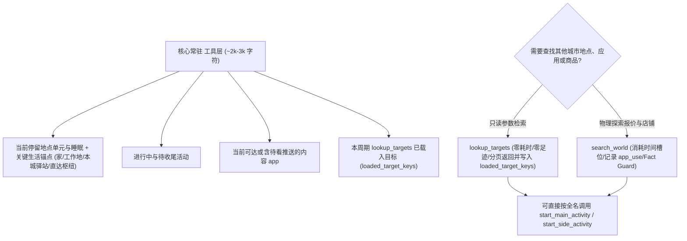
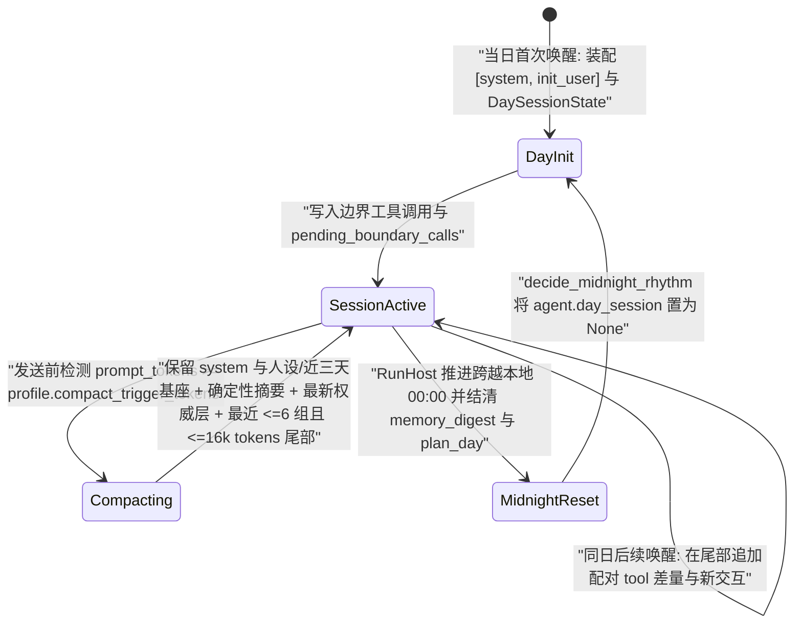
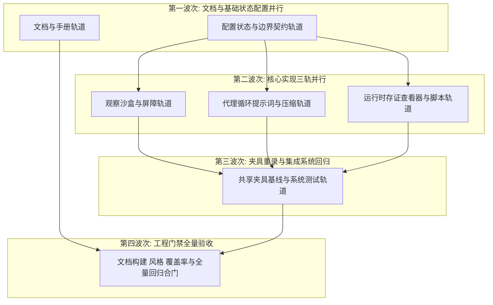

# 日会话连续上下文、Tool Search 与 Prefix Cache 工程规格说明

> 上游提案：[PROPOSAL.md](PROPOSAL.md)
> 工程守则：[AGENTS.md](../../../AGENTS.md)
> 基线提交：`28e7660c`
> 文档状态：冻结规格（供多轨道并行实施与合门验收使用）

## 1. 架构总览、版本常数与退场清单

本规格严格执行 [PROPOSAL.md](PROPOSAL.md) 建立的**「日会话连续追加流 + 顶层门禁解耦与按需目标检索 + 水位与零点双触发上下文控制」**架构，替换现行跨唤醒整页重建、沙盒整层回传、`can_finish_idle` 纯文本退出及商品轮转窗口。所有实施必须遵守以下刚性不变量：

- **零向后兼容**：不保留旧格式分支、双写逻辑、降级开关或历史兼容别名；过时模块、字段、配置键与测试随本批改造一并删除。
- **概念命名全流程一致**：统一使用**七层**（`系统层`、`人设层`、`记忆层`、`待办层`、`工具层`、`环境层`、`进度层`）、**主槽位**与**副槽位**、**日会话**（`DaySessionState`）、**唤醒会话**（`wakeup_id`）、**核心常驻工具层**、**顶层门禁**（`工具层.gate`）、**日内 Compaction**、**跨日重置**、**运行查看器**与 **Fact Guard**；禁止在代码、文档或测试中混用退场术语或自造缩写。
- **消息前缀与角色序列刚性不变量**：同一人物在同一本地日内的 `DaySessionState.messages` 严格维持 `[system, init_user, assistant, tool, ...]` 形态；全天除 `messages[1]` 之外**严禁插入第二条 `role: "user"` 消息**；跨轮 `tools` 列表与 `thinking` 配置在日会话生命周期内保持字节恒定，严禁在末轮或重试时删减工具或关闭思考。
- **`FOUNDATION` 导入边界与门面签名保护**：新建状态模块 `src/worldmock/state/decisions/day_session.py` 与 [models.py](../../../src/worldmock/configuration/inputs/models.py) 必须保持在 [test_import_graph.py](../../../tests/unit/engineering/test_import_graph.py) 的 `FOUNDATION` 边界内，仅可导入 `FOUNDATION` 内模块（`foundation.*`、`state.*` 等）与标准库，且不得引入未在 `DELAYED_IMPORTS` 中登记的局部导入；`worldmock.agents` 严禁反向导入 `simulation_engine` 或 `runtime`；[engine.py](../../../src/worldmock/simulation_engine/engine.py) 中 `LifeEngine` 全部公开方法名与参数列表保持与 [test_engine_facade_boundary.py](../../../tests/unit/engineering/test_engine_facade_boundary.py) `_SYNC_FACADE_METHODS` 完全一致。
- **异常边界统一**：协议违反、回合预算耗尽与沙盒契约破坏统一抛出 `ProtocolError`；持久化数据或清单不一致抛出 `IntegrityError`；可恢复领域规则拒绝抛出 `BusinessRuleError`（均继承自 [errors.py](../../../src/worldmock/foundation/errors.py) 中的 `WorldMockError`）。

### 1.1 冻结版本常数总表

| 版本常数或字段 | 所属模块与位置 | 基线版本 | 冻结版本 | 变更说明 |
| --- | --- | --- | --- | --- |
| `RunConfig.schema_version` | [models.py](../../../src/worldmock/configuration/inputs/models.py) | `Literal[3]` | `Literal[4]` | 移除商品轮转三项配置键；`ModelProfileConfig` 新增 `compact_trigger_tokens` 与 `prompt_cache_key` |
| `WORLD_SCHEMA_VERSION` | [world.py](../../../src/worldmock/state/world/world.py) | `17` | `18` | 删除 `WorldState.presentation_state`；`AgentState` 新增 `day_session: DaySessionState \| None` |
| `RUN_MANIFEST_SCHEMA_VERSION` | [identity.py](../../../src/worldmock/state/identity.py) | `8` | `9` | `StageProfileIdentity` 冻结新增 `compact_trigger_tokens` 与 `prompt_cache_key`；更新提示与工具指纹 |
| `EXPORT_SCHEMA_VERSION` | [export.py](../../../src/worldmock/recording_engine/export/export.py) | `9` | `10` | 导出清单与报告对接日会话上下文、Compaction 证据及缓存令牌明细 |
| `build_quality_report` `schema_version` | [quality.py](../../../src/worldmock/recording_engine/reports/quality.py) | `11` | `12` | 适配日会话调用分类、`cached_input_tokens` / `uncached_input_tokens` / `cache_hit_ratio` 与 Compaction 统计 |
| `RULES_VERSION` | [constants.py](../../../src/worldmock/exchange_engine/definitions/constants.py) | `7` | `7`（不变） | 交换规则与目录结构未变，确保既有环境目录包与目录资产无需重建即可继续使用 |
| `CatalogManifest.format_version` | [models.py](../../../src/worldmock/resource_engine/catalog/models.py) | `Literal[7]` | `Literal[7]`（不变） | 目录声明格式保持不变 |
| `PersonaConfig.schema_version` | [models.py](../../../src/worldmock/configuration/inputs/models.py) | `Literal[3]` | `Literal[3]`（不变） | `personas/*.toml` 字段与校验不变 |

### 1.2 退场模块、字段与机制清单

| 类别 | 退场对象与位置 | 处置方式 | 替代归宿或说明 |
| --- | --- | --- | --- |
| 商品轮转与呈递模块 | [rotation.py](../../../src/worldmock/simulation_engine/observation/targets/rotation.py)、[presentation.py](../../../src/worldmock/simulation_engine/observation/targets/presentation.py)、[test_rotation.py](../../../tests/unit/life/test_rotation.py) | 彻底删除 | 由核心常驻 `工具层`、`lookup_targets` 与 `search_world` 替代 |
| 商品呈递状态字段 | `WorldState.presentation_state`（[world.py](../../../src/worldmock/state/world/world.py)）、`AgentWakeupInput.pending_presentation` 与 `SandboxOutcome.pending_presentation`（[barrier.py](../../../src/worldmock/state/decisions/barrier.py)）、`ObservationBuilder._product_window`（[observe.py](../../../src/worldmock/simulation_engine/observation/layers/observe.py)） | 彻底删除 | 移除每轮 20 项 `product:purchase` 窗口及状态传递 |
| 商品轮转配置字段 | `RunConfig.candidate_presentation_limit`、`RunConfig.rotation_quota_ratio`、`RunConfig.rotation_stale_seconds`（[models.py](../../../src/worldmock/configuration/inputs/models.py)） | 彻底删除 | `config.toml` 中出现上述字段直接以 `RUN_CONFIG_INVALID` 拒绝 |
| 记忆 `14k` 硬回填机制 | `MEMORY_BACKSTOP_CHARS`、`MEMORY_LAYER_CHARS`、`require_budget`、`_backstop`、`_blank`、`_merge_hours`（[layout.py](../../../src/worldmock/simulation_engine/observation/memory/layout.py) 与 [memory_layer.py](../../../src/worldmock/simulation_engine/observation/layers/memory_layer.py)）、`记忆层.今天` 中的 `_COUNT_LINE` 生成逻辑（[prompt_schemas.py](../../../src/worldmock/agents/prompt/prompt_schemas.py)） | 彻底删除 | 由日内阈值 Compaction 与跨日重置管理记忆与上下文预算，避免单日长序列在 `require_budget` 触发误杀；同步从 [test_single_source.py](../../../tests/unit/engineering/test_single_source.py) `OWNERS` 与 [dataset_acceptance.py](../../../tests/dataset_acceptance.py) 移除 `MEMORY_BACKSTOP_CHARS`、`MEMORY_LAYER_CHARS`、`require_budget` 及关联变异 |
| 纯文本空闲退出 | `SandboxHandle.can_finish_idle`（[engine_handle.py](../../../src/worldmock/agents/protocol/engine_handle.py)）、`AgentSandbox.can_finish_idle` 与 `_keep_agent_ready`（[sandbox.py](../../../src/worldmock/simulation_engine/decisions/sandbox.py)）、`LoopCallbacks.can_finish_without_calls`（[agent_loop.py](../../../src/worldmock/agents/protocol/agent_loop.py)） | 彻底删除 | 统一改为必须调用 `continue_activity` 或开始/搜索边界工具结束唤醒 |
| 末轮缩工具与关思考重试 | `_life_turn_tools` 末轮/重试删减逻辑（[life_agent.py](../../../src/worldmock/agents/life_agent.py)）、`_search_turn_tools` 末轮/重试删减逻辑（[search_session.py](../../../src/worldmock/agents/search/search_session.py)）、`RETRY_THINKING`（[truncation.py](../../../src/worldmock/state/model/truncation.py) 连同该过时模块一并删除）及 `retry_due`/`thinking_enabled`/`with_feedback` 插入 `role: "user"` 消息（[life_truncation.py](../../../src/worldmock/agents/protocol/life_truncation.py)） | 彻底删除 | 全程下发恒定工具列表并保留 `allow_thinking and profile.thinking`；纠错仅通过配对 `role: "tool"` 或无消息前缀变更的在轨重试完成 |
| 挂起层快照铺平载体 | `SuspendedLoopState.base_layers` 与 `SuspendedLoopState.messages`（[suspended.py](../../../src/worldmock/state/decisions/suspended.py)） | 彻底删除 | 对话流归属 `AgentState.day_session.messages`；差量基准归属 `DaySessionState.last_observed_layers` |

---

## 2. 配置、模型档案与状态结构契约

### 2.1 `RunConfig`、`ModelProfileConfig` 与 `StageProfileIdentity`

在 [models.py](../../../src/worldmock/configuration/inputs/models.py) 与 [identity.py](../../../src/worldmock/state/identity.py) 中按如下契约更新模型类（`InputModel` 维持 `extra="forbid", frozen=True, strict=True`）：

| 模型类 | 字段名 | 精确类型与校验规则 | 说明 |
| --- | --- | --- | --- |
| `RunConfig` | `schema_version` | `Literal[4]` | 拒绝 `schema_version != 4`（含旧版 `3`） |
| `RunConfig` | 保留运行字段 | `seed`、`timezone`、`start_time`、`stop_time`、`activity_feedback_seconds`、`reconsideration_interval_seconds`、`progress_report_interval_seconds`、`calendar`、`models`、`model_routing` | 彻底移除 `candidate_presentation_limit`、`rotation_quota_ratio`、`rotation_stale_seconds` |
| `ModelProfileConfig` | `compact_trigger_tokens` | `int = Field(default=80000, ge=16384)` | 日内 Compaction 触发阈值；`validate_compact_trigger` 校验严格满足 `compact_trigger_tokens < int(context_window * 0.85)` |
| `ModelProfileConfig` | `prompt_cache_key` | `bool = False` | 显式布尔开关；`strict=True` 下仅接受布尔值 |
| `StageProfileIdentity` | `compact_trigger_tokens` | `int = Field(strict=True, ge=16384)` | 与 `ModelProfileConfig` 同步冻结，校验 `compact_trigger_tokens < int(context_window * 0.85)` |
| `StageProfileIdentity` | `prompt_cache_key` | `StrictBool = False` | 与 `ModelProfileConfig` 同步冻结，由 [setup.py](../../../src/worldmock/runtime/framework/setup.py) 与 [world_setup.py](../../../src/worldmock/simulation_engine/world/world_setup.py) 透传并核验一致 |

- **错误映射一致性**：`compact_trigger_tokens` 校验失败时在 Pydantic `@model_validator(mode="after")` 抛出 `ValueError("compact_trigger_tokens must be strictly less than int(context_window * 0.85)")`，由 [environment.py](../../../src/worldmock/configuration/inputs/environment.py) 统一包装为 `EnvironmentInputError("config.toml", "RUN_CONFIG_INVALID", reason)`；严禁将 `api_key_env` 凭据值写入清单或日志。
- **`ModelClient` 六键契约保持不变**：[model_client.py](../../../src/worldmock/configuration/model/model_client.py) 的 `REQUEST_KEYS` 仍严格保持为 `("model", "messages", "tools", "tool_choice", "max_tokens", "extra_body")`。当 `resolved.profile.prompt_cache_key` 为 `True` 时，仅主循环 `action` 请求在 `extra_body` 字典内注入 `"prompt_cache_key": f"{run_id}:a{agent_id}:{local_date}"`（与 `"thinking"` 并存于 `extra_body` 中）；`prompt_cache_key` 为 `False` 时不在 `extra_body` 写入该键。后台 `plan_day`、`memory_digest` 与搜索子会话 `search_session` 不注入 `prompt_cache_key`。

### 2.2 `DaySessionState`、`AgentState`、`WorldState` 与屏障边界 DTO

新建 `src/worldmock/state/decisions/day_session.py`（归属 `FOUNDATION`），定义不可变状态模型 `DaySessionState(StateModel)`（继承 `StateModel` 的 `FrozenModel` 配置而不对容器字段启用 `strict=True`，确保 `WorldState.model_validate(state.model_dump(mode="json"))` 与 `canonical_json` 往返无损；并在 `day_session.py` 导出 `FIVE_LAYER_KEYS` 供 [observe.py](../../../src/worldmock/simulation_engine/observation/layers/observe.py) 复用，避免触发 [test_single_source.py](../../../tests/unit/engineering/test_single_source.py) 规则表克隆门禁）并在 [agent.py](../../../src/worldmock/state/world/agent.py) 的 `AgentState` 中持有：

| 字段或类 | 精确类型与默认 | 约束与校验规则 | 归属与生命周期 |
| --- | --- | --- | --- |
| `DaySessionState.local_date` | `str` (`pattern=r"^\d{4}-\d{2}-\d{2}$"`) | 规范 ISO 日期；跨午夜重置时销毁旧对象 | 绑定当前日会话对应的本地日期 |
| `DaySessionState.system_prompt` | `str` (`min_length=1`) | 日会话建立时固化的 `系统层` 紧凑 JSON | 日内恒定不变，供 Compaction 原样复用 |
| `DaySessionState.tools_digest` | `str` (`pattern=r"^[a-f0-9]{64}$"`) | 等于当前 `life_tool_schema_sha256()` | 恢复或复用会话时核验工具定义一致性 |
| `DaySessionState.messages` | `tuple[dict[str, Any], ...]` | 长度至少为 `2`；`messages[0]["role"] == "system"` 且 `messages[1]["role"] == "user"`；索引 `>= 2` 严禁出现 `role == "user"` | 日内连续消息序列，包含 Compaction 重建后的基底与保留尾部 |
| `DaySessionState.pending_boundary_calls` | `tuple[str, ...] = ()` | 非空白去重字符串；若非空则 `messages[-1]["role"] == "assistant"` 且包含对应的 `tool_calls` ID（`start_main_activity` + `start_side_activity` 成组退出时含两个 ID） | 上一次唤醒退出时挂起的边界工具 `tool_call_id` 序列，等待下次唤醒或搜索恢复按序以 `role: "tool"` 回填 |
| `DaySessionState.last_observed_layers` | `dict[str, Any]` (`default_factory=dict`) | 仅允许包含 `FIVE_LAYER_KEYS = {"tool_layer", "todo_layer", "environment_layer", "memory_layer", "progress_layer"}` 的纯字典快照；由 `AgentSandbox` 维护已交付给模型的基准（仅在初始化、`lookup_targets`、非终结 `dispatch_world_tool` 与 Compaction 时更新，终结边界工具不覆盖） | 上次已交付给模型且生效的五层基准，专供跨唤醒 `layer_changes` 与搜索恢复差量计算 |
| `DaySessionState.loaded_target_keys` | `tuple[tuple[str, str], ...] = ()` | 每项为 `(kind, object_id)`，其中 `kind in {"location", "app", "product"}` | 本轮或本段日内通过 `lookup_targets` 懒加载进入 `工具层` 的目标键集合；Compaction 时清零为 `()` |
| `DaySessionState.compaction_count` | `int = Field(default=0, ge=0)` | 非负整数 | 本本地日内已触发 Compaction 的次数 |
| `DaySessionState.compacted_through_seq` | `int = Field(default=0, ge=0)` | 非负整数 | 最近一次 Compaction 折叠覆盖的最大已提交 `event_seq` |
| `DaySessionState.last_prompt_tokens` | `int \| None = Field(default=None, ge=0)` | 非负整数或 `None` | 上一次模型调用观测到的输入令牌数（仅用于估算与诊断参考） |
| `AgentState.day_session` | `DaySessionState \| None = None` | 在 `WorldState` 序列化与检查点中完整保存 | 初建为 `None`；日内首次唤醒提交后赋值；午夜零点重置与反事实干预时置为 `None` |

- **跨轨道边界 DTO 变更（[barrier.py](../../../src/worldmock/state/decisions/barrier.py) 与 [suspended.py](../../../src/worldmock/state/decisions/suspended.py)）**：
  - `SuspendedLoopState`：删除 `base_layers` 与 `messages` 字段，仅保留 `wakeup_id`、`action_id`、`activity_id`、`pending_tool_call_id`、`turn_used`、`memory_search_count`、`accepted_action_ids`、`pending_memories`、`verified_experiences`、`local_rejection_counts`、`observation_event_id`、`observation_parts`、`suspended_at`。
  - `AgentWakeupInput`：删除 `pending_presentation`；新增 `run_id: str`、`local_date: str`、`day_session: DaySessionState | None = None`、`boundary_delta_payload: dict[str, Any] | None = None`、`settled_day_events: tuple[dict[str, Any], ...] = ()`（由 `BarrierMerger._build_wakeup` 从只读存储预先装配好当日已提交事件与环境差量，保证 `worldmock.agents` 不导入 `recording_engine` 或 `simulation_engine`）。
  - `ToolDispatchResult`：新增 `activity_id: str | None = None`（用于向 `_WakeupRunner` 传递挂起搜索的活动标识，不再将该敏感标识混入面向模型的 `tool_message_payload`）。
  - `SandboxOutcome`：删除 `pending_presentation`；新增 `day_session: DaySessionState` 与 `compaction_records: tuple[dict[str, Any], ...] = ()`（用于在屏障原子提交阶段写入 `day_session_compacted` 证据与运维日志）。

---

## 3. 统一边界收尾（`continue_activity`）与 `role: "tool"` 环境差量契约

### 3.1 完整日会话跨唤醒消息时序

```mermaid
sequenceDiagram
    participant Host as 运行宿主与时钟屏障
    participant Merger as BarrierMerger
    participant Runner as LifeAgent与AgentLoop
    participant Sandbox as AgentSandbox

    Host->>Merger: prepare_barrier(ready_agent_ids)
    alt 当日首次唤醒 (day_session 为 None)
        Merger-->>Runner: AgentWakeupInput(day_session=None, observation=初始全量观察)
        Runner->>Runner: 初始化 messages = [system, init_user(六层全量)]
    else 同日后续唤醒或搜索恢复 (day_session 非 None)
        Merger->>Merger: 基于 day_session.last_observed_layers 与当前观察计算 boundary_delta_payload 或 search_result_payload
        Merger-->>Runner: AgentWakeupInput(day_session=历史会话, delta=差量载荷)
        Runner->>Runner: 在 messages 末尾按 pending_boundary_calls 追加配对 role="tool" 差量消息
    end
    loop 唤醒内推理回合
        Runner->>Runner: 校验 compact_trigger_tokens 水位; 达标则执行日内 Compaction
        Runner->>Runner: 发送固定 tools(11个) 与恒定 thinking 请求至 ModelClient
        alt 只读查询 (search_memory / recall_task_summary / lookup_targets)
            Runner->>Sandbox: 执行零耗时查询并更新 loaded_target_keys
            Sandbox-->>Runner: 返回紧凑查询载荷
            Runner->>Runner: 追加 (assistant, tool) 并继续当前唤醒
        else 控制工具或业务拒绝 (report_status / pause_activity / conclude_activity / revise_day_plan)
            Runner->>Sandbox: 在沙盒执行状态更新或拒绝脉冲并计算 layer_changes
            Sandbox-->>Runner: 返回 ToolDispatchResult(terminal_exit=False)
            Runner->>Runner: 追加 (assistant, tool) 并继续当前唤醒
        else 边界退出工具 (start_main_activity / start_side_activity / search_world / continue_activity)
            Runner->>Sandbox: 沙盒受理并标记 terminal_exit=True 或 suspended=True
            Runner->>Runner: 将本次 assistant(含 boundary tool_calls) 保留在 messages 末尾并记录 pending_boundary_calls
            Runner->>Sandbox: finish_wakeup(suspended, updated_day_session, compaction_records)
        end
    end
    Host->>Merger: commit_barrier(outcomes) 原子写入 WorldState.agents[id].day_session 与事件草稿
```

### 3.2 `continue_activity` 严格契约与 `TodayEntry` 静默过滤

- **工具请求模型（[requests.py](../../../src/worldmock/state/interaction/requests.py)）**：新增 `ContinueActivityRequest(ToolRequestModel)`，纳入 `ActionRequest` 联合类型与 `REQUEST_MODELS["continue_activity"]`（同时更新 `life_action_tool_names()`、`life_tool_schema_sha256()`、`TOOL_DESCRIPTIONS["continue_activity"]` 并遵守 [test_tool_description_references.py](../../../tests/unit/agent_protocol/test_tool_description_references.py) 单句纯中文用途校验，同步更新 [actions.py](../../../src/worldmock/state/interaction/actions.py) 边界集合 `BOUNDARY_TOOLS = (*START_TOOLS, SEARCH_TOOL, "continue_activity")`）：
  - 字段：`reason: str | None`（严禁声明默认值，满足 `deepseek_strict_schema`；参数描述不得含未放行拉丁字母单词或规则词）。
  - 校验器：`@field_validator("reason")` 规定当 `reason` 非 `None` 时，`stripped = value.strip()` 必须满足 `1 <= len(stripped) <= 200` 且返回 `stripped`。
- **批次与准入规则（[life_agent.py](../../../src/worldmock/agents/life_agent.py)、[dispatcher.py](../../../src/worldmock/simulation_engine/actions/dispatcher.py)、[sandbox.py](../../../src/worldmock/simulation_engine/decisions/sandbox.py)）**：
  - `validate_life_batch` 允许单次调用 `continue_activity` 作为唯一世界动作退出，**禁止**将 `continue_activity` 与 `START_TOOLS`、`search_world`、`CONTROL_TOOLS` 或只读查询混批。
  - `ActionHandlers` / `AgentSandbox` 受理 `continue_activity` 时按顺序执行两项前置检查：
    - 若存在任何待收尾活动（`activity_control.pending_conclusions(open_activities)` 非空），拒绝并抛出 `activity_control.conclusion_required(waiting, names)`（错误码 `ACTIVITY_CONCLUSION_REQUIRED`）。
    - 若当前没有任何进行中活动（`not active_activities(state, agent_id)`），拒绝并抛出 `Refusal("ACTIVITY_PRECONDITION_UNMET", ...)`（错误码 `ACTIVITY_PRECONDITION_UNMET`，提示人物必须先开启一项活动或使用其他行动，禁止在无进行中活动时推进空转）。
  - 受理后不改变任何活动槽位与身体资源状态，记录 `action_requested`、`action_accepted` 与 `action_result`（`status="completed"`，`data` 写明当前维持中的活动标识清单 `activity_ids` 与可选 `reason`）；`ToolDispatchResult` 返回 `accepted=True, terminal_exit=True, suspended=False`。
  - **彻底废除 `can_finish_idle`**：移除 `SandboxHandle.can_finish_idle`、`AgentSandbox.can_finish_idle`、`LoopCallbacks.can_finish_without_calls` 与 `AgentSandbox._keep_agent_ready`。`AgentLoop._validate_reply` 在 `calls` 为空时一律视为协议错误并触发纠偏，不再允许纯文本响应直接结束唤醒。
- **`entries.py` 对静默 `continue_activity` 的 `TodayEntry` 过滤规则**：
  - 在 [entries.py](../../../src/worldmock/simulation_engine/observation/memory/entries.py) 中，将 `AgentEvents.entries` 类型更新为 `dict[tuple[str, str], TodayEntry | None]`，将 `build_entry(...) -> TodayEntry | None` 的返回类型允许为 `None`；在 [days.py](../../../src/worldmock/simulation_engine/observation/memory/days.py) `_wakeup_entries` 中仅将非 `None` 条目加入返回列表，同时**照常推进窗口下界** `lower = max(commit.commit, bound)` 与 `PublishedToday.published`。
  - 当一次唤醒提交窗口 `(lower, commit]` 中**全部**已受理请求仅为 `continue_activity`（无 `START_TOOLS`、`SEARCH_TOOL`、`CONTROL_TOOLS`、被拒请求及 `revise_day_plan`）、窗口内 `_settled_drafts(scope)` 为空（无已结算活动结束、购买、送达或办成事件），且请求中 `reason is None` 且 `self_note is None` 时，视作**静默维持**，`build_entry` 直接返回 `None`（并缓存 `cached.entries[(commit.wakeup_id, day)] = None`），不生成空洞噪声明细，也不触发空 `核验`/`自述` 违规。
  - 若 `continue_activity` 携带了非空 `reason`（而无其他核验或 `self_note`），在 `SELF_RANKS` 中新增 `"continue": 2`，`_notes` 为受理的 `continue_activity` 产出一项 `_Note(kind="continue", text=reason, ..., activity_id=primary_activity_id)`（取 `result.data["data"]["activity_ids"][0]`），`_item` 渲染为 `f"续行：{note.text}"`；同步在 [categories.py](../../../src/worldmock/simulation_engine/observation/memory/categories.py) `request_category` 中为 `"continue_activity"` 按 `result.data["data"]["activity_ids"][0]` 推导主活动类别，并将该活动标识纳入 `entries.py` `_assemble` 的 `involved` 集合，确保 `facts.categories` 完整且生成合法 `TodayEntry`；若唤醒内混有前序已结算事实、被拒请求、控制动作或 `self_note`，则按既有规则正常归并写入 `TodayEntry`。

### 3.3 `role: "tool"` 增量载荷契约与 `ObservationBuilder.layer_changes`

- **跨唤醒与搜索恢复 `role: "tool"` 统一载荷形状**（经 `render_layer_json` 与 `compact_render` 压缩及黑名单检验后写入 `tool.content`）：

```json
{
  "ok": true,
  "result": { "...": "上一边界工具的结算回执或搜索终局摘要" },
  "boundary": {
    "observed_at": "2026-10-19T13:45:00+08:00",
    "wake_reasons": ["activity_completed"],
    "events": ["午休小睡结束"]
  },
  "changes": {
    "环境层": { "observed_at": "2026-10-19T13:45:00+08:00", "body": { "sleepiness": "清醒" } },
    "记忆层": { "今天_append": [{ "时刻": "12:15", "类别": "生活", "核验": ["午休小睡…"] }] },
    "待办层": { "day_plan": { "date": "2026-10-19", "goals": [] } },
    "进度层": { "events": [] },
    "工具层": {
      "gate": { "main_slot_busy": false, "side_slot_busy": false, "sleeping": false, "in_transit": false, "pending_conclusions": ["午休小睡"] },
      "group_deltas": { "updated": [{ "name": "工作", "kind": "activity", "phase": "进行中", "tools": ["..."] }] }
    }
  }
}
```

- **载荷构造方法与键名映射**：
  - `boundary` 对象仅在**跨唤醒边界增量**（`mode == "regular"` 且 `day_session` 非 `None`）及**搜索恢复边界增量**（`mode == "resume_search"`）中出现，由 `BarrierMerger` 装配 `observed_at`（ISO 8601 本地时刻）、`wake_reasons`（来自当前观察 `wake_reasons`）及 `events`（与本轮推进相关的简短结算描述）；在 `mode == "regular"` 下，`boundary_delta_payload["result"]` 固定构造为 `{"status": "settled", "observed_at": observed_at}`。当上一次唤醒以 `start_main_activity` + `start_side_activity` 成组退出（`len(pending_boundary_calls) == 2`）时，`_WakeupRunner` 按序为每个挂起 `tool_call_id` 追加一条 `role: "tool"` 消息：前一条仅携带 `{"ok": true, "result": {"status": "settled", "observed_at": observed_at}}`，最后一条携带完整 `boundary_delta_payload`（含 `"boundary"` 与 `"changes"`），避免在两条消息间重复发送环境差量。唤醒**内部**只读或控制工具调用（`AgentSandbox._dispatch_result`）保持 `{"ok": true, "result": ..., "changes": ...}`（可选附 `"events": []`）而无时间推进。
  - **严格黑名单零泄漏**：`ToolDispatchResult.tool_message_payload`、`boundary_delta_payload` 与 `search_result_payload` **严禁**包含 `activity_id` 或 [narration.py](../../../src/worldmock/agents/prompt/narration.py) `FORBIDDEN_OBSERVATION_KEYS` 中的任何键；`AgentLoop` 在 `LoopConfig` 中接收 `render_tool_content: Callable[[Mapping[str, Any]], str]`（`LifeAgent` 传入 `render_layer_json`，而 `SearchSessionRunner` 保留无观察黑名单的紧凑 JSON 序列化以允许搜索子会话使用 `goods_id` 与 `location_id`）。
  - **修复 `_resume_search_payload` 铺平五层缺陷（[merger.py](../../../src/worldmock/simulation_engine/decisions/merger.py)）**：删除 `{key: value for row in loop.base_layers ...}`。改为直接以 `day_session.last_observed_layers` 作为 `before` 基准调用 `ObservationBuilder.layer_changes(day_session.last_observed_layers, obs)`，生成 `{"ok": true, "result": public_result(...), "search": search_details(...), "boundary": ..., "changes": ...}`。若搜索跨越本地零点在 `D+1` 完成恢复（此时 `decide_midnight_rhythm` 已将 `day_session` 重置为 `None`），`_WakeupRunner._init_context` 以当日纯净 `[system, init_user]` 启动新日会话（`进度层` 已直接包含本次完成的搜索结果），不追加孤立的 `role: "tool"` 消息。
- **`ObservationBuilder.layer_changes(before, after)` 精细子键级差量契约（[observe.py](../../../src/worldmock/simulation_engine/observation/layers/observe.py)）**：
  - 将内部观察键 `("environment_layer", "memory_layer", "todo_layer", "progress_layer", "tool_layer")` 对应映射为公开层键 `("环境层", "记忆层", "待办层", "进度层", "工具层")`，仅输出实质发生变化的层键（全等层完全省略）。
  - **`环境层`**：逐键比较 `("observed_at", "body", "location", "weather", "duty", "tomorrow")`，仅写入变化字段；其中 `"body"` 进一步仅输出发生分级变化的体感子键（`appetite`、`sleepiness`、`relaxation`、`social`）。
  - **`记忆层`**：逐键比较 `"可查"`、`"近三天"`；对 `"今天"`，若 `before_today` 是 `after_today` 的严格前缀，仅输出 `"今天_append": deepcopy(after_today[len(before_today):])`；若仅尾部因同日搜索恢复归并发生覆写（公共前缀长度为 `k > 0`），仅输出 `"今天_tail": {"from_index": k, "entries": deepcopy(after_today[k:])}`；其余情况输出 `"今天"`。
  - **`待办层`**：逐键比较 `("paused_activities", "errands", "orders", "day_plan")`，仅输出变化的子键。
  - **`进度层`**：逐键比较 `("session_started_at", "events", "rejected_today")`；其中 `"events"` 与 `"rejected_today"` 在满足严格前缀追加时分别输出 `"events_append"` 与 `"rejected_today_append"`，否则仅在变化时输出该子键。
  - **`工具层`**：单独比较 `"gate"` 与 `"callable_index"`（无变化则省略）；对 `"targets"` 按 `(kind, name)` 唯一标识逐项比对，计算 `group_deltas = {"added": [...], "updated": [...], "removed": [{"kind": ..., "name": ...}]}`，由 `layer_changes` 显式调用 [tool_groups.py](../../../src/worldmock/agents/prompt/tool_groups.py) 中的 `compact(...)` 对 `added` 与 `updated` 目标项执行无损字段压缩并省去空列表键（因 `compact_render` 仅匹配包含 `"layer": "工具层"` 与 `"targets"` 的完整工具层字典，不自动压缩 `group_deltas`）；若 `gate`、`group_deltas` 与 `callable_index` 均为空，则完全省略 `"工具层"`。

### 3.4 协议重试与纠偏连续性（禁止插入第二条 `user`）

- **全回合恒定 `tools` 与 `thinking`**：删除 `_life_turn_tools` 与 `_search_turn_tools` 的 `if remaining <= 1 or retry:` 缩减分支；`AgentLoop._turn_request` 使用 `thinking_on = self.config.allow_thinking and self.config.binding.profile.thinking`（不再乘以 `not retry`，同时保留 `allow_thinking=False` 对 `SearchSessionRunner` 的禁用约束）；当 `thinking_on` 为 `True` 时，`tool_choice` 恒定为 `"auto"`（含截断重试回合）；仅当 `thinking_on` 为 `False` 且处于截断重试时，才使用 `tool_choice = "required"`。
- **纠偏消息路由（[agent_loop.py](../../../src/worldmock/agents/protocol/agent_loop.py) 与 [life_truncation.py](../../../src/worldmock/agents/protocol/life_truncation.py)）**：
  - 当模型回复包含结构完整且 `id` 互异的 `tool_calls`（`_pairable_calls(calls)` 为 `True` 且非 `truncated(raw)`）但发生参数校验、批次形状、看法主体或业务规则拒绝时，**无论 `thinking` 开启与否**，一律追加 `_response_assistant_message(raw)` 与配对的 `role: "tool"` 纠偏消息（将 `{**feedback.report.payload(), "instruction": FEEDBACK_INSTRUCTION}` 字典传入 `render_tool_content` 渲染），并将 `last_truncated` 置为 `False`。
  - 当模型回复为纯文本无工具调用、`choices` 为空或输出截断（`finish_reason == "length"` 且无 `tool_calls`）时，**严禁调用 `with_feedback` 向 `history` 追加或替换 `role: "user"` 消息**。`AgentLoop` 将该次异常记入 `model_response` 证据与 `protocol_feedback` 后保持 `history` 停留在上一个合法边界不变（完整保留前缀缓存），通过循环内局部状态 `last_truncated = truncated(raw)` 标记下一回合的 `retry` 状态（非截断异常回复置 `False`）并继续重发至多至 `max_turns`；耗尽回合预算仍未产生合法工具调用时抛出 `ProtocolError(self.config.exhausted_message)`。

---

## 4. 顶层 `gate` 解耦、常驻 `工具层` 瘦身与零耗时 `lookup_targets`

### 4.1 顶层 `工具层.gate` 契约与目标行前条件分离

在 [tool_layer.py](../../../src/worldmock/simulation_engine/observation/targets/tool_layer.py)、[tool_groups.py](../../../src/worldmock/agents/prompt/tool_groups.py) 与 [prompt_schemas.py](../../../src/worldmock/agents/prompt/prompt_schemas.py) 中落地以下结构：

```json
{
  "layer": "工具层",
  "gate": {
    "main_slot_busy": false,
    "side_slot_busy": false,
    "sleeping": false,
    "in_transit": false,
    "pending_conclusions": []
  },
  "groups": [ ... ],
  "callable_index": { "goods": [ ... ], "prefer_apps": [ ... ] }
}
```

- **`gate` 五键准确定义**：
  - `main_slot_busy: bool`：主槽位（`"first"`）是否被进行中或待收尾活动占用。
  - `side_slot_busy: bool`：副槽位（`"second"`）是否被进行中或待收尾活动占用。
  - `sleeping: bool`：人物当前是否处于进行中的 `ActivityKind.SLEEP` 活动。
  - `in_transit: bool`：人物当前是否处于出行在途会话（`admission.present_location(state, agent_id) is None`）。
  - `pending_conclusions: list[str]`：当前必须先调用 `conclude_activity` 收尾的活动显示名称列表（按 `open_activities` 排序投影）。
- **Schema 与紧凑分组适配**：
  - `TOOL_LAYER_SCHEMA` 与 `COMPACT_TOOL_LAYER_SCHEMA` 新增必填字段 `"gate": _GATE`（封闭对象，禁止额外键）。
  - `compact_tool_layer` 与 `expand_tool_layer` 必须无损保留并深拷贝 `"gate"` 键（`compact_tool_layer` 按 `("layer", "gate", "groups", "callable_index")` 键序返回，`expand_tool_layer` 按 `("layer", "gate", "targets", "callable_index")` 键序返回）。
- **`refusal_for` 行级解耦**：
  - [admission.py](../../../src/worldmock/simulation_engine/actions/admission.py) 抽出 `intrinsic_refusal(context: Context, call: Call) -> Refusal | None`（仅执行 `_main_refusal`、` _side_refusal` 与 `_funds_refusal`，跳过 `_slots_refusal` 与 `_sleep_refusal`），`group_refusal` 仍保留全套全局检查供 `StartGroups` 与 `search_refusal` 使用。
  - [tool_layer.py](../../../src/worldmock/simulation_engine/observation/targets/tool_layer.py) 在为 `START_TOOLS`（`location` / `app` / `product`）计算行级 `available` 与 `reason` 时，跳过 `pending_conclusions` 并改调 `admission.intrinsic_refusal`（全局门禁由顶层 `工具层.gate` 统一宣告，并在实际调用 `AgentSandbox.dispatch_world_tool` 时由 `admission.group_refusal` 与 `StartGroups` 照常严格拒绝）；行级 `available`/`reason` 仅反映目标自身固有条件（地点营业时段、直达路线与通行方式、前置状态/票证、内容应用可用条件、在途对原地动作约束、账户余额不足）。
  - `ObservationBuilder.sandbox_layers` 接收 `loaded_target_keys`，按当前 `state` 与 `loaded_target_keys` 同步重算 `tool_layer`、`todo_layer`、`environment_layer` 与 `activity_bindings`。
  - 活动目标行（`kind == "activity"`）继续保留对单条活动的 `report_status` / `pause_activity` / `conclude_activity` 工具可用性判断。

### 4.2 核心常驻 `工具层` 收录标准与完整目录解析保留



- **核心常驻地点收录过滤器**（`_target_visible(context, row)` 严格收窄规则）：
  - 若 `row["kind"] == "location"`，仅当该地点 `object_id` 满足以下任一条件时收入核心常驻 `工具层`：
    - 人物当前所在地点（`agent.location_id`）。
    - 人物居住地（`inputs.home_location_ids[agent_id]`）或工作地点（`inputs.workplace_location_ids[agent_id]`，非 `None` 时）。
    - 当前所在城市的全部驿站（`location.kind == "parcel_station"` 或目录定义的包裹自提站）及具备跨城直达出边的城市枢纽（`bool(graph.intercity_edges_from(location_id))`）。
    - 从当前地点存在跨城声明直达边的异地枢纽（`destination_id in dict(graph.intercity_edges_from(agent.location_id))`）。
    - 位于本周期 `DaySessionState.loaded_target_keys` 中的地点（`("location", object_id) in loaded_target_keys`）。
- **内容 app 与商品收录规则**：
  - 彻底移除 `_product_window` 每轮 20 项 `product:purchase` 商品滚动窗口；默认核心常驻 `工具层` 不主动列出静态 `product` 项，仅保留在 `loaded_target_keys` 中显式检索过的商品（`("product", object_id)`）与 `callable_index` 汇总计数。
  - 若 `row["kind"] == "app"`：保留当前具备有效内容或含置顶推送（`pinned_push_content(...) is not None`）的内容应用，或位于 `loaded_target_keys` 中的应用（`("app", object_id)`）；其余停用或无内容可播的应用不占常驻篇幅。
- **保留 `catalog_bindings` 供 `name_book` 直呼**：`ObservationBuilder` 继续在观察内部证据中保留完整 `catalog_bindings`，确保人物记忆中已知或刚刚检索到的城市地点、商品与内容应用，即使未常驻在核心 `工具层` 中，依然可以通过完整名称直接调用 `start_main_activity` 或 `start_side_activity` 并由 `name_resolution.py` 精确解析。

### 4.3 零耗时只读工具 `lookup_targets` 严格契约

- **请求模型（[requests.py](../../../src/worldmock/state/interaction/requests.py)）**：新增 `LookupTargetsRequest(ToolRequestModel)` 并注册进 `QUERY_MODELS["lookup_targets"]`（与 `search_memory` 同属 `_QUERY_TOOLS`，`TOOL_DESCRIPTIONS["lookup_targets"]` 与参数描述须满足 [test_tool_description_references.py](../../../tests/unit/agent_protocol/test_tool_description_references.py) 单句纯中文用途校验）：
  - `kind: Literal["location", "app", "product"] | None`（无默认值）。
  - `keyword: str | None`（无默认值；非 `None` 时去除首尾空白后长度必须为 `1..100`）。
  - `limit: int`（无默认值；`@field_validator` 校验 `1 <= limit <= 30`）。
  - `offset: int`（无默认值；`@field_validator` 校验 `offset >= 0`）。
- **沙盒执行与边界隔离（[engine_handle.py](../../../src/worldmock/agents/protocol/engine_handle.py)、[sandbox.py](../../../src/worldmock/simulation_engine/decisions/sandbox.py)）**：
  - 在 `SandboxHandle` 与 `AgentSandbox` 定义以下同步接口（均遵守每函数至多 `5` 入参）：
    - `lookup_targets(self, request: BaseModel | Mapping[str, Any]) -> dict[str, Any]`：零耗时只读目标检索。
    - `compact_snapshot(self) -> dict[str, Any]`：供日内 Compaction 清空 `self._loaded_target_keys` 后，按沙盒当前 `self._state` 刷新 `todo_layer`、`environment_layer`、`tool_layer`（保留当前 `memory_layer`、`progress_layer` 与 `progress_meta`）、同步更新 `_delivered_layers` 并返回最新五层与 `progress_meta`。
    - `finish_wakeup(self, suspended: SuspendedLoopState | None, day_session: DaySessionState, compaction_records: tuple[dict[str, Any], ...] = ()) -> SandboxOutcome`：封口沙盒，并以沙盒维护的 `self._loaded_target_keys` 与 `_delivered_layers` 补全 `day_session`（`model_copy(update=...)`）后写入 `SandboxOutcome`。
  - **零耗时与零足迹**：不消费活动槽位、不推进模拟时钟、不产生 `action_requested` / `action_result` / `app_use` 事件、不触发 `WorldState` 更改或冲突回滚点清除以外的副作用；允许与 `search_memory`、`recall_task_summary` 同批只读并行调用，禁止与 `START_TOOLS`、`search_world`、`continue_activity` 或 `CONTROL_TOOLS` 混批。
  - **检索范围与排序**：
    - `location`：当前城市全部地点及当前地点一步直达的异地枢纽；优先按当前位置直达可达性与显示名称排序。
    - `app`：目录全部内容应用（`app.role == "content"` 且目录含对应内容）；按应用名称排序。
    - `product`：当前城市在售店铺商品（`discovery.product_bindings(layer)`）；按商品名称排序。
    - `kind is None`：按 `("location", "app", "product")` 顺序合并后匹配 `keyword`（忽略大小写的子串匹配名称、地点/商品类别、动作描述或时段摘要）并分页切片 `[offset : offset + limit]`。
  - **返回载荷与会话载入集更新**：
    - 返回 `{"ok": true, "result": {"total": total, "has_more": offset + len(targets) < total, "next_offset": ..., "targets": [...], "loaded_count": len(targets)}}`，其中 `targets` 元素由 `_binding_target`（叠加行级固有条件求值与 `compact_render` 压缩）构造，**严禁**出现 `location_id`、`app_id`、`goods_id` 等黑名单键。
    - `AgentSandbox` 将本次命中条目的 `(kind, object_id)` 并入内存中的 `self._loaded_target_keys`（有序去重），并刷新沙盒基准观察中的 `tool_layer`，使同唤醒后续行动与下轮差量保持口径一致；`DaySessionState.loaded_target_keys` 随唤醒结束持久化（直至日内 Compaction 或跨日重置清零）。
  - **`search_world` 保持绝对正交**：`search_world` 继续占用副槽位、消耗 `180~420` 秒仿真时间、启动 `SearchSessionRunner` 子会话、执行 `Fact Guard` 白名单核验并记录 `app_use` 数字足迹。

---

## 5. 日内阈值 Compaction、跨日会话重置、检查点恢复与冲突回滚

### 5.1 双触发上下文控制状态机



### 5.2 日内阈值 Compaction 确定性算法（[prompt_capacity.py](../../../src/worldmock/agents/prompt/prompt_capacity.py) 与 [life_agent.py](../../../src/worldmock/agents/life_agent.py)）

- **触发检查时机与 `ProgressBudget` 协同**：
  - 在 `AgentLoop._invoke_turn` 组装本回合请求并调用 `fit_request` 之前，当存在压缩钩子（仅主循环 `LifeAgent` 启用；`SearchSessionRunner` 无跨唤醒历史不启用）且 `len(history) > 2` 时，计量当前草拟请求的 `prompt_tokens = prompt_token_count(request)`。
  - 若 `prompt_tokens >= profile.compact_trigger_tokens`（默认 `80,000`，严格小于 `int(context_window * 0.85)`），立即在内存内执行一次**确定性结构化 Compaction**（零额外 LLM 调用，零外部 I/O）。
  - **`ProgressBudget` 对齐规则**：在日初首轮（`day_session is None`），`_WakeupRunner._init_context` 按 `messages[1]` 构造对应的 `ProgressBudget(layers, meta)`；在同日后续唤醒或 `resume_search`（`day_session is not None`）初始化时，因 `messages[1]` 为早期基底且与新唤醒 `wakeup.observation["progress_meta"]` 不对齐，初始 `budget` 必须置为 `None`（禁止拿新 `progress_meta` 配历史 `messages[1]` 或用 `fit_request` 覆盖已缓存前缀）；每当 Compaction 执行并重建 `messages[1]` 后，压缩钩子必须同步返回新的 `(rebuilt_messages, ProgressBudget(rebuilt_layers, rebuilt_meta))` 供 `AgentLoop` 刷新 `self.budget`；在 [prompt_capacity.py](../../../src/worldmock/agents/prompt/prompt_capacity.py) `_log_capacity_failure` 中，若 `budget is None`，从 `request["messages"][1]` 解析层数组输出分段令牌诊断。
- **原文尾部边界切割**：
  - 将 `history[2:]` 解析为若干完整的 `(assistant, *tool_messages)` 交互组 `G_0, G_1, ..., G_{m-1}`，保证每一组内所有 `tool_call_id` 完整配对，绝不从组中间截断。
  - 自末尾 `G_{m-1}` 向前倒序纳入保留尾部 `tail_groups`，循环条件为：`len(tail_groups) < 6` **且**加入下一组后 `tail_groups` 的总令牌数 `<= 16000`（若最末一组 `G_{m-1}` 自身即超过 `16000` tokens，仍至少保留 `G_{m-1}` 作为最小完整尾部以维持当前唤醒推理链与 `tool_call_id` 合法性）。
  - 若可折叠前序组 `folded_groups = G_0 .. G_{k-1}` 为空（`k == 0`），则跳过 Compaction，直接交由 `fit_request` 执行 `0.85 * context_window` 物理上限护栏。
- **确定性前序摘要与 `messages[1]` 重建**：
  - `messages[0]` 保持 `day_session.system_prompt` 逐字节不变。
  - 调用 `self.sandbox.compact_snapshot()` 重置沙盒 `loaded_target_keys = ()` 并获取最新权威五层基座与 `progress_meta`（`人设层` 保持静态不变；`待办层`、`环境层`、`进度层` 与核心常驻 `工具层` 取最新权威投影）。
  - `记忆层` 保持静态 `"可查"` 与 `"近三天"` 不变，更新 `"今天"` 为当日最新权威 `记忆层.今天` 条目，并依据 `AgentWakeupInput.settled_day_events` 与被折叠的 `记忆层.今天` 条目确定性生成可选结构化 `"折叠摘要"` 键（写入 `MEMORY_LAYER_SCHEMA` 可选字段 `"折叠摘要"`）：
    - `folded_through_seq: int`：本次已折叠覆盖的最大已提交 `event_seq`。
    - `folded_until_clock: str`：已折叠区间最晚事件本地时刻（`HH:MM`）。
    - `completed_activities: list[str]`：当日已结束主/副活动摘要列表（按发生时刻升序）。
    - `places_visited: list[str]`：当日已抵达地点显示名去重列表（按访问先后）。
    - `purchases: list[str]`：当日已完成购买商品与渠道摘要列表。
    - `body_and_balance_notes: list[str]`：当日关键消费、收货与体感状态变化摘要。
    - `open_commitments: list[str]`：当前尚未了结的目标、待办与在途订单摘要。
  - 依 `USER_LAYER_NAMES` 次序重新渲染 `messages[1]`，拼接保留原文尾部 `*tail_messages`，构成合法序列 `[system, rebuilt_user, *tail_messages]`。
- **状态更新与证据落盘**：
  - 更新 `DaySessionState`：`compaction_count += 1`、`compacted_through_seq = folded_through_seq`、`loaded_target_keys = ()`、`last_observed_layers` 对齐重建瞬间的五层权威基座。
  - 记录一条 `compaction_records` 描述符至 `SandboxOutcome`，由 `BarrierMerger.commit_barrier` 在原子事务中写入 `environment_event`（`kind="day_session_compacted"`，`visibility="system"`，`source_kind="environment"`，载荷含 `compaction_count`、`compacted_through_seq`、`before_tokens`、`after_tokens`、`folded_groups`、`kept_tail_groups`）并登记 `ops.log` 级别 `"info"`、代码 `"DAY_SESSION_COMPACTED"`。
  - 重建后交由 `fit_request` 校验 `request_token_count(rebuilt_request) < CONTEXT_THRESHOLD * model_context_length(...)`；若极端单组仍超物理极限，按既有 `_condensation_steps` 对 `进度层` 做最后防线浓缩，仍超限则记录分层明细并抛出 `RuntimeError("model request capacity exceeded")`。

### 5.3 跨日重置、检查点恢复、反事实干预与多人物冲突回滚

- **跨午夜零点重置（[time_advance.py](../../../src/worldmock/simulation_engine/scheduling/clock/time_advance.py) 与 [run_host.py](../../../src/worldmock/runtime/lifecycle/run_host.py)）**：
  - 当 `RunHost._advance` 跨过本地 `00:00` 边界后，先执行 `_settle_midnight_tasks()` 完成前日 `memory_digest` 与今日 `plan_day`，随后 `LifeEngine.decide_midnight_rhythm()` 在推进提交新一天世界状态时将全员 `agent.day_session` 置为 `None`。
  - 防御性跨日核对：在 `BarrierMerger._build_wakeup` 中，若检测到 `agent.day_session is not None` 且 `agent.day_session.local_date != local_date(state.current_time, config.timezone)`，一律按过期会话丢弃并置为 `None`，绝不将前一日原始消息带入次日。
- **检查点、恢复与重放**：
  - `AgentState.day_session` 随 `WorldState` v18 写入 SQLite `world_state` 与 `checkpoints` 表。`LifeEngine.open` 与 `RunHost.start_resume` 恢复后直接读回精确一致的 `DaySessionState.messages`、`pending_boundary_calls`、`loaded_target_keys` 与 `last_observed_layers`，确定性重放（`recorded_response_run.py`）下产生的每一字节请求前缀与原运行完全相同。
- **多人物并发 `BarrierMerger._conflict_rollback`（[merger.py](../../../src/worldmock/simulation_engine/decisions/merger.py)）**：
  - 当并行人物在 `commit_barrier` 重放期间触发跨人物资源冲突而回滚分支时，`_conflict_rollback(before, agent_id)` 直接保留回滚基准 `before.agents[agent_id]` 中**本轮唤醒开始前**的 `day_session`（包括唤醒前的 `messages`、`pending_boundary_calls`、`loaded_target_keys`、`last_observed_layers` 与 `compaction_count`），彻底丢弃本次失败沙盒内的全部中间推理、Compaction 变更与局部目标加载；人物将 `next_decision_at` 置为 `before.current_time` 并附加 `"rejection_feedback"` 唤醒原因，并在下一次同刻屏障重新以干净的唤醒前会话状态重算。
- **反事实分支干预（[counterfactual.py](../../../src/worldmock/simulation_engine/world/counterfactual.py)）**：
  - `CounterfactualRuntime.apply_counterfactual` 对干预目标人物（及处于同刻干预点的全员状态）同时清除 `suspended_loop = None` 与 `day_session = None`，确保反事实余额变化后的首次决策基于最新世界观察重头构建干净日会话，避免旧会话缓存污染反事实分支。

---

## 6. 后台任务前缀顺序、运行可观测性与指标门禁兼容

### 6.1 后台任务固定键序序列化

- **`prepare_plan_day`（[day_planning.py](../../../src/worldmock/simulation_engine/scheduling/plans/day_planning.py)）**：移除 `json.dumps(payload, ensure_ascii=False, sort_keys=True)` 中的 `sort_keys=True`，改用 `json.dumps(payload, ensure_ascii=False, separators=(",", ":"))` 严格保留 `plan_inputs` 构造顺序，并确保静态不变键（`"人物"`、`"上班安排"`、`"计划日期"`）排在前面，动态变动键（`"回顾时段"`、`"生成时刻"`、`"动作结果"`、`"收尾记录"`、`"个人事务"`、`"在途订单"`、`"上一天的目标"`、`"已核验经历"`）排在末尾。
- **`memory_digest`（[memory_digest.py](../../../src/worldmock/simulation_engine/evidence/memory_digest.py)）**：核对 `_day_inputs` 与 `_summary_inputs` 的字典构造顺序，确保 `"人物卡片"` 等静态字段置前、按日/按期变动的原始条目与统计置后，且 `prepare_digest_request` 保持不使用 `sort_keys=True`。

### 6.2 缓存令牌统计、质量报告 v12 与可观测性

- **运行状态与结果统计（[status.py](../../../src/worldmock/runtime/monitoring/status.py)）**：
  - 扩展 `_OBSERVED_USAGE_SQL` 与 `_observed_usage`，在保留现有字段基础上新增：
    - `cached_input_tokens`：汇总 `COALESCE(json_extract(body,'$.data.response.usage.prompt_cache_hit_tokens'), json_extract(body,'$.data.response.usage.prompt_tokens_details.cached_tokens'))`（仅对提供该明细的响应求非空整数和；全部缺失时返回 `None`）。
    - `uncached_input_tokens`：汇总 `COALESCE(json_extract(body,'$.data.response.usage.prompt_cache_miss_tokens'), json_extract(body,'$.data.response.usage.prompt_tokens') - COALESCE(json_extract(body,'$.data.response.usage.prompt_cache_hit_tokens'), json_extract(body,'$.data.response.usage.prompt_tokens_details.cached_tokens')))`（全部缺失时返回 `None`）。
    - `cache_hit_ratio`：当 `input_tokens` 与 `cached_input_tokens` 均可用且 `input_tokens > 0` 时返回 `round(cached_input_tokens / input_tokens, 6)`，否则返回 `None`。
  - [cli.py](../../../src/worldmock/cli.py) `result.json` 的 `token_stats` 自动复用 `observed_model_usage` 同步获得上述三项缓存字段。
- **质量报告 v12（[quality.py](../../../src/worldmock/recording_engine/reports/quality.py)）**：
  - `schema_version` 升为 `12`，移除已退场的 `from worldmock.state.model.truncation import RETRY_THINKING` 导入及 `extra_body == RETRY_THINKING` 判定。
  - `_token_fields` 与 `_aggregate_tokens` 同步兼容从 `usage.prompt_cache_hit_tokens` 或 `usage.prompt_tokens_details.cached_tokens` 提取 `cached_input_tokens`、`uncached_input_tokens` 与 `cache_hit_ratio`；`_estimate_cost` 在网关仅提供 `prompt_tokens_details.cached_tokens` 时同样可派生 `prompt_cache_hit_tokens` 与 `prompt_cache_miss_tokens`（仅当两者之和等于 `prompt_tokens` 时有效）。
  - **日会话调用分类（`_call_class` / `_request_classes`）**：在 `_model_quality(events)` 中结合事件序列判定每个 `model_request` 的调用类别：
    - 保留 `"plan_day"`、`"memory_digest"`、`"search_session"`、`"consolidation"`、`"reflection"` 原规则。
    - 若同一 `wakeup_id` 内前序紧邻 `model_response` 的 `protocol_feedback.error_code == "OUTPUT_TRUNCATED"`，统一判为 `"truncation_retry"`（无论 `thinking` 开启与否及 `tool_choice` 取值）。
    - 其余 `is_action_request(request)` 请求：`_message_roles(request) == ["system", "user"]` 判为 `"fresh_decision_turn"`（日初首轮），长度大于 `2`（同日后续唤醒、唤醒内多轮或 Compaction 后带尾部历史轮）判为 `"turn_with_history"`。
  - **Compaction 指标与记忆回填归零**：在 [quality.py](../../../src/worldmock/recording_engine/reports/quality.py) 与 [memory_pilot.py](../../../tools/analysis/memory_pilot.py) 中，统计 `kind == "day_session_compacted"` 环境事件次数作为 `compaction_count` / `M9.capacity_compressions`，移除 `M6.memory_layer_budget`（`<= 14000`）与 `fallback_rewrites` 对已退场 `_backstop` 改写的检查，并使 `_max_react_turns` 对齐 `RUN_MANIFEST_SCHEMA_VERSION = 9`。

### 6.3 分析门禁、运行查看器与回放比对脚本

- **行为指标门禁（[metrics.py](../../../tools/analysis/behavior/metrics.py)）**：
  - 更新 `_observation_gate` 以适配日会话对 `messages[1]` 的合法复用而不削弱真重复检测：按 `(agent_id, wakeup_id)` 取该唤醒的第一条 `model_request`；若消息以 `role == "user"` 结尾（如日初唤醒或短测试样本），取 `("user", user_text)` 作为观察签名；若消息以 `role == "tool"` 结尾（日内续行唤醒），取该唤醒首次进入模型时末尾连续配对 `role: "tool"` 差量消息正文元组 `("tool", tuple(trailing_tool_contents))` 作为观察签名；同时严厉校验任何一条 `_decision_model_requests` 中的 `role == "user"` 消息总数不得超过 `1`（发现多条 `user` 消息直接判门禁失败）。
  - 在行为指标报告中补充缓存命中率与日内 Compaction 摘要字段。
- **运行查看器（[run-viewer.html](../../../tools/run-viewer.html)、[run-viewer-index.js](../../../tools/run-viewer-index.js)、[run-viewer-context.js](../../../tools/run-viewer-context.js)、[run-viewer-context-view.js](../../../tools/run-viewer-context-view.js)、[run-viewer-activities.js](../../../tools/run-viewer-activities.js)、[run-viewer-wording.js](../../../tools/run-viewer-wording.js)）**：
  - `run-viewer-index.js`：保留完整日会话多轮 `messages` 索引，不再假设请求仅含 `[system, user]` 两条消息而粗暴截断 `REQUEST_MESSAGES_KEEP`。
  - `run-viewer.html`：`TOOL_LABELS` 新增 `continue_activity: "继续当前活动"` 与 `lookup_targets: "检索目标"`；`renderOverview()` 令牌总表新增缓存命中令牌、未命中令牌与缓存命中率展示。
  - `run-viewer-context.js` 与 `run-viewer-context-view.js`：更新 `rules` 说明文本（移除 `14,000`/`12,000` 兜底与末轮删减工具描述，补充日会话、`continue_activity`、`lookup_targets`、`工具层.gate` 与 Compaction）；`parseRequest` / `toolItems` 与 `flow` / `comparison` 兼容解析 `工具层.gate`、追加 `tool` 差量与 Compaction 节点。
- **检查与回放比对脚本（[inspect_run.py](../../../scripts/inspect_run.py)、[recorded_response_run.py](../../../scripts/recorded_response_run.py)、[compare_runs.py](../../../scripts/compare_runs.py)、[freeze_rrs_baseline.py](../../../scripts/freeze_rrs_baseline.py)）**：
  - `inspect_run.py`：`cmd_summary` 与 `cmd_events` 输出缓存命中/未命中令牌及 `continue_activity` / `lookup_targets` / `day_session_compacted` 事件摘要。
  - `recorded_response_run.py`：兼容 `RunConfig` v4、`RUN_MANIFEST_SCHEMA_VERSION = 9`、`WORLD_SCHEMA_VERSION = 18`、`extra_body.prompt_cache_key` 及日会话连续 `messages` 的逐字节比较。
  - `compare_runs.py`：更新目标版本上界检查与质量掩码，移除已退场 `presentation_state` 与商品轮转引用。

---

## 7. 严格互斥并行改动文件清单与验收门禁

本规格拆分为六个职责内聚的并行/阶段轨道；**同波次内各轨道修改文件集合严格互斥**，禁止跨轨道编辑共享文件：



### 7.1 各轨道严格互斥文件清单

**文档与手册轨道**

| 变更动作 | 显式文件路径 | 关键变更要点 |
| --- | --- | --- |
| 修改 | [docs/INDEX.md](../../../docs/INDEX.md)、[README.md](../../../README.md) | 同步 `06-agent.md` 与 `09-io-formats.md` 概述并校验既有锚点有效 |
| 修改 | [01-architecture.md](../../../docs/design/01-architecture.md) | `quality.json` 升为 v12；更新 `DaySessionState` 归属、`lookup_targets`、`continue_activity`、`工具层.gate` 与 `viewer-context.json` 重录说明 |
| 修改 | [04-simulation-engine.md](../../../docs/design/04-simulation-engine.md) | `WORLD_SCHEMA_VERSION = 18`、`RUN_MANIFEST_SCHEMA_VERSION = 9`；增补 `continue_activity` 与 `lookup_targets`；删除商品轮转；更新核心常驻地点、差量计算、搜索恢复与冲突/跨日重置 |
| 修改 | [05-recording-engine.md](../../../docs/design/05-recording-engine.md) | `EXPORT_SCHEMA_VERSION = 10`、`quality.json` v12、`RUN_MANIFEST_SCHEMA_VERSION = 9`；补充 `prompt_cache_key`、日内 Compaction 存证、日会话调用分类与缓存统计 |
| 修改 | [06-agent.md](../../../docs/design/06-agent.md) | 重写日会话连续上下文、11 个原生工具、恒定 `tools`/`thinking`、核心常驻 `工具层` 与 `gate`、`role: "tool"` 差量契约、`plan_day`/`memory_digest` 静态键序、废除 `_backstop` 并更新章节引用的标题一致性、日内 Compaction 与禁止第二条 `user` 规则 |
| 修改 | [07-evaluation.md](../../../docs/design/07-evaluation.md) | `quality.json` v12、`RUN_MANIFEST_SCHEMA_VERSION = 9`；适配日会话口径、归零 `_backstop`、`capacity_compressions` 对齐 `day_session_compacted`、缓存命中与费用指标 |
| 修改 | [08-configuration.md](../../../docs/design/08-configuration.md) | `RunConfig` v4（删除轮转三键）；`ModelProfileConfig` 新增 `compact_trigger_tokens` 与 `prompt_cache_key`；维持 `ModelClient` 六键契约 |
| 修改 | [09-io-formats.md](../../../docs/design/09-io-formats.md) | `WORLD_SCHEMA_VERSION = 18`、`RUN_MANIFEST_SCHEMA_VERSION = 9`；删除 `presentation_state` / `pending_presentation` 与计数行；新增 `DaySessionState` 与 `StageProfileIdentity` 字段表 |
| 修改 | [10-runtime.md](../../../docs/design/10-runtime.md) | 更新屏障流程图（删除过期待呈递、补充午夜跨日重置）、11 工具与无 `can_finish_idle`、`prompt_cache_key` 与 `observed_model_usage` 缓存字段 |
| 修改 | [rules.md](../../../docs/manual/rules.md)、[runtime.md](../../../docs/manual/runtime.md)、[evaluation.md](../../../docs/manual/evaluation.md)、[resources.md](../../../docs/manual/resources.md) | `config.toml` v4 与新模型参数示例；11 工具与 `lookup_targets` / `continue_activity` 操作指引；v9/v10/v12 版本号同步；移除商品窗口与全城位置展开表述 |

**配置状态与边界契约轨道**

| 变更动作 | 显式文件路径 | 关键变更要点 |
| --- | --- | --- |
| 新建 | `src/worldmock/state/decisions/day_session.py` | 定义 `DaySessionState(StateModel)` 与 `FIVE_LAYER_KEYS`（纯 `FOUNDATION` 依赖，校验消息角色、挂起边界调用与日会话字段） |
| 删除 | [truncation.py](../../../src/worldmock/state/model/truncation.py) | 彻底删除仅包含 `RETRY_THINKING` 的过时截断配置模块 |
| 修改生产 | [models.py](../../../src/worldmock/configuration/inputs/models.py)、[identity.py](../../../src/worldmock/state/identity.py)、[world.py](../../../src/worldmock/state/world/world.py)、[agent.py](../../../src/worldmock/state/world/agent.py)、[suspended.py](../../../src/worldmock/state/decisions/suspended.py)、[barrier.py](../../../src/worldmock/state/decisions/barrier.py)、[actions.py](../../../src/worldmock/state/interaction/actions.py)、[requests.py](../../../src/worldmock/state/interaction/requests.py) | 版本升号；移除轮转配置与 `presentation_state` / `pending_presentation` / `base_layers`；新增 `compact_trigger_tokens`、`prompt_cache_key`、`AgentState.day_session`、`ContinueActivityRequest`（含 `ActionRequest`）与 `LookupTargetsRequest`、`ToolDispatchResult.activity_id` |
| 修改单元测试 | [test_environment_inputs.py](../../../tests/unit/test_environment_inputs.py)、[test_model_identity.py](../../../tests/unit/runtime/test_model_identity.py)、[test_decision_round_types.py](../../../tests/unit/runtime/test_decision_round_types.py)、[test_start_request_models.py](../../../tests/unit/agent_protocol/test_start_request_models.py) | 覆盖新配置校验、版本常量、`DaySessionState` 不变量、新工具请求模型严格校验 |

**观察沙盒与屏障轨道**

| 变更动作 | 显式文件路径 | 关键变更要点 |
| --- | --- | --- |
| 删除 | [rotation.py](../../../src/worldmock/simulation_engine/observation/targets/rotation.py)、[presentation.py](../../../src/worldmock/simulation_engine/observation/targets/presentation.py)、[test_rotation.py](../../../tests/unit/life/test_rotation.py) | 彻底移除商品轮转与呈递合并代码及单测 |
| 修改生产 | [observe.py](../../../src/worldmock/simulation_engine/observation/layers/observe.py)、[tool_layer.py](../../../src/worldmock/simulation_engine/observation/targets/tool_layer.py)、[admission.py](../../../src/worldmock/simulation_engine/actions/admission.py)、[dispatcher.py](../../../src/worldmock/simulation_engine/actions/dispatcher.py)、[sandbox.py](../../../src/worldmock/simulation_engine/decisions/sandbox.py)、[merger.py](../../../src/worldmock/simulation_engine/decisions/merger.py)、[layout.py](../../../src/worldmock/simulation_engine/observation/memory/layout.py)、[memory_layer.py](../../../src/worldmock/simulation_engine/observation/layers/memory_layer.py)、[entries.py](../../../src/worldmock/simulation_engine/observation/memory/entries.py)、[days.py](../../../src/worldmock/simulation_engine/observation/memory/days.py)、[categories.py](../../../src/worldmock/simulation_engine/observation/memory/categories.py)、[day_planning.py](../../../src/worldmock/simulation_engine/scheduling/plans/day_planning.py)、[memory_digest.py](../../../src/worldmock/simulation_engine/evidence/memory_digest.py)、[time_advance.py](../../../src/worldmock/simulation_engine/scheduling/clock/time_advance.py)、[counterfactual.py](../../../src/worldmock/simulation_engine/world/counterfactual.py)、[world_setup.py](../../../src/worldmock/simulation_engine/world/world_setup.py) | 精细子键 `layer_changes`、`工具层.gate` 解耦（`admission.intrinsic_refusal`）与常驻瘦身、`lookup_targets` / `compact_snapshot` / `_delivered_layers` 追踪、`continue_activity` 受理与 `entries.py`/`categories.py` 静默过滤及续行归类、废除 `_backstop` / `require_budget` 与 `can_finish_idle`、修复 `_resume_search_payload`、跨日重置与冲突回滚、去除 `sort_keys=True` |
| 修改单元测试 | [test_sandbox_and_merger.py](../../../tests/unit/life/test_sandbox_and_merger.py)、[test_memory_layout.py](../../../tests/unit/life/test_memory_layout.py)、[test_today_entry_events.py](../../../tests/unit/life/test_today_entry_events.py)、[test_native_environment_contract.py](../../../tests/unit/life/test_native_environment_contract.py)、[test_shared_observation_contract.py](../../../tests/unit/life/test_shared_observation_contract.py) | 适配 `gate`、精细差量、零噪音 `continue_activity`、无 `_backstop` 与 `DaySessionState` 回滚 |

**代理循环提示词与压缩轨道**

| 变更动作 | 显式文件路径 | 关键变更要点 |
| --- | --- | --- |
| 修改生产 | [life_agent.py](../../../src/worldmock/agents/life_agent.py)、[agent_loop.py](../../../src/worldmock/agents/protocol/agent_loop.py)、[engine_handle.py](../../../src/worldmock/agents/protocol/engine_handle.py)、[life_truncation.py](../../../src/worldmock/agents/protocol/life_truncation.py)、[life_feedback.py](../../../src/worldmock/agents/protocol/life_feedback.py)、[life_prompt.py](../../../src/worldmock/agents/prompt/life_prompt.py)、[prompt_schemas.py](../../../src/worldmock/agents/prompt/prompt_schemas.py)、[prompt_capacity.py](../../../src/worldmock/agents/prompt/prompt_capacity.py)、[tool_groups.py](../../../src/worldmock/agents/prompt/tool_groups.py)、[narration.py](../../../src/worldmock/agents/prompt/narration.py)、[search_session.py](../../../src/worldmock/agents/search/search_session.py)、[search_prompt.py](../../../src/worldmock/agents/search/search_prompt.py) | 日会话连续消息流与 `tool` 差量注入；确定性阈值 Compaction（`<= 6` 组且 `<= 16000` tokens）与 `ProgressBudget` 刷新；`prompt_cache_key` `extra_body` 注入；恒定 11 工具与恒定 `allow_thinking and profile.thinking`；删除 `can_finish_idle` 与 `role: "user"` 纠偏插入；`render_tool_content` 接入 `render_layer_json`；`compact_tool_layer` 保留 `gate` |
| 修改单元测试 | [test_agent_loop.py](../../../tests/unit/agents/test_agent_loop.py)、[test_life_agent_shape.py](../../../tests/unit/agents/test_life_agent_shape.py)、[test_truncation_feedback.py](../../../tests/unit/agents/test_truncation_feedback.py)、[test_activity_schema.py](../../../tests/unit/agent_protocol/test_activity_schema.py)、[test_tool_description_references.py](../../../tests/unit/agent_protocol/test_tool_description_references.py)、[test_user_layer_order.py](../../../tests/unit/agent_protocol/test_user_layer_order.py)、[test_prompt_capacity_memory.py](../../../tests/unit/agent_protocol/test_prompt_capacity_memory.py)、[test_system_layer_text.py](../../../tests/unit/start_interfaces/test_system_layer_text.py)、[test_search_prompt.py](../../../tests/unit/agent_protocol/test_search_prompt.py) | 覆盖 11 工具、恒定工具与思考、无 `user` 纠偏插话、Compaction 折叠边界、`gate` Schema、禁止第二条 `user` |

**运行时存证查看器与脚本轨道**

| 变更动作 | 显式文件路径 | 关键变更要点 |
| --- | --- | --- |
| 修改生产 | [setup.py](../../../src/worldmock/runtime/framework/setup.py)、[run_host.py](../../../src/worldmock/runtime/lifecycle/run_host.py)、[runner.py](../../../src/worldmock/runtime/lifecycle/runner.py)、[midnight.py](../../../src/worldmock/runtime/lifecycle/midnight.py)、[status.py](../../../src/worldmock/runtime/monitoring/status.py)、[export.py](../../../src/worldmock/recording_engine/export/export.py)、[quality.py](../../../src/worldmock/recording_engine/reports/quality.py)、[validation.py](../../../src/worldmock/recording_engine/validation/validation.py)、[store.py](../../../src/worldmock/recording_engine/storage/store.py) | `StageProfileIdentity` 透传；跨日重置配合；缓存命中/未命中统计与 `cache_hit_ratio`；`EXPORT_SCHEMA_VERSION = 10`；`quality.py` v12 日会话分类（移除 `RETRY_THINKING` 依赖）与 Compaction 统计 |
| 修改工具与脚本 | [metrics.py](../../../tools/analysis/behavior/metrics.py)、[memory_pilot.py](../../../tools/analysis/memory_pilot.py)、[run-viewer.html](../../../tools/run-viewer.html)、[run-viewer-index.js](../../../tools/run-viewer-index.js)、[run-viewer-context.js](../../../tools/run-viewer-context.js)、[run-viewer-context-view.js](../../../tools/run-viewer-context-view.js)、[run-viewer-activities.js](../../../tools/run-viewer-activities.js)、[run-viewer-wording.js](../../../tools/run-viewer-wording.js)、[inspect_run.py](../../../scripts/inspect_run.py)、[recorded_response_run.py](../../../scripts/recorded_response_run.py)、[compare_runs.py](../../../scripts/compare_runs.py)、[freeze_rrs_baseline.py](../../../scripts/freeze_rrs_baseline.py) | `_observation_gate` 日会话适配；`memory_pilot.py` `capacity_compressions` 与 v9 清单适配；查看器日会话流、新工具与缓存指标显示；脚本版本与事件适配 |
| 修改纯存证及查看器单测 | [test_status.py](../../../tests/unit/footprints/test_status.py)、[test_quality.py](../../../tests/unit/footprints/test_quality.py)、[test_behavior_metrics.py](../../../tests/unit/evaluation/test_behavior_metrics.py)、[test_memory_pilot.py](../../../tests/unit/evaluation/test_memory_pilot.py)、[test_compare_runs.py](../../../tests/unit/engineering/test_compare_runs.py)、[test_recorded_response_run.py](../../../tests/unit/engineering/test_recorded_response_run.py)、[test_dayrun_baseline.py](../../../tests/unit/engineering/test_dayrun_baseline.py)、[run_viewer.test.cjs](../../../tests/system/viewer/run_viewer.test.cjs)、[run_viewer_context.test.cjs](../../../tests/system/viewer/run_viewer_context.test.cjs)、[test_run_viewer.py](../../../tests/system/viewer/test_run_viewer.py) | 断言新增缓存字段、v12 质量报告、日会话 `_observation_gate`、`memory_pilot` 指标与查看器渲染 |

**共享夹具基线与系统测试轨道**

| 变更动作 | 显式文件路径 | 关键变更要点 |
| --- | --- | --- |
| 修改共享夹具与工程测试 | [config.toml](../../../tests/fixtures/dataset-environment/config.toml)、[multi-agent-environment/config.toml](../../../tests/fixtures/multi-agent-environment/config.toml)、[viewer-context.json](../../../tests/fixtures/viewer-context.json)、[dayrun-activity-baseline.json](../../../tests/fixtures/dayrun-activity-baseline.json)、[dayrun-callback-baseline.json](../../../tests/fixtures/dayrun-callback-baseline.json)、[dayrun_truncations.json](../../../tests/fixtures/dayrun_truncations.json)、[test_single_source.py](../../../tests/unit/engineering/test_single_source.py)、[test_engine_facade_boundary.py](../../../tests/unit/engineering/test_engine_facade_boundary.py)、[dataset_acceptance.py](../../../tests/dataset_acceptance.py)、[dayrun_baseline.py](../../../tests/dayrun_baseline.py)、[tests/life/conftest.py](../../../tests/life/conftest.py)、[tests/life/environment_runtime.py](../../../tests/life/environment_runtime.py)、[host_run_fixtures.py](../../../tests/integration/host_run_fixtures.py)、[current_contract_fixtures.py](../../../tests/integration/runtime/current_contract_fixtures.py) | 两套环境的 `config.toml` 升为 v4 并删去轮转三键；重录基线夹具与 `viewer-context.json`；同步 `test_single_source.py` `OWNERS` 与 `dataset_acceptance.py` 变异清单 |
| 修改集成与系统测试 | [test_output_truncation.py](../../../tests/integration/runtime/test_output_truncation.py)、[test_life_agent_protocol.py](../../../tests/integration/runtime/test_life_agent_protocol.py)、[test_agent_loop.py](../../../tests/integration/runtime/test_agent_loop.py)、[test_wakeup_roundtrip.py](../../../tests/integration/runtime/test_wakeup_roundtrip.py)、[test_search_session_flow.py](../../../tests/integration/runtime/test_search_session_flow.py)、[test_model_client_wire.py](../../../tests/integration/runtime/test_model_client_wire.py)、[test_seven_layer_request.py](../../../tests/integration/runtime/test_seven_layer_request.py)、[test_state_serialization.py](../../../tests/integration/life/test_state_serialization.py)、[test_memory_layer_assembly.py](../../../tests/integration/life/test_memory_layer_assembly.py)、[test_export.py](../../../tests/integration/footprints/test_export.py)、[test_run_manifest.py](../../../tests/system/lifecycle/test_run_manifest.py)、[test_complete_day_baseline.py](../../../tests/system/lifecycle/test_complete_day_baseline.py)、[test_run_viewer_recording.py](../../../tests/system/lifecycle/test_run_viewer_recording.py) 及关联引用退役字段或旧版本号的测试文件 | 全面切换至日会话连续前缀、恒定工具与思考、Compaction、跨日重置、v4/v9/v10/v12/v18 版本契约，并新增端到端多唤醒前缀字节一致、`lookup_targets` 零足迹、水位 Compaction 与冲突回滚测试 |

### 7.2 合门验收规范

全部轨道合拢后，必须在干净工作区串行执行以下全部门禁，且均须无跳过、无放宽地通过：

- **文档链接与设计构建门禁**：执行 `python scripts/documentation_gate.py` 与 `python scripts/build_design_doc.py`（零断链、零重复锚点，HTML 构建成功）。
- **工程静态与边界门禁**：通过 [test_import_graph.py](../../../tests/unit/engineering/test_import_graph.py)、[test_single_source.py](../../../tests/unit/engineering/test_single_source.py)、[test_engine_facade_boundary.py](../../../tests/unit/engineering/test_engine_facade_boundary.py)、[test_model_client_boundary.py](../../../tests/unit/engineering/test_model_client_boundary.py) 与 [test_style_gate.py](../../../tests/unit/engineering/test_style_gate.py)（中文 Doxygen 注释、每行至多 120 字符、每函数至多 50 行与 5 入参、英文日志与报错）。
- **全量测试与分支覆盖率门禁**：运行 `python -m pytest tests`（**`0` skipped**、全量 unit / integration / system 测试通过），并通过 `python scripts/coverage_gate.py`（分支覆盖率 `>= 85%` 且 `0` 个未覆盖公开接口，报告写入 `.work/` 不上库）。

---

## 8. 无人值守时采用的决定

| 决策项 | 冻结选择 | 决策依据与约束影响 |
| --- | --- | --- |
| `compact_trigger_tokens` 配置与约束 | 在 `ModelProfileConfig` 新增 `compact_trigger_tokens: int = Field(default=80000, ge=16384)`，校验严格小于 `int(context_window * 0.85)`；同步冻结进 `StageProfileIdentity` | 兼顾长程推理可用上下文余量与含推理思考文本的二次方缓存读费收敛，防止阈值高于安全水位导致前置失效 |
| 日内 Compaction 前序摘要方式与尾部保留 | 默认采用基于当日已提交事件与 `记忆层.今天` 条目的确定性结构化摘要生成，并在重构后 `messages[1]` 对齐最新权威 `待办层`、`环境层`、`进度层` 与核心常驻 `工具层`，保留最近完整 `(assistant, *tool_messages)` 原文尾部（上限 `6` 组且不超过 `16000` tokens） | 零额外模型往返延迟，不引入外部非确定性与幻觉漂移，完整支撑检查点恢复与录音确定性重放 |
| `prompt_cache_key` 注入机制 | 在 `ModelProfileConfig` 中作为显式布尔开关（默认 `False`）提供；为 `True` 时仅在主循环 `action` 请求的 `extra_body` 中注入 `"prompt_cache_key": f"{run_id}:a{agent_id}:{local_date}"` | 严格维持 `ModelClient` 顶层六键 `REQUEST_KEYS` 契约不变，消除并发多人物同网关请求跨节点缓存抖动 |
| 商品轮转彻底退役与全链路版本清零 | 删除 `rotation.py`、`presentation.py`、`WorldState.presentation_state`、`AgentWakeupInput.pending_presentation`、`SandboxOutcome.pending_presentation` 及 `RunConfig` 轮转三键；升级 `RunConfig.schema_version = 4`、`WORLD_SCHEMA_VERSION = 18`、`RUN_MANIFEST_SCHEMA_VERSION = 9`、`EXPORT_SCHEMA_VERSION = 10`、`quality.py` `schema_version = 12`（保持 `RULES_VERSION = 7`） | 贯彻 `AGENTS.md` 零向后兼容与单真相原则，消除每轮 20 商品窗口漂移并保持现有环境目录包兼容可用 |
