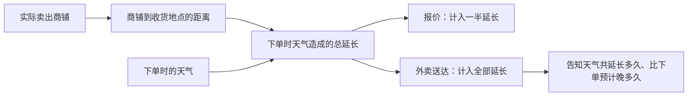

# 天气影响外卖配送，商铺评分影响到手品质

**提案，待评审。不改当前运行规则。** 天气延误只用于外卖。到店购买和外卖都按实际卖出商铺的评分，在拿到商品时给出这一份的品质；评分不替人物写“喜欢”或“不喜欢”。快递不参与这两项改动：不补发货商铺或距离，到站和取件仍按现有规则处理。

举例：林悦大雨天中午十二点点餐。晴天原本十二点二十四分送达，下单时显示十二点二十七分。十二点三十分送到时，她看到：“信阳山笋炒腊肉已送达。天气使配送多用了六分钟，比下单预计晚三分钟。这份菜的品质：中。”她可以觉得合口味，也可以觉得花五十一元不值。系统不替她决定是否再点。

## 为什么改这几处

| 现有行为 | 最小改动 |
| --- | --- |
| 外卖已经有实际卖出商铺、地图距离、备货时间。商品查询和下单共用报价；但报价里的预计送达时刻也直接驱动送达。 | 保留预计送达给人物看；排程使用实际应送达时刻。复用已有天气系数和配送速度。 |
| 到店购买和外卖都已记录实际卖出商铺，收货结算知道收到了哪一份，却没有品质事实。 | 这两种收货按实际卖出商铺抽品质。沿现有收货结果送给人物，再走已有的收尾和日回顾。不建另一套偏好或评价系统。 |

[Uber Direct](https://developer.uber.com/docs/deliveries/daas/references/api/webhooks/delivery-status-webhook) 区分预计送达和配送完成事件；[Google Merchant Center](https://support.google.com/merchants/answer/190657?hl=en) 区分店铺五星评分和具体商品评价。这里借用这两处分工。下面的延时比例和品质分布是 **WorldMock 的模拟参数**，不是对平台算法或真实物流的估计。

## 下单时预估，送到时揭晓

**天气只影响外卖在路上的时间。** 取商铺到下单收货地点的图上最短距离。晴天基准仍是十分钟备货加原有路程；备货时间不随天气改变。到店购买不加配送时间。

| 计算 | 提议规则 |
| --- | --- |
| 天气总延长 | 距离以米计，复用配送速度每秒五米。总延长秒数 = 向上取整〔距离 ÷ 配送速度 ×（1 ÷ 天气系数 − 1）〕。只在最后取整。复用现有系数：晴、多云 1，小雨 0.85，大雨 0.7，雪 0.6。 |
| 人物看到的预计送达 | 晴天基准时刻 + 天气总延长的一半，向下取整到秒。下单时冻结；工具候选、商品查询、订单、待办和今日计划都只用这个时刻。 |
| 引擎实际送达 | 晴天基准时刻 + 全部天气总延长，且不早于付款。外卖订单只需在现有 `expected_at` 之外保存一个私有值 `weather_delay_seconds`；排程和到期校验据两者计算，不再保存第二份预测。实际发生仍记在 `arrived_at`。 |
| 最终通知 | 外卖送达时告知天气总延长和“比预计晚多久”。前者取冻结值，后者取真实到达减下单预计，不把付款等待算成天气。无延误不加说明；不足一分钟用秒，不显示成零分钟。 |

上例的商铺距离是 **4.2 公里**：晴天路程十四分钟，大雨二十分钟，所以天气多用六分钟，报价先计三分钟。同样的大雨，距离减半，天气总延长也是三分钟；同样的距离，雪天比大雨更慢。距离越远或天气越差时延长不减少，秒级取整可使相邻距离显示相同。

天气在**受理购买**时取一次，不随途中变天反复改约；查询只按查询时的天气预估。发货通知仍按公开预计时刻计算，不让人物从发货时刻提前读出隐藏的延长。一个配送组只发一次延误说明，不给每件商品重复加时；睡眠和出行仍按已有规则处理，通知可在下一次观察看到，不额外叫醒人物。

## 商铺给出概率，收货给出品质

**目录只加商铺评分。** 在地点上加 `rating`，实际售卖商品的商铺必须填写 1 至 5 的有限数值，允许小数；缺评分就拒绝发布，不设默认分。普通住处、公司、只代收件的驿站不填。到店购买用眼前这家店，外卖用报价最终选中的分店，不用店铺类型的平均分。沿用现有商品绑定和选店规则。

| 时刻 | 人物看到什么 | 系统做什么 |
| --- | --- | --- |
| 查商品、下单 | 商铺名称和评分。可以说“看着合口味”，不能把这一份的品质说成亲身体验。 | 不抽品质，不改变现有选店排序。 |
| 店内拿到、外卖送到 | “掌柜的店 · 信阳山笋炒腊肉：这份品质中。”一份对应一项。 | 在这两种购买的 `goods_received` 事件保存该份的 `quality`（好、中、坏），只结算一次。 |
| 形成印象 | 下一次决策能读到商品、商铺和这一份的品质；如果收尾时写看法，应结合这次收货事实、自己的口味和价格。 | 事实进入记忆层的核验记录；主观看法仍由人物写。品质不直接改变饱腹、价格、商铺评分或人设，不强制给好评、差评或复购。 |

**品质只抽一次。** 用项目现有的独立随机流，按该份履约记录的 `order_id` 取流，用 Python 标准库的正态抽样，以卖出商铺评分为均值、标准差固定为 1。抽到的数小于 2.5 为坏，2.5 至不足 3.5 为中，3.5 及以上为好。连续抽样值只是分档用，不当作星级、不展示、不必保存。例如四星店约 69% 为好、7% 为坏；二星店正好相反。高分店也会卖出坏货，同店同款的两份可以不同；重复查看、恢复运行不会重抽。不引入第三方包，不新增运行配置。

## 落地边界

| 责任归属 | 要改的地方 |
| --- | --- |
| [资源引擎](../../design/03-resource-engine.md) | 登记商铺评分并校验；同步更新环境包和测试输入，不改商品供给索引，不为旧目录写迁移或兼容层。 |
| [交换引擎](../../design/02-exchange-engine.md) | 在已有天气系数、配送速度和时间计算旁定义天气延长与品质分档。只保留一套数值规则。 |
| [模拟引擎](../../design/04-simulation-engine.md)与[订单状态](../../design/09-io-formats.md) | 外卖查询和下单共用报价，订单冻结延长；外卖排程和到期校验使用实际应送达时刻，不改变配送归组。共用收货入口仅对到店和外卖抽品质。 |
| [人物](../../design/06-agent.md)与[记录引擎](../../design/05-recording-engine.md) | 外卖到达事实负责延误，收货事实负责品质；购买结果不暴露私有延长。进度层和记忆层沿用同一事实；核验和导出按每份到店或外卖订单对应到商铺和品质。 |

实施时先用一份真实商铺外卖走通“查询 → 下单 → 延误 → 收货品质 → 人物看到”，再验证到店购买走同一套品质规则。先更新所属模块设计，再改实现；本提案不改变现行设计、应用标注类别或历史运行。

## 怎样验收

- **外卖配送时间**：固定商铺、商品、距离和下单时刻，只换天气；再固定天气，只换距离。校验晴天基准不变、大雨和雪的延长次序，以及上例的报价、送达和两种延误口径。
- **不能提前知道**：同一时刻反复查询得到同一报价；在公开预计时刻和真实到达之间查看，仍是在途、不能收货。核对人物实际收到的工具结果、进度、记忆、待办和通知，没有私有时刻、完整延长或品质。跨零点、恢复运行，已下单的报价和到达时刻不变。
- **快递保持不变**：同一笔快递在晴天和大雨下预计及实际到站时间相同；到站通知不报天气延误，取件不抽品质、收货结果不带品质字段。快递商品目录无需新增字段。
- **品质有差异也可复现**：对到店和外卖，固定一组订单身份，比较同款商品在不同评分商铺的三档频率与理论概率。覆盖分档阈值、同款多份、取消不产生品质、同一次收货重放不重抽。
- **印象来自这份货**：用相同历史、价格和商铺各展示一份好货与坏货。先断言两种品质都进入真实决策输入，再用一对模型样例检查收尾能区分体验，而不是照抄店铺评分。不以“一定复购”或“一定拉黑”作为验收条件。
