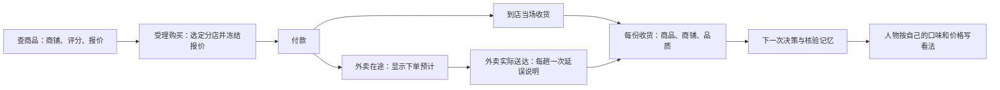

# 天气影响外卖配送，商铺评分影响到手品质 · 开发规格

本次实现以[提案](PROPOSAL.md)为边界。对人物而言，下单时能知道哪家店、店的评分和预计何时到；这份商品的品质要等实际拿到才知道。两家分店各有自己的评分，同店同款的两份也可以有不同品质。快递沿用按下单 app 报价、到驿站再领取的过程。

## 环境如何声明评分

`location.jsonl` 每个实际售卖商品的地点必须有 `rating`。它是 1 至 5（含两端）的有限 JSON 数值，接受整数和小数。判据取自已有商品绑定：地点的 `kind` 出现在至少一种商品的 `store_kinds` 中。这包括只做到店生意的地点；住处、公司或仅代收件的驿站省略此键。若驿站也售货，按售卖地点处理。拒绝缺失的商铺评分、多余的非售卖地点评分、显式 null、布尔、字符串、非有限值和越界值。使用既有目录行校验与跨表登记入口，沿用现有商品供给索引与环境清单摘要。

报价仍按实际地点、营业状态、app 意向与已有的价款、距离、地点身份顺序选店。查商品时每个有店铺身份的结果行使用这一家分店的显示名与数值评分；下单结果展示最终成交分店的 `store` 与 `rating`。工具候选预览照原来的无意向报价显示商铺评分与公开预计。人物此时可以结合商铺评分、口味与价格表达期待，须等收到这份商品才有亲身品质体验。快递没有实际卖出地点，维持原有呈现。查询的内部答案已保存 `store_id`，购买已保存最终 `store_id`，显示时从同一冻结环境解析评分，订单无需复制。

## 外卖报价、发货与到达

| 时刻与使用者 | 计算与可见事实 |
| --- | --- |
| 商品预览、查询完成、受理购买 | 共用同一家店到收货地点的图上最短距离。取该时刻世界里的本地日天气，查询不产生持久订单，受理时冻结。仍以受理前的收货地点处理与出发同组的购买。 |
| 晴天基准 | 从报价时刻起，加原有 600 秒备货，再加向上取整的路程秒数（米数除以每秒 5 米）。晴、多云取 1，小雨 0.85，大雨 0.7，雪 0.6，读取现有天气系数表。 |
| 总延长 | 令 `D = ceil(距离米数 / 配送速度 × (1 / 天气系数 − 1))`。使用精确比例，最后向上取整一次，避免整数秒被浮点误差进一秒。备货不参与。 |
| 公开预计 | `expected_at = 晴天基准时刻 + D // 2`。订单结果、进度、记忆中提及的预计、在途待办与零点计划均用此时刻。 |
| 付款与发货 | 付款后才登记发货及到达事件，沿用现有配送归组与序号。发货仍是付款加上从付款到公开预计的非负间隔的十分之一，向上取整。取消不产生配送或收货。 |
| 实际到期 | 外卖状态保存私有严格非负整数 `weather_delay_seconds = D`。到期时刻为 `max(paid_at, expected_at + D − D // 2)`，排程、配送校验和收货校验共用。到店和快递沿用自己的到期时刻。本地日期变更时先登记新一天的天气，再完成该秒的查询。途中变天、跨零点和恢复使用已冻结数据。一趟只到达一次，结算时记录 `arrived_at`。 |
| 送达说明 | 实际送达晚于预计时，组级到达事实记录 `weather_delay_seconds` 和 `late_by_seconds = arrived_at − expected_at`。正文分别说明天气共延长多久、比下单预计晚多久；只有付款导致晚到时仅说明晚到。准时省略，少于一分钟写秒。组级到达通知、进度和核验从同一事实取值。 |

外卖的实际到期与私有延长只属于引擎状态和排程，公开订单快照只给出预计。到达后公开组级的延误说明，每件商品各自的收货事件另行说明品质。沿用现有睡眠、出行和通知观察窗口。

## 收到什么，怎样进入记忆

| 环节 | 实现与边界 |
| --- | --- |
| 到店或外卖收货 | 共用 `settle_receipt`。确认已付款、到期且尚未交付后，按该份记录的实际 `store_id` 取评分。用现有 `random_stream(random_state, "goods-quality:" + order_id)` 取独立随机流，调用 Python 标准库 `gauss(rating, 1)`。样本小于 2.5 为「坏」，从 2.5 起、不足 3.5 为「中」，从 3.5 起为「好」。 |
| 事实与重放 | 每份一个 `goods_received` 事件，在已有商品与订单身份外写 `store_id`、`quality`。只保存三档结果。重复调用走原有已交付分支，读取观察、记忆、恢复和导出都不重抽。快递取件沿用原字段。 |
| 人物与收尾 | 进度层把每份实际收货显示成商品、商铺和品质。当天核验条目从同一事件形成，过去日子的回顾按已有类别和窗口读入。现有收尾工具仍由人物自由写看法，可以参考自己的口味和实际价格；单次体验不会自动形成好评、差评或复购承诺。 |
| 认证导出 | 每份已交付的到店或外卖订单恰对应一条收货，收货事实和订单商品、卖出商铺、来源与品质对应。快递收货没有商铺评分或品质。保留现有身体结算、账本与事件来源校验。比对订单时使用与人物公开快照相同的字段，同时校验完整检查点。 |

## 设计与改动文件清单

路径相对于 WorldMock 仓库，表中同目录文件并列。当前设计先在原章节修订，运行时按这些职责实现。

| 所属设计 | 生产文件与输入 | 具体改动 |
| --- | --- | --- |
| [资源引擎](../../design/03-resource-engine.md)、[环境作者手册](../../manual/resources.md) | `src/worldmock/resource_engine/catalog/{models,loader}.py`、`registration/admission.py`（同属 `resource_engine/`）；`tests/fixtures/dataset-environment/catalog/{location.jsonl,manifest.json}` | 声明与登记评分，补齐本仓库发布的环境输入和字节摘要，修订作者示例。 |
| [交换引擎](../../design/02-exchange-engine.md)、[配置的随机键表](../../design/08-configuration.md) | `src/worldmock/exchange_engine/{commerce/operators,definitions/types}.py` | 复用配送速度和天气系数；统一总延长、正态抽样和品质阈值。 |
| [模拟引擎](../../design/04-simulation-engine.md)、[状态与序列化](../../design/09-io-formats.md) | `src/worldmock/state/world/{orders,world}.py`、`simulation_engine/commerce/purchase/{purchase_offers,basket}.py`、`commerce/fulfillment/{commerce,receipt,order_notices}.py`、`scheduling/clock/{effects,time_advance,weather}.py`、`world/world_setup.py`（后三项同属 `simulation_engine/`）、`recording_engine/projections/commerce/action_orders.py` | 报价和订单只新增一个私有延长量，统一到期判断、剔除公开快照的私有字段；付款、分组、到站与睡眠边界照旧。运行状态由 15 升为 16。 |
| [人物](../../design/06-agent.md) | `src/worldmock/simulation_engine/activities/query/query_answer.py`、`observation/targets/tool_layer.py`、`observation/layers/{result_projection,progress_layer}.py`、`observation/memory/entries.py`、`observation/wording/settled_text.py`（均在模拟引擎）；`agents/prompt/{prompt_schemas,life_prompt}.py`、`agents/memory/life_memory.py` | 真实分店评分进入查询与购买，实际交付后的延误与逐份品质进入决策输入和核验记录，使用已有提示层和收尾工具。 |
| [记录引擎](../../design/05-recording-engine.md) | `src/worldmock/recording_engine/projections/{activities/experiences,commerce/purchases}.py`、`validation/invariants.py`；`projections/presentation/display_wording.py`（同属记录引擎） | 记录和导出同一组事实；认证识别缺品质、错商铺、重复收货或快递错误带品质。 |

## 验收与执行

| 可观察结果 | 检验方法与测试归属 |
| --- | --- |
| 大雨下 4,200 米，12:00 下单，12:27 预计，12:30 送达 | 用交换引擎单测固定基准、全套天气系数、距离减半、临界整秒与奇数秒。用真实环境目录、商铺、引擎购买入口和观察验证报价、实际排程、收货及一次 6 分钟/3 分钟说明。 |
| 预计已过仍在途 | 检查购买、查询、人物实际输入、待办和今日计划只见预计；在预计和到期之间直接请求配送、收货均被拒；发货没有泄露延长。测试付款晚于报价、同店多份、跨日变天、睡眠和检查点恢复。 |
| 只有实际售货地点需要评分 | 目录单测覆盖有效整数、小数、边界、缺失、无效输入、只做到店和非售货地点。检查同款多分店、意向换店、快递行无评分，原选店顺序与费用仍有效。 |
| 每份真实收货独立且可复现 | 检查两个分档边界和固定订单集合在二星及四星店的三档频率，与正态分布概率比较并写明容差。到店及外卖两路都须使用真实卖家，检验同款多份、取消、重复交付、恢复、快递独立及身体结算。 |
| 人物能区分亲身体验 | 从正常决策构建路径得到两份实际模型输入，固定历史、商品、商铺、评分和付款，单独改变收货品质。自动断言逐份核验与进度；用一对模型收尾样例检查是否能结合品质写出不同体验，保留样例及实际使用的模型。 |
| 记录可认证 | 核对导出的订单、来源事件、商铺和品质，破坏映射应被拒。快递晴雨报价、到站和取件事实一致。 |

以下是本次新增或修改的测试和测试输入，按目录列出。

| 目录 | 文件 |
| --- | --- |
| `tests/` | `dataset_acceptance.py` |
| `tests/fixtures/dataset-environment/catalog/` | `location.jsonl`、`manifest.json` |
| `tests/fixtures/` | `dayrun-activity-baseline.json`、`dayrun-callback-baseline.json`、`viewer-context.json` |
| `tests/integration/evaluation/` | `test_memory_pilot_export.py` |
| `tests/integration/footprints/` | `test_acs_export.py`、`test_acs_invariants.py`、`test_dataset_recording.py`、`test_display_names_source.py`、`test_inspect_current_activity.py`、`test_inspect_meal_count.py`、`test_verified_experiences.py` |
| `tests/integration/life/` | `test_app_opening.py`、`test_body_settlement_records.py`、`test_constant_table_runtime.py`、`test_delivery_weather_and_quality.py`、`test_grocery_cooking.py`、`test_location_meal.py`、`test_memory_digest_runtime.py`、`test_phone_records.py`、`test_planning_and_errand_evidence.py`、`test_purchase_orders.py`、`test_purchase_runtime.py`、`test_purchase_travel_admission.py`、`test_query_activity.py`、`test_query_answer.py`、`test_state_serialization.py`、`test_today_entries.py`、`test_todo_orders.py` |
| `tests/integration/runtime/` | `test_goods_quality_prompt.py`、`test_life_agent_protocol.py`、`test_same_second_continuation.py`、`test_verified_memory.py` |
| `tests/integration/scheduling/` | `test_delivery_and_calendar_boundaries.py` |
| `tests/integration/start_interfaces/` | `test_purchase_array.py`、`test_purchase_prefer.py` |
| `tests/system/lifecycle/` | `test_parcel_arrival_export.py`、`test_purchase_resume.py` |
| `tests/unit/catalog/` | `test_dataset_catalog.py` |
| `tests/unit/exchange/` | `test_operators.py` |
| `tests/unit/footprints/` | `test_purchases.py` |
| `tests/unit/life/` | `test_environment_commerce.py`、`test_memory_progress_contract.py`、`test_persisted_lifecycle_shape.py`、`test_purchase_phases.py`、`test_result_contents.py` |
| `tests/unit/start_interfaces/` | `test_system_layer_text.py` |

两个完整日基线分别由两次独立运行，经 `scripts/freeze_rrs_baseline.py` 比较一致后写入。查看器的请求样例经原有宿主录制入口重新生成。

保留现有验收强度。实现齐备后集中执行完整 pytest、文档链接与设计构建，进行一轮实现审查与修正，再验证最终提交。

## 无人值守时采用的决定

- WorldMock 当前登记的四个售货地点使用显式合成评分：三杯咖啡 4.5，一心面馆 4，二味小炒 2，四季便利 3.5。两个面馆的评分可验证卖家身份。这些数值仅用于本仓库环境，并无现实商家评价含义。
- 使用现有发布环境与代码身份机制；世界结构号随订单形状变化。外部 WorldMock-Dataset 有自己的版本、制包、发布和主分支，本次交付目标是 WorldMock 的 main。此次更新 WorldMock 自带的完整环境包及作者制作说明。
- 模型样例使用同一模型的两次独立收尾，把输出与输入并列审阅。样例检验能否区分这两次体验，自动化检验事实确实进入模型输入；不把一次模型措辞固化为所有人物必须表达的态度。
