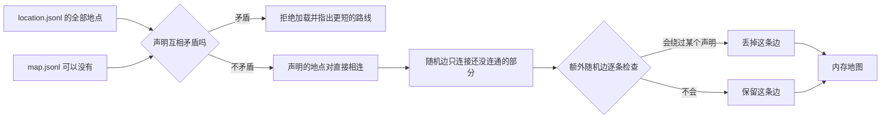
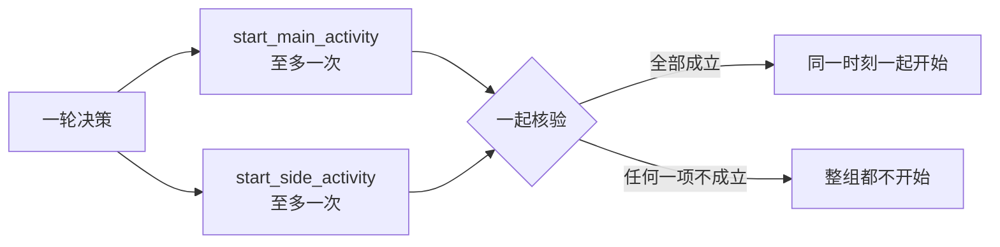
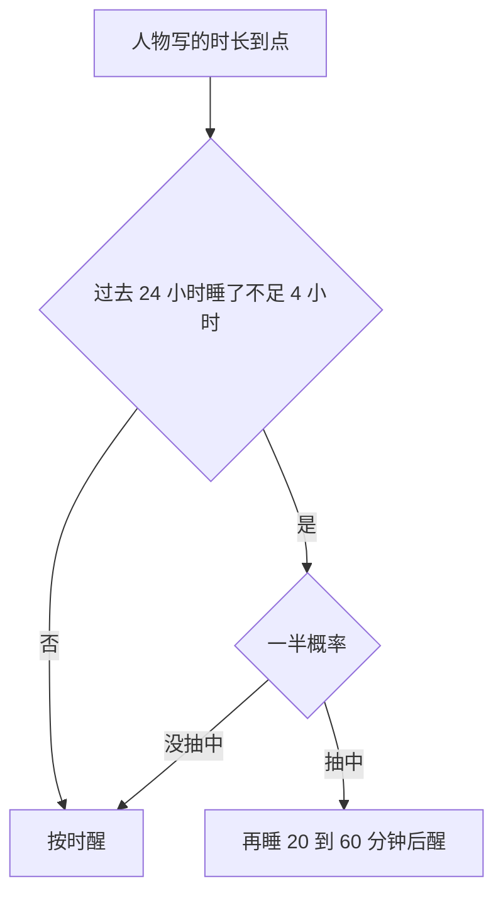
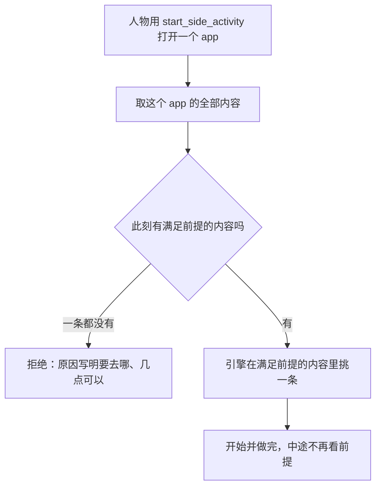
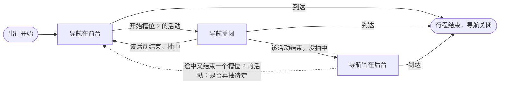
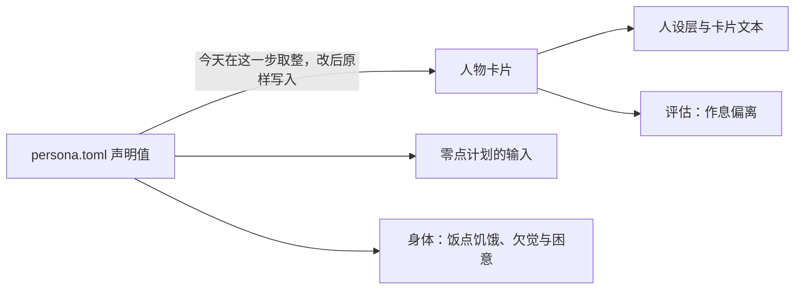
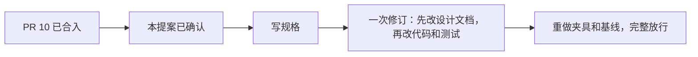

<a name="proposal-envrev-环境数据集合同修订提案"></a>
# 环境数据集合同修订提案

> 状态：所有者已逐条确认（2026-10-10），据此写规格；本文不改变任何现行行为。
> 日期：2026-10-10。
> 来源：issue 11（构建白领 v3 环境包时发现的引擎限制）和所有者当天的逐条答复。标「原话」的引文出自这些答复。
> 代码基线：提交 `8e7cdd6`，即 PR 10「实现单人环境数据集合同」的分支头，尚未合入主干。文中的「今天」都指这个提交。
> 落地方式：本提案写在从 PR 10 分支头另开的分支上，PR 10 本身不动；实施在 PR 10 合入之后作为一次修订进行。
> 叫法：「规格」指 PR 10 实现的那份[环境数据集合同规格](../environment-dataset-contract/SPEC-environment-dataset-contract.md)；
> 「设计文档《某某》」指 `docs/design/` 下的同名模块正文；
> 「所有者此前的答复」指规格的[问答记录](../environment-dataset-contract/open-questions.md)。
> 证据层级：读代码和离线计算。没有调用模型，没有做过真实运行。

<a name="proposal-envrev-这份提案改什么"></a>
## 这份提案改什么

WorldMock 模拟一个人的日常，产出可追溯的数字足迹。足迹最主要的下游用途是**手机时间线**：
某个 app 几点开、几点关，几点进出某个地点，几点收到什么通知。
本提案的每一条改动，都先看它对这条时间线、以及对驱动这条时间线的行为有什么影响。

issue 11 提了六个引擎提案。讨论之后，所有者定下的范围比它大，方向也有几处不同：

| 主题 | 今天 | 改后 | 章节 |
| --- | --- | --- | --- |
| 地图 | 全部随机生成，通勤时间由种子决定 | 可选文件 `map.jsonl` 声明两地距离，其余照旧随机 | [地图声明](#proposal-envrev-地图声明) |
| 出行 | 四种方式写死在引擎里，人人都能开车 | 一个 `travel` 动作；方式由可选文件 `travel-method.jsonl` 定义，步行自带 | [出行方式](#proposal-envrev-出行方式) |
| 开始一件事 | 一个 `start_activity` | `start_main_activity` 管槽位 1，`start_side_activity` 管槽位 2，一轮可各调用一次 | [活动接口与槽位](#proposal-envrev-活动接口与槽位) |
| 在地点做事 | 引擎挑做哪件，且不能和用手机同时进行 | 人物点名做哪件；可以和购买、用 app 同时进行 | [在地点做什么由人物点名](#proposal-envrev-在地点做什么由人物点名) |
| 购买 | 一次最多两件，每件一份 | 一次可买多件，同名写两次就是两份 | [活动接口与槽位](#proposal-envrev-活动接口与槽位) |
| 睡眠 | 只能在自己家睡，睡多久由引擎定 | 人物自己写时长；能在标了 `sleepable` 的地点睡；一天里睡得太少时可能睡过头 | [睡眠](#proposal-envrev-睡眠) |
| app 里的内容 | 在哪、几点都能用 | 可选字段 `prerequisite` 限定地点和时段，打卡因此只能在公司打 | [app 内容的前提](#proposal-envrev-app-内容的前提) |
| 手机记录 | 导航、下单、付款没有完整的开关时间，送达没有通知 | 引擎记 app 的开和关、地点的进和出、四种订单通知 | [引擎要记的手机记录](#proposal-envrev-引擎要记的手机记录) |
| 身体 | 基础代谢每小时固定 65 千卡 | 按体重计算 | [身体](#proposal-envrev-身体) |
| 人设作息 | 声明的时间被取整到半小时 | 声明什么就用什么 | [人设作息窗口](#proposal-envrev-人设作息窗口) |

issue 里的「内容时间窗口」「闹钟作为睡眠的计划结束」「送达通知」三个提案被上面的做法取代，「内容进食效果」不做。
其余限制不改引擎，见[不改引擎、由数据包处理](#proposal-envrev-不改引擎、由数据包处理)。
各章都按同一个顺序写：现在是什么样、改成什么样、数据集作者要做什么、取代的既有规则。
裁决没有写到的细节，所有者没有异议的按建议定下，统一列在文末的[按建议定下的细节](#proposal-envrev-按建议定下的细节)。

<a name="proposal-envrev-版本号与旧数据"></a>
## 版本号与旧数据

仓库的既定做法是不保留兼容：旧输入和旧运行按版本直接拒绝，不写迁移。这次修订照此处理。

- **规则版本只升一次。** 引擎的规则版本从 3 升一号，整次修订合在一起升。所有环境包的 `manifest.json` 都要把 `rules_version` 改成新号；
  旧号的环境包被拒绝（`RULES_VERSION_MISMATCH`），旧运行不能恢复或重放。
- **环境包的文件集合变了。** 必需文件从五个减为四个（`callbacks.jsonl` 变成可选），新增两个可选文件 `map.jsonl` 和 `travel-method.jsonl`。
- **其余结构号在规格里逐项定。** 目录格式、世界状态、人物卡片、导出清单各自要不要升号，原则相同：要升就各升一次，旧版本直接拒绝。
- **提示和工具定义都变了。** 开始工具换成两个，系统层里讲槽位、睡眠、内容选择的几句要重写，两者的指纹随之变化。
- **测试夹具和基线重做一次。** 测试用的环境包、两份完整日基线和录制的提示样例，在修订的末尾按新规则统一重做。

一个现有的环境包至少要改这几处才能加载：改 `rules_version`；给人物的家标 `sleepable`；需要步行以外的出行方式就新增 `travel-method.jsonl`，
并把导航 app 的绑定改成指向出行方式；把地点内容的标题起成人物能点名的名字。

<a name="proposal-envrev-地图声明"></a>
## 地图声明

### 现在是什么样

数据集作者在 `location.jsonl` 里只能列出有哪些地点，写不了「家到公司有多远」。
地点之间怎么连、每段多长，由引擎在加载环境时用运行种子随机生成：

- 先把全部地点随机连成一棵树，保证每个地点都走得到；
- 再随机补上「（地点数 − 1）÷ 2，向下取整」条额外的边；
- 每条边的长度在 200 到 2000 米之间随机取。

人物看到的行程时间和车费、外卖多久送到、从哪家店送、哪个驿站最近，都按这张图上的最短路线计算。
手机时间线上「几点离开家、几点进公司」「订单几点送达」也跟着这张随机图走。

结果是通勤时间由种子决定，作者控制不了。
测试夹具（仓库里测试用的示例环境包，种子 7）生成的图里，家到公司最短是「家 → 五里公园 → 公司」，共 1,957 米，晴天驾车只要 4 分 40 秒。
issue 11 的白领数据包想要 25 到 35 分钟的车程。按它的 11 个地点扫了两万个种子，没有一个能让家到公司达到 25 分钟所需的 10.5 公里；数据包最后用的种子只有 8.5 分钟。

文件方面，`catalog/` 今天恰好是清单（`manifest.json`）加五个 JSONL，一个都不能少；没有回调时，`callbacks.jsonl` 也必须放一个零字节的空文件。
生成的地图不放进环境包；运行开始时把生成结果冻结进运行目录，恢复时核对。

依据：`src/worldmock/catalog/mapgen.py` 的 `generate_edges`，`src/worldmock/catalog/identity.py` 的必需文件集合。

### 改成什么样

环境包新增一个可选文件 `map.jsonl`。每行声明两个地点之间的距离。
字段沿用现有 `MapEdge`：`a`、`b` 是两个地点的 `location_id`，`length_m` 是米数。

想让家到公司开车 30 分钟，写一行：

```json
{"a": "home", "b": "office", "length_m": 12600}
```

12,600 米按驾车的 7 米/秒走，正好 1,800 秒（驾车的速度以后写在出行方式文件里，见「出行方式」一章）。人物 08:20 从家出发：

| 当天天气 | 驾车用时 | 到公司 |
| --- | --- | --- |
| 晴、多云 | 30 分钟 | 08:50:00 |
| 小雨 | 35 分 18 秒 | 08:55:18 |
| 大雨 | 42 分 52 秒 | 09:02:52 |
| 雪 | 50 分钟 | 09:10:00 |

**文件可以不存在。** 不存在等于一行都没声明，地图和今天一样全部随机生成。
`callbacks.jsonl` 改成同样的规则：今天必须存在（允许零字节），以后没有回调可以不放这个文件。

**声明的距离一定算数。** 今天所有的边都是随机的。以后生成地图时，声明了距离的两个地点直接相连，边长就是声明值。
其余的边仍由引擎随机生成，并保证所有地点连通，但随机边不能让声明的距离被更短的路线绕过：

- 用来连通的随机边，只在它连接的两部分还没有连通时才保留。声明的地点对一开始就算已经连通，所以这类边不会在声明的两地之间多开一条路。
- 今天的额外随机边保留，但逐条检查：哪条会让某个声明的距离被更短的路线绕过，就丢掉哪条，丢掉的不补。

所以人物从家去公司，走的就是声明的那 12,600 米。

第一条是核对时补上的，所有者已确认。不加它声明就不算数：测试夹具上声明家到公司 12,600 米后，
连通用的两条随机边「家 → 五里公园 → 公司」仍只有 1,957 米。按离线试算，没有 `map.jsonl` 时这样生成的地图与今天完全相同。

**声明之间互相矛盾，登记（加载环境包时的检查）时直接拒绝。** 今天没有声明，也就没有这项检查。例如同时写了：

```json
{"a": "home", "b": "office", "length_m": 12600}
{"a": "home", "b": "park", "length_m": 3000}
{"a": "office", "b": "park", "length_m": 4000}
```

家经公园到公司只有 7,000 米，比声明的 12,600 米短。引擎拒绝加载，并指出更短的是「家 → 公园 → 公司」这条路线。

**接受两个偏差。**

- 往返只能取同一个值。数据包想要早上 25 分钟、晚上 35 分钟，地图给不出，只能选一个数。
- 雨雪天车程会变慢。天气对速度的影响照旧生效，见上表。

**地图仍然只在加载时在内存里生成。** 生成结果不写进环境包；运行目录里照旧冻结一份，供恢复核对。



下面三件事不用另写规则，会自动跟着声明的距离变：

- 外卖时间。配送时长仍是备餐 600 秒加「距离 ÷ 5 米/秒」。咖啡店声明在公司 4,500 米外，外卖就是 25 分钟。
- 最近的店和最近的驿站，按新地图的最短距离选。
- 步行时间。同样的 12,600 米，晴天步行要 2 小时 55 分钟。

上面的 12,600 米超出了今天随机边 200 到 2000 米的范围。声明值有没有上下限，裁决没有写，列在文末「按建议定下的细节」里。
issue 11 原本提议「整张图都由数据集给出」。裁决改成只声明在意的几对，其余照旧随机。

### 数据集作者要做什么

- 为在意的地点对各写一行，例如家和公司。
- 声明一条远大于 2,000 米的距离后，地图实际分成两簇（比如家这一侧和公司这一侧），只靠声明的那条边相连；没有声明的地点随机挂在其中一侧。所以凡是要在公司或家附近用到的地点（午餐店、咖啡店、便利店、驿站），都要各声明一行到公司或到家的距离，否则它落在哪一侧由种子决定。例如面馆若被挂在家旁 800 米，从面馆送外卖到公司就是 13,400 米，要 54 分 40 秒。引擎不为此加规则，所有者的裁决是这由数据集负责。
- `a`、`b` 写 `location_id`，不是显示名。一对地点只有一个距离，往返共用。
- 不需要声明距离就不放 `map.jsonl`；没有回调也可以不放 `callbacks.jsonl`。
- 加载被拒绝并提示某条路线更短时，改其中一行，让直达的距离不超过绕行的总长。
- 改完照旧刷新清单，再跑一次环境校验。

### 取代的既有规则

- 「地图完全由全部地点和运行种子生成，数据集给不出任何距离」。写在设计文档《资源引擎》「加权连通图与路线」、规格「内存地图」，以及所有者此前对「地图文件」一问的答复（删除发布的 `map.json`，由引擎在加载时用地点和种子生成）。答复里「地图不作为发布文件」的部分保留。
- 「`catalog/` 恰好是五个 JSONL，全部必须存在；`callbacks.jsonl` 可以为空但不能缺」。写在设计文档《资源引擎》「环境目录文件」「环境发布身份」、规格「环境数据集包的组成」和手册「设计环境数据集」。
- 「树之外固定再加（地点数 − 1）÷ 2 条额外边」。写在设计文档《资源引擎》「加权连通图与路线」。以后会绕过声明的额外边被丢掉，实际条数可能更少。
- 「每条边长都在 200 到 2000 米内抽取」。出处同上。以后声明的边取声明值。
- 「相同的地点集合和运行种子得到相同的地图和 `map_sha256`」。出处同上。以后还取决于 `map.jsonl` 的内容。

<a name="proposal-envrev-出行方式"></a>
## 出行方式

### 现在是什么样

人物面前的每个目的地都带四个出行动作：`walk`、`drive`、`take_taxi`、`take_bus`。
要开车去公司，人物调用 `start_activity`，写 `{"action": "drive", "target": "公司"}`。

四种方式写死在引擎里。数据集改不了数值，也去不掉其中任何一种；每个人物都能开车、打车、坐公交。

| 方式 | 速度 | 车费 | 体力消耗（代谢当量，静坐为 1） |
| --- | --- | --- | --- |
| 步行 | 1.2 米/秒 | 免费 | 3.5 |
| 驾车 | 7 米/秒 | 每公里 2 元，最低 5 元 | 1.5 |
| 打车 | 7 米/秒 | 每公里 3 元，最低 14 元 | 1.5 |
| 公共交通 | 5 米/秒 | 一律 2 元 | 1.5 |

用时等于「地图距离 ÷（速度 × 天气系数）」，向上取整到秒。
天气系数是晴和多云 1.0、小雨 0.85、大雨 0.7、雪 0.6，对四种方式都生效。
车费只看距离，与天气无关，出发时付。

导航 app 是一种功能 app（人物不能点选、由引擎自动记录使用的 app）。它和回调规则今天都按动作名绑定。夹具里的高德地图是这样写的：

```json
{"app_id": "amap", "name": "高德地图", "role": "function", "actions": ["drive", "take_bus", "take_taxi", "walk"]}
```

人物出发时，引擎从绑定了该动作的 app 里随机挑一个，记一条导航记录。
回调规则的触发条件写 `{"class": "action", "key": "drive"}`，数据集用它做「开车的日子扣一格油」之类的事。

依据：`src/worldmock/exchange/operators.py` 的速度与车费算子，`src/worldmock/life/action_contract.py` 的动作表。

### 改成什么样

出行合成一个动作 `travel`。人物调用 `start_main_activity`，目的地写在 `target`，出行方式的名称写在第三个参数 `detail`：

```text
start_main_activity  {"action": "travel", "target": "公司", "detail": "驾车"}
```

有哪些出行方式，由数据集决定。环境包新增可选文件 `travel-method.jsonl`，每行定义一种方式，写五样东西：

| 写什么 | 用来做什么 |
| --- | --- |
| 名称 | 人物看到并写进 `detail` 的名字 |
| 速度 | 用时按地图距离和它计算 |
| 起步价 | 车费的起点 |
| 每公里价格 | 车费随地图距离增加的部分 |
| 体力档位 | 沿用内容的四个档位 `idle`、`light`、`moderate`、`heavy` |

规则如下，每条先说今天、再说以后。

- **步行始终自带。** 今天步行是四种固定方式之一；以后引擎只维护步行，数值仍是 1.2 米/秒、免费、代谢当量 3.5。文件里不写步行。
- **文件只添加其他方式。** 今天四种方式人人都有；以后文件不存在时，人物只能步行。
- **驾车、打车、公共交通的数值从引擎删除。** 今天它们的速度、车费和体力消耗写在引擎里；以后由数据集的行给出。
- **天气的影响仍由引擎固定。** 五种天气的系数不变，对数据集定义的方式同样生效。
- **绑定改成按出行方式的身份。** 今天导航 app 和回调规则写 `drive`、`take_bus` 这样的动作名；以后改为指向某一种出行方式。
- **文件名用连字符**，与 `app-catalog.jsonl` 等现有文件一致。

夹具要保持今天的行为，就加入下面三行。字段名是建议写法，裁决只定了每行写哪五样东西。
例子里多出的 `travel_method_id` 是为了让 app 和回调规则按身份绑定而加的；单设一个身份还是直接拿名称当身份，列在文末「按建议定下的细节」里。

```json
{"travel_method_id": "bus", "name": "公共交通", "speed_meters_per_second": 5, "start_price_fen": 200, "price_per_km_fen": 0, "exertion": "light"}
{"travel_method_id": "driving", "name": "驾车", "speed_meters_per_second": 7, "start_price_fen": 500, "price_per_km_fen": 200, "exertion": "light"}
{"travel_method_id": "taxi", "name": "打车", "speed_meters_per_second": 7, "start_price_fen": 1400, "price_per_km_fen": 300, "exertion": "light"}
```

`light` 档的代谢当量是 1.5，正是今天这三种方式的数值。
车费按「起步价与按公里计价两者取较大」计算时，这三行在 0 到 200 公里的每一米上都与今天的车费一分不差。
起步价和每公里价格怎样合成车费，裁决没有写。若按两者相加，驾车和打车会比今天贵，列在文末「按建议定下的细节」里。

家到公司声明为 12,600 米、当天晴，人物在「公司」这个目的地上看到：

| 出行方式 | 用时 | 车费 |
| --- | --- | --- |
| 步行 | 2 小时 55 分钟 | 免费 |
| 驾车 | 30 分钟 | 25.20 元 |
| 打车 | 30 分钟 | 37.80 元 |
| 公共交通 | 42 分钟 | 2 元 |

对手机时间线的影响：离开和到达地点的时刻由所选方式的速度决定；导航 app 仍从绑定了这种方式的 app 里挑，它几点开、几点关怎么记，见「引擎要记的手机记录」一章。
没有 `travel-method.jsonl` 的环境包里，人物去 12.6 公里外的公司只能走将近三小时。

评估也受影响。今天评估把出行方式归成步行、驾车、公共交通三类（打车归驾车）。数据集自己定义的方式，引擎不知道该归哪一类。所有者的裁决是先不评：评估认不出的方式在盲评里不带出行方式，步行照旧；这次修订不为此加字段，以后再补，记在 [issue 12](https://github.com/HoldThatThgt/WorldMock/issues/12)。

### 数据集作者要做什么

- 需要步行以外的方式，就新建 `travel-method.jsonl`，一种方式一行。不要写步行。
- 不想让人物开车，就不写驾车这一行。今天「人人默认有车」的效果不再自动存在。
- 把导航 app 的绑定从动作名改成出行方式的身份。高德地图一行大致变成下面这样（字段名和步行的身份写法见文末「按建议定下的细节」）：

```json
{"app_id": "amap", "name": "高德地图", "role": "function", "travel_method_ids": ["bus", "driving", "taxi", "walking"]}
```

- 把回调规则里的 `{"class": "action", "key": "drive"}` 改成指向驾车这一行的身份。
- 改完照旧刷新清单，再跑一次环境校验。

### 取代的既有规则

- 「四种出行方式及其速度、车费、代谢当量都是引擎常量」。写在所有者此前对「公交与打车」一问的答复（选了引擎常量并定下各方式的数值）、规格「出行、睡眠与驿站交互」的方式表、设计文档《交换引擎》「身体共同结算」「收货与费用」和手册「理解固定世界规则」。
- 「动作闭集里有 `walk`、`drive`、`take_taxi`、`take_bus` 四个出行动作」。写在设计文档《模拟引擎》「动作、名称与并行」和系统层规则文字。
- 「每个其他地点都提供全部四种出行」。写在 规格「工具层与只读查询」。以后是步行加数据集定义的方式。
- 「功能 app 绑定具体动作 `walk`、`drive`、`take_taxi`、`take_bus`、`purchase`」。写在设计文档《资源引擎》「app、内容与候选呈现」和所有者此前对「功能 app 如何绑定动作」一问的答复（绑定写在 app 行上，绑到具体动作）。`purchase` 的绑定不变。
- 「回调的动作触发写七个具体动作之一」。写在设计文档《资源引擎》「声明式回调」。
- 「所有人物默认有车」。写在 规格「出行、睡眠与驿站交互」。以后有没有驾车，看数据集有没有这一行。
- 「出行方式的中文说法由引擎固定」。出处同上。以后步行以外的名称来自数据集。

<a name="proposal-envrev-活动接口与槽位"></a>
## 活动接口与槽位

### 现在是什么样

人物要开始做一件事，用的是工具 `start_activity`。一次请求写一到两项，每项只有 `action`（做什么）和 `target`（对谁做）。`action` 有七个：`walk`、`drive`、`take_taxi`、`take_bus`、`purchase`、`sleep`、`interact`。例如边开车去公司边刷哔哩哔哩：

```json
{"items": [{"action": "drive", "target": "公司"}, {"action": "interact", "target": "哔哩哔哩"}]}
```

人物同一时刻最多做两件事。引擎用两个槽位来管：一个槽位同一时刻只能放一件事，哪种动作进哪个槽位是固定的。现行设计文档把它们叫第一名额、第二名额，本文统一叫槽位 1、槽位 2。

| 槽位 | 今天放什么 |
| --- | --- |
| 槽位 1 | 四种出行、睡眠 |
| 槽位 2 | 购买、用 app、在地点做事 |

这带来四个后果：

- 在地点做事和用手机挤在同一个槽位。12:00 人物在公司做着「季度销售数据整理」，想点外卖，必须先暂停工作，买完再恢复。在家吃晚饭时也不能同时刷哔哩哔哩。
- 一次购买最多两件，同一件商品不能写两次，每件固定买一份。
- 睡眠的 `target` 只能写自己的家，睡多久由引擎算。
- 每次决策只能提交一个改变世界的请求。想同时开始两件事，要把两项写进同一个 `start_activity`；引擎把整组核验一遍，任何一项不成立，两项都不开始，也不扣款。

### 改成什么样

`start_activity` 删除，换成两个接口，一个接口管一个槽位。旧接口不保留，旧写法直接拒绝。

| 接口 | action | target | 第三个参数 detail |
| --- | --- | --- | --- |
| `start_main_activity` | travel | 目的地 | 出行方式名称 |
| `start_main_activity` | interact | 当前地点 | 要做的事（内容名或系列名） |
| `start_main_activity` | sleep | 时长，整数分钟 | 不填 |
| `start_side_activity` | purchase | 一件或多件商品（数组） | 无此参数 |
| `start_side_activity` | interact | 一个 app | 无此参数 |

第三个参数今天不存在。讨论时它叫 `content`，现在定名 `detail`：出行时它写出行方式，在地点时写要做的事，不只是内容。所有者的要求是，不论叫什么，都要在工具说明里把每种 `action` 下该写什么写清楚。

几个调用的样子。工具的每个参数都必须出现在请求里，所以「不填」写成 `"detail": null`；`start_side_activity` 没有 `detail` 这个参数。睡眠时长写成数字还是文字，列在文末「按建议定下的细节」里，这里只是示意：

```text
start_main_activity  {"action": "travel",   "target": "公司", "detail": "驾车"}
start_main_activity  {"action": "interact", "target": "家",   "detail": "工作日晚饭"}
start_main_activity  {"action": "sleep",    "target": 60,     "detail": null}
start_side_activity  {"action": "purchase", "target": ["牛肉面", "冰美式", "冰美式"]}
start_side_activity  {"action": "interact", "target": "哔哩哔哩"}
```

**槽位怎么变。** 在地点做事从槽位 2 搬到槽位 1，其余不动。

| 槽位 | 改后放什么 | 谁能占 |
| --- | --- | --- |
| 槽位 1 | 出行、睡眠、在地点做事 | 新开始的活动只能由 `start_main_activity` 放进来 |
| 槽位 2 | 购买、用 app | 新开始的活动只能由 `start_side_activity` 放进来 |

「谁能占」只管新开始的活动。暂停的活动不占槽位；恢复它仍用 `report_status`，回到它原来的槽位，并照今天重新检查槽位是否空着。

同一槽位内仍然互斥，睡眠仍然要求槽位 2 为空。能同时做的组合因此变了：

| 想同时做 | 今天 | 改后 |
| --- | --- | --- |
| 在地点做事 + 用 app | 不行 | 可以 |
| 在地点做事 + 购买 | 不行 | 可以 |
| 出行 + 用 app，出行 + 购买 | 可以 | 可以 |
| 出行 + 在地点做事 | 不行 | 不行 |
| 睡眠 + 任何事 | 不行 | 不行 |

「出行 + 购买」有一条保留的限制：路上能买的只有快递类商品（绑定在 app 上的商品）。外卖在路上下不了单，只能和出发同一轮开始、送到出发地。

落到手机时间线上：人物 12:00 在公司开始购买，12:04 付款完成，工作这项活动从头到尾没有断。今天要得到同样的手机记录，人物得先暂停工作、买完再恢复，多出几轮决策，工作也被切成两段。

**一轮里用两个接口。** 一轮决策里，两个接口各可以调用一次，也可以只调用其中一个。
两个调用要在模型的同一次回复里一起提交；这一批提交后本轮决策结束，整组一起核验。只提交其中一个，本轮同样结束。
这一批里能不能再夹 `report_status` 这类控制工具，列在文末「按建议定下的细节」里。



「整组核验、整组开始」今天就有，只是今天两项写在同一个请求里。变化是它们成了两次工具调用。今天人物一侧和环境一侧都只接受「一轮一个改变世界的请求」，这一条要放开到「两个开始接口各一次」。

**购买怎么变。**

| | 今天 | 改后 |
| --- | --- | --- |
| 一次买几件 | 一到两件 | 一件或多件，不设上限 |
| 同一个商品名写两次 | 拒绝 | 买两份 |
| 余额不足 | 整次购买不成立 | 整单拒绝，不变 |
| 怎样分订单 | 按店铺、收货地、下单 app、履约方式四项分 | 付款按下单的内容 app 分：同一个内容 app 里买的几件是一张订单 |
| 一张订单怎么付 | 抽一次：支付 app 占 10 至 20 秒，在内容 app 里直付不占时间 | 抽一次，一张订单只用一种方式；两种都占 10 至 20 秒 |
| 一次购买多久 | 抽 60 至 300 秒，付款从末尾切出 | 仍抽 60 至 300 秒，付款包在里面；实际耗时取它和付款合计中较大的一个 |

所有商品仍然合成一次购买过程，占槽位 2；到店、外卖、快递的判定不变。分订单和付款时间按所有者的裁决改，原话：
「买多个物品按照内容app分订单，多个物品在一个内容app的订单就算一单，一个内容app只用一种支付app结算，付款时间包在购买时长里，取购买时长和支付总时长的最大值作为实际耗时」。

- 例：一次从三个内容 app 各买一件，是三张订单。三张的付款分别抽到支付宝 15 秒、微信 12 秒、在内容 app 里直付 18 秒，合计 45 秒。购买时长抽到 200 秒，实际就是 200 秒：前 155 秒下单，后 45 秒付款。购买时长抽到 60 秒，实际还是 60 秒：前 15 秒下单。
- 订单数不会超过数据集里内容 app 的个数，所以不用再设订单数上限。只有付款合计比抽到的购买时长还长时（要五张以上订单才可能），实际耗时才等于付款合计，这时没有下单那一段。
- 配送和运费仍按店铺算，和今天一样，所有者已确认。同一个内容 app 上点了两家店的外卖：付款一次，配送两趟，运费两份，「订单已发货」「订单已送达」各两条。到店当场买没有内容 app，抽到直付时没有 app 可开，不占时间，也和今天一样。

引擎今天在两处核对总额：开始时不够，整组请求被拒绝；购买结束付款时不够，整次购买取消。两处都不会只买其中几件，这一点保留。
引擎今天在两处核对总额：开始时不够，整组请求被拒绝；购买结束付款时不够，整次购买取消。两处都不会只买其中几件，这一点保留。

**保持不变的部分。**

- 控制工具不变：`report_status`、`pause_activity`、`conclude_activity`、`revise_day_plan`、`recall_task_summary`，以及只读的 `query_world`。
- 进行中和刚结束待收尾的活动占槽位，暂停的活动不占。
- 用 app 时人物只写 app 名，看到什么仍由引擎按现有次序挑。
- 出行方式有哪些名字、睡眠时长的范围，分别见「出行方式」「睡眠」两章。

依据：槽位分配在 `src/worldmock/life/action_contract.py`，整组核验在 `src/worldmock/life/admission.py`。

### 取代的既有规则

- 开始工具只有 `start_activity`，每项只写 `action` 与 `target`，动作固定七个；第一名额放四种出行和睡眠，第二名额放购买和 interact。写在设计文档《模拟引擎》「动作、名称与并行」。
- 所有地点和 app 的 interact 都用第二槽，与购买互斥；任意两个 interact 不能并行，哪怕一个在地点、一个在 app。写在规格「内容目录」的「索引、选择与恢复」和「动作与请求接口」的「受理、派发与并行」。
- 一次请求一至两项，同一个 `target` 不得重复，一项购买一件、不设数量。写在规格「动作与请求接口」的「请求与目标」；「每个购买项一件商品」「重复商品拒绝」「请求最多两个购买项」写在规格「商品与履约」的「合单、时间与资金」。
- 每次决策恰好提交一个世界请求，世界请求单独提交。写在规格「动作与请求接口」的「宿主与提示合同」和系统层提示。
- 环境工具清单里的 `start_activity`。写在设计文档《人物》「提示与工具」和手册《安装、运行与恢复》的「检查工具交互」。
- 四种出行各是一个 `action`。合成 `travel`，方式写进 `detail`；细节见「出行方式」一章。
- 睡眠的 `target` 写自己的家。出自所有者此前对「睡眠目标」一问的答复（只在自己家睡，`target` 写家）和规格「请求与目标」。接口上改为写时长；能在哪睡见「睡眠」一章。

<a name="proposal-envrev-在地点做什么由人物点名"></a>
## 在地点做什么由人物点名

### 现在是什么样

人物在地点上只能说「我在这里做点事」，做哪件事由引擎挑：

```json
{"items": [{"action": "interact", "target": "家"}]}
```

可做的事来自 `content-catalog.jsonl`。数据集作者把一条内容绑定到一类地点，这类地点就都能做它。测试环境里「家」这类地点有两条（只列相关字段）：

```json
{"content_id": "c-chat", "title": "测试闲聊", "location_kinds": ["home"], "duration_seconds": 600}
{"content_id": "c-rest", "title": "测试休息", "location_kinds": ["home"], "duration_seconds": 900}
```

几条内容还可以用 `series` 字段串成一个系列，按集号一集一集做。例如系列「工作日晚饭」有备菜、吃饭、洗碗三集。

引擎按固定次序挑：最近一次没做完的，然后是已经开了头的系列的下一集，然后是从没做过的里随机一条，最后是做得最少的。

这带来四个后果：

- 人物决定不了做什么。issue 里的例子：家里只有「工作日晚饭」一个系列，22:00 在家做点事，得到的还是晚饭。晚饭中途停下，以后不论几点都接着做晚饭。
- 给家再加「洗漱」「睡前准备」也解决不了。引擎在没做过的里随机挑，07:00 可能挑到晚饭。
- 标题不是人物能写的名字。标题今天允许重复，请求里也没有地方写它。
- 人物开始之前看不到这里有哪些事可做，只看到一个时长范围。

### 改成什么样

在地点上，人物点名要做的事。名字写在 `start_main_activity` 的第三个参数 `detail` 里：

```text
start_main_activity  {"action": "interact", "target": "家", "detail": "测试休息"}
```

`detail` 可以写两种名字：

| 写什么 | 对应数据集里的 | 引擎做什么 |
| --- | --- | --- |
| 内容名 | 一条不属于系列的内容的 `title` | 开始这一条 |
| 系列名 | `series.title` | 人物不选集，做到第几集由引擎接着排 |

系列的例子。18:30 人物写 `"detail": "工作日晚饭"`，引擎从备菜开始，备菜做完自动接吃饭。人物中途结束，下次再点名「工作日晚饭」，引擎从没做完的那一集接着排。一集做完自动接下一集、整个系列做完就停，这些今天就有，不改。改的只是「做哪个系列」由人物说。

**人物从哪里看到能点的名字。** 人物要先看到名字才能点名，今天他只看到一个时长范围。建议在工具层（提示里列出此刻能做什么的那一层）当前地点那一行下，列出此刻能点名的每件事：不属于系列的内容名、系列名，各带时长，没做完的显示剩余时长。裁决没有写这一条，列在文末「按建议定下的细节」里。

app 一侧保持现状。用 app 时人物只写 app 名，看到什么由引擎按现有次序挑：有推送先看推送，然后是上面那套次序。两边不一样是有意的：刷 app 看到什么本来就是 app 推给你的；地点没有推荐流，在家做什么是人自己决定的。

| | 今天 | 改后 |
| --- | --- | --- |
| 在地点做哪件事 | 引擎挑 | 人物点名 |
| 系列做到第几集 | 引擎排 | 引擎排 |
| app 里看到什么 | 引擎挑 | 引擎挑 |

**不做内容时间窗口。** issue 提议给地点内容加可用时段，让引擎在 22:00 挑不到晚饭。现在挑的人换成了人物，不需要引擎按时段替他筛，这个提案不做，地点内容不加时段字段。地点自己的营业时间照旧：关门时不能在那里做事。

**对手机时间线的影响。** 进出地点的时间不受影响。变的是人在地点里做的事合不合时宜：早上洗漱、晚上做饭，由人物照人设和当时的身体感觉决定。配合「活动接口与槽位」一章，人物可以一边在家吃晚饭一边刷 app，app 的使用记录不再被地点上的活动挤掉。

**保持不变的部分。**

- 内容仍然绑定到地点类型，同一类地点共用一批内容。
- 每条内容的时长、体力档位、两项心理缓解档位仍由数据集声明。
- 进度仍按人物和内容记。暂停、恢复、收尾仍用现有控制工具。
- 驿站也是地点，同样要点名；到站的包裹仍在这次 interact 里领取。
- 绑定到 app 的内容怎么挑、怎么推送。

依据：现有挑选次序在 `src/worldmock/life/content_select.py`，系列接续在 `src/worldmock/life/interact.py`。

### 数据集作者要做什么

- 把 `title` 和 `series.title` 当成人物要读、要写的名字来起。写人会说的事：「洗漱」「做晚饭」「午休」。
- 同一类地点下，这些名字要彼此分得开。标题今天允许重复；以后重名会让点名指不到唯一的一件事。建议登记时就拒绝重名并指出是哪两行；裁决没有写，列在文末「按建议定下的细节」里。
- 想让一件事分几步连着做，就写成系列。人物点名系列，步骤由引擎接：

```json
{"content_id": "dinner-1", "title": "备菜", "series": {"title": "工作日晚饭", "episode": 1}, "location_kinds": ["home"], "duration_seconds": 1200}
```

- 一类地点下可以放多件互不相干的事了。以前放多了引擎会乱挑，现在由人物点名。
- 不要给地点内容写可用时段，没有这个字段。
- 驿站这类地点仍然至少要有一件能点名的事，例如「驿站取件」。
- 绑定到 app 的内容不用为本章做任何修改。

### 取代的既有规则

- 地点上的 interact 由引擎按「最近未完成、系列下一集、未看单元、轮数最少」挑内容。写在设计文档《模拟引擎》「出行、内容与目录浏览」。对地点不再适用，对 app 照旧。
- 人物只选择内容 app 或当前地点，引擎按推荐顺序选内容。写在规格「内容目录」的「目标与依据」和「索引、选择与恢复」。
- 标题不要求唯一，内容标题不是人物可点名的对象。写在规格「内容目录」的「内容条目」；设计文档《资源引擎》也写着「内容标题不参与名称解析」。
- 内容标题不能点名，也不能通过 interact 的名称解析。写在规格「动作与请求接口」的「请求与目标」「名称解析」。
- 系统层提示里的「内容由环境选择，标题不是动作目标」，以及规格「宿主与提示合同」里的「只选 app 或当前地点，内容由引擎选」。
- 所有者此前对「选内容之前引擎对 interact 的对象知道什么」的答复：选之前不做检查，由数据集设计者保证绑定合理。地点一侧改为人物点名，app 一侧这条答复继续有效。
- 所有者此前对「用 interact 取件」的答复，以及规格「驿站取件与商品收货」：取件的同时按通常推荐顺序开始一条地点内容。改为开始人物点名的那一条。
- 更早的提案裁决「使用不再细分，人物只说使用加内容 app，内容由系统推送」。对 app 继续有效；在地点上人物要多说一个名字。

<a name="proposal-envrev-睡眠"></a>
## 睡眠

### 现在是什么样

模拟的人今天只能在自己家里睡，睡多久由引擎替他定：正好等于人设里的每日睡眠需要（`persona.toml` 的 `sleep_need_hours`，7 到 9 小时）。林悦的每日睡眠需要是 8 小时，00:10 睡下，引擎让她 08:10 醒。她定不了“睡到 08:00”，也不能在办公室睡一小时午觉。

今天的请求是 `start_activity`，写 `{"action": "sleep", "target": "家"}`。引擎这样处理：

- **在哪睡。** 目标必须是本人的家，而且人此刻就在家。在别处提交会被拒绝。
- **关门。** 地点声明了营业时间（`opens`）、此刻又不在营业时段内时，不能开始睡。这条只在代码里，设计正文没有写。
- **槽位。** 一个人同时最多做两件事，分别占槽位 1 和槽位 2。睡眠占槽位 1，并要求槽位 2 是空的。
- **何时醒。** 每段睡眠有一个计划结束时刻，睡眠只在这个时刻结束。日计划提醒、推送、外卖送达、班次起止都不叫醒人，人物自己也不能暂停或提前结束。
- **欠的觉。** 引擎给人记一本账，范围 0 到 24 小时。清醒每小时欠「每日睡眠需要 ÷（24 − 每日睡眠需要）」小时，睡每小时补 1 小时。每日睡眠需要 8 小时的人清醒 16 小时正好欠 8 小时，睡 8 小时补完。
- **睡前看到什么。** 工具层（提示里列出此刻能做什么的那一层）在睡眠那一行显示引擎定好的时长，例如“约 8 小时”。

另外，身体常量表里有两个数（`awake_sleep_debt_per_hour = 1`、`sleep_recovery_per_hour = 2`）没有任何代码使用，也和上面真正生效的欠觉换算不一致。唤醒表和睡醒时少记的一条原因见「顺手清理」一章。

依据：`src/worldmock/life/` 下 `session_actions.py` 的开始核验与睡眠派发、`sleep.py` 的欠觉换算、`schedule.py` 的唤醒表。

### 改成什么样

睡多久由人物自己写，在哪睡看他此刻在哪。林悦 00:10 在家写 470 分钟，08:00 醒；13:00 在办公室写 60 分钟，14:00 醒。睡眠本身不产生手机记录，睡着时推送和送达照常发生，只是不叫醒人；它决定的是醒来后第一条 app 记录和出门时刻落在几点。

| 事项 | 今天 | 改后 |
| --- | --- | --- |
| 接口 | `start_activity` | `start_main_activity` |
| 写法 | `action` 写 `sleep`，`target` 写 `家` | `action` 写 `sleep`，`target` 写 `470`，第三个参数 `detail` 不填（请求里写 `null`） |
| 睡多久 | 引擎定，等于每日睡眠需要 | 人物写，整数分钟，10 到 720（12 小时） |
| 在哪睡 | 只能在本人的家 | 不写地点，就在当前所在地点；该地点必须标了 `sleepable` |
| 何时醒 | 开始时刻加每日睡眠需要 | 写的时长到点；过去 24 小时睡得太少时可能睡过头 |
| 睡前看到 | 引擎定好的时长 | 补完欠的觉大约要多久 |

- **时长。** `target` 写整数分钟，最少 10，最多 720。超出范围时拒绝，并用英文说明允许的范围。引擎不再替人定时长。
- **地点。** 请求里不写地点。当前所在地点标了 `sleepable` 才能睡，没标就拒绝；今天只认本人的家。地点关门时不能开始睡，这条写进设计正文。
- **槽位。** 不变：睡眠占槽位 1，要求槽位 2 为空。同一轮里再用 `start_side_activity` 开始购买或用 app，整组都不开始。
- **结束。** “睡眠只在自己的计划结束时结束”原样保留。日计划提醒照旧不叫醒睡眠，推送、送达、班次起止也不叫醒。所有者原话：「plan_day不需要再设置reminder，而是sleep的时候自己定义时长」。日计划里的提醒功能本身保留，只是不靠它起床。
- **睡过头。** 人物写的时长到点那一刻，往回数 24 小时，把他睡过的时间加起来，刚睡的这一觉也算。合计不足 4 小时，有一半概率再睡 20 到 60 分钟；满 4 小时就按时醒。每段睡眠只判一次。这次随机由运行种子决定，重放同一次运行得到同一结果。补回的觉按实际睡的时长算，多睡的那段也补。今天没有睡过头。
  所有者原话：「如果改成每日睡眠小于4小时的人更容易睡过头」。这条规则不看欠的觉。最初写的是「精力（1 − 欠的觉 ÷ 每日睡眠需要）低于 60%」，核对发现它把睡足的人白天正常攒下的也算成缺觉，所有者认为不对，改成现在这样。建议的两处细节：多睡的那段可以让这段睡眠超过 12 小时；人物事先不知道自己会不会睡过头。
- **欠觉换算。** 保留现行算法。常量表里那两个没人用的数删除。
- **睡前提示。** 开始睡之前，人物能看到补完欠的觉大约要多久；今天这一行显示的是引擎定好的时长。只给大概的时长，不给身体的精确数值。



几个例子。「过去 24 小时睡了」从到点那一刻往回数，含刚睡的这一觉。

| 例子 | 过去 24 小时睡了 | 结果 |
| --- | --- | --- |
| 林悦 00:10 睡 470 分钟 | 7 小时 50 分 | 08:00 按时醒 |
| 林悦在办公室午睡，13:00 睡 60 分钟 | 8 小时 50 分 | 14:00 按时醒 |
| 林悦傍晚小睡，18:00 睡 30 分钟（当天没有午睡） | 8 小时 20 分 | 18:30 按时醒 |
| 李浩然每晚 01:00 睡 390 分钟 | 6 小时 30 分 | 每天 07:30 按时醒 |
| 夜里 00:00 睡 240 分钟 | 4 小时 | 04:00 按时醒 |
| 夜里 01:00 睡 180 分钟 | 3 小时 | 可能睡过头：一半概率 04:00 醒，一半概率 04:20 到 05:00 之间醒 |
| 通宵到 08:00，再睡 180 分钟 | 3 小时 | 可能睡过头 |
| 前一晚只睡 3 小时，中午再睡 30 分钟 | 3 小时 30 分 | 可能睡过头 |

按五份请求里的作息，五个人物每天都睡 6.5 小时以上，正常情况下不会触发。这条规则只在人物自己写了很短的睡眠、或者通宵之后才起作用。

睡眠只看当前地点有没有标 `sleepable`，所以办公室午睡可以表达：办公室标 `sleepable`，人物在办公室睡 60 分钟。它是真正的睡眠，不会被推送或送达打断。
午睡成为真正的睡眠后，一天里就不止一段睡眠了。今天有两处把「一段睡眠结束」当成「过了一夜」，按所有者的裁决这样改：

- **就寝反思每天一次。** 就寝反思是让模型回顾前一天、写下 1 到 5 条感想存进记忆的那一步；感想从第二天起显示在每次决策的记忆部分，让人物记得前几天的事。今天每段睡眠结束都触发，而且排在醒来后的第一次决策之后。改成：人物每个本地日第一次睡醒时做一次，总结前一天，做完再做这一天的第一次决策；当天之后的睡醒（比如午睡）不再触发。所有者原话：「感想每天第一次睡醒时总结前一天吧，然后再开始这一天」。这样当天的第一次决策就能看到昨天的感想。「一天」按本地零点分；通宵没睡的那天不做，下一次睡醒时一并回顾。
- **评估只把睡满 180 分钟的睡眠算作就寝。** 更短的单列为小睡，报次数和时长。今天每段睡眠都算一次就寝：林悦每个工作日午睡一小时，12 周的平均睡眠时长会从 7.83 小时算成 4.99 小时。

没有采纳的做法：日计划提醒叫醒睡眠；没有提醒时一直睡到补完欠的觉为止；人在哪都能睡。issue 11 里“把闹钟当作睡眠的计划结束”的提案由人物自己写时长取代。

### 数据集作者要做什么

- 在 `location.jsonl` 里给每个允许睡觉的地点加 `"sleepable": true`。这个字段可选，不填等于不能睡。
- 人物自己的家必须标。没标时环境加载报错，运行不会开始；引擎不替数据集补。
- 想让人物能在办公室午睡，就给办公室也标上。

```json
{"app_ids":[],"is_home":true,"kind":"home","location_id":"home","name":"家","sleepable":true}
{"app_ids":[],"kind":"office","location_id":"office","name":"公司","sleepable":true}
```

- 家如果声明了 `opens`，关门时段内人物不能开始睡。想让人物随时能睡，家就不要声明 `opens`。
- `persona.toml` 的 `sleep_need_hours` 照人物真实的每日睡眠需要填。它不再决定睡多久，只用于欠觉和困意的计算，不必再为了凑起床时刻去调它。
- 改完 `location.jsonl` 后照常刷新 `manifest.json` 里的摘要。

### 取代的既有规则

- “睡眠只能在本人住处开始，且人此刻在家”。写在设计文档《模拟引擎》「动作、名称与并行」、规格的动作表和「出行、睡眠与驿站交互」；所有者此前对「睡眠目标」一问的答复选的也是只能在自己家睡。
- “睡眠时长按每日睡眠需要派生，按一天封顶”。写在规格的动作表和「出行、睡眠与驿站交互」。
- “`sleep` 以本人家为目标”，以及名称解析里“`sleep` 的目标只能是地点”。写在系统层规则文字和规格的「名称解析」。
- “工具层只在本人家那一行提供睡眠，并显示引擎派生的时长”。写在规格的「工具层与只读查询」。
- 系统层的一句“睡眠期间只有睡够了才会请你决策”，以及规格提示主题表里“本人在家才可睡……早睡通常早结束”一行。
- 身体常量表里“清醒每小时欠 1 小时、睡每小时补 2 小时”两个数。写在 `src/worldmock/exchange/body.py`，没有代码使用。
- “就寝反思只由当轮刚按计划结束的睡眠触发”。写在设计文档《人物》「进度、待办与记忆」；所有者此前对「就寝反思怎样触发」一问的答复也是按睡眠结束触发。改为每个本地日第一次睡醒时做一次，并且先反思、再做当天的第一次决策。
- “每一段睡眠都是一次就寝”。只写在评估的睡眠报告实现里（`src/worldmock/evaluation/behavior_metrics.py`）。改为睡满 180 分钟才算就寝。

<a name="proposal-envrev-app-内容的前提"></a>
## app 内容的前提

### 现在是什么样

人物想用手机上的某个 app，只写 app 的名字。今天的调用是 `start_activity`，其中一项写 `{"action": "interact", "target": "钉钉"}`。打开以后做哪一条内容由引擎挑，人物不能点名内容。

app 里的内容今天没有地点和时间条件：

- `content-catalog.jsonl` 的一行要么绑定到 app（写 `app_ids`），要么绑定到地点类型（写 `location_kinds`），两边不能同时写。
- 绑定到 app 的内容，在哪里、几点都能开始。
- 绑定到地点类型的内容，只有人在那类地点时能做。但它不算 app 使用，手机时间线上没有 app 的开关记录。
- 营业时间 `opens` 只有 `location.jsonl` 的地点行能写。

打卡因此做不出来。把打卡写成钉钉的内容，人物半夜在家也能打。把打卡写成办公室的地点内容，时间线上就没有钉钉。issue 8 为此提出给引擎加一个打卡动作。

| 场合 | 今天引擎怎么做 |
| --- | --- |
| 工具层里的 app 一行 | 内容 app 始终列出。只有无内容可做时才不可用，原因是 `Nothing is left to do for this action.` |
| 打开 app 时挑内容 | 在这个 app 的全部内容里按固定顺序挑：被推送的那条、最近没做完的、已经开始的系列、没看过的、做得最少的 |
| 内容推送 | 当地 08:00 到 21:00 每个整点有一次机会，只挑标了 `pushable` 的内容。同一段停留或同一段路上，每个 app 最多一条 |

依据：`src/worldmock/life/content_select.py`（取候选与挑选顺序）、`src/worldmock/catalog/admission.py`（内容登记校验）。

### 改成什么样

绑定到 app 的内容可以多写一个可选字段 `prerequisite`（下文叫前提），说明这条内容在哪类地点、几点才能开始。所有者原话：「用于判定这个内容在哪个地点and/or哪个时间可以interact」。

| `prerequisite` 里的项 | 含义 | 不写这一项时 |
| --- | --- | --- |
| `location_kinds` | 人在这些地点类型之一时才能开始。写地点行 `kind` 的原文 | 不限地点 |
| `opens` | 当地时间落在这些时段内才能开始。写法和地点行的 `opens` 完全一样 | 不限时间 |

两项都可以省略，但至少写一项。两项都写时两项都要满足，因为每一项各自都是「才能用」的条件。不写 `prerequisite` 的内容和今天一样，随时随地能开始。

前提只在一个时刻判断：这条内容要开始的那一刻。由此有三条规则。

- **app 整个不可用。** 一个 app 的内容此刻全都不满足前提时，工具层里这一行的 `available` 为 `false`，`reason` 写明要去哪、几点可以。人物仍然提交时，按同一句原因拒绝，什么都不开始。今天不会出现这种情况：app 只要登记了内容，就不会因为地点或时间打不开。
- **前提只卡开始。** 内容开始以后，时段过了也好，人离开了也好，都照常做完。今天 app 互动可以带着出行继续，这一点不变。
- **不满足前提的内容不会被推送。** 整点推送只在此刻满足前提的内容里挑。推送的其他规则不变。推送只是一条通知，所有者原话：「推送只是推送，如果人真的要看手机要自己去start side activity」。
  推送发出后前提可能不再满足，例如 09:00 推送了只在 08:00–10:00 能开始的内容，人物 11:00 才打开 app。建议打开 app 时先按前提筛、再按现有次序挑：被推送的那条此刻不满足前提就不算，工具层也不再显示它的「有推送」提示。

不变的部分：人物仍然只写 app 名，app 里做哪一条仍由引擎挑。地点内容不能写 `prerequisite`，也不加可用时段；在地点做什么改由人物点名，见「在地点做什么由人物点名」。



**完整例子：钉钉打卡。** 数据集登记办公室（`kind` 为 `office`，名称「练秋湖研发中心」）、内容 app 钉钉，以及钉钉唯一的一条内容。文件里它是一行，这里折开显示：

```json
{"app_ids": ["dingtalk"], "content_id": "dingtalk-clock", "title": "考勤打卡", "duration_seconds": 60,
 "exertion": "idle", "pushable": false, "relaxation_relief": "none", "social_relief": "none",
 "summary": "打开考勤页，完成一次打卡。",
 "summary_source": {"kind": "synthetic", "url": null, "notice": "数据集作者编写"},
 "prerequisite": {"location_kinds": ["office"], "opens": {"weekly": {
   "mon": [["08:00", "10:00"], ["17:00", "20:00"]], "tue": [["08:00", "10:00"], ["17:00", "20:00"]],
   "wed": [["08:00", "10:00"], ["17:00", "20:00"]], "thu": [["08:00", "10:00"], ["17:00", "20:00"]],
   "fri": [["08:00", "10:00"], ["17:00", "20:00"]]}}}}
```

下面用示例人物林悦。2026 年 10 月 12 日（周一）她看到的和留下的：

| 时刻 | 林悦在哪 | 工具层的钉钉一行 | 发生了什么 |
| --- | --- | --- | --- |
| 08:10 | 家 | 不可用，原因写明要去练秋湖研发中心 | 她若仍然提交，按同一句原因被拒绝，不产生钉钉的使用记录 |
| 08:55 | 练秋湖研发中心 | 可用，时长「约 1 分钟」 | 她调用 `start_side_activity`，`action` 写 `interact`，`target` 写 `钉钉`。引擎挑中「考勤打卡」，08:56 做完 |
| 12:30 | 练秋湖研发中心 | 不可用，原因写明今天 08:00–10:00 和 17:00–20:00 可以 | 时段含头不含尾，10:00 整已经不能开始 |
| 17:35 | 练秋湖研发中心 | 可用 | 再打一次，还是这条内容，记为第二轮 |
| 17:35 同一轮里开始打卡和出行 | 出发前在练秋湖研发中心 | 可用 | 建议按出发前所在地点判断前提，与外卖按出发前地点收货的现行口径一致；打卡照常做到 17:36，不因离开而中断。裁决没有写这一条，列在文末「按建议定下的细节」里 |
| 周六全天 | 任何地方 | 不可用 | `weekly` 里没写的星期，整天不能开始 |

08:55 那一次在 `app-usage.jsonl` 里是两行，形状和今天任何一次 app 内容使用相同（身份字段从略，`1791766500` 即当地 08:55:00）：

```json
{"fact_kind": "app_use", "app_id": "dingtalk", "status": "completed",
 "segments": [{"started_at": 1791766500, "ended_at": 1791766560}]}
{"fact_kind": "content_consumed", "app_id": "dingtalk", "content_id": "dingtalk-clock", "completed": true,
 "interval_start": 1791766500, "interval_end": 1791766560, "position_before": 0.0, "position_after": 60.0, "push_id": null}
```

手机时间线据此得到钉钉 08:55 打开、08:56 关闭。引擎不另外记录这是上班卡还是下班卡，也不记录比班次早了还是晚了。issue 8 按这个结论关闭，不新增打卡动作。

### 数据集作者要做什么

- 需要限定地点或时间的 app 内容，在它那一行加 `prerequisite`；其他内容不用动。改完照常刷新 `manifest.json` 的摘要。
- `prerequisite` 只写在绑定到 app 的内容上。顶层的 `location_kinds` 仍然表示「这是地点内容」，没有 app 记录；`prerequisite` 里的 `location_kinds` 表示「这是 app 内容，但只有人在那类地点时才能打开」，有 app 记录。两处同名，含义不同。
- app 里做哪一条由引擎挑。想让「在公司打开钉钉就是打卡」，就要保证那个地点、那个时段钉钉里只有打卡满足前提：钉钉只登记打卡，或者给钉钉的其他内容写上和打卡错开的 `opens`。
- 想在记录里分清上班卡和下班卡，可以登记两条内容，各写各的时段，记录里的 `content_id` 就不同。
- 同时卖商品的 app，如果每条内容都带前提，前提都不满足时它打不开，人物也看不到它的商品列表。给这种 app 至少留一条不带前提的内容。
- 带前提的内容标了 `pushable` 时，只在前提满足的整点才可能被推送。

### 取代的既有规则

- 「绑定到 app 的内容在任何地点都能做。」写在规格「内容目录」的「索引、选择与恢复」，以及所有者此前对「运动在哪里允许」一问的回答。改为：没写 `prerequisite` 的内容仍然如此，写了的按前提。
- 「内容行没有地点或时间条件，字段是封闭的。」写在设计文档《资源引擎》「app、内容与候选呈现」和规格「内容条目」的字段表。改为：多一个可选字段 `prerequisite`。
- 「营业时段的写法只用在地点行。」写在设计文档《资源引擎》「地点与营业安排」。改为：同一种写法也用在 `prerequisite` 的 `opens` 里。
- 「内容 app 只在没有内容可做时才不可用。」写在规格「工具层与只读查询」和「索引、选择与恢复」。改为：内容全都不满足前提时也不可用，原因写明地点和时段。
- 「app 里标了 `pushable` 的内容都是推送候选。」写在规格「推送与进度」。改为：还要此刻满足前提。
- issue 8 提出的做法（新增打卡动作，办公地点绑定考勤 app，记录上班卡和下班卡）不做，由 `prerequisite` 表达。
- issue 11 的「内容时间窗口」提案（给内容行直接加 `opens`，app 内容和地点内容都适用）不照原样做：app 内容用 `prerequisite`，地点内容不加时段。issue 11 里「让一条内容同时写 `app_ids` 和 `location_kinds`」的设想也不做，一条内容只能绑一边的登记规则保留。

<a name="proposal-envrev-引擎要记的手机记录"></a>
## 引擎要记的手机记录

下游拿到足迹后要拼一条手机时间线：哪个 app 几点开几点关，几点进出哪个地点，几点收到什么通知。这一章定下这三类行都由引擎直接记，不留给下游推算。所有者原话：「应该引擎做，app要记录开关时间，地点要记录出入时间，推送要记录送达时间」。

### 现在是什么样

先说两个名词。**功能 app** 是数据集里 `role` 为 `function` 的 app，比如高德地图、支付宝；人物不能点名使用，由引擎在出行或付款时代为选用。**下单的内容 app** 是引擎为一笔远程订单选中的那个内容 app，比如瑞幸咖啡、美团外卖；到店当场买没有下单 app。

以林悦为例：早上开车去公司，到了以后点一杯咖啡。今天的导出里是这样的：

| 她手机上发生的事 | 今天引擎记下了什么 |
| --- | --- |
| 自己打开哔哩哔哩、钉钉 | 一段有起止的使用区间（`app_use`），已经够用 |
| 开车时高德地图一直开着 | 出发那一秒记一个时间点（`app_touch`）；到达不记，没有关闭时刻 |
| 在瑞幸咖啡里下单 | 没有 app 记录；瑞幸咖啡只作为订单上的 `app_id` 出现 |
| 跳到支付宝付款 | 进入付款那一秒记一个时间点；10 至 20 秒的付款过程只写在订单的支付起止字段里 |
| 离开家、进入公司 | 停留只存在世界状态里，不写事件，不单独导出；导出里只有出行活动的起止和一条「到达」经历 |
| 收到哔哩哔哩的内容推送 | 有送达时刻（`push_delivered`），本章不改 |
| 收到「支付成功」 | 抽到支付宝时有一条 `payment_notification`；抽到空值时不发 |
| 收到「订单已送达」 | 没有通知；只有送达事件和收货行 |
| 快递到了驿站 | 有一条到站取件通知（`pickup_ready`）；按代码读，它今天疑似过不了导出自查，见「顺手清理」 |

「抽到空值」是现有规则：受理购买时，引擎为每张订单在绑定了购买的支付 app 和一个「空」之间等概率抽一次；抽到空，表示直接用下单 app 里绑的银行卡付，不跳支付 app。这条保留，所有者原话：「感觉还是要保留，不然没法模拟通过内容app绑定的银行卡直接支付的情况」。

### 改成什么样

**app 记开和关。** 三种由引擎代为使用的 app，从「一个时间点」或「没有记录」改成有开有关：

| app | 打开 | 关闭 |
| --- | --- | --- |
| 导航 app | 出行开始 | 到达，或人物开始槽位 2 的活动 |
| 下单的内容 app | 购买开始 | 进入付款 |
| 支付 app | 进入付款 | 付款完成（现有的 10 至 20 秒，不改） |

槽位 2 是放购买和用 app 的那个位置，人物用 `start_side_activity` 开始其中的活动（见「活动接口与槽位」一章）。

抽到空值时不跳支付 app，付款的 10 至 20 秒就在下单的内容 app 里完成，所以它从购买开始一直开到付款完成。

例：09:05:00 开始买冰美式，引擎选中瑞幸咖啡下单，抽到支付宝，购买总时长 200 秒，其中付款 15 秒。瑞幸咖啡 09:05:00 开、09:08:05 关；支付宝 09:08:05 开、09:08:20 关。今天这一段的 app 记录只有 09:08:05 的一个时间点。

**一次购买有多张订单时。** 付款按下单的内容 app 分订单（见「活动接口与槽位」一章）。一次从两个内容 app 买东西，就有两张订单、两段付款。各个 app 这样排，同一时刻只有一个在前台：先依次是各个下单的内容 app，再依次是各张订单的付款；在内容 app 里直付的那张，付款时开的还是它自己。全部订单在购买结束时一起扣款，各张订单的「订单已下单」「支付成功」在那一刻一起发出。下单那段时间建议由各个下单 app 平分。

**导航会被打断，也可能回来。** 路上只要槽位 2 没有活动，导航 app 就一直开着。人物在路上开始槽位 2 的活动，导航在那一刻关闭；路上购买快递类商品也算（外卖在路上下不了单，只能和出发同一轮开始）。这个活动结束时引擎抽一次：一半概率导航回到前台，开到到达或再次被打断；另一半概率留在后台。抽取跟随运行种子，重放结果相同。原话：「如果side activity没有激活，保持功能app常开」；「概率回，如果再开始新的side再打断」。

出行开始时槽位 2 已经有活动（包括同一轮一起开始的），按上面第一句原话，导航一开始不在前台，也不记零秒的区间；该活动结束时按同一条一半概率规则决定导航是否出现。没抽中之后，途中再结束一个槽位 2 的活动要不要再抽，裁决没有写，列在文末「按建议定下的细节」里。



例：08:20 出发，08:31 开始刷哔哩哔哩，08:40 刷完并抽中，08:50 到达。高德地图记两段：08:20–08:31 和 08:40–08:50。今天只有 08:20 的一个时间点。

**地点记进和出。** 人物每进入、每离开一个地点，导出里都要有时刻。今天要拿出行活动的起止去反推。

**通知记送达时刻。** 订单相关的通知定为四种，其中只有「支付成功」今天已有：

| 通知 | 时刻 | 来自 |
| --- | --- | --- |
| 订单已下单 | 付款完成 | 下单的内容 app |
| 支付成功 | 付款完成 | 支付 app；支付候选抽到空值时是下单的内容 app |
| 订单已发货 | 付款后经过配送时长的 10% | 下单的内容 app |
| 订单已送达 | 送达 | 下单的内容 app |

- 「订单已下单」和「支付成功」同一刻发出。今天的「支付成功」只在抽到支付 app 时才有。
- 发货时刻的例子是所有者给的：配送要 60 秒，发货通知就在付款后 6 秒发出。这里的配送时长按「送达或快递到站的时刻 − 付款完成的时刻」算，发货时刻向上取整到秒。
- 到店当场拿走的购买只发「支付成功」。它没有下单 app，所以抽到空值时一条通知都不发，这一点与今天相同。
- 快递到驿站不另发「订单已送达」，沿用现有的到站取件通知。

接上面的咖啡：09:08:20 付款完成，瑞幸咖啡发「订单已下单」，支付宝发「支付成功」；按现有配送规则预计 09:20:00 送达，届时瑞幸咖啡发「订单已送达」。付款完成到送达共 700 秒，取 10% 是 70 秒，「订单已发货」在 09:09:30 发出。如果抽到的是空值，没有支付宝那一段，瑞幸咖啡一直开到 09:08:20 付款完成，「支付成功」也改由瑞幸咖啡发。

**白领一天逐行对照。** 左列取自数据集请求「职场白领」的周一手机时间线。

| 请求里的手机行 | 今天导出 | 改后导出 |
| --- | --- | --- |
| 08:05–08:06 天气 app | 数据包配了天气内容且人物去用，就有一段 `app_use` | 不变，由数据包处理 |
| 08:20 离开家 | 没有这一行，只能从出行活动的开始时刻反推 | 在家这段停留带离开时刻 |
| 08:25–08:50 高德地图 | 出发时一个时间点，没有关闭 | 一段区间：出发开，到达关；途中有槽位 2 的活动就按上面的规则分段 |
| 08:50 进入研发中心 | 一条「到达」经历 | 研发中心这段停留带进入时刻，傍晚再带离开时刻 |
| 08:55–08:56、17:35–17:36 钉钉打卡 | 各一段 `app_use` | 不变 |
| 09:05–09:08 瑞幸咖啡 | 没有 app 记录 | 一段区间：购买开始到进入付款；抽到空值时到付款完成 |
| 09:08–09:09 支付宝 | 抽到支付宝时一个时间点；抽到空值时没有 | 抽到支付宝时一段 10 至 20 秒的区间；抽到空值时没有 |
| 09:09 支付成功（支付宝） | 抽到支付宝时有；抽到空值时没有 | 抽到支付宝时不变；抽到空值时由瑞幸咖啡发 |
| 09:30 订单已送达（瑞幸咖啡） | 没有通知，只有送达事件和收货行 | 送达那一刻由瑞幸咖啡发 |
| 11:50–12:20 美团外卖午餐的四行 | 同咖啡 | 同咖啡 |
| 12:30–13:00、23:30–00:05 哔哩哔哩 | 各一段 `app_use` 加逐条内容 | 不变 |
| 17:40–18:15 高德地图，17:45 离开公司，18:20 到家 | 同早晨 | 同早晨 |
| 20:00–20:11 盒马、支付宝、支付成功 | 同咖啡 | 同咖啡 |

- 请求没列的行，引擎也会记：每笔远程订单都有「订单已下单」和「订单已发货」，盒马那一单还会有送达通知或到站取件通知。
- 请求里导航比离开家晚五分钟开、比到家早五分钟关；引擎里导航和离开同一秒开，和到达同一秒关。
- 时长不在本章改动之内：一次购买仍是 1 至 5 分钟（含付款），付款仍是 10 至 20 秒，比请求里的下单和付款短；只绑一个支付 app 时，支付宝仍是一半概率出现。

### 数据集作者要做什么

不用新增任何文件或字段。哪些行会出现，仍由已有的三处写法决定：

- 想让一种出行带导航记录，就给它绑一个导航功能 app（绑定方式的变化见「出行方式」一章）；没绑就没有导航行。
- 想让付款有时跳到支付 app，就登记绑定了购买的支付功能 app；一个都不登记，每笔都按空值处理，远程订单的「支付成功」由下单的内容 app 发。
- 下单的内容 app 仍来自地点或商品上的 `app_ids`，写法不变；它现在除了出现在订单上，还会出现在 app 开关记录和订单通知里。

### 取代的既有规则

- 「功能 app 的自动记录只是一个时间点：出发记一条导航，进入付款记一条支付，各是导出里的一行 `app_touch`，不做起止两行。」这是所有者此前对「功能 app 的记录怎样进导出」一问的答复（当时选了单一时间点的方案），也写在规格「记录、导出与评估」的「环境事件」「app 使用事实」，以及设计文档《记录引擎》「数字足迹」和设计文档《概述》「解决方案」。现在导航和支付改成有开有关的区间；回调规则自己产生的足迹不在本章范围，仍是时间点。
- 「下单 app 只保存在订单上，不因为引擎代选而产生任何 app 记录。」写在规格「记录、导出与评估」的「环境事件」。现在购买开始到进入付款是它的使用区间。
- 「付款的 10 至 20 秒只由订单字段表达，瞬时记录不扩成持续区间。」写在规格同一小节和「足迹不变量与拒绝」的「app 使用区间」一行。现在它是支付 app 的使用区间。
- 「只有抽到支付 app 的付款才有『支付成功』，通知必须来自支付 app，抽到空值不发。」写在规格「环境事件」的消费推送段、「足迹不变量与拒绝」的「消费推送」一行和「app 目录与功能 app」的「自动记录、付款与回调」。现在抽到空值时由下单的内容 app 发；到店且抽到空值仍不发。
- 「app 使用事实固定七种；订单送达只写送达事件和收货行。」写在规格「app 使用事实」和设计文档《记录引擎》「数字足迹」。现在增加订单已下单、已发货、已送达三种通知。
- 「地点停留只保存在世界状态里，不写事件。」只写在 `life/sessions.py` 的模块说明里，设计文档里没有对应正文。现在进出时刻要进导出。

<a name="proposal-envrev-身体"></a>
## 身体

人物身体里有一个能量池，上限 2400 千卡。活着就在消耗，吃到东西才补充；能量低了人物会觉得饿，于是点外卖、买零食。
对手机时间线来说，这一章决定人物多久饿一次，也就是外卖 app 多久被打开一次、支付通知多久出现一次。

### 现在是什么样

每一段时间的消耗是两部分之和：

- 基础代谢（什么都不做也在消耗的那部分）：每小时固定 65 千卡。谁都一样，不看 `persona.toml` 里的 `body.mass_kg`。
- 活动的额外消耗：`max(代谢当量 − 1, 0) × mass_kg × 小时数`。代谢当量是活动强度相对静坐的倍数，静坐为 1。这一部分看体重。

代谢当量是引擎固定的一张表：睡眠 0.95，空闲和购买 1.0，内容的体力档位 `light` 1.5、`moderate` 2.0、`heavy` 5.0，步行 3.5。
槽位 1 和槽位 2 同时有活动时，取代谢当量高的那一个，基础代谢只扣一次。

65 千卡恰好是 65 公斤的人静坐一小时的消耗，所以体重不是 65 公斤的人物都算偏了：

- 55 公斤的人每天多扣 240 千卡，70 公斤的人每天少扣 120 千卡。
- 睡眠的 0.95 小于 1，额外消耗为 0，睡觉和静坐消耗相同。

补充只有一个来源：商品真正收到的那一刻。

- `merchant-catalog.jsonl` 里 `category` 为 `snack`（零食）的商品每件 200 千卡，`meal`（食品）每件 600 千卡。
- `drink`（饮料）和 `goods`（商品）没有热量，只让放松需要减少 0.10。
- 实得热量要乘食品利用率：欠觉不超过 8 小时时为 0.9。一顿饭实得 540 千卡，一份零食实得 180 千卡。
- 能量加到 2400 封顶，多出的部分作废。
- 一次购买最多两件，同一件商品不能写两次。
- 在家「做晚饭、吃晚饭」这类内容不带热量。

### 改成什么样

所有者的裁决是「根据体重换算没问题，这次一起做」。规则只改一处：

- 基础代谢改为按体重计算：每小时 `mass_kg × 1` 千卡（系数取 issue 的提法）。这与额外消耗一直在用的换算相同：1 个代谢当量等于每公斤每小时 1 千卡。
- 额外消耗的算法、能量上限 2400、饥饿的各个阈值都不变。代谢当量表本章不动；表里驾车、打车、公共交通三行由「出行方式」一章删除。

每小时消耗（千卡），用引擎的结算函数算出：

| 状态 | 55 公斤 今天 | 55 公斤 改后 | 70 公斤 今天 | 70 公斤 改后 |
| --- | ---: | ---: | ---: | ---: |
| 睡眠、空闲 | 65 | 55 | 65 | 70 |
| `light`（坐着办公、看视频） | 92.5 | 82.5 | 100 | 105 |
| `moderate`（做饭） | 120 | 110 | 135 | 140 |
| 步行 | 202.5 | 192.5 | 240 | 245 |

一天的消耗（千卡）。参考日取：睡 8 小时、空闲 5 小时、`light` 9.5 小时、`moderate` 1 小时、步行半小时。

| | 55 公斤 今天 | 55 公斤 改后 | 70 公斤 今天 | 70 公斤 改后 |
| --- | ---: | ---: | ---: | ---: |
| 全天静息（24 小时不动） | 1560 | 1320 | 1560 | 1680 |
| 参考日：基础代谢 | 1560 | 1320 | 1560 | 1680 |
| 参考日：活动额外消耗 | 385 | 385 | 490 | 490 |
| 参考日：合计 | 1945 | 1705 | 2050 | 2170 |
| 吃三顿饭（3 × 540 = 1620）后的结余 | −325 | −85 | −430 | −550 |

读法：

- 55 公斤的人每天少消耗 240 千卡，一日三餐基本持平。
- 70 公斤的人每天多消耗 120 千卡，三顿饭之外还要再吃约三份零食才持平。
- 65 公斤的人前后完全一样。

时钟上的例子：0 点带着 1800 千卡入睡，8 点起床后一直坐着办公（`light`），不吃早饭。
55 公斤的人第一次感到「有点想吃」约从 10:23 推迟到 11:34；70 公斤的人约从 10:12 提前到 09:44。

与吃有关的三条裁决：

- 零食 200 千卡、食品 600 千卡这两个数引擎不动。
- 吃得不够靠两件事解决。一是数据集重新安排哪件商品算 `snack`、哪件算 `meal`。二是引擎放开一次买多件（规则见「活动接口与槽位」）：`start_side_activity` 的 purchase 把 target 写成 `["番茄牛腩饭", "番茄牛腩饭"]` 就是买两份，实得 1080 千卡。
- issue 提出的「内容进食效果」不做。内容仍然不带热量，热量只在商品收到时进账。

身体规则受规则版本约束，版本怎么升见开头的「版本号与旧数据」。

依据：`src/worldmock/life/body.py` 的 `settle_shared_body`。

### 数据集作者要做什么

- `persona.toml` 的 `body.mass_kg` 从此直接决定每天的基础消耗。按人物真实体重填写，并据此估算一天要吃几顿。
- 检查 `merchant-catalog.jsonl` 每件商品的 `category`：正餐、便当、食材包标 `meal`；面包、水果、小食标 `snack`；咖啡、奶茶标 `drink`（没有热量）。例如：

```json
{"goods_id":"goods-beef-rice","name":"番茄牛腩饭","category":"meal","price_fen":3200,"store_kinds":["餐馆"]}
{"goods_id":"goods-iced-americano","name":"冰美式","category":"drink","price_fen":1500,"store_kinds":["咖啡店"]}
```

- 在家做晚饭的人物：食材包标 `meal`，热量在食材送达时进账，不在「吃晚饭」内容结束时进账。想让热量落在晚饭前，就让人物到家后再下单。
- 一次买两份时注意上限：能量 1500 时收到两份饭，只能加到 2400，多出的 180 千卡作废。
- 清单里的 `rules_version` 要改成新的版本号，见开头的「版本号与旧数据」。

### 取代的既有规则

- 「每小时基础代谢 65 千卡，与体重无关」，写在设计文档《交换引擎》「身体共同结算」；改为每小时 `mass_kg × 1` 千卡。
- 「清单的 `rules_version` 为 3」，写在设计文档《资源引擎》「环境目录文件」；升一号。
- 一次购买的件数规则由「活动接口与槽位」一章取代，出处见该章。

<a name="proposal-envrev-人设作息窗口"></a>
## 人设作息窗口

数据集作者可以在 `persona.toml` 里直接写人物的作息：几点吃午饭、几点下班、几点到家、几点吃晚饭、几点睡，以及睡眠中点和每天要睡多久。
写了就以写的为准；没写的由模型从 `background_story` 里读出来。这一章只管写了的那些值。

### 现在是什么样

七个可以声明的值，都写成「自午夜起的小时数」，18.25 就是 18:15：

| 字段 | 例子 | 含义 |
| --- | --- | --- |
| `lunch_window`、`dinner_window` | `[11.75, 12.75]` | 午饭、晚饭时段 |
| `leave_work_window`、`arrive_home_window` | `[18.25, 18.75]` | 下班、到家时段 |
| `bedtime_window` | `[23.5, 24.5]` | 就寝时段，可以跨午夜 |
| `chronotype_midsleep` | `4.0` | 睡眠中点 |
| `sleep_need_hours` | `8.0` | 每天需要睡多久 |

运行开始时，引擎为人物编出一张人物卡片：身份、关系、作息时间、习惯、口味。声明值在这一步写进卡片，覆盖模型抽取的值。

这些值有四处用途：

| 用途 | 谁在读 | 读的是哪一份 |
| --- | --- | --- |
| 人物画像：每次决策请求里的人设层，以及记忆整理和反思时用的卡片文本 | 模型 | 人物卡片（取整后） |
| 零点计划：每天零点生成当日计划时的输入 | 模型 | `persona.toml` 原值 |
| 身体：午饭、晚饭时段内更容易饿（只有声明了才有）；睡眠需要和睡眠中点决定欠觉和困意 | 引擎 | `persona.toml` 原值 |
| 评估：实际下班、到家时刻偏离声明时段多少分钟 | 评估报告 | 人物卡片（取整后） |

取整只发生在一个地方：声明值写进人物卡片的那一步。五个时段取整到半小时，睡眠中点和睡眠需要取整到一刻钟。卡片的数据模型本身也拒绝不在这些格点上的值。

于是同一个声明在不同地方变成不同的数：

| 声明 | 人设层显示 | 零点计划显示 | 身体或评估使用 |
| --- | --- | --- | --- |
| `arrive_home_window = [18.25, 18.75]` | 18点到19点 | 18:15–18:45 | 评估按 18:00–19:00 |
| `lunch_window = [11.75, 12.75]` | 12点到13点 | 11:45–12:45 | 饭点加成在 11:45–12:45 |
| `lunch_window = [12.1, 12.2]` | 不采用声明，保留模型抽取的值，只记一条警告 | 12:06–12:12 | 饭点加成在 12:06–12:12 |
| `sleep_need_hours = 7.6` | 7.5 小时 | 不显示 | 欠觉按 7.6 小时算 |

第三行的原因：两端取整后都落在 12:00，时段长度为零，写不成卡片。

卡片文本还有一个显示问题：它只会写「几点」和「几点半」，睡眠中点 4.25 会被写成「4点」。

### 改成什么样

裁决：`persona.toml` 里声明的作息值不再被取整。声明什么，卡片里就存什么、显示什么，四处用途读到同一个值。
所有者在「拒绝不在半小时上的写法」和「卡片不再取整」之间选了后者。



改后的同一张表：

| 声明 | 人设层显示 | 零点计划显示 | 身体或评估使用 |
| --- | --- | --- | --- |
| `arrive_home_window = [18.25, 18.75]` | 18点一刻到18点三刻 | 18:15–18:45 | 评估按 18:15–18:45 |
| `lunch_window = [11.75, 12.75]` | 11点三刻到12点三刻 | 11:45–12:45 | 饭点加成在 11:45–12:45 |
| `lunch_window = [12.1, 12.2]` | 12点6分到12点12分 | 12:06–12:12 | 饭点加成在 12:06–12:12 |
| `sleep_need_hours = 7.6` | 7.6 小时 | 不显示 | 欠觉按 7.6 小时算 |

引擎要做的事：

- 声明值写进卡片时不再取整；卡片的数据模型不再因为「不在半小时上」拒绝时段。
- 「取整后时段长度为零，放弃声明」这条警告（`CARD_FIELD_CONFLICT`，原因 `window_off_grid`）不会再出现，连同代码一起删除。
- 卡片文本改用人设层已有的、能写到分钟的写法，不再丢分钟。
- 零点计划和身体本来就读原值，不用改。评估继续读卡片，读到的就是声明值。
- 恢复运行时「卡片与声明一致」的核对保留，比较的是未取整的值。

两点裁决没有说到，列在文末「按建议定下的细节」里，正文先按下面的理解写：

- 裁决原话点名的是半小时。睡眠中点与睡眠需要今天取整到一刻钟，这里按同一句「声明的作息值不再被取整」一并处理。
- 模型从背景故事里抽取的值（起床、出门，以及没有声明的时段）不在这条裁决之内，暂按继续取整到半小时处理。

还有一种情况会让四处仍不一致。声明的时段与卡片里其他时间的先后顺序冲突时，卡片今天保留模型抽取的值、只记一条警告；声明值自己前后矛盾（比如午饭写在晚饭之后）今天也能通过加载。建议分开处理：声明值之间自相矛盾的，加载 `persona.toml` 时就拒绝；声明值与模型抽取的起床、出门时间冲突的，怎么处理列在文末「按建议定下的细节」里。

对手机时间线的影响是间接的：人物每次决策和每天零点计划看到的是同一个时间，不再一处写 18 点、一处写 18:15；评估量出来的「晚到家几分钟」也以声明的时间为准。

依据：`src/worldmock/profile/injection.py` 的 `apply_persona_rhythm`。

### 数据集作者要做什么

- 文件格式不变。`persona.toml` 仍是 `schema_version = 1`，字段名和取值范围不变。
- 不用再为了对齐半小时去改时间。请求里写 18:15 到 18:45 到家，就照实写：

```toml
lunch_window = [11.75, 12.75]
leave_work_window = [17.5, 18.0]
arrive_home_window = [18.25, 18.75]
dinner_window = [19.0, 20.0]
bedtime_window = [23.5, 24.5]
```

- 加载时已有的两条约束照旧：下班时段的起点不晚于到家时段的起点；就寝时段的起点不早于晚饭时段的终点。
- 之前为了绕开取整而写在半小时上的值（例如 issue 里建议的 `[18.0, 18.5]`）可以改回请求里的真实时间。
- 没有声明的值仍由模型从背景故事里读。想让四处用途确定一致，就把七项都声明。

### 取代的既有规则

- 「显式作息覆盖卡片抽取值，冲突警告、格点与覆盖不动点保持」，写在规格「人设与运行配置」的「人物声明」。其中「格点保持」对声明值不再成立。其余三条保留：声明值覆盖模型抽取的值；时段先后顺序冲突时记警告；同一份声明再覆盖一次，结果不变（规格叫「覆盖不动点」）。
- 「声明值按卡片格点取整：时段到半小时，睡眠中点与睡眠需要到一刻钟；取整后写不成时段的声明放弃并记警告」，只写在 `src/worldmock/profile/injection.py` 的说明里，现行设计正文没有这一条。改为原样写入。
- issue 对这一条给的处理是「数据集把时段写在半小时上」；被本裁决取代。

<a name="proposal-envrev-顺手清理"></a>
## 顺手清理

下面几件事与 issue 11 的提案无关，是读代码时顺带看到的。除最后一件外，它们今天都不改变世界状态和手机时间线，但会误导读文档的人，或者在别处改动时变成真问题。最后一件（快递到站）如果属实，带快递的运行今天就导不出来，要先写测试确认。它们随这次修订一起改。
同类的另一件事（身体常量表里两个没有代码使用的欠觉数字）写在「睡眠」一章。

### 现在是什么样

先说两个词。

- 唤醒原因：引擎每推进到一个时刻，都要判断要不要让人物做一次决策；让的话记下原因，例如 `planned_end`（手上的活动按计划结束）。所有可能的原因列在引擎的一张唤醒表里，共 11 行。
- 导出自查：导出足迹时，引擎把自己写下的事件再核对一遍因果，不通过就不导出。

### 改成什么样

| 事项 | 现在是什么 | 为什么今天没出事 | 怎么改 |
| --- | --- | --- | --- |
| 架构文档里过时的一段 | 设计文档《总体架构》「事件驱动的时间推进」还写着「唤醒原因共 23 个，包含 `alarm_ring`」「睡眠接受工作边界、目标提醒、实验结束和闹钟」。闹钟早已删除，睡眠只在自己的计划结束时结束。 | 只是文字，代码不读它。 | 按现行规则重写这一整段。 |
| 设计文档里对不上的唤醒名单 | 设计文档《模拟引擎》「唤醒、日计划与个人事务」列了 11 个名字（`activity_completed`、`goal_reminder_due`、`shift_start` 等），代码和规格都不用这些名字。裁决只点名了架构文档那一段，这一段是同一个问题。 | 只是文字。 | 换成代码用的那张唤醒表（名称、类别、能否叫醒睡着的人），代码以它为准；架构文档只留一句指向它。 |
| 唤醒表里没人读的一列 | 表的每一行有一列「人物睡着时能否提供决策」（`can_wake_sleep`）。代码不读这一列，睡着时放行谁是另外写死的一句：只放行睡眠自己的计划结束。表里 `session_open` 标的是「能」，写死的那句却不放行它。 | 表里标「能」的两种情况（睡眠刚结束、运行刚开始）发生时人物都已经醒着，轮不到那句写死的判断。 | 判断改为读这一列；`planned_end` 一行仍要核对结束的是睡眠本身。表和行为从此不会各说各的。 |
| 睡醒时少记一条唤醒原因 | 规格规定：人睡醒的那一刻要记两条原因，「手上的活动按计划结束」（`planned_end`）和「新的一段清醒开始」（`session_open`，运行刚开始或刚睡醒时记）。引擎只在运行刚开始时记过后一条。 | 睡醒那一刻照样请人物决策；现有的回调规则和就寝反思都不依赖这条原因的名字。 | 睡醒那一刻补记 `session_open`。记录里每次睡醒多一条原因，按原因名的统计随之变化。 |
| 同一个数字写了两遍 | 配送费 500 分、备餐 600 秒在常量表里有名字（`DELIVERY_FEE_FEN`、`DELIVERY_PREP_SECONDS`），算报价和合单运费的代码却直接写 500 和 600。零食 200、食品 600 千卡也是交换算子里一处、收货代码里一处。 | 两边的数今天相等。 | 使用处改为引用常量表；常量表之外不再出现这些数字。 |
| 代码注释指向不存在的文档小节 | 设计文档重组后，注释里引用的小节大多改名或并掉了。扫描 `src/` 与 `custom/`：18 处带锚点的引用和约 130 处带小节名的引用，在现行 `docs/design/` 里一处也对不上。例如 `docs/design/06-agent.md#agent-人设作息覆盖`、`02-exchange-engine.md「其他体感分级」`。 | 注释不参与运行；现有的文档链接检查只看文档，不看代码注释。 | 改成现在的文件和小节。 |
| 手册里的命令写法 | 手册《安装、运行与恢复》把命令写成 `python -m worldmock …`，仓库里没有让这种写法生效的入口文件，登记的命令是 `worldmock`。 | 用登记的命令就能运行。 | 手册统一写 `worldmock …`。 |
| 一次睡醒可能反思不止一次 | 按代码读，睡醒那一秒里每做一次决策都会再做一轮就寝反思，而睡醒后通常要决策两次（先给睡眠收尾，再开始下一件事）。没有在真实运行里核对过。 | 多出来的只是一次模型调用和几条感想，不影响世界状态。 | 「睡眠」一章把就寝反思改成每天第一次睡醒时做一次，这个问题随之消失；实现时用测试守住一天只做一次。 |
| 评估算就寝时刻不处理跨零点 | 评估取就寝时刻的中位数时按「自零点起的分钟」算。23:50、00:10、23:40、00:20 四晚会算成 12:00。 | 这是报告项，不是放行条件，没有别的代码读它。 | 改成以 06:00 为一天的起点来算，上面四晚得到 00:00。 |
| 快递到站的导出自查 | 快递到驿站时引擎写一条到站事件，起因写的是「购买被受理」那条结果。导出自查却要求起因是「付款」那条事件。按代码读，真实的快递到站会让导出失败，报 `Parcel arrival must reference its true payer purchase result`。 | 没有测试让一单真实快递走完到站再导出，所以没暴露。外卖不走这条检查。 | 先写测试：下快递单、付款、到站、导出。失败属实就修，建议改引擎一侧，让到站事件的起因指向付款事件。这一件要排在「引擎要记的手机记录」之前做，因为沿用到站取件通知的前提是它能导出。所有者已确认照此办理。 |

### 取代的既有规则

- 「既有唤醒原因共 23 个，包含 `alarm_ring`；睡眠接受工作边界、目标提醒、实验结束和闹钟」，写在设计文档《总体架构》「事件驱动的时间推进」；改为现行的 11 个唤醒原因和「睡眠只在自己的计划结束时结束」。
- 「睡着时放行哪些唤醒原因」由判定函数里写死的一句决定，只在代码里；改为读唤醒表的 `can_wake_sleep` 列。规格「唤醒触发」本来就是这样规定的。
- 其余各项不取代规则，是让代码、注释和手册回到已有规则上。

<a name="proposal-envrev-不改引擎、由数据包处理"></a>
## 不改引擎、由数据包处理

issue 列出的限制里，有一批不需要引擎为它们单独加功能：要么手机时间线上本来就没有这条记录，要么用现有的或本提案别处已经加的通用能力，数据集自己就能表达。

### 现在是什么样

引擎只提供通用的东西：地点、app、内容、商品、身体的固定规则。它不认识「母亲」「压力」「题材偏好」这类只属于某个人物的概念，也不读手机系统层面的信息（包名、POI 类型）。这一点不变。

### 数据集作者要做什么

| 事项 | 引擎为什么不改 | 数据集怎么做 |
| --- | --- | --- |
| 周末才给母亲打电话 | 电话只是 app 里的一条内容，引擎不认识打给谁。人物每次决策本来就看得到今天星期几。 | 在 `background_story` 里写明。要硬性保证，就给这条内容写 `prerequisite`，`opens` 只列周六和周日：`{"opens":{"weekly":{"sat":[["00:00","24:00"]],"sun":[["00:00","24:00"]]}}}`。电话 app 里若只有这一条内容，工作日整个 app 会显示为不可用。 |
| 压力大时深呼吸 | 引擎里没有「压力」这个量，回调也不能替人物开始一件事。请求的时间线上这件事没有任何记录。 | 写进 `background_story`。画像会把它抽成「压力时怎么做」显示给人物，人物可以在 `report_status` 的自述里提到。不要为它造一条 app 内容，否则时间线上会多出请求里没有的 app 使用。 |
| 偏好都市情感短剧 | 刷 app 看到什么由引擎挑：先接着没看完的和已经开始的系列，否则在没看过的条目里等概率抽一条。引擎不读人物口味。 | 调整这个 app 里各题材的条数。52 条里有 10 条都市情感时抽中概率约 19%；想要一半就做到 26 条，或者减少其他题材。一部系列不管多少集只算一个候选。 |
| 聊天与联系人 | 人物没有联系人字段，也没有对方回复的流程。聊天只是一条带 `social_relief` 的内容。 | 关系写进 `background_story`，画像最多抽四个关系，要写明用什么渠道联系。聊天做成微信这类 app 的内容，填 `social_relief` 档位。 |
| 放松需要与社交需要的配平 | 增长速度和缓解档位都是引擎固定的数：放松需要清醒时每小时加 0.08；内容的缓解档位 none、low、medium、high 对应每小时减 0、0.10、0.30、0.50。 | 靠内容的档位和时长来配。清醒 16 小时放松需要共涨 1.28，约 2.5 小时 high 的内容才抵平；社交需要同理（中等外向每小时加 0.06）。初值写在 `persona.toml` 的 `initial_relaxation_need`、`initial_social_need`。 |
| app 包名 | `app-catalog.jsonl` 的行没有包名字段，多写会被拒绝。包名随手机系统不同，属于下游的手机投影，不属于这个世界。 | 在数据集自己的投影工具里维护「app → 各平台包名」对照表。 |
| 地点的 POI 类型 | `location.jsonl` 的 `kind` 是数据集自己起的字符串，引擎只拿它匹配商品和内容，不解释含义。 | 在投影里维护「地点 → POI 类型」对照；或者直接把 `kind` 起成想要的 POI 类型名。 |
| 起床后看天气 | 天气是世界事实，每次决策都显示给人物，不用打开 app 才知道。 | 想在时间线上留下「打开天气 app」的记录，就登记一个天气内容 app 和一条短内容（至少 60 秒），并在 `background_story` 里写她起床后会看天气。 |
| 请求里旧格式的人物配置 | 引擎只读现行的 `persona.toml`。旧字段（`occupation`、`routine_preference` 等）和旧结构一律拒绝，不做兼容读取。 | 把请求里的人物配置改写成现行 `persona.toml`（`schema_version = 1`）。 |
| DeepSeek 的模型元数据 | 引擎要求模型服务的元数据接口给出 `context_window` 和 `max_output_tokens`，这是既有规则。DeepSeek 文档里的接口现在两项都有，但还没有对着真实服务核过。 | 准备环境包时最先做这一步：设好密钥，运行一次 `worldmock validate --environment <环境根目录>`。它只读元数据，不发生成请求。不满足时报 `RUN_CONFIG_INVALID`，原因是 `model context metadata is unavailable`。 |

### 明确不做

- 地点内容的可用时段（issue 的「内容时间窗口」提案）：人物在地点上改为自己点名要做的事，不会再出现「晚上十点在家只能做晚饭」，时段就不需要了。
- 内容进食效果：热量仍只在商品收到时进账。吃得不够靠数据集分档和一次买多件解决。
- 去掉支付候选的空值：所有者原话「感觉还是要保留，不然没法模拟通过内容app绑定的银行卡直接支付的情况」。
- 每家店单独的备餐时间：配送时长仍是固定备餐 600 秒加地图路程；距离已经可以用 `map.jsonl` 声明。
- 餐量档位：零食 200、食品 600 两个数不动，不给商品加大份、小份。
- 人设里的支付习惯：支付 app 仍在候选（含空值）里等概率抽。
- 把前台或停车场做成地点：每个地点都是地图上的一个点，会产生自己的进出记录；请求的时间线里前台和停车场没有任何记录，保留为故事里的文字。

### 取代的既有规则

- 无。本章只确认既有规则继续有效。

<a name="proposal-envrev-按建议定下的细节"></a>
## 按建议定下的细节

下面是逐条裁决没有写到、而规格必须定下的点。所有者的答复是「我没回复的就说明我没有意见」，所以都按建议定下。纯实现细节留给规格。

| 章节 | 问题 | 定下的做法 |
| --- | --- | --- |
| 地图声明 | 声明的距离有没有上下限 | 下限 1 米，不设 2,000 米上限。另设一条总限制：任意两地之间，步行在雪天也要能一天内走到（约 62 公里），超出时加载拒绝并指出是哪一对。 |
| 出行方式 | 起步价和每公里价格怎样合成车费 | 两者取较大的一个，和今天驾车、打车的算法一样。两者相加会比今天贵。 |
| 出行方式 | 出行方式的身份怎么写，app 和回调规则怎么指向它 | 每行单设一个身份 `travel_method_id`，步行的固定身份是 `walking`，app 和回调规则写这个身份。 |
| 活动接口与槽位 | 两个开始接口能不能和 `report_status` 这类控制工具出现在同一轮 | 不能。一轮要么开始活动，要么控制已有的活动。 |
| 活动接口与槽位 | 睡眠时长在请求里写成数字还是文字 | 写成文字 `"470"`，并且 `start_side_activity` 的 `target` 始终是数组（用 app 时数组里恰好一个）。这样每个参数只有一种类型，工具定义最简单。 |
| 在地点做什么由人物点名 | 人物从哪里看到当前地点能点名的事 | 在提示里当前地点那一行下完整列出，各带时长。 |
| 在地点做什么由人物点名、出行方式 | 同一类地点下两件事重名，或两种出行方式重名时 | 登记时拒绝，并指出是哪两行。 |
| 活动接口与槽位 | 付款改成按内容 app 分订单之后，配送和运费怎么算 | 仍按店铺算，和今天一样：外卖每家店各送一趟、各收一次运费。所有者已明确确认。 |
| app 内容的前提 | 同一轮里开始出行和带地点前提的 app 内容，地点按哪里算 | 按出发前所在的地点。这样「打完下班卡随即出发」可以表达。 |
| 引擎要记的手机记录 | 新记录在导出里长什么样 | 导航、下单、支付的开关并入现有的 app 使用区间；三种新的订单通知新增一种事实；地点进出记成一份新的导出文件，每段停留一行。 |
| 引擎要记的手机记录 | 导航没回到前台之后，途中再结束一个槽位 2 的活动，要不要再抽 | 再抽，每次都是一半概率。 |
| 人设作息窗口 | 这条裁决的范围 | 睡眠中点和睡眠需要也不再取整；模型从背景故事里读出的值仍取整到半小时。 |
| 人设作息窗口 | 声明的时段和模型读出的起床、出门时间先后顺序冲突时 | 沿用现在的做法：卡片保留模型读出的值并记一条警告，写明这是「四处一致」的唯一例外。 |

<a name="proposal-envrev-实施顺序"></a>
## 实施顺序



- PR 10 已于 2026-10-10 合入主干。
- 两件事不等修订，可以先做：按「顺手清理」先写快递到站的测试；数据包一侧先跑一次 DeepSeek 的模型元数据校验。
- 规格据本提案来写。规则先写进所属的设计文档，再改代码，这是仓库的既定顺序。
- 修订作为一个整体落地：规则版本只升一次，夹具和两份完整日基线只重做一次。
- 修订完成后，issue 11 和 issue 8 按这份提案的结论关闭。
