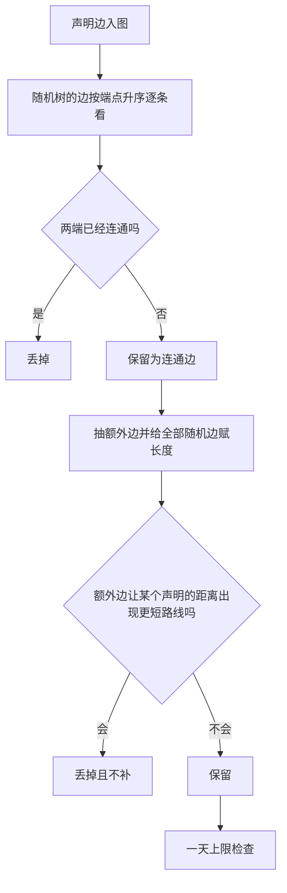
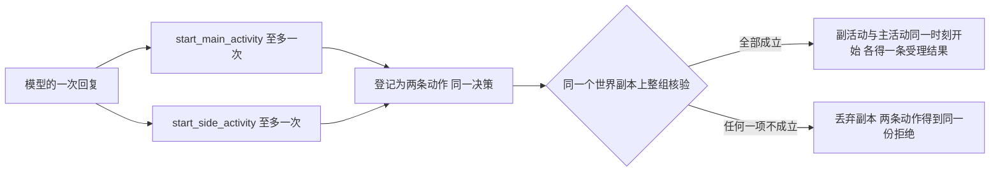
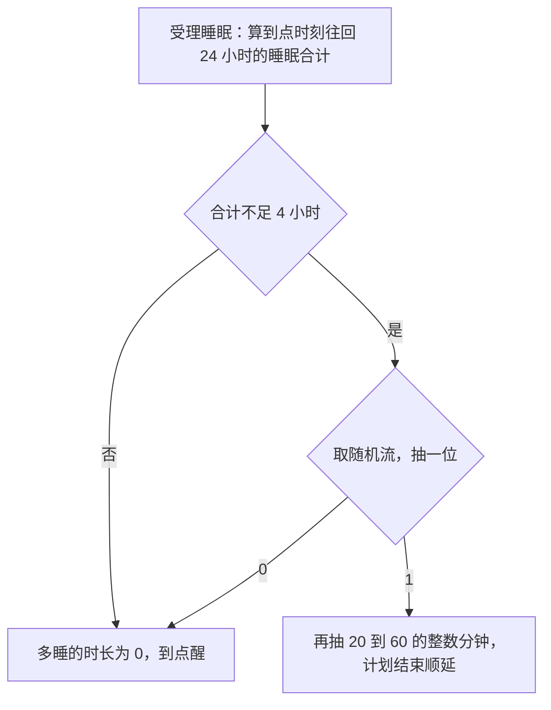
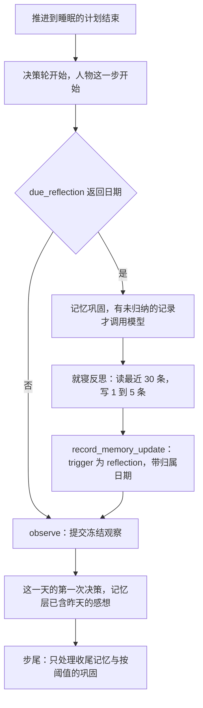
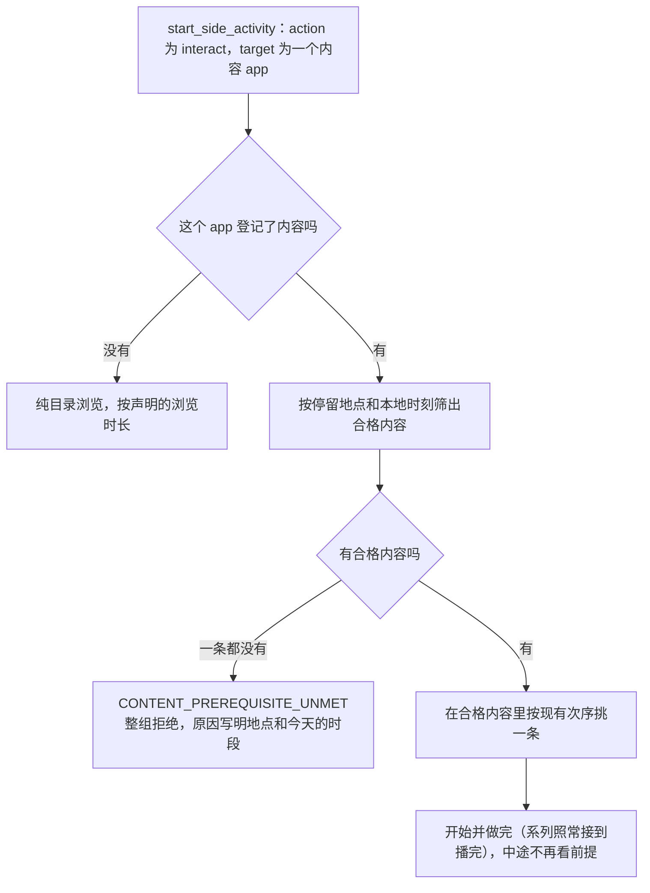

<a name="spec-envrev-环境数据集合同修订规格"></a>
# 环境数据集合同修订规格

> 状态：已冻结（2026-10-11，所有者指示严格按本规格实施）。实施在集成分支 `feat/environment-contract-revision` 上分十个阶段进行。
> 日期：2026-10-10。
> 依据：[环境数据集合同修订提案](PROPOSAL-environment-contract-revision.md)，所有者已逐条确认。本规格把它落成可以直接实现和测试的规则。
> 两者不一致时以提案为准，下面「与提案不同的地方」列出的几处除外。
> 代码基线：主干提交 `6110cb93`（PR 10 合入之后）。文中的「今天」「现行」都指这个提交。
> 证据层级：读代码和离线计算。没有调用模型，没有做过真实运行；文中标明「未运行」的缺陷只是按代码读出的。
> 叫法：「提案」指上面那份修订提案；「旧规格」指 PR 10 实现的[环境数据集合同规格](../environment-dataset-contract/SPEC-environment-dataset-contract.md)；
> 「设计文档《某某》」指 `docs/design/` 下的同名模块正文，实施时先改它再改代码。

<a name="spec-envrev-目录"></a>
## 目录

| 章 | 内容 |
| --- | --- |
| [环境包文件](#spec-envrev-环境包文件) | 必需与可选的目录文件、清单、目录摘要、登记失败的次序 |
| [地图声明](#spec-envrev-地图声明) | `map.jsonl` 的行、矛盾检查、地图生成步骤、距离上下限 |
| [出行方式](#spec-envrev-出行方式) | `travel-method.jsonl` 的行、自带的步行、车费、app 与回调的绑定 |
| [活动接口与槽位](#spec-envrev-活动接口与槽位) | 两个开始接口的请求结构、一轮两个调用、槽位、系统层与工具说明的逐字文本 |
| [在地点做什么由人物点名](#spec-envrev-在地点做什么由人物点名) | 能点名的名字、重名检查、工具层的列出、系列、暂停与恢复、取件 |
| [购买与付款](#spec-envrev-购买与付款) | 订单与配送组、付款时长、购买时长、到达排程、快递到站的修复 |
| [睡眠](#spec-envrev-睡眠) | 时长、能睡的地点、睡过头、睡前提示、唤醒表 |
| [每日反思与睡眠统计](#spec-envrev-每日反思与睡眠统计) | 每天第一次睡醒时的回顾、评估里的就寝与小睡 |
| [app 内容的前提](#spec-envrev-app-内容的前提) | `prerequisite` 的结构、筛选、拒绝、推送、同一轮出行 |
| [引擎要记的手机记录](#spec-envrev-引擎要记的手机记录) | app 的开关、导航规则、地点停留、订单通知、导出与自查 |
| [身体](#spec-envrev-身体) | 基础代谢按体重 |
| [人设作息窗口](#spec-envrev-人设作息窗口) | 声明的作息值不取整、互相矛盾的声明、显示到分钟 |
| [清理项](#spec-envrev-清理项) | 过时的文档段落、写了两处的数字、失效的注释引用、命令写法 |
| [版本、身份与基线](#spec-envrev-版本、身份与基线) | 各版本号的新旧值、测试夹具、基线怎样重做 |
| [实施顺序与验收](#spec-envrev-实施顺序与验收) | 分阶段的实施顺序、每个阶段的门、完成判据与证据层级 |
| [写规格时定下的细节](#spec-envrev-写规格时定下的细节) | 提案没有写到、由规格定下的做法，供所有者过目 |

每章都按同一个顺序写：目标与依据、行为规格、接口删除面与文件指引、测试要求。

<a name="spec-envrev-与提案不同的地方"></a>
## 与提案不同的地方

写规格时对着代码逐条核对，有几处照提案的字面做不成，或者提案里的数不准。这几处以本规格为准，等所有者过目：

- **下单 app 按店铺抽。** 提案定了运费按店铺收。今天下单 app 是按商品抽的，同一家店的两样东西可能分到两个 app，于是同一家店送两趟、收两份运费。规格改成按「店铺、本地日期」抽，见「购买与付款」。
- **晚饭与就寝的先后检查。** 提案写这条加载检查照旧。照旧的话，午夜之后才睡的人物一写晚饭时间就被拒绝。规格把就寝起点落在午夜之后的情形按次日理解，见「人设作息窗口」。
- **两地之间的距离上限。** 提案写的是步行在雪天也要一天内走到。规格按这个世界里最慢的出行方式算；只有步行时仍是约 62 公里，见「地图声明」。
- **几张订单会撑长购买。** 提案写五张以上。按付款 10 至 20 秒、购买 60 至 300 秒算，四张订单就可能，见「购买与付款」。
- **睡过头的算例。** 提案里「夜里 01:00 睡 180 分钟可能睡过头」这一行不对：往回数 24 小时还盖着前一天早晨的睡眠，合计不止 4 小时。规则本身没有变，算例以「睡眠」一章为准，提案已同步更正。
- **基础夹具不加钉钉。** 带前提的内容由测试在夹具副本上构造，基础夹具和两份完整日基线不因它变化。

<a name="spec-envrev-环境包文件"></a>
## 环境包文件

### 目标与依据

环境包是一个环境根目录，只含 `catalog/`、`persona.toml` 和 `config.toml`。今天 `catalog/` 恰好是清单 `manifest.json` 加五个 JSONL，缺一个就不能加载，没有回调也要放一个零字节的 `callbacks.jsonl`。
本章把目录文件改成四个必需加三个可选：`callbacks.jsonl` 变为可选，新增可选的 `map.jsonl`（声明两地距离）与 `travel-method.jsonl`（定义步行以外的出行方式）。
数据集作者只在需要时才放可选文件；对模拟的人，可选文件不存在与存在但零行得到同一个世界。
本章实现提案「版本号与旧数据」中文件集合与目录格式号的部分，以及提案「地图声明」「出行方式」对文件可以不存在的规定。两个新文件的行格式见本规格「地图声明」「出行方式」两章。版本号的新旧值、测试夹具和基线由「版本、身份与基线」规定，本章只引用。

### 行为规格

#### 文件集合

环境根仍是文件闭集，只允许 `catalog/`、`persona.toml`、`config.toml`。`catalog/` 只允许下表八个文件名。

| 文件 | 是否必需 | 内容 | 不存在时 |
| --- | --- | --- | --- |
| `manifest.json` | 必需 | 清单 | 加载失败 |
| `app-catalog.jsonl` | 必需 | app 行 | 加载失败 |
| `content-catalog.jsonl` | 必需 | 内容行 | 加载失败 |
| `location.jsonl` | 必需 | 地点行 | 加载失败 |
| `merchant-catalog.jsonl` | 必需 | 商品行 | 加载失败 |
| `callbacks.jsonl` | 可选 | 状态声明与回调规则 | 没有状态，没有规则 |
| `map.jsonl` | 可选 | 声明的两地距离 | 没有声明，地图全部随机生成 |
| `travel-method.jsonl` | 可选 | 数据集定义的出行方式 | 只有引擎自带的步行 |

- 可选文件「存在」指 `catalog/` 下有这个名字的目录条目，不论类型。存在的条目必须是普通文件；链接和目录由现有的安全文件边界以 `ENVIRONMENT_IDENTITY_MISMATCH` 拒绝。
- 三个可选文件都允许零字节。零字节表示零行，加载出的目录、地图和运行行为与文件不存在完全相同；两者只在清单文件表和目录摘要上不同。
- 文件名一律用连字符。`travel_method.jsonl`、`map.json`、`callback.jsonl` 等其他名字都是包外条目。
- 两个文件名集合只在 `src/worldmock/catalog/identity.py` 定义：`REQUIRED_CATALOG_FILES`（四个必需 JSONL）与新增的 `OPTIONAL_CATALOG_FILES`（三个可选 JSONL）。其余模块引用这两个常量，不各自写文件名。
- 文件闭集分两个阶段落地（阶段见「实施顺序与验收」）：环境包阶段 `OPTIONAL_CATALOG_FILES` 只含 `callbacks.jsonl` 与 `map.jsonl`，这时 `travel-method.jsonl` 仍是包外条目，按 `ENVIRONMENT_STALE_FILE` 拒绝；出行方式阶段把 `travel-method.jsonl` 加入闭集。本章写的「八个文件名」「七个 JSONL 文件名」「三个可选」都是修订结束时的状态，环境包阶段相应是七个、六个和两个。

#### 清单

清单 `manifest.json` 仍是一个 JSON 对象，字段集合不变；两个版本号各升一号（新旧值与升号理由见「版本、身份与基线」），文件表从固定五项改为按实际存在的文件登记。

| 字段 | 类型 | 是否必填 | 约束 | 含义 |
| --- | --- | --- | --- | --- |
| `format_version` | 整数 | 必填 | 恰为 `4` | 目录格式号 |
| `environment_id` | 字符串 | 必填 | 非空白 | 环境标识 |
| `environment_version` | 字符串 | 必填 | 非空白 | 数据集作者决定的版本 |
| `rules_version` | 严格整数 | 必填 | 等于引擎的 `RULES_VERSION`，本次修订后为 `4` | 规则版本 |
| `files` | 数组 | 必填 | 每个存在的目录 JSONL 恰一项；按 `path` 升序；无重复 | 文件表 |
| `files[].path` | 字符串 | 必填 | 七个 JSONL 文件名之一 | 相对 `catalog/` 的路径 |
| `files[].sha256` | 字符串 | 必填 | 64 位小写十六进制 | 该文件实际字节的 SHA-256 |
| `files[].size_bytes` | 严格整数 | 必填 | 不小于 0 | 该文件的实际字节数 |
| `catalog_content_sha256` | 字符串 | 必填 | 64 位小写十六进制 | 目录摘要 |

文件表与实际文件一一对应：四个必需文件必须登记；可选文件存在就必须登记，不存在就不得登记；清单自己不进文件表。
一个放了 `map.jsonl` 和 `travel-method.jsonl`、没有回调的环境包，清单形如（摘要与字节数为示意）：

```json
{"catalog_content_sha256": "…", "environment_id": "white-collar", "environment_version": "3",
 "files": [{"path": "app-catalog.jsonl", "sha256": "…", "size_bytes": 612},
           {"path": "content-catalog.jsonl", "sha256": "…", "size_bytes": 5210},
           {"path": "location.jsonl", "sha256": "…", "size_bytes": 731},
           {"path": "map.jsonl", "sha256": "…", "size_bytes": 43},
           {"path": "merchant-catalog.jsonl", "sha256": "…", "size_bytes": 851},
           {"path": "travel-method.jsonl", "sha256": "…", "size_bytes": 412}],
 "format_version": 4, "rules_version": 4}
```

#### 目录摘要

目录摘要 `catalog_content_sha256` 的算法不变，参与的文件从固定五个改为实际存在的目录 JSONL：

1. 取四个必需文件加存在的可选文件，按路径升序。
2. 依次为每个文件写入一帧：路径的 UTF-8 字节、一个 NUL、八字节大端内容长度、实际内容。
3. 最后写入清单帧：路径为 `manifest.json`，内容是去掉 `catalog_content_sha256`、并把 `files` 换成上一步实际文件表后的清单规范 JSON。
4. 对全部帧求 SHA-256，取小写十六进制。

不存在的可选文件没有帧，也不在文件表里。零字节的可选文件有一帧（内容长度为零）和一项文件表记录：`size_bytes` 为 0，`sha256` 为空内容的摘要 `e3b0c44298fc1c149afbf4c8996fb92427ae41e4649b934ca495991b7852b855`。所以「不放」与「放一个空文件」行为相同、目录摘要不同。
`persona.toml`、`config.toml` 和生成的地图仍不进目录摘要。

#### 校验次序与登记失败

登记失败指加载或校验环境包时抛出的 `RegistrationError`：一个稳定的登记码、一句只在 `src/worldmock/catalog/errors.py` 维护的固定英文原因，加一段可选的英文详情。它没有 `fix` 字段；作者的改法写在手册里。

环境根闭集检查（`validate_environment_entries`）只看条目名、不读内容：根目录出现三个条目以外的名字，或 `catalog/` 出现八个文件名以外的名字，报 `ENVIRONMENT_STALE_FILE`。
清单检查按下面的次序进行，先遇到的先报：

1. 清单原始对象的 `rules_version` 是严格整数且不等于当前规则版本：`RULES_VERSION_MISMATCH`。
2. 严格清单模型不通过（`format_version` 不是 4、字段缺失、类型错误、未知字段）：`ENVIRONMENT_KIND_INVALID`；只有 `files[].size_bytes` 的缺失、类型或取值错误报 `ENVIRONMENT_NUMBER_INVALID`（同时出现未知字段时仍报 `ENVIRONMENT_KIND_INVALID`）。
3. 文件表路径重复：`ENVIRONMENT_ID_DUPLICATE`；未按路径升序：`ENVIRONMENT_KIND_INVALID`。
4. 文件表里有七个 JSONL 文件名以外的路径：`ENVIRONMENT_STALE_FILE`。
5. 文件表缺少某个必需文件：`ENVIRONMENT_FILE_UNLISTED`。
6. `catalog/` 里有八个文件名以外的条目：`ENVIRONMENT_STALE_FILE`。
7. 某个可选文件存在而文件表没有登记：`ENVIRONMENT_FILE_UNLISTED`。
8. 按「目录摘要」的步骤从实际文件重算文件表和摘要，与清单逐项比较，任何不同：`ENVIRONMENT_IDENTITY_MISMATCH`。文件表登记了一个并不存在的可选文件，属于这一项。

| 登记码 | 何时报 | 固定英文原因 | 英文详情 |
| --- | --- | --- | --- |
| `ENVIRONMENT_STALE_FILE` | 环境根或 `catalog/` 有闭集外条目；文件表有七个文件名以外的路径 | `The environment contains an entry outside its declared package.`（不变） | 实际路径 |
| `ENVIRONMENT_FILE_UNLISTED` | 文件表缺少必需文件；可选文件存在而没有登记 | `The manifest does not list a catalog file that is required or present.`（改写：原文只说必需文件） | 没有登记的文件名，例如 `map.jsonl` |
| `ENVIRONMENT_IDENTITY_MISMATCH` | 登记的文件不存在、是链接或目录、字节数或摘要不符；目录摘要不符 | `A catalog file does not match the identity recorded in the manifest.`（不变） | 现有详情 |
| `ENVIRONMENT_ID_DUPLICATE` | 文件表路径重复 | 不变 | 无 |
| `ENVIRONMENT_KIND_INVALID` | 文件表未排序；`format_version` 不是 4；清单形状错误 | 不变 | 模型错误原文 |
| `ENVIRONMENT_NUMBER_INVALID` | 文件表某项的 `size_bytes` 缺失、不是严格整数或小于 0 | 不变 | 模型错误原文 |
| `RULES_VERSION_MISMATCH` | `rules_version` 不是 4 | `The environment was published for a different rules version.`（不变） | 无 |

作者的改法：放了新文件或删了可选文件之后重新刷新清单；`ENVIRONMENT_STALE_FILE` 时删除或改正那个文件名；版本不符时把清单的两个版本号改成 4 并按新格式改完各文件。

详情必须送到作者手里。`worldmock run` 等命令直接输出异常全文；`worldmock validate --environment ROOT` 的每条错误仍是 `{path, code, reason}`，其中登记失败的 `reason` 定为固定英文原因后接一个空格和详情（没有详情时只有固定原因）。本规格其余章节规定的行号、地点对、更短路线等详情都经这一处到达作者。

#### 加载、刷新与纯校验

- 加载（`load_catalog`）与纯校验（`validate_catalog_files`）共用同一段读取与登记：读四个必需文件和文件表登记的可选文件；不存在（因而没有登记）的可选文件按零行处理；存在而未登记的已在清单检查第 7 步拒绝。此后的对象登记、索引和运行不区分「不存在」与「零行」。
- `callbacks.jsonl` 的行规则（状态行在前、规则行在后、各自升序）不变；动作触发的写法变化见「出行方式」。
- `refresh_manifest_identity` 从 `catalog/` 的实际内容重算文件表（四个必需加存在的可选）和目录摘要，原子写出规范 JSON 加 LF。新放入的可选文件被登记，已删除的可选文件被移出；`format_version`、`rules_version`、`environment_id`、`environment_version` 原样保留。缺少必需文件或写入失败时报 `ENVIRONMENT_IDENTITY_MISMATCH` 并保留旧清单。

#### 运行目录冻结与导出自查

- 新建运行时按原字节冻结 `persona.toml`、`config.toml`、`catalog/manifest.json` 和文件表里的每个 `catalog/<path>`，另外冻结生成的地图 `map.json`。`catalog/map.jsonl`（数据集声明的距离，原字节）与 `map.json`（引擎生成的整张图，规范 JSON）是两份不同的素材。
- 导出自查（导出足迹时对冻结素材的核对，`validate_frozen_environment`）先读冻结的清单，再要求冻结素材的名字集合恰为 `persona.toml`、`config.toml`、`map.json`、`catalog/manifest.json` 加清单文件表里的每个 `catalog/<path>`，不符报 `Frozen environment asset set is invalid`。
- 冻结清单的文件表必须包含全部四个必需文件，且不含七个文件名以外的路径，否则报 `Frozen catalog file set is invalid`；目录摘要按文件表里的全部文件重算。
- 恢复和重放照旧核对五项环境身份（`environment_id`、`environment_version`、`rules_version`、`catalog_content_sha256`、`map_sha256`），不新增身份项：增删任何可选文件都会改变 `catalog_content_sha256`。

#### 版本号与旧环境包

规则版本 `RULES_VERSION`（清单 `rules_version`）与目录格式 `format_version` 的新旧值、升号理由、各升一次的原则，以及旧环境包和旧运行在各入口怎样被拒绝，全文见「版本、身份与基线」；本章只规定清单检查里这两个号对应的登记码（见上文「校验次序与登记失败」的第 1、2 步）。
一个现有环境包在文件层面至少要做三件事：把清单的 `format_version` 和 `rules_version` 都改成 4；按各章的新行格式修改 JSONL（人物的家必须标 `sleepable`；功能 app 的出行绑定改写成 `travel_method_ids`，回调规则的出行触发改写成带 `travel_method_id` 的 `travel`；同一个地点类型下内容的 `title` 与 `series.title` 不得重名；需要步行以外的出行方式就新增 `travel-method.jsonl`，需要声明距离就新增 `map.jsonl`，零字节的 `callbacks.jsonl` 可以删掉）；刷新清单后再跑一次环境校验。

测试夹具 `tests/fixtures/dataset-environment/catalog/` 的文件集合、改动所在的阶段和由测试在夹具副本上构造的情形，见「版本、身份与基线」的「测试夹具环境」，本章不另行规定。

### 接口、删除面与文件指引

直接删除：

- 「`catalog/` 恰为五个 JSONL、全部必须存在」的全部实现：`compute_catalog_identity` 固定遍历五个文件、`validate_manifest` 要求文件表等于固定集合、`validate_frozen_environment` 的固定素材集合与固定文件集合。
- `callbacks.jsonl` 必须存在的读取路径；夹具里的零字节 `callbacks.jsonl`。
- `format_version` 为 3、`RULES_VERSION` 为 3 的任何读取。

先改设计文档，再改代码：

| 设计文档 | 小节 | 改什么 |
| --- | --- | --- |
| 《资源引擎》 | 「环境目录文件」 | 文件表改为四个必需加三个可选；清单写 `format_version: 4`、`rules_version: 4`、文件表按存在的文件登记；「没有 `map.json`」一句改为「不发布生成的地图；`map.jsonl` 只声明距离」 |
| 《资源引擎》 | 「注册校验与错误」 | `ENVIRONMENT_FILE_UNLISTED` 的边界改为「缺少必需文件，或存在的可选文件未登记」；写明校验次序 |
| 《资源引擎》 | 「环境发布身份」「目录发布」「验证边界」 | 文件表与目录摘要按存在的文件计算；不放与放空文件摘要不同；刷新会登记或移出可选文件；「五个 JSONL」的说法全部改掉 |
| 《记录引擎》 | 「冻结输入、检查点与分支」 | 冻结素材为清单登记的全部目录 JSONL 加生成的 `map.json` |
| 《状态与序列化》 | 「输入与模型身份」 | 发布目录可以含 `map.jsonl`，但不含生成的地图 |
| 《配置》 | 「校验与输入冻结」 | `validate` 的 `reason` 为固定原因后接详情 |
| 手册《设计环境数据集》《使用 WorldMock》 | 文件清单段 | 八个文件名、哪些可选、不放等于零行 |

| 源码 | 修改范围 |
| --- | --- |
| `src/worldmock/catalog/identity.py` | `REQUIRED_CATALOG_FILES` 去掉 `callbacks.jsonl`；新增 `OPTIONAL_CATALOG_FILES`（环境包阶段两个名字，出行方式阶段加入 `travel-method.jsonl`）；`compute_catalog_identity` 按存在的文件计算；`refresh_manifest_identity` 随之登记或移出可选文件 |
| `src/worldmock/catalog/admission.py` | `validate_environment_entries` 与 `validate_manifest` 的闭集和八步次序 |
| `src/worldmock/catalog/models.py` | `CatalogManifest.format_version` 改为 `Literal[4]` |
| `src/worldmock/catalog/loader.py` | 只读文件表登记的可选文件，不存在的按零行；`_read_callbacks` 接受文件不存在 |
| `src/worldmock/catalog/errors.py` | 改写 `ENVIRONMENT_FILE_UNLISTED` 的原因 |
| `src/worldmock/exchange/constants.py` | `RULES_VERSION = 4` |
| `src/worldmock/validation.py` | `_checked` 把登记详情并入 `reason` |
| `src/worldmock/footprints/frozen_environment.py` | 素材集合和文件集合按冻结清单的文件表核对 |
| `src/worldmock/life/world_setup.py` | 冻结逻辑已按文件表遍历，无需改规则，随新文件集合验证 |
| `tests/fixtures/dataset-environment/catalog/` | 按「版本、身份与基线」的「测试夹具环境」重做并刷新清单 |

### 测试要求

| 层级 | 测试入口 | 必须覆盖的行为 |
| --- | --- | --- |
| unit | `tests/unit/catalog/test_environment_boundary.py` | 八个文件名的任意合法子集通过闭集检查；`map.json`、`travel_method.jsonl` 等名字以 `ENVIRONMENT_STALE_FILE` 拒绝并给出实际路径 |
| unit | `tests/unit/catalog/test_identity.py` | 目录摘要只覆盖存在的文件；同一环境「不放 `callbacks.jsonl`」与「放零字节文件」文件表和摘要不同、加载出的目录对象与地图相同；刷新会登记新放入的可选文件、移出已删除的可选文件；写入失败保留旧清单 |
| unit | `tests/unit/catalog/test_manifest_version.py` | `rules_version` 为 3 先报 `RULES_VERSION_MISMATCH`；规则版本为 4 而 `format_version` 为 3 报 `ENVIRONMENT_KIND_INVALID` |
| unit | `tests/unit/catalog/test_dataset_negative_contract.py`、`test_loader.py` | 逐条验证八步次序：必需文件未登记、可选文件存在未登记（两者都是 `ENVIRONMENT_FILE_UNLISTED` 且详情含文件名）、登记了不存在的可选文件（`ENVIRONMENT_IDENTITY_MISMATCH`）、文件表含闭集外路径、文件表重复与未排序、可选文件是链接；三个可选文件各自不存在、零字节、有内容三种情形都能加载 |
| unit | `tests/unit/footprints/test_dataset_negative_contract.py` | 冻结素材集合多一项、少一项、冻结清单缺必需文件或含闭集外路径时，导出自查分别以规定的英文原因失败 |
| integration | `tests/integration/environment/test_frozen_inputs.py`、`tests/integration/runtime/test_environment_identity.py` | 新建运行冻结的素材恰为清单登记的文件加 `map.json`；带与不带各可选文件的运行都能通过导出自查；改动或增删任一可选文件后打开旧运行被拒绝 |
| system | `tests/system/environment/test_validation.py`、`tests/system/cli/test_cli.py` | `worldmock validate` 对只有四个必需文件的环境包成功；对含全部七个 JSONL 的环境包成功；闭集外文件、未登记的可选文件各报规定的登记码，`reason` 含详情 |
| system | `tests/system/lifecycle/` 下的完整生命周期测试 | 重做后的夹具走完新建、检查点、恢复和导出 |

表中涉及 `travel-method.jsonl` 的用例（八个文件名的闭集、含全部七个 JSONL 的环境包、第三个可选文件的三种情形）在出行方式阶段补齐；环境包阶段按 `callbacks.jsonl` 与 `map.jsonl` 两个可选文件写，并断言 `travel-method.jsonl` 这个名字被 `ENVIRONMENT_STALE_FILE` 拒绝，出行方式阶段把这条断言改为接受。

<a name="spec-envrev-地图声明"></a>
## 地图声明

### 目标与依据

今天地点之间怎么连、每段多长，全部由运行种子随机生成，数据集作者写不了「家到公司有多远」。本章新增可选文件 `map.jsonl`：每行声明两个地点之间的距离，声明的两地直接相连，距离就是声明值；其余的边照旧随机生成并保证全图连通，但不得让任何声明的距离被更短的路线绕过。
数据集作者由此控制通勤、外卖和取件的时间。模拟的人看到的行程时间、车费和预计送达都按新地图计算，请求接口不因本章改变。
没有 `map.jsonl` 时，生成的地图与今天逐字节相同。本章实现提案「地图声明」，以及提案文末「按建议定下的细节」里声明距离上下限的一行；其中总限制的算法与提案的写法有一处差别，见「边长范围与一天上限」。

### 行为规格

#### `map.jsonl` 的行

每行是一条声明边：两个地点之间一条无向的直达连接。行模型沿用现有的 `MapEdge`，不新增字段。

| 字段 | 类型 | 是否必填 | 约束 | 含义 |
| --- | --- | --- | --- | --- |
| `a` | 字符串 | 必填 | 非空白；是 `location.jsonl` 登记的 `location_id`；按字符串比较严格小于 `b` | 一个端点 |
| `b` | 字符串 | 必填 | 非空白；是登记的 `location_id` | 另一个端点 |
| `length_m` | 严格整数 | 必填 | 不小于 1；布尔、小数、字符串都不接受；不设固定上限，只受「一天上限」约束 | 两地的距离，单位米，往返共用 |

- 行按 `(a, b)` 升序排列；同一对地点只能出现一次。端点写 `location_id`，不写显示名。
- 三个字段以外的键拒绝。文件可以零行。
- 声明的地点对之间不需要彼此连通，也不需要覆盖全部地点。

```json
{"a": "cafe", "b": "office", "length_m": 4500}
{"a": "home", "b": "office", "length_m": 12600}
```

#### 登记校验

这些检查不需要运行种子，加载与纯校验都执行。行解析之后依次检查：每行 `a < b`；两个端点都已登记；同一对不重复；行已排序；声明之间不互相矛盾。

| 登记码 | 何时报 | 固定英文原因 | 英文详情 |
| --- | --- | --- | --- |
| `ENVIRONMENT_LINE_INVALID` | 某行不是恰好一个 JSON 对象 | 不变 | `map.jsonl:<行号>` 开头 |
| `ENVIRONMENT_KIND_INVALID` | 出现三个字段以外的键；`a`、`b` 不是非空白字符串；`a` 不小于 `b`（含两端相同）；行未按 `(a, b)` 升序 | 不变 | `map.jsonl:<行号> Map endpoints must satisfy a < b.`；`map.jsonl:<行号> Map rows must be sorted by (a, b).` |
| `ENVIRONMENT_NUMBER_INVALID` | `length_m` 缺失、不是严格整数或小于 1 | 不变 | `map.jsonl:<行号>` 加模型错误原文 |
| `ENVIRONMENT_REF_UNKNOWN` | 端点不是登记的 `location_id` | 不变 | `map.jsonl:<行号> Unknown location_id: <值>.` |
| `ENVIRONMENT_ID_DUPLICATE` | 同一对 `(a, b)` 出现两行 | 不变 | `map.jsonl:<行号> and map.jsonl:<行号> declare the same pair <a>-<b>.` |
| `MAP_DISTANCE_CONTRADICTED`（新增） | 某条声明边的两端，经其他声明边有一条严格更短的路线 | `A declared distance is longer than a route through other declared distances.` | `map.jsonl:<行号> <a>-<b> declares <声明值> m but <a> -> … -> <b> is <路线总长> m.` |
| `MAP_ROUTE_TOO_LONG`（新增，需要种子） | 生成后的地图上，最远的一对地点用最慢的出行方式在最差天气下走不到一天之内 | `Two places are farther apart than the slowest travel method can cover in one day in the worst weather.` | `<a> -> <b> is <距离> m, which takes <秒数> s at <速度> m/s in the worst weather; the limit is 86400 s.` |

现有的 `MAP_TOO_SMALL`、`MAP_EDGE_INVALID`、`MAP_DISCONNECTED` 仍用于生成结果的自检，含义不变。

#### 互相矛盾的声明

1. 用全部地点作节点、全部声明边作边，建一张只含声明边的图（复用 `Graph`，它不要求连通）。
2. 按文件行序逐行取这张图上 `a` 到 `b` 的最短距离。距离严格小于该行的 `length_m` 就报 `MAP_DISTANCE_CONTRADICTED`，报第一条不成立的行。
3. 详情里的路线取 `Graph.path` 的结果：最短路线，等长时取完整地点元组字典序最小的一条。
4. 绕行总长等于声明值不算矛盾。

例：

```json
{"a": "home", "b": "office", "length_m": 12600}
{"a": "home", "b": "park", "length_m": 3000}
{"a": "office", "b": "park", "length_m": 4000}
```

加载失败：`MAP_DISTANCE_CONTRADICTED: A declared distance is longer than a route through other declared distances. map.jsonl:1 home-office declares 12600 m but home -> park -> office is 7000 m.`
把第一行改成 7000 或更小就能加载。作者的改法只有一种：让直达的距离不超过绕行的总长。

#### 生成步骤

地图仍只在加载时在内存里生成。输入是全部 `location_id`、声明边和地图种子；地图种子的取法不变：`random_stream(sha256("random:{seed}"), "map").getrandbits(64)`，不新增随机键。下面的「随机树」指 `nx.random_labeled_tree(地点数, seed=地图种子)` 的边映射回地点身份后的地点对。



1. 地点身份升序排成节点序列。不足两个报 `MAP_TOO_SMALL`。
2. 声明边全部入图，长度取声明值。
3. 取随机树的地点对，按 `(a, b)` 升序逐条看：两端此刻还不连通（声明边和已保留的连通边都算）就保留，称为连通边，并把两端所在的两部分合并；两端已经连通就丢掉。
4. 候选集合是全部无序地点对减去随机树的全部地点对（保留的和丢掉的都减去）再减去声明的地点对，按 `(a, b)` 升序。
5. 以 `random.Random(地图种子)` 从候选中 `sample` 抽取额外边，条数为「（地点数 − 1）÷ 2 向下取整」与候选个数中较小的一个。
6. 把连通边和抽到的额外边合在一起按 `(a, b)` 升序，用同一个随机流依次为每条抽一个 200 到 2000 米的整数长度。
7. 当前图为声明边加连通边。额外边按 `(a, b)` 升序逐条检查：把它加入当前图后，只要有任何一条声明边的两端最短距离严格小于声明值，就丢掉这条额外边；否则加入当前图。丢掉的不补抽。
8. 输出节点序列和按 `(a, b)` 升序的全部边，经 `validate_map` 自检后做「一天上限」检查。

由这些步骤直接得到三条性质，测试必须守住：

- 全图连通。随机树本身连通全部地点，丢掉的树边两端当时已经连通。
- 每条声明边两端的最短距离恰等于声明值。连通边加入时两端不连通，所以它不在任何环上，不会给已经连通的两地开出新路；额外边逐条检查过。
- 相同的地点集合、相同的声明边（解析后的值，不看行内空白和键序）和相同的种子，得到相同的地图。

额外边在总长恰好相等时保留。这时距离仍等于声明值，但 `Graph.path` 可能返回经过中间地点的那条等长路线，行程记录里的路径随之不同；用时和车费不受影响。

#### 边长范围与一天上限

| 边的来源 | 长度范围 |
| --- | --- |
| 连通边、额外边 | 200 到 2000 米的整数（`MAP_EDGE_LENGTH_M`，不变） |
| 声明边 | 不小于 1 米的整数；不设 2000 米上限 |

一天上限是对生成后的整张图做的唯一一处检查，保证运行中任何一次出行的用时都不超过 86,400 秒：

1. 取最慢速度：内置步行的 1.2 米/秒与 `travel-method.jsonl` 各行速度中最小的一个。
2. 取最差天气系数：天气系数表里最小的一个，今天是雪的 0.6。
3. 取图上最短距离最大的一对地点；距离相同时取 `(a, b)` 最小的一对。
4. 用现有的用时算子按这个距离、最慢速度和最差天气系数算用时；大于 86,400 秒就报 `MAP_ROUTE_TOO_LONG`。

只有步行时，这等于任意两地的最短距离不超过 62,208 米：62,208 米正好 86,400 秒，62,209 米是 86,402 秒。数据集定义了更慢的方式时上限按它算，例如 0.5 米/秒对应 25,920 米。
与提案的差别：提案写的是步行在雪天也要能一天内走到；本章扩大为最慢的出行方式，因为工具层要为每个目的地的每种方式算用时，超过一天会直接出错。只有步行时上限仍是提案的约 62 公里；数据集定义了比步行更慢的方式时上限更小，按提案能加载的环境包会在这里被拒绝。这一处扩大列进替所有者定下的细节。
分阶段落地（阶段见「实施顺序与验收」）：环境包阶段的可选文件只有 `callbacks.jsonl` 和 `map.jsonl`，第 1 步的最慢速度只有步行的 1.2 米/秒，一天上限只按步行算；出行方式阶段加入 `travel-method.jsonl`，把各行的速度纳入第 1 步，一天上限随之扩到数据集定义的最慢方式。
例：两个地点的环境包声明 70,000 米，报 `home -> office is 70000 m, which takes 97223 s at 1.2 m/s in the worst weather; the limit is 86400 s.`
这一检查需要生成后的地图，所以在 `load_catalog` 里做；不带种子的纯校验不做。`worldmock validate` 在运行配置可读时会带种子加载，因此同样报出。
有了这条上限，出行受理和工具层报价不会再遇到超过一天的行程；行程规划里现有的 `ROUTE_DURATION_INVALID` 保持原样，不为它新增任何接住或兜底的路径。

#### `map_sha256` 与冻结

- `map_sha256` 仍是整张生成结果的摘要：对 `{"edges": [{"a", "b", "length_m"}, …], "nodes": […]}` 的规范 JSON 加一个 LF 求 SHA-256。声明边与随机边一视同仁，不标记来源。
- 它取决于地点身份集合、声明边的值和运行种子；不取决于 `travel-method.jsonl`，也不取决于 `map.jsonl` 的行内空白和键序（这些字节差异由目录摘要体现）。
- 生成结果不写进环境包。新建运行时照旧把它冻结为运行目录里的 `map.json`；恢复和重放重新生成并核对 `map_sha256`。`map.jsonl` 的原字节另按「环境包文件」冻结。

#### 与今天逐字节相同的范围

没有 `map.jsonl`（或文件零行）时，声明边为空：随机树的每条边加入时两端都不连通，全部保留；候选集合、抽取条数、赋长度的次序与今天的生成器相同；没有声明可绕过，额外边一条也不丢。所以生成的边、`map.json` 的字节和 `map_sha256` 与今天逐字节相同。
离线核对（修订前的生成器对照上述步骤）：2 到 40 个地点各 60 个种子，加夹具八个地点的 300 个运行种子，共 2,640 组，全部相同。夹具（八个地点、种子 7）的 `map_sha256` 保持 `017bbcfedf78e142ac0310242e504655142c92796fb8395c8ccc4a11a3afedf5`，只要地点身份集合不变。
与今天的差别只有一处：新增的一天上限会拒绝今天能加载的极端地图。只有步行时，它要求某条最短路线超过 62,208 米，也就是至少 32 条随机边连成一条最短路，因此不超过 32 个地点的环境包不可能触发；数据集定义了比步行更慢的方式时上限相应变小。清单版本号和目录摘要的变化属于「环境包文件」，不是地图的差别。

#### 夹具算例

夹具今天生成十条边，家到公司最短是「家 → 五里公园 → 公司」，1,745 + 212 = 1,957 米。在夹具副本上放一行 `{"a": "home", "b": "office", "length_m": 12600}` 后，按上述步骤得到：

| 步骤 | 结果 |
| --- | --- |
| 随机树的七条边 | 保留六条为连通边；`office`–`park` 被丢掉，因为升序在前的 `home`–`park` 已经把五里公园连进「家—公司」这一部分 |
| 抽到的三条额外边 | `home`–`noodle-2`、`noodle-1`–`office`、`noodle-1`–`store` |
| 逐条检查 | `home`–`noodle-2`（1,910 米）会开出「家 → 二味小炒 → 四季便利 → 快递驿站 → 公司」共 4,557 米的路线，丢掉；另两条保留 |
| 最终九条边 | `cafe`–`parcel-station` 1869、`home`–`office` 12600、`home`–`park` 1745、`noodle-1`–`noodle-2` 1156、`noodle-1`–`office` 1655、`noodle-1`–`store` 779、`noodle-2`–`store` 1532、`office`–`parcel-station` 903、`parcel-station`–`store` 212 |
| `map_sha256` | `4f50d86da786151125b7f067349b1e0b96e99a2564728c032fea81be14e74f3e` |

家到公司是声明的 12,600 米。地图分成两簇：家这一侧只有家和五里公园，其余六个地点都在公司一侧。五里公园今天离公司 212 米，声明后离公司 14,345 米。这就是提案要求作者为公司或家附近要用到的地点各声明一行的原因；引擎不为此加规则。

#### 自动跟随声明的行为

下面几项不另写规则，按新地图的最短距离照现有公式计算：

- 出行用时与车费。12,600 米、驾车 7 米/秒：晴和多云 1,800 秒，小雨 2,118 秒（35 分 18 秒），大雨 2,572 秒（42 分 52 秒），雪 3,000 秒。08:20 出发分别在 08:50:00、08:55:18、09:02:52、09:10:00 到达。步行晴天 10,500 秒（2 小时 55 分）。
- 外卖配送时长仍是备餐 600 秒加「距离 ÷ 5 米/秒」向上取整，不乘天气系数。4,500 米是 1,500 秒（25 分钟）；13,400 米是 3,280 秒（54 分 40 秒）。
- 最近的店和最近的驿站按新地图的最短距离选，同距取较小的地点身份。
- 一对地点只有一个距离，往返相同；天气照旧放慢各种出行方式。这两点是已接受的偏差。

### 接口、删除面与文件指引

直接删除：

- 「地图完全由全部地点和运行种子生成，数据集给不出任何距离」「树之外固定再加（地点数 − 1）÷ 2 条额外边」「每条边长都在 200 到 2000 米内」「相同的地点集合和种子得到相同的地图」这四句规则的原表述；改为本章的表述。
- 行程规划里把一天上限写成字面数 `86400` 的写法，改为引用常量。

先改设计文档，再改代码：

| 设计文档 | 小节 | 改什么 |
| --- | --- | --- |
| 《资源引擎》 | 「职责与边界」 | 流程图与说明加入「声明的距离」作为地图的输入 |
| 《资源引擎》 | 「加权连通图与路线」 | 整节重写：`map.jsonl` 的行、矛盾检查、八步生成、边长范围、一天上限、`map_sha256` 取决于什么、没有声明时与修订前相同 |
| 《资源引擎》 | 「注册校验与错误」 | 登记码表加入 `MAP_DISTANCE_CONTRADICTED`、`MAP_ROUTE_TOO_LONG` 及 `map.jsonl` 行使用的通用码 |
| 《配置》 | 「唯一种子与随机键」 | 「地图」一行补充：同一个 64 位地图种子用于随机树、额外边抽取和边长，声明边不消耗随机数 |
| 《概述》 | 「地图中的消费行为」 | 改掉「地图由 WorldMock 生成、Dataset 发布」的说法：距离可由数据集声明，其余随机生成，生成结果不发布 |
| 手册《设计环境数据集》 | 地图一段 | 怎样写 `map.jsonl`；声明长距离后要为附近用到的地点各声明一行；矛盾时怎么改；一天上限 |

| 源码 | 修改范围 |
| --- | --- |
| `src/worldmock/catalog/mapgen.py` | `generate_edges`、`generate_map` 增加声明边参数并实现八步；函数超过 50 行时拆出连通边与额外边两个私有函数 |
| `src/worldmock/catalog/admission.py` | 新增 `map.jsonl` 的行次序、引用、重复与矛盾检查（并入 `validate_registration` 的共用阶段）；新增对生成结果的一天上限检查（环境包阶段只按步行，出行方式阶段纳入数据集各行的速度） |
| `src/worldmock/catalog/loader.py` | 读取 `map.jsonl`（行模型 `MapEdge`）；把声明边交给生成器；生成后调用一天上限检查 |
| `src/worldmock/catalog/errors.py` | 新增两个登记码及原因 |
| `src/worldmock/exchange/constants.py` | 新增 `TRAVEL_MAX_SECONDS = 86400`；天气系数表 `WEATHER_FACTORS` 从 `src/worldmock/life/weather.py` 移到这里，供目录层与生活层共用 |
| `src/worldmock/life/weather.py`、`src/worldmock/life/travel.py`、`src/worldmock/scheduling/effects.py`、`src/worldmock/footprints/environment_events.py` | 改为引用上述常量，行为不变；后两个文件今天从 `life.weather` 导入 `WEATHER_FACTORS`。同一阶段修改 `tests/unit/engineering/test_single_source.py` 的归宿表 |

`Graph`（`src/worldmock/catalog/graph.py`）、`MapEdge`、`MapGraph`、`map_bytes` 不改。

### 测试要求

| 层级 | 测试入口 | 必须覆盖的行为 |
| --- | --- | --- |
| unit | `tests/unit/catalog/test_mapgen.py` | 没有声明边时与修订前逐字节相同：保留现有固定样例（三个地点、种子 7 的三条边和字节）并核对夹具的 `map_sha256`；有声明边时每条声明边都在图里且长度为声明值、每个声明的地点对最短距离等于声明值、全图连通；随机边长度都在 200 到 2000 之间；丢掉的额外边不补（边数可以少于「地点数 − 1 +（地点数 − 1）÷ 2」）；候选不足时有几条取几条（三个地点全部声明、两个地点声明一对）；节点输入次序不影响结果；夹具声明家到公司 12,600 米得到「夹具算例」的九条边和摘要 |
| unit | `tests/unit/catalog/test_admission.py`、`test_jsonl.py` | `map.jsonl` 每种行错误报规定的登记码和带行号的详情：未知键、`a` 不小于 `b`、未排序、同一对两行、未登记地点、`length_m` 为 0、布尔、小数、字符串、缺失；矛盾声明报 `MAP_DISTANCE_CONTRADICTED` 且详情含行号、声明值、路线和总长；绕行等长时通过；零行文件通过 |
| unit | `tests/unit/catalog/test_loader.py` | 一天上限的边界：只有步行时最远距离 62,208 米通过、62,209 米报 `MAP_ROUTE_TOO_LONG`；两条各自合法的声明边串起来超限时报出的是最远的那一对；数据集定义 0.5 米/秒的方式时上限变为 25,920 米（这一条随出行方式阶段加入）；纯校验不做这项检查 |
| integration | `tests/integration/life/test_purchase_travel_admission.py`、`test_environment_runtime.py` | 真实引擎加载带声明的环境：工具层对声明的地点对给出的用时与车费等于按声明值计算的结果，四种天气系数下受理的行程用时与本章算例一致；外卖预计送达、最近驿站按新地图计算；行程记录的距离等于声明值 |
| integration | `tests/integration/runtime/test_environment_identity.py` | `map.jsonl` 的值改变后 `map_sha256` 与 `catalog_content_sha256` 都变；只改行内空白时只有 `catalog_content_sha256` 变；改动后打开旧运行被拒绝；冻结的 `map.json` 与内存地图字节一致 |
| system | `tests/system/environment/test_validation.py` | `worldmock validate` 对矛盾声明和超限声明各返回规定的登记码，`reason` 含更短路线或地点对 |

<a name="spec-envrev-出行方式"></a>
## 出行方式

### 目标与依据

今天步行、驾车、打车、公共交通四种方式及其速度、车费、体力消耗都写死在引擎里，每个人物都能开车，各是一个动作。本章把出行合成一个动作 `travel`，把步行以外的方式交给数据集：可选文件 `travel-method.jsonl` 每行定义一种出行方式，引擎只自带步行。
数据集作者决定这个世界里有哪些方式、各自多快、多贵、多累；没有这个文件的环境包里人物只能步行。模拟的人在工具层每个目的地下看到各方式的用时、车费和费力程度，把方式的名称写进 `start_main_activity` 的 `detail`。
天气对速度的影响仍由引擎固定。本章实现提案「出行方式」以及文末「按建议定下的细节」里车费合成、出行方式身份和重名三行；评估里的出行类别按所有者的裁决暂不处理。

### 行为规格

#### `travel-method.jsonl` 的行

| 字段 | 类型 | 是否必填 | 约束 | 含义 |
| --- | --- | --- | --- | --- |
| `travel_method_id` | 字符串 | 必填 | 非空白；文件内唯一；行按它升序；不得为保留身份 `walking` | 出行方式的身份，app 行和回调规则用它引用 |
| `name` | 字符串 | 必填 | 非空白；在全部出行方式（含内置的「步行」）之间经 `channel_key`（去掉全部空白、不分大小写）比较后唯一 | 人物看到并写进 `detail` 的名称 |
| `speed_meters_per_second` | JSON 数值 | 必填 | 有限且大于 0；整数或小数都可以；布尔和字符串不接受 | 基础速度，米/秒 |
| `start_price_fen` | 严格整数 | 必填 | 不小于 0 | 起步价，分 |
| `price_per_km_fen` | 严格整数 | 必填 | 不小于 0 | 每公里价格，分 |
| `exertion` | 字符串 | 必填 | `idle`、`light`、`moderate`、`heavy` 之一 | 体力档位，与内容行的 `exertion` 同一闭集 |

六个字段都没有缺省值，其他键拒绝。文件可以零行。两个价格都写 0 就是免费的方式。名称不要求与地点、商品、app 的名称不同，因为它只在 `detail` 里解析。

#### 自带的步行

步行由引擎维护，不写在文件里，任何环境包都有。

| 事实 | 固定值 |
| --- | --- |
| 身份 | `walking`（保留，数据集的行不得使用） |
| 名称 | 「步行」（数据集的行不得重名） |
| 速度 | 1.2 米/秒 |
| 车费 | 0 |
| 代谢当量 | 3.5 |

app 行和回调规则可以像引用数据集的方式一样引用 `walking`。

#### 登记校验

| 登记码 | 何时报 | 英文详情 |
| --- | --- | --- |
| `ENVIRONMENT_LINE_INVALID` | 某行不是恰好一个 JSON 对象 | `travel-method.jsonl:<行号>` 开头 |
| `ENVIRONMENT_KIND_INVALID` | 未知键；`travel_method_id`、`name` 缺失或不是非空白字符串；`exertion` 缺失或不在四个档位内；行未按 `travel_method_id` 升序 | `travel-method.jsonl:<行号>` 加模型错误原文，或 `Travel method rows must be sorted by travel_method_id.` |
| `ENVIRONMENT_NUMBER_INVALID` | 速度缺失、不是数值、不是有限数或不大于 0；两个价格缺失、不是严格整数或小于 0 | `travel-method.jsonl:<行号>` 加模型错误原文 |
| `ENVIRONMENT_ID_DUPLICATE` | `travel_method_id` 重复；`travel_method_id` 写成 `walking`；两行名称相同；名称与「步行」相同 | `travel-method.jsonl:<行号> and travel-method.jsonl:<行号> share the identity <值>.`；`travel-method.jsonl:<行号> uses the reserved identity walking.`；`travel-method.jsonl:<行号> and travel-method.jsonl:<行号> share the name <名称>.`；`travel-method.jsonl:<行号> uses the built-in name 步行.` |
| `ENVIRONMENT_REF_UNKNOWN` | app 行的 `travel_method_ids` 或回调规则的 `travel_method_id` 指向既不在文件里、也不是 `walking` 的身份 | `<文件名>:<行号> Unknown travel_method_id: <值>.` |

各码的固定英文原因不变。速度极慢的方式不在这里拒绝，由「地图声明」的一天上限统一把关。
行解析之后依次检查：保留身份、身份重复、行按身份升序、保留名称、名称重复；先遇到的先报。
行里写 `Infinity`、`NaN` 属于 `ENVIRONMENT_LINE_INVALID`，在行读取阶段就被拒绝；溢出成无穷大的数字写法（例如 `1e999`）报 `ENVIRONMENT_NUMBER_INVALID`。
`travel-method.jsonl` 在出行方式阶段才加入可选文件闭集 `OPTIONAL_CATALOG_FILES`（见「环境包文件」），同一阶段把一天上限从只按步行扩到数据集定义的最慢方式（见「地图声明」）；此前的阶段这个文件名是包外条目。

#### 用时与车费

对一次出行（起点是人物当前所在地点，终点是 `target` 解析出的地点，方式是 `detail` 解析出的出行方式）：

1. 距离与路径取内存地图的最短路，等长时取完整地点元组字典序最小的一条。
2. 天气系数取受理当刻的世界天气：晴、多云 1.0，小雨 0.85，大雨 0.7，雪 0.6。它对包括数据集定义的全部方式生效，数据集不能改。
3. 用时 `duration_seconds = ceil(distance_meters ÷ (speed_meters_per_second × 天气系数))`。沿用现有的十进制精确算法：速度为整数时原样取，为小数时取它的最短十进制写法；先精确相乘，再整数化上取整。
4. 车费 `fare_fen = max(start_price_fen, ceil(price_per_km_fen × distance_meters ÷ 1000))`，全程整数运算，即 `max(start_price_fen, (price_per_km_fen * distance_meters + 999) // 1000)`。车费与天气无关。
5. 车费在出发受理时支付给 `external:scenario`；为 0 时不动余额；余额不足以 `INSUFFICIENT_TRAVEL_FUNDS` 拒绝，文字不变。

受理时冻结路径、距离、天气系数、用时和车费，之后天气变化不改写已受理的行程；恢复时按同一方式重算并核对，不符仍报 `Persisted travel plan does not match the published graph`。

夹具为保持今天的行为加入下面三行（见「夹具」），用上面的公式逐米核对 0 到 200,000 米，车费与今天的算子零处不同，用时在四种天气系数下也相同。家到公司 12,600 米、晴：

| 出行方式 | 用时 | 车费 |
| --- | --- | --- |
| 步行 | 10,500 秒（2 小时 55 分） | 0 |
| 公共交通（5 米/秒，起步 200，每公里 0） | 2,520 秒（42 分） | 200 分 |
| 驾车（7 米/秒，起步 500，每公里 200） | 1,800 秒（30 分） | 2,520 分 |
| 打车（7 米/秒，起步 1400，每公里 300） | 1,800 秒（30 分） | 3,780 分 |

短途时起步价生效：1,957 米驾车按公里是 392 分，收 500 分；打车按公里是 588 分，收 1,400 分。

#### 体力档位

出行的体力消耗沿用内容的四个档位和同一组代谢当量，步行保留自己的固定值。工具层不出现身体数值，只把档位说成「轻松」或「费力」。

| 方式 | 代谢当量键 | 代谢当量 | 工具层的说法 |
| --- | --- | --- | --- |
| 自带的步行 | `walking` | 3.5 | 费力 |
| `exertion` 为 `idle` | `idle` | 1.0 | 轻松 |
| `exertion` 为 `light` | `light` | 1.5 | 轻松 |
| `exertion` 为 `moderate` | `moderate` | 2.0 | 费力 |
| `exertion` 为 `heavy` | `heavy` | 5.0 | 费力 |

身体常量表 `BODY_CONSTANTS.activity_met` 删除 `drive`、`take_taxi`、`take_bus` 三个键，`walk` 改名为 `walking`。出行活动受理时把代谢当量键写进活动私有数据的 `exertion`，身体结算对出行和 interact 一样读这个键；并行活动取较高代谢当量的规则不变。

#### 功能 app 的绑定

功能 app 是 `role` 为 `function`、由引擎代为选用的 app。它的绑定分成两个字段：

| 字段 | 类型 | 是否必填 | 约束 | 含义 |
| --- | --- | --- | --- | --- |
| `actions` | 字符串数组 | 功能 app 可选，缺省为空；内容 app 不得出现 | 元素只能是 `purchase`；升序、无重复 | 绑定购买，作为支付 app 候选（不变） |
| `travel_method_ids` | 字符串数组 | 功能 app 可选，缺省为空；内容 app 不得出现 | 每项是文件里的 `travel_method_id` 或 `walking`；按身份升序、无重复 | 绑定这些出行方式，作为导航 app 候选 |

```json
{"app_id": "amap", "name": "高德地图", "role": "function", "travel_method_ids": ["bus", "driving", "taxi", "walking"]}
```

| 登记码 | 何时报 | 固定英文原因 |
| --- | --- | --- |
| `APP_UNBOUND` | 功能 app 的两个数组都为空 | `An app must have content, or an action or travel method binding, for its role.`（改写） |
| `APP_ROLE_BINDING_INVALID` | 内容 app 带有 `actions` 或 `travel_method_ids` 字段，空数组也算 | `Only function apps may bind actions or travel methods, and only content apps may be referenced by locations, goods or contents.`（改写） |
| `ENVIRONMENT_KIND_INVALID` | `actions` 里出现 `purchase` 以外的值（包括 `travel` 和四个旧动作名）；数组未排序 | 不变 |
| `ENVIRONMENT_ID_DUPLICATE` | 数组内重复 | 不变 |
| `ENVIRONMENT_REF_UNKNOWN` | `travel_method_ids` 指向未登记的身份 | 不变 |

目录索引 `apps_by_action` 只保留 `purchase` 一个键；新增 `apps_by_travel_method`，键为 `walking` 和每个数据集身份，值为绑定它的功能 app 身份升序元组。
导航 app 的选择规则不变：出行受理成功后，从 `apps_by_travel_method[该次出行的 travel_method_id]` 里用随机流 `function-app:{activity_id}` 等概率选一个，候选为空就没有导航记录，不加空值。选中后整趟不换。它几点开、几点关怎样记，见「引擎要记的手机记录」。

#### 回调规则的引用

回调规则的动作触发在 `key` 为 `travel` 时多一个必填字段：

| 字段 | 类型 | 是否必填 | 约束 | 含义 |
| --- | --- | --- | --- | --- |
| `class` | 字符串 | 必填 | `action` | 触发类 |
| `key` | 字符串 | 必填 | 动作闭集之一；四个旧出行动作名不再合法 | 订阅的动作 |
| `travel_method_id` | 字符串 | `key` 为 `travel` 时必填，其他 `key` 不得出现 | 文件里的身份或 `walking` | 只订阅这一种出行方式 |

```json
{"rule_id": "fuel-daily", "trigger": {"class": "action", "key": "travel", "travel_method_id": "driving"},
 "effect": {"type": "state_delta", "state": "fuel", "delta": -1, "once_per": "local_day"}}
```

- `key` 为 `travel` 而缺 `travel_method_id`，或其他 `key` 带了它：`ENVIRONMENT_KIND_INVALID`。指向未登记的身份：`ENVIRONMENT_REF_UNKNOWN`。
- 一条规则订阅一种方式，与今天一条规则订阅一个出行动作的表达力相同；不提供「任意方式」的写法。
- 匹配：一次出行受理成功时，触发原因带上该次出行的 `travel_method_id`；规则的 `key` 与方式都相同才匹配。带 `once_per: local_day` 的增量仍按出行活动实际结算的本地日期执行，匹配条件相同。
- 模型上按现有月度触发的做法新增一个独立的触发模型 `TravelTrigger`，加载器在 `key` 为 `travel` 时选用它。

#### 请求、名称解析与拒绝

```text
start_main_activity  {"action": "travel", "target": "公司", "detail": "驾车"}
```

`target` 是目的地的完整显示名，解析规则与今天的出行目标相同。`detail` 是出行方式的名称，只在出行方式的名称里解析：先精确匹配，再按现有的无损归一（全半角、括号、空白）逐级放宽，唯一才受理；写法实际变化时照旧记入 `details.resolved`。宿主与环境共用同一个解析函数。引擎不默认步行，也不替人物改写。

`detail` 缺失、找不到或有歧义时的错误码、路径、`expected`、`why`、`allowed_values` 和候选形状，全文在「活动接口与槽位」（请求模型的交叉约束与「名称解析」），出行与在地点做事共用同一套文字，本章不另给。本章只定两点：不默认步行；候选是可以照抄的完整调用，其中 `action` 为 `travel`、`target` 为目的地显示名、`detail` 为出行方式名称。
把当前所在地点写成出行目的地，唯一的结果是名称解析阶段的 `ACTION_NOT_OFFERED`（当前地点的行不提供 `travel`），同样见「活动接口与槽位」；它不是出行的对象条件，本章不另列拒绝。

| 错误码 | 何时 | 条目内容 | 原因与改法 |
| --- | --- | --- | --- |
| `INSUFFICIENT_TRAVEL_FUNDS` | 余额低于车费 | 不变 | `The caller's available balance is below the route fare.`；没有改法 |

名称类拒绝每人每秒前两次不计同刻轮数的规则不变。错误的五字段形状、调用位置前缀和两个开始接口同轮时的合并方式由「活动接口与槽位」规定。
同一轮里出发并购买时，开始前的余额核对照今天进行，车费取所选出行方式的车费。

#### 工具层

工具层是提示里列出此刻能做什么的那一层。每个其他地点（目的地）仍占一行，关闭的地点照旧可以前往。该行的动作不再是四个出行动作，而是每种出行方式一行：

| 键 | 取值 |
| --- | --- |
| `action` | 恒为 `travel` |
| `detail` | 出行方式的名称，即人物要写进 `detail` 的字 |
| `available`、`reason` | 与受理同源的可用性和英文原因，规则不变（同刻阶段、待收尾、槽位、余额等） |
| `price` | 车费的人读写法，例如「25.2 元」；免费写「0 元」 |
| `duration` | 按当刻天气算出的用时的人读写法，例如「约 30 分钟」 |
| `quantity` | `null` |
| `note` | 「轻松」或「费力」，按「体力档位」的表 |

- 顺序：步行在前，其余按 `travel_method_id` 升序。每个目的地列出全部方式，不轮转、不截断。
- 私有绑定行在每个动作上另带 `travel_method_id`，不进入公开工具层；这个字段登记在「活动接口与槽位」的绑定行字段表里（仅 `travel` 行）。
- 紧凑渲染的分组键不变（目标类别与动作）；`detail` 加入动作字段闭集，使紧凑渲染与还原逐值守恒。全部目的地的出行行因此落在同一组里。
- `query_world` 按动作筛选 `travel` 时返回各方式的行，不新增按出行方式的筛选键。

家到公司 12,600 米、晴，夹具三行，「公司」一行下依次是：

| `detail` | `price` | `duration` | `note` |
| --- | --- | --- | --- |
| 步行 | 0 元 | 约 3 小时 | 费力 |
| 公共交通 | 2 元 | 约 42 分钟 | 轻松 |
| 驾车 | 25.2 元 | 约 30 分钟 | 轻松 |
| 打车 | 37.8 元 | 约 30 分钟 | 轻松 |

系统层讲出行的文字见「活动接口与槽位」的逐字文本，不点名任何具体方式。

#### 活动、行程身份与人物可见文字

- 出行活动保存 `travel_method_id`，取代原来的 `travel_mode`；出行方式枚举 `TravelMode` 删除。判断一项活动是不是出行只看动作是否为 `travel`，不再看这个字段有没有值。
- 行程身份仍是 `<起点>-><终点>:<travel_method_id>`，步行的行程身份不变，例如 `home->office:walking`。
- 外卖商品履约记录的 `trip_id` 后缀由今天写死的 `driving` 改为 `delivery`，写成 `<店铺>-><收货地>:delivery`；它不是出行方式身份，与出行方式和 `travel-method.jsonl` 无关。
- 同一个名称用在所有人物可见的地方，引擎不再维护另外两套说法：活动名为「<出行方式名称>前往<地点显示名>（M月D日 HH:MM 起）」；环境层路上的位置对象把键 `travel_mode` 改名为 `travel_method`，值为出行方式名称；已核验的到达句为「<时刻> <出行方式名称>到了<地点显示名>」。
- 数据集的名称替换了今天的「乘出租车」「乘公交车」「乘公共交通」等固定说法；步行仍写「步行」。
- 时间线渲染与查看器从冻结的目录读名称，`walking` 显示「步行」。

#### 评估

所有者的裁决是先不评：评估认不出的出行方式不归类，这次修订不为此加字段，后续在 issue 12 处理。

- 公开证据里路线事实的 `travel_mode` 只在该次出行的 `travel_method_id` 为 `walking` 时输出 `walking`；其他任何身份（包括数据集把身份起成 `driving`、`bus`、`taxi` 的行）都不输出这个属性。评估里原来的四项对照表删除，评估不读数据集的行。
- 盲评的 `travel_mode` 公开闭集保持 `walking`、`driving`、`transit` 不变；对照数据一侧的投影不变。
- 盲评活动行和公开点事实的 `action` 对出行一律是 `travel`。
- 评估读取的活动导出行必备字段 `travel_mode` 改为 `travel_method_id`。
- 这一栏仍要两边各至少有一次带方式的出行才显示。只用数据集方式出行的人物，这一栏不会显示；盲评结论须注明它不反映数据集定义的出行方式。

#### 夹具

夹具新增 `travel-method.jsonl`，三行与今天的驾车、打车、公共交通逐项相同：

```json
{"travel_method_id": "bus", "name": "公共交通", "speed_meters_per_second": 5, "start_price_fen": 200, "price_per_km_fen": 0, "exertion": "light"}
{"travel_method_id": "driving", "name": "驾车", "speed_meters_per_second": 7, "start_price_fen": 500, "price_per_km_fen": 200, "exertion": "light"}
{"travel_method_id": "taxi", "name": "打车", "speed_meters_per_second": 7, "start_price_fen": 1400, "price_per_km_fen": 300, "exertion": "light"}
```

高德地图一行改为上面「功能 app 的绑定」里的写法，支付宝与微信的 `actions` 不变。`light` 档的代谢当量 1.5 正是今天这三种方式的数值。与今天相比，夹具上会变的只有：工具层各方式的顺序（步行、公共交通、驾车、打车）、环境层与到达句里的方式说法、动作名和请求形状。
夹具文件的逐字节写法（键按升序、不带空格）、清单和改动所在的阶段以「版本、身份与基线」的「测试夹具环境」为准，上面三行只为说明数值。

### 接口、删除面与文件指引

直接删除：

- 动作 `walk`、`drive`、`take_taxi`、`take_bus` 及其在动作闭集、名额表、标签表、功能 app 绑定闭集、回调动作触发闭集里的全部出现；`TRAVEL_ACTIONS`、`TRAVEL_ACTION_MODES` 以及 `ACTION_LABELS` 里四个出行标签。
- 出行方式枚举 `TravelMode`；方式短语表 `TRAVEL_WAYS`；到达句里的固定方式映射。
- 引擎常量 `DRIVING_METERS_PER_SECOND`、`DRIVING_FARE_MINIMUM_FEN`、`DRIVING_FARE_FEN_PER_METER`，算子里写死的打车与公共交通数值和按方式查速度的 `_speed`，以及英文原因 `Travel mode is outside the fixed set`。
- 身体常量表的 `drive`、`take_taxi`、`take_bus` 三个键。
- 评估里 `walking`、`driving`、`taxi`、`bus` 的四项对照表。
- 「所有人物默认有车」「每个其他地点都提供全部四种出行」两条规则。

先改设计文档，再改代码：

| 设计文档 | 小节 | 改什么 |
| --- | --- | --- |
| 《资源引擎》 | 新增小节「出行方式」（放在「加权连通图与路线」之后） | `travel-method.jsonl` 的行、自带的步行、保留身份与名称、唯一性 |
| 《资源引擎》 | 「app、内容与候选呈现」 | 功能 app 的 `actions` 只剩 `purchase`，新增 `travel_method_ids`；至少一种绑定非空 |
| 《资源引擎》 | 「声明式回调」 | 动作触发的形状：`key` 为 `travel` 时必带 `travel_method_id` |
| 《资源引擎》 | 「注册校验与错误」 | `APP_UNBOUND`、`APP_ROLE_BINDING_INVALID` 的边界；出行方式名称参与唯一性检查 |
| 《交换引擎》 | 「身体共同结算」 | 代谢当量表删去「驾车、打车、公共交通」一行，写明出行取数据集档位、步行固定 3.5 |
| 《交换引擎》 | 「收货与费用」 | 「费用来自固定交通算子」改为用时与车费的两条公式，速度和价格来自出行方式 |
| 《模拟引擎》 | 「动作、名称与并行」「出行、内容与目录浏览」 | 出行是一个动作 `travel`，方式写在 `detail`；受理时冻结出行方式的身份；每个目的地列出步行加数据集定义的方式 |
| 《人物》 | 「提示与工具」 | 工具层目的地行的动作形状与顺序；同一个方式名称用于活动名、环境层和到达句 |
| 《行为评估》 | 「认证与适配」「公开点事实」 | 出行动作为 `travel`；出行方式一行改为只有自带的步行输出 `walking`，其余不归类 |
| 《状态与序列化》 | 「世界、人物与活动」 | 出行活动保存 `travel_method_id` |
| 《配置》 | 「唯一种子与随机键」 | 「出行功能 app」一行的候选来源改为绑定该出行方式的功能 app |
| 手册《设计环境数据集》《理解固定世界规则》 | 出行与功能 app 段 | 怎样写出行方式、导航绑定和回调引用；哪些仍是固定规则（步行、天气系数、取较大的车费公式） |
| 手册《自定义评估与盲评输入》 | 盲评说明 | 数据集定义的出行方式不带类别，结论里注明 |

| 源码 | 修改范围 |
| --- | --- |
| `src/worldmock/catalog/models.py` | 新增行模型 `TravelMethod`；`App` 新增 `travel_method_ids`；`Catalog` 新增 `travel_methods`、`apps_by_travel_method` |
| `src/worldmock/catalog/loader.py` | 读取 `travel-method.jsonl`；数值错误映射加入三个新数值字段名；建立两个新索引；`apps_by_action` 只留 `purchase`；动作触发在 `key` 为 `travel` 时选用 `TravelTrigger` |
| `src/worldmock/catalog/identity.py` | 把 `travel-method.jsonl` 加入 `OPTIONAL_CATALOG_FILES`（文件闭集的规则见「环境包文件」） |
| `src/worldmock/catalog/admission.py` | 出行方式的排序、保留身份、名称唯一；功能 app 两种绑定的检查；回调引用检查；一天上限的最慢速度纳入数据集各行的速度（规则见「地图声明」） |
| `src/worldmock/catalog/callback_models.py` | 新增 `TravelTrigger`；`ActionTrigger` 的 `key` 不含 `travel` |
| `src/worldmock/catalog/errors.py` | 改写 `APP_UNBOUND`、`APP_ROLE_BINDING_INVALID` 的原因 |
| `src/worldmock/exchange/constants.py` | 新增 `WALKING_TRAVEL_METHOD_ID`、`WALKING_TRAVEL_METHOD_NAME`；保留 `WALKING_METERS_PER_SECOND`；删除三个驾车常量 |
| `src/worldmock/exchange/operators.py` | `travel_seconds` 改为接收速度；`evaluate_travel_fare` 改为接收起步价与每公里价格；删除 `_speed` |
| `src/worldmock/exchange/body.py` | 代谢当量表按「体力档位」修改 |
| `src/worldmock/life/travel_methods.py`（新增） | 唯一知道自带步行的地方：把步行与 `Catalog.travel_methods` 合成有序的出行方式表（步行在前，其余按身份升序），给出每种方式的身份、名称、速度、两项价格、代谢当量键和费力说法；工具层、名称解析、受理、行程规划和文字投影都只经它读取 |
| `src/worldmock/life/travel.py` | 行程规划按出行方式的速度和价格计算；行程身份用 `travel_method_id` |
| `src/worldmock/life/models.py`、`activities.py` | `travel_mode` 改为 `travel_method_id`；删除 `TravelMode`；出行判定改看动作；身体强度键读 `exertion` |
| `src/worldmock/life/action_contract.py`、`name_resolution.py`、`observe.py`、`start_group.py`、`admission.py` | 单一出行动作、`detail` 的解析、私有绑定行带 `travel_method_id`；出行在开始组里的核验与派发落在「活动接口与槽位」新增的 `start_group.py`，不指到 `session_actions.py` |
| `src/worldmock/life/purchase_offers.py` | 外卖商品履约记录的 `trip_id` 后缀由 `driving` 改为 `delivery` |
| `src/worldmock/life/tool_layer.py`、`tool_groups.py`、`prompt_schemas.py` | 目的地行按出行方式列出；动作行与紧凑渲染加入 `detail`；环境层键改名 |
| `src/worldmock/life/environment_layer.py`、`settled_text.py`、`readable.py` | 三处文字都用出行方式名称；删除 `TRAVEL_WAYS` |
| `src/worldmock/life/decision_coordinator.py`、`callbacks.py` | 导航候选取 `apps_by_travel_method`；回调原因带出行方式并按它匹配 |
| `src/worldmock/evaluation/public_evidence.py`、`adapters.py` | 只归类自带的步行；必备字段改名 |
| `scripts/render_day.py`、`scripts/inspect_run.py`、`tools/run-viewer.html` | 读取 `travel_method_id` 并从冻结目录取名称 |
| `tests/fixtures/dataset-environment/catalog/` | 新增三行的 `travel-method.jsonl`，改高德地图一行（按「版本、身份与基线」的「测试夹具环境」） |

世界状态结构号因活动字段改名需要升号，整次修订只升一次，由「版本、身份与基线」统一规定。

### 测试要求

| 层级 | 测试入口 | 必须覆盖的行为 |
| --- | --- | --- |
| unit | `tests/unit/catalog/test_admission.py`、`test_jsonl.py`、`test_dataset_negative_contract.py` | 行的每种错误报规定的登记码与带行号的详情：未知键、缺字段、速度为 0、负数、布尔、字符串、溢出成无穷大的数字写法（`1e999`，报 `ENVIRONMENT_NUMBER_INVALID`）、字面的 `Infinity` 与 `NaN`（报 `ENVIRONMENT_LINE_INVALID`）；价格为负、小数、布尔；档位不在闭集；未排序；身份重复；身份为 `walking`；两行重名（仅空白或大小写不同也算）；名称为「步行」。零行文件与不放文件都只有步行 |
| unit | `tests/unit/catalog/test_admission.py`、`test_loader.py` | 功能 app：只有 `travel_method_ids`、只有 `actions`、两者都有均合法；两者都空报 `APP_UNBOUND`；内容 app 带任一字段报 `APP_ROLE_BINDING_INVALID`；`actions` 写 `travel` 或旧动作名报 `ENVIRONMENT_KIND_INVALID`；引用未登记身份报 `ENVIRONMENT_REF_UNKNOWN`；引用 `walking` 合法。`apps_by_travel_method` 的键与排序 |
| unit | `tests/unit/catalog/test_admission.py`、`tests/unit/life/test_callbacks.py` | 回调动作触发：`travel` 缺方式、其他 `key` 带方式、未登记方式分别被拒绝；只有方式相同的出行触发规则；按本地日限次的增量只在该方式的出行实际结算时执行 |
| unit | `tests/unit/exchange/test_environment_travel.py`、`test_operators.py`、`test_constants.py` | 用时公式的上取整与十进制精确性（整数与小数速度、四种天气系数）；车费取较大值的两侧与边界（按公里恰好等于起步价、差一分）；两个价格都为 0；夹具三行在 0 到 200,000 米上与修订前的车费逐米相同；身体常量表的键与数值 |
| integration | `tests/integration/life/test_purchase_travel_admission.py`、`test_environment_runtime.py` | 真实引擎：没有 `travel-method.jsonl` 时每个目的地只有步行一行；有文件时按「步行在前、身份升序」列出全部方式，价格、时长、费力说法与受理结果同源；`detail` 为 `null`、写错、写得接近、归一后可解析各得到「活动接口与槽位」规定的结果且不默认步行；余额不足的方式标为不可用并以同一原因拒绝；出发与购买同轮时按所选方式的车费核对余额；受理后冻结的行程在天气变化和恢复后不变；外卖商品履约记录的 `trip_id` 以 `:delivery` 结尾，数据集有没有身份为 `driving` 的出行方式都一样 |
| integration | `tests/integration/life/test_environment_runtime.py`、`tests/unit/life/test_environment_body.py` | 出行期间的能量消耗按该方式档位的代谢当量结算，步行按 3.5；与并行活动取较高值 |
| integration | `tests/integration/life/test_callback_runtime.py`、`tests/integration/runtime/test_current_runtime_contract.py` | 导航 app 只从绑定该出行方式的功能 app 里选，同种子结果相同，没有绑定时没有导航记录；活动名、环境层、到达句使用同一个数据集名称；紧凑工具层还原后与完整工具层逐值相同 |
| integration | `tests/integration/evaluation/test_public_evidence.py`、`test_review.py` | 步行的路线事实带 `walking`；数据集方式（包括身份恰为 `driving` 的行）不带 `travel_mode`；盲评闭集仍只接受三个词；出行的 `action` 为 `travel` |
| system | `tests/system/environment/test_validation.py`、`tests/system/lifecycle/` | `worldmock validate` 对重名、保留身份和未登记引用返回规定的登记码与含行号的 `reason`；重做的夹具完整日里出行、车费、导航选择与修订前一致，只有本章列出的文字与顺序变化 |

<a name="spec-envrev-活动接口与槽位"></a>
## 活动接口与槽位

### 目标与依据

开始一件事的工具从一个 `start_activity` 换成两个。槽位是引擎用来限制「同一时刻最多做两件事」的两个位置，一个槽位同一时刻只放一项活动；`start_main_activity` 开始占槽位 1 的活动，`start_side_activity` 开始占槽位 2 的活动。在地点做事从槽位 2 搬到槽位 1，模拟的人因此可以一边在地点做事一边购买或用内容 app；一次购买可以写任意多件商品，同一个名称写两次就是两份。数据集作者不用为本章改环境包里的任何文件。本章实现提案「活动接口与槽位」一章中付款时间以外的内容：分订单、付款方式和购买耗时由「购买与付款」一章规定，`travel` 的出行方式、`sleep` 的时长与可睡地点、在地点点名做哪件事分别由「出行方式」「睡眠」「在地点做什么由人物点名」三章规定。

### 行为规格

#### 两个开始工具与动作闭集

| 工具 | `action` | 槽位 | `target` 写什么 | `detail` 写什么 |
| --- | --- | --- | --- | --- |
| `start_main_activity` | `travel` | 槽位 1 | 目的地的地点名 | 出行方式名称 |
| `start_main_activity` | `interact` | 槽位 1 | 当前所在地点的地点名 | 要做的那件事的名称 |
| `start_main_activity` | `sleep` | 槽位 1 | 要睡的分钟数，写成文字数字，例如 `"470"` | `null` |
| `start_side_activity` | `purchase` | 槽位 2 | 商品名数组，一份一项 | 没有这个参数 |
| `start_side_activity` | `interact` | 槽位 2 | 恰含一个内容 app 名的数组 | 没有这个参数 |

`start_activity`、`StartActivityRequest`、`ActivityRequestItem` 删除，不保留读取分支。模型调用已不存在的工具时，宿主（人物一侧的 `LifeAgent`）照现有规则以 `TOOL_CALL_REQUIRED` 纠错（`why = "The tool is not offered in this round."`）。

动作闭集只在 `src/worldmock/life/action_contract.py` 声明：

| 常量 | 值 | 用途 |
| --- | --- | --- |
| `ACTIVITY_ACTIONS` | `("travel", "purchase", "sleep", "interact")` | 全部动作，工具层 Schema、`query_world` 的 `action` 筛选和回调动作触发的键都读它 |
| `MAIN_ACTIVITY_ACTIONS` | `("travel", "interact", "sleep")` | `start_main_activity` 的 `action` 枚举 |
| `SIDE_ACTIVITY_ACTIONS` | `("purchase", "interact")` | `start_side_activity` 的 `action` 枚举 |
| `START_TOOLS` | `("start_main_activity", "start_side_activity")` | 两个开始工具，按此顺序进入 `REQUEST_MODELS` |

活动种类 `ActivityKind`（`sleep`、`travel`、`interact`、`purchase`）不变。`ACTION_LABELS` 保留 `purchase`「购买」、`sleep`「睡觉」、`interact`「进行」；出行的说法来自出行方式名称，见「出行方式」一章。

#### 请求模型

两个模型都继承 `ToolRequestModel`（`strict=True`、`extra="forbid"`、冻结），工具 Schema 由模型经 `deepseek_strict_schema` 生成。每个参数都必须出现在请求里；多写任何键按多余字段拒绝。

`StartMainActivityRequest`：

| 字段 | 类型 | 是否必填 | 约束 | 含义 |
| --- | --- | --- | --- | --- |
| `action` | `Literal["travel", "interact", "sleep"]` | 必填 | Schema 写枚举，表外值由模型校验拒绝 | 做什么 |
| `target` | `str` | 必填 | 非空白（`pattern=r"\S"`）；`sleep` 时的取值规则见「睡眠」一章 | 目的地地点名、当前地点名或分钟数 |
| `detail` | `str \| None` | 必填，可为 `null` | 字符串时非空白；`travel`、`interact` 必须是字符串，`sleep` 必须是 `null` | 出行方式名称或要做的事的名称 |

`StartSideActivityRequest`：

| 字段 | 类型 | 是否必填 | 约束 | 含义 |
| --- | --- | --- | --- | --- |
| `action` | `Literal["purchase", "interact"]` | 必填 | Schema 写枚举 | 做什么 |
| `target` | `list[str]` | 必填 | 每项非空白；至少一项；`interact` 时恰好一项；`purchase` 不设上限，允许同名重复 | 商品名（一份一项）或一个内容 app 名 |

严格端点不接受 `minItems`、`maxItems`，项数由模型的本地校验执行。交叉约束的每条违背各报一条，定位到所在字段：

| 条件 | 定位 | 英文原因（`why`） |
| --- | --- | --- |
| `action` 为 `travel` 或 `interact` 而 `detail` 为 `null` | `detail` | `detail is required when action is travel`；`detail is required when action is interact` |
| `action` 为 `sleep` 而 `detail` 不是 `null` | `detail` | `detail must be null when action is sleep` |
| `start_side_activity` 的 `target` 为空数组 | `target` | `target requires at least one name` |
| `action` 为 `interact` 而 `target` 不是恰好一项 | `target` | `target takes exactly one app name when action is interact` |
| 缺少字段、多余字段、类型不符、`action` 在枚举之外 | 该字段 | 沿用 `request_errors._VALIDATION_REASONS` 的现有句子，例如 `This required field was omitted.`、`This field is not declared and must be removed.`、`A JSON array is required.`、`The value is outside the declared allowed values.`（带完整 `allowed_values`） |

`sleep` 的分钟数校验（只认十进制整数及其范围）也在 `StartMainActivityRequest` 的交叉校验里执行，取值范围和英文原因由「睡眠」一章给出，定位 `target`。以上校验在宿主报 `ARGUMENTS_INVALID`（`fix = "Correct every reported parameter."`），在环境报 `ACTION_REQUEST_INVALID`，两边读同一个模型。

工具用途句（`TOOL_DESCRIPTIONS`）和字段说明（参数 Schema 的 `description`，只写格式与来源）逐字如下，它们进入 `tool_schema_sha256`：

| 位置 | 文字 |
| --- | --- |
| `start_main_activity` 用途 | 开始一项占槽位 1 的活动：出行、在当前地点做一件事，或睡觉。 |
| `start_main_activity.action` | 做什么：travel 出行，interact 在当前地点做一件事，sleep 睡觉。 |
| `start_main_activity.target` | travel 写目的地地点的完整名称；interact 写当前所在地点的完整名称；sleep 写要睡的分钟数，只写数字，例如 470。 |
| `start_main_activity.detail` | travel 写出行方式的名称，照工具层该目的地下列出的写；interact 写要做的那件事的名称，照工具层当前地点下列出的写；sleep 写 null。 |
| `start_side_activity` 用途 | 开始一项占槽位 2 的活动：购买商品，或使用一个内容 app。 |
| `start_side_activity.action` | 做什么：purchase 购买商品，interact 使用内容 app。 |
| `start_side_activity.target` | 名称数组。purchase 逐份写商品的完整名称，同一个名称写两次就是两份；interact 只写一个内容 app 的完整名称。 |

```text
start_main_activity  {"action": "travel",   "target": "公司", "detail": "驾车"}
start_main_activity  {"action": "interact", "target": "家",   "detail": "测试休息"}
start_main_activity  {"action": "sleep",    "target": "470",  "detail": null}
start_side_activity  {"action": "purchase", "target": ["牛肉面", "柠檬茶", "柠檬茶"]}
start_side_activity  {"action": "interact", "target": ["哔哩哔哩"]}
```

生活决策的原生工具由七个请求工具（两个开始工具、`recall_task_summary`、`report_status`、`pause_activity`、`conclude_activity`、`revise_day_plan`）、三个记忆查询和 `query_world` 组成，共十一个；世界请求是其中除 `recall_task_summary` 外的六个。环境稳定工具面 `_STABLE_TOOL_SURFACE` 是七个请求工具加 `query_world`，`LifeEnv._validate_registered_tool_surface` 照旧在初始化时核对两侧一致。「行动请求」的唯一判定（`decision_start.is_action_request` 及 `FootprintStore.last_agent_action_request_seq` 的 SQL 谓词）从「tools 含 `start_activity`」改为「tools 含 `start_main_activity`」。

#### 槽位

设计正文原来的「第一名额」「第二名额」统一改称槽位 1、槽位 2；世界状态里活动的 `resource_claims` 取值保持 `first`、`second`。英文原因里 `second activity slot` 的现有句子（`Sleep requires the second activity slot to be empty.`）不变；同槽位占用的句子由现行的 `Activities require the same activity slot.` 改为点名占用者的新句，见「核验次序与拒绝」。

| 槽位 | `resource_claims` | 放什么 | 新开始的活动由谁放进来 |
| --- | --- | --- | --- |
| 槽位 1 | `{"first"}` | 出行、睡眠、在地点做事 | 只有 `start_main_activity` |
| 槽位 2 | `{"second"}` | 购买、用内容 app | 只有 `start_side_activity` |

- 占用由 `action_contract.activity_slot(action, app_id)` 唯一给出：`travel`、`sleep` 为 `first`；`purchase` 为 `second`；`interact` 在 `app_id` 为 `null`（地点活动）时为 `first`，否则为 `second`。开始活动与世界状态不变量 `_expected_activity_claims` 都调用它。
- 进行中和刚结束待收尾的活动占槽位，暂停的活动不占。同一槽位同一时刻至多一项。
- 睡眠占槽位 1，并要求槽位 2 没有进行中或待收尾的活动；睡着时不能开始或恢复槽位 2 的活动。
- 「由谁放进来」只约束新开始的活动。恢复暂停的活动仍用 `report_status` 点名它，它回到原来的槽位（`resource_claims` 不变），核验次序和文字与现行 `activity_control._report_refusal` 相同：回到实际开始地点、有空槽位、与进行中活动的占用不冲突。系列换集留在原活动、原槽位，不经开始工具。

能同时进行的组合：

| 组合 | 结果 |
| --- | --- |
| 在地点做事 + 用内容 app | 可以 |
| 在地点做事 + 购买（到店、外卖、快递都行） | 可以 |
| 出行 + 用内容 app | 可以；出发前已在用的 app 可以带着走，也可以同一组一起开始 |
| 出行 + 快递类购买（绑定在 app 上的商品） | 可以；路上也能下单 |
| 出行 + 外卖购买（店铺商品远程送达） | 只能在出发前已经开始，或与出发同一组开始；收货地点是出发前的停留地点。人在路上时下不了单 |
| 出行 + 到店购买 | 不可以：不能与出发同组开始，进行中的到店购买要先结束才能出发 |
| 出行 + 在地点做事、出行 + 睡眠、在地点做事 + 睡眠 | 不可以，同占槽位 1 |
| 睡眠 + 任何槽位 2 的活动 | 不可以 |

#### 一次回复里的开始组：人物一侧

开始调用指对两个开始工具之一的一次调用；开始组指模型同一次回复里的全部开始调用，一条或两条。宿主按下面的步骤处理一次带工具调用的回复：

1. 逐个调用解析参数 JSON、核对工具名与调用身份（现行 `_parse_model_calls`）。
2. 核对批次形状。合法的批次只有三种：全部是只读查询（`query_world`、`recall_task_summary`、三个记忆查询）；恰好一个调用且它是一个世界请求；恰好两个调用，一个 `start_main_activity`、一个 `start_side_activity`，先后不限。其余组合（同一个开始工具两次、开始工具与控制工具同批、世界请求与只读查询同批、本次决策已登记过世界请求）整批拒绝。
3. 对每个调用做请求模型校验和名称解析（见下一小节）。两条开始调用各自校验，全部问题合并成一次纠错，明细路径以各自真实的调用位置开头（`["tool_calls", i, "function", "arguments", …]`）。有任何问题时本回合不登记任何世界请求。
4. 全部通过后按回复中的先后依次调用 `LifeEnv.submit_action`。`action_id` 为 `{decision_id}:action:{序号:04d}`，序号是该调用在本回复世界请求中的位置，从 1 起；开始组的两条依次是 `0001`、`0002`。
5. 本回复的世界请求全部登记后本次决策结束，不追加 tool 消息。只提交一个开始调用时同样结束。
6. 第二条登记时环境抛出异常属于运行故障，走现行 `TOOL_SERVICE_FAILED` 与中止决策轮的路径，已登记的第一条不结算。

批次形状不合法的纠错：

| 项 | 值 |
| --- | --- |
| `error_code` | `TOOL_CALL_REQUIRED` |
| `reason` | `Submit one world request, start_main_activity together with start_side_activity, or a batch containing only read queries.` |
| `fix`（该码默认改法） | `Submit one world request, the two start tools together, or only read queries.` |
| 明细 | 路径 `["tool_calls"]`，`written` 为本批各调用的工具名，`allowed_values` 为本回合开放的工具，`expected` 同 `reason`，`why = "The call combination violates atomic batch rules."` |

最后一个模型回合和截断重试仍只开放世界请求，两个开始工具都在其中。

同时开始两项活动，靠的是模型在同一次回复里发出两个工具调用。宿主今天已经接受一次回复带多个只读查询调用，放开批次形状在代码上没有障碍；离线套件只能证明宿主和环境接受这样的回复。真实的模型服务能否稳定这样做，只能用真实服务确认（发一次带两个开始工具的行动请求即可），属于「实施顺序与验收」里真实模型运行那一层证据，取得之前写「未取得」。真实服务做不到时回到所有者处决定，引擎不加「分两次回复凑成一组」的做法。

#### 名称解析

宿主和环境在同一份冻结观察（本次决策开始时提交的观察事件）上共用 `name_resolution.resolve_start(book, tool, request)`。`action` 由模型枚举保证，不再做归一和「动作不在闭集」的名称纠错。

私有绑定的动作行与调用一一对应。每个对象（地点、商品、内容 app）的绑定行带 `actions` 数组，数组的一项是：

| 字段 | 类型 | 是否必填 | 约束 | 含义 |
| --- | --- | --- | --- | --- |
| `action` | `str` | 必填 | `ACTIVITY_ACTIONS` 之一 | 该对象提供的动作 |
| `detail` | `str \| None` | 必填 | `travel` 行是出行方式名称，地点 `interact` 行是可点名的名称，其余为 `null`；同一对象同一 `action` 下互不相同 | 调用里 `detail` 要写的名称 |
| `note` | `str \| None` | 必填 | 可用时为 `null` | 此刻不可用的英文原因，与受理一致 |
| `content_ids`、`episode_titles` | `list[str]` | 仅地点 `interact` 行 | 见「在地点做什么由人物点名」 | 名称对应的内部身份与候选排序用的别名 |
| `travel_method_id` | `str` | 仅 `travel` 行 | 已登记的出行方式身份或 `walking` | `detail` 对应的出行方式身份 |

动作行属于哪个工具由对象类型和动作决定：地点的 `travel`、`interact`、`sleep` 属于 `start_main_activity`，商品的 `purchase` 和内容 app 的 `interact` 属于 `start_side_activity`。

解析步骤：

1. 把调用展开成解析项。`start_main_activity` 是一项（`action`、`target`、`detail`）；`start_side_activity` 的 `target` 每个元素一项，`purchase` 允许重复元素各自成项。
2. `sleep` 不经绑定行：名称解析对 `sleep` 只校验分钟数（与请求模型同一条校验），不查名称，也不看当前地点有没有 `sleep` 动作行，分钟数合格就成立。能不能睡由受理按「睡眠」一章的次序判定：地点不可睡、人在路上、地点关门都是业务拒绝，不是 `ACTION_NOT_OFFERED`。
3. 其余各项用现行 `lookup` 查对象：先精确匹配完整标签，再在该动作允许的对象类型里做三级无损归一（`travel` 与主工具的 `interact` 只认地点，`家`、`住处` 指向本人住处；`purchase` 只认商品；副工具的 `interact` 只认内容 app）。
4. 匹配到多个对象：`NAME_AMBIGUOUS`。匹配到一个对象但它在这个工具下不提供该动作：`ACTION_NOT_OFFERED`。没有匹配且是 `purchase`：交给指名商品解析（`named_supply_row`），环境在全量商品里找不到唯一商品时以 `SUPPLY_NOT_FOUND` 业务拒绝。没有匹配且不是 `purchase`：`NAME_NOT_FOUND`。
5. 主工具的 `travel`、`interact` 再解析 `detail`：在该对象该动作的各行 `detail` 中用 `object_labels.resolve_name` 逐级匹配，唯一才受理；多个为 `NAME_AMBIGUOUS`，没有为 `NAME_NOT_FOUND`。
6. 名称照写与解析结果不同（全半角、空白等无损归一）时记入受理结果的 `details.resolved`（`{written, as}`），`detail` 同样记录。

| 结果 | 码与定位（参数内路径） | `expected` | `why` | 候选 |
| --- | --- | --- | --- | --- |
| 对象名找不到 | `NAME_NOT_FOUND`；主工具 `["target"]`，副工具 `["target", k]` | `A known object name in the selected action's category is required.` | `No known object named <名称> supports this action; changing spelling cannot create an object.` | 本轮列出、类型允许的近名对象，按可行性、相似度、名称排序，至多三条 |
| 对象名有歧义 | `NAME_AMBIGUOUS`；路径同上 | `One unambiguous complete object name is required.` | `The name <名称> identifies several known objects.` | 各匹配对象，至多三条 |
| 对象不提供该动作 | `ACTION_NOT_OFFERED`；`["action"]`；`allowed_values` 为该对象在本工具下提供的动作（可以为空） | `An action offered by this object is required.` | `The known object <对象名> does not support the written action.` | 该对象可提交的完整调用（可以属于另一个工具），至多三条 |
| `detail` 找不到 | `NAME_NOT_FOUND`；`["detail"]`；`allowed_values` 为该对象该动作全部行的 `detail`，按行序（出行是该目的地下的全部出行方式名称，地点是当前地点的全部单元名） | `A detail name listed for this object and action is required.` | `<对象名> offers no <action> option named <detail>; changing spelling cannot create one.` | 该对象该动作的近名行，至多三条 |
| `detail` 有歧义 | `NAME_AMBIGUOUS`；`["detail"]`；`allowed_values` 同上一行 | `One unambiguous complete detail name is required.` | `The name <detail> identifies several options of <对象名>.` | 各匹配行，至多三条 |

`detail` 的缺失、找不到、有歧义对 `travel` 和 `interact` 只有上面这一套文字，「出行方式」「在地点做什么由人物点名」两章不另给写法。`detail` 为 `null` 到不了名称解析：它由请求模型的交叉约束拒绝（`detail is required when action is travel`、`detail is required when action is interact`），模型校验读不到观察，这条明细的 `allowed_values` 为空、不带候选；引擎不默认步行，也不替人物补一件事。名称类纠错的顶层 `reason` 取各明细的 `why`，多条以 `; ` 相连，这是现行 `name_resolution` 的做法。

候选是可以照抄提交的完整调用，形状 `{"tool", "arguments", "note"}`，`note` 沿用该行的不可用原因或时长：

```json
{"tool": "start_main_activity", "arguments": {"action": "interact", "target": "家", "detail": "测试休息"}, "note": "约 15 分钟"}
{"tool": "start_side_activity", "arguments": {"action": "purchase", "target": ["牛肉面", "柠檬茶"]}, "note": null}
```

`purchase` 的候选把所写数组里出错的那个元素换成候选名称，其余元素照写。例：人在家时调用 `start_main_activity {"action": "interact", "target": "公司", "detail": "季度销售数据整理"}`，「公司」此刻只提供 `travel`，宿主回 `ACTION_NOT_OFFERED`，`allowed_values` 为 `["travel"]`，候选是去公司的完整 `travel` 调用。把当前地点写成 `travel` 的目的地同理：当前地点的行没有 `travel`。对不是当前地点的地点写 `interact`、把当前地点写成出行目的地，这两种输入唯一的结果就是名称解析阶段的 `ACTION_NOT_OFFERED`；受理的对象条件里没有「在场」和「目的地就是当前地点」两项检查。名称类纠错发生在宿主，不登记世界请求、不计同刻轮数；环境对绕过宿主的请求用同一函数复核，全部名称问题合并为一次 `ACTION_REQUEST_INVALID`。

#### 开始组：环境一侧



登记（`DecisionCoordinator.submit_action`）：

1. 照现行规则核对调用类型、决策轮和决策上下文。
2. 同一人物本轮已有登记时，只有同时满足「已有恰好一条、两条的 `decision_id` 相同、两条的工具名恰是两个开始工具各一个、`action_id` 不同」才接受第二条；否则仍抛 `ProtocolError("Agent already submitted its decision round action")`，运行停止。
3. 每条登记各写一个 `action_requested` 事件（`tool_name`、`request`、`request_sha256`、`reused`、`self_note`）。`self_note` 是提交世界请求那次回复的正文，只记在本决策的第一条动作上，第二条为 `null`。

结算（`commit_decision_round`）把已登记动作按 `decision_id` 分组，组内保持登记次序；一组在同一个世界深拷贝上执行，任何业务拒绝都丢弃这个拷贝：

1. 逐条用请求模型复核，再按「核验次序与拒绝」的次序核验整组。核验读请求前的世界，所以与出发同组的购买报价、收货地点和在场判断都按出发前的停留地点算。
2. 整组成立后派发。次序固定，与两条调用在回复里的先后无关：主调用是 `travel` 时，先取一次出发前的停留地点留给副调用的派发（带地点前提的 app 内容按它筛选，见「app 内容的前提」一章），再结束当前停留会话、开始路上会话（`opened_by_action_id` 取主调用的 `action_id`）；再开始副调用的活动；再开始主调用的活动；最后把新活动归入当前会话。出行的车费在此刻支付，购买只冻结商品履约记录不扣款。
3. 每条动作恰好开始一项活动，活动的 `origin_action_id`、`origin_request_event_id` 指向开始它的那条动作；活动身份为 `activity-{action_id}`（购买为 `activity-{action_id}-purchase`）。
4. 每条动作各写 `action_accepted` 与 `action_result`：`status = in_progress`，`activity_id` 为它开始的活动，`message = "Activities started"`，`data.activities` 只含这一项活动的快照，`data.orders` 含这条动作创建的商品履约记录，以及这条动作在驿站领取的商品履约记录（领取后的 `delivered` 快照）；内容 app 的开始结果照旧带 `goods`。驿站取件的那条 `start_main_activity` 不创建记录，却把到站的记录改成 `delivered`；保留的导出自查要求收货事件的起因结果里带着这条记录的 `delivered` 快照，并要求全部记录的最终状态能从事件快照重建，所以结果里必须带上它们。确认这一点的测试是「购买与付款」一章规定的 `tests/system/lifecycle/test_parcel_arrival_export.py`（到站后取件，再运行到截止并导出）。
5. 整组被拒时，两条动作各写 `action_rejected` 与 `action_result`，内容相同（见下一小节）；世界不变，不扣款，不消耗任何随机流。
6. `commit_decision_round` 的返回值每个决策只含一条结果：该决策第一条动作的结果；两条动作的结果都已落库。锁定的 AgentSociety 2 要求返回条数等于决策上下文条数，这样做不用改 AS2 补丁。

重放：一组的两条动作要么都已有存档结果、要么都没有。都有时按存档结果写重放证据，不重做领域动作；一条有一条没有属于协议故障，抛 `ProtocolError("Start group replay is inconsistent")`。

回调的动作触发按开始调用求值：每条受理的开始调用求值一次，键是该调用的 `action`，一次购买无论几件只触发一次；回调受理锚点为 `{action_id}:0`。`travel` 触发怎样限定出行方式见「出行方式」一章。操作日志的组件按调用判定：`purchase` 为 `commerce`，`travel` 为 `travel`，其余为 `engine`。

#### 核验次序与拒绝

整组只给一份拒绝，顶层错误码取下表次序里第一条不成立的检查。表中「负责的调用」决定明细落在哪次调用上。

| 检查（按次序） | 码 | 何时不成立 | `reason` | `next_step` 与 `fix` | 负责的调用 |
| --- | --- | --- | --- | --- | --- |
| 请求形状 | `ACTION_REQUEST_INVALID` | 任一调用不通过请求模型 | 各明细 `why` 以 `; ` 相连 | `fix = "Correct every reported parameter."` | 出错的调用，路径到具体字段 |
| 待收尾 | `ACTIVITY_CONCLUSION_REQUIRED` | 有刚结束而未收尾的活动 | `Conclude the finished activities <活动名> first.` | `next_step = "Conclude <活动名>."` | 组内每条调用 |
| 名称 | `ACTION_REQUEST_INVALID` | 任一调用名称解析失败 | 各项原因以 `; ` 相连 | `fix` 为各明细码的默认改法 | 出错的调用，路径到具体字段，带候选 |
| 指名商品 | `SUPPLY_NOT_FOUND` | 购买数组里未展示的名称在全量商品中找不到唯一商品 | `No goods exist for the written name; changing spelling cannot create goods.` | `fix = "Use an exact known goods name."`；`next_step = "Choose a known product or candidate request."` | `start_side_activity` |
| 同刻阶段 | `SAME_MOMENT_ACTION_RESTRICTED` | 当前受限轮不开放「开始」 | `This same-moment stage only accepts its offered action types.` | `next_step = "Choose an action offered in this stage."` | 组内每条调用 |
| 同槽位占用 | `RESOURCE_CONFLICT`，`unmet = ["resource_claims"]` | 某条调用要占的槽位已有进行中的活动 | `The first activity slot is occupied by <活动名>.` 或 `The second activity slot is occupied by <活动名>.` | 占用者可以暂停（进行中的 `interact`）时 `next_step = "Conclude or pause <活动名> first."`，否则 `"Conclude <活动名> first."` | 要占该槽位的调用 |
| 睡眠约束 | `RESOURCE_CONFLICT` | 主调用是 `sleep`，而槽位 2 有进行中或待收尾的活动，或同组还有副调用 | `Sleep requires the second activity slot to be empty.` | 槽位 2 已被占：`next_step = "Conclude or pause the second activity first."`；冲突来自同组的副调用：`fix = "Submit start_main_activity alone to sleep."` | 被占时是主调用；同组冲突时是两条调用 |
| 主调用的对象条件 | 见下 | 见下 | 见下 | 见下 | `start_main_activity` |
| 副调用的对象条件 | 见下 | 见下 | 见下 | 见下 | `start_side_activity` |
| 余额 | `INSUFFICIENT_FUNDS` | 余额少于「全部货款 + 各配送组的运费 + 同组出行的车费」 | `The caller's available balance is below the actual purchase total.` | 都为 `null` | 有车费参与合计时是两条调用，否则是 `start_side_activity` |
| 仅出行的余额 | `INSUFFICIENT_TRAVEL_FUNDS` | 没有同组购买，余额少于车费 | `The caller's available balance is below the route fare.` | 都为 `null` | `start_main_activity` |

主调用的对象条件，按动作：

| 动作 | 码 | 何时不成立 | `reason` 与 `next_step` |
| --- | --- | --- | --- |
| `travel` | `ACTIVITY_PRECONDITION_UNMET`，`unmet = ["activities_before_departure"]` | 有进行中的到店购买 | `Conclude <购买活动名> before departure.`；`next_step = "Conclude <购买活动名>."` |
| `travel` | 路线与方式的检查 | 见「出行方式」一章 | |
| `interact` | `LOCATION_CLOSED` | 该地点声明了营业时段而此刻不在其内 | `The location is closed at the current time.` |
| `interact` | `PARCEL_NOT_READY`、被暂停活动占着的 `RESOURCE_CONFLICT` | 见「在地点做什么由人物点名」一章 | |
| `sleep` | 见「睡眠」一章 | | |

表里没有「目的地就是当前地点」和「人物不停留在所写地点」两项：这两种输入在名称解析阶段已经以 `ACTION_NOT_OFFERED` 结束（见「名称解析」），到不了对象条件。

副调用的对象条件，按动作：

| 动作 | 码 | 何时不成立 | `reason` 与 `next_step` |
| --- | --- | --- | --- |
| `purchase` | 逐份报价的拒绝，按数组次序取第一条 | 现行 `quote_goods`：店铺商品而人在路上为 `ACTIVITY_PRECONDITION_UNMET`（`Place the order after arriving at a location.`，`unmet = ["delivery_destination"]`）；没有营业的远程渠道为 `ACTIVITY_PRECONDITION_UNMET`（`Purchase requires presence at <店名> while it is open.`）；所在门店关门为 `LOCATION_CLOSED` | 同左 |
| `purchase` | `ACTIVITY_PRECONDITION_UNMET` | 同组主调用是 `travel`，而报价里有到店购买 | `A local purchase cannot start with departure.`；`next_step = "Complete or conclude the local purchase before leaving."` |
| `interact` | `CONTENT_PREREQUISITE_UNMET` | 见「app 内容的前提」一章 | |

由世界条件造成的拒绝没有 `fix`。删除的拒绝码：`ORDER_ITEM_COUNT_OUT_OF_RANGE`、`ORDER_DUPLICATE_ITEM`、宿主的 `TOO_MANY_TARGETS`，连同默认文字和抛出点一起删除。`CONTENT_EXHAUSTED` 也整个删除：它不再有触发条件，删除面写在「app 内容的前提」一章。

拒绝的形状沿用五个字段 `error_code`、`reason`、`fix`、`items`、`unmet`，拒绝结果的 `data` 另带现有的 `next_step`、`same_moment_round`、`max_same_moment_decisions`、`next_decision_at`：

- 开始组有两条调用时，`reason` 在原因后追加一句 ` Neither start request was started.`（前面一个空格）；只有一条调用时不追加。
- 自带明细的拒绝（请求形状、名称）保留各自的字段路径，前面加上所在调用的真实位置。其余业务拒绝为每条负责的调用写一条明细：路径 `["tool_calls", i, "function", "arguments", "target"]`，`written` 为该调用所写的 `target` 原值，`error_code` 同顶层，`expected` 与 `why` 取不带追加句的原因，不带候选。没有问题的那条调用不出明细。
- 调用位置 `i` 是该动作在本决策已登记动作中的次序，从 0 起，与它在模型回复里的位置相同。
- 两条动作的拒绝结果内容相同。`ActionResult.error_code` 与 `message` 分别是顶层码和 `reason`。

例：人在家，槽位 2 空着，「测试休息」正在进行（槽位 1）。模型同一次回复调用 `start_main_activity {"action": "travel", "target": "公司", "detail": "步行"}` 和 `start_side_activity {"action": "interact", "target": ["哔哩哔哩"]}`。整组被拒：

```json
{"error_code": "RESOURCE_CONFLICT",
 "reason": "The first activity slot is occupied by 进行测试休息（1月5日 20:00 起）. Neither start request was started.",
 "fix": null,
 "items": [{"path": ["tool_calls", 0, "function", "arguments", "target"], "written": "公司", "error_code": "RESOURCE_CONFLICT",
            "allowed_values": [], "expected": "The first activity slot is occupied by 进行测试休息（1月5日 20:00 起）.",
            "why": "The first activity slot is occupied by 进行测试休息（1月5日 20:00 起）.", "candidates": []}],
 "unmet": ["resource_claims"]}
```

`next_step` 为 `Conclude or pause 进行测试休息（1月5日 20:00 起） first.`，哔哩哔哩没有开始。

工具层逐行的 `available` 与 `reason` 用同一套检查对「只含这一行的一组」求值（待收尾、同刻阶段、同槽位占用、睡眠约束、对象条件、余额），所以说明与拒绝原因一字不差。

#### 同刻预算、续接与进度层

同刻轮数是同一模拟秒内一个人物已结算的决策轮数，三个开放轮加三个受限轮用完即运行失败。

- 一个开始组算一轮：受理加一，整组被拒加一，重放加一，都只加一次。两个开始工具的同刻请求类都是 `start`。
- 名称类拒绝每人每秒前两次免计的规则按组计：`same_moment._second_rejections` 对同一 `decision_id` 的两条拒绝结果只取一次。服务拒绝的情绪脉冲、播报机会的消耗、下一次决策的安排、同刻唤醒类别回调（锚点 `wake:{第一条动作的 action_id}`）也按组各做一次。
- 同秒续接（同一秒相邻两次决策之间，把上一决策的最终回复与结果接在消息链上）的成链条件从「上一决策以恰好一个世界请求结束」改为「以一个世界请求或一个开始组结束」。链对象用 `tool_results` 取代 `tool_call_id` 与 `result`：`[{"tool_call_id", "result"}]`，按调用次序，一条或两条，`result` 是对应动作的公开结果。宿主为每个 `tool_call_id` 各追加一条 tool 消息；`changes` 与 `events` 只写在最后一条上。重建的最终 assistant 消息带一个或两个 `tool_calls`，两个时必须是两个开始工具各一个，且与登记的两条 `action_requested` 按次序同名，否则断链。
- 进度层照现行规则每个 `action_requested` 一条 `tool_call` 记录，开始组因此是同一时刻的两条记录，`arguments` 是各自所写的参数，`result` 是各自动作的结果。`rejected_today` 对同一决策的两条拒绝只统计一次，`tool` 取明细路径里调用位置对应的那条动作的工具名。
- 按动作计数的统计（质量报告、行为评估的拒绝数）不合并：一个被拒的开始组计两条被拒动作，这一点写进《行为评估》「行为报告」。

#### 购买数组

- `start_side_activity` 的 `purchase` 把 `target` 的每个元素当作一份商品。同一个名称写两次就是两份，件数不设上限；至少一项由请求模型保证。
- 每一份各解析成商品、各做一次履约报价（现行 `quote_goods`，同一时刻同一商品的报价相同），各生成一条商品履约记录（`DeliveryState`），`quantity` 仍恒为 1，`order_id` 为 `order-{action_id}-{序号:04d}`，序号按配送组的键 `group_key` 升序、组内按 `goods_id` 升序从 1 编号，补零到四位，与 `action_id` 的写法一致；凡是说到 `order_id` 的「最小」「升序」，一律按字符串比较。商品履约记录的模型、收货结算、个人事务累计和导出逐条计算，不引入数量乘法。
- 配送和运费仍按店铺合并：店铺、收货地、下单 app、履约方式四项都相同的记录是一个配送组，运费按配送组只收一次，记在这一组的第一条记录上（`delivery_fee_fen`），其余记录为 0。到店购买没有运费。店铺商品的下单 app 按店铺和本地日期抽取，同一次购买里同一家店只有一个下单 app、一个配送组、一份运费。付款按下单的内容 app 分订单；商品履约记录、订单、配送组、一趟配送四个词的定义，下单 app 的抽取和付款，都由「购买与付款」一章规定。一个内容 app 上点了两家店，是一张订单付款一次、两个配送组各送一趟、运费两份。
- 全部商品合成一个购买活动，占槽位 2。活动名为「购买<商品名列表>（M月D日 HH:MM 起）」，列表按 `goods_id` 升序，相邻的同名商品合写成「<商品名>×N」。
- 总额在两处核对，都不会只买其中几件：开始时余额不足，整组以 `INSUFFICIENT_FUNDS` 拒绝；购买结束付款时余额不足，整次购买取消。
- 公开结果的 `details.purchases` 每条记录一行，`quantity` 为「1 份」，不合并。

例（测试夹具 `tests/fixtures/dataset-environment`，种子 7，2026-01-05 08:00:00，人在家）：`start_side_activity {"action": "purchase", "target": ["牛肉面", "柠檬茶", "柠檬茶"]}`。三份都由最近的一心面馆经美团外卖送到家（2,524 米，配送 1,105 秒），是一张订单、一个配送组、一趟配送：

| 商品履约记录 | 商品 | 店铺与下单 app | `unit_price_fen` | `delivery_fee_fen` | 预计送达 |
| --- | --- | --- | ---: | ---: | --- |
| `order-{action_id}-0001` | 牛肉面 | 一心面馆，美团 | 2800 | 500 | 08:18:25 |
| `order-{action_id}-0002` | 柠檬茶 | 一心面馆，美团 | 1200 | 0 | 08:18:25 |
| `order-{action_id}-0003` | 柠檬茶 | 一心面馆，美团 | 1200 | 0 | 08:18:25 |

合计 5,700 分（57 元），活动名「购买牛肉面、柠檬茶×2（1月5日 08:00 起）」。把柠檬茶改成只有咖啡店出售、12:00:00 人在公司买 `["牛肉面", "柠檬茶"]`：牛肉面来自一心面馆（991 米，799 秒，12:13:19 送达），柠檬茶来自三杯咖啡（2,772 米，1,155 秒，12:19:15 送达）。一心面馆只绑定美团；三杯咖啡绑定饿了么和美团，按「购买与付款」一章的随机键 `order-app:cafe:2026-01-05`，当天抽到饿了么。这是两张订单、两个配送组，各收 500 分运费，合计 2,800 + 1,200 + 500 × 2 = 5,000 分。这时人物在公司做着的「季度销售数据整理」不受影响，仍在槽位 1 进行。

#### 系统层与工具说明的新文字

`LIFE_SYSTEM_LAYER["rules"]` 中下列条目改写，其余条目逐字不变。原「start_activity 每项只填…」一条拆成三条，按下表次序放在原位置；讲睡眠的一条是新增的，接在「同时最多两项活动…」之后。

| 原条目（开头） | 新文字（全文） |
| --- | --- |
| 每次决策单独提交一个世界请求。… | 每次决策以世界请求结束：要么提交一个控制请求（report_status、pause_activity、conclude_activity、revise_day_plan 之一），要么开始活动。开始活动时 start_main_activity 与 start_side_activity 各至多调用一次；要同时开始两项，就在同一次回复里各调用一次，两项一起核验，任何一项不成立两项都不开始。提交前可以查询记忆、回看任务或查询世界，只读查询可以同批；世界请求不与只读查询同批，开始活动也不与控制请求同批，提交即结束本次决策。 |
| start_activity 每项只填 action 和 target，… | start_main_activity 开始占槽位 1 的活动，填 action、target、detail 三项：travel 是出行，target 写目的地地点名，detail 写出行方式名称，照工具层该目的地下列出的名称写；interact 是在当前地点做一件事，target 写当前地点名，detail 写这件事的名称，照工具层当前地点下列出的名称写；sleep 是睡觉，target 写要睡的分钟数（只写数字），detail 写 null。 |
| （同上，第二条） | start_side_activity 开始占槽位 2 的活动，填 action、target 两项，target 始终是名称数组：purchase 是购买，逐份写商品名，同一个名称写两次就是两份，全部商品共用一个购买过程；interact 是用内容 app，数组里只写一个内容 app 名称。 |
| （同上，第三条） | 名称要写完整。地点、商品和内容 app 可以直接按名称调用，即使此刻没有展示；在地点做的事只能写当前地点下列出的名称。写得不准会返回候选，不会替你更改。 |
| 出行以地点为目标；sleep 以本人家为目标且须在家；… | 在地点做哪件事由你点名：系列只写系列名称，做到第几集由环境接着排，做完一集自动接下一集。用内容 app 时看到什么由环境选择，app 里的内容标题不是可写的名称。功能 app 不由你选择。 |
| 同时最多两项活动。… | 同时最多两项活动，槽位 1 和槽位 2 各放一项：出行、睡眠和在地点做事占槽位 1，购买和用内容 app 占槽位 2。在地点做事可以同时购买或用内容 app；睡眠要求槽位 2 空着。进行中和刚结束待收尾的活动都占槽位，暂停让出槽位。 |
| （新增一条，接在上一条之后） | sleep 写的分钟数在 10 到 720 之间；就在当前地点睡，地点须能睡。睡着后到你写的时长才会再请你决策，提醒、推送和送达都不会叫醒你；过去一天睡得太少时，可能再多睡二十分钟到一小时。工具层 sleep 一行的 note 写现在睡大约多久能补满欠的觉，只供参考，睡多久由你自己写。 |
| 活动自然结束后先用 conclude_activity 收尾；… | 活动自然结束后先用 conclude_activity 收尾；report_status 写进展；pause_activity 暂停在地点做的事或内容 app 的使用；conclude_activity 结束活动并写总结、想记住的新情况与看法。恢复暂停的活动不用开始工具：report_status 点名暂停活动时恢复它，它回到原来的槽位；恢复须回到实际开始地点且该槽位空着，读取最新共享进度；暂停活动在别处也可以结束。 |
| 商品实际收到时自动吃掉或用掉，… | 商品实际收到时自动吃掉或用掉，不保存库存。到店商品在购买完成付款时收到，外卖等实际送达，快递先到驿站；本人到站后在驿站开始一件事（start_main_activity 的 interact）时领取本站全部到站包裹。购买过程结束时统一付款，付不起时整次取消。 |

原条目里两句关于睡眠的话删去：「sleep 以本人家为目标且须在家」和「睡眠期间只有睡够了才会请你决策」；原来的「睡眠要求没有其他活动」已在上表改写为「睡眠要求槽位 2 空着」。在哪能睡、何时醒、`note` 是什么意思这三句合成一个 rules 条目，就是上表新增的那一行；三句背后的规则由「睡眠」一章规定，分钟数的范围只写在这一条里。系统层 rules、工具用途句和字段说明的逐字文本只在本章给出，「睡眠」「出行方式」等章只引用，不另给写法。「出发前先暂停或结束必须在原地的活动；…」一条不改。系统层与工具定义改变后，`prompt_sha256` 与 `tool_schema_sha256` 随之改变，旧运行不能恢复或重放。

### 接口、删除面与文件指引

直接删除：工具 `start_activity`、模型 `StartActivityRequest` 与 `ActivityRequestItem`、七动作枚举里的 `walk`、`drive`、`take_taxi`、`take_bus`、「一至两项」「target 不得重复」两条请求校验、拒绝码 `ORDER_ITEM_COUNT_OUT_OF_RANGE`、`ORDER_DUPLICATE_ITEM`、`TOO_MANY_TARGETS`、「动作不在闭集」的名称纠错与动作写法归一、同组「在地点做事 + 出行」的在场拒绝分支（`and cannot start with travel`，两者现在同属一个工具，不会同组出现）、地点 `interact` 的在场对象条件与出行「目的地就是当前地点」的对象条件（这两种输入只在名称解析阶段得到 `ACTION_NOT_OFFERED`）、链对象的 `tool_call_id` 与 `result` 两个键。拒绝码 `CONTENT_EXHAUSTED` 也整个删除，删除面写在「app 内容的前提」一章。

先改设计正文，再改代码：

| 设计文档 | 小节 | 改什么 |
| --- | --- | --- |
| 《模拟引擎》 | 「世界与请求」「动作、名称与并行」 | 两个开始工具、各自的动作闭集与参数、槽位表（在地点做事进槽位 1）、「新开始才受工具约束，恢复用 report_status」、能同时进行的组合、开始组的登记与整组核验、核验次序与拒绝文字 |
| 《模拟引擎》 | 「购买、付款与收货」「原子性与恢复」 | 购买数组、一份一条商品履约记录、运费按店铺合并、路上购买的限制；一个决策可以登记两条开始动作，同刻轮数按组计 |
| 《人物》 | 「提示与工具」 | 工具清单、批次形状、系统层新文字、同秒续接以开始组结束时的两条 tool 消息 |
| 《资源引擎》 | 「声明式回调」 | 动作触发的键随动作闭集改变，每条开始调用求值一次 |
| 《配置》 | 「唯一种子与随机键」 | 回调受理锚点为 `{action_id}:0`；一条动作只开始一项活动 |
| 《状态与序列化》《运行与框架集成》 | 「世界、人物与活动」「原生模型与工具」 | 「名额」改称槽位及其占用规则；工具形状的指向 |
| 《行为评估》 | 「行为报告」 | 写明一个被拒的开始组按两条被拒动作计 |
| 手册《安装、运行与恢复》 | 「检查工具交互」 | 两个开始工具的写法 |

| 源码 | 改什么 |
| --- | --- |
| `src/worldmock/life/action_contract.py` | 动作闭集、两个工具的枚举、`activity_slot(action, app_id)` |
| `src/worldmock/life/models.py` | 两个请求模型与 `REQUEST_MODELS`；`_expected_activity_claims` 改用新的 `activity_slot` |
| `src/worldmock/life/start_group.py`（新） | 开始组的展开、核验次序、派发次序（含开路上会话之前取出发前的停留地点）、逐动作结果与组拒绝的构造；`session_actions.py` 只保留接线与控制工具 |
| `src/worldmock/life/admission.py`、`activities.py`、`tool_layer.py`、`observe.py` | 槽位占用与拒绝文字、单行可用性、带 `detail` 的动作行与绑定 |
| `src/worldmock/life/name_resolution.py`、`error_contract.py`、`guidance.py`、`business_feedback.py` | 按工具解析、`detail` 解析、新候选形状、码表增删、带调用位置的业务明细 |
| `src/worldmock/life/decision_coordinator.py`、`same_moment.py`、`continuation.py`、`progress_layer.py`、`decision_start.py`、`src/worldmock/footprints/store.py` | 两条登记、按组结算与计数、`tool_results`、行动请求判定 |
| `src/worldmock/life/action_evidence.py` | 开始结果的 `data.orders` 加入这条动作在驿站领取的商品履约记录（领取后的快照） |
| `src/worldmock/life/basket.py`、`storefront_runtime.py`、`callbacks.py` 的调用处 | 去掉件数与重复检查、活动名里的「×N」、每调用一次回调 |
| `src/worldmock/life/prompt_schemas.py`、`tool_groups.py`、`world_query.py` | 动作行第八个字段 `detail`，动作枚举 |
| `custom/agents/life_agent.py`、`src/worldmock/agents/life_prompt.py`、`life_continuation.py`、`custom/envs/life_env.py` | 批次形状、两次登记、系统层与用途句、两条 tool 消息、稳定工具面 |
| `src/worldmock/evaluation/public_evidence.py`、`behavior_metrics.py`、`src/worldmock/footprints/purchases.py`、`src/worldmock/life/memory_layer.py`、`scripts/inspect_run.py`、`tools/run-viewer.html` | 读取 `tool_name == "start_activity"` 与 `request.items` 的地方改读两个开始工具的参数 |

### 测试要求

| 层级 | 要覆盖的可观察行为 |
| --- | --- |
| unit | 两个请求模型：字段全必填、多余键拒绝、枚举外 `action` 拒绝并给出完整 `allowed_values`、`detail` 的三条交叉约束、空数组与 `interact` 多项的拒绝、同名重复被接受；两个模型都通过 `deepseek_strict_schema` |
| unit | `activity_slot`：出行、睡眠、地点 `interact` 为 `first`，购买、app `interact` 为 `second`；世界状态拒绝占用与规则不符的活动 |
| unit | 批次形状：三种合法形状通过；同一开始工具两次、开始加控制、世界请求加只读查询、空批各以 `TOOL_CALL_REQUIRED` 拒绝，原因与改法逐字 |
| unit | 名称解析：五种结果的码、路径、`expected`、`why`；`detail` 找不到与有歧义时 `allowed_values` 是该对象该动作全部行的 `detail`，顶层 `reason` 等于明细的 `why`；候选是新工具的完整调用，购买候选只替换出错元素；`detail` 的归一写入 `resolved`；对不是当前地点的地点写 `interact`、把当前地点写成出行目的地都只得到 `ACTION_NOT_OFFERED`；`sleep` 在没有 `sleep` 行的地点和路上名称解析照样成立 |
| integration | 两条开始调用同一回复：登记两条动作、同一时刻开始两项活动、各有受理结果、活动回链各自的动作；交换两条调用的先后结果相同；在驿站取件的那条动作，结果的 `data.orders` 带所领取的商品履约记录在领取后的 `delivered` 快照 |
| integration | 整组原子性：主调用成立而副调用不成立（及反过来）时两项都不开始、余额与订单不变、不消耗随机流；两条拒绝结果内容相同，明细路径以真实调用位置开头，无问题的调用没有明细，`reason` 带追加句 |
| integration | 核验次序：同时触发多条检查时顶层码取次序在前的一条；睡眠与副调用同组、睡眠时槽位 2 被占分别给出各自的 `fix` 与 `next_step` |
| integration | 组合表逐行：在地点做事时可以开始购买和用 app 而地点活动不中断；出行同组的外卖送到出发地；路上只能买快递类商品；到店购买不能与出发同组；有进行中的到店购买时不能出发 |
| integration | 恢复：暂停的地点活动用 `report_status` 恢复回到槽位 1；用开始工具不能恢复；槽位被占时恢复被拒 |
| integration | 购买数组：同名两次得到两条 `quantity` 为 1 的商品履约记录；十件以上被受理，`order_id` 的序号补零到四位、按字符串升序与编号次序一致；同一配送组只收一次运费，同 app 两家店是两个配送组、收两次；开始时与付款时余额不足都不部分购买；活动名带「×N」 |
| integration | 环境登记：同一决策第二条非开始动作、第三条动作、同一开始工具第二次都以 `ProtocolError` 停止运行；`commit_decision_round` 每个决策返回一条结果 |
| integration | 同刻预算：开始组受理、被拒、重放各只加一轮；名称类拒绝按组免计；同秒续接在开始组之后带两条 tool 消息且 `changes` 只在最后一条 |
| integration | 宿主与环境一致：宿主放行的开始组环境不以名称或形状拒绝；绕过宿主直接提交的错误请求得到同一错误形状 |
| integration | 回调：一次购买多件只触发一次 `purchase` 动作回调 |
| system | 完整日基线用两个开始工具重做；系统层与工具 Schema 指纹可重算且与旧值不同；旧运行按身份拒绝；仍有效的源码变异（丢字段、破坏原子性、只开始一半）被测试杀死 |

<a name="spec-envrev-在地点做什么由人物点名"></a>
## 在地点做什么由人物点名

### 目标与依据

人物在地点上做哪件事，从引擎按固定次序挑改为人物自己点名：名称写在 `start_main_activity` 的 `detail` 里，可以是一条不属于系列的内容的 `title`，也可以是一个系列的 `series.title`。数据集作者因此要把这两种名字当成人物读和写的名字来起，并保证同一类地点下互不重名；模拟的人在工具层当前地点下看到全部可点名的名称，系列做到第几集仍由引擎接着排。内容 app 一侧不变，人物只写 app 名，看到什么由引擎挑。本章实现提案「在地点做什么由人物点名」一章；工具形状、槽位和开始组的规则见「活动接口与槽位」。

### 行为规格

#### 内容单元与可点名的名称

内容单元沿用现行挑选规则里的概念：一条不属于系列的内容自成一个单元，同一系列的各集合成一个单元。单元名是人物能写进 `detail` 的名称。

| 单元 | 单元名 | 单元键（排序用） | 包含的内容 |
| --- | --- | --- | --- |
| 独立内容 | 该内容的 `title` | 该内容的 `content_id` | 自身 |
| 系列 | `series.title` | 集号最小一集的 `content_id` | 各集，按集号升序 |

- 只有绑定到地点类型的内容（`location_kinds` 非空）才形成可点名的单元；一个地点可点名的单元是绑定到它的 `kind` 的全部单元。
- 属于系列的各集 `title` 不能点名。
- 绑定到 app 的内容不形成可点名的单元，标题唯一性也不检查。
- 地点内容不加可用时段字段；地点自己的营业时段照旧。

#### 登记校验

同一个地点类型下，全部单元名经 `channel_key`（去掉全部空白、不分大小写）比较后不得重复，独立内容名与系列名合在一起比。不同地点类型之间可以重名；不要求与商品、app、地点的名称不同。

| 项 | 值 |
| --- | --- |
| 码 | `ENVIRONMENT_ID_DUPLICATE` |
| 何时 | `catalog.admission._check_contents` 按文件行序逐行检查；一行内容在它的每个 `location_kinds`（升序）下登记「(类型, 单元名的 `channel_key`) → 所属单元」，遇到同键而所属单元不同时拒绝。同一系列的后续各集属于同一单元，不算重复 |
| 英文原因 | `An identifier or display name is declared twice in one catalog file.` |
| 详情 | `content-catalog.jsonl:<先登记一行的行号> and content-catalog.jsonl:<当前行的行号> give location kind <类型> the same activity name <先登记的单元名>.` |
| 次序 | 排在该行的容器、引用、摘要、来源和系列检查之后 |

例：在测试夹具的 `content-catalog.jsonl` 里，`c-rest`（「测试休息」，绑定 `home`）在第 10 行；新增 `{"content_id": "c-rest-2", "title": "测试 休息", "location_kinds": ["home"], …}` 按身份升序落在第 11 行。加载被拒绝：`ENVIRONMENT_ID_DUPLICATE: An identifier or display name is declared twice in one catalog file. content-catalog.jsonl:10 and content-catalog.jsonl:11 give location kind home the same activity name 测试休息.`

驿站类型至少绑定一条内容的现行登记规则（`PARCEL_STATION_REQUIRED`）不变，所以收件地点至少有一个可点名的单元。运行时比较用的无损归一（全半角、括号、空白）与 `channel_key` 不是同一个函数，极少数写法在登记时不同而归一后相同；这种情况由名称解析的 `NAME_AMBIGUOUS` 处理，不另加登记规则。

#### 工具层的列出

人物停留在某个地点时，工具层该地点的目标行下，为这个地点的每个内容单元列一条 `interact` 动作行，完整列出，不轮转、不截断，按单元键升序；`sleep` 行排在其后。人在路上时不列任何地点的 `interact` 行；其他地点的行只有出行，`query_world` 查到的也是如此。没有单元的地点没有 `interact` 行。

工具层动作行从七个字段改为八个，键序 `action, detail, available, reason, price, duration, quantity, note`；紧凑渲染照旧省略 `null`。`sleep` 行的 `detail` 为 `null`，它的其余字段见「睡眠」一章。地点 `interact` 行各字段：

| 字段 | 类型 | 是否必填 | 约束 | 含义 |
| --- | --- | --- | --- | --- |
| `action` | `str` | 必填 | `interact` | 动作 |
| `detail` | `str` | 必填 | 单元名原文 | 调用时写进 `detail` 的名称 |
| `available` | `bool` | 必填 | 与受理同源 | 此刻能否开始 |
| `reason` | `str \| None` | 必填 | `available` 为 `true` 时为 `null` | 不可用的英文原因，与拒绝一字不差 |
| `price`、`quantity` | `None` | 必填 | 恒为 `null` | 不适用 |
| `duration` | `str` | 必填 | `duration_phrase(ceil(下一条内容的 duration_seconds − 已做位置))` | 此刻开始会做多久；没做完的内容是剩余时长，系列是下一集的时长 |
| `note` | `str \| None` | 必填 | 见下 | 系列集数与「没做完」的说明 |

「下一条内容」是点名这个单元此刻会开始的那条内容：独立内容是它自己；系列是代表集，即各集中 `completed_rounds` 最小者里集号最小的一集。「已做位置」是人物对该内容的共享进度 `position_seconds`，没有记录为 0。

`note` 的写法：系列写「第 N 集，共 M 集」（N 是下一条内容的集号，M 是系列的集数）；已做位置大于 0 时写「上次没做完，接着做」；两者都有时以「；」相连；都没有为 `null`。

私有绑定里对应的动作行另带两个不进提示的键：`content_ids`（单元包含的内容身份，系列按集号升序）和 `episode_titles`（系列各集的 `title`，独立内容为空数组）。

例（测试夹具，2026-01-05 20:00，人在家，两个单元都没做过；运行从 08:00 开始后没有睡过，修订后的夹具里家标了 `sleepable`）。完整冻结的目标行：

```json
{"name": "家", "kind": "location", "phase": null, "state": "全天营业", "actions": [
  {"action": "interact", "detail": "测试闲聊", "available": true, "reason": null, "price": null, "duration": "约 10 分钟", "quantity": null, "note": null},
  {"action": "interact", "detail": "测试休息", "available": true, "reason": null, "price": null, "duration": "约 15 分钟", "quantity": null, "note": null},
  {"action": "sleep", "detail": null, "available": true, "reason": null, "price": null, "duration": null, "quantity": null, "note": "现在睡，约 5.5 小时能补满"}],
 "tools": []}
```

`sleep` 行的 `note` 是「睡眠」一章的睡前提示：夹具人物每日睡眠需要 7.5 小时，醒着 12 小时欠的觉是 12 × 7.5 ÷ 16.5 ≈ 5.45 小时，按半小时取整。

提示里的紧凑渲染：

```json
{"kind": "location", "action": "interact", "shared": {"state": "全天营业", "available": true},
 "targets": [{"name": "家", "detail": "测试闲聊", "duration": "约 10 分钟"}, {"name": "家", "detail": "测试休息", "duration": "约 15 分钟"}]}
{"kind": "location", "action": "sleep", "shared": {"state": "全天营业", "available": true, "note": "现在睡，约 5.5 小时能补满"},
 "targets": [{"name": "家"}]}
```

进行中、暂停和没做完的事各在哪里出现：

| 情形 | 工具层该单元的行 | 另外出现在 |
| --- | --- | --- |
| 没做过，或做完过 | 可用，`note` 按上面的写法 | 无 |
| 上次没做完且已经结束（收尾过） | 可用，`duration` 为剩余时长，`note` 含「上次没做完，接着做」 | 无 |
| 正在做（活动进行中，占槽位 1） | 当前地点的每条 `interact` 行都不可用，原因是槽位 1 被占 | 工具层的活动目标行，带 `report_status`、`pause_activity`、`conclude_activity` |
| 刚结束待收尾 | 每条行都不可用，原因是先收尾 | 工具层的活动目标行，带 `conclude_activity` |
| 被本人暂停的活动占着 | 该单元的行不可用，原因点名那个暂停的活动；其他单元的行不受影响 | 待办层 `paused_activities`，带 `report_status`（恢复）与 `conclude_activity` |

#### 名称解析与候选

解析步骤与错误形状见「活动接口与槽位」的「名称解析」。地点一侧的具体规定：

- `target` 必须解析到人物当前停留的地点。写了别的地点，或人在路上，该地点不提供 `interact`，宿主回 `ACTION_NOT_OFFERED`，候选是该地点可提交的完整调用（通常是去那里的出行）。这是这种输入唯一的结果，发生在名称解析阶段；受理的对象条件里没有「在场」一项。
- `detail` 必须写，引擎不替人物补，当前地点只有一个单元时也一样；`detail` 为 `null` 由请求模型拒绝（`detail is required when action is interact`）。
- `detail` 在当前地点各 `interact` 行的 `detail` 中解析：精确相等，再按无损归一逐级放宽，唯一才受理。
- 找不到时为 `NAME_NOT_FOUND`，定位 `["detail"]`，`allowed_values` 是当前地点的全部单元名（按行序），候选从当前地点的 `interact` 行里按现行 `rank`（此刻可行优先、相似度、名称）取至多三条。排序用的名称是「单元名加该单元的 `episode_titles`」，所以写了某一集的标题时，所属系列排在候选最前。
- 归一后对应多个单元时为 `NAME_AMBIGUOUS`，`allowed_values` 同上，候选是这些单元。
- 名称类纠错发生在宿主，不登记世界请求、不计同刻轮数；环境复核到同样的问题时合并为 `ACTION_REQUEST_INVALID`。

例：数据集给 `home` 绑定系列「工作日晚饭」（三集的 `title` 为备菜、吃饭、洗碗）以及「洗漱」「睡前准备」两条独立内容，三个单元按单元键升序就是这个次序。人物写 `{"action": "interact", "target": "家", "detail": "备菜"}`，宿主回：

```json
{"error_code": "NAME_NOT_FOUND", "reason": "家 offers no interact option named 备菜; changing spelling cannot create one.",
 "fix": "Use an exact known name or a candidate.",
 "items": [{"path": ["tool_calls", 0, "function", "arguments", "detail"], "written": "备菜", "error_code": "NAME_NOT_FOUND",
            "allowed_values": ["工作日晚饭", "洗漱", "睡前准备"], "expected": "A detail name listed for this object and action is required.",
            "why": "家 offers no interact option named 备菜; changing spelling cannot create one.",
            "candidates": [{"tool": "start_main_activity", "arguments": {"action": "interact", "target": "家", "detail": "工作日晚饭"}, "note": "约 20 分钟"}]}],
 "unmet": []}
```

#### 开始、系列接续与单元内规则

受理一条地点 `interact` 时，除「活动接口与槽位」的整组核验外，按下面的次序检查对象条件，第一条不成立的给出拒绝：

| 次序 | 码 | 何时不成立 | `reason` | `next_step` |
| --- | --- | --- | --- | --- |
| 营业 | `LOCATION_CLOSED` | 地点声明了营业时段而此刻不在其内 | `The location is closed at the current time.` | 无 |
| 取件 | `PARCEL_NOT_READY`，`unmet = ["parcel_ready"]` | 地点 `accepts_parcels`，而本人在此没有已到站的包裹 | `No parcels are ready for you at this station.` | 无 |
| 单元被占 | `RESOURCE_CONFLICT`，`unmet = ["content_unit"]` | 该单元的某条内容是本人一项暂停中活动的当前内容 | `<单元名> is held by the paused activity <活动名>.` | `Resume <活动名> with report_status, or conclude it.` |

表里没有「在场」一项：对不是当前停留地点的地点写 `interact`，唯一的结果是名称解析阶段的 `ACTION_NOT_OFFERED`（见「名称解析与候选」）。这些拒绝都没有 `fix`。全部成立后开始活动：

1. 取单元的下一条内容（定义见「工具层的列出」），从它的共享进度位置开始，计划时长为 `ceil(duration_seconds − 位置)`。做完过的内容位置已归零，再点名就是新的一轮。
2. 活动占槽位 1，`data` 沿用现行内容活动的字段（`app_id` 为 `null`，`content_id`，`start_position_seconds`，`pinned_by_push_id` 为 `null`，`draw_index` 为 0，`played`，体力与缓解档位）。不抽随机数。
3. 活动名为「进行<单元名>（M月D日 HH:MM 起）」，例如「进行工作日晚饭（10月12日 18:30 起）」；点名系列时用系列名，不用各集标题。内容 app 的活动名仍是「进行<app 名>（…起）」。
4. 开始结果的 `details.content` 仍为 `{app: null, title, summary, duration, pushed: false}`，`title` 是实际开始的那条内容（系列为那一集）的标题。
5. 地点 `accepts_parcels` 时，同一次受理里领取本站全部到站包裹（见「驿站取件」）。

系列接续不变：一集做完，在同一活动、同一槽位里接下一集，条件是集号大于刚做完的一集、且完成轮数少于刚做完一集的新轮数的最小集号；没有这样的集时活动按计划结束。不属于系列的内容做完即结束。接续不重新检查营业时段和包裹。

例（系列「工作日晚饭」，备菜 1,200 秒、吃饭 1,500 秒、洗碗 600 秒，后两个时长是例子的假设）：

| 时刻 | 发生什么 |
| --- | --- |
| 18:30:00 | 人物在家点名「工作日晚饭」，三集都没做过，从备菜开始 |
| 18:50:00 | 备菜做完，自动接吃饭 |
| 19:00:00 | 人物用 `conclude_activity` 结束活动；吃饭停在第 600 秒 |
| 21:00:00 | 工具层「工作日晚饭」一行：`duration` 为「约 15 分钟」，`note` 为「第 2 集，共 3 集；上次没做完，接着做」。人物再次点名，从吃饭的第 600 秒接着做 |
| 21:15:00 | 吃饭做完，接洗碗 |
| 21:25:00 | 洗碗做完，活动按计划结束，等人物收尾 |
| 之后再点名 | 三集各完成一轮，从备菜开始新的一轮 |

不中途结束时，18:30:00 开始的活动依次在 18:50:00、19:15:00 换集，19:25:00 结束。

#### 暂停、恢复与占用

- 在地点做事可以暂停（`pause_activity`），出行、睡眠、购买仍不可以。暂停让出槽位 1，之后可以出发、睡觉，或在当前地点点名另一个单元。
- 正在地点做事时出发、睡觉或点名另一个单元，不自动暂停，按同槽位占用拒绝（`RESOURCE_CONFLICT`，`The first activity slot is occupied by <活动名>.`，`next_step = "Conclude or pause <活动名> first."`）。
- 恢复仍用 `report_status` 点名暂停的活动，不用开始工具。条件与现行相同：人物停留在活动的实际开始地点、有空槽位、槽位 1 没有进行中的活动。恢复不重新选内容，读最新的共享进度；不重新检查营业时段、包裹和单元被占。
- 暂停的活动在别处也可以用 `conclude_activity` 结束；结束后它占着的单元可以再点名，从上次的位置接着做。
- 进度仍按人物和内容记，暂停的时间不计进度。

#### 驿站取件

驿站是 `accepts_parcels` 为 `true` 的地点，同样要点名。取件规则沿用现行做法：在这样的地点，无论点名哪个单元，这一次受理都一次领取本人在本站全部已到站的包裹，并开始点名的那个单元；没有已到站包裹时，该地点的任何 `interact` 都以 `PARCEL_NOT_READY` 拒绝，工具层该地点的每条 `interact` 行相应标为不可用。取件时长就是点名单元的内容时长，不另建隐藏的取件活动。收货事件的原因指向这条 `start_main_activity` 的受理结果。这条受理结果的 `data.orders` 带上所领取的各条商品履约记录在领取后的 `delivered` 快照（规则见「活动接口与槽位」的「开始组：环境一侧」），导出自查靠它核对收货；「到站、取件、导出」的确认测试是「购买与付款」一章规定的 `tests/system/lifecycle/test_parcel_arrival_export.py`。

#### 地点一侧不再使用的挑选规则

| 规则 | 地点一侧 | app 一侧 |
| --- | --- | --- |
| 跨单元的次序：最近未完成、已开头的系列、没做过的里随机一条、轮数最少 | 不再使用 | 不变 |
| 内容抽取的随机流 `{activity_id}:{draw_index}` | 不再抽取 | 不变 |
| 有其他候选时避开被暂停活动或推送占着的内容 | 改为「单元被占」的明确拒绝 | 不变 |
| 没有可做内容时的 `CONTENT_EXHAUSTED` | 不再出现：没有单元的地点没有 `interact` 行 | 改为 `CONTENT_PREREQUISITE_UNMET` 或目录浏览；这个码整个删除，删除面见「app 内容的前提」 |
| 工具层的时长范围（`content_duration_range`） | 改为每个单元一行各自的时长 | 不变 |
| 推送钉住 | 本来就不适用 | 不变 |
| 单元内：代表集、从上次位置继续、做完可再做一轮、系列自动接续 | 保留 | 不变 |

### 接口、删除面与文件指引

直接删除：`content_select.eligible_contents` 与 `content_duration_range` 的地点分支、地点目标对 `select_content` 的调用、「内容标题不是人物可点名的对象」「地点上由引擎按推荐次序挑内容」「取件同时按通常推荐顺序开始一条地点内容」「interact 活动名不写内容标题」这些规则在地点一侧的表述。拒绝码 `CONTENT_EXHAUSTED` 在地点一侧不再有触发条件，它整个删除，删除面写在「app 内容的前提」一章。不新增内容字段，不新增登记码。

先改设计正文，再改代码：

| 设计文档 | 小节 | 改什么 |
| --- | --- | --- |
| 《模拟引擎》 | 「出行、内容与目录浏览」「购买、付款与收货」 | 地点 `interact` 由人物点名单元；单元内规则；地点活动名；取件时开始点名的单元；挑选次序只对 app 适用 |
| 《资源引擎》 | 「注册校验与错误」「app、内容与候选呈现」 | 同一地点类型下单元名唯一及其拒绝详情；删去「内容标题不参与名称解析」，改为地点内容的 `title` 与 `series.title` 是人物可点名的名称 |
| 《人物》 | 「提示与工具」 | 工具层在当前地点下逐单元列出、动作行的 `detail` 字段、进行中与暂停的事各在哪一层出现 |
| 《配置》 | 「唯一种子与随机键」 | 内容选择键只用于内容 app |
| 手册《设计环境数据集》相关章节 | 地点内容的写法 | 把 `title`、`series.title` 当成人物要写的名字来起；同类地点下不重名；收件地点没有包裹时那里的事都做不了 |

| 源码 | 改什么 |
| --- | --- |
| `src/worldmock/life/location_activities.py`（新） | 地点内容单元的列出与排序、下一条内容、行的 `duration` 与 `note`、单元被占的拒绝、按单元开始活动 |
| `src/worldmock/life/content_select.py` | `_content_units`、`_representative` 改为公开函数供新模块复用；删除地点分支 |
| `src/worldmock/life/interact.py` | 地点目标改为按单元开始，活动名用单元名；app 目标与接续、恢复不变 |
| `src/worldmock/life/observe.py`、`tool_layer.py`、`tool_groups.py`、`prompt_schemas.py` | 当前地点的逐单元绑定与动作行、八字段动作行、路上不列地点 `interact` |
| `src/worldmock/life/name_resolution.py` | `detail` 解析与带 `episode_titles` 的候选排序 |
| `src/worldmock/life/guidance.py`、`admission.py` | 单元被占的拒绝文字 |
| `src/worldmock/catalog/admission.py` | 同一地点类型下单元名唯一的登记检查与详情 |
| `src/worldmock/life/world_query.py` | 查询结果随新的目标行变化 |

### 测试要求

| 层级 | 要覆盖的可观察行为 |
| --- | --- |
| unit | 登记：同一地点类型下两条独立内容重名、独立内容与系列重名、只差空白或大小写的重名都以 `ENVIRONMENT_ID_DUPLICATE` 拒绝，详情给出两行行号、类型和名称；不同地点类型重名、app 内容标题重名、同一系列各集、系列内集标题与别的单元同名都能加载 |
| unit | 单元的排序键、下一条内容的选取（没做过、做到一半、整个系列做完）、`duration` 与 `note` 的四种写法 |
| integration | 工具层：停留时当前地点逐单元列出且完整不截断，键序八字段，`sleep` 行排在 `interact` 行之后且 `detail` 为 `null`，紧凑渲染可逆；路上不列；其他地点只列出行；没有单元的地点没有 `interact` 行 |
| integration | 点名独立内容开始这一条；点名系列从代表集开始、做完自动接下一集、整个系列做完后停止；中途结束后再点名从没做完的一集的原位置继续；整个系列做完后再点名开始新一轮 |
| integration | 名称：`detail` 为 `null`、写错、写了某一集标题、归一后有歧义分别得到规定的码、路径与候选，系列排在集标题候选的最前；找不到与有歧义时 `allowed_values` 是当前地点的全部单元名；对别的地点或在路上 `interact` 得到 `ACTION_NOT_OFFERED`；宿主与环境结论一致 |
| integration | 点名不消耗随机流：同一世界上开始地点活动前后，其他随机键的抽取结果不变；同种子两次运行选到的内容相同 |
| integration | 暂停与恢复：暂停让出槽位 1 后可以出发；被暂停活动占着的单元再点名以 `RESOURCE_CONFLICT` 拒绝并点名该活动，其他单元可以开始；回到开始地点用 `report_status` 恢复，从共享进度继续；正在做事时出发或点名另一单元被同槽位占用拒绝 |
| integration | 并行：在地点做事的同时开始购买和用内容 app，地点活动的进度与结束时刻不受影响 |
| integration | 驿站：有到站包裹时点名任一单元都一次领完并开始该单元，收货事件回链这条受理结果，结果的 `data.orders` 带这些包裹领取后的 `delivered` 快照；没有包裹时任何单元都以 `PARCEL_NOT_READY` 拒绝，工具层各行同样标注 |
| integration | 活动名为「进行<单元名>（…起）」，开始结果的 `details.content.title` 是实际那一集的标题；app 一侧的挑选次序、推送钉住与活动名不变 |
| system | 完整日基线里人物在家和公司按名称开始地点活动；环境校验命令对重名的环境包给出登记失败；仍有效的变异（忽略 `detail` 改回引擎挑选、跳过单元被占检查、点名集标题也能开始）被测试杀死 |

<a name="spec-envrev-购买与付款"></a>
## 购买与付款

### 目标与依据

本章实现提案「活动接口与槽位」里关于购买的裁决，以及「顺手清理」里快递到站的那一项。模拟的人一次可以买任意多件，同名写两次就是两份；一次购买里的商品按下单的内容 app 分成订单，每张订单只用一种付款方式，付款占 10 至 20 秒，在内容 app 里直付也占这段时间。配送和运费仍按店铺算：下单的内容 app 改为按店铺抽取，同一次购买里同一家店只有一个下单的内容 app、一个配送组、一份运费。购买时长仍抽 60 至 300 秒并把付款包在里面，实际耗时取它和付款合计中较大的一个。数据集作者不需要为本章改任何文件。

### 行为规格

#### 名词与两种分组

购买请求由 `start_side_activity` 提交，接口、名称解析和整组核验见「活动接口与槽位」一章。本章从解析后的商品身份序列讲起：序列至少一件，不设上限；同一个 `goods_id` 可以出现多次，出现几次就是几份。

| 名词 | 含义 | 身份 |
| --- | --- | --- |
| 商品履约记录 | 一份商品一条，即现有的 `DeliveryState`；同一商品买两份是两条，`quantity` 恒为 1 | `order_id`，写作 `order-{action_id}-{序号:04d}` |
| 订单 | 一次购买里 `app_id` 相同的全部商品履约记录。`app_id` 是引擎为这份商品选中的下单的内容 app；到店当场买的记录 `app_id` 为 null，合成一张到店订单。付款按订单计 | 购买活动身份加 `payment_order_key` |
| 配送组 | 一次购买里 `group_key` 相同的全部商品履约记录，与今天相同。运费按配送组收 | `group_key` |
| 一趟配送 | 一个配送组里 `expected_at` 相同的外卖或快递记录。到达排程按趟计 | 这一趟里 `order_id` 最小的那条记录（按字符串比较） |

- 整份规格统一用这四个词，其他各章不另起叫法。
- `order_id` 的序号从 1 起，补零到四位，与 `action_id` 的写法一致。各章凡是说 `order_id`「最小」「升序」「按身份升序」，一律按字符串比较。
- `group_key` 不变，是 `[store_id, destination_id, app_id, fulfillment]` 的规范 JSON。
- `payment_order_key` 是 `[app_id]` 的规范 JSON，序列化方式与 `group_key` 相同。带下单 app 的订单形如 `["meituan"]`，到店订单是 `[null]`。订单一律按这个字符串升序处理，`[null]` 因此排在所有带下单 app 的订单之后。
- 配送组的键里含 `app_id`，所以每个配送组、每趟配送恰好属于一张订单；一张订单可以含多个配送组，例如同一个内容 app 上点了两家店，或者同一个内容 app 既有外卖又有快递。
- 外卖的一个配送组就是一趟配送。快递的到站日按商品抽取，同一个配送组里到站日不同的记录分成几趟。
- 店铺商品的下单 app 按「店铺、本地日期」抽取：候选是这家店绑定的内容 app 按 `app_id` 升序，用键 `order-app:{store_id}:{local_date}` 的随机流等概率取一个。今天的键是 `order-app:{goods_id}:{store_id}:{local_date}`，按商品逐件抽，一家绑了两个内容 app 的店在同一次购买里可能被分到两个 app、送两趟、收两份运费。改后同一次购买里同一家店的商品总在同一个下单 app 上，一家店只有一个下单 app、一个配送组、一份运费，与所有者确认的「运费按店铺收」一致。绑定在 app 上的快递类商品仍按商品抽，键 `order-app:{goods_id}:courier:{local_date}` 不变。这一条提案没有写，是规格新定的，列进替所有者定下的细节。
- 订单不新增持久字段，也不新增身份：它由购买活动的 `data.order_ids` 和记录上的 `app_id` 得出。

商品履约记录上与本章有关的字段（其余字段不变；外卖记录 `trip_id` 的后缀改为 `delivery`，见「出行方式」一章）：

| 字段 | 类型 | 是否必填 | 约束 | 含义 |
| --- | --- | --- | --- | --- |
| `app_id` | 字符串或 null | 必填 | 到店为 null | 下单的内容 app；同一次购买里取值相同的记录是一张订单 |
| `group_key` | 字符串 | 必填 | 非空，定义不变 | 配送组 |
| `payment_app_id` | 字符串或 null | 必填 | 同一张订单的记录取值相同 | 这张订单抽到的支付 app；null 表示直付 |
| `payment_duration_seconds` | 严格整数 | 必填 | 0，或 10 至 20；同一张订单取值相同；`app_id` 与 `payment_app_id` 都为 null 时为 0，其余情况为 10 至 20 | 这张订单的付款时长 |
| `payment_started_at`、`payment_ended_at` | 整数或 null | 必填 | 付款段真实开始、真实走完时各写一次；付款时长为 0 的订单恒为 null；同一张订单取值相同 | 付款段的真实起止 |
| `delivery_fee_fen` | 整数 | 必填 | 每个配送组的第一条记录承担整组运费，其余为 0，不变 | 运费 |
| `expected_at` | 整数 | 必填 | 到店记录为购买开始时刻加实际购买时长；外卖和快递是受理时冻结的预计到达，不变 | 预计到手或到达的时刻 |
| `paid_at` | 整数或 null | 必填 | 一次购买的全部记录同时写入，等于购买完成的时刻 | 真实扣款时刻 |

#### 受理：报价、分组和抽取

整组核验通过后，购买按下面的顺序受理。任何一步拒绝都不留下记录、活动或抽取结果。

1. 逐件报价。对序列里的每个 `goods_id` 调用现有的 `quote_goods`，得到店铺、下单的内容 app、履约方式、目的地、预计到达和运费策略。到店、外卖、快递的判定和选店规则不变；下单的内容 app 按上一小节抽取（店铺商品按店铺和本地日期，快递类商品按商品）；同一个 `goods_id` 的多份报价相同。
2. 分配送组。沿用 `group_offers`：报价按 `goods_id` 升序稳定排序，按 `group_key` 归组，组按键升序。
3. 算总价。全部货款加各配送组的运费。运费规则不变：到店为 0；外卖每个配送组收一次运费；快递的配送组只要有一份商品抽到收费就收一次运费，全部免运费才为 0。运费金额经 `delivery_fee_fen()` 取值，不直接写常量，见「清理项」一章。
4. 核对余额。总价超过余额时拒绝；同一轮还有出行时，总价加车费一起核对，规则见「活动接口与槽位」一章。
5. 分订单并抽付款。按 `payment_order_key` 升序逐张处理：
   - 付款方式：候选是绑定了 `purchase` 的功能 app 按 `app_id` 升序排列，末尾加一个 null；用键 `function-app:{action_id}:{payment_order_key}` 的随机流（`random_stream`）在候选里等概率取一个。一张订单只抽一次，订单里有几件商品都一样。
   - 付款时长：`app_id` 与抽到的支付 app 都为 null 时为 0，不抽；其余情况用键 `payment-duration:{action_id}:{payment_order_key}` 的随机流取 10 至 20 的整数秒。
6. 抽购买时长并排出各段，见下一小节。
7. 生成商品履约记录。按配送组键升序、组内按 `goods_id` 升序依次编号，`order_id` 为 `order-{action_id}-{序号:04d}`；状态为 `pending`，`paid_at` 为 null。
8. 生成一个购买活动，占槽位 2，计划时长等于实际购买时长，`data.order_ids` 列出全部记录。

付款方式的含义不变：抽到支付 app 表示跳到这个 app 付款；抽到 null 表示直付，带下单 app 的订单就在下单的内容 app 里用绑定的银行卡付，到店订单没有 app 可开。没有登记任何绑定 `purchase` 的功能 app 时，每张订单必然抽到 null。受理不扣款，不写任何 app 记录或通知。

#### 购买时长与分段

设购买开始时刻为 `S`，订单按键升序为第 1 至第 n 张，付款时长依次为 `p_1` 至 `p_n`，其中带下单 app 的订单有 `k` 张。

1. 抽取 `D`：用键 `purchase-duration:{action_id}` 的随机流取 60 至 300 的整数秒，一次购买只抽一次。
2. 付款合计 `P` 等于各张订单付款时长之和；实际购买时长 `T = max(D, P)`；下单时间 `O = T − P`。
3. 下单段。`k` 不为 0 时，把 `[S, S + O)` 按订单键升序依次分给带下单 app 的订单：前 `k − 1` 张各 `O // k` 秒，最后一张拿剩下的全部。长度为 0 的段不存在。`k` 为 0（只有到店订单）时，`[S, S + O)` 没有任何 app 在前台。到店订单不参与平分。
4. 付款段。从 `S + O` 起按订单键升序首尾相接，每张占自己的付款时长；付款时长为 0 的到店直付订单没有付款段。最后一段结束于 `S + T`，也就是购买的计划结束。
5. 各段的前台 app。下单段是这张订单的 `app_id`；付款段是 `payment_app_id`，为 null 时是这张订单的 `app_id`。

由此可得：各段互不重叠；`k` 不为 0 时各段首尾相接铺满整次购买；购买时长、分段和付款方式在受理时全部冻结，恢复和重放不重抽。

| 情形 | 结果 |
| --- | --- |
| 一至两张订单 | `P` 至多 40，`T = D`，购买为 60 至 300 秒 |
| 三张订单 | `P` 至多 60。只有三张都抽到 20 秒且 `D` 抽到 60 时 `O = 0`；按离线计算，三张都带下单 app 时概率约百万分之三 |
| 四张以上订单 | `P` 可以超过 `D`，这时 `T = P`、`O = 0`。按离线计算，订单都带下单 app 时，四张有 1.06% 的购买被付款撑长，五张 6.2%，八张 24.9%，十二张 49.8% |
| `O = 0` | 没有下单段。第一个付款段从购买开始那一秒起；抽到支付 app 的订单，它的下单的内容 app 在这次购买里没有前台区间，「订单已下单」照发 |
| `O` 小于 `k` | 前 `k − 1` 张的下单段长度为 0，不存在；最后一张拿到全部 `O` 秒 |
| 直付订单不是键最大的那张 | 它的下单的内容 app 出现两段：先下单，隔着别的 app 再回来付款 |

提案写的是「要五张以上订单才可能」；按付款 10 至 20 秒、购买 60 至 300 秒，四张订单的付款合计就可以超过抽到的购买时长，三张订单就可能没有下单时间。以本表为准。

例（一张订单）。2026 年 10 月 12 日 09:05:00 开始买冰美式，下单的内容 app 是瑞幸咖啡，付款抽到支付宝 15 秒，`D` 抽到 200：`P = 15`，`T = 200`，`O = 185`。

| 段 | 起止 | 前台 app |
| --- | --- | --- |
| 下单 | 09:05:00–09:08:05 | 瑞幸咖啡 |
| 付款 | 09:08:05–09:08:20 | 支付宝 |

09:08:20 购买完成并扣款。付款抽到 null 时，付款段的前台 app 是瑞幸咖啡，瑞幸咖啡从 09:05:00 连续开到 09:08:20。

例（三张订单）。12:00:00 开始，一次从盒马（`hema`）、瑞幸咖啡（`luckin`）、美团（`meituan`）各买一件，按键升序就是这个顺序。付款依次抽到支付宝 15 秒、微信 12 秒、null 18 秒，`P = 45`。

| `D` | `T` | `O` | 下单段 | 付款段 |
| --- | --- | --- | --- | --- |
| 200 | 200 | 155 | 盒马 12:00:00–12:00:51，瑞幸咖啡 12:00:51–12:01:42，美团 12:01:42–12:02:35 | 支付宝 12:02:35–12:02:50，微信 12:02:50–12:03:02，美团 12:03:02–12:03:20 |
| 60 | 60 | 15 | 盒马 12:00:00–12:00:05，瑞幸咖啡 12:00:05–12:00:10，美团 12:00:10–12:00:15 | 支付宝 12:00:15–12:00:30，微信 12:00:30–12:00:42，美团 12:00:42–12:01:00 |

例（没有下单时间）。同样三张订单，付款各抽到 20 秒，`D` 抽到 60：`P = 60`，`T = 60`，`O = 0`。支付宝 12:00:00–12:00:20，微信 12:00:20–12:00:40，美团 12:00:40–12:01:00。再加一张饿了么（`eleme`）的订单、付款也是 20 秒时，`P = 80`，`T = 80`，购买持续 80 秒。

例（到店加外卖）。人在便利店，一次买店里的纸巾和美团上的牛肉面。到店订单抽到支付宝 14 秒，美团订单抽到 null 12 秒，`D` 抽到 200：`O = 174` 全部归美团。美团 12:00:00–12:03:06（下单 174 秒接着直付 12 秒），支付宝 12:03:06–12:03:20。

#### 推进与订单上的付款时刻

- 购买进行中，每个段的开始和结束时刻都是时钟边界：下一次推进不得越过其中任何一个。
- 付款段开始的那一秒，把 `payment_started_at` 写到这张订单的全部记录上；付款段走完的那一秒写 `payment_ended_at`。付款段结束不扣款，也不发通知。
- 第一个付款段恰好从购买开始那一秒起（`O = 0`）时，`payment_started_at` 在受理的同一次提交里写入。
- 每个带前台 app 的段在结束那一秒留下一条 app 前台区间，见「引擎要记的手机记录」一章。
- 推进越过了某个段的边界是运行故障 `Purchase phase boundary was skipped`。

#### 完成、扣款与失败

购买活动走到计划结束的那一秒，在同一次提交里依次处理：

1. 全部记录都已付款或都已取消时不做任何事（重复结算保护，不变）。
2. 只有一部分记录已付款，是运行故障 `Purchase contains partially paid orders`。
3. 存在付款时长大于 0 而 `payment_ended_at` 仍为 null 的记录，是运行故障 `Purchase completion requires actual payment operation evidence`。
4. 复核总价。余额不足时全部记录改为 `cancelled`，购买活动记为失败（`boundary_type = payment_failed`，`interruption_reason = INSUFFICIENT_FUNDS`），不写付款、通知或收货；已经留下的 app 前台区间保留。这一条不变。
5. 余额足够时，按 `payment_order_key` 升序逐张订单结算：
   - 从人物账户向 `external:scenario` 转这张订单的货款加它名下各配送组的运费；
   - 把 `paid_at` 写到这张订单的全部记录上；
   - 写一条 `purchase_payment`，字段不变：`{kind, activity_id, order_ids, amount_fen}`，`order_ids` 是这张订单的全部记录、按 `order_id` 的字符串升序，账户差额只记在这条事件上，`caused_by` 指向购买受理的 `action_result`；
   - 写这张订单的「订单已下单」和「支付成功」，规则见「引擎要记的手机记录」一章；
   - 到店订单的记录随后逐条当秒收货，`goods_received.caused_by` 指向这张订单的 `purchase_payment`。
6. 为每趟配送登记到达排程和发货通知排程。

订单之间不插入回调或其他结算。所有订单的 `paid_at` 相同，都等于购买完成的时刻。抽到支付 app 的订单，支付 app 在自己的付款段走完时就关了，「支付成功」要等到购买完成才发；n 张订单时两者最多相隔 `(n − 1) × 20` 秒。

#### 提前结束与运行截止

- 购买不能暂停。人物用 `conclude_activity` 提前结束，或运行截止时购买还没完成，全部未付款记录改为 `cancelled`，不扣款、不收货、不发通知，也不登记排程。这一条不变。
- 结束那一秒正在进行的段在该秒截断；它之前已经走完的段不回删。截断的付款段只有 `payment_started_at`，`payment_ended_at` 保持 null。
- 恰好在 `stop_time` 走到计划结束的购买先正常完成，不截断。

#### 配送排程与到达的起因

- 分趟。已付款的外卖和快递记录按 `(group_key, expected_at)` 归成一趟配送，各趟按 `(expected_at, group_key)` 升序排列。
- 到期时刻 `due_at = max(expected_at, paid_at)`。订单很多时，付款合计可能把购买拖到某趟外卖的预计到达之后（外卖最早在购买开始后 601 秒到，31 张订单的付款合计才可能超过 600 秒）；这时该趟在购买完成的同一次推进里到达，处理次序沿用现有的「先结算活动、再处理当秒到期的排程」。
- 到达排程。每趟一条预排事件：`kind = delivery_arrival`，`scheduled_id = delivery-{这一趟里 order_id 最小的记录}`（按字符串比较），`data = {order_ids}`（按字符串升序），`caused_by` 恰为这一趟所属订单的 `purchase_payment` 事件。
- 排程序号。一次购买的排程序号从现有最大序号加一开始，先按趟的顺序分给各趟的发货通知排程，再按同样的顺序分给各趟的到达排程；同一秒到期时，发货通知先于到达处理。
- 到达处理不变：外卖到期即送达并收货，快递到站进入 `ready_for_pickup`、不收货；人物可见的 `delivery_arrival` 事件每趟一条，`data.orders` 是这一趟的记录。订阅 `delivery_arrival` 的回调规则因此按趟触发。
- 到达仍可能让醒着的人物得到一次决策（已有的唤醒原因 `delivery_arrival`），不叫醒睡眠。

今天的到达排程按 `(expected_at, fulfillment, destination_id)` 合并，起因写的是购买受理的 `action_result`；本小节的两处改动（按趟、起因指向付款）就是下一小节那项问题的引擎侧修法。

#### 快递到站的导出自查（未验证）

- 现状。下面的结论只来自读代码，没有测试或真实运行证实。到达排程的起因今天取购买受理的 `action_result`，到达事件原样带着它；导出自查 `_pickup_invariants` 却要求到站事件恰有一个起因，并且是列出这条记录的 `purchase_payment`，否则报 `Parcel arrival must reference its true payer purchase result`。外卖不走这条检查。`tests/` 下没有任何用例让一条快递的商品履约记录走到到站再导出，也没有「到站、取件、再导出」的用例。
- 确认用的测试。system 层，文件 `tests/system/lifecycle/test_parcel_arrival_export.py`，真实引擎加测试夹具环境：把 `stop_time` 延到开始后至少六个本地日（夹具的运行窗口只有 24 小时，快递要 2 至 5 个本地日），购买 app 侧商品「平台笔记本」，推进到购买完成、快递到站；到站后人物到驿站取件；再运行到截止并生成最终检查点，导出后调用 `validate_export`。断言：导出通过；`purchases.jsonl` 里这条记录恰有一行 `pickup_ready`；它的 `source_event_id` 指向的 `delivery_arrival` 事件，`caused_by` 恰为这条记录的 `purchase_payment`；这条记录恰有一行 `receipt`；取件那条动作的结果里带着这条记录在领取后的快照（状态为 `delivered`）。
- 在今天的代码上确认。这个测试在修订之前先写。按代码读，它在今天的代码上通不过导出自查，原因有两处：到站事件的起因（`Parcel arrival must reference its true payer purchase result`）；取件后的 `delivered` 状态今天不进任何事件，收货的起因结果里没有这条记录的快照（`Export order events disagree with the final checkpoint` 或 `Goods receipt cause is not the actual fulfilled order event`）。两处分别确认：先去掉取件一步跑一次（到站后直接运行到截止并导出），再跑完整流程，两次各报哪一句都写进实施记录。失败属实即确认。
- 修法。改引擎一侧，自查不动：按上一小节，到达排程按趟 `(group_key, expected_at)` 登记，每趟一条事件，起因指向该趟所属的付款事件。外卖到达走同一段代码，一并改成同一口径。只改起因而不按趟拆分是不够的：今天的合并方式会把属于不同付款事件的记录并进同一条到达事件，单一起因无法同时列出它们。取件那条动作的结果带上它领取的记录在领取后的快照，规则见「活动接口与槽位」一章，与到站起因的修复在同一阶段完成。
- 若不取件的那一次在今天的代码上通过，说明关于到站起因的读代码结论不成立，到达事件的起因保持今天的写法，只做按趟拆分，并把这一结果写进实施记录。
- 付款自查的归组，同一阶段修。导出自查今天把整次运行里 `group_key` 相同的记录归成一组，再要求这一组恰有一条付款事件；同一路线买两次（两次购买的店铺、目的地、下单 app、履约方式都相同）会误报 `Purchase group payment count disagrees with actual payment`。证据层级：只读代码，未运行。这条旧缺陷与快递到站一起在第一个阶段修：先按（购买活动，`group_key`）归组；到付款改成按订单结算的阶段，再换成按订单（购买活动加 `app_id`）归组。检查的内容见「引擎要记的手机记录」一章的「修改的检查」。
- 先后。这一项连同取件结果的快照和付款自查的归组，是整次修订的第一个阶段（见「实施顺序与验收」），排在「引擎要记的手机记录」的实现之前，因为快递沿用到站取件通知的前提是它能导出。第一个阶段里付款事件还是每个配送组一条，「该趟所属的付款事件」就是这一趟所在配送组的 `purchase_payment`；分趟的键 `(group_key, expected_at)` 从这一阶段起不再改，付款改成按订单结算后，起因就是所属订单的 `purchase_payment`。

#### 拒绝与运行故障

人物可见的拒绝，码和文字都不变：

| 码 | 何时 | 英文 reason | 英文 next_step 或 fix |
| --- | --- | --- | --- |
| `SUPPLY_NOT_FOUND` | 商品名不能唯一命中一件商品 | `No goods exist for the written name; changing spelling cannot create goods.` | `fix`：`Use an exact known goods name.`；`next_step`：`Choose a known product or candidate request.` |
| `INSUFFICIENT_FUNDS` | 受理时总价（同一轮有出行时加车费）超过余额 | `The caller's available balance is below the actual purchase total.` | 无 |
| `LOCATION_CLOSED` | 当前地点有售但已闭店 | `The location is closed at the current time.` | 无 |
| `ACTIVITY_PRECONDITION_UNMET` | 人在路上买店铺商品 | `Place the order after arriving at a location.` | 无 |
| `ACTIVITY_PRECONDITION_UNMET` | 没有营业且可远程下单的店铺 | `Purchase requires presence at {地点名} while it is open.` | 无 |
| `ACTIVITY_PRECONDITION_UNMET` | 到店购买与出发同一轮开始 | `A local purchase cannot start with departure.` | `next_step`：`Complete or conclude the local purchase before leaving.`；`fix` 无 |

`ORDER_ITEM_COUNT_OUT_OF_RANGE` 和 `ORDER_DUPLICATE_ITEM` 删除：件数不设上限，重复就是多份；空的商品数组属于请求形状错误，由「活动接口与槽位」一章规定。

运行故障（运行停止，保留已确认的部分）：

| 英文信息 | 何时 |
| --- | --- |
| `Purchase phase boundary was skipped` | 推进越过了某个段的开始或结束。取代今天的 `Purchase payment start boundary was skipped` 和 `Purchase payment end boundary was skipped` |
| `Purchase contains partially paid orders` | 完成时只有一部分记录已付款。取代今天的 `Purchase contains partially paid groups` |
| `Purchase completion requires actual payment operation evidence` | 完成时有付款段没有走完。文字不变，判据从支付 app 非空改成付款时长大于 0 |
| `Purchase requires its unique committed acceptance result` | 找不到购买受理的唯一结果。不变 |

### 接口、删除面与文件指引

直接删除，不留兼容：

- 一次一至两件、同一商品不能写两次的限制，以及 `ORDER_ITEM_COUNT_OUT_OF_RANGE`、`ORDER_DUPLICATE_ITEM` 两个码和它们的原因、改法文字。
- 按 `group_key` 抽付款方式和付款时长；直付不占时间、没有付款段；只有抽到支付 app 的配送组才排进购买末尾。
- 店铺商品的下单 app 按「商品、店铺、本地日期」逐件抽取（键 `order-app:{goods_id}:{store_id}:{local_date}`）。
- 「购买时长不随付款组数变化」「请求最多两个购买项，支付段合计至多 40 秒」这两条保证。
- 到达排程按 `(expected_at, fulfillment, destination_id)` 合并、起因指向购买受理结果；`decision_coordinator._resolve` 里把同轮新登记的到达排程改写成指向动作结果的那一段（按代码读，购买受理已不登记排程，这一段没有调用路径）。
- 进入付款那一秒的自动 `app_touch`，由下一章的前台区间取代。

先改设计文档：

- 《模拟引擎》「购买、付款与收货」：改写分组（订单、配送组、一趟配送）、下单 app 按店铺抽取、付款抽取、购买时长与分段、完成时逐张订单结算、到达排程的分趟与起因。
- 《配置》「唯一种子与随机键」：购买总时长一行注明实际时长取较大者；支付段时长和购买功能 app 两行的键改为 `payment_order_key`，直付也抽时长、只有到店直付不抽；补 `payment_order_key` 的定义；下单 app 一行改为店铺商品按 `order-app:{store_id}:{local_date}`、快递类商品仍为 `order-app:{goods_id}:courier:{local_date}`；「配送组使用首件既有订单的 `delivery-{order_id}`」改成按趟。
- 《状态与序列化》「世界、人物与活动」：商品履约记录字段的新语义；世界状态结构版本随整次修订升一次，新旧值见「版本、身份与基线」一章。
- 手册《理解固定世界规则》里讲购买时长和付款的段落照此改写。

源码：

- `src/worldmock/life/order_routing.py`：新增 `payment_order_key` 和按订单归组；`group_shipping_fen` 经 `delivery_fee_fen()` 取值（见「清理项」一章）。
- `src/worldmock/life/purchase_offers.py`：店铺商品下单 app 的随机键改为 `order-app:{store_id}:{local_date}`，快递类商品的键不变。
- `src/worldmock/life/basket.py`：删除件数与重复检查；`build_orders` 改为每张订单抽一次，`order_id` 的序号补零；`delivery_events` 改为按趟、起因取付款事件、到期取较大者。
- 新模块 `src/worldmock/life/purchase_phases.py`：购买时长、分段、边界和逐边界推进的纯函数，取代 `storefront_runtime` 里的 `_payment_segments`、`payment_boundaries`、`advance_payment`。
- `src/worldmock/life/storefront_runtime.py`：受理时用新的时长与分段，完成时逐张订单结算；只做接线。
- `src/worldmock/life/time_advance.py`：下一边界取购买各段的边界。
- `src/worldmock/life/models.py`：`DeliveryState` 的说明与校验按上表；`src/worldmock/life/guidance.py` 删除两个码。
- `src/worldmock/footprints/purchases.py`：购买尝试改认 `start_side_activity` 且 `action` 为 `purchase` 的请求，一次请求一行。
- `src/worldmock/footprints/invariants.py`：付款自查的归组，第一个阶段改为按（购买活动，`group_key`），付款按订单结算的阶段换成按订单；见上文「快递到站的导出自查」。
- 工具层里购买的时长说法保持「1–5 分钟」：超过 300 秒要十六张以上订单。
- `src/worldmock/life/engine.py` 是不超过 600 行、不带业务私有方法的门面，本章的新逻辑放进 `life/` 下并列的模块。每个函数不超过 50 行、5 个参数。

### 测试要求

- unit：`payment_order_key` 的写法与排序，`[null]` 排在最后；同店同 app 的两件是一张订单一个配送组，同一 app 两家店是一张订单两份运费。
- unit：下单 app 的抽取。绑定了两个内容 app 的店，同一本地日的两种商品抽到同一个下单 app，是一张订单、一个配送组、一份运费；快递类商品的键和抽取结果不变。
- unit：`order_id` 的序号补零到四位；一次购买十条以上记录时，按字符串升序与编号次序相同。
- unit：分段函数。覆盖本章全部例子的逐秒结果；`O` 的平分与余数；`O = 0`；`O` 小于 `k`；只有到店订单；到店加外卖；各段互不重叠，`k` 不为 0 时铺满整次购买。
- unit：付款抽取。候选末尾恰有一个 null；没有支付 app 时必为 null；到店直付时长为 0 且不消费随机流；其余在 10 至 20 之间；同一 `action_id` 与订单键重复计算结果相同。
- unit：分趟、排序与到期取较大者（用预计到达早于付款时刻的合成记录）；发货排程的序号先于到达排程。
- integration：同名写两次得到两条记录、数量各为 1、同一配送组只收一次运费。
- integration：一次购买含三张订单，走到完成：恰三条 `purchase_payment`，金额各等于该订单货款加运费，`paid_at` 全部等于购买完成时刻，账户差额等于三者之和。
- integration：付款合计超过抽到的时长时购买按付款合计结束，不报运行故障；`O = 0` 时受理提交里已有 `payment_started_at`。用固定种子挑出满足条件的请求身份，或用登记了足够多内容 app 的夹具变体。
- integration：受理时余额不足整单拒绝且不留记录；完成时余额不足全部取消、活动失败、没有付款和通知。
- integration：提前结束和运行截止时全部记录取消；截断的付款段只有开始时刻。
- integration：同一内容 app 上两家店的外卖，付款一次、到达事件两条，两条的 `caused_by` 都是同一条 `purchase_payment`；快递同一配送组两个到站日时到达事件两条。
- integration：同一路线买两次（两次购买的店铺、目的地、下单 app、履约方式都相同）再导出，导出自查通过；随快递到站的修复在第一个阶段落地，付款自查换成按订单归组后仍须通过。
- system：`tests/system/lifecycle/test_parcel_arrival_export.py`，即上文「快递到站的导出自查」的确认测试，随第一个阶段落地。
- integration，反例：推进目标越过段边界时报 `Purchase phase boundary was skipped`；人为制造部分付款时报 `Purchase contains partially paid orders`。
- system：重做后的完整日基线里，购买的时长、付款事件数和到达事件与本章一致；恢复和重放不重抽付款方式、付款时长和购买时长。

<a name="spec-envrev-睡眠"></a>
## 睡眠

### 目标与依据

本章实现提案「睡眠」一章里关于睡眠本身的规则，以及「顺手清理」一章里唤醒表的三项（唤醒名单、`can_wake_sleep` 一列、睡醒补记）；就寝反思和评估的睡眠统计写在下一章「每日反思与睡眠统计」。
模拟的人自己写睡多久，就在当前所在地点睡，地点必须标了 `sleepable`；过去 24 小时睡得太少时，到点后可能再睡 20 到 60 分钟。
数据集作者在 `location.jsonl` 里给允许睡觉的地点加 `sleepable`，人物自己的家必须标，否则环境加载失败。
睡眠本身不产生手机记录，睡着时推送和送达照常发生；它决定的是醒来后第一条 app 记录和出门时刻落在几点。
开始工具 `start_main_activity`、它的三个参数、两个槽位和整组受理由「活动接口与槽位」一章定义，本章只规定 `action` 为 `sleep` 时的行为。

### 行为规格

#### 名词

| 名词 | 含义 |
| --- | --- |
| 写的时长 | 人物在请求里写的分钟数，乘 60 后记作 `declared_duration_seconds` |
| 到点时刻 | 睡眠开始时刻加写的时长 |
| 多睡的时长 | 睡过头时多出的秒数，没有睡过头为 0，记作 `oversleep_seconds` |
| 计划结束 | 开始时刻加写的时长再加多睡的时长；受理时定下，之后不再改 |
| 睡醒 | 一段睡眠在自己的计划结束时结束，活动状态变为 `completed` |
| 欠的觉 | 身体状态里的 `sleep_deficit_hours`，范围 0 到 24 小时 |
| 宿主 | 人物一侧在提交前校验请求的代码（`custom/agents/life_agent.py`） |
| 唤醒原因 | 引擎推进到一个时刻后请人物决策时记下的原因名，全部列在唤醒表里 |

#### 睡眠请求

```text
start_main_activity  {"action": "sleep", "target": "470", "detail": null}
```

| 字段 | 类型 | 是否必填 | 约束 | 含义 |
| --- | --- | --- | --- | --- |
| `action` | string | 是 | 恰为 `sleep` | 做什么 |
| `target` | string | 是 | 数字文字，解析后是 10 到 720 的整数 | 写的时长，单位分钟 |
| `detail` | null | 是 | 键必须出现，值必须是 `null` | 睡眠不用这个参数 |

请求里不写地点，睡在人物此刻停留的地点。`target` 不做名称解析。
`sleep` 不经私有绑定的动作行：名称解析对 `sleep` 只校验分钟数，当前地点有没有 `sleep` 行都不影响这一步。
宿主与环境共用同一个解析函数 `parse_sleep_minutes`，步骤如下：

1. 对 `target` 做 NFKC 归一并去掉全部空白；全角数字因此变成半角。
2. 归一后的文字必须整串由 `0` 到 `9` 组成且至少一位。带单位（`470分钟`、`8h`、`7小时50分`）、小数、正负号的写法都不接受。
3. 按十进制读成整数 `minutes`，要求 10 ≤ `minutes` ≤ 720。
4. 写的时长是 `minutes × 60` 秒。`str(minutes)` 与原文不同时，受理结果的 `details.resolved` 记一条 `{written, as}`：原文 `４７０` 记成 `470`，原文 `060` 记成 `60`。

引擎不替人物换算、取整，也不把越界的数截到范围内。

| 情形 | 宿主码 | 环境码 | `path` 末段 | `why`（英文原文） |
| --- | --- | --- | --- | --- |
| `target` 过不了第 2 步或第 3 步 | `ARGUMENTS_INVALID` | `ACTION_REQUEST_INVALID` | `target` | `For sleep, target must be a whole number of minutes from 10 to 720 written in digits, for example 470.` |
| `detail` 不是 `null` | `ARGUMENTS_INVALID` | `ACTION_REQUEST_INVALID` | `detail` | `detail must be null when action is sleep` |

`detail` 一行的文字是「活动接口与槽位」交叉约束表里的同一句；分钟数一行的文字只在本章定。
两种情形同时出现时两条都报。错误沿用现有五字段形状：`reason` 是各条 `why` 以 `; ` 相连，`fix` 为 `Correct every reported parameter.`，`allowed_values` 为空，不带候选，`unmet` 为空；`path` 是完整路径 `tool_calls[i].function.arguments.target`。
宿主在本次决策内纠错，不计同刻轮数；环境的同码拒绝只在绕过宿主时出现，按普通业务拒绝计入。
`target` 不是字符串、缺少 `detail` 键等形状错误走「活动接口与槽位」一章的通用参数校验。

#### 可以睡的地点

`location.jsonl` 的地点行新增一个可选字段：

| 字段 | 类型 | 是否必填 | 约束 | 含义 |
| --- | --- | --- | --- | --- |
| `sleepable` | 严格布尔 | 否 | 缺省 `false`；写 `null`、数字或字符串按现有字段类型错误拒绝 | 人物停留在这个地点时能否开始睡眠 |

```json
{"app_ids":[],"is_home":true,"kind":"home","location_id":"home","name":"家","sleepable":true}
{"app_ids":[],"kind":"office","location_id":"office","name":"公司","sleepable":true}
```

- `sleepable` 与 `is_home` 互不推导。`is_home` 仍只表示住处：解析 `persona.home_location`、把「家」「住处」指到它、找最近的驿站。
- 环境加载时检查人物自己的家。`persona.home_location` 解析到的地点通过现有的 `HOME_LOCATION_REQUIRED` 检查后，若 `sleepable` 不是 `true`，以新的登记码 `HOME_NOT_SLEEPABLE` 失败，原因 `The persona home must be marked sleepable.`，详情 `persona.home_location`。`worldmock validate` 把它报成一条 `{path, code, reason}`，运行不会开始。引擎不替数据集补标。
- 只查这一个地点。目录里其他 `is_home` 地点不查；只做目录登记校验、不读人设时也不查。
- 工具层只在人物当前地点那一行、且该地点 `sleepable` 时提供 `sleep` 动作行。其他地点能不能睡不在工具层标注。
- 家如果声明了 `opens`，关门时段内不能开始睡；想让人物随时能睡，家就不要声明 `opens`。

#### 受理

睡眠走「活动接口与槽位」一章的整组受理。睡眠特有的判定按下面的次序进行，前一步不通过就不看后一步；任何一步拒绝，世界不变，也不取随机流。
这些判定都是业务拒绝，计入同刻轮数：地点不可睡、人在路上、地点关门都按本节的次序判定，不是名称解析阶段的 `ACTION_NOT_OFFERED`。

1. 待收尾活动与同刻阶段照现行通用规则判定，睡眠的请求类是 `start`。
2. 槽位 1 必须空着。出行进行中、在地点做事进行中或待收尾时拒绝。人在路上时槽位 1 一定被出行占着，所以通过这一步的人物一定停留在某个地点。
3. 槽位 2 必须空着，包括同一轮里用 `start_side_activity` 一起提交的购买或用 app；不满足时整组都不开始。
4. 当前停留地点必须 `sleepable`。
5. 当前停留地点声明了 `opens` 时，此刻必须在营业时段内。
6. 按下文算出多睡的时长，开始睡眠活动。

| 步 | 码 | `reason` | `next_step` | `fix` | `unmet` |
| --- | --- | --- | --- | --- | --- |
| 2 | `RESOURCE_CONFLICT` | `The first activity slot is occupied by <活动名>.` | 占用者可以暂停（进行中的 `interact`）时 `Conclude or pause <活动名> first.`，否则 `Conclude <活动名> first.` | null | `resource_claims` |
| 3（槽位 2 已被占） | `RESOURCE_CONFLICT` | `Sleep requires the second activity slot to be empty.` | `Conclude or pause the second activity first.` | null | 空 |
| 3（同组带了 `start_side_activity`） | `RESOURCE_CONFLICT` | `Sleep requires the second activity slot to be empty.` | null | `Submit start_main_activity alone to sleep.` | 空 |
| 4 | `ACTIVITY_PRECONDITION_UNMET` | `Sleeping is not possible at <当前地点显示名>.` | `Go to <本人家的显示名>.` | null | `sleepable_location` |
| 5 | `LOCATION_CLOSED` | `The location is closed at the current time.` | null | null | 空 |

第 2、3 步的拒绝文字由「活动接口与槽位」规定，本表引用同一句：第 2 步是点名占用者的同槽位占用文字；第 3 步的码和原因是现有的，同组一行的 `fix` 是那一章新增的。开始组有两条调用时 `reason` 末尾的追加句也见那一章。第 5 步的码和文字是现有的。第 4 步取代今天「不在家睡」的拒绝；家一定 `sleepable`，所以下一步总能指向家。
第 4、5 步由 `admission.py` 里的一个函数给出，工具层的可用性说明和受理共用它，`sleep` 动作行的 `reason` 与拒绝原因一字不差。
关门只卡开始：睡着以后地点到了关门时刻，睡眠照常进行到计划结束。

开始的睡眠活动：

| 字段 | 取值 |
| --- | --- |
| `kind` | `sleep` |
| `location_id` | 人物当前停留地点 |
| `planned_duration_seconds` | 写的时长加多睡的时长 |
| `planned_end_at` | 开始时刻加 `planned_duration_seconds` |
| `resource_claims` | 槽位 1 |
| `name` | 「睡觉（M月D日 HH:MM 起）」，不变 |
| `data.action` | `sleep` |
| `data.declared_duration_seconds` | 写的时长，600 到 43200 |
| `data.oversleep_seconds` | 多睡的时长，0，或 1200 到 3600 之间 60 的整数倍 |

#### 过去 24 小时睡了多久

「过去 24 小时」从到点时刻往回数，刚写的这一觉也算。函数 `sleep_seconds_in_window` 在受理时计算。设受理时刻为 `now`，写的时长为 `declared` 秒：

1. `declared_end = now + declared`，`window_start = declared_end − 86400`。
2. 合计从 `declared` 起算。这一觉最长 12 小时，整段都在窗口内。
3. 对本人每一段状态为 `completed` 的睡眠活动，加上 `max(0, ended_at − max(started_at, window_start))`。早于窗口开始入睡的睡眠只计落在窗口内的那一截，整段在窗口之前的计 0。受理时不会有进行中的睡眠；被运行终点截断的睡眠之后不再有受理，都不参与。
4. `window_start` 早于运行开始时刻时，再加上「运行开始前的假定睡眠」落在窗口内的那一截。假定睡眠沿用身体初值（`body.initial_body`）的同一假设：人物在惯常起床时刻睡醒，此前睡满每日睡眠需要。
   - `wake_hour = (persona.chronotype_midsleep + persona.sleep_need_hours ÷ 2) mod 24`
   - `awake_seconds = round(((运行开始的本地钟点 − wake_hour) mod 24) × 3600)`
   - 假定睡眠的结束时刻是运行开始时刻减 `awake_seconds`，开始时刻是结束时刻减 `round(persona.sleep_need_hours × 3600)`
   - 只假定这一段，更早的时间按没睡算。
5. 结果是整数秒。

这些输入在受理时都已确定：此前的睡眠都已结束，这一觉在到点之前不会被任何事打断。所以「到点那一刻往回数」的结果可以在受理时算准，不需要在到点时刻另设结算。

假定睡眠的例子：林悦 `chronotype_midsleep = 4.0`、`sleep_need_hours = 8.0`，运行从周一 08:00 开始。`wake_hour` 是 8，`awake_seconds` 是 0，假定睡眠为周一 00:00 到 08:00。她周一 13:00 午睡 60 分钟，窗口是周日 14:00 到周一 14:00，合计 9 小时，按时醒。不设这条假定的话，运行第一天的每次小睡都只数到自己那几十分钟。

#### 睡过头



1. `total = sleep_seconds_in_window(...)`。
2. `total ≥ 14400` 时 `oversleep_seconds = 0`，不取随机流。恰好 4 小时按时醒。
3. 否则取 `random_stream(state.random_state, "oversleep:{action_id}")`，`action_id` 是开始这段睡眠的那次 `start_main_activity` 调用的动作身份。
4. 在这条流上先 `getrandbits(1)`。得 0 时 `oversleep_seconds = 0`；得 1 时再 `randint(20, 60)` 得到整数分钟，`oversleep_seconds` 是它乘 60。两端都能取到。
5. 每段睡眠只走一次这个流程。延长后的计划结束不再判，也不会连着延长第二次。

规则只看 24 小时里睡了多久，不看欠的觉，也不看每日睡眠需要。

存放与可复现：

- 多睡的时长在受理时并入 `planned_duration_seconds` 与 `planned_end_at`，并单独记在 `data.oversleep_seconds`；人物写的数记在 `data.declared_duration_seconds`。两者随受理结果里的活动快照进入事件，事后可以核对这次是怎么抽的。
- 睡眠活动只有一个计划结束，「睡眠只在自己的计划结束时结束」逐字成立。到点时刻不是边界：那一刻不产生事件，不记 `planned_end`，也不记 `session_open`。
- 结果随受理提交进世界状态，检查点里存的是最终值。恢复和重放读已写下的值，不再抽。随机键只含运行种子和动作身份，重算也得到同一结果；重复提交同一动作身份走现有的重放路径，不重新派发。
- 12 小时只限制人物写的数。多睡的那段不受它限制，一段睡眠最长 780 分钟。
- 人物事先不知道这一觉会不会睡过头：受理之后到睡醒之前没有决策机会，提示里也没有任何字段给出抽取结果。

随机流的一个可复算例子：种子 7 时 `random_state = sha256("random:7")` 的十六进制摘要，键 `oversleep:run-a:round:1791356400:42:agent:1:order:0:action:0001` 抽到的一位是 1，随后的分钟数是 27，即多睡 1620 秒。

合计的例子。表里没有特别说明的，都假设前一晚照常睡过。

| 例子 | 窗口内此前的睡眠 | 合计 | 结果 |
| --- | --- | --- | --- |
| 林悦每晚 00:10 睡 470 分钟 | 前一晚在窗口起点 08:00 结束，计 0 | 7 小时 50 分 | 08:00 按时醒 |
| 林悦在办公室午睡，13:00 睡 60 分钟 | 当天 00:10 到 08:00 | 8 小时 50 分 | 14:00 按时醒 |
| 林悦傍晚小睡，18:00 睡 30 分钟，当天没有午睡 | 当天 00:10 到 08:00 | 8 小时 20 分 | 18:30 按时醒 |
| 李浩然每晚 01:00 睡 390 分钟 | 前一晚在窗口起点 07:30 结束，计 0 | 6 小时 30 分 | 每天 07:30 按时醒 |
| 00:00 睡 240 分钟，窗口内没有别的睡眠 | 无 | 4 小时整 | 04:00 按时醒 |
| 01:00 睡 180 分钟，窗口内没有别的睡眠 | 无 | 3 小时 | 可能睡过头：一半 04:00 醒，一半 04:20 到 05:00 之间醒 |
| 01:00 睡 180 分钟，前一晚 00:10 睡到 08:00 | 前一天 04:00 到 08:00，4 小时 | 7 小时 | 04:00 按时醒 |
| 04:30 睡 90 分钟，前一晚 00:10 睡到 08:00 | 前一天 06:00 到 08:00，2 小时 | 3 小时 30 分 | 可能睡过头：一半 06:00 醒，一半 06:20 到 07:00 之间醒 |
| 通宵到 08:00 再睡 180 分钟，前一晚 00:10 睡到 08:00 | 前一晚在窗口起点 11:00 之前结束，计 0 | 3 小时 | 可能睡过头：一半 11:00 醒，一半 11:20 到 12:00 之间醒 |
| 前一晚只睡 03:00 到 06:00，中午 12:00 再睡 30 分钟 | 当天 03:00 到 06:00 | 3 小时 30 分 | 可能睡过头：一半 12:30 醒，一半 12:50 到 13:30 之间醒 |

第六、七两行是同一个请求在不同前情下的结果：一段短觉在凌晨到点时，窗口会盖住前一天早晨那段睡眠的尾巴。照常睡过一夜之后，短觉要在接近或晚于平时起床的时刻到点，合计才会不足 4 小时。提案里「夜里 01:00 睡 180 分钟」「夜里 00:00 睡 240 分钟」两行算例只在窗口内没有别的睡眠时成立；规则照裁决原样实现，本章不改窗口的量法。

#### 睡着以后与醒来

- 睡眠只在自己的计划结束时结束。日计划提醒、个人事务提醒、推送、外卖送达、快递到站、班次起止、重估间隔和进度播报都不叫醒人；人物不能暂停或提前结束进行中的睡眠，现有拒绝 `ACTIVITY_PAUSE_UNAVAILABLE` 不变。
- 日计划的提醒功能保留，只是不靠它起床：睡着时到点的提醒不交付，醒后同一本地日内补交付。
- 身体按实际睡的时长结算。欠的觉每睡 1 小时补 1 小时，多睡的那段同样补；睡眠压力照现行公式衰减。
- 下列既有行为不改，午睡成为真正的睡眠后会更常出现，测试要锁住：睡着的区间把「饿或困连续超过两小时」的计时清零；睡着时放松需要和社交需要不增长；每段睡眠醒来后先用 `conclude_activity` 收尾，才能开始下一件事。
- 醒来后人物看到自己是否睡过头。`activity_control.py` 新增 `oversleep_phrase(activity)`：状态为 `completed` 且 `data.oversleep_seconds` 大于 0 的睡眠返回「比打算的多睡了 N 分钟」，N 是 `oversleep_seconds ÷ 60`；其余返回空串。`objective_progress` 在返回非空时把它接在「已做…」之后，工具层里这段刚结束的睡眠因此显示成「已做约 8.5 小时，比打算的多睡了 40 分钟」；`ending_phrase` 在返回非空时用它代替「按计划结束」，收尾后的 settled 句是「睡觉（10月8日 00:10 起）：00:10–08:40，比打算的多睡了 40 分钟」。

#### 睡前提示

工具层 `sleep` 动作行的八个字段，键序 `action, detail, available, reason, price, duration, quantity, note`：`action` 为 `sleep`；`detail` 为 `null`；`available` 与 `reason` 来自上面的受理判定；`price`、`duration`、`quantity` 为 `null`；`note` 写补完欠的觉大约要多久。今天这一行的 `duration` 显示引擎定好的时长，这个显示删除。

`note` 由 `felt.py` 新增的 `sleep_debt_phrase(deficit_hours)` 生成，输入是观察时刻的 `sleep_deficit_hours`，记作 h：

| 条件 | 文字 |
| --- | --- |
| h 大于 12 | 「现在睡，12 小时以上才能补满」 |
| h 小于 0.25 | 「现在不欠觉」 |
| 其余，`steps = floor(h × 2 + 0.5)` 等于 1 | 「现在睡，约半小时能补满」 |
| 其余，`steps` 大于 1 | 「现在睡，约 X 小时能补满」，X 是 `steps ÷ 2`，写成 `1`、`1.5`、`8` 这样的数 |

- 只给半小时一档的时长，不给 `sleep_deficit_hours` 的原值，也不出现「欠觉 N 小时」的说法。
- `note` 只取决于身体，不取决于这一行此刻是否可用；地点关门或槽位 2 被占时照样显示。
- 例：林悦某天 08:00 起床时不欠觉，13:00 欠 2.5 小时，显示「约 2.5 小时」；18:00 欠 5 小时，显示「约 5 小时」；00:10 欠 8.08 小时，显示「约 8 小时」。
- 提示只是参考，睡多久由人物自己写。人物不知道睡过头的门槛和概率。

#### 系统层与工具说明的文字

系统层 rules 里讲睡眠的条目（在哪能睡、到点才醒、可能多睡、`note` 只供参考）、`start_main_activity` 的工具用途句和字段说明，都见「活动接口与槽位」的逐字文本，本章不另给写法。
旧文字「sleep 以本人家为目标且须在家」和「睡眠期间只有睡够了才会请你决策。」删除。
个人事务规则里的「提醒到点只提醒一次且不会叫醒睡眠」不动；「睡眠要求没有其他活动」已由「活动接口与槽位」一章改写为「睡眠要求槽位 2 空着」。
这些文字进入提示指纹和工具定义指纹，随修订一次变更。

#### 唤醒表

唤醒表是 `schedule.py` 的 `WAKE_TRIGGERS`，行集合、类别和行序都不变。设计正文以这张表为准：

| 序 | 名称 | 类别 | `can_wake_sleep` |
| --- | --- | --- | --- |
| 1 | `planned_end` | `time_boundary` | 是 |
| 2 | `felt_band_change` | `state_change` | 否 |
| 3 | `delivery_arrival` | `event_arrival` | 否 |
| 4 | `reconsideration_interval` | `time_boundary` | 否 |
| 5 | `rejection_feedback` | `outcome_feedback` | 否 |
| 6 | `session_open` | `time_boundary` | 是 |
| 7 | `progress_report_due` | `time_boundary` | 否 |
| 8 | `no_active_activity` | `time_boundary` | 否 |
| 9 | `reminder_due` | `reminder_due` | 否 |
| 10 | `duty_boundary` | `duty_boundary` | 否 |
| 11 | `app_push` | `reminder_due` | 否 |

改两处行为：

- 睡着时放行谁，读表里的 `can_wake_sleep`。`evaluate_wake_reasons` 的过滤条件改为：人物醒着时命中的都保留；人物睡着时只保留 `can_wake_sleep` 为真的行，并且 `planned_end` 一行仍要 `planned_end_is_sleep` 为真，即结束的是睡眠本身。函数里不再出现写死的唤醒原因名单。
- 睡醒那一刻补记 `session_open`。`WakeSnapshot.session_open` 的取值改为「本人有一段睡眠恰在本边界完成」，与 `planned_end_is_sleep` 同一事实；今天读的 `"session_open" in flags` 永远为假，删除。运行开始时仍由初始待处理原因 `["session_open"]` 表达。

记录上的变化：每次睡醒的 `body_settlement.data.wake_reasons`、人物的 `pending_wake_reasons`、`decision_started.data.wake_reasons` 和观察里的 `wake_reasons` 多一项 `session_open`。体感分级没有变化时，睡醒的原因列表是 `["planned_end", "session_open", "no_active_activity"]`。`session_open` 与 `planned_end` 同属 `time_boundary`，按类别订阅的回调仍只执行一次；质量报告和行为评估里按原因名的计数每次睡醒加一。

#### 欠觉换算与删除的常量

欠觉换算保留现行算法（`sleep.deficit_after_awake`、`sleep.deficit_after_sleep`）：清醒每小时欠 `sleep_need_hours ÷ (24 − sleep_need_hours)` 小时，睡每小时补 1 小时，限在 0 到 24。
`persona.toml` 的 `sleep_need_hours` 不再决定睡多久，只用于欠觉、睡眠压力初值和运行开始前的假定睡眠。
每晚写的睡眠比 `sleep_need_hours` 短时，欠的觉按这套换算逐日累加，睡前提示跟着变长，食品利用率跟着下降；引擎规则照裁决不动，这个后果由手册告诉作者。林悦声明 8 小时、每晚 00:10 睡 470 分钟，每天多欠 0.25 小时：睡前欠的觉第 1 晚 8.08 小时，第 17 晚起超过 12 小时，睡前提示变成「现在睡，12 小时以上才能补满」，第 65 晚起顶在 24 小时上限，食品利用率从 0.90 降到 0.80。把 `sleep_need_hours` 写成与实际夜间睡眠一致的 7.8333，睡前欠的觉每晚都是 7.83 小时，醒后为 0。
身体常量表 `BodyConstants` 里的 `awake_sleep_debt_per_hour` 和 `sleep_recovery_per_hour` 没有代码使用，数值也与上面的算法不符，直接删除。

### 接口、删除面与文件指引

直接删除，不留兼容：

| 删除对象 | 位置 |
| --- | --- |
| 睡眠时长按每日睡眠需要派生、按一天封顶 | `session_actions.py` 的睡眠派发，`tool_layer.py` 的睡眠时长显示 |
| 睡眠目标必须是本人的家 | `session_actions.py`、`tool_layer.py` 里对 `home_location_id` 的比较；`observe.py` 只在本人家提供 `sleep` 的条件 |
| `sleep` 的目标按地点做名称解析 | `name_resolution.py` 的 `_ACTION_KINDS["sleep"]` |
| 写死的睡眠放行名单 | `schedule.py` 的 `evaluate_wake_reasons` |
| `"session_open" in flags` | `rhythm.py` 的 `_wake_snapshot` |
| `awake_sleep_debt_per_hour`、`sleep_recovery_per_hour` | `src/worldmock/exchange/body.py` |
| 系统层两句旧睡眠文字 | `src/worldmock/agents/life_prompt.py` |

先改设计文档，再改代码：

| 设计文档 | 小节 | 改什么 |
| --- | --- | --- |
| 《资源引擎》 | 「地点与营业安排」「注册校验与错误」 | `sleepable` 字段；家必须标；`HOME_NOT_SLEEPABLE` |
| 《模拟引擎》 | 「动作、名称与并行」 | 睡眠的写法、能睡的地点、关门时不能开始睡、睡过头、醒来后的说法；删「睡眠只能在本人住处开始」 |
| 《模拟引擎》 | 「唤醒、日计划与个人事务」 | 把十一个对不上的名字换成唤醒表；写明按 `can_wake_sleep` 过滤和睡醒记 `session_open` |
| 《总体架构》 | 「事件驱动的时间推进」 | 删「23 个唤醒原因」「`alarm_ring`」「睡眠接受工作边界、目标提醒、实验结束和闹钟」；改写为睡眠只在自己的计划结束时结束，并指向唤醒表；整段替换后的文字见「清理项」 |
| 《交换引擎》 | 「身体共同结算」 | 写明欠觉换算的两条公式；多睡的那段同样补觉 |
| 《人物》 | 「提示与工具」 | 睡眠动作行的 `note` 与取整规则；系统层讲睡眠的条目，文字见「活动接口与槽位」 |
| 《配置》 | 「唯一种子与随机键」 | 随机键表加一行 `oversleep:{action_id}`：先抽一位，再抽 20 到 60 的整数分钟 |

源码改动与新逻辑的位置：

| 文件 | 改动 |
| --- | --- |
| `src/worldmock/life/sleep_plan.py`（新） | `parse_sleep_minutes`、`sleep_seconds_in_window`、运行开始前的假定睡眠、睡过头抽取；纯函数，不引用世界模型，宿主和环境都调用 |
| `src/worldmock/life/models.py` | `start_main_activity` 的请求模型在 `action` 为 `sleep` 时调用 `parse_sleep_minutes` 并要求 `detail` 为 `null` |
| `src/worldmock/catalog/models.py`、`catalog/errors.py`、`src/worldmock/environment.py` | `Location.sleepable`；`HOME_NOT_SLEEPABLE`；`_resolve_persona_locations` 的家检查 |
| `src/worldmock/life/admission.py` | 睡眠的地点判定函数（不可睡、关门），工具层与受理共用 |
| `src/worldmock/life/start_group.py`（「活动接口与槽位」新建的开始组模块） | 开始组派发里的睡眠一支：读写的时长并调用 `sleep_plan`；活动 `data` 写两个新键 |
| `src/worldmock/life/observe.py`、`tool_layer.py`、`felt.py` | 当前地点 `sleepable` 时提供 `sleep`；动作行的 `note`；`sleep_debt_phrase` |
| `src/worldmock/life/activity_control.py` | `oversleep_phrase`，以及 `objective_progress`、`ending_phrase` 对它的使用 |
| `src/worldmock/life/schedule.py`、`rhythm.py` | 读 `can_wake_sleep`；睡醒记 `session_open` |
| `src/worldmock/exchange/body.py`、`src/worldmock/agents/life_prompt.py` | 删两个常量；系统层与工具说明文字 |
| `docs/manual/resources.md`、`docs/manual/rules.md` | `sleepable` 的写法；睡眠由人物写时长、可能睡过头；每晚睡得比 `sleep_need_hours` 短时欠的觉逐日累加，想每天补完就把它写成实际的夜间睡眠时长 |

`src/worldmock/life/engine.py` 不承接新逻辑。测试用的环境包怎样改、何时改，见「版本、身份与基线」（家和公司标 `sleepable`）。

### 测试要求

| 层级 | 可观察行为 |
| --- | --- |
| unit | `parse_sleep_minutes`：`10`、`720`、`470` 通过；`9`、`721`、`0`、空串、`7.5`、`-60`、`470分钟`、`8h` 拒绝；全角数字和夹空白的写法归一后通过；前导零通过并产生 `resolved` |
| unit | `sleep_seconds_in_window`：整段在窗口内、跨窗口起点只计一截、整段在窗口之前计 0、多段相加；窗口早于运行开始时计入假定睡眠，假定睡眠的起止与 `initial_body` 用的惯常起床时刻一致 |
| unit | 睡过头：合计 14400 秒不取随机流，14399 秒取；同一 `random_state` 和动作身份重复计算结果相同，换动作身份互不影响；多睡的时长只取 0 或 1200 到 3600 之间 60 的整数倍；上面给出的种子 7 例子逐值相符 |
| unit | `sleep_debt_phrase` 在 0.25、0.75、1.25、12 各边界两侧的文字；文字里没有身体原值 |
| unit | `evaluate_wake_reasons`：预期列表独立写出，不从被测表生成；睡着时只放行 `can_wake_sleep` 的行；睡着时结束的不是睡眠则 `planned_end` 不放行；把表里某一行的 `can_wake_sleep` 改掉，结果随之改变 |
| unit | 目录：`sleepable` 缺省为假；非布尔值按类型错误拒绝 |
| integration | 环境加载：家没标 `sleepable` 报 `HOME_NOT_SLEEPABLE` 与规定原因；别的 `is_home` 地点没标不报；只做目录校验时不报 |
| integration | 经真实请求、引擎和存储：在标了 `sleepable` 的办公室睡 60 分钟，60 分钟后醒，活动的 `location_id` 是办公室；在没标的地点被 `ACTIVITY_PRECONDITION_UNMET` 拒绝，原因和下一步逐字相符；`sleepable` 但关门时 `LOCATION_CLOSED`；睡着后地点关门不醒 |
| integration | 槽位 2 有活动、或同一轮带 `start_side_activity` 时整组拒绝，世界与事件不变；槽位 1 被出行或地点活动占用时拒绝 |
| integration | 请求级错误：宿主与环境对同一份坏请求给出相同的条目形状；`detail` 非空与 `target` 非法同时出现时两条都报 |
| integration | 一段会睡过头的睡眠：`planned_end_at` 等于开始加写的时长加多睡的时长；到点时刻没有事件、没有决策；计划结束时才醒；欠的觉按全长恢复；写 720 分钟并睡过头时活动超过 12 小时仍被接受 |
| integration | 提醒、推送、送达、班次边界、进度播报都不在睡眠中提供决策；醒后同日补交付提醒；进行中的睡眠不能暂停或结束 |
| integration | 工具层：只有当前地点 `sleepable` 时出现 `sleep` 行；`duration` 为空，`note` 是规定文字；不可用时 `reason` 与受理拒绝一致；提示里没有被禁止的身体键 |
| integration | 睡醒边界的 `wake_reasons` 含 `planned_end` 与 `session_open`，按类别订阅的回调只执行一次；运行开始仍只有 `session_open` 且不执行类别回调 |
| integration | 醒来后工具层的刚结束睡眠显示「比打算的多睡了 N 分钟」，收尾后的 settled 句同样；没睡过头的仍是「按计划结束」 |
| integration | 系统层讲睡眠的条目与「活动接口与槽位」的逐字文本一字不差，且不含两句旧文字；提示指纹可重算 |
| system | 多日运行里含夜间睡眠和办公室午睡：从睡眠中途的检查点恢复，醒来时刻与原运行相同，不重新抽取；重放同一运行得到相同的多睡时长 |
| system | 两份完整日基线随修订末尾重做一次，重做后逐字节可复现；旧 `rules_version` 的环境包和旧运行被拒绝 |

应被杀死的变异：把「不足 4 小时」改成「不超过 4 小时」；去掉窗口起点的截取；把抽取挪到到点时刻；随机键去掉动作身份；睡着时不再核对 `planned_end` 结束的是睡眠；删掉睡醒的 `session_open`；把 `sleepable` 判定换回本人的家。

<a name="spec-envrev-每日反思与睡眠统计"></a>
## 每日反思与睡眠统计

### 目标与依据

本章实现提案「睡眠」一章里因午睡成为真正的睡眠而改的两条规则，以及「顺手清理」里与它们相关的两项：一次睡醒可能反思不止一次，评估算就寝时刻不处理跨零点。
今天有两处把「一段睡眠结束」当成「过了一夜」：就寝反思在每段睡眠结束后都做，而且排在醒来后的第一次决策之后；评估把每段睡眠都算成一次就寝。
改后，就寝反思每个本地日只在第一次睡醒时做一次，回顾前一天，做完才做这一天的第一次决策；评估只把睡满 180 分钟的睡眠算作就寝，更短的单列为小睡。
两条都不往手机时间线上写记录：反思通过记忆影响之后的决策，评估只是运行结束后的报告。
本章标题里的「每日反思」就是现有的就寝反思，名称、触发值 `reflection` 和条目来源 `reflection` 都不改。

### 行为规格

#### 名词

| 名词 | 含义 |
| --- | --- |
| 就寝反思 | 人物一侧的一次独立模型调用：读人物最近 30 条自己写下的记录，写出 1 到 5 条感想存进人物的记忆 |
| 记忆巩固 | 人物一侧把还没归纳过的记录归纳成一段摘要的模型调用；摘要不进决策提示 |
| 睡醒 | 本人的一段睡眠在自己的计划结束时结束，状态为 `completed`；睡醒时刻是它的 `ended_at`。被运行终点截断的睡眠不算睡醒 |
| 本地日 | 运行时区的日历日，按本地零点分；恰在 00:00:00 的时刻属于新的一天 |
| 当天第一次睡醒 | 一个本地日里时刻最早的那次睡醒，不论这段睡眠多长、在哪睡 |
| 归属日期 | 反思记在哪一天名下：睡醒所在本地日的前一天 |
| 冻结观察 | 一次决策开头由环境提交的那一份观察，名称解析和提示各层都以它为准；一次决策恰有一份 |

#### 触发条件

触发由一个纯函数 `due_reflection(state, agent_id)` 判定，放在 `memory_evidence.py`，环境的各个读取点都调用它：

1. 取当前时刻 `now` 和人物状态。`last_decision_time` 等于 `now` 时返回空：这一秒已经提交过一轮决策。
2. 在本人的活动里找状态为 `completed`、`ended_at` 等于 `now` 的睡眠。没有则返回空。
3. 取 `now` 在 `state.timezone` 下的本地日期 D。本人另有一段 `completed` 的睡眠、`ended_at` 也落在 D 上时返回空：这不是当天第一次睡醒。
4. 否则返回 `{date, sleep_activity_id}`：`date` 是 D 的前一天，`sleep_activity_id` 是第 2 步找到的睡眠。

判定只读世界状态里已有的事实，不新增世界字段。`last_decision_time` 在每一轮决策提交时写入，受理、业务拒绝和免计的名称类拒绝都一样，所以睡醒那一秒只有第一次决策之前为真。

| 情形 | 是否触发 | 归属日期 |
| --- | --- | --- |
| 林悦周四 00:10 睡到 08:00 | 周四 08:00 触发 | 周三 |
| 同一天 13:00 到 14:00 午睡 | 不触发 | 无 |
| 23:00 睡到次日 07:00 | 07:00 触发 | 入睡那天 |
| 03:00 睡到 10:00 | 10:00 触发 | 前一天 |
| 周三 22:00 睡到周四 00:30，再从 01:00 睡到 08:00 | 00:30 触发，08:00 不触发 | 周三 |
| 通宵之后 13:00 到 14:00 的小睡是当天第一次睡醒 | 14:00 触发 | 前一天 |
| 周四整天没睡，周五 01:00 睡到 09:00 | 周四不做；周五 09:00 触发 | 周四 |
| 睡醒那一秒的第二次决策 | 不触发 | 无 |
| 运行开始、睡眠被运行终点截断 | 不触发 | 无 |

周四整天没睡的例子里，记在周三名下的反思不存在；周五那次读到的最近 30 条记录覆盖周三和周四，这就是提案说的「下一次睡醒时一并回顾」。

#### 执行位置

今天人物的一步固定为：取观察，决策，步尾处理记忆（巩固、反思），登记记忆更新。反思因此排在醒来后的第一次决策之后。
记忆层由环境在取观察时从已提交的 `memory_updated` 事件派生。要让第一次决策看到昨天的感想，反思必须在取观察之前做完并登记。改后的一步：



1. `LifeAgent` 覆写的 `_observe_environment` 在调用 `observe` 之前，先调用环境的只读方法 `due_reflection(context)`。
2. 返回空时直接取观察，这一步与今天相同。
3. 返回日期时调用记忆运行时的新入口 `wake_reflection`：
   1. 有未归纳的记录时先做一次记忆巩固，原因文字为 `daily reflection`。今天「睡眠边界必做巩固」的规则跟着反思一起挪到这里；小睡醒来不再巩固。
   2. 做就寝反思。读取、提示文字、唯一工具 `submit_reflection`、条数与引用校验、校验重试上限都不改。人物的记忆里一条记录都没有时不调用模型，这一天就没有反思，当天之后的睡醒也不补。
   3. 这个阶段不重写 `MEMORY.md`；巩固出的摘要由同一步的步尾照常渲染。
4. 写出了感想就调用 `record_memory_update` 登记，形状见下一节。
5. 调用 `observe`。之后的决策、世界请求和步尾与今天相同，只是步尾不再做反思，也不再因睡眠而强制巩固。

其他约束：

- 这个阶段的模型调用使用调用身份 `{decision_id}:reflection:{序号四位}:attempt:1`，序号从 0001 起，不占用也不重置决策的模型回合计数，所以不消耗 `MAX_REACT_TURNS`，也不会与决策回合的调用身份重复。请求与响应照常逐次留证。
- 这些请求不带开始工具，不是行动请求，不触发 `decision_started`，也不会被读成世界请求的 `self_note`。
- 反思输出在重试耗尽后仍不合合同时，照现行规则是运行故障：这一步抛出，决策轮中止，不写入任何感想。
- 一次决策仍然恰有一份冻结观察，反思阶段不取观察，也不在反思之后另取第二份观察。

环境只读方法 `due_reflection` 的接口。它与纯函数用同一个名字：纯函数以 `(state, agent_id)` 为参，环境只读方法以本次决策的 `DecisionContext` 为参，校验后转给纯函数。

| 项 | 规定 |
| --- | --- |
| 调用路径 | 与 `read_query` 相同的 Life 扩展通道：`LifeEnvProxy`、环境 actor 子类、`LifeEnv`、`LifeEngine` 各加一个同名方法；不改 AS2 补丁 |
| 入参 | 本次决策的 `DecisionContext`；先做现有的上下文校验，并要求决策轮已开启 |
| 返回 | 纯函数 `due_reflection` 的结果：空，或 `{"date": "YYYY-MM-DD", "sleep_activity_id": "..."}` |
| 副作用 | 无；不写事件，不改世界 |

#### 登记

就寝反思的记忆更新发生在取观察之前，没有观察可绑定。`memory_updated.data` 因此多一个键 `reflection`，并允许 `observation_event_id` 为空；所有记忆更新用同一组键。

| 字段 | 类型 | 是否必填 | 约束 | 含义 |
| --- | --- | --- | --- | --- |
| `operation` | string | 是 | 反思登记恒为 `append_episodes` | 现有含义 |
| `created_episode_ids`、`merged_episode_ids`、`episodes` | array | 是 | 反思登记里每条快照都带 `source = reflection`；其他登记里一条都不带 | 现有含义 |
| `memory_before_sha256`、`memory_sha256`、`episodes_sha256`、`state_sha256` | string | 是 | 反思登记里前两项相等 | 现有含义 |
| `consolidated` | bool | 是 | 反思阶段做了巩固时为真 | 现有含义 |
| `observation_event_id` | string 或 null | 是 | 反思登记为 `null`；其他登记是本决策的冻结观察 | 来源观察 |
| `verified_event_ids` | array | 是 | 反思登记为空数组 | 现有含义 |
| `trigger` | array | 是 | 反思登记恰为 `["reflection"]`；其他登记是 `[]` 或 `["activity_conclusion"]` | 写入点 |
| `decision_id` | string | 是 | 所在决策 | 现有含义 |
| `reflection` | object 或 null | 是 | 反思登记为 `{date, sleep_activity_id}`，取自 `due_reflection`；其他登记为 `null` | 归属日期与所属睡眠 |

环境在 `record_memory_update` 里按 `observation_event_id` 是否为空分两路：

- 为空，是反思登记。要求同时成立：`due_reflection` 此刻非空；这次决策还没有观察；本人在这一时刻还没有登记过反思；`operation` 是 `append_episodes`；每条快照的来源都是 `reflection`；`verified_event_ids` 为空。
- 非空，是步尾登记。核对照旧（观察属于本决策，事实窗口一致），另加一条：快照里不得有来源为 `reflection` 的条目。写入点只可能是 `activity_conclusion`。

任一条不满足，照现行做法先记英文错误日志，再以 `ProtocolError("Memory update evidence is invalid")` 作为运行故障拒绝。
反思登记与收尾登记不会再出现在同一个事件里：睡醒那一步最多有两个 `memory_updated`，先反思、后步尾。

#### 记忆层

- 记忆层从 `memory_updated` 事件里取 `reflection` 非空的那些，把其中每条感想放进 `earlier_days` 里日期等于 `reflection.date` 的条目，形状仍是 `{"activity": null, "text": 感想}`。
- 仍只显示日期早于今天的条目。归属日期总是睡醒那天的前一天，所以感想从登记后的第一次决策起就显示，并在之后每次决策里出现，直到被窗口裁掉。
- 一个本地日至多一次反思，归属日期各不相同，每个日期下至多 5 条感想。
- 8000 字符窗口的裁剪次序不变：先删最旧日期的感想。
- 「入睡时刻前推 6 小时」的归属规则删除。记忆层不再回查睡眠活动；`trigger` 含 `reflection` 而 `reflection` 不是带日期的对象时，以 `IntegrityError("Bedtime reflection has no filing date")` 拒绝。

例：林悦周三全天的记录在周四 08:00 睡醒时被读到，写出两条感想。周四 08:00 的第一次决策里，记忆层 `earlier_days` 有一个周三的条目，`self_notes` 末尾是这两条。周四 14:00 午睡醒来不再反思，记忆层不变。

#### 读旧触发的另外三处

今天除了人物一侧的触发，还有三处读「本决策点有一段刚结束的睡眠」。四处统一改成下表，旧判定全部删除：

| 读取点 | 今天 | 改后 |
| --- | --- | --- |
| 人物一侧的触发 | `LifeAgent.memory_sleep_boundary` 读观察里的 `ended_sleep`，步尾执行 | 取观察之前调用环境只读方法 `due_reflection`；删除这个覆写和 `observation_ended_sleep` |
| 环境对写入点的核对 | `memory_write_points` 由观察里的 `ended_sleep` 推出 `reflection` | 反思写入点由 `record_memory_update` 的空观察一路给出，判定用 `due_reflection`；`memory_write_points` 只推导 `activity_conclusion` |
| 记忆层的归属日期 | 用 `ended_sleep_at` 找到睡眠，再按入睡时刻前推 6 小时 | 直接读 `reflection.date` |
| 质量检查 | `_sleep_ended_at_observation`：观察引用的进度事件里有一段刚结束的睡眠 | 只凭事件独立重算，见下 |

质量检查对每个 `reflection` 非空的记忆更新核对四件事，任一不成立记一条现有问题类型 `memory_update_without_source`：

1. 同一人物有一条 `activity_progress` 事件，快照是 `completed` 的睡眠，`ended_at` 等于这次更新的发生时刻。
2. 这是该人物在这个本地日（时区取运行清单的窗口时区）最早的一次睡醒。
3. `reflection.date` 是这个本地日的前一天。
4. 这次更新排在同一决策的观察之前，并且该人物在这一时刻只有这一条反思登记。

`reflection` 为空的更新照旧核对观察与事实窗口。观察里的私有键 `ended_sleep` 不再有读者，从观察中删除。

#### 评估：就寝、小睡与中位数

行为评估报告的 `sleep_schedule` 改成下面的口径，报告标识随之升号，新值 `behavior-metrics-4` 由「版本、身份与基线」规定，与本次修订其他章节对这份报告的改动合用一次升号。

1. 从 `activity_progress` 事件收集每段睡眠：开始取快照的 `started_at`，结束取各事件区间终点的最大值，与今天相同。
2. 分类。任何一条进度快照的状态都不是 `completed` 的记作 `unfinished`，例如运行终点时还在睡的那一段。其余按实际时长（结束减开始，多睡的那段算在内）分：不少于 10800 秒记作 `bedtime`，否则记作 `nap`。
3. `sessions` 照旧逐段列出全部有效睡眠，每段多一个键 `category`。
4. `summary` 只统计 `bedtime`；没有 `bedtime` 时为 `null`。
5. `naps` 只统计 `nap`。`unfinished` 两边都不计。

| 字段 | 类型 | 是否必填 | 约束 | 含义 |
| --- | --- | --- | --- | --- |
| `sessions[].agent_id`、`bed_time`、`rise_time`、`duration_hours`、`started_at`、`ended_at` | 现有类型 | 是 | 不变 | 一段睡眠的起止与时长 |
| `sessions[].category` | string | 是 | `bedtime`、`nap`、`unfinished` 之一 | 这段睡眠的分类 |
| `summary.median_bed_minutes_of_day` | number | 是 | 0 到 1440，不含 1440 | 就寝时刻的中位数，自本地零点起的分钟 |
| `summary.median_rise_minutes_of_day` | number | 是 | 0 到 1440，不含 1440 | 起床时刻的中位数 |
| `summary.mean_duration_hours` | number | 是 | 四位小数 | 就寝睡眠的平均时长 |
| `summary.session_count` | integer | 是 | 不小于 1 | 就寝睡眠的段数 |
| `naps.count` | integer | 是 | 不小于 0 | 小睡次数 |
| `naps.mean_duration_hours` | number 或 null | 是 | 四位小数；次数为 0 时为 `null` | 小睡的平均时长 |

就寝时刻的中位数以 06:00 为一天的起点来算：

1. 每段就寝睡眠的开始时刻换成自本地零点起的分钟 m。
2. 平移：`s = (m − 360) mod 1440`。
3. 取全部 s 的中位数（偶数个时取中间两个的平均）。
4. 平移回去：`(中位数 + 360) mod 1440`。

起床时刻的中位数不平移，仍直接取自本地零点起的分钟。
报告的 `notes`：一段有效睡眠都没有时沿用现有说明；有睡眠但没有就寝睡眠时写「没有睡满 180 分钟的睡眠，就寝与起床时刻无法计算」。

| 例子 | 今天 | 改后 |
| --- | --- | --- |
| 林悦 12 周：84 夜 00:10 到 08:00，60 个工作日各午睡 13:00 到 14:00 | 就寝 00:10，起床 08:00，平均 4.9861 小时，144 段 | 就寝 00:10，起床 08:00，平均 7.8333 小时，84 段；小睡 60 次，平均 1 小时 |
| 只看周一到周五，每天午睡 | 就寝 06:35，起床 11:00，平均 4.4167 小时 | 就寝 00:10，起床 08:00，平均 7.8333 小时；小睡 5 次 |
| 四晚就寝 23:50、00:10、23:40、00:20 | 中位数 720，即 12:00 | 平移后为 1070、1090、1060、1100，中位数 1080，结果 0，即 00:00 |
| 两晚就寝 23:00 与 03:00 | 中位数 780，即 13:00 | 平移后为 1020、1260，中位数 1140，结果 60，即 01:00 |
| 23:00 入睡、运行在 00:00 结束 | 算成一段 1 小时的睡眠 | `unfinished`，两边都不计 |

照规则接受的边界后果：

- 不到 180 分钟的夜间睡眠记为小睡，那一夜没有就寝时刻。
- 午后补觉睡满 180 分钟，或写 120 分钟又多睡满 60 分钟，记为一次就寝。
- 一夜分两段、每段都满 180 分钟，记两次就寝。
- 评估的 180 分钟门槛与就寝反思无关：反思只看是不是当天第一次睡醒。
- 就寝时刻的分界从零点挪到了 06:00，没有消失：就寝落在 06:00 两侧的人（例如 05:50 和 06:10 各一晚）平移后为 1430、10，中位数 720，结果 1080，即 18:00。这样的就寝很少见，照裁决实现，并在《行为评估》里写明这个已知后果。

### 接口、删除面与文件指引

直接删除，不留兼容：

| 删除对象 | 位置 |
| --- | --- |
| `LifeAgent.memory_sleep_boundary` 的覆写 | `custom/agents/life_agent.py` |
| `observation_ended_sleep` | `src/worldmock/life/memory_evidence.py` |
| `ended_sleep_at` | `src/worldmock/life/sleep.py` |
| 观察的私有键 `ended_sleep` | `src/worldmock/life/observe.py` |
| `reflection_date`、`REFLECTION_SHIFT_SECONDS`，以及 `Bedtime reflection has no ended sleep` | `src/worldmock/life/memory_layer.py` |
| `_sleep_ended_at_observation` | `src/worldmock/footprints/quality.py` |
| 步尾的反思与睡眠边界强制巩固 | `src/worldmock/agents/life_memory.py` 的 `after_step`、`_consolidation_due` |
| 每段睡眠都算一次就寝、按零点起算取中位数 | `src/worldmock/evaluation/behavior_metrics.py` |

AS2 的锁定调用仍向 `after_step` 传 `sleep_boundary`。`LifeAgent` 不再覆写取值钩子，这个值恒为假，WorldMock 的记忆运行时不再读它。`patches/agentsociety2/` 不改。

先改设计文档，再改代码：

| 设计文档 | 小节 | 改什么 |
| --- | --- | --- |
| 《人物》 | 「进度、待办与记忆」 | 把「就寝反思只由当轮刚按计划结束的睡眠触发」改成每个本地日第一次睡醒时做一次、先反思再做当天第一次决策、归属前一天；「初始化不反思」保留 |
| 《人物》 | 「宿主模型协议」 | 人物一步的次序：反思阶段、观察、决策、步尾；反思阶段的调用身份和不占回合预算 |
| 《记录引擎》 | 「事件与来源」 | `memory_updated` 的 `reflection` 键、可空的 `observation_event_id`、两路登记；质量检查的四件事 |
| 《运行与框架集成》 | 「原生模型与工具」 | Life 扩展通道新增只读方法 `due_reflection` |
| 《行为评估》 | 「行为报告」 | `behavior-metrics-4`；就寝、小睡、未结束三类；06:00 起算的就寝中位数，以及就寝落在 06:00 两侧时的已知后果 |
| 《模拟引擎》 | 「世界与请求」 | 「初始 `session_open` 唤醒不生成就寝反思」保留，核对措辞与新触发一致 |

源码改动与新逻辑的位置：

| 文件 | 改动 |
| --- | --- |
| `src/worldmock/life/memory_evidence.py` | 新增 `due_reflection`；`memory_write_points` 只推导收尾写入点；证据形状允许空观察 |
| `src/worldmock/life/model_evidence.py` | `record_memory_update` 分两路，反思一路写 `reflection` |
| `src/worldmock/life/engine.py`、`custom/envs/life_env.py`、`src/worldmock/life/read_query_runtime.py` | 只读方法 `due_reflection` 的四级转发，每处一个薄方法，与纯函数同名 |
| `custom/agents/life_agent.py` | 取观察之前的反思阶段；反思阶段的调用身份；登记 |
| `src/worldmock/agents/life_memory.py` | 新入口 `wake_reflection`；`after_step` 不再反思 |
| `src/worldmock/life/memory_layer.py` | 感想按 `reflection.date` 归并 |
| `src/worldmock/footprints/quality.py` | 反思来源按事件独立重算 |
| `src/worldmock/evaluation/behavior_metrics.py` | 常量 `BEDTIME_MIN_SECONDS = 10800`、`BEDTIME_DAY_START_MINUTES = 360`；分类、小睡统计与平移中位数 |
| `docs/manual/evaluation.md` | 睡眠统计的新口径 |

### 测试要求

| 层级 | 可观察行为 |
| --- | --- |
| unit | `due_reflection`：上表每一行各一例；恰在本地零点结束的睡眠归新的一天；截断的睡眠不算；`last_decision_time` 等于当前时刻时为空 |
| unit | 评估：179 分 59 秒是小睡，180 分钟整是就寝；写 120 分钟多睡 60 分钟是就寝；未结束的睡眠两边都不计；没有就寝睡眠时 `summary` 为空并有规定说明；小睡次数为 0 时平均时长为空 |
| unit | 评估：四晚 23:50、00:10、23:40、00:20 的就寝中位数是 0；23:00 与 03:00 两晚是 60；05:50 与 06:10 两晚是 1080；起床中位数不平移；林悦 12 周的四个数与上表相符 |
| unit | 质量检查：反思登记找不到对应睡醒、不是当天第一次睡醒、日期不是前一天、同一时刻登记两次、排在观察之后，各记一条 `memory_update_without_source`；合法的反思登记不报，也不报事实窗口问题 |
| integration | 夜间睡眠醒来的那一步：事件次序是反思的模型请求与响应、`memory_updated`（`trigger` 为 `["reflection"]`，`reflection.date` 是前一天，`observation_event_id` 为空）、观察、行动请求；这一步的决策请求里记忆层已含刚写的感想 |
| integration | 同一秒的第二次决策不再反思；同一天午睡醒来不反思、不强制巩固；第二天早上再做一次，整个运行里每个本地日至多一条反思登记 |
| integration | 通宵后的小睡若是当天第一次睡醒则触发；整天没睡的那天没有反思，下一次睡醒的反思记在那一天名下 |
| integration | 人物没有任何记录时不调用模型、不登记，当天之后的睡醒也不补；运行开始不反思 |
| integration | 反思阶段的调用身份不与决策回合重复，决策仍有完整的回合预算；反思输出重试耗尽时运行故障，没有写入任何感想 |
| integration | 环境拒绝：不该反思时提交空观察的登记；步尾登记里夹带来源为 `reflection` 的条目；同一时刻第二次反思登记；每种都是运行故障并有英文日志 |
| integration | 记忆层：感想出现在归属日期的条目下，之后几天继续显示，超出窗口时先删最旧日期的感想；`trigger` 含 `reflection` 却没有日期时以规定文字拒绝 |
| integration | 每次决策恰有一份观察；只读查询与同秒续接在睡醒那一步照常工作 |
| system | 多日运行含午睡：导出的质量报告没有记忆来源问题；从睡醒那一秒、第一次决策之前的检查点恢复，反思在恢复后的运行里只做一次 |
| system | 评估报告标识为 `behavior-metrics-4`，含 `naps`，每段睡眠带 `category`；旧标识的基线随修订末尾重做一次 |

应被杀死的变异：去掉「当天第一次」的判定；去掉 `last_decision_time` 的判定；把反思阶段挪回取观察之后；归属日期改回入睡时刻前推 6 小时；评估去掉 180 分钟门槛；就寝中位数去掉平移。

<a name="spec-envrev-app-内容的前提"></a>
## app 内容的前提

### 目标与依据

数据集作者可以给绑定到 app 的内容行多写一个可选字段 `prerequisite`（下称前提），声明这条内容只有人在某类地点、或当地时间落在某些时段内才能开始。打卡由此写成「钉钉里一条只在公司、只在上下班时段能开始的内容」：手机时间线上有钉钉的开关记录，引擎不新增打卡动作。模拟人物的写法不变，仍用 `start_side_activity` 只写 app 名，app 里做哪一条仍由引擎挑；变化是引擎先去掉此刻不满足前提的内容再挑，一条都不剩时这个 app 此刻不可用，原因写明要去哪、今天几点可以。没写 `prerequisite` 的内容与修订前一样，随时随地能开始。本章实现提案「app 内容的前提」一章，以及提案「按建议定下的细节」里「同一轮里开始出行和带地点前提的 app 内容，地点按出发前所在的地点」一行。

### 行为规格

#### 前提对象

`content-catalog.jsonl` 的内容行新增一个字段，其余字段不变：

| 字段 | 类型 | 是否必填 | 约束 | 含义 |
| --- | --- | --- | --- | --- |
| `prerequisite` | 对象 | 否 | 只能写在 `app_ids` 非空的内容行上；省略表示没有前提；显式 `null` 拒绝，「没有前提」只有省略这一种写法 | 这条内容能开始的地点与时段条件 |

`prerequisite` 对象只有下面两个成员，其他键拒绝：

| 字段 | 类型 | 是否必填 | 约束 | 含义 |
| --- | --- | --- | --- | --- |
| `location_kinds` | 字符串数组 | 否 | 省略与 `[]` 等价；每项非空白；无重复并按字符串升序；每项须与至少一个登记地点的 `kind` 逐字相等，不做归一 | 人的停留地点属于其中一类时才能开始；为空表示不限地点 |
| `opens` | 对象 | 否 | 形状与地点行的 `opens` 完全相同（`{weekly, exceptions}`），用同一套校验；省略表示不限时间；显式 `null` 拒绝 | 当地时间落在这些时段内才能开始 |

两个成员至少写一项：`location_kinds` 非空，或写了 `opens`。两项都写时两项都要满足。

内容行顶层的 `location_kinds` 与 `prerequisite.location_kinds` 同名而含义不同。前者把内容绑定到地点，这是地点内容，没有 app 记录；后者只是 app 内容的开始条件，内容仍由 `app_ids` 绑定，有 app 记录。一条内容只能绑一边的规则不变，所以写了顶层 `location_kinds` 的行不能写 `prerequisite`；地点内容也不新增任何可用时段字段。

行模型上，`Content` 增加 `prerequisite: ContentPrerequisite | None = None`；`ContentPrerequisite` 是新的严格冻结模型，成员为 `location_kinds: tuple[NonEmptyString, ...] = ()` 与 `opens: OpeningHours | None = None`。目录不为前提新建索引。

例（文件里是一行，这里折开显示）：

```json
{"app_ids": ["dingtalk"], "content_id": "dingtalk-clock", "title": "考勤打卡", "duration_seconds": 60,
 "exertion": "idle", "pushable": false, "relaxation_relief": "none", "social_relief": "none",
 "summary": "打开考勤页，完成一次打卡。",
 "summary_source": {"kind": "synthetic", "url": null, "notice": "数据集作者编写"},
 "prerequisite": {"location_kinds": ["office"], "opens": {"weekly": {
   "mon": [["08:00", "10:00"], ["17:00", "20:00"]], "tue": [["08:00", "10:00"], ["17:00", "20:00"]],
   "wed": [["08:00", "10:00"], ["17:00", "20:00"]], "thu": [["08:00", "10:00"], ["17:00", "20:00"]],
   "fri": [["08:00", "10:00"], ["17:00", "20:00"]]}}}}
```

#### 登记校验与错误码

前提在两个阶段校验，`worldmock validate` 与加载都执行，失败即登记失败（`RegistrationError`），不进入运行。

- 行解析阶段：`prerequisite` 及其成员的形状由严格行模型检查，失败详情以 `content-catalog.jsonl:<行号>` 开头。
- 登记核对阶段：在 `src/worldmock/catalog/admission.py` 的内容逐行校验里，排在来源检查之后、系列检查之前。前提内部的次序是：写在地点内容上、两项都没写、`location_kinds` 的重复与排序、`location_kinds` 悬空、`opens` 的时段写法。容器缺失和两侧互斥仍然先于前提。

| 码 | 何时触发 | 英文原因 | 详情 |
| --- | --- | --- | --- |
| `ENVIRONMENT_KIND_INVALID` | 行解析：`prerequisite` 是 `null` 或不是对象、含未知键；`location_kinds` 不是字符串数组或有空白项；`opens` 是 `null` 或形状不符。登记核对：`location_kinds` 未按升序；`opens` 出现未知星期、非规范日期或时刻、倒置或重叠的时段 | `A declared kind is outside the fixed set.`（不变） | 两种 `null` 分别是 `A declared content prerequisite must be an object.` 与 `A declared opening schedule must be an object.`（后一句取代地点行现行的 `A declared location opening schedule must be an object.`，见下一节）；时段写法沿用地点已有的五句详情 |
| `ENVIRONMENT_ID_DUPLICATE` | `prerequisite.location_kinds` 有重复项 | 不变 | 无 |
| `CONTENT_PREREQUISITE_INVALID`（新增） | `prerequisite` 写在顶层 `location_kinds` 非空的内容上；或 `location_kinds` 为空且没写 `opens` | `A content prerequisite must belong to an app content and declare location kinds, opening hours, or both.` | 前一种 `<content_id> is a location content.`；后一种 `<content_id> declares neither location kinds nor opening hours.` |
| `CONTENT_BINDING_DANGLING` | `prerequisite.location_kinds` 的某一项没有任何登记地点声明 | 改为 `A content names a location kind that no registered location declares.`，同时覆盖顶层绑定与前提 | `<content_id> prerequisite names <kind>.` |
| `CONTENT_SERIES_INVALID` | 同一系列各集的 `prerequisite` 不完全相同（见「系列」） | 改为 `Episodes of a series must share one container binding and one prerequisite and have unique episode numbers.` | `<series.title> episodes declare different prerequisites.` |

`opens` 里一个时段都没有（例如 `{"weekly": {}}`）是合法写法，表示这条内容永远不能开始，与地点行相同，不另设检查。同时卖商品的 app 如果每条内容都带前提，前提都不满足时它打不开，人物也看不到它的商品列表；这一点只写进手册提醒，登记不拦，按商品名购买不受影响。

#### 营业时段求值的唯一归属

营业时段（`OpeningHours`，即 `{weekly, exceptions}`）的求值、校验和文字写法各只保留一份，地点行的 `opens` 与 `prerequisite.opens` 都用它。

- 求值放在 `OpeningHours` 自身（`src/worldmock/catalog/models.py`），沿用现有的两个方法名。
  - `opening_intervals(local_date)`：日期的 ISO 写法出现在 `exceptions` 里时，返回该日声明的时段（整日替换，可以是空）；否则返回 `weekly` 中该星期的时段，没写的星期返回空。
  - `is_open(local_moment)`：把本地时刻的小时和分钟折成当日分钟数，秒不参与；存在某个时段使「起点 ≤ 分钟数 < 终点」即为真，`24:00` 按 1440 计。时段含头不含尾：09:59:59 算在 `08:00–10:00` 内，10:00:00 不算。
- `Location.opening_intervals` 与 `Location.is_open` 保留为地点的接口，只处理「没写 `opens` 即全天」这一条，其余委托给 `OpeningHours`。调用它们的购买报价、受理、工具层和评估都不改。
- 「显式 `null` 拒绝」由同一个前置校验函数 `require_declared_schedule` 挂在 `Location.opens` 与 `ContentPrerequisite.opens` 两个字段上，文字统一为 `A declared opening schedule must be an object.`。这是改写一条现有的英文详情：它取代地点行现行的 `A declared location opening schedule must be an object.`，旧句不保留，断言到旧句的用例随之更新。
- 登记校验沿用 `catalog/admission.py` 的 `_check_opening_hours`，对两种对象各调用一次。
- 时段的文字只有一种写法：每个时段写成 `HH:MM–HH:MM`（中间是 U+2013），由 `src/worldmock/life/readable.py` 的新函数 `interval_phrases` 给出。工具层地点行的 `state` 用「、」连接，本章的拒绝原因用 `, ` 连接。

#### 前提判定

两个输入先定义清楚。**停留地点**是人物当前停留会话所在的地点，即 `src/worldmock/life/admission.py` 的 `present_location` 的结果；人在路上（当前会话是一段路）时没有停留地点，既不算在出发地也不算在目的地。**本地时刻**是世界当前时刻按运行时区（`state.timezone`）换算的结果。

判定一条内容的前提，输入是内容行、停留地点、本地时刻，输出是不满足的成员名，空即满足：

1. 内容没有 `prerequisite`：满足。
2. `location_kinds` 非空，而人物没有停留地点，或停留地点的 `kind` 不在其中：记 `content_location`。只比较 `kind` 原文，不看该地点自己此刻是否营业。
3. 写了 `opens`，而 `opens.is_open(本地时刻)` 为假：记 `content_time`。
4. 两项各判各的，输出按 `content_location`、`content_time` 的固定次序。

这个函数是新模块 `src/worldmock/life/content_prerequisite.py` 的 `prerequisite_unmet`，是前提的唯一判定处。它不读随机流，不改世界。

#### 合格内容与挑选次序

**合格内容**指一个 app 绑定的内容中此刻满足前提的那些。筛选放在取候选的唯一一处 `content_select.eligible_contents`：对 app 目标，取 `catalog.contents_by_app` 里这个 app 的内容，按 `content_id` 升序，留下 `prerequisite_unmet` 为空的。开始时的挑选、工具层的时长范围、推送候选三处读到的是同一份结果。

`ContentRequest` 新增必填字段 `stay_location_id`（`str | None`，排在 `target_id` 之后，路上为 `None`），是判定前提所用的停留地点。工具层与推送取当前已提交世界的停留地点；开始取本轮请求生效之前的停留地点（见「与出行同一轮开始」）。

筛选之后的挑选次序不变：被推送的那条、最近没做完的、已经开始的系列、没看过的里随机一条、做得最少的里随机一条；预留排除和系列代表集都只在合格内容里算。随机流的键仍是 `{activity_id}:{draw_index}`，一次挑选至多抽一次，筛选本身不抽取。因此不含任何 `prerequisite` 的环境包，本章不改变它的挑选与推送结果。



走纯目录浏览的条件是「这个 app 没有登记任何内容」，不是「此刻没有合格内容」。登记了内容的 app 永远不走目录浏览：内容都不合格时它不可用，引擎不读 `browse_duration_seconds`，不产生没有 `content_id` 的使用记录。

#### 全都不合格时的拒绝

一个登记了内容的 app，此刻没有任何合格内容时，对它的 `interact` 以 `CONTENT_PREREQUISITE_UNMET`（新增的业务拒绝码）拒绝。它在两处由同一个函数 `content_prerequisite.app_prerequisite_refusal` 产生，所以文字一字不差：工具层计算这个 app 一行的可用性时；受理一轮含 `start_side_activity`（`action` 为 `interact`）的请求、做整组核验时。它属于对象条件，与 `LOCATION_CLOSED`、`PARCEL_NOT_READY` 同一层，是副调用的对象条件；整组核验的次序以「活动接口与槽位」为准，它排在待收尾、同刻阶段、同槽位占用和睡眠约束之后；判定发生在派发任何活动、开路上会话、收车费之前。没有登记内容的 app、恢复暂停的活动、系列接续和推送都不产生这个拒绝。

| 字段 | 取值 |
| --- | --- |
| `error_code` | `CONTENT_PREREQUISITE_UNMET` |
| `reason` | 按下面的步骤拼出，写明地点显示名和当天的时段 |
| `fix` | `null`。这是世界条件造成的拒绝，改写请求不能让它成立，与 `LOCATION_CLOSED` 同样不给改法 |
| `next_step` | 有内容差地点时 `Go to <地点>.`；都只差时间时取该码的默认下一步 `Choose another action.` |
| `unmet` | `content_location`、`content_time` 中实际出现过的，按这个次序 |
| `items` | 沿用领域拒绝的现有形状：一条，指向这次 `start_side_activity` 调用的 `target`，`expected` 与 `why` 都是 `reason`，没有候选 |

`reason` 的拼法：

1. 取这个 app 的全部内容，按 `content_id` 升序，逐条用 `prerequisite_unmet` 得到不满足的成员。
2. 每条内容写一个分句。`<地点>` 是 `kind` 属于该内容 `prerequisite.location_kinds` 的全部登记地点的显示名，按 `location_id` 升序，用 ` or ` 连接；人物从不看到 `kind` 原文，所以写显示名。`<时段>` 是 `prerequisite.opens.opening_intervals(本地日期)` 经 `interval_phrases` 写出、用 `, ` 连接。
   - 只差地点：`it requires presence at <地点>`
   - 只差时间：`it is available <时段> today`；当天没有时段时 `it is not available today`
   - 两项都差：`it requires presence at <地点> during <时段> today`；当天没有时段时 `it requires presence at <地点> and is not available today`
3. 文字相同的分句只留第一次出现的那个，其余按原次序用 `; or ` 连接。同一系列各集前提相同，自然合成一句。
4. 整句是 `Nothing in <app 名称> can start here now: <分句>.`；`unmet` 里没有 `content_location` 时去掉 `here ` 一词。
5. `next_step` 里的 `<地点>` 取第一个差地点的分句的地点。

| 情形 | `reason` |
| --- | --- |
| 只差地点 | `Nothing in 钉钉 can start here now: it requires presence at 练秋湖研发中心.` |
| 只差时间，当天有时段 | `Nothing in 钉钉 can start now: it is available 08:00–10:00, 17:00–20:00 today.` |
| 只差时间，当天没有时段 | `Nothing in 钉钉 can start now: it is not available today.` |
| 两项都差，当天有时段 | `Nothing in 钉钉 can start here now: it requires presence at 练秋湖研发中心 during 08:00–10:00, 17:00–20:00 today.` |
| 两项都差，当天没有时段 | `Nothing in 钉钉 can start here now: it requires presence at 练秋湖研发中心 and is not available today.` |
| 钉钉另有一条只在工作日 12:00–13:00 能开始的内容，周一 08:10 在家 | `Nothing in 钉钉 can start here now: it requires presence at 练秋湖研发中心; or it is available 12:00–13:00 today.` |

分句不截断，长度由数据集里前提的种类数决定。

这个拒绝是普通业务拒绝：整组都不开始，不扣款，不消耗随机流，不改内容进度和推送状态，不产生 app 使用记录；照常计入同刻决策轮数和拒绝的情绪脉冲，不属于名称类拒绝。评估把它算作外部约束：`EXTERNAL_CONSTRAINT_ERROR_CODES` 加入这个码，同时删去 `CONTENT_EXHAUSTED`。`src/worldmock/life/guidance.py` 为它登记默认原因 `No content of this app can start at the current place and time.` 和默认下一步 `Choose another action.`，不登记默认改法；实际拒绝总是带上面拼出的原因。

拒绝码 `CONTENT_EXHAUSTED` 整个删除。app 一侧，登记了内容的 app 筛后为空时是本码，没有登记内容的 app 走目录浏览；地点一侧改为人物点名，没有内容单元的地点没有 `interact` 行（见「在地点做什么由人物点名」）。这个码因此不再有任何触发条件，它的抛出点、默认原因与默认下一步、评估外部约束集合里的成员和对应的测试参数在同一次修订里删除，清单见本章「接口、删除面与文件指引」；其他章提到这个码的地方引用本章。

#### 工具层

内容 app 仍然全部列出。带前提之后，app 一行的动作字段这样取：

| 情形 | `available` 与 `reason` | `duration` | `note` |
| --- | --- | --- | --- |
| app 没有登记内容 | 按现有规则 | 声明的浏览时长 | `null` |
| 至少一条内容合格 | 按现有的其余受理条件 | 只在合格内容里算：会被钉住的推送内容或最近没做完的合格内容的余量；否则合格内容全长的最小值到最大值 | 此刻打开会钉住某条推送时写「有推送：《标题》」，否则 `null` |
| 登记了内容但都不合格 | `false`；`reason` 是上一节的同一句 | `null` | `null` |

「会钉住」与挑选用同一个判定（`content_select.pinned_push_content`）：当前会话里这个 app 有未释放的推送，并且它指向的内容在合格内容里。`query_world` 返回的是同一批行，结论相同。本章不改工具层的行结构和层 Schema（动作行的八个字段见「在地点做什么由人物点名」），也不给系统层新增句子：现有的「`available` 为 `false` 的动作仍可提交，会按 `reason` 拒绝」已经覆盖（系统层逐字文本以「活动接口与槽位」为准）。

#### 只卡开始：进行、暂停、恢复与再次开始

- 前提只在活动开始时判定一次，判的是引擎为这次打开挑中的那条内容。开始之后到活动结束，时段结束、人离开那类地点、到达别处、播报边界、系列自动接下一集都不再判定，活动照常结算到内容末端并记 `completed: true`。
- 暂停与恢复不变。恢复用 `report_status`，仍只要求人在活动的开始地点、槽位空着且不与进行中的活动冲突，不判定前提；恢复接着做同一条内容，不重新挑。
- 人物提前结束而留下进度的内容，下次被挑中属于再次开始，要判定前提。不合格时它不在候选里，不挡住同一个 app 的其他内容；合格时仍按「最近没做完的」优先，从保存的位置接着做。
- 从检查点恢复运行时，对持久活动和会话推送的核对（`validate_activity_targets`、`validate_app_pushes`）不加前提这一项：进行中的内容和已送达的推送此刻不满足前提都是合法状态。
- 导出格式和导出自查不变。本章不新增世界状态字段、事件种类、导出事实和随机键。

#### 系列

- 登记时，同一 `series.title` 的各集 `prerequisite` 必须完全相同：都不写，或解析后的 `location_kinds` 与 `opens` 逐项相等（键的先后、`exceptions` 省略与写成空对象不算差异）。不同则 `CONTENT_SERIES_INVALID`。引擎把系列当成一个单元来挑代表集，各集前提不同会让筛选跳集。
- 开始时，系列整体要么都在合格内容里，要么都不在。
- 一集做完、自动接同系列下一集时不判定前提：前提只在活动开始时判一次，与地点一侧的系列接续一致（见「在地点做什么由人物点名」）。在时段内、在那类地点开始的系列，时段过了或人离开之后仍按现有规则一集接一集，直到系列播完或人物结束活动；接续不产生拒绝，不新增结束原因，`interact.py` 的接续逻辑不为前提改动。
- 数据集作者不想让内容在时段外连着做，就不要把它写成系列；这一条写进手册。
- 人物提前结束而留下进度的系列，之后再打开这个 app 是一次新的开始，照「只卡开始」判定前提；合格时按现有「已经开始的系列」次序从下一集接着排。

#### 推送

- 整点推送（当地 08:00 到 21:00 每个整点）处理时，一个内容 app 的候选内容是：当前会话里这个 app 还没有推送，且内容此刻合格并标了 `pushable`。「此刻」取推送事件到期的那一秒；停留地点取该秒活动结算之后的停留会话，所以恰在整点到达算已经到了。人在路上时，带地点前提的内容都不是候选。
- 候选为空的 app 不参加抽取；全部 app 都没有候选时照旧写 `{kind: "app_push", pushed: false, session_id}`。抽取不变：以 `scheduled_id` 为键的同一条随机流先在候选 app 里抽一个，再按挑选次序在它的候选内容里取一条。载荷、推送身份、每段会话每个 app 至多一条、完成释放、睡眠不被叫醒都不变。
- 推送送达之后前提可能不再满足；同一段停留里地点不会变，只可能是时段过了。打开 app 时先筛后挑：被推送的那条不在合格内容里就不钉住，按没有这条推送来挑，活动的 `pinned_by_push_id` 为 `null`，推送保持 `pending`，不记打开。筛后没有任何合格内容时照「全都不合格时的拒绝」处理，不因为有推送而放行。
- 推送记录不撤回。`push_delivered` 是已经发生的通知，推送状态不加新值，导出不加新事实；这条推送仍占着这段会话里该 app 的那一个名额，停留结束时照旧随会话过期。同一段停留里时段再次到来而它仍未释放时，恢复优先。

例：钉钉另有一条标了 `pushable`、只在 08:00–10:00 能开始的内容，09:00 被推送。人物 09:30 打开钉钉，钉住它；11:00 才打开，它不在合格内容里，工具层不显示「有推送」，钉钉若没有别的合格内容就不可用。

#### 与出行同一轮开始

- 一轮里 `start_main_activity`（`action` 为 `travel`）和 `start_side_activity`（`action` 为 `interact`）一起提交时，前提的停留地点取本轮请求生效之前的停留地点，也就是出发地；目的地不参与判断。这与外卖按出发前的停留点报价和收货是同一口径。
- 整组核验读的是出发前的世界，工具层读的也是它，两处结论相同。核验成立后引擎才开路上会话、收车费、开始活动；随后挑内容时仍用出发前的停留地点筛选，不因为人物此时已经算在路上而把刚核验通过的内容筛掉。实现上由开始组的派发在开路上会话之前取一次停留地点，经 `ContentRequest.stay_location_id` 传给挑选；整组核验与派发都在 `src/worldmock/life/start_group.py`，次序见「活动接口与槽位」。
- 判定不成立时整组拒绝：出行不开始，不收车费，不开路上会话。
- 已经在路上的人物没有停留地点，带地点前提的内容不能开始；只带时段前提的内容照常按时刻判定。
- 本章只把停留地点取自出发前。推送钉住仍读挑选当时的会话，即路上会话，出发地那段停留里的推送不钉住，与修订前相同。因此出发前的工具层可以对这个 app 显示「有推送：《标题》」和那条内容的余量，同一轮出发后实际不钉住、按没有这条推送来挑；这一处差异保留，要让两处一致需所有者另行裁决。

#### 完整例子：钉钉打卡

运行时区为 Asia/Shanghai。数据集登记办公室（`location_id` 与 `kind` 都是 `office`，名称「练秋湖研发中心」）、家（`kind` 为 `home`）、内容 app 钉钉（`{"app_id": "dingtalk", "name": "钉钉", "role": "content"}`，有显式内容所以不写浏览时长），以及钉钉唯一的一条内容，即「前提对象」一节的那一行。登记通过：`office` 有地点声明，时段有序不重叠，前提写在 app 内容上。

示例人物林悦。下表每一行的提交都是 `start_side_activity {"action": "interact", "target": ["钉钉"]}`；除注明外日期是 2026 年 10 月 12 日（周一）。

| 当地时刻 | 停留地点 | 判定 | 工具层的钉钉一行 | 提交的结果 |
| --- | --- | --- | --- | --- |
| 08:10 | 家 | 地点不满足，时段满足 | `available: false`，`duration: null`，`reason` 为 `Nothing in 钉钉 can start here now: it requires presence at 练秋湖研发中心.` | 拒绝：`CONTENT_PREREQUISITE_UNMET`，同一句 `reason`，`next_step` 为 `Go to 练秋湖研发中心.`，`unmet` 为 `["content_location"]`；没有钉钉的使用记录 |
| 08:55 | 练秋湖研发中心 | 满足 | `available: true`，`duration` 为「约 1 分钟」 | 受理：引擎挑中 `dingtalk-clock`，08:56:00 做完，完成第 1 轮 |
| 09:59:59 | 练秋湖研发中心 | 满足，分钟数 599 小于 600 | 可用 | 受理：做到 10:00:59 完成，10:00 时段结束不打断 |
| 10:00:00、12:30 | 练秋湖研发中心 | 时段不满足 | `reason` 为 `Nothing in 钉钉 can start now: it is available 08:00–10:00, 17:00–20:00 today.` | 拒绝：`next_step` 为 `Choose another action.`，`unmet` 为 `["content_time"]` |
| 12:30，假设她中午回了家 | 家 | 两项都不满足 | `reason` 为 `Nothing in 钉钉 can start here now: it requires presence at 练秋湖研发中心 during 08:00–10:00, 17:00–20:00 today.` | 拒绝：`next_step` 为 `Go to 练秋湖研发中心.`，`unmet` 为 `["content_location", "content_time"]` |
| 17:35 | 练秋湖研发中心 | 满足 | 可用 | 受理：还是这条内容，17:36:00 做完，完成第 2 轮 |
| 17:35，同一轮里另有 `start_main_activity {"action": "travel", "target": "家", "detail": "驾车"}`（与上一行二选一） | 出发前在练秋湖研发中心 | 按出发地判定，满足 | 可用 | 两项一起受理：打卡在路上做到 17:36:00 完成，不因离开而中断 |
| 17:36，已经在路上 | 无 | 地点不满足 | `reason` 同 08:10 | 拒绝，同 08:10 |
| 10 月 17 日（周六）09:00 | 练秋湖研发中心 | 时段不满足，`weekly` 没写周六 | `reason` 为 `Nothing in 钉钉 can start now: it is not available today.` | 拒绝：`unmet` 为 `["content_time"]` |
| 周六 09:00 | 家 | 两项都不满足 | `reason` 为 `Nothing in 钉钉 can start here now: it requires presence at 练秋湖研发中心 and is not available today.` | 拒绝：`next_step` 为 `Go to 练秋湖研发中心.` |

08:55 那一次在 `app-usage.jsonl` 里是两行，形状与任何一次 app 内容使用相同（身份字段从略；`1791766500` 即当地 08:55:00，`1791766560` 即 08:56:00）：

```json
{"fact_kind": "app_use", "app_id": "dingtalk", "status": "completed",
 "segments": [{"started_at": 1791766500, "ended_at": 1791766560}]}
{"fact_kind": "content_consumed", "app_id": "dingtalk", "content_id": "dingtalk-clock", "completed": true,
 "interval_start": 1791766500, "interval_end": 1791766560, "position_before": 0.0, "position_after": 60.0, "push_id": null}
```

17:35 那一次同样是两行，区间为 `1791797700` 到 `1791797760`。引擎不另外记录这是上班卡还是下班卡，也不记录比班次早了还是晚了；要在记录里分清，就登记两条内容、各写各的时段，`content_id` 不同。钉钉里如果还有别的此刻合格的内容，打开钉钉不一定挑中打卡：要保证「在公司打开钉钉就是打卡」，钉钉只登记打卡，或者给其他内容写上与打卡错开的 `opens`。

### 接口、删除面与文件指引

先改设计文档，再改代码。本章不单独升版本号：内容行多了字段、引擎多了固定规则，随整次修订的清单格式版本与规则版本各升一次，新旧值见「版本、身份与基线」。

| 文档 | 要重写的地方 |
| --- | --- |
| 《资源引擎》（`docs/design/03-resource-engine.md`）「环境目录文件」「注册校验与错误」 | 内容文件一行写明可选前提；拒绝码表加入 `CONTENT_PREREQUISITE_INVALID`，改写 `CONTENT_BINDING_DANGLING`、`CONTENT_SERIES_INVALID`、`ENVIRONMENT_KIND_INVALID` 三行的登记边界 |
| 《资源引擎》（`docs/design/03-resource-engine.md`）「地点与营业安排」 | 营业时段的求值归 `OpeningHours`，地点行与内容前提共用；删去「地点的 `is_open` 接收……」那一句的旧归属 |
| 《资源引擎》（`docs/design/03-resource-engine.md`）「app、内容与候选呈现」「验证边界」 | `prerequisite` 的两个成员、只能写在 app 内容上、至少一项、系列各集相同；验证范围加入前提登记 |
| 《模拟引擎》（`docs/design/04-simulation-engine.md`）「出行、内容与目录浏览」 | 先筛后挑；全都不合格时的拒绝；只卡开始、恢复不判；系列自动接续不判前提；目录浏览的条件改成「app 没有登记内容」；推送候选要此刻合格、打开时不合格就不钉住；同一轮出行按出发前的停留地点 |
| 《人物》（`docs/design/06-agent.md`）「提示与工具」 | 内容 app 一行可能因前提不可用，原因写明地点与当天时段；「有推送」只在会钉住时显示 |
| 《行为评估》（`docs/design/07-evaluation.md`）「行为报告」 | 外部约束的清单以「app 内容前提不满足」取代「内容耗尽」 |
| 《概述》（`docs/design/00-overview.md`）「算法与工程背书总表」 | 「内容呈现」一行的「合格内容」写明含前提 |
| 手册《设计环境数据集》（`docs/manual/resources.md`） | 前提的写法与七条写作提醒：只写在 app 内容上；两处 `location_kinds` 的区别；想让某 app 在某地某时只做一件事，就让那时只有它合格；上班卡与下班卡分成两条；卖商品的 app 至少留一条不带前提的内容；带前提的可推送内容只在前提满足的整点才可能被推送；带前提的系列开始后会一集接一集做完，不想让内容在时段外连着做就不要写成系列 |

| 源码 | 修改范围 |
| --- | --- |
| `src/worldmock/catalog/models.py` | 新增 `ContentPrerequisite`、`Content.prerequisite`；时段求值挪到 `OpeningHours.opening_intervals` 与 `OpeningHours.is_open`，`Location` 的同名方法改为委托；`require_declared_schedule` 改成两处共用的模块函数，英文详情改为统一的一句 |
| `src/worldmock/catalog/admission.py`、`errors.py` | 内容逐行校验加入前提检查（拆成独立小函数）与系列的前提一致性；新增一个登记码，改写两句原因 |
| `src/worldmock/life/content_prerequisite.py`（新增） | `prerequisite_unmet` 与 `app_prerequisite_refusal`；判定、分句和拒绝文字只在这里 |
| `src/worldmock/life/content_select.py` | `ContentRequest.stay_location_id`；`eligible_contents` 对 app 目标筛选；`content_duration_range` 按「app 是否登记了内容」分支；公开 `pinned_push_content`；删去 `select_from_contents` 里候选为空时抛 `CONTENT_EXHAUSTED` 的分支 |
| `src/worldmock/life/interact.py` | 开始时把出发前的停留地点交给挑选；系列接续（`_complete_content`）不加前提判定，保持现状 |
| `src/worldmock/life/app_push.py` | 候选经同一筛选；`validate_app_pushes` 不变 |
| `src/worldmock/life/tool_layer.py` | app 行的对象条件调用 `app_prerequisite_refusal`，取代 `interact` 行时长范围为空时抛 `CONTENT_EXHAUSTED` 的分支；推送说明改用 `pinned_push_content`；地点行的时段文字改用 `interval_phrases` |
| `src/worldmock/life/start_group.py`（由「活动接口与槽位」新增） | 整组核验调用 `app_prerequisite_refusal`；开路上会话之前取停留地点并传给派发。这些改动不落在 `session_actions.py`；新逻辑不进 `src/worldmock/life/engine.py`，它是不超过 600 行、不带业务私有方法的门面 |
| `src/worldmock/life/readable.py`、`guidance.py` | `interval_phrases`；新码的默认原因与默认下一步；删去 `CONTENT_EXHAUSTED` 的默认原因与默认下一步 |
| `src/worldmock/evaluation/goal_metrics.py` | `EXTERNAL_CONSTRAINT_ERROR_CODES` 加入新码，删去 `CONTENT_EXHAUSTED` |

直接删除、不留并行写法的部分：

- 规则：「绑定到 app 的内容在任何地点都能做」「推送仅以 `pushable` 判资格」「营业时段的写法只用在地点行」「内容 app 只在没有内容可做时才不可用」。
- 代码：`Location` 里的时段算术和它的类方法校验器（挪到共用处后原处不留副本）；`content_duration_range` 里「候选为空就读浏览时长」的分支；工具层直接读会话推送来写「有推送」的写法。
- 拒绝码 `CONTENT_EXHAUSTED` 整个删除，不留别名，其他章引用这一条：`content_select.select_from_contents` 开头候选为空时的抛出和它的错误日志（整组核验先于挑选，推送只对非空候选挑选，空候选到不了这里，原处不换成别的拒绝）；`tool_layer._require_object` 里 `interact` 行时长范围为空时的抛出；`guidance.py` 里它的默认原因 `Nothing is left to do for this action.` 与默认下一步 `Choose another action.`；`evaluation/goal_metrics.py` 的 `EXTERNAL_CONSTRAINT_ERROR_CODES` 里的成员；测试里 `tests/unit/life/test_content_and_commerce_boundaries.py::test_empty_content_pool_is_explicit_exhaustion` 整条删除，`tests/integration/evaluation/test_goal_metrics.py::test_actual_world_constraint_is_counted_once_and_fails_the_block_gate` 参数表里的这一项换成 `CONTENT_PREREQUISITE_UNMET`。
- 明确不做：打卡动作、上下班卡标记、地点内容的时段字段、一条内容同时绑 app 和地点、推送撤回状态、「卖商品的 app 必须有无前提内容」的登记检查、内容全不合格时退成目录浏览、系列自动接续时判定前提。

### 测试要求

基础夹具不加钉钉，也不加带前提的内容，以「版本、身份与基线」为准；带前提的内容和内容 app 钉钉由测试在夹具副本上构造，并用 `refresh_manifest_identity` 刷新清单。需要变体的用例同样在临时目录里改写目录行并刷新清单。

| 层级 | 测试入口 | 必须覆盖的可观察行为 |
| --- | --- | --- |
| unit | `tests/unit/catalog/test_dataset_catalog.py`、`test_dataset_negative_contract.py` | 只写地点、只写时段、两项都写、省略四种合法行可加载，`Content.prerequisite` 取值正确。每种登记失败各一例并断言码与详情：`null`、非对象、未知键、空对象、`location_kinds` 为空且无 `opens`、写在地点内容上、类型不存在、重复、未排序、空白项、`opens` 为 `null`、五种时段写法错误、系列两集前提不同。次序：容器缺失先于前提，前提先于系列。键序不同或 `exceptions` 写成空对象的两集视为前提相同 |
| unit | `tests/unit/catalog/test_dataset_catalog.py` | `OpeningHours.is_open` 含头不含尾（09:59:59 为真、10:00:00 为假）、`24:00` 结束、没写的星期关闭、特殊日期整日替换（含空数组）；`Location.is_open` 与 `opening_intervals` 对同一输入的结果与挪动前相同，省略 `opens` 为全天；地点行与前提的 `opens` 写 `null` 得到同一句 `A declared opening schedule must be an object.` |
| unit | `tests/unit/life/test_environment_content.py` | `prerequisite_unmet` 的四种组合和人在路上；`eligible_contents` 只留合格内容；没做完但此刻不合格的内容不挡住其他内容（未筛时挑中它，筛后挑中另一条）；合格集合内的次序和随机流消耗与没有前提时相同；`content_duration_range` 只算合格内容，全不合格时为空且不读浏览时长；被推送的内容不合格时不钉住、时段回来后重新钉住 |
| unit | `tests/unit/life/test_content_and_commerce_boundaries.py` | 推送候选只含此刻合格且 `pushable` 的内容；人在路上时带地点前提的内容不是候选；全部 app 无候选时写 `pushed: false`；带前提的系列开始后，一集做完时前提已经不满足（时段已过，或人已在路上）仍自动接下一集直到播完，接续不判定前提；带着不合格推送和进行中的带前提内容的世界能通过恢复核对；`test_empty_content_pool_is_explicit_exhaustion` 随 `CONTENT_EXHAUSTED` 删除 |
| unit | `tests/unit/life/test_error_contract.py` | 「全都不合格时的拒绝」表里六种情形的 `reason` 逐字相等；`fix` 为 `null`；`next_step` 两种取值；`unmet` 的次序；多个地点按 `location_id` 排序并用 ` or ` 连接；新码有默认原因和默认下一步、没有默认改法；`CONTENT_EXHAUSTED` 进入退役码的参数表，取它的默认原因以 `no declared reason` 拒绝 |
| integration | `tests/integration/life/test_content_start_evidence.py` | 经真实请求、引擎和 SQLite：工具层钉钉一行的 `reason` 与提交后的拒绝一字不差；拒绝后世界、内容进度、推送状态和随机状态都不变，没有活动和使用记录，同刻轮数加一；合格时开始、做完、轮数递增；在时段末开始的内容跨过时段结束仍做完；暂停后在时段外恢复被受理；提前结束留下进度的内容在不合格时不被挑中、合格后从原位置接着做；登记了内容的 app 全不合格时不产生没有 `content_id` 的活动 |
| integration | `tests/integration/life/test_purchase_travel_admission.py`、`test_environment_runtime.py` | 在办公室同一轮开始出行和打开钉钉，两项都受理，打卡在路上做完；在家同一轮出行去办公室并打开钉钉，整组被拒，没有出行活动、没有车费、会话不变；已经在路上时带地点前提的 app 不可用，只带时段前提的 app 照常按时刻判定 |
| integration | `tests/integration/scheduling/test_environment_schedule.py` | 整点推送在前提不满足时不选带前提的内容，满足时可以选中；恰在整点到达算已到；推送后时段结束，工具层不显示「有推送」，打开 app 不钉住，推送保持 `pending` 并在离开时过期 |
| integration | `tests/integration/evaluation/test_goal_metrics.py`、`tests/integration/footprints/test_dataset_recording.py` | 新码计入外部约束且同一动作只计一次，参数表里的 `CONTENT_EXHAUSTED` 换成新码；钉钉 08:55 那一次导出为一行 `app_use` 和一行 `content_consumed`，区间与完整例子相同，导出自查通过 |
| system | `tests/system/environment/test_validation.py` | `worldmock validate` 对带合法前提的环境包通过；对前提写在地点内容上、类型不存在的环境包失败并报出对应的码 |
| system | `tests/system/lifecycle/test_external_environment_lifecycle.py`、`test_complete_day_baseline.py` | 带前提的完整日在夹具副本上跑到截止，导出与自查通过；基础夹具没有前提，两份完整日基线不为本章单独重做，随修订末尾重做一次（规程见「版本、身份与基线」） |
| system | `tests/system/mutations/test_dataset_acceptance.py`（登记在 `tests/dataset_acceptance.py`） | 两条营业时段变异改指向 `OpeningHours.is_open` 与 `OpeningHours.opening_intervals`；新增两条：去掉 `eligible_contents` 的筛选、同一轮出行时改用出发后的停留地点，各自必须被上面的用例杀死 |

<a name="spec-envrev-引擎要记的手机记录"></a>
## 引擎要记的手机记录

### 目标与依据

本章实现提案「引擎要记的手机记录」。下游拼手机时间线要三类行：app 几点开几点关，几点进出哪个地点，几点收到什么通知。今天导航和付款只有一个时间点，下单没有记录，停留不出世界状态，送达没有通知；改后这三类行都由引擎写成事件并进入导出，下游不用推算。数据集作者不用新增任何文件或字段。模拟的人看不到这些记录：它们都是系统可见的记录，不进提示，也不给决策机会。

### 行为规格

#### 记录一览与共同规则

| 手机上的事 | 引擎写的事件 | 导出里的位置 |
| --- | --- | --- |
| 导航 app、下单的内容 app、支付 app 的开和关 | `app_foreground`，一段前台区间一条 | `app-usage.jsonl` 的 `app_use` |
| 订单已下单、订单已发货、订单已送达 | `order_notification` | `app-usage.jsonl` 的 `order_notification` |
| 支付成功 | `payment_notification`，已有，发送方放宽 | `app-usage.jsonl` 的 `payment_notification` |
| 快递到站 | `delivery_arrival`，已有 | `purchases.jsonl` 的 `pickup_ready`，已有 |
| 进入、离开地点 | `location_entered`、`location_left` | 新文件 `location-stays.jsonl` |

「前台」指手机上此刻开着的那个 app；同一时刻至多一个。

- 新增的四种事件都是 `environment_event`，`source_kind = environment`，`visibility = system`，`resource_changes` 为空。`EventType` 的 14 个成员不变。
- 它们不进入人物的任何提示层、记忆、零点计划和就寝反思的输入，提示指纹不因本章变化。
- 它们都不是决策机会：不新增唤醒原因，不写 `pending_wake_reasons`，不改 `next_decision_at`。写下它们的那一秒是否请人物决策，只由该秒已有的唤醒原因决定（例如购买结束、外卖送达）。
- 它们不能被回调规则订阅，也不产生公开评估证据。
- 恢复和重放读取已提交的事件与世界状态，不重写、不重抽。

#### app 前台区间事件

一段前台区间在它关闭的那一秒写一条 `app_foreground`；打开时不写事件。

| 字段 | 类型 | 是否必填 | 约束 | 含义 |
| --- | --- | --- | --- | --- |
| `data.kind` | 字符串 | 必填 | 恒为 `app_foreground` | 事件种类 |
| `data.app_id` | 字符串 | 必填 | 已登记的 app | 在前台的 app |
| `data.step` | 字符串 | 必填 | `navigation`、`ordering`、`payment` 之一 | 这段前台在做什么 |
| `data.interval_start` | 整数 | 必填 | 小于 `interval_end` | 打开的时刻 |
| `data.interval_end` | 整数 | 必填 | 等于事件的 `occurred_at` | 关闭的时刻 |
| `activity_id`（信封） | 字符串 | 必填 | `navigation` 为出行活动，`ordering`、`payment` 为购买活动 | 所属活动 |
| `caused_by`（信封） | 数组 | 必填 | 恰一项：所属活动受理的 `action_result` | 起因 |

`data` 恰为这五个键。长度为 0 的区间不写。

#### 购买里的下单 app 与支付 app

购买的分段见「购买与付款」一章。每个带前台 app 的段在结束那一秒写一条 `app_foreground`：

| 段 | `step` | `app_id` | 打开 | 关闭 |
| --- | --- | --- | --- | --- |
| 下单段 | `ordering` | 这张订单的下单的内容 app | 轮到这张订单下单 | 这一段结束 |
| 付款段，抽到支付 app | `payment` | 支付 app | 轮到这张订单付款 | 这笔付款的 10 至 20 秒走完 |
| 付款段，直付 | `payment` | 这张订单的下单的内容 app | 同上 | 同上 |
| 到店直付 | 不写 | 没有 app 可开 | 无 | 无 |

- 只有一张订单时，下单的内容 app 从购买开始开到进入付款，支付 app 从进入付款开到付款完成；直付时下单的内容 app 从购买开始一直开到付款完成（下单和付款两条事件首尾相接，导出时并成一段）。
- 购买被提前结束或运行截止时，正在进行的那一段在该秒截断并写出；余额不足导致购买失败时各段都已走完，记录保留。
- 到店订单没有下单段；只有到店订单的购买，在付款段之前没有任何 app 记录。

接「购买与付款」一章的例子：

| 例子 | `app_foreground` 事件（当地时间） |
| --- | --- |
| 一张订单，支付宝 | 09:08:05 写 瑞幸咖啡 `ordering` 09:05:00–09:08:05；09:08:20 写 支付宝 `payment` 09:08:05–09:08:20 |
| 一张订单，直付 | 09:08:05 写 瑞幸咖啡 `ordering` 09:05:00–09:08:05；09:08:20 写 瑞幸咖啡 `payment` 09:08:05–09:08:20；导出里瑞幸咖啡是一段 09:05:00–09:08:20 |
| 三张订单，`D` 为 200 | 六条：盒马、瑞幸咖啡、美团各一条 `ordering`，支付宝、微信、美团各一条 `payment`；导出里美团有两段 12:01:42–12:02:35 和 12:03:02–12:03:20 |
| 没有下单时间 | 三条 `payment`；盒马和瑞幸咖啡在这次购买里没有 `app_use` |

#### 导航 app

导航 app 是绑定了某种出行方式的功能 app（绑定写法见「出行方式」一章）。一趟出行选一个，整趟不换：候选是绑定了这趟出行方式的功能 app 按 `app_id` 升序，用键 `function-app:{出行活动的 activity_id}` 的随机流等概率取一个（键不变）。没有候选的出行不记任何导航记录，也不做下面的抽取。

导航此刻是否在前台，保存在人物状态里：

| 字段 | 类型 | 是否必填 | 约束 | 含义 |
| --- | --- | --- | --- | --- |
| `AgentState.navigation_foreground` | 对象或 null | 必填，缺省 null | 非空时该人物没有状态为 `active` 的槽位 2 活动 | 导航正在前台的那一段；null 表示不在前台 |
| `activity_id` | 字符串 | 必填 | 该人物一项状态为 `active` 的出行活动 | 所属出行 |
| `app_id` | 字符串 | 必填 | 这趟出行选定的导航 app | 导航 app |
| `opened_at` | 整数 | 必填 | 不早于出行开始，不晚于当前时刻 | 这一段回到前台的时刻 |

这个状态不放进出行活动的 `data`：活动快照是人物可见事件的内容，导航 app 不能出现在那里。

规则只有一处，在每次世界提交之前执行一次（决策轮提交和时钟推进提交）。记提交前的世界为「之前」、待提交的世界为「之后」，`now` 为之后的当前时刻；「进行中的出行」指该人物状态为 `active` 的出行活动，「进行中的槽位 2 活动」指该人物状态为 `active`、占槽位 2 的活动（购买或用 app）。

1. 关闭。导航在前台，而之后已没有这趟进行中的出行，或者之后有进行中的槽位 2 活动：`now` 晚于 `opened_at` 时写一条 `step = navigation` 的 `app_foreground`，区间为 `[opened_at, now)`；然后把 `navigation_foreground` 置为 null。
2. 打开。导航不在前台、之后有进行中的出行、之后没有进行中的槽位 2 活动、这趟出行有导航候选时：
   - 这趟出行是本次提交里刚开始的：打开。
   - 否则，若之前有进行中的槽位 2 活动（它在本次提交里停止了执行）：用键 `navigation-return:{出行活动的 activity_id}:{那项槽位 2 活动的 activity_id}` 的随机流抽一位（`getrandbits(1)`），为 1 时打开，为 0 时导航留在后台。
   - 其余情况不变。
3. 打开就是把 `navigation_foreground` 写成 `{activity_id, app_id, opened_at}`，其中 `opened_at` 取 `now`；不写事件。

由这三步得到的行为：

| 情形 | 结果 |
| --- | --- |
| 出发时没有进行中的槽位 2 活动 | 导航从出发那一秒起在前台 |
| 出发时已有进行中的槽位 2 活动，或同一轮一起开始了一项 | 导航一开始不在前台，不记零秒区间；那项活动停止执行时抽一次 |
| 路上开始槽位 2 的活动（用 app，或买快递类商品） | 导航在那一秒关闭 |
| 路上一项槽位 2 活动停止执行：做完、人物提前结束、付款失败、被暂停 | 抽一次，一半概率回到前台；按真实停止的那一秒算，不等人物收尾 |
| 上一次没抽中，之后又有一项槽位 2 活动停止执行 | 再抽一次，每项活动一个键，每次都是一半概率 |
| 抽中后同一秒人物又开始一项槽位 2 活动 | 区间长度为 0，不写事件 |
| 槽位 2 活动与出行在同一秒结束 | 不抽，也没有可关闭的区间 |
| 到达、人物途中提前结束出行、运行截止 | 导航在那一秒关闭 |
| 已结束待收尾的槽位 2 活动被收尾 | 不是停止执行，不抽，导航不变 |

例。08:20:00 开车出发，高德地图被选中；08:31:00 开始刷哔哩哔哩，08:40:00 刷完并抽中，08:50:00 到达。08:31:00 写一条 高德地图 `navigation` 08:20:00–08:31:00，08:50:00 写一条 08:40:00–08:50:00。没抽中时只有第一条。同一轮里既出发又开始刷哔哩哔哩、08:31:00 刷完并抽中时，只有 08:31:00–08:50:00 一条。

世界状态校验：`navigation_foreground` 非空而所指出行不是该人物进行中的出行、`opened_at` 越界，或同时存在进行中的槽位 2 活动，加载检查点时以 `navigation foreground disagrees with active activities` 拒绝。

#### 停留进出

停留是人物在一个地点从进入到离开的一段，即现有的停留会话（`SessionKind.STAY`）；会话身份 `session-{agent_id}-{四位序号}` 不变。今天会话的开始和结束只在世界状态里，本章让每段停留的两端各写一条事件。

| 事件 | `data` 恰为 | 何时写 | `occurred_at` | `caused_by` |
| --- | --- | --- | --- | --- |
| `location_entered` | `{kind, session_id, location_id, entry_kind}` | 一段停留开始 | 停留的开始时刻 | 见下表 |
| `location_left` | `{kind, session_id, location_id}` | 人物出发，这段停留结束 | 出发时刻 | 恰一项：受理这次出发的 `action_result` |

| `entry_kind` | 含义 | `caused_by` |
| --- | --- | --- |
| `run_start` | 运行开始时人物已在这个地点，不是一次真实的进入 | 空 |
| `arrival` | 出行按计划走完，到达目的地 | 恰一项：这趟出行走完那一秒的 `activity_progress` |
| `travel_ended_early` | 人物途中提前结束出行，回到出发地开始一段新停留 | 恰一项：这次 `conclude_activity` 的 `action_result` |

- `run_start` 那一条随世界创建的首次提交写入，整次运行恰一条。
- 其余在发生切换的那次提交里写：之后比之前多出一段路上会话，就为之前进行中的那段停留写 `location_left`；之后比之前多出一段停留，就写 `location_entered`，会话的 `opened_by_action_id` 为空的是 `arrival`，非空的是 `travel_ended_early`。
- 运行截止不写 `location_left`：截止时人物还在的那段停留没有离开时刻。到达时刻恰好等于运行截止时照常写 `location_entered`。
- 路上不是停留，不写这两种事件。

#### 订单通知

订单相关的通知共四种。「订单已下单」「订单已发货」「订单已送达」是新事件 `order_notification`；「支付成功」沿用 `payment_notification`，字段不变。

`order_notification` 的 `data` 恰为 `{kind, app_id, order_ids, title, summary}`：

| 字段 | 类型 | 是否必填 | 约束 | 含义 |
| --- | --- | --- | --- | --- |
| `kind` | 字符串 | 必填 | 恒为 `order_notification` | 事件种类 |
| `app_id` | 字符串 | 必填 | 内容 app | 发通知的 app，即下单的内容 app |
| `order_ids` | 字符串数组 | 必填 | 非空、按字符串升序、不重复的商品履约记录身份；`order_id` 的写法见「购买与付款」一章 | 这条通知说的是哪些记录 |
| `title` | 字符串 | 必填 | `订单已下单`、`订单已发货`、`订单已送达` 之一 | 通知标题 |
| `summary` | 字符串 | 必填 | 非空，按下表确定性生成 | 通知正文 |

| 通知 | 每什么一条 | 时刻 | 发送的 app | `order_ids` | `caused_by` | `summary` |
| --- | --- | --- | --- | --- | --- | --- |
| 订单已下单 | 每张带下单 app 的已付款订单 | `paid_at` | 订单的 `app_id` | 这张订单的全部记录 | 这张订单的 `purchase_payment` | `已下单：{商品名列表}` |
| 支付成功 | 每张已付款订单；`payment_app_id` 与 `app_id` 都为 null 的不发 | `paid_at` | `payment_app_id`，为 null 时是订单的 `app_id` | 同上 | 同上 | `已消费 {金额} 元，购买{商品名列表}`，不变 |
| 订单已发货 | 每趟配送，外卖和快递都发 | `paid_at + ceil((due_at − paid_at) / 10)` | 这趟配送的 `app_id` | 这一趟的记录 | 所属订单的 `purchase_payment` | `{商品名列表}已发货` |
| 订单已送达 | 每趟外卖配送 | 真实送达的时刻 | 这趟配送的 `app_id` | 这一趟的记录 | 这一趟的 `delivery_arrival` 事件 | `{商品名列表}已送达` |

- `paid_at` 是购买完成、真正扣款的那一秒；一次购买的全部「订单已下单」「支付成功」在这一秒发出，每张订单先写「订单已下单」再写「支付成功」。
- `due_at` 是这趟配送到达排程的到期时刻（见「购买与付款」一章）。发货时刻取付款到到达这段时间的十分之一，向上取整到秒：相隔 60 秒就在付款后 6 秒，相隔 700 秒就在付款后 70 秒。发货时刻不早于付款、不晚于到达。
- 发货通知用一条预排事件实现：`kind = order_shipped`，`scheduled_id = shipped-{这一趟里 order_id 最小的记录}`（按字符串比较，与到达排程取同一条记录），`data = {order_ids}`，`caused_by` 为所属订单的 `purchase_payment`。到期时只写这一条 `order_notification`，不写别的事件，不求值回调，不唤醒人物；人物睡着时照写。到期时刻晚于运行截止的不发。
- 外卖送达时，先按现有规则写人物可见的 `delivery_arrival` 和收货，再写「订单已送达」。
- 快递到站不发「订单已送达」，沿用现有的到站取件通知：`purchases.jsonl` 里每条到站记录一行 `pickup_ready`，不复制成 `order_notification`。快递照发「订单已下单」「支付成功」「订单已发货」。
- 到店当场买的订单只有「支付成功」，由支付 app 发；抽到直付时一条通知都没有。
- 商品名列表：这条通知所含记录的商品名，按 `goods_id` 升序用「、」连接，同一商品多份写成「名称×份数」。`payment_notification` 的摘要改用同一写法。
- 购买被提前结束、截止截断或完成时余额不足，四种通知都不发。

例。接上面的咖啡：09:08:20 购买完成，瑞幸咖啡发「订单已下单」，支付宝发「支付成功」；咖啡店在 1,500 米外，预计 09:20:00 送达，付款到送达 700 秒，「订单已发货」在 09:09:30 发出；09:20:00 瑞幸咖啡发「订单已送达」。抽到直付时「支付成功」改由瑞幸咖啡发。快递例：周一 20:11:00 付款，周四 00:00:00 到站，相隔 186,540 秒，「订单已发货」在周二 01:21:54 发出，到站时只有到站取件通知。

#### `app-usage.jsonl`

事实从七种变为八种，共同字段仍是 `fact_kind`、`agent_id`、`activity_id`、`app_id`、`source_event_id`。

| `fact_kind` | 另带字段 | 来源 | 本章的变化 |
| --- | --- | --- | --- |
| `app_use` | `segments`、`status` | 人物点名使用 app 的活动；`app_foreground` 事件 | 新增第二种来源 |
| `content_consumed` | 不变 | 不变 | 无 |
| `push_delivered`、`push_opened`、`push_released` | 不变 | 不变 | 无 |
| `app_touch` | `occurred_at` | 回调规则 `footprint_chain` 的足迹 | 出行和付款的自动时间点删除，只剩回调足迹 |
| `payment_notification` | `occurred_at`、`amount_fen`、`order_ids`、`title`、`summary` | `payment_notification` 事件 | `app_id` 可以是下单的内容 app |
| `order_notification` | `occurred_at`、`order_ids`、`title`、`summary` | `order_notification` 事件 | 新增；`activity_id` 为 null |

来自 `app_foreground` 的 `app_use` 行：

- 同一活动、同一 app 一行，字段与人物点名使用的 `app_use` 完全相同，不加新字段。
- `activity_id` 是所属的出行或购买活动；`segments` 是这一对活动与 app 的全部前台区间，按时间升序，首尾相接的并成一段；`status` 是所属活动在导出截止时的状态；`source_event_id` 是最后一条贡献区间的 `app_foreground` 事件。
- `app_use` 行排在文件最前，按各行第一条来源事件的先后排列；其后是其余事实，按事件先后。
- 下游区分人物自己打开的 app 和引擎代为使用的 app，看 `activity_id` 在 `activities.jsonl` 里的 `activity_type`：`interact` 是人物点名使用，`travel` 是导航，`purchase` 是下单或付款。

例（咖啡那次购买，冰美式 16 元加运费 5 元，身份字段从略；`1791767100` 即当地 09:05:00）：

```json
{"fact_kind": "app_use", "app_id": "luckin", "status": "completed", "segments": [{"started_at": 1791767100, "ended_at": 1791767285}]}
{"fact_kind": "app_use", "app_id": "alipay", "status": "completed", "segments": [{"started_at": 1791767285, "ended_at": 1791767300}]}
{"fact_kind": "order_notification", "app_id": "luckin", "occurred_at": 1791767300, "title": "订单已下单", "summary": "已下单：冰美式"}
{"fact_kind": "payment_notification", "app_id": "alipay", "occurred_at": 1791767300, "amount_fen": 2100, "title": "支付成功", "summary": "已消费 21.00 元，购买冰美式"}
{"fact_kind": "order_notification", "app_id": "luckin", "occurred_at": 1791767370, "title": "订单已发货", "summary": "冰美式已发货"}
{"fact_kind": "order_notification", "app_id": "luckin", "occurred_at": 1791768000, "title": "订单已送达", "summary": "冰美式已送达"}
```

#### `location-stays.jsonl` 与导出清单

新增第六份导出文件，每段停留一行，由 `location_entered` 与 `location_left` 按 `session_id` 配对投影，按进入事件的先后排列。

| 字段 | 类型 | 是否必填 | 约束 | 含义 |
| --- | --- | --- | --- | --- |
| `agent_id` | 整数 | 必填 | 唯一人物 | 人物 |
| `session_id` | 字符串 | 必填 | 停留会话身份，文件内唯一 | 这段停留；与 `push_delivered` 等事实的 `session_id` 是同一套身份 |
| `location_id` | 字符串 | 必填 | 已登记地点 | 地点 |
| `entry_kind` | 字符串 | 必填 | `run_start`、`arrival`、`travel_ended_early` 之一 | 这段停留怎样开始 |
| `entered_at` | 整数 | 必填 | 纪元秒 | 进入时刻；`run_start` 的那一行等于运行开始时刻 |
| `left_at` | 整数或 null | 必填 | 不早于 `entered_at` | 离开时刻；导出截止时还在这里则为 null |
| `enter_source_event_id` | 字符串 | 必填 | 一条 `location_entered` 事件 | 进入的来源 |
| `leave_source_event_id` | 字符串或 null | 必填 | 一条 `location_left` 事件；`left_at` 为 null 时为 null | 离开的来源 |

例（10 月 12 日 00:00:00 开始、24 小时的运行；08:20 出发，08:50 到公司，17:45 离开，18:20 到家）：

| `location_id` | `entry_kind` | `entered_at` | `left_at` |
| --- | --- | --- | --- |
| `home` | `run_start` | 1791734400（00:00:00） | 1791764400（08:20:00） |
| `office` | `arrival` | 1791766200（08:50:00） | 1791798300（17:45:00） |
| `home` | `arrival` | 1791800400（18:20:00） | null |

导出清单：`schema_version` 随这份新文件升一次，新旧值和旧导出在哪里被拒绝见「版本、身份与基线」一章；`artifacts` 的键集变为 `events`、`activities`、`verified_experiences`、`purchases`、`app_usage`、`location_stays`，新键的值与其余相同，是 `{path, rows, sha256}`，`path` 为 `location-stays.jsonl`。质量报告的结构和内容不变。

#### 导出自查

删除的检查：

| 检查 | 原因 |
| --- | --- |
| 自动 `app_touch` 的步骤只能是 `navigation` 或 `payment`、app 必须是绑定了该动作的功能 app | 自动时间点已删除。`app_touch` 的 `rule_id` 必须是真实的回调规则身份，`step` 只取 `browse` 或 `payment` |
| `app_use` 必须来自人物点名使用 app 的 `interact` 活动 | 现在也来自出行和购买 |
| 「支付成功」必须来自绑定了 `purchase` 的功能 app；支付 app 为空的不得有通知 | 直付改由下单的内容 app 发 |

修改的检查：

| 检查 | 改后 |
| --- | --- |
| 同一人物的 `app_use` 区间不得重叠 | 不变，现在连导航、下单、支付一起查；这就是「同一时刻只有一个 app 在前台」 |
| 付款事件计数 | 今天按 `group_key` 把整次运行的记录归组，两次购买只要店铺、目的地、app、履约方式相同就会被并成一组而误报（证据层级：只读代码，未运行）。这条旧缺陷不等到本章：它与快递到站一起在第一个阶段先改为按（购买活动，`group_key`）归组，到付款改成按订单结算的阶段再换成按订单（购买活动加 `app_id`）归组，分步见「购买与付款」一章的「快递到站的导出自查」；相关三句英文错误里的 group 在换成按订单的那一步改为 order。改后：每张已付款订单恰一条 `purchase_payment`，金额、记录集合、时刻、账户差额和受理来源一致；一张订单不得只付一部分 |
| 「支付成功」计数与发送方 | 每张已付款订单，`payment_app_id` 与 `app_id` 不全为 null 时恰一条；通知的 `app_id` 等于 `payment_app_id`，为 null 时等于订单的 `app_id`；金额、记录集合、时刻与起因和该订单的 `purchase_payment` 一致 |
| 支付区间 | 每张付款时长大于 0 的订单，付款段 10 至 20 秒，按订单键顺序排在购买末尾且互不重叠；`payment_started_at`、`payment_ended_at` 与对应的 `payment` 前台区间一致 |
| 到站取件通知 | 检查本身不动；引擎改后到站事件的起因就是付款事件 |
| 冻结环境里的 app 核对 | `app_foreground`：`navigation` 的 app 是绑定了该出行方式的功能 app，`ordering` 的 app 是内容 app，`payment` 的 app 是绑定了 `purchase` 的功能 app 或内容 app；`payment_notification` 的 app 同 `payment`；`order_notification` 的 app 是内容 app |

新增的检查：

| 检查 | 要求 |
| --- | --- |
| 前台事件与订单通知的来源 | 字段闭集、系统可见、恰一个起因；前台区间为正且结束于事件时刻 |
| 自动 `app_use` | 所属活动是出行或购买；`segments` 等于该活动该 app 全部 `app_foreground` 区间合并的结果；每段落在所属活动真实执行的区间之内；`status` 等于所属活动的状态 |
| 导航区间 | 所属活动是出行，`step` 全为 `navigation`，一趟出行只有一个导航 app；不与同一人物任何购买或用 app 的活动的执行区间重叠 |
| 下单与支付区间 | 所属活动是购买；`ordering` 的 app 是该购买某张订单的 `app_id`，且全部早于第一个付款段；`payment` 区间的起点等于某张订单的 `payment_started_at`，终点等于它的 `payment_ended_at`，购买被截断时等于购买结束时刻 |
| 订单已下单 | 每张带下单 app 的已付款订单恰一条，时刻等于 `paid_at`，app、记录集合与起因和该订单一致；未付款的订单没有 |
| 订单已发货 | 每趟已付款的配送至多一条；发货时刻不晚于导出里最后一条事件的时刻时恰一条；时刻等于 `paid_at + ceil((到达排程的到期时刻 − paid_at) / 10)` |
| 订单已送达 | 每趟已送达的外卖配送恰一条，时刻等于送达时刻，起因是这一趟的 `delivery_arrival`；快递和到店没有 |
| 停留 | `location-stays.jsonl` 与由事件重新投影的结果逐行相同；恰一行 `run_start` 且是第一行，`entered_at` 等于运行开始；各行按时间先后互不重叠，只有最后一行的 `left_at` 可以为 null |
| 停留与出行 | 每个 `arrival` 对应一趟走完的出行：到达时刻、目的地相同，前一行的离开时刻和地点等于这趟出行的开始时刻和出发地；每个 `travel_ended_early` 的地点等于前一行的地点；每次离开对应一次被受理的出发 |
| 停留与最终检查点 | 各行与检查点世界状态里的停留会话逐一对应：身份、地点、开始时刻相同；`left_at` 非空时等于会话的结束时刻；`left_at` 为 null 的那一行对应结束于运行截止的会话 |

检查失败的英文信息（都是运行故障，导出不发布）：

| 检查失败 | 英文错误 |
| --- | --- |
| 前台事件或订单通知字段多余或缺失 | `System app event fields are outside the current contract`（沿用） |
| 前台区间或步骤不合法 | `App foreground step or interval is invalid` |
| 订单通知标题、正文或记录集合不合法 | `Order notification text or order set is invalid` |
| 停留事件字段、来源或起因不合法 | `Location stay event fields or source are invalid` |
| 自动 `app_use` 与前台事件或所属活动不符 | `Automatic app use disagrees with its foreground events` |
| 导航区间越出出行或与槽位 2 活动重叠 | `Navigation app use overlaps a side activity or leaves its trip` |
| 下单、支付区间与订单不符 | `Purchase app use disagrees with its order phases` |
| 区间重叠或长度不为正 | `App use intervals overlap or have no positive duration`（沿用） |
| 订单只付了一部分 | `Purchase order has partial payment`（取代 `Purchase group has partial payment`） |
| 订单付款事件计数不符 | `Purchase order payment count disagrees with actual payment`（取代 `Purchase group payment count disagrees with actual payment`） |
| 付款事件与订单不符 | `Purchase payment disagrees with its actual order`（取代 `Purchase payment disagrees with its actual order group`） |
| 「支付成功」计数或内容不符 | `Payment notification count disagrees with actual payment`、`Payment notification disagrees with its actual purchase payment`（沿用） |
| 订单通知计数不符 | `Order notification count disagrees with actual payment, shipment or delivery` |
| 订单通知的时刻、app、记录集合或起因不符 | `Order notification disagrees with its actual order event` |
| 停留文件与事件重新投影不同 | `Export location stays disagree with committed events` |
| 停留重叠、乱序或开头不是运行开始 | `Location stays overlap or are out of order` |
| 停留与出行不符 | `Location stay disagrees with its actual travel` |
| 停留与最终检查点不符 | `Location stays disagree with the final checkpoint` |
| 冻结环境里 app 的角色或绑定不符 | `Foreground app disagrees with its frozen app role or binding`、`Payment notification disagrees with its frozen app`、`Order notification disagrees with its frozen content app` |
| 清单版本或文件集合不符 | `Export manifest is not a committed supported version`、`Export artifact set is invalid`（沿用） |

### 接口、删除面与文件指引

直接删除，不留兼容：

- 出发那一秒的导航 `app_touch`（`decision_coordinator._navigation_drafts`）和进入付款那一秒的支付 `app_touch`。
- 「下单 app 不因引擎代选而产生 app 记录」「付款的 10 至 20 秒只由订单字段表达」「只有抽到支付 app 才有『支付成功』」「app 使用事实固定七种」「地点停留只保存在世界状态里、不写事件」这五条规则，以及 `life/sessions.py` 模块说明里对应的那句话。
- 上文「删除的检查」里的三项自查和它们的英文错误：`Automatic app touch disagrees with its frozen function app`、`Payment notification disagrees with its frozen function app`，以及 `App usage activity has no actual app identity` 对出行和购买活动的拒绝。
- 导出清单旧结构号的读取（新旧值见「版本、身份与基线」一章）。

先改设计文档：

- 《记录引擎》「事件与来源」：登记四种新事件的字段闭集和起因。「数字足迹」：改成八种事实，`app_use` 含引擎代为使用的区间，`app_touch` 只剩回调足迹，写明各通知的发送方。「完整导出认证」：六份文件、新的清单结构号、本章的自查。
- 《模拟引擎》「出行、内容与目录浏览」：写入导航前台规则，取代「受理时冻结自动功能 app」的说法；同一节补一段停留进出事件。「购买、付款与收货」：四种通知的时刻和发货排程。
- 《配置》「唯一种子与随机键」：登记 `navigation-return:{travel_activity_id}:{side_activity_id}`；预排事件身份补 `shipped-{order_id}`。
- 《状态与序列化》「世界、人物与活动」：人物状态新增 `navigation_foreground`。
- 《概述》「解决方案」：「线下辅助与导航只保留起止触点」一句改为前台区间。
- 《人物》「进度、待办与记忆」：下单与支付区间、订单通知、停留记录同样不是人物记忆。
- 《行为评估》「公开点事实」：末句补上新的系统记录不增加公开点事实。
- 手册《自定义评估与盲评输入》里导出目录的「五类正文」改为六类。

源码：

- 新模块 `src/worldmock/life/navigation_foreground.py`：导航的三步规则，纯函数，输入之前与之后的世界。
- 新模块 `src/worldmock/life/stay_records.py`：由会话变化生成 `location_entered`、`location_left`。
- 新模块 `src/worldmock/life/order_notices.py`：四种通知的草稿、商品名列表、发货排程。
- `src/worldmock/life/purchase_phases.py`（见上一章）：逐边界写购买的 `app_foreground`。
- `src/worldmock/life/decision_coordinator.py`、`src/worldmock/life/time_advance.py`：提交前各调用一次导航规则和停留记录；删除 `_navigation_drafts`。`src/worldmock/life/world_setup.py`：首次提交写 `run_start` 那一条。
- `src/worldmock/life/models.py`：`NavigationForeground`、`AgentState.navigation_foreground` 与世界校验。
- `src/worldmock/scheduling/events.py`、`src/worldmock/scheduling/effects.py`：`ScheduledKind.ORDER_SHIPPED`；到期写发货通知；外卖送达后写送达通知。
- `src/worldmock/footprints/app_usage.py`：新事件的来源校验，`app_foreground` 投影成 `app_use`，`order_notification` 投影。`src/worldmock/footprints/environment_events.py`：两种停留事件的字段闭集。
- 新模块 `src/worldmock/footprints/location_stays.py`：停留投影与自查。
- `src/worldmock/footprints/invariants.py`、`frozen_environment.py`、`export.py`、`validation.py`，以及 `src/worldmock/evaluation/validation.py` 的文件集合检查。
- 跟着改的只读工具：`tools/run-viewer.html` 的环境事件标签表补四种新事件；`scripts/inspect_run.py` 的事件与购买查看；查看器测试。
- `src/worldmock/life/engine.py` 是不超过 600 行、不带业务私有方法的门面，本章的新逻辑放进 `life/` 下并列的模块；每个函数不超过 50 行、5 个参数。

### 测试要求

- unit：导航三步规则，逐条覆盖上文情形表的每一行；同一运行种子、同一对活动身份重复计算，抽取结果相同；不同槽位 2 活动的键不同。
- unit：`app_foreground` 投影：首尾相接并段、不相接分段、同一活动两个 app 两行、`status` 取所属活动状态、行的排列。
- unit：发货时刻公式：相隔 60 得 6，61 得 7，700 得 70，1 得 1，0 得 0。
- unit：商品名列表与三种通知摘要的文字，含同一商品多份。
- unit：停留投影：配对、`left_at` 为 null、三种 `entry_kind`。
- unit，反例：每种新事件多一个键、少一个键、可见性不是 system、起因个数不对、区间为零或倒置、标题不在三者之内，分别报对应的英文错误。
- integration：真实引擎一次外卖购买走完：前台事件与分段一致；`paid_at` 那一秒有「订单已下单」和「支付成功」，发送方随付款方式变化（支付 app、直付各一例）；发货通知落在公式时刻；送达那一秒有「订单已送达」；事件都是系统可见。
- integration：到店购买抽到支付 app 时只有「支付成功」和一段支付区间，抽到直付时没有任何 app 记录和通知。
- integration：快递有「订单已下单」「支付成功」「订单已发货」，到站时没有「订单已送达」，`pickup_ready` 一行。
- integration：导航：出发即开；路上开始用 app 即关；结束后按抽取回或不回；到达关闭；带着进行中的 app 出发和同一轮一起开始时出发那一秒没有区间；途中提前结束出行、运行截止各关闭一次。
- integration：这些记录不提供决策机会：发货通知到期的那次推进之后，该秒没有其他唤醒原因时人物不就绪；`decision_started` 的唤醒原因里没有新名字；人物睡着时发货与送达通知照写且不叫醒。
- integration：提示不变：同一世界在写入这些记录前后，人物的各层提示逐字节相同；进度层、记忆层不出现导航、下单、支付 app 和通知。
- integration：停留：出发、到达、提前结束出行各产生对应事件；导出的 `location-stays.jsonl` 与检查点里的停留会话一致；运行开始那一行和截止那一行的形状。
- integration：一次含导航、外卖、快递、到店、用 app 的运行，导出后 `validate_export` 通过，清单结构号是新值，文件集合为六份。
- integration：「同一路线买两次再导出」的测试见「购买与付款」一章，随第一个阶段落地；本章落地后它仍须通过。
- integration，反例（改写已导出的文件或事件后重新签名）：删掉一条「订单已下单」、把「支付成功」的 app 改成别的 app、把导航区间延长到与用 app 的区间重叠、把一行停留的 `left_at` 改晚、删掉 `location-stays.jsonl` 的一行、把清单结构号改回旧值，各报对应的英文错误。
- integration：恢复与重放：在导航前台中途的检查点恢复，后续区间与不间断运行相同，抽取不重做；在购买付款段中途恢复同理。
- system：重做后的两份完整日基线含本章的记录并通过导出自查；查看器能打开含新事件的运行且标签正确。

<a name="spec-envrev-身体"></a>
## 身体

### 目标与依据

人物身体里有一个能量池：活着就在消耗，收到零食或食品才补充，能量低了人物觉得饿，于是点外卖、买零食。落到手机时间线上，这决定外卖 app 多久被打开一次、支付通知多久出现一次。本章实现提案「身体」一章，只改一条规则：基础代谢（什么都不做也在消耗的那部分）从每小时固定 65 千卡改为按 `persona.toml` 的 `body.mass_kg` 计算。对数据集作者，`mass_kg` 从此直接决定人物一天要吃几顿；对模拟的人，55 公斤的比今天晚饿，70 公斤的比今天早饿，65 公斤的每一秒都和今天相同。规则版本随整次修订只升一次，由「版本、身份与基线」一章负责，本章不另升任何版本号。

### 行为规格

#### 消耗公式

代谢当量是活动强度相对静坐的倍数，静坐为 1；1 个代谢当量等于每公斤体重每小时 1 千卡。共同区间是两个槽位在同一段真实时间里一起结算的那一段（槽位 1 放出行、睡眠、在地点做事，槽位 2 放购买、用 app）。

一个共同区间的能量消耗按下面的次序计算。全部用双精度浮点，次序不得调换，这样 65 公斤的人物与今天逐位相同。

1. `hours = seconds / 3600`。`seconds` 是区间的整数秒；小于 0 时照旧抛 `ValueError`，文本 `body settlement duration cannot be negative`。
2. `met` 取区间内全部进行中活动的代谢当量的最大值；没有活动时取 1.0；暂停的活动不参加。
3. 每小时基础代谢 `basal_rate = mass_kg`，每小时额外消耗 `extra_rate = max(met - 1, 0) * mass_kg`。
4. `basal = basal_rate * hours`，`extra = extra_rate * hours`。
5. 能量减少 `min(basal + extra, 区间开始时的能量)`，能量不低于 0。

- 两个槽位同时有活动时，第 2 步只取一个 `met`，基础代谢只扣一次。
- 睡眠的代谢当量 0.95 小于 1，额外消耗为 0，基础代谢不打折；睡一小时和空闲一小时消耗相同。
- 身体边界预测用同一组速率：预测下一次跌破 800、400、100 千卡的时刻，以及饥饿分级下一次变化的时刻，都以 `basal_rate + extra_rate` 为每小时消耗。人物因为饿而得到决策机会（唤醒原因 `felt_band_change`）的时刻因此随体重变化。
- 系数 1 不设具名常量：它就是代谢当量的定义，额外消耗的公式里一直这样写。

本章没有新的拒绝，也没有新的登记失败。

#### 输入

`persona.toml` 的 `[body]` 表不变：

| 字段 | 类型 | 是否必填 | 约束 | 含义 |
| --- | --- | --- | --- | --- |
| `mass_kg` | 浮点数 | 必填 | 有限数，`0 < 值 ≤ 300` | 体重（千克）。改后同时决定基础代谢和活动的额外消耗 |
| `initial_energy_kcal` | 浮点数 | 必填 | 有限数，`0 ≤ 值 ≤ 2400` | 运行开始时的能量 |
| `initial_sleep_debt_hours` | 浮点数 | 必填 | 有限数，`值 ≥ 0` | 运行开始时欠的觉 |

不满足约束时照旧以 `PERSONA_INVALID` 拒绝：初始能量超过上限的原因是 `initial energy exceeds maximum energy`，其余是 `Persona file validation failed`。

#### 结算证据

每个共同区间写一条 `environment_event`，`data.kind` 为 `body_settlement`。其中 `data.body_settlement` 的字段名和形状不变，只有数值随公式变：

| 字段 | 类型 | 是否必填 | 约束 | 含义 |
| --- | --- | --- | --- | --- |
| `before` | 对象 | 必填 | 完整的身体状态 | 区间开始时的身体 |
| `after` | 对象 | 必填 | 完整的身体状态 | 区间结束时的身体 |
| `duration_seconds` | 整数 | 必填 | `≥ 0` | 区间秒数 |
| `basal_energy_kcal` | 浮点数 | 必填 | 等于第 4 步的 `basal`，不因能量见底而缩小 | 这一区间的基础代谢 |
| `extra_energy_kcal` | 浮点数 | 必填 | 等于第 4 步的 `extra`，不因能量见底而缩小 | 活动强度超出静坐的那部分消耗 |

实际扣掉的能量记在同一事件的 `resource_flows` 里：`resource` 为 `energy_kcal`、`direction` 为 `drain`、`cause` 为 `settle:shared:energy_kcal`，数量等于第 5 步的结果；扣减为 0 时没有这条分录。

#### 计算、记录和说明基础代谢的全部位置

| 位置 | 今天 | 改后 |
| --- | --- | --- |
| `src/worldmock/exchange/body.py` 的 `BodyConstants.basal_kcal_per_hour` | 常量 65 | 删除 |
| `src/worldmock/life/body_config.py` 的 `BodyConfig.basal_kcal_per_hour` 与 `assemble_body_config` 的传参 | 把 65 传进结算视图 | 删除 |
| `src/worldmock/life/body.py` 新函数 `hourly_burn(config, met)` | 没有 | 返回 `(basal_rate, extra_rate)`；第 3 步的公式只写在这里 |
| 同文件 `settle_shared_body` | `config.basal_kcal_per_hour * hours` | 调用 `hourly_burn`，再各乘 `hours` |
| 同文件 `_FeltProjection.burn_per_hour` | `config.basal_kcal_per_hour + ...` | `hourly_burn` 两项之和 |
| `src/worldmock/life/world_ops.py` 的 `_body_settlement_data` | 写出两个证据字段 | 代码不改 |
| `src/worldmock/life/felt.py` 中 `APPETITE_STARVING_KCAL` 的注释 | 写着「约 1.5 小时基础消耗」 | 改为「固定 100 千卡，不随体重变」 |
| `docs/design/02-exchange-engine.md`「身体共同结算」 | 「每小时基础代谢 65 千卡」 | 按本章公式改写 |
| `docs/manual/personas.md` | 只说身体质量是输入 | 补上体重怎样决定每天的消耗 |

人物提示里不出现任何身体数值，所以基础代谢没有面向人物的显示。运行查看器和 `scripts/inspect_run.py` 只读结算后的能量，不读基础代谢，不用改。

#### 保持不变的数值

| 数值 | 取值 | 说明 |
| --- | --- | --- |
| 能量池上限 | 2400 千卡 | 对所有体重相同；超过上限的进账作废，不提示人物 |
| 饥饿阈值 | 800、400、100 千卡 | 对所有体重相同；饥饿分级的公式和各档下界不变 |
| 零食、食品 | 每件 200、600 千卡 | 只在商品真正收到时进账；饮料和商品没有热量，收到时放松需要减 0.10 |
| 食品利用率 | 欠觉 0 至 8 小时为 0.9，16 小时 0.85，24 小时 0.8，其间线性插值 | 欠觉不超过 8 小时时，一件食品实得 540 千卡，一件零食实得 180 千卡 |
| 代谢当量表 | 睡眠 0.95；空闲与购买 1.0；`idle` 1.0、`light` 1.5、`moderate` 2.0、`heavy` 5.0；步行 3.5 | 本章不改。驾车、打车、公共交通三行由「出行方式」删除 |
| 内容 | 不带热量 | 「内容进食效果」不做 |

#### 算例

以下数字用结算函数按改后的公式重算。

每小时消耗（千卡）：

| 状态 | 55 公斤 今天 | 55 公斤 改后 | 65 公斤 今天与改后 | 70 公斤 今天 | 70 公斤 改后 |
| --- | ---: | ---: | ---: | ---: | ---: |
| 睡眠、空闲 | 65 | 55 | 65 | 65 | 70 |
| `light`（坐着办公、看视频） | 92.5 | 82.5 | 97.5 | 100 | 105 |
| `moderate`（做饭） | 120 | 110 | 130 | 135 | 140 |
| `heavy` | 285 | 275 | 325 | 345 | 350 |
| 步行 | 202.5 | 192.5 | 227.5 | 240 | 245 |

一天的消耗（千卡）。参考日取：睡 8 小时、空闲 5 小时、`light` 9.5 小时、`moderate` 1 小时、步行半小时。

| | 55 公斤 今天 | 55 公斤 改后 | 65 公斤 今天与改后 | 70 公斤 今天 | 70 公斤 改后 |
| --- | ---: | ---: | ---: | ---: | ---: |
| 基础代谢（也等于全天静息的消耗） | 1560 | 1320 | 1560 | 1560 | 1680 |
| 活动额外消耗 | 385 | 385 | 455 | 490 | 490 |
| 合计 | 1945 | 1705 | 2015 | 2050 | 2170 |
| 吃三件食品（3 × 540 = 1620）后的结余 | −325 | −85 | −395 | −430 | −550 |

- 55 公斤的人每天少消耗 240 千卡，一日三餐基本持平。
- 70 公斤的人每天多消耗 120 千卡，三餐之外还要约三件零食（550 ÷ 180）才持平。
- 从吃饱（2400 千卡）静息到第一次低于 800 千卡：今天所有人都是 24.6 小时；改后 55 公斤 29.1 小时，65 公斤 24.6 小时，70 公斤 22.9 小时。100 公斤的人静息一天正好消耗 2400 千卡，等于整个能量池。

时钟上的例子：0 点带着 1800 千卡入睡，8 点起床后一直做 `light` 的事，不吃早饭，没有声明饭点。第一次感到「有点想吃」的时刻：

| 体重 | 今天 | 改后 |
| --- | --- | --- |
| 55 公斤 | 10:22:14 | 11:33:30 |
| 65 公斤 | 10:15:14 | 10:15:14 |
| 70 公斤 | 10:11:59 | 09:43:49 |

提案把这四个时刻约写成 10:23、11:34、10:12、09:44；上表是到秒的重算值。

一次买两份：能量 1500 千卡时先后收到两件食品，第一件加 540 到 2040，第二件只能加到 2400，多出的 180 千卡作废。

### 接口、删除面与文件指引

直接删除，不留兼容：`BodyConstants.basal_kcal_per_hour`、`BodyConfig.basal_kcal_per_hour`。事件字段、世界状态和导出格式都不变，本章不升任何结构号。

| 先改的设计文档 | 改什么 |
| --- | --- |
| `docs/design/02-exchange-engine.md`「身体共同结算」 | 「每小时基础代谢 65 千卡」改为「每小时基础代谢等于 `mass_kg` 千卡」；写明睡眠的 0.95 不折减基础代谢；写明能量上限和饥饿阈值不随体重变。同一节里「睡眠需要由画像映射及人设覆盖形成」与代码不符，一并改为：身体的睡眠需要与睡眠中点读 `persona.toml`，未声明时取缺省值 7.5 与 4.0 |
| `docs/manual/personas.md` | 补一段：每天的基础消耗是 `24 × mass_kg` 千卡；一件食品实得 540、一件零食实得 180；据此估算一天要吃几顿；一次买两份时超过 2400 的部分作废；体重接近 100 公斤时静息一天就耗尽能量池 |

| 源码 | 改什么 |
| --- | --- |
| `src/worldmock/exchange/body.py` | 删 `basal_kcal_per_hour` |
| `src/worldmock/life/body_config.py` | 删同名字段和传参 |
| `src/worldmock/life/body.py` | 新增 `hourly_burn`；`settle_shared_body` 与 `_FeltProjection.burn_per_hour` 改为调用它。新逻辑留在本文件，不进 `engine.py` |
| `src/worldmock/life/felt.py` | 改写 `APPETITE_STARVING_KCAL` 的注释 |

### 测试要求

现有的身体测试全部使用 65 公斤的夹具人物，改前改后都能通过，分不出新旧公式。每个断言基础代谢的用例都要带至少一组不是 65 公斤的体重。

| 层级 | 入口 | 验收行为 |
| --- | --- | --- |
| unit | `tests/unit/life/test_environment_numerics.py` | 体重 55、65、70 三组：睡眠、空闲、`light`、`moderate`、`heavy`、步行各一小时的 `basal_energy_kcal`、`extra_energy_kcal` 等于算例表；参考日合计 1705、2015、2170；两个槽位并行只扣一次基础代谢；睡眠一小时的基础代谢等于空闲一小时 |
| unit | 同上 | 能量见底：55 公斤、能量 10 千卡、步行一小时，结束能量为 0，`basal_energy_kcal` 仍是 55、`extra_energy_kcal` 仍是 137.5 |
| unit | `tests/unit/life/test_body_felt_sleep_boundaries.py` | 边界预测随体重变：算例中 8 点起到第一次「有点想吃」，55 公斤 12,810 秒、70 公斤 6,229 秒；空闲时从 1000 千卡到第一次低于 800 千卡，55 公斤 13,091 秒、70 公斤 10,286 秒 |
| unit | `tests/unit/exchange/test_constants.py` | `BODY_CONSTANTS` 没有 `basal_kcal_per_hour`；能量上限 2400、阈值 800 与 400、食品利用率四个节点不变 |
| unit | `tests/unit/life/test_environment_body.py` | 食品实得 540、零食实得 180；能量 1500 连收两件食品停在 2400 |
| integration | `tests/integration/life/`，用 `engine_factory` 的 `mutate` 把 `body.mass_kg` 改成 55.0 和 70.0 | 真实引擎推进一段空闲和一段睡眠，读已提交的 `body_settlement` 事件：`basal_energy_kcal` 等于体重乘小时数；`resource_flows` 的能量分录等于基础加额外；65 公斤夹具的同一段数值与修订前相同 |
| integration | 同上 | 相同起始能量、相同活动下，70 公斤人物的 `felt_band_change` 早于 55 公斤人物 |
| system | 完整日基线 | 65 公斤夹具人物的身体数值不因本章变化；基线随整次修订只重做一次 |
| 源码变异 | 本次修订的变异登记处，沿用 `SourceMutation` 的形状 | 把 `hourly_burn` 里的 `config.mass_kg` 换成 `65.0`，必须被上面非 65 公斤的 unit 用例杀死 |

<a name="spec-envrev-人设作息窗口"></a>
## 人设作息窗口

### 目标与依据

数据集作者可以在 `persona.toml` 里直接写人物的作息：午饭、晚饭、下班、到家、就寝五个时段，加上睡眠中点和每日睡眠需要。今天这些声明值在写进人物卡片（运行开始时为人物编出的那张卡：身份、关系、作息时间、习惯、口味）时被取整，时段到半小时，另两项到一刻钟，同一个声明于是在人设层、零点计划、身体和评估四处变成不同的数。本章实现提案「人设作息窗口」一章：声明什么，卡片里就存什么、显示什么，四处读到同一个值。对数据集作者，不用再为对齐半小时去改时间；对模拟的人，每次决策看到的时间和每天零点计划里的时间一致。`persona.toml` 的格式和 `schema_version = 1` 不变。

### 行为规格

#### 可以声明的七个值

「声明」指这个键出现在 `persona.toml` 里。七个值都写成自午夜起的小时数，18.25 就是 18:15。

| 字段 | 类型 | 是否必填 | 约束 | 含义 |
| --- | --- | --- | --- | --- |
| `lunch_window`、`dinner_window` | 两个浮点数的数组，依次是起点、终点 | 可选 | 两端有限；`0 ≤ 起点 < 终点 ≤ 24`；终点减起点不超过 12 | 午饭、晚饭时段，含起点不含终点 |
| `leave_work_window`、`arrive_home_window` | 同上 | 可选 | 同上 | 下班、到家时段 |
| `bedtime_window` | 同上 | 可选 | 两端有限；`0 ≤ 起点 < 24`；`起点 < 终点 ≤ 30`；终点减起点不超过 12 | 开始就寝的时段；终点大于 24 表示越过午夜 |
| `chronotype_midsleep` | 浮点数 | 可选，缺省 4.0 | 有限数，`0 ≤ 值 < 24` | 自由日的睡眠中点 |
| `sleep_need_hours` | 浮点数 | 可选，缺省 7.5 | 有限数，`7 ≤ 值 ≤ 9` | 每天需要睡多久 |

- 取值不要求落在任何格点上，也不要求是整分钟。`[12.1, 12.2]`、`18.3333`、`7.6` 都合法。
- 没有声明的值照旧：人设层和评估用模型从 `background_story` 读出的值，零点计划不显示这一项，身体对睡眠中点和睡眠需要用缺省值、对饭点没有加成。想让四处确定一致，就把七项都声明。

#### 加载时拒绝互相矛盾的声明

两个声明值不可能同时写进卡片时，加载 `persona.toml` 就拒绝，不调用模型、不创建运行资产。

就寝起点的次日读法：`bedtime_window` 的起点小于 6 时读作次日凌晨，比较时加 24；否则按当日读。6 来自就寝时段的上界 30（次日 06:00）减 24，源码里只写一个常量 `BEDTIME_HORIZON_HOURS = 30`。

检查次序固定，只报告第一条不成立的。先按午饭、晚饭、下班、到家、就寝的次序检查每个时段自身的形状，再按下表检查成对关系：

| 次序 | 同时声明了 | 必须满足 | 英文原因 | 来历 |
| --- | --- | --- | --- | --- |
| 1 | 下班、到家 | 下班起点 ≤ 到家起点 | `leave_work_window must not start after arrive_home_window` | 已有 |
| 2 | 晚饭、就寝 | 就寝起点（次日读法）≥ 晚饭终点 | `bedtime_window must not overlap dinner window` | 已有，改用次日读法 |
| 3 | 午饭、晚饭 | 午饭终点 ≤ 晚饭起点 | `lunch_window must end before dinner_window starts` | 新增 |
| 4 | 午饭、就寝 | 午饭起点 ≤ 就寝起点（次日读法） | `bedtime_window must not start before lunch_window` | 新增 |
| 5 | 下班、就寝 | 下班起点 ≤ 就寝起点（次日读法） | `leave_work_window must not start after bedtime_window` | 新增 |
| 6 | 到家、就寝 | 到家起点 ≤ 就寝起点（次日读法） | `arrive_home_window must not start after bedtime_window` | 新增 |

第 2 条是对提案的一处修正。提案写加载时已有的两条约束照旧；今天这一条用就寝起点的原值比较，午夜之后才睡的人物（例如每晚 01:00 睡）只要同时声明晚饭和就寝就被拒绝，做不到把七项都声明。改用次日读法后，起点不小于 6 的就寝结果与今天相同，只放开午夜之后的就寝；英文原因不变。

单个时段形状的原因文本不变：`<字段名> must contain two finite hours`、`<字段名> must satisfy 0 <= start < end <= <24 或 30>`、`<字段名> span must not exceed 12 hours`。

失败的形状是 `path` 为 `persona.toml`、`code` 为 `PERSONA_INVALID`、`reason` 为上面的英文原因。今天这些原因只进日志，返回给作者的是笼统的 `Persona file validation failed`；改后原样返回。没有改法字段，作者照原因改其中一个时段。

| 声明 | 结果 |
| --- | --- |
| `lunch_window = [18.0, 19.0]`、`dinner_window = [12.0, 13.0]` | 拒绝，第 3 条。今天能加载，卡片里晚饭保留模型读出的值 |
| `lunch_window = [12.0, 13.5]`、`dinner_window = [13.0, 14.0]` | 拒绝，第 3 条。今天能通过加载，随后引擎装配饭点时因两个时段重叠而报错 |
| `lunch_window = [11.75, 12.75]`、`dinner_window = [12.75, 13.5]` | 通过，首尾相接不算矛盾 |
| `bedtime_window = [22.0, 23.0]`、`leave_work_window = [23.0, 23.5]` | 拒绝，第 5 条 |
| `bedtime_window = [0.5, 1.5]`、`leave_work_window = [18.0, 18.5]`，没有声明晚饭 | 通过，就寝读作次日 00:30 |
| `bedtime_window = [1.0, 1.5]`、`dinner_window = [19.0, 20.0]` | 通过，就寝读作次日 01:00。今天被第 2 条拒绝 |
| `bedtime_window = [9.0, 10.0]`、`lunch_window = [12.0, 13.0]` | 拒绝，第 4 条 |

#### 人物卡片里的作息

| 字段 | 类型 | 是否必填 | 约束 | 含义 |
| --- | --- | --- | --- | --- |
| `time_anchors.wake`、`time_anchors.leave_home` | 时段对象 | 必填 | 只来自模型读出的值 | 起床、出门 |
| `time_anchors.lunch`、`time_anchors.dinner`、`time_anchors.bedtime` | 时段对象 | 必填 | 声明了取声明值，否则取模型读出的值 | 午饭、晚饭、就寝 |
| `time_anchors.leave_work`、`time_anchors.arrive_home` | 时段对象或 `null` | 必填，可为 `null` | 同上；`null` 表示没有固定时刻 | 下班、到家 |
| `chronotype_midsleep` | 浮点数 | 必填 | `0 ≤ 值 < 24` | 睡眠中点 |
| `sleep_need_hours` | 浮点数 | 必填 | `7 ≤ 值 ≤ 9` | 每日睡眠需要 |

时段对象：

| 字段 | 类型 | 是否必填 | 约束 | 含义 |
| --- | --- | --- | --- | --- |
| `start_hour` | 浮点数 | 必填 | `0 ≤ 值 < 30` | 起点 |
| `end_hour` | 浮点数 | 必填 | `0 < 值 ≤ 30`；大于 `start_hour`；与起点相差不超过 12 | 终点 |

- 卡片的数据模型不再检查格点：时段对象不再要求两端在半小时上，`chronotype_midsleep` 与 `sleep_need_hours` 不再要求在一刻钟上。范围、起点小于终点、跨度上限照旧。
- 时间先后的约束照旧：起床、出门、午饭、晚饭、就寝的起点不倒挂（排在后面却更小的起点按次日读，加 24，加完起点须小于 30、终点不超过 30）；出门起点 ≤ 下班起点 ≤ 就寝起点；下班起点（下班为 `null` 时取出门起点）≤ 到家起点 ≤ 就寝起点；下班、到家的终点不超过 24。
- 编译产物的结构版本 `schema_version` 随本章升号一次，旧版本直接拒绝，抽取提示版本不变；新旧取值见「版本、身份与基线」一章。

#### 声明值写进卡片

模型读出的卡片先编好，再按下面的步骤写入声明值。新建运行和环境校验走同一个函数。

1. 取声明集合：七个字段里出现在 `persona.toml` 且值非空的那些。
2. 睡眠中点、睡眠需要：声明了就把声明值原样作为卡片值。与卡片原值不同时记一条 `CARD_FIELD_OVERRIDDEN`。
3. 声明的时段按固定次序排队：午饭、下班、到家、晚饭、就寝。每个时段原样做成时段对象，不取整。
4. 反复扫描队列：把一个时段放进卡片后，卡片的先后约束仍成立就落下并出队；一轮扫描里没有任何时段落下时停止。
5. 仍在队列里的时段不写进卡片，卡片保留原值，各记一条 `CARD_FIELD_CONFLICT`。
6. 每个卡片值确实改变了的时段记一条 `CARD_FIELD_OVERRIDDEN`。

警告按第 2 步、第 5 步、第 6 步的先后排列，各步内部按上面的字段次序。

- 就寝起点小于它前面的时间时，卡片按次日存：声明 `[0.5, 1.5]`，卡片里是 24.5 到 25.5，钟面时刻相同。这是卡片唯一会改写声明数值的地方。
- 同一份声明再写一次，卡片不变。恢复运行时用它核对：对恢复出来的卡片再写一次声明，卡片有任何变化就以完整性错误停止，文本 `Restored persona card rhythm disagrees with the scenario-declared rhythm`。比较的是未取整的值。
- 「取整后时段长度为零，放弃声明」的分支删除，`CARD_FIELD_CONFLICT` 的原因 `window_off_grid` 不再存在。

#### 声明和模型读出的时间冲突

加载检查之后，声明值之间不会再互相挤掉。第 5 步的冲突只剩一种来源：声明的时段和模型读出的时间排不进同一天。模型读出的时间指起床、出门，以及没有声明、由模型读出的其余时段。这时卡片保留模型读出的值，运行照常进行，只记警告。这是「四处读到同一个值」的唯一例外：人设层、卡片文本和评估用卡片里的值，零点计划和身体仍用声明值。

| 警告码 | `details` 的键 | 英文消息 |
| --- | --- | --- |
| `CARD_FIELD_OVERRIDDEN` | `field`、`card_value`、`persona_value`、`applied_value` | `Persona <字段名> overrides the extracted card value: card <卡片原值>, persona <声明值>, applied <写入值>.` |
| `CARD_FIELD_CONFLICT` | `field`、`card_value`、`persona_value`、`reason`（固定为 `anchor_order`） | `Persona <字段名> <声明值> conflicts with card anchor order: wake, departure, lunch, dinner and bedtime must be nondecreasing; work departure cannot precede departure, home arrival cannot precede either departure, and both must not follow bedtime; keeping card value <卡片值>.` |

警告的去向不变：冻结进运行清单的 `input_warnings`、计入质量报告、各写一条运维日志；运行不因警告失败。

例：模型读出出门 08:00 到 08:30，作者声明 `lunch_window = [7.0, 8.0]`。午饭排在出门之前，写不进卡片。人设层显示模型读出的午饭，零点计划显示 07:00–08:00，饭点加成在 07:00 到 08:00。

#### 模型读出的值

不在本次裁决之内，抽取流程和抽取提示不改：

- 模型读出的时段（起床、出门，没有声明的午饭、晚饭、就寝、下班、到家，以及习惯的时段）在抽取入口取整到半小时；长度不到半小时的时段向外取整，不会变成零长度。
- 模型读出的睡眠中点和睡眠需要在抽取入口取整到一刻钟，和今天一样。
- 卡片模型不再检查格点之后，格点只由抽取入口的取整保证。

#### 写到分钟的显示

把一个小时数写成中文时刻：

1. `minutes = round(小时数 × 60) mod 1440`。`round` 是 Python 内置的取整，恰在两个整数正中时取偶数。先取整到分钟，再对一天取模，所以 23.9999 和 24.0 都写成「0点」，25.0 写成「1点」。
2. 时取 `minutes` 除以 60 的整数部分，分取余数。
3. 文本是「<时>点」加上分钟的说法：0 分不加，15 分「一刻」，30 分「半」，45 分「三刻」，其余「<分>分」。

时段写成「<起点>到<终点>」。睡眠需要写成十进制小时，最多六位有效数字并去掉末尾的零：7.6 写「7.6」，8.0 写「8」。

- 人设层和卡片文本用同一个函数。卡片文本原来只会写「几点」「几点半」的那套写法删除。
- 零点计划保持 `HH:MM–HH:MM`，分钟的取整规则与第 1 步相同，所以三处显示的是同一分钟。
- 显示取整到分钟，身体和评估用原值。声明 18.3333 时显示 18 点 20 分，评估按 18:19:59 比较，相差不到半分钟。
- 卡片派生文字不超过 600 汉字的上限不变。写到分钟后每个时段最多多 4 个汉字，睡眠中点最多多 2 个；超出时照旧在运行开始时报错，不截断。

| 声明 | 卡片里存 | 人设层与卡片文本 | 零点计划 | 身体或评估 |
| --- | --- | --- | --- | --- |
| `arrive_home_window = [18.25, 18.75]` | 18.25 到 18.75 | 18点一刻到18点三刻 | 18:15–18:45 | 评估按 18:15 到 18:45 |
| `lunch_window = [11.75, 12.75]` | 11.75 到 12.75 | 11点三刻到12点三刻 | 11:45–12:45 | 饭点加成在 11:45 到 12:45 |
| `lunch_window = [12.1, 12.2]` | 12.1 到 12.2 | 12点6分到12点12分 | 12:06–12:12 | 饭点加成在 12:06 到 12:12 |
| `bedtime_window = [23.5, 24.5]` | 23.5 到 24.5 | 23点半到0点半 | 23:30–00:30 | 不参与 |
| `bedtime_window = [0.5, 1.5]`，没有声明晚饭 | 24.5 到 25.5 | 0点半到1点半 | 00:30–01:30 | 不参与 |
| `sleep_need_hours = 7.6` | 7.6 | 7.6 小时 | 不显示 | 欠觉按 7.6 小时算 |
| `chronotype_midsleep = 4.1` | 4.1 | 4点6分 | 不显示 | 困意按 4.1 算 |

今天的对照：第一行人设层显示「18点到19点」、评估按 18:00 到 19:00；第三行不采用声明、只记警告；第六行人设层显示 7.5 小时；睡眠中点 4.25 在卡片文本里写成「4点」。

#### 四处用途读到的值

| 用途 | 读哪一份 | 改后读到 |
| --- | --- | --- |
| 人设层、卡片文本 | 卡片 | 声明值（上一小节的例外除外） |
| 零点计划 | `persona.toml` | 声明值 |
| 身体：饭点加成、欠觉与困意 | `persona.toml` | 声明值 |
| 评估：下班、到家偏离 | 卡片 | 声明值（同一例外） |

零点计划、身体、评估的代码都不改。评估把小时数换成当天的时刻时截到整秒。例：声明到家 `[18.25, 18.75]`，某天 18:50 到家，评估记晚 5 分钟，今天按 18:00 到 19:00 记 0；18:05 到家记早 10 分钟，今天记 0。

### 接口、删除面与文件指引

直接删除：声明值的取整；`CARD_FIELD_CONFLICT` 的原因 `window_off_grid` 和产生它的分支；卡片模型的两处格点检查和只为它们服务的格点判定函数；卡片文本专用的时刻写法。

| 先改的设计文档 | 改什么 |
| --- | --- |
| `docs/design/08-configuration.md`「人物声明」 | 把「保留人物作息覆盖与现行取值范围」「保留现行人物作息窗口」两行换成本章的七个值的表，写明不取整；加上成对关系的六条规则和英文原因（晚饭与就寝一条按次日读法）；写明这些原因随 `PERSONA_INVALID` 原样返回 |
| `docs/design/06-agent.md`「人物身份与画像」 | 把「人设声明的节律覆盖对应画像锚点」展开为：声明值原样写入、模型读出的值在抽取入口取整、声明与模型读出的时间冲突时保留卡片值并警告（唯一例外）、显示写到分钟；编译产物结构版本的取值见「版本、身份与基线」 |
| `docs/design/07-evaluation.md`「行为报告」 | 说明下班、到家窗口取卡片里未取整的值 |
| `docs/manual/personas.md` | 写明时间照实填、不必对齐半小时；列出六条成对关系；建议七项都声明；说明唯一例外和对应的警告码 |

| 源码 | 改什么 |
| --- | --- |
| `src/worldmock/input_models.py` | `PersonaConfig` 的时段检查把第 2 条改为次日读法，加第 3 至 6 条；新增 `BEDTIME_HORIZON_HOURS`；检查函数超过 50 行时拆出模块内的辅助函数 |
| `src/worldmock/environment.py` | `_persona_reason`：模型级（错误位置为空）的取值错误原样返回其英文文本，其余不变 |
| `src/worldmock/profile/models.py` | 删 `TimeWindow` 的格点检查、`PersonaCard.validate_hour_grid`、`value_on_grid`、`_GRID_TOLERANCE`；`SCHEMA_VERSION` 按「版本、身份与基线」升号；`quantize` 与 `TimeWindow.from_clock_range` 保留给抽取入口 |
| `src/worldmock/profile/injection.py` | `_hour_overrides` 与 `_window_overrides` 不再取整；删 `_window_target`；`_conflict` 不再接收原因参数 |
| `src/worldmock/profile/textgen.py` | `hour_text` 按上面三步实现；`render_card` 改用 `hour_text` 与 `window_text`；删 `_hour_text`、`_window_text`、`_clock_hour` |
| `src/worldmock/profile/extractor.py`、`src/worldmock/agents/life_persona.py`、`src/worldmock/life/day_plan_inputs.py`、`src/worldmock/evaluation/workload_metrics.py` | 行为不改，只改写提到取整和格点的说明文字 |

### 测试要求

| 层级 | 入口 | 验收行为 |
| --- | --- | --- |
| unit | `tests/unit/test_environment_inputs.py` | 六条成对关系各一个拒绝用例，断言 `PERSONA_INVALID` 和逐字的英文原因；每条各一个边界通过用例（相等时通过）；次日读法：就寝 `[0.5, 1.5]` 配下班 `[18.0, 18.5]` 通过，就寝 `[1.0, 1.5]` 配晚饭 `[19.0, 20.0]` 通过，就寝 `[9.0, 10.0]` 配午饭 `[12.0, 13.0]` 拒绝；多条同时不成立时只报次序最前的一条；不在格点上的声明值全部通过加载 |
| unit | 同上 | 负例：午饭与晚饭重叠的声明在加载时被拒绝，不会走到引擎装配饭点的那一步 |
| unit | `tests/unit/profile/test_models.py` | 时段对象接受 12.1 到 12.2；仍拒绝起点不小于终点、跨度超过 12、越界；卡片接受睡眠中点 4.1 和睡眠需要 7.6，仍拒绝越界；旧结构版本的编译产物被拒绝，取值见「版本、身份与基线」 |
| unit | `tests/unit/profile/test_injection.py` | 上表每一行的卡片值；`[12.1, 12.2]` 落进卡片并记 `CARD_FIELD_OVERRIDDEN`；全库不再产生 `window_off_grid`；声明与模型读出的出门冲突时卡片保留原值并记 `CARD_FIELD_CONFLICT`，`reason` 为 `anchor_order`；再写一次声明卡片不变；越过午夜的就寝加 24 |
| unit | `tests/unit/profile/test_extractor.py` | 模型输出 `12:06-12:12` 得到 12.0 到 12.5；睡眠中点 `04:10` 得到 4.25；睡眠需要 7.6 得到 7.5；习惯的时段在半小时上 |
| unit | `tests/unit/profile/test_textgen.py` | 时刻写法：4.25、12.1、18.3333、23.9999、24.0、25.0 分别是「4点一刻」「12点6分」「18点20分」「0点」「0点」「1点」；卡片文本与人设层对同一张卡片写出相同的时段文字；超过 600 汉字仍报错 |
| integration | `tests/integration/runtime/test_persona_profile.py` | 用真实的运行创建路径，声明七项（含 `[18.25, 18.75]`）：工作区里的结构化卡片、卡片文本、人设层、零点计划的输入、引擎的饭点窗口、评估的到家窗口是同一个时间；评估算例 18:50 到家记 5 分钟 |
| integration | 同上 | 唯一例外：声明与模型读出的出门冲突时，运行照常创建，清单的 `input_warnings` 有一条 `CARD_FIELD_CONFLICT`，人设层显示卡片值，零点计划显示声明值 |
| integration | 恢复路径的现有用例 | 恢复出来的卡片与声明不一致时以上面的文本停止；声明值不在格点上的运行可以恢复 |
| system | `tests/system/environment/test_validation.py` | `worldmock validate --environment` 对自相矛盾的人设返回非零，输出里是 `persona.toml`、`PERSONA_INVALID` 和逐字的原因 |
| 源码变异 | 本次修订的变异登记处 | 把第 3 条的「≤」放宽、把声明值重新取整、去掉时刻写法里的取模，各自必须被上面的用例杀死 |

<a name="spec-envrev-清理项"></a>
## 清理项

### 目标与依据

本章实现提案「顺手清理」一章里与唤醒表、快递到站无关的事项：架构文档里过时的一段、同一个数字写了两遍、代码注释指向不存在的文档小节、手册里的命令写法、评估算就寝时刻不处理跨零点，以及一次睡醒可能反思不止一次。除评估那一项外，它们不改变世界状态和手机时间线，但会误导读文档的人，或者在别处改动时变成真问题。每一项都写明改哪里、改成什么；代码注释里的文档引用和手册里的命令写法只改正、不新增检查，其余各项写明靠什么防止它回来。对数据集作者，变化只有两处：手册里的命令能照抄运行，评估报告的就寝时刻不再把零点两侧的夜晚算成中午。

### 行为规格

#### 架构文档里过时的一段

`docs/design/01-architecture.md`「事件驱动的时间推进」整段替换为：

> 共享时钟不按固定步长走，直接推进到下一个真实边界，例如活动的计划结束、身体体感分级变化、商品送达、提醒、班次起止、整点推送、进度播报和重估间隔。每个边界都结算并提交；只有命中唤醒原因的边界才请人物决策，结算边界和决策机会分别判断。系列内容一集做完自动接下一集，不增加决策；非系列内容做完或系列做完时活动结束。长时间活动的固定决策机会是进度播报：这个机会一提出，不论人物用哪个工具、请求被受理还是被拒绝，当时到期的播报锚点都移到当前秒。睡眠只在自己的计划结束时结束，提醒、推送、送达和班次起止都不叫醒睡着的人。唤醒原因有哪些、各属哪一类、能否叫醒睡着的人，只写在[模拟引擎](04-simulation-engine.md#唤醒日计划与个人事务)的唤醒表里，本节不重复名称和个数。

- 删掉的内容：「既有唤醒原因共 23 个，包含 `alarm_ring`」「睡眠只接受工作边界、目标提醒、实验结束和闹钟」，以及按内容类别区分完成后是否决策的说法（内容类别已经删除）。
- 防止复发靠「规则只写一处」：这一段不再出现任何唤醒原因的名称和个数，只留一条链接。链接的片段是文档链接检查按标题算出的标识；唤醒表所在小节改名或消失时，现有的链接检查会失败。唤醒表与代码是否一致，由「睡眠」一章的测试负责。
- 不为这段文字另加解析正文的测试。仓库对文档的检查只查链接和设计构建。

#### 同一个数字只写一处

常量表指 `src/worldmock/exchange/constants.py`。下面这些规则数值只在常量表里出现一次，使用处通过交换算子或常量名取值：

| 数值 | 常量表里的名字 | 取值 |
| --- | --- | --- |
| 外卖与快递的运费 | `DELIVERY_FEE_FEN`（已有） | 500 分 |
| 备餐时间 | `DELIVERY_PREP_SECONDS`（已有） | 600 秒 |
| 零食、食品的热量 | `GOODS_ENERGY_KCAL`（新增，只读映射） | `snack` 200、`meal` 600 千卡 |
| 饮料、商品收货时的放松缓解 | `GOODS_RELAXATION_RELIEF`（新增） | 0.10 |

| 文件与位置 | 今天 | 改后 |
| --- | --- | --- |
| `src/worldmock/exchange/operators.py` 的 `evaluate_goods_receipt` | 字面量 200、600 和 0.10 | 读 `GOODS_ENERGY_KCAL` 与 `GOODS_RELAXATION_RELIEF` |
| `src/worldmock/life/receipt.py` 的 `_food_effect` | 自己再写一遍 200 和 600 | 调用 `evaluate_goods_receipt(order.category, order.quantity)` |
| 同文件 `_receipt_effect` | 两处 0.1 | 用同一次 `evaluate_goods_receipt` 的返回值 |
| `src/worldmock/life/purchase_offers.py` 的 `quote_goods`（选店的比较键） | `goods.price_fen + 500` | `goods.price_fen + delivery_fee_fen()` |
| 同文件 `_delivery_offer` | 运费 500、备餐 600 | `delivery_fee_fen()`、`DELIVERY_PREP_SECONDS` |
| 同文件 `_courier_offer` | 在 0 和 500 之间抽 | 在 0 和 `delivery_fee_fen()` 之间抽，两个候选的次序不变 |
| `src/worldmock/life/order_routing.py` 的 `group_shipping_fen` | 任一件收运费就收 500 | 任一件收运费就收 `delivery_fee_fen()` |

- 所有数值不变，随机流的键（`courier-fee:{goods_id}:{app_id}`）和候选次序不变，报价、运费、收货效果逐位不变。
- `operators.py` 里车费和公交速度的字面量随「出行方式」删除，不在本项。
- 「常量表之外不再出现这些数字」指这些规则的使用处。500、600、200 在别处另有无关的用途（例如文字长度上限），不属于本项。
- 防止复发：用行为测试而不是扫描源码。测试把常量表里的一个值换成另一个数（对每个已加载、绑定了这个名字的 `worldmock` 模块同时替换），再走真实的报价、配送组运费和收货路径，结果必须全部跟着变；哪个使用处写回了字面量，这个测试就失败。

#### 代码注释里的设计文档引用

现状（扫描 `src/` 与 `custom/` 共 180 个 Python 文件）：对 `docs/design/` 与 `docs/manual/` 下文件的引用共 240 处，文件都存在；其中 18 处带锚点、125 处带小节名，在现行文档里一处也对不上；另有 60 处是小节号被删掉后留下的残迹，例如路径后面跟着「、2.1、8.1」。

改后，注释和文档字符串里的引用只用两种写法：

| 写法 | 例子 | 改写时核对 |
| --- | --- | --- |
| 文件加小节标题 | `docs/design/02-exchange-engine.md「身体共同结算」` | 文件存在；「」里的文字逐字等于该文件的一个标题 |
| 只写文件 | `docs/design/02-exchange-engine.md` | 文件存在 |

改写规则：

1. 带锚点的写法一律改成上面两种之一。
2. 小节标题取现在写着这条规则的那个小节；规则搬到了别的模块文档，就指向那个文件。
3. 现行文档里没有任何小节写这条规则时，只留文件路径，不编造小节名。
4. 跟在路径后面的旧编号残迹一并删掉，包括「第几章」「规格几点几」「裁决某号」这类说法。
5. 注释描述的东西已经不存在时（例如联系人接口），删掉这处引用。

起始对照如下，覆盖全部 18 处锚点和出现两次以上的小节名；只出现一次的按上面的规则处理。本次修订若给目标小节改了名，以改名后的标题为准。

| 旧写法里的小节或锚点 | 改为 |
| --- | --- |
| `02-exchange-engine.md`「其他体感分级」「饥饿在低能量时不失灵」里讲饥饿的，「规则数值与实验假设」里讲饿得发慌上界的 | `docs/design/02-exchange-engine.md「身体共同结算」` |
| 同文件「其他体感分级」里讲放松需要、社交需要分级的 | `docs/design/02-exchange-engine.md「放松与社交需要」` |
| 同文件「校验资源分录」 | `docs/design/02-exchange-engine.md「资源与账户」` |
| 同文件「规则数值与实验假设」里讲困意档界的 | 只留 `docs/design/02-exchange-engine.md` |
| 同文件「活动节奏与同刻决策上限」 | `docs/design/04-simulation-engine.md「原子性与恢复」` |
| `04-simulation-engine.md#simulation-engine-提醒时刻`、`#simulation-engine-完成依据与结算`，以及「运行时机」「执行位置」「每条变更」「环境复核」「预排事件」「决策节律：结算边界与唤醒条件分离」 | `docs/design/04-simulation-engine.md「唤醒、日计划与个人事务」` |
| `04-simulation-engine.md#simulation-engine-返回` | `docs/design/04-simulation-engine.md「出行、内容与目录浏览」` |
| 同文件「人物工具与管理接口」 | `docs/design/04-simulation-engine.md「动作、名称与并行」` |
| 同文件讲同一秒内呈现的小节 | `docs/design/04-simulation-engine.md「原子性与恢复」` |
| `05-recording-engine.md`「事件正文与资源证据」「资金守恒验证」 | `docs/design/05-recording-engine.md「事件与来源」` |
| `06-agent.md#agent-下班与到家锚点`、`#agent-人设作息覆盖`、`#agent-场景作息覆盖`，以及「画像编译」「人物卡片覆盖率产出」 | `docs/design/06-agent.md「人物身份与画像」` |
| `06-agent.md#agent-工作安排声明` | `docs/design/08-configuration.md「人物声明」` |
| `06-agent.md`「请求组成」「人设层」「工具层」「通用格式」「候选与呈现合同」 | `docs/design/06-agent.md「提示与工具」` |
| 同文件「进度层」「唯一出现原则」「零点、反思与未了结」 | `docs/design/06-agent.md「进度、待办与记忆」` |
| 同文件「单一行动阶段」「同秒续接」「模型身份」「生成参数」 | `docs/design/06-agent.md「宿主模型协议」` |
| `09-io-formats.md`「资源与需求字段」 | `docs/design/09-io-formats.md「世界、人物与活动」` |

这一项只改写引用，不为代码注释新增链接检查：`scripts/documentation_gate.py` 的扫描范围不变，不新增问题文字、单元测试或源码变异，与「实施顺序与验收」收尾放行阶段的写法一致。

#### 手册里的命令写法

`worldmock` 包没有可执行的包入口，登记的命令是 `worldmock`。手册里 8 行 `python -m worldmock ...` 改成 `worldmock ...`，参数不动：

| 文件 | 行 | 命令 |
| --- | --- | --- |
| `docs/manual/runtime.md` | 开头的命令块 4 行 | `validate`、`run`、`status`、`export` |
| 同文件 | 「从检查点创建分支」的命令块 2 行 | `resume`、`replay` |
| `docs/manual/personas.md` | 命令块 2 行 | `profile compile`、`profile check` |

改后的样子：`worldmock validate --environment D:/datasets/my-world`。不新增包入口文件。

这一项同样只改正写法，不新增检查：文档链接检查不加命令引用检查，也不加解析手册命令块的测试。

#### 评估的就寝时刻中位数

评估的睡眠报告对计入就寝的睡眠（哪些睡眠计入就寝由「每日反思与睡眠统计」一章规定）取就寝时刻的中位数。今天按自零点起的分钟直接取，23:50、00:10、23:40、00:20 四晚算出 12:00。改为以 06:00 为一天的起点；算法、常量和报告字段的全文见「每日反思与睡眠统计」一章，本章只留下面的对照。

| 就寝时刻 | 今天 | 改后 |
| --- | --- | --- |
| 23:50、00:10、23:40、00:20 | 12:00 | 00:00 |
| 23:50、00:10、00:30 | 00:30 | 00:10 |
| 每晚 00:10 | 00:10 | 00:10 |
| 每晚 23:00 | 23:00 | 23:00 |
| 每天 09:00（上夜班的人） | 09:00 | 09:00 |

已知后果：分界从零点挪到了 06:00。就寝时刻落在 06:00 两侧的人（例如 05:50 和 06:10 各一晚）会算出 18:00。这样的就寝很少见，照规则接受。

#### 一次睡醒只反思一次

按代码读，今天睡醒那一秒里每做一次决策都会再做一轮就寝反思。「每日反思与睡眠统计」一章把就寝反思改成每个本地日第一次睡醒时做一次、并且排在当天第一次决策之前，这个问题随之消失，本章不另立规则，只登记必须守住的行为：同一个本地日里，睡醒那一秒的第二次决策不触发反思，当天之后的睡醒也不触发。

#### 不在本章的事项

| 提案「顺手清理」里的事项 | 规定在 |
| --- | --- |
| 设计文档里对不上的唤醒名单、唤醒表里没人读的一列、睡醒时少记的一条唤醒原因 | 「睡眠」 |
| 快递到站的导出自查 | 「购买与付款」 |
| 身体常量表里两个没有代码使用的欠觉数字 | 「睡眠」 |

### 接口、删除面与文件指引

本章不改任何请求、事件、导出或数据集格式，不升任何版本号。

| 先改的文档 | 改什么 |
| --- | --- |
| `docs/design/01-architecture.md`「事件驱动的时间推进」 | 换成上面的整段 |
| `docs/design/07-evaluation.md`「行为报告」 | 就寝中位数的改写由「每日反思与睡眠统计」规定；在同一处写明上面的已知后果 |
| `docs/manual/runtime.md`、`docs/manual/personas.md` | 8 行命令改写 |

| 源码 | 改什么 |
| --- | --- |
| `src/worldmock/exchange/constants.py` | 新增 `GOODS_ENERGY_KCAL`、`GOODS_RELAXATION_RELIEF` |
| `src/worldmock/exchange/operators.py`、`src/worldmock/life/receipt.py`、`src/worldmock/life/purchase_offers.py`、`src/worldmock/life/order_routing.py` | 按「同一个数字只写一处」的表改 |
| `src/worldmock/evaluation/behavior_metrics.py` | 就寝中位数的改动与常量见「每日反思与睡眠统计」，本章不另列 |
| `src/` 与 `custom/` 下带引用的 66 个文件 | 只改注释和文档字符串里的引用 |

### 测试要求

| 层级 | 入口 | 验收行为 |
| --- | --- | --- |
| unit | `tests/unit/engineering/test_documentation_gate.py`，现有的真实仓库用例 | 真实仓库的文档链接全部通过；架构文档指向唤醒表的链接在其中 |
| unit | `tests/unit/exchange/test_constants.py`、`tests/unit/exchange/test_operators.py` | 常量表的四组取值；`evaluate_goods_receipt` 对四个类别的返回值不变 |
| unit | `tests/unit/engineering/test_single_source.py` | 两个新常量登记了唯一归属，别处重新定义同名常量即失败 |
| integration | `tests/integration/life/`，真实目录与引擎 | 把 `DELIVERY_FEE_FEN` 换成 700：外卖报价的运费、选店结果里的总价、配送组运费都是 700，快递运费只可能是 0 或 700；把 `DELIVERY_PREP_SECONDS` 换成 900：外卖报价的备餐秒数和预计送达时刻跟着变；把 `GOODS_ENERGY_KCAL` 换成 250 与 650：真实收货证据的 `provided` 是 250 与 650；把 `GOODS_RELAXATION_RELIEF` 换成 0.2：饮料收货证据的 `provided` 是 0.2 |
| integration | 同上 | 不替换时，报价、运费、收货证据与修订前逐位相同 |
| unit | `tests/unit/evaluation/test_behavior_metrics.py` | 上表五组就寝时刻的中位数；05:50 与 06:10 两晚算出 18:00；起床时刻的中位数不受影响 |
| integration | 就寝反思的现有用例所在位置 | 睡醒那一秒连续两次决策只产生一次反思调用；同一本地日的第二次睡醒不产生反思调用 |
| 源码变异 | 本次修订的变异登记处 | 把就寝中位数的平移去掉（常量与登记见「每日反思与睡眠统计」），必须被上面的用例杀死 |

<a name="spec-envrev-版本、身份与基线"></a>
## 版本、身份与基线

### 目标与依据

本章实现提案「版本号与旧数据」，并把其余各章对版本号、冻结身份、测试夹具和基线的后果收在一处。
数据集作者要在清单里写新的规则版本和新的格式版本，文件集合变成四个必需加三个可选；旧环境包在加载的第一步被拒绝。
已有的运行不能恢复、不能重放，也通不过导出认证；不写迁移脚本、兼容读取或双格式。
模拟的人物不直接受本章影响：提示和工具定义由别的章改动，本章只规定这两者的指纹随之重算。

### 行为规格

#### 用词

- **结构号**：写在某一种持久化结构里的版本号。
- **身份**：运行开始时冻结、此后逐项比对的摘要或字段组。
- **指纹**：由提示文字或工具定义算出的摘要。
- **基线**：测试直接读取并逐字比较的冻结期望文件。
- **在场文件**：`catalog/` 里实际存在、名字属于目录文件闭集的 JSONL 文件。

#### 升号原则

- 一个结构号只守一种结构。结构的字段集合、取值闭集、字段含义或可接受的取值域变了才升号；只有取值变了不升号。
- 要升的结构号在整次修订里各升一次：在第一次改动它所守结构的那个实施阶段里升，后面的阶段不再升。各阶段见「实施顺序与验收」。
- 旧值由严格比较直接拒绝。不写迁移，不保留读取旧值的分支，不提供双格式。
- 测试旧值被拒绝时，在新夹具的副本上改出反例；仓库里不保存旧格式夹具。
- 本次修订不新增第三方依赖，`pyproject.toml`、`uv.lock` 和 `requirements/` 不变。

#### 版本号与结构号

| 名称 | 定义处 | 今天 | 改后 | 为什么 | 旧值在哪里被拒绝 |
| --- | --- | --- | --- | --- | --- |
| 规则版本 `RULES_VERSION` | `src/worldmock/exchange/constants.py` | 3 | 4 | 引擎的固定规则变了：基础代谢按体重、出行数值移出引擎、睡眠时长与睡过头、槽位分配、购买分单与付款时间、内容前提、手机记录 | 加载时 `catalog/loader.py::_registered_catalog` 先比较清单原始对象里的严格整数，`catalog/admission.py::validate_manifest` 再核一次，登记码 `RULES_VERSION_MISMATCH`；恢复与重放时 `life/run_identity.py::require_environment_identity` 报 `Runtime environment identity mismatch`；导出认证时 `footprints/validation.py::_validate_run_identity` 报 `Export frozen run manifest or environment identity is invalid`；冻结基线时 `scripts/freeze_rrs_baseline.py::_environment_identity` 报 `Complete-day candidate has an invalid current identity or summary` |
| 清单格式 `format_version` | `src/worldmock/catalog/models.py::CatalogManifest` | 3 | 4 | 文件集合变了；app 行、回调的动作触发、地点行、内容行的形状变了 | 严格清单模型，登记码 `ENVIRONMENT_KIND_INVALID`；发生在规则版本比较之后 |
| 世界状态 `WORLD_SCHEMA_VERSION` | `src/worldmock/life/models.py` | 12 | 13 | 保存在世界状态里的形状变了：活动的私有数据（睡眠的声明时长与多睡时长、出行所用的出行方式）、商品履约记录的付款字段改按订单取值、预排事件的种类、导航是否在前台 | `WorldState.schema_version` 的严格字面量：打开运行（`life/engine_context.py`）和恢复（`runtime.py::_prepare_resume`）时模型校验失败；导出认证报 `Export checkpoint world schema does not match the current code` |
| 运行清单 `schema_version` | `src/worldmock/life/world_setup.py::_run_manifest` | 5 | 5，不变 | 顶层字段集合不变；`environment_assets` 的键改为跟随清单文件表，见下文 | 不适用。旧运行由环境身份、模型身份和代码身份拒绝 |
| 导出清单 `schema_version` | `src/worldmock/footprints/export.py::_export_identity` | 4 | 5 | 导出工件从五份变成六份，新增地点停留 | `footprints/validation.py::_validate_identity` 报 `Export manifest is not a committed supported version`；工件集合不符报 `Export artifact set is invalid` |
| 质量报告 `schema_version` | `src/worldmock/footprints/quality.py::build_quality_report` | 7 | 7，不变 | 本次修订不增删质量报告的键 | 不适用 |
| 人物卡片 `SCHEMA_VERSION` | `src/worldmock/profile/models.py` | 4 | 5 | 声明的作息值原样写进卡片，卡片可以保存不在半小时或一刻钟格点上的值 | `CompiledPersona.schema_version` 的严格字面量 |
| 卡片抽取提示 `PROMPT_VERSION` | `src/worldmock/profile/models.py` | `card-v4` | `card-v4`，不变 | 抽取提示的文字不变，模型抽取的值照旧取整：时段到半小时，睡眠中点与睡眠需要到一刻钟 | 不适用 |
| `persona.toml`、`config.toml` 的 `schema_version` | `src/worldmock/input_models.py` | 1 | 1，不变 | 字段名和取值范围不变 | 不适用 |
| 行为评估报告标识 | `src/worldmock/evaluation/behavior_metrics.py::behavior_metrics_report` | `behavior-metrics-3` | `behavior-metrics-4` | 睡眠报告只把睡满 180 分钟的睡眠算作就寝，小睡单列，就寝时刻的中位数改以 06:00 为一天的起点 | 这是输出标识，仓库里没有读取方；测试断言新值 |
| 长期比较标识、盲评包标识 | `src/worldmock/evaluation/metrics.py`、`review.py` | `evaluation-metrics-2`、`blind-review-packet-2` | 不变 | 评估认不出的出行方式只是不带 `travel_mode`，这个字段今天就可以缺省 | 不适用 |
| 检查点记录、人物工作区 `AGENT.json`、画像覆盖报告的结构号 | `src/worldmock/footprints/store.py`、`runtime.py`、`profile/coverage.py` | 1 | 1，不变 | 形状不变 | 不适用 |
| AS2 锁定源码摘要 `AS2_LOCKED_SOURCE_SHA256` | `src/worldmock/run_setup.py`，与 `patches/agentsociety2/SERIES` 的 `source_sha256` 相同 | `bf716c7b982ea1aa057207b4ad06e1758b598bccef90834e18da2ca4253db3c6` | 不变 | 本次修订不改 AS2 补丁；两个开始接口和就寝反思的次序都在宿主和环境一侧实现 | 不适用 |

运行清单和质量报告不升号，同时是对其余各章的约束：本次修订不给运行清单增删顶层字段，不给质量报告增删键。
app 的开关、订单通知和地点停留进事件与导出工件，不进质量报告。

结构号各自只在所属模块正文维护一处：规则版本和格式版本在设计文档《资源引擎》「环境目录文件」，
世界状态和运行清单在《状态与序列化》「单一状态归属」，导出清单在《记录引擎》「完整导出认证」，
评估标识在《行为评估》「行为报告」，卡片在《人物》「人物身份与画像」。

#### 指纹与派生身份

| 身份 | 计算处 | 今天 | 改后 |
| --- | --- | --- | --- |
| `prompt_sha256` | `src/worldmock/agents/life_prompt.py::life_prompt_sha256`，对生活系统层、只读系统层和七层 Schema 的规范 JSON 求摘要 | `27f3c3e52f7708649c738a6da4b773c7f053817586a503dca1f017699d1767cc` | 系统层里讲槽位、开始工具、睡眠、内容选择和出行的句子重写，工具层 Schema 变了，按新文字重算 |
| `tool_schema_sha256` | `custom/agents/life_agent.py::life_tool_schema_sha256`，对生活决策全部原生工具定义求摘要 | `3f7c8528da66888b76a7656406cd6cc9dbd8bc89ef201f7ec02ef2ae28e7bcfe`，十个工具 | 十一个工具：`start_activity` 换成 `start_main_activity` 和 `start_side_activity`，`REQUEST_MODELS` 从六项变成七项 |
| `code_sha256` | `src/worldmock/run_setup.py::runtime_code_sha256`，覆盖 `src/`、`custom/` 的全部 Python 源码、`pyproject.toml`、`uv.lock` 和实际导入的 AS2 包 | 每次改生产源码都变 | 算法不变 |
| `catalog_content_sha256` | `src/worldmock/catalog/identity.py::compute_catalog_identity` | 对固定的五个文件分帧 | 对在场文件分帧，分帧写法不变 |
| `map_sha256` | 生成地图的规范 JSON 加一个换行的摘要 | 只由地点集合和种子决定 | 还取决于 `map.jsonl`；没有声明时与今天逐字节相同 |
| `persona_sha256`、`config_sha256` | 两份 TOML 的原字节摘要 | 原字节摘要 | 算法不变 |
| 环境身份 | `src/worldmock/environment.py::environment_identity` | `environment_id`、`environment_version`、`rules_version`、`catalog_content_sha256`、`map_sha256` 五项 | 字段集合不变 |

- 两个指纹的今天值由离线计算得到，只用来确认实现后它们确实变了。测试不把指纹写成字面量，只断言能重算、改动文字或工具定义就变，这是现有测试的做法。
- 改动系统层文字、层 Schema 或工具说明的每个阶段，指纹都按当阶段的内容重算；不要求整次修订只变一次。
- 旧指纹的拒绝位置不变：新建运行时 `life/world_setup.py::_validate_creation_model` 报 `Run model identity disagrees with environment inputs`；恢复与重放时 `runtime.py::_require_runtime_identity` 报 `Checkpoint model identity differs from the current LifeAgent contract`，代码身份不符报 `Checkpoint code identity differs from the current runtime`。

#### 目录摘要和冻结素材跟随文件集合

今天目录摘要、运行冻结和导出认证都按固定的五个文件写。改后按下面的次序处理：

1. 文件集合以「环境包文件」的「文件集合」为准，本章不另列：`catalog/identity.py` 的 `REQUIRED_CATALOG_FILES` 是四个必需文件，新增的 `OPTIONAL_CATALOG_FILES` 在修订结束时是三个可选文件。可选文件分阶段进闭集：环境包阶段只含 `callbacks.jsonl` 与 `map.jsonl`，出行方式阶段加入 `travel-method.jsonl`，见「实施顺序与验收」。
2. 清单的 `files` 必须恰好等于在场文件，按路径升序；四个必需文件必须在场。清单的检查次序，以及登记与在场不一致时各用哪个登记码，见「环境包文件」的「校验次序与登记失败」。
3. `compute_catalog_identity` 按路径升序遍历在场文件，对每个文件写入「相对路径、NUL、八字节大端长度、原字节」一帧，最后写入去掉 `catalog_content_sha256`、`files` 换成真实文件表的规范清单一帧。分帧写法与今天相同，变的只是遍历的文件集合。
4. `refresh_manifest_identity` 把在场文件写进 `files`。可选文件不存在就不登记，不写零字节占位。
5. 新建运行时 `life/world_setup.py::_freeze_environment` 冻结 `persona.toml`、`config.toml`、`catalog/manifest.json`、清单登记的每个 `catalog/<路径>`，以及生成的 `map.json`。运行清单 `environment_assets` 的键因此是四个固定键加上每个登记文件一个键。
6. `footprints/frozen_environment.py::validate_frozen_environment` 不再用固定的九个键。期望的键按上一步由冻结清单的 `files` 得出，素材键与期望不符报 `Frozen environment asset set is invalid`；冻结清单登记的路径集合必须包含全部必需文件、且不超出两个闭集，否则报 `Frozen catalog file set is invalid`；目录摘要按第 3 步对冻结字节重算，不符报 `Frozen catalog content digest is invalid`。

算例。环境包阶段结束时的夹具是四个原字节不变的 JSONL，清单写格式版本 4、规则版本 4、`environment_version` 为字符串 `3`。按上面的分帧离线算出：

| `catalog/` 里的 JSONL | `files` 条数 | `catalog_content_sha256` |
| --- | --- | --- |
| 今天的夹具：五个文件，两个版本号都是 3，环境版本 `2` | 5 | `de3c1c6e8482886e7fdd5b31613b072bd468d3eb4d5035948ac9ae4438aba729` |
| 四个必需文件 | 4 | `06dcba29d691b4353a33ed8c1d8896ef6896d443dd2fa9bd30689fd41a3171e7` |
| 四个必需文件，再放一个零字节的 `callbacks.jsonl` | 5 | `ada4e847585cc3feab680e940ffa201beadf58f6c5930bab037927af36cc6d57` |

后两行登记出的对象和回调规则相同（都是零条回调），运行行为相同，环境身份不同。这两个值在清单字段集合不变时成立；夹具在后面的阶段再改文件后，摘要由 `refresh_manifest_identity` 重新给出，不手写。

#### 旧输入与旧运行在哪里被拒绝

| 情形 | 入口 | 结果 |
| --- | --- | --- |
| 清单的 `rules_version` 是 3 | `validate`、`run`、`resume`、`replay`、`profile validate` 的环境加载 | `RULES_VERSION_MISMATCH`，原因 `The environment was published for a different rules version.` |
| `rules_version` 改成了 4，`format_version` 仍是 3 | 同上 | `ENVIRONMENT_KIND_INVALID` |
| 两个版本号都改了，行还是旧形状：功能 app 的 `actions` 里有出行动作、回调的动作触发写 `drive`、人物的家没标 `sleepable` | 同上 | 所属章节规定的登记码；版本号正确不构成放行 |
| 用新环境包恢复或重放旧运行 | `runtime.py::_prepare_resume` | 依次核对检查点的世界结构、模型身份与代码身份、环境身份；第一项不符即停止，不创建新运行目录 |
| 认证旧代码写出的导出 | `footprints/validation.py::validate_export` | 导出清单结构号、冻结运行清单里的规则版本、检查点的世界结构，任一不符即 `IntegrityError` |
| 用新代码对旧运行目录执行 `export` | `footprints/export.py::export_run` | 不新增版本检查；它写出的导出在认证时按上一行被拒绝 |
| 把旧规则版本的候选交给基线冻结脚本 | `scripts/freeze_rrs_baseline.py` | 拒绝，目标文件原字节保留 |

#### 测试夹具环境

测试用的环境包在 `tests/fixtures/dataset-environment/`，由 `tests/data_paths.py::ARTIFICIAL_ENVIRONMENT_ROOT` 引用。修订结束时它是这样的：

| 文件 | 变化 | 内容 |
| --- | --- | --- |
| `catalog/manifest.json` | 改 | `format_version` 4，`rules_version` 4，`environment_id` 仍是 `artificial-test`，`environment_version` 从字符串 `2` 改成 `3`，`files` 是五条记录（四个必需文件加 `travel-method.jsonl`），摘要由 `refresh_manifest_identity` 生成 |
| `catalog/callbacks.jsonl` | 删除 | 基础夹具没有回调，不放这个文件 |
| `catalog/travel-method.jsonl` | 新增 | 三行：公共交通、驾车、打车，数值与今天引擎里的常量相同 |
| `catalog/app-catalog.jsonl` | 改一行 | 高德地图的绑定从动作名改成出行方式的身份 |
| `catalog/location.jsonl` | 改两行 | 家和公司加 `sleepable` |
| `catalog/content-catalog.jsonl`、`catalog/merchant-catalog.jsonl`、`persona.toml`、`config.toml` | 不变 | 同类地点下可点名的标题本来就不重名；人物 65 公斤，声明的两个作息值本来就在格点上 |
| `catalog/map.jsonl` | 不放 | 基础夹具的地图全部随机生成，用来守住「没有声明时地图与今天相同」 |

新增和改动的行，键按升序、不带空格、每行以 LF 结尾，与现有文件的写法一致：

```json
{"exertion":"light","name":"公共交通","price_per_km_fen":0,"speed_meters_per_second":5,"start_price_fen":200,"travel_method_id":"bus"}
{"exertion":"light","name":"驾车","price_per_km_fen":200,"speed_meters_per_second":7,"start_price_fen":500,"travel_method_id":"driving"}
{"exertion":"light","name":"打车","price_per_km_fen":300,"speed_meters_per_second":7,"start_price_fen":1400,"travel_method_id":"taxi"}
```

```json
{"app_id":"amap","name":"高德地图","role":"function","travel_method_ids":["bus","driving","taxi","walking"]}
{"app_ids":[],"is_home":true,"kind":"home","location_id":"home","name":"家","sleepable":true}
{"app_ids":[],"kind":"office","location_id":"office","name":"公司","sleepable":true}
```

夹具分三步变成上表的样子，每一步都刷新清单。它跟着规则落地的阶段改，是因为各阶段其余测试都要能加载它；它在主干上只变一次。这不是重做基线：两份完整日基线和录制样例只在最终提交上重做一次，见「基线与录制夹具」。

| 阶段结束时 | 目录文件 | 清单 |
| --- | --- | --- |
| 环境包阶段 | 删除 `callbacks.jsonl`，四个必需文件原字节不变 | 格式 4、规则 4、环境版本 `3`、四条文件记录 |
| 开始接口阶段 | `location.jsonl` 的家和公司加 `sleepable` | 四条文件记录，摘要刷新 |
| 出行方式阶段 | 新增 `travel-method.jsonl`，改高德地图一行 | 五条文件记录，摘要刷新 |

环境版本在环境包阶段改成 `3` 之后不再改。
基础夹具不加钉钉，也不加带前提的内容。其余形状由测试在夹具副本上构造：`map.jsonl`、回调规则、钉钉和带前提的 app 内容、绑定到地点的系列、没标 `sleepable` 的家、没有 `travel-method.jsonl` 的包、零字节的可选文件。副本改完目录文件后调用 `refresh_manifest_identity`，不手写摘要。

夹具三行出行方式保持今天的数值。家到公司在种子 7 的地图上是 1,957 米（经五里公园），晴天时：

| 出行方式 | 用时 | 车费 |
| --- | --- | --- |
| 步行 | 1,631 秒 | 免费 |
| 驾车 | 280 秒 | 5.00 元 |
| 打车 | 280 秒 | 14.00 元 |
| 公共交通 | 392 秒 | 2.00 元 |

按「起步价与按公里计价取较大」算，这三行在 0 到 200 公里的每一米上与今天的车费算子逐分相同（离线逐米核对，零处不同）。

#### 基线与录制夹具

| 文件 | 读它的测试 | 本次修订怎样处理 | 由什么产生 |
| --- | --- | --- | --- |
| `tests/fixtures/dayrun-activity-baseline.json`、`tests/fixtures/dayrun-callback-baseline.json` | `tests/system/lifecycle/test_complete_day_baseline.py` | 只在最终提交上重冻一次 | 候选来自 `tests/life/day_baseline_runtime.py::record_complete_day`，冻结用 `scripts/freeze_rrs_baseline.py` |
| `tests/fixtures/viewer-context.json` | `tests/system/lifecycle/test_run_viewer_recording.py`、`tests/system/viewer/run_viewer.test.cjs`、`run_viewer_context.test.cjs` | 只在最终提交上重录一次 | `test_run_viewer_recording.py` 里的录制函数 `_recorded_viewer_requests` 走真实宿主得到的两次请求；没有专用脚本 |
| `tests/fixtures/dayrun_truncations.json` | `tests/unit/footprints/test_quality.py` | 不动 | 早先真实模型运行的截断记录，只用于截断统计，与请求形状无关，离线也重做不出来 |
| `control-request-generations.json`、`dayrun-contact-replies.json`、`dayrun_fidelity_inputs.json`、`layering-public-api.json`、`tool_interaction_habits.json` | 没有测试读取 | 不动，不重做 | 不适用 |

两份完整日基线的摘要包含冻结的运行清单，运行清单里有 `code_sha256`、两个指纹和环境身份，规范化时不屏蔽它们。所以只要改了生产源码，哪怕只改注释，这两份基线就与代码不符。录制样例逐字比较系统层消息和工具定义，改了这两样它也与代码不符。

照提案，整次修订作为一个整体落地：这两份基线和录制样例只在集成分支的最终提交上重做一次，不逐阶段重冻或重录。中间阶段里它们与代码不符，所以各阶段的门不含这两份基线的比对，也不含读取录制样例的用例，其余测试必须全绿；怎样过门见「实施顺序与验收」。

重冻规程：

1. 在集成分支不再改生产源码的最终提交上做，这时生产源码已经是最终字节。运行 `python scripts/bootstrap.py --profile release`，得到通过的 `.work/environment-receipt.json`。参考平台沿用现有基线 `generation` 记载的平台（Windows、AMD64、CPython 3.12.13）。
2. 在 `.work/day-baseline/` 放一个不上库的 pytest 用例，调用 `record_complete_day(monkeypatch, tmp_path / kind, 仓库根, kind)`，把返回的字典按 UTF-8 写成 JSON。对 `activity` 和 `callback` 各在两个独立进程里运行一次，两次用不同的 `--basetemp`，得到每种两份候选。
3. 对每种运行 `python scripts/freeze_rrs_baseline.py <第一份候选> <第二份候选> tests/fixtures/dayrun-<kind>-baseline.json`。两份候选不逐项相等或身份不合法时脚本拒绝，目标文件原字节保留；这时先找出不确定性的来源，不重试到相等为止。
4. 运行 `python -m pytest tests/system/lifecycle/test_complete_day_baseline.py -q` 核对，再把基线提交进集成分支。`tests/` 不计入代码身份，提交基线不会让它再次失效。
5. 持续集成在 Ubuntu 上运行同一条测试；它与参考平台上冻结的摘要不一致时按跨平台不可复现处理，不为另一个平台另存一份基线。

重冻后的两份基线必须满足：

| 字段 | 活动日 | 回调日 | 重冻后 |
| --- | --- | --- | --- |
| `seed` | 20260105 | 20260106 | 不变 |
| `persona_sha256` | `fdee3079c11084ee6749284a4ae745514157d1e4403058416a5d53a79a5bc3c9` | 同左 | 不变 |
| `config_sha256` | `4caf54e3a3bb7aaf9c4b1b37750b6962dcfb47512265ee23524beb4e7fb57138` | `2b88e70084698826a91da123710b04086a3b0616f3166937d50ef6b707d79ed2` | 不变 |
| `environment_identity.map_sha256` | `04645c19cfa4576bfe988cca8c41182d5fd67c67ceea1f671e247e130882a8c8` | `a54b9d8d1ad1f70b2dbc0500d74392c6c8b120698d2b24c5bbc78fff1e9daa7e` | 不变 |
| `environment_identity.environment_id` | `artificial-test` | 同左 | 不变 |
| `environment_identity.environment_version` | `2` | `2` | `3` |
| `environment_identity.rules_version` | 3 | 3 | 4 |
| `environment_identity.catalog_content_sha256`、`summary` | 今天的值 | 今天的值 | 改变 |

前五行不变是因为夹具的人物、运行配置和地点集合没有动，基础夹具也没有 `map.jsonl`。其中 `map_sha256` 变了，就说明「没有声明时地图与今天逐字节相同」没有守住。

两个脚本化的日子在修订结束时至少走到这些行为；它们随所属行为落地的阶段逐步加入，不提前写，冻结只在最终提交上做一次：

| 日子 | 至少包含 |
| --- | --- |
| 活动日（`activity`） | 同一轮里在家点名「测试休息」并购买牛肉面一份、薯片两份；同一轮里驾车去公司并打开哔哩哔哩；在公司睡 60 分钟；之后由收尾助手步行回家、夜里睡 450 分钟直到截止 |
| 回调日（`callback`） | 回调规则 `driving` 的触发改成指向驾车这一种出行方式；驾车去四季便利；在店里购买纸巾和饭团；`driving_days` 回到 3 |

收尾助手 `tests/life/environment_runtime.py::settle_decision` 在没有活动时的选择改成：人停留在本人的家就睡 450 分钟（夹具人设每日睡眠需要 7.5 小时折成的分钟数）；不在家就步行回家。判定与今天的助手「在家才睡、否则走回家」一致，所以活动日里人物在公司睡完 60 分钟后先走回家再睡，夜间睡眠的长度与今天相同。

录制样例重录时沿用现有流程：先用 `revise_day_plan` 修订计划，再经同秒续接用 `start_side_activity` 打开美团（`action` 写 `interact`，`target` 是只含「美团」的数组）。文件沿用现有的两格缩进、非 ASCII 原样写法；内容只来自真实宿主的请求，不手改。

### 接口、删除面与文件指引

直接删除，不留别名或读取分支：

- 旧值本身：`RULES_VERSION = 3`、清单格式的字面量 3、`WORLD_SCHEMA_VERSION = 12` 和它上方逐版本的历史注释、导出清单的 4、卡片的 4、`behavior-metrics-3`。
- 五文件闭集的写法：`REQUIRED_CATALOG_FILES` 里的 `callbacks.jsonl`、`compute_catalog_identity` 对固定五个文件的遍历、`loader.py::_read_callbacks` 的无条件读取、`validate_frozen_environment` 里固定的素材键集合、导出认证里固定的五份工件集合。
- 夹具里的零字节 `callbacks.jsonl`。

先改的设计正文：

| 设计文档 | 小节 | 改什么 |
| --- | --- | --- |
| 《资源引擎》 | 「环境目录文件」 | 清单一行写格式版本 4、规则版本 4；文件表写成四个必需、三个可选；删去「`callbacks.jsonl` 允许零字节」所隐含的必须存在 |
| 《资源引擎》 | 「环境发布身份」「验证边界」 | 文件表是在场文件；摘要随在场文件分帧；放与不放空文件身份不同；地图摘要还取决于 `map.jsonl`；「真实五个 JSONL」改成清单登记的文件 |
| 《记录引擎》 | 「冻结输入、检查点与分支」「完整导出认证」 | 冻结的目录文件是清单登记的那些；导出清单结构号 5，工件六份 |
| 《状态与序列化》 | 「单一状态归属」「输入与模型身份」 | 世界状态结构版本 13，运行清单仍是 5；冻结素材跟随清单 |
| 《行为评估》 | 「行为报告」 | 报告标识 `behavior-metrics-4` |
| 《人物》 | 「人物身份与画像」 | 卡片结构号 5 |
| 《总体架构》 | 「工程验证」 | 写明完整日基线绑定代码身份，改生产源码的变更要按双候选规程重冻 |
| 手册《设计环境数据集》、`README.md` | 文件清单一段、「清单及五份 JSONL」一句 | 四个必需文件加三个可选文件；清单里的两个版本号 |

源码：

| 模块 | 改什么 |
| --- | --- |
| `src/worldmock/exchange/constants.py` | 规则版本 4 |
| `src/worldmock/catalog/models.py` | 清单格式的字面量 4 |
| `src/worldmock/catalog/identity.py` | 必需文件四个；新增 `OPTIONAL_CATALOG_FILES`；摘要与刷新遍历在场文件 |
| `src/worldmock/catalog/admission.py`、`loader.py` | 两层闭集与清单核对按两个闭集；可选文件登记了才读 |
| `src/worldmock/footprints/frozen_environment.py` | 素材键与目录摘要按冻结清单的文件表核对 |
| `src/worldmock/life/models.py` | 世界状态结构版本 13；删历史注释 |
| `src/worldmock/footprints/export.py`、`validation.py` | 导出清单结构号 5；工件集合六份 |
| `src/worldmock/profile/models.py` | 卡片结构号 5 |
| `src/worldmock/evaluation/behavior_metrics.py` | 报告标识 `behavior-metrics-4` |
| `tests/fixtures/dataset-environment/catalog/` | 按「测试夹具环境」 |
| `tests/life/day_baseline_runtime.py`、`tests/life/environment_runtime.py` | 两个脚本化的日子和收尾助手改成新请求 |

这些改动都落在现有模块里，本章不新增生产模块。

### 测试要求

| 范围与测试入口 | 层 | 验收行为 |
| --- | --- | --- |
| `tests/unit/exchange/test_constants.py`、`tests/unit/catalog/test_manifest_version.py` | unit | 规则版本是 4；规则版本偏一号时无论清单其余形状如何都先报 `RULES_VERSION_MISMATCH`；规则版本正确而格式版本是 3 时报 `ENVIRONMENT_KIND_INVALID`；字符串、布尔、浮点或缺失的规则版本报 `ENVIRONMENT_KIND_INVALID` |
| `tests/unit/catalog/test_identity.py`、`test_engine_package_resources.py`、`test_environment_boundary.py` | unit | 必需闭集四个名字，可选闭集在修订结束时三个名字（环境包阶段两个，出行方式阶段加入 `travel-method.jsonl`）；修订结束时夹具目录恰为清单加五个文件；摘要只覆盖在场文件；放入零字节可选文件并刷新后登记结果相同、摘要不同；刷新不为缺席的可选文件写记录；闭集之外的文件被拒 |
| `tests/unit/catalog/test_mapgen.py` | unit | `test_frozen_tree_extra_edge_and_length_stream` 不改也通过；夹具地点加种子 7 生成的地图摘要仍是 `017bbcfedf78e142ac0310242e504655142c92796fb8395c8ccc4a11a3afedf5` |
| `tests/unit/footprints/test_dataset_negative_contract.py` | unit | 冻结素材的键跟随冻结清单；多一个或少一个素材键报 `Frozen environment asset set is invalid`；冻结清单缺必需文件或列出闭集外的路径报 `Frozen catalog file set is invalid`；改一个冻结目录字节后摘要不符 |
| `tests/unit/profile/test_models.py`、`test_compile.py` | unit | 卡片结构号 5；结构号写 4 的编译结果被严格模型拒绝；抽取提示版本仍是 `card-v4` |
| `tests/unit/evaluation/test_behavior_metrics.py` | unit | 报告标识 `behavior-metrics-4` |
| `tests/unit/agent_protocol/test_decision_context_protocol.py`、`tests/integration/runtime/test_seven_layer_request.py`、`test_life_agent_protocol.py` | unit、integration | 工具指纹恰好覆盖十一个原生工具；改任一工具说明则工具指纹变、提示指纹不变；改系统层文字则提示指纹变；测试里没有指纹字面量 |
| `tests/unit/engineering/test_freeze_rrs_baseline.py`、`test_dayrun_baseline.py` | unit | 规则版本是 3 的候选被拒且目标文件原字节保留；运行清单结构号仍是 5；规范化不屏蔽 `code_sha256` |
| `tests/integration/life/test_state_serialization.py`、`tests/integration/runtime/test_environment_identity.py`、`tests/integration/life/test_creation_model_identity.py` | integration | 结构号 12 的世界状态被严格模型拒绝；父运行清单的环境身份里规则版本是 3 时恢复报 `Runtime environment identity mismatch`；提示或工具指纹与当前不同时，新建运行和恢复各自按原文拒绝，且不留下运行文件 |
| `tests/integration/footprints/test_acs_export.py` | integration | 导出清单结构号 5、检查点世界结构 13、工件六份；把导出清单结构号改回 4、把冻结运行清单的规则版本改成 3、把检查点世界结构改成 12、去掉地点停留工件，四种篡改各被对应原文拒绝 |
| `tests/system/environment/test_validation.py` | system | `worldmock validate --environment` 对规则版本是 3 的夹具副本输出 `{path, code, reason}`、非零退出；没有 `callbacks.jsonl` 的夹具通过 |
| `tests/system/lifecycle/test_run_manifest.py`、`test_complete_day_baseline.py`、`test_run_viewer_recording.py` | system | 新建运行的 `environment_assets` 恰为四个固定键加清单登记的文件；两份重冻的基线逐字相等并满足上文的不变项；录制样例的工具清单含两个开始工具、不含 `start_activity`。后两项只在最终提交上核对 |

不为本章新增源码变异登记文件；版本比较和文件闭集的变异登记进现有的 `tests/dataset_acceptance.py`，清单见「实施顺序与验收」。

<a name="spec-envrev-实施顺序与验收"></a>
## 实施顺序与验收

### 目标与依据

本章实现提案「实施顺序」，规定其余各章怎样分阶段落地、每个阶段靠什么放行。
修订在一条集成分支上分十个阶段完成；每个阶段结束时，除只在末尾重做的两份完整日基线和录制样例之外，全量测试通过。集成分支一次合入主干，所以主干上规则版本只变一次，两份基线和录制样例也只重做一次。
数据集作者和模拟的人物看不到中间阶段，他们面对的只有合入前和合入后两种状态。
快递到站的测试和修复排在最前，因为「引擎要记的手机记录」沿用到站取件通知的前提是它能导出。

### 行为规格

#### 用词

- **集成分支**：从主干开出、承载整次修订、最后一次合入主干的分支。
- **阶段**：集成分支上一组一起合入的改动，包括设计正文、代码、测试和夹具；基线只在最后一个阶段重做。
- **放行**：一个阶段满足下文「每个阶段都要过的门」。
- **参考平台**：现有完整日基线的 `generation` 字段记载的平台，重冻在它上面做。

#### 落地方式

- 每个阶段先改所属的设计正文，再改代码和测试，三者在同一阶段合入。手册只在用户操作变化的阶段改。
- 每个阶段结束时集成分支可以运行：不留只改了一半的接口，不靠跳过或预期失败过门，不调用模型服务。
- 照提案，整次修订作为一个整体落地：两份完整日基线和录制样例 `viewer-context.json` 只在最终提交上重做一次，不逐阶段重冻或重录。中间阶段里它们与代码不符，所以各阶段的门不含这两份基线的比对（`tests/system/lifecycle/test_complete_day_baseline.py`），也不含读取录制样例的用例（`tests/system/lifecycle/test_run_viewer_recording.py`，以及 `tests/system/viewer/` 下读 `viewer-context.json` 的用例）；其余测试必须全绿。中间阶段运行测试时在命令行上排除这几个用例，不在测试文件里加跳过或预期失败标记。
- 每个结构号在下表标出的阶段升一次。规则版本和清单格式版本在环境包阶段就升，此后集成分支上的环境包一直是新版本号；主干只在合入时看到这一次变化。
- 快递到站阶段不依赖其余阶段。照提案，它的测试不等修订，可以先写、先在修复前的代码上跑出结果；修复改了生产源码，会让主干上的两份基线与代码不符，所以它和其余九个阶段一样只随集成分支合入。
- 睡眠与反思、内容前提、购买付款三个阶段彼此不依赖，可以并行开发；合入集成分支时仍按下表次序逐个进行，每个阶段合入后各过一次门。
- 数据包一侧对真实服务做的模型元数据核验不属于本仓的阶段，随时可以做。


| 次序 | 阶段 | 落地的提案内容 | 本阶段升的号 | 夹具目录文件 |
| --- | --- | --- | --- | --- |
| 1 | 快递到站阶段 | 「顺手清理」的快递到站导出自查；同一路线买两次时付款自查误报的旧缺陷 | 无 | 不变 |
| 2 | 环境包阶段 | 「版本号与旧数据」「地图声明」 | 规则版本 4、清单格式 4 | 改清单，删 `callbacks.jsonl` |
| 3 | 身体与作息阶段 | 「身体」「人设作息窗口」；「顺手清理」的同一个数字写两遍；「睡眠」里删除两个没人用的欠觉常量 | 人物卡片 5 | 不变 |
| 4 | 开始接口阶段 | 「活动接口与槽位」的两个接口、槽位、一次买多件；「在地点做什么由人物点名」；「睡眠」的时长、地点和睡前提示 | 世界状态 13 | 改 `location.jsonl` |
| 5 | 出行方式阶段 | 「出行方式」 | 无 | 新增 `travel-method.jsonl`，改 `app-catalog.jsonl` |
| 6 | 睡眠与反思阶段 | 「睡眠」的睡过头、就寝反思、评估口径；「顺手清理」的唤醒表、睡醒补记、反思次数、就寝中位数和两处过时的设计文字 | 评估报告标识 4 | 不变 |
| 7 | 内容前提阶段 | 「app 内容的前提」 | 无 | 不变 |
| 8 | 购买付款阶段 | 「活动接口与槽位」的分订单与付款时间 | 无 | 不变 |
| 9 | 手机记录阶段 | 「引擎要记的手机记录」 | 导出清单 5 | 不变 |
| 10 | 收尾放行阶段 | 「顺手清理」的注释引用和手册命令写法；唯一一次重冻与重录，全部门 | 无 | 不变 |

真实的依赖只有这些：手机记录阶段依赖快递到站、出行方式和购买付款三个阶段；出行方式、睡眠与反思、内容前提、购买付款都依赖开始接口阶段；购买付款阶段还要接着改快递到站阶段留下的付款自查归组；开始接口阶段依赖环境包阶段。其余先后只是合入集成分支的次序。

开始接口阶段排在出行方式阶段之前，是因为请求形状是其余各章的枢纽：测试助手和上百处请求在这个阶段一次改成新写法，夹具里三种出行方式的名称与今天的固定中文名相同，出行方式阶段不必再改这些请求。

#### 每个阶段都要过的门

| 门 | 命令或测试 | 要求 |
| --- | --- | --- |
| 设计正文先行 | 本阶段列出的 `docs/design` 小节 | 正文先于实现改好，与代码、测试同阶段合入 |
| 文档链接 | `python scripts/documentation_gate.py` | 无断链、无重复标识 |
| 设计汇编 | `python scripts/build_design_doc.py` | 生成 `.work/docs/design/worldmock-design.html` 成功 |
| 全量测试 | 先跑改动范围内的 unit、integration、system 用例，再跑 `python -m pytest tests`（release 环境档） | 无失败、无跳过、无预期失败；中间阶段在命令行上排除两份基线的比对和读取录制样例的用例，最终提交上不排除任何用例 |
| 风格 | `tests/unit/engineering/test_style_gate.py` | 生产源码每行至多 120 字符、每函数至多 50 行和 5 个入参、每文件至多 2000 行、函数说明含中文 |
| 结构 | `tests/unit/engineering/test_single_source.py`、`test_import_graph.py`、`test_layering_acceptance.py` | 常量与规则只有一个归宿；依赖方向不变；`life/engine.py` 仍是不超过 600 行的门面 |
| 源码变异 | `tests/system/mutations/` | 登记的每个变异都有唯一可编译的锚点，并被登记的行为测试杀死 |
| 覆盖率 | 三层各自采集后合并，`python scripts/coverage_gate.py --from-json <coverage.json> --junit <三层 JUnit>` | 分支覆盖率不低于 85%，未覆盖的公共接口为零；中间阶段用排除上述用例后的三层结果判定，因为覆盖率门要求 JUnit 里没有失败和跳过 |
| 完整日基线 | `tests/system/lifecycle/test_complete_day_baseline.py` | 不是中间阶段的门。两份基线只在最终提交上按「版本、身份与基线」的规程重冻一次，在收尾放行阶段过这道门 |
| 录制样例 | `tests/system/lifecycle/test_run_viewer_recording.py`、`tests/system/viewer/` | 读取 `viewer-context.json` 的用例不是中间阶段的门。样例只在最终提交上重录一次，在收尾放行阶段过这道门 |
| 持续集成 | `.github/workflows/tests.yml`、`rebuildable-environment.yml` | 最终提交上设计、三层测试、合并覆盖率、两个平台的重建身份全部通过。中间阶段的提交上工作流不排除用例，system 层只允许因两份基线的比对和读取录制样例的用例而失败，合并覆盖率随之不运行，覆盖率按上面一行在本地判定 |

下面各阶段只写它特有的内容；每个阶段的完整行为清单以所属章节的「测试要求」为准。

#### 快递到站阶段

读代码的结论有三条，都只读了代码、没有运行过：快递到驿站时引擎把到站事件的起因写成「购买被受理」的结果，导出自查却要求起因是付款事件，带快递的运行导不出来；人物到驿站取件后，商品履约记录变成 `delivered` 的那份快照不进任何事件，取过件的运行同样导不出来；付款自查按 `group_key` 把整次运行的记录归组，同一路线买两次会误报。这个阶段先用测试确认，再修。

- **先写测试（system）**：新文件 `tests/system/lifecycle/test_parcel_arrival_export.py`。用夹具环境建真实引擎，把 `stop_time` 改成 `start_time` 加六个本地日；购买「平台笔记本」（夹具里唯一绑定在 app 上的商品，走快递，二到五天到站）；让购买正常结束并付款；运行到快递到站；人物到快递驿站取件（本阶段用今天的开始请求，开始接口阶段随请求助手改成点名）；再用现有收尾助手运行到截止；写最终检查点；导出；调用 `validate_export`。断言：认证通过；`purchases.jsonl` 里这条商品履约记录恰有一行 `pickup_ready`，`pickup_location_id` 是 `parcel-station`，`arrived_at` 等于这条记录的 `arrived_at`；到站事件的 `caused_by` 恰为一条 `purchase_payment` 事件，它的 `order_ids` 含这条记录；`purchases.jsonl` 里这条记录恰有一行 `receipt`，取件那条动作的结果带着这条记录领取后的快照。
- **确认**：在修复之前的代码上跑一次，把结果记到 `.work/environment-contract-revision/`。预期是失败：到站一步报 `Parcel arrival must reference its true payer purchase result`；取件一步按代码读会报 `Export order events disagree with the final checkpoint` 或 `Goods receipt cause is not the actual fulfilled order event`。哪一步失败属实就修哪一步。到站一步在修复前的代码上通过时怎样处理，见「购买与付款」的「快递到站的导出自查」；测试照样留下。不提交带跳过或预期失败标记的测试。
- **修复（引擎一侧）**：
  - 到达排程照「购买与付款」的「配送排程与到达的起因」改：外卖送达和快递到站都按一趟配送 `(group_key, expected_at)` 登记，每趟一条事件，起因是付清这一趟的那条付款事件。今天付款事件就是每个配送组一条，所以这个阶段直接按最终的分组键实现，购买付款阶段不再换键。`life/basket.py::delivery_events` 改分组键，`life/storefront_runtime.py::complete_purchase` 把付款事件身份交给排程；`life/decision_coordinator.py` 在动作结算末尾把新排的到站事件起因改写成动作结果的那一段删除，任何路径排出的到站事件都不得再被改写起因。到站取件那条导出自查不动。
  - 取件那条动作的结果带上它领取的商品履约记录在领取后的快照，规则见「活动接口与槽位」对开始结果的规定。
  - 付款自查（`footprints/invariants.py`）由按 `group_key` 跨整次运行归组，改为按（购买活动，`group_key`）归组；购买付款阶段再换成按订单归组。
- **先改的设计正文**：《模拟引擎》「购买、付款与收货」加一句：外卖送达和快递到站按一趟配送各登记一条事件，起因是付款事件；驿站取件的动作结果带着领取后的商品履约记录。《记录引擎》「完整导出认证」写明付款自查按购买活动归组。
- **另加测试**：unit，`tests/unit/life/test_environment_commerce.py`：两条已付款记录的预计到达时刻、履约方式和目的地都相同而配送组不同时，排出两条到达事件，各带一个起因；同一个配送组里预计到达时刻不同的两条快递记录也排出两条。integration，`tests/integration/life/test_purchase_runtime.py`：外卖送达事件的起因是付款事件，收货的起因仍是送达事件。integration，`tests/integration/footprints/test_acs_export.py`：同一路线（店铺、收货地、下单 app、履约方式都相同）买两次再导出，导出自查通过；这条旧缺陷的证据层级是只读代码、未运行，所以这条测试同样先在修复前的代码上跑一次并记下结果。
- **基线**：本阶段改了生产源码，活动日里有一单外卖，送达事件的起因也变了；两份基线不在本阶段重冻，随修订末尾重做一次。

#### 环境包阶段

- **先改的设计正文**：《资源引擎》「环境目录文件」「JSONL 行读取与环境包边界」「注册校验与错误」「加权连通图与路线」「环境发布身份」「验证边界」；《记录引擎》「冻结输入、检查点与分支」；《状态与序列化》「输入与模型身份」；手册《设计环境数据集》；`README.md` 里「清单及五份 JSONL」一句。
- **源码范围**：`src/worldmock/exchange/constants.py`、`src/worldmock/catalog/` 下的 `models.py`、`identity.py`、`admission.py`、`loader.py`、`errors.py`、`mapgen.py`，`src/worldmock/footprints/frozen_environment.py`。声明的边、随机边的保留与丢弃放在 `mapgen.py`，`map.jsonl` 的行校验、矛盾检查和总限制放在 `catalog/admission.py`，见「地图声明」；函数各自不超过 50 行。
- **这个阶段里的中间状态**：`OPTIONAL_CATALOG_FILES` 这一阶段只含 `callbacks.jsonl` 与 `map.jsonl`，`travel-method.jsonl` 还是闭集之外的名字，放了就按「环境包文件」以 `ENVIRONMENT_STALE_FILE` 拒绝；任意两地的总限制（一天上限）只按步行计算。出行方式阶段把 `travel-method.jsonl` 加入闭集，并把一天上限扩到数据集定义的最慢方式。
- **夹具**：清单改两个版本号、环境版本改成 `3`、刷新文件表；删除零字节的 `callbacks.jsonl`；不放 `map.jsonl`。
- **测试**：unit 覆盖版本号的拒绝次序、两个文件闭集、目录摘要随在场文件、`map.jsonl` 的行校验、声明的距离一定算数、互相矛盾时拒绝并指出更短的路线、任意两地的总限制、没有声明时地图不变、冻结素材集合。integration 用带声明的夹具副本建引擎，核对行程用时、外卖时长和最近驿站按声明的距离算。system 核对 `worldmock validate` 对旧版本号的包给出 `{path, code, reason}` 并非零退出。
- **本阶段特有的放行条件**：`tests/unit/catalog/test_mapgen.py::test_frozen_tree_extra_edge_and_length_stream` 不改也通过；夹具地点加种子 7 生成的地图摘要与今天相同。两份基线里的 `map_sha256` 与今天相同这一项，留到收尾放行阶段重冻后核对。

#### 身体与作息阶段

- **先改的设计正文**：《交换引擎》「身体共同结算」；《人物》「人物身份与画像」；《配置》「人物声明」；手册《编写 persona.toml》《理解固定世界规则》。
- **源码范围**：`src/worldmock/exchange/body.py`（每小时 65 千卡的常量换成按体重的系数；删除两个没有代码使用的欠觉常量）、`src/worldmock/life/body.py`、`body_config.py`；`src/worldmock/life/order_routing.py`、`purchase_offers.py`、`receipt.py`、`src/worldmock/exchange/operators.py`（配送费、备餐时间、快递费、零食与食品热量只引用常量表）；`src/worldmock/profile/` 下的 `models.py`、`injection.py`、`textgen.py`、`extractor.py`；`src/worldmock/input_models.py`（声明值自相矛盾时拒绝）。
- **夹具**：不变。夹具人物 65 公斤，基础代谢前后相同；声明的两个作息值本来就在格点上。
- **测试**：unit 覆盖 55、65、70 公斤在睡眠、`light`、`moderate`、步行四种状态下的每小时消耗；常量表之外不再有这几个数字的字面量；声明值原样进卡片、卡片文本写到分钟、`window_off_grid` 的警告不再出现、模型抽取的值照旧取整（时段到半小时，睡眠中点与睡眠需要到一刻钟）、声明值自相矛盾被拒、就寝起点在午夜之后的人物可以同时声明晚饭和就寝（就寝起点按次日读，见「人设作息窗口」）。integration 核对人设层、零点计划的输入、身体结算和评估读到同一个声明值，恢复时「卡片与声明一致」比较的是未取整的值。
- **本阶段特有的放行条件**：卡片结构号 5；`tests/unit/exchange/test_constants.py` 里对被删常量的断言同步删除。

#### 开始接口阶段

- **先改的设计正文**：《模拟引擎》「世界与请求」「动作、名称与并行」「出行、内容与目录浏览」「购买、付款与收货」；《人物》「提示与工具」；《资源引擎》「地点与营业安排」「注册校验与错误」「app、内容与候选呈现」；《状态与序列化》「单一状态归属」「世界、人物与活动」；《运行与框架集成》「原生模型与工具」；手册《安装、运行与恢复》「检查工具交互」、《理解固定世界规则》、《设计环境数据集》。
- **源码范围**：请求与受理在 `src/worldmock/life/` 下的 `models.py`、`action_contract.py`、`admission.py`、新模块 `start_group.py`（开始组的核验次序与派发次序；`session_actions.py` 只保留接线与控制工具）、`decision_coordinator.py`、`same_moment.py`、`continuation.py`、`name_resolution.py`、`request_errors.py`、`error_contract.py`、`business_feedback.py`；呈现在 `tool_layer.py`、`tool_groups.py`、`prompt_schemas.py`、`world_query.py`、`activity_titles.py`；行为在 `content_select.py`、新模块 `location_activities.py`（在地点按名称开始一件事）、`interact.py`、`sleep.py`、新模块 `sleep_plan.py`（本阶段只有睡眠分钟数的解析）、`basket.py`；宿主与适配在 `custom/agents/life_agent.py`、`custom/envs/life_env.py`、`src/worldmock/agents/life_prompt.py`、`life_continuation.py`；登记在 `src/worldmock/catalog/models.py`、`admission.py`、`src/worldmock/environment.py`；读者在 `tools/run-viewer.html`、`tools/run-viewer-context.js`、`scripts/render_day.py`、`scripts/inspect_run.py`。
- **这个阶段里的中间状态**：出行仍是今天的四种固定方式，`travel` 的 `detail` 按固定中文名「步行」「驾车」「打车」「公共交通」解析到它们；功能 app 和回调规则的出行绑定写法暂不改。睡眠只落请求形状、时长范围、`sleepable` 地点、关门不能睡和睡前提示。购买只放开件数和同名多份。这三处在后面的出行方式、睡眠与反思、购买付款阶段补齐。
- **框架约束**：AS2 的决策轮核对要求环境对每个人物恰好返回一条结果，所以环境为一个人物本轮的两次开始调用各记一条动作，两条结果都落库，向框架只返回该决策第一条动作的结果；AS2 补丁不改。
- **夹具与录制**：`location.jsonl` 的家和公司加 `sleepable` 并刷新清单；`tests/life/` 下的请求助手一次改成新写法；`viewer-context.json` 不在本阶段重录，随修订末尾重做一次。
- **测试**：unit 覆盖两个工具的严格 Schema（每个参数都必须出现、睡眠的 `detail` 为 null、睡眠时长是数字文字、`start_side_activity` 的 `target` 恒为数组且用 app 时恰好一个）和槽位表。integration 覆盖两次调用在同一次回复里各一次并整组核验，任一不成立则整组不开始、不扣款、不消耗随机选择；与控制工具同轮被拒；同刻预算按组计；在地点做事可以和用 app 或购买同时进行，出行加在地点做事、睡眠加任何事仍被拒；点名内容与系列，写得不准时返回候选而不替换；同名写两次买两份；睡眠时长 10 到 720 的边界、不可睡的地点、关门、槽位 2 非空；`start_activity` 和四个旧出行动作被拒。system 覆盖查看器和日时间线；录制样例的工具清单留到收尾放行阶段重录后核对。
- **本阶段特有的放行条件**：世界状态结构版本 13；AS2 锁定源码摘要不变（`tests/unit/engineering/test_shared_rules_spec.py`）；现有变异 `first_slot_removed` 的锚点和杀手按新槽位规则改写。

#### 出行方式阶段

- **先改的设计正文**：《交换引擎》「身体共同结算」「收货与费用」；《资源引擎》「环境目录文件」「注册校验与错误」「app、内容与候选呈现」「声明式回调」；《模拟引擎》「动作、名称与并行」「出行、内容与目录浏览」；《行为评估》「公开点事实」；手册《设计环境数据集》《理解固定世界规则》。
- **源码范围**：`src/worldmock/catalog/` 下的 `identity.py`（`travel-method.jsonl` 加入可选文件闭集）、`models.py`、`loader.py`、`admission.py`（含一天上限扩到数据集定义的最慢方式）、`callback_models.py`；`src/worldmock/exchange/constants.py`、`operators.py`、`body.py`（驾车的三个常量、公共交通的速度与票价、代谢当量表里三种方式的一行都删除）；`src/worldmock/life/` 下的 `action_contract.py`（删除四个出行动作、`TRAVEL_ACTIONS`、`TRAVEL_ACTION_MODES`）、新模块 `travel_methods.py`（把自带的步行和数据集的行合成出行方式表）、`travel.py`、`discovery.py`、`tool_layer.py`、`readable.py`、`callbacks.py`、`purchase_offers.py`（外卖商品履约记录的行程身份后缀改为 `delivery`）；`src/worldmock/evaluation/public_evidence.py`（只认步行）；`src/worldmock/footprints/frozen_environment.py`（自动功能 app 记录的核对）。
- **夹具与录制**：新增 `travel-method.jsonl`，改高德地图一行，刷新清单；回调日的 `driving` 规则改成指向驾车这一种出行方式；`viewer-context.json` 不在本阶段重录。
- **测试**：unit 覆盖出行方式行的登记（身份升序不重复、名称去空白不分大小写后唯一、`walking` 和「步行」保留、未登记的身份）、车费取较大、五种天气系数对数据集定义的方式生效、一天上限随数据集定义的最慢方式变小（0.5 米/秒时是 25,920 米）。integration 覆盖没有 `travel-method.jsonl` 时只能步行、`detail` 不写或写错被拒并给出可照抄的候选、回调按出行方式的身份触发、导航 app 从绑定了该方式的 app 里选、评估只把步行归类。
- **本阶段特有的放行条件**：一条 unit 测试钉住夹具三行与今天逐分相同的数值：1,957 米晴天，步行 1,631 秒免费，驾车 280 秒 500 分，打车 280 秒 1,400 分，公共交通 392 秒 200 分；12,600 米晴天，驾车 1,800 秒 2,520 分，打车 1,800 秒 3,780 分，公共交通 2,520 秒 200 分，步行 10,500 秒。

#### 睡眠与反思阶段

- **先改的设计正文**：《模拟引擎》「唤醒、日计划与个人事务」（换成代码用的唤醒表：名称、类别、能否叫醒睡着的人；加入睡过头）、「世界与请求」；《总体架构》「事件驱动的时间推进」（整段重写，只留一句指向唤醒表）；《人物》「进度、待办与记忆」「宿主模型协议」；《记录引擎》「事件与来源」；《运行与框架集成》「原生模型与工具」；《行为评估》「行为报告」；《配置》「唯一种子与随机键」。
- **源码范围**：`src/worldmock/life/` 下的 `sleep.py`、`sleep_plan.py`（过去 24 小时的睡眠合计与睡过头的抽取）、`start_group.py`（睡眠派发并入多睡的时长）、`schedule.py`（睡着时放行谁改为读唤醒表的 `can_wake_sleep` 列）、`time_advance.py`、`observe.py`、`memory_evidence.py`、`model_evidence.py`、`read_query_runtime.py`、`memory_layer.py`、`engine.py`（只读方法的薄转发）；`custom/agents/life_agent.py`、`custom/envs/life_env.py`、`src/worldmock/agents/life_memory.py`、`life_prompt.py`；`src/worldmock/footprints/quality.py`；`src/worldmock/evaluation/behavior_metrics.py`。
- **框架约束**：AS2 的决策步骤是先跑决策循环、后做记忆收尾。「先反思、再做当天第一次决策」在宿主一侧实现，做法以「每日反思与睡眠统计」为准：宿主在取观察之前调用环境的只读方法 `due_reflection`；返回日期时先做记忆巩固与就寝反思，并以空的 `observation_event_id` 登记记忆，然后才取这次决策唯一的一份观察。不取两次观察，AS2 补丁不改。
- **夹具与录制**：夹具不变；系统层讲睡眠的句子变了，`viewer-context.json` 不在本阶段重录。
- **测试**：unit 覆盖提案睡眠例子表的八行、每段睡眠只判一次、同一种子得到同一结果、补回的觉按实际睡的时长算；评估的 180 分钟门槛、小睡的次数与时长、23:50、00:10、23:40、00:20 四晚的就寝中位数是 00:00。integration 覆盖睡着时提醒、推送、送达、班次起止都不叫醒；睡醒那一刻记下 `planned_end` 和 `session_open` 两条原因；同一个本地日里午睡醒来不再反思；通宵那天不反思，下一次睡醒时回顾；当天第一次决策的记忆层里已经有前一天的感想；睡醒那一秒决策两次也只反思一次；反思登记排在观察之前，每次决策恰有一份观察。
- **本阶段特有的放行条件**：评估报告标识 `behavior-metrics-4`；AS2 锁定源码摘要不变。

#### 内容前提阶段

- **先改的设计正文**：《资源引擎》「app、内容与候选呈现」「地点与营业安排」「注册校验与错误」；《模拟引擎》「出行、内容与目录浏览」；《人物》「提示与工具」；《行为评估》「行为报告」里外部约束的拒绝码；手册《设计环境数据集》。
- **源码范围**：`src/worldmock/catalog/models.py`（前提字段；取当天时段和判断是否在时段内移到营业时段对象，地点和内容前提共用）、`admission.py`、`errors.py`；`src/worldmock/life/` 下的新模块 `content_prerequisite.py`（前提的判定与拒绝文字）、`content_select.py`、`interact.py`、`app_push.py`、`tool_layer.py`、`start_group.py`（整组核验调用前提判定，开路上会话之前取停留地点）、`readable.py`、`guidance.py`；`src/worldmock/evaluation/goal_metrics.py`。
- **夹具**：不变。基础夹具不加钉钉，钉钉和带前提的内容由测试在夹具副本上构造并刷新清单。
- **测试**：unit 覆盖前提的登记校验、时段含头不含尾、`weekly` 没写的星期整天不可用。integration 逐行覆盖提案的钉钉打卡例子：在家不可用且提交被同一句原因拒绝；在公司 08:55 可用并在 08:56 做完；12:30 不可用；17:35 同一轮里打卡并出发按出发前的地点判断；周六全天不可用。另覆盖开始以后离开或过了时段照常做完；不满足前提的内容不被推送；推送后前提失效时不优先打开、工具层不再显示推送提示。
- **本阶段特有的放行条件**：现有变异 `opening_right_boundary`、`opening_exception_ignored` 的锚点随营业时段求值的新位置改写，并各加一条由内容前提测试充当的杀手；拒绝码 `CONTENT_EXHAUSTED` 在本阶段整个删除，删除面见「app 内容的前提」。

#### 购买付款阶段

- **先改的设计正文**：《模拟引擎》「购买、付款与收货」；《配置》「唯一种子与随机键」里付款时长、支付方式选择、下单 app 的键和分组口径（下单 app 改为按店铺抽，见「购买与付款」）；《资源引擎》「固定价格与配送费」确认配送和运费仍按店铺；《记录引擎》「完整导出认证」里付款自查改为按订单归组。
- **源码范围**：`src/worldmock/life/` 下的 `basket.py`、`order_routing.py`、`purchase_offers.py`、新模块 `purchase_phases.py`（购买时长、分段与逐边界推进）、`storefront_runtime.py`、`commerce.py`、`time_advance.py`、`models.py`（商品履约记录的付款字段按订单取值）；`src/worldmock/footprints/purchases.py`、`invariants.py`（付款自查由按（购买活动，`group_key`）归组换成按订单归组）。
- **夹具**：不变。
- **测试**：unit 覆盖提案的例子：三张订单的付款 15、12、18 秒合计 45 秒，购买时长抽到 200 秒时实际 200 秒、前 155 秒下单，抽到 60 秒时实际 60 秒、前 15 秒下单；付款合计超过抽到的时长时实际等于付款合计。integration 覆盖同一个内容 app 上两家店的外卖付款一次、配送两趟、运费两份；同一家店绑了两个内容 app 时，一次购买里这家店的商品仍在同一个下单 app 上、只收一份运费；在内容 app 里直付也占 10 至 20 秒；到店当场买且直付不占时间；开始时和结束时余额不足都不部分购买；付款自查换成按订单归组后，同一路线买两次再导出仍通过。

#### 手机记录阶段

- **先改的设计正文**：《记录引擎》「事件与来源」「数字足迹」「完整导出认证」；《概述》「解决方案」；《模拟引擎》「出行、内容与目录浏览」「购买、付款与收货」；《配置》「唯一种子与随机键」；《状态与序列化》「事件与检查点」。
- **源码范围**：`src/worldmock/life/` 下的新模块 `navigation_foreground.py`（导航在前台与否）、`stay_records.py`（停留进出事件）、`order_notices.py`（订单通知与发货排程），以及 `purchase_phases.py`、`decision_coordinator.py`、`time_advance.py`、`world_setup.py`、`models.py`、`storefront_runtime.py`、`sessions.py`；`src/worldmock/scheduling/events.py`、`effects.py`；`src/worldmock/footprints/` 下的 `app_usage.py`、`environment_events.py`、`purchases.py`、`invariants.py`、`frozen_environment.py`、`export.py`、`validation.py`，以及新模块 `location_stays.py`（地点停留的投影与自查）；读者 `scripts/render_day.py`、`tools/run-viewer.html`。
- **夹具**：不变。人物看不到这些记录，系统层和工具定义不变，录制样例不受本阶段影响。
- **测试**：unit 覆盖各投影和导出不变量。integration 覆盖提案的咖啡例子：09:05:00 开始购买，下单的内容 app 记 09:05:00 到 09:08:05，支付 app 记 09:08:05 到 09:08:20，09:08:20 发出「订单已下单」和「支付成功」，09:09:30 发出「订单已发货」，09:20:00 发出「订单已送达」；抽到直付时内容 app 一直记到 09:08:20，「支付成功」由它发。导航例子：08:20 出发、08:31 开始槽位 2 的活动、08:40 结束并抽中、08:50 到达，记 08:20 到 08:31 和 08:40 到 08:50 两段；出发时槽位 2 已有活动则不记零秒区间。另覆盖快递不发「订单已送达」而沿用到站取件通知、到店且直付一条通知都不发、停留首尾相接。system 覆盖完整日导出含六份工件并通过认证，篡改任何一份新工件被认证拒绝。
- **本阶段特有的放行条件**：导出清单结构号 5；本阶段前后 `life_prompt_sha256()` 的值相同，用一次离线计算核对并记到 `.work/environment-contract-revision/`。

#### 收尾放行阶段

- **文档**：手册《安装、运行与恢复》《编写 persona.toml》里的命令统一写成 `worldmock …`；只改正写法，不为命令写法新增检查。
- **源码**：`src/` 和 `custom/` 里指向不存在小节的注释改到现行的文件和小节，对不上的只留文件名，改写规则见「清理项」；不为代码注释新增链接检查。改注释也会改变代码身份。
- **唯一一次重做**：在不再改生产源码的提交上，按规程重冻两份基线、重录样例，并核对「版本、身份与基线」列出的不变项。此后两份基线的比对和读取录制样例的用例重新计入门，全量测试不再排除任何用例。
- **核对升号次数**：对集成分支和修订前的主干做一次差异核对，确认规则版本、清单格式、世界状态、导出清单、人物卡片、评估报告标识各自恰好变了一次，运行清单结构号、质量报告结构号和 AS2 摘要没有变。
- **回执**：全部门的输出写到 `.work/environment-contract-revision/`，不上库。

### 接口、删除面与文件指引

- 中间状态里存在、修订结束时不存在的东西有三处：开始接口阶段按固定中文名解析出行方式的那一步，以及 `src/worldmock/life/action_contract.py` 里的四个出行动作、`TRAVEL_ACTIONS`、`TRAVEL_ACTION_MODES`，都在出行方式阶段删除；环境包阶段只含两个名字的可选文件闭集和只按步行算的一天上限，在出行方式阶段补齐；快递到站阶段按（购买活动，`group_key`）归组的付款自查，在购买付款阶段换成按订单归组。除此之外各阶段不引入准备以后再换掉的代码。
- 新逻辑放在哪：`src/worldmock/life/engine.py` 是门面，`tests/unit/engineering/test_layering_acceptance.py` 要求它不超过 600 行、除构造函数和快照外没有私有方法，所以各阶段的新逻辑放进 `life/` 下并列的模块；一个函数超过 50 行或 5 个入参就拆。当前树里没有接近 2000 行的生产文件。
- 常量搬家或删除时，同一阶段改 `tests/unit/engineering/test_single_source.py` 的归宿表。
- 源码变异登记在现有的 `tests/dataset_acceptance.py`，不另建以本次修订命名的登记文件；锚点随代码搬家在同一阶段改。
- 测试助手集中在 `tests/life/`：`conftest.py`、`environment_runtime.py`、`request_fixtures.py`、`day_baseline_runtime.py`。开始接口阶段把它们一次改成新请求，后面的阶段不再改请求形状。
- 开发记录只有 `docs/dev/environment-contract-revision/` 下的提案和本规格，完成后冻结；不建进度台账、追溯矩阵或阶段完成表，测试不解析这两份文件。
- 每个阶段先改的设计小节已在上文逐阶段列出；设计 HTML 仍只生成到 `.work/`，不提交。

### 测试要求

#### 贯穿各阶段的测试

| 范围 | 层 | 验收行为 |
| --- | --- | --- |
| 各阶段的行为测试 | unit、integration、system | 上文每个阶段列出的行为，在该阶段合入时就存在并通过；行为清单以所属章节的「测试要求」为准 |
| 删除面 | unit、integration、system | 由真实拒绝证明：工具清单里没有 `start_activity`，宿主收到这个工具名按未提供的工具拒绝；`walk`、`drive`、`take_taxi`、`take_bus` 作为 `action` 被拒并返回允许的动作；规则版本是 3 的清单、格式版本是 3 的清单被拒；功能 app 的 `actions` 里写出行动作、回调触发写 `drive` 被拒；没有 `callbacks.jsonl` 的包可以加载；结构号 4 的导出和结构号 12 的检查点被拒 |
| 结构守卫 | unit | 风格、单一来源、依赖方向、门面行数四项在每个阶段通过；常量表之外没有配送费、备餐时间、快递费、零食与食品热量的字面量 |
| 完整日 | system | 一天和两天的运行到达声明的截止时刻、无失败事件、导出通过认证，每个阶段都要求；两份基线逐字相等只在最终提交上要求 |
| 快递到站 | system | `tests/system/lifecycle/test_parcel_arrival_export.py`，行为见快递到站阶段 |

#### 必须登记并被杀死的源码变异

现有十二个变异继续有效，锚点随代码搬家改写。下面每条规则在它落地的阶段至少登记一个变异；锚点取实现时的真实源码，杀手是直接导入该模块的行为测试。

| 把规则改坏的方式 | 落地阶段 | 杀手所在层 |
| --- | --- | --- |
| 到站事件的起因改回购买受理结果 | 快递到站 | system |
| 跳过清单原始规则版本的比较 | 环境包 | unit |
| 在场而未登记的可选文件被接受 | 环境包 | unit |
| 额外随机边不再逐条检查，声明的距离可以被绕过 | 环境包 | unit |
| 互相矛盾的声明不拒绝 | 环境包 | unit |
| 基础代谢改回与体重无关 | 身体与作息 | unit |
| 声明的作息值仍取整到半小时 | 身体与作息 | unit |
| 在地点做事仍占槽位 2 | 开始接口 | integration |
| 两次开始调用只核验其中一次 | 开始接口 | integration |
| 睡眠时长的下限或上限不检查 | 开始接口 | integration |
| 没标 `sleepable` 的地点也能睡 | 开始接口 | integration |
| 点名失效，引擎自己挑一条地点内容 | 开始接口 | integration |
| 车费由取较大改成相加 | 出行方式 | unit |
| 天气系数不作用于数据集定义的方式 | 出行方式 | unit |
| 睡过头的 4 小时门槛判断反向，或 24 小时合计不含刚睡的这一觉 | 睡眠与反思 | unit |
| 就寝反思每段睡眠都触发 | 睡眠与反思 | integration |
| 评估去掉 180 分钟门槛 | 睡眠与反思 | unit |
| 前提时段的右端点改成闭区间 | 内容前提 | unit |
| 不满足前提的内容仍进入推送候选 | 内容前提 | integration |
| 购买耗时由取较大改成相加，或直付不占时间 | 购买付款 | integration |
| 槽位 2 的活动开始时导航不关闭 | 手机记录 | integration |
| 发货通知不按配送时长的 10% | 手机记录 | integration |
| 导出认证不比较地点停留工件 | 手机记录 | integration |

#### 完成判据

整次修订在下面各项都成立时才算实施完成；「文档已经改了」不算完成，接受未知字段或保留旧路径也不算。

- 十个阶段全部合入集成分支，集成分支一次合入主干。
- 设计正文、手册、实现和夹具一致；文档链接检查和设计汇编通过。
- 在最终提交上：`python -m pytest tests` 不排除任何用例，无失败、无跳过、无预期失败；覆盖率门通过；登记的源码变异全部被杀死；两个持续集成工作流通过。
- 两份完整日基线和录制样例只在最终提交上重做了一次，并满足「版本、身份与基线」列出的不变项。
- 相对修订前的主干，规则版本 3 变 4、清单格式 3 变 4、世界状态 12 变 13、导出清单 4 变 5、人物卡片 4 变 5、评估报告标识 3 变 4，各恰好一次；运行清单结构号、质量报告结构号、AS2 锁定源码摘要没有变化。
- 删除面逐项由真实拒绝证明；生产源码里没有为旧格式留下的读取分支、别名或开关。
- issue 11 和 issue 8 按提案的结论关闭；记录出行方式归类的 issue 12 保持打开。

#### 证据层级

| 层级 | 怎样取得 | 可以据此声称 | 不能据此声称 |
| --- | --- | --- | --- |
| 读代码与离线计算 | 读源码，用带键的随机流做小型离线计算 | 设计依据和算例；提案和本规格处在这一层 | 任何「已实现」「已通过」 |
| 离线套件 | 最终提交上的全量测试、覆盖率、源码变异、文档检查和两个持续集成工作流 | 引擎规则、登记校验、导出认证、提示与工具的形状，以及宿主在脚本化模型回复下的协议行为，都按本规格实现 | 真实模型会按新接口行动；真实服务的元数据满足要求；长期行为真实 |
| 真实元数据核验 | 设好密钥后对目标环境包运行 `worldmock validate --environment <环境根>`；只读元数据，不发生成请求 | 目标服务给出了 `context_window` 和 `max_output_tokens`，这个环境包能通过加载 | 模型的行为 |
| 真实模型运行 | 用按本修订改好的环境包运行 `worldmock run`，正常结束并写出最终检查点，再 `export` 并通过认证 | 这一次运行里观察到的事实：模型是否在同一次回复里各调用一次两个开始接口、是否点名地点内容、写了多长的睡眠、导出里有哪些手机记录行 | 超出这次运行的时长和人物范围的结论；十二周的行为要由十二周的运行证明 |

实施完成只要求离线套件这一层。真实模型运行会产生费用，只在所有者要求时启动；它不是合入的条件，但在声称「白领数据包的手机时间线成立」之前必须取得。
报告结果时写明层级；没有取得的层级写「未取得」，不用离线结果代替。

<a name="spec-envrev-写规格时定下的细节"></a>
## 写规格时定下的细节

提案没有写到、而实现必须定下的点，规格各章已经定了。下面只列会改变人物经历、手机时间线或数据集写法的那些，用不涉及代码的话再说一遍，供所有者过目。纯实现细节不在此列。

| 章 | 事项 | 定下的做法 |
| --- | --- | --- |
| 环境包文件 | 可选文件不放与放一个空文件，世界相同但算两个环境 | 回调、地图声明、出行方式这三个文件都可以不放。不放和放一个空文件，人物经历的世界完全一样，但环境身份不同：用其中一种开始的运行，换成另一种之后不能恢复或重放。放进或删掉可选文件后必须重新刷新清单；文件在而清单里没登记，环境包加载失败并指出是哪个文件。 |
| 环境包文件 | 环境校验命令的报错会带上具体位置 | 今天校验命令只给一句固定的原因，看不到是哪一行出的问题。改后原因后面会接上细节：哪个文件第几行、哪两个地点、哪条更短的路线。比如声明家到公司 12,600 米、又声明经公园只要 7,000 米，报错会直接写出「家 → 公园 → 公司是 7,000 米」；改法只有一种，让直达的距离不超过绕行的总长。 |
| 地图声明 | 任意两地最远能隔多远，按最慢的出行方式算，不只按步行算 | 提案写的是「步行在雪天也要能一天内走到，约 62 公里」。规格改成按这个世界里最慢的出行方式在雪天一天内能走到来算。只有步行，或者数据集定义的方式都比步行快时，上限仍是约 62 公里。数据集作者如果定义了比步行还慢的方式，上限就更小，例如每秒 0.5 米时约 26 公里；超出时环境包加载失败，并指出是哪两个地点、要走多少秒。这样定是因为人物面前每个目的地都要列出每种方式的用时，出现超过一天的行程会让运行直接出错。 |
| 出行方式 | 人物必须自己写明出行方式，不会被默认成步行 | 人物出行时要写目的地和出行方式的名称两样。不写方式、写了一个不存在的方式或写得有歧义，这次出行都不会开始，引擎不会替他按步行走，也不会替他换成相近的方式；他会收到几条可以照抄的完整写法，再提交一次。 |
| 出行方式 | 评估只认自带的步行，数据集定义的方式一律不归类 | 盲评里的「出行方式」只在人物步行时标成步行。数据集定义的方式都不带类别，即使作者把它的身份起成 driving、bus、taxi 也一样，评估不按名字猜。所以只开车或坐车出行的人物，盲评里这一栏不会显示，盲评结论要注明它不反映数据集定义的出行方式。补类别留给 issue 12。 |
| 出行方式 | 人物在每个目的地下看到什么 | 每个可以去的地点下面列出全部出行方式，步行排第一，其余按作者写的身份的字母顺序，不轮换也不省略。每种方式带车费、按当时天气算出的用时，以及「轻松」或「费力」两个字：体力档位写 idle 或 light 的显示轻松，写 moderate 或 heavy 的和步行显示费力。余额不够付车费的方式照样列出，但标为此刻不可用。 |
| 出行方式 | 出行方式的名称全程只用数据集作者起的那一个 | 活动名、人在路上时的位置说明、到达记录和时间线查看器都显示作者写的名称，今天引擎自带的「乘出租车」「乘公交车」「乘公共交通」不再出现。名称不能叫「步行」，两种方式之间也不能重名，只差空格或大小写也算重名；重名时环境包加载失败并指出是哪两行。 |
| 出行方式 | 导航 app 和回调规则要逐个方式写 | 导航 app 要写明绑定哪些出行方式，步行也可以绑定。某种方式没有任何 app 绑定时，用这种方式出行的那一趟在手机时间线上没有导航记录。回调规则一条只能指定一种出行方式，没有「任意出行方式」的写法：想让开车和打车都扣油，要写两条规则。 |
| 活动接口与槽位 | 同时开始两件事，要靠模型在一次回复里发出两个调用 | 人物想同时开始两件事（比如边出发边刷 app），必须在同一次回复里把两个开始接口各调用一次。离线测试只能证明引擎接受这样的回复；真实的模型会不会稳定这样做，还没有用真实服务确认过。确认做不到时回来请您决定，引擎不会自己加「分两次回复凑成一组」的变通。 |
| 活动接口与槽位 | 两件事一起提交、有一件不成立时人物看到什么 | 同一次回复里开始的两件事，只要有一件不成立，两件都不开始，也不扣钱。人物只收到一份说明，末尾多一句「两项都没有开始」，这一次只算一轮决策。开始活动不能和汇报、暂停、结束放在同一次回复里。对别的地点写「在那里做事」，或把当前所在地点写成出行目的地，只会得到一次不计次数的纠错和可以照抄的正确写法。 |
| 活动接口与槽位 | 一次买多件怎么记 | 同一个商品名写两次就是两份，件数不设上限；每一份单独记一条，活动名写成「购买牛肉面、柠檬茶×2」。运费按店铺只收一次。钱不够时整次都不买：开始时不够，整组被拒；付款时不够，整次取消。 |
| 在地点做什么由人物点名 | 能收包裹的地点，没有到站包裹时什么事都做不了 | 标了能收包裹的地点（驿站，或同时代收快递的便利店），人物在那里没有到站包裹时，点名任何一件事都会被拒绝，原因是「没有包裹」。数据集作者在这类地点只放取件类的事。有包裹时，点名哪件事都会一次领完全部包裹，花的时间就是所点那件事的时长。 |
| 在地点做什么由人物点名 | 只在当前地点看得到能点名的事，名字必须自己写 | 人物只有停留在某个地点时，才看得到这里能点名的事，全部列出、各带时长；别的地点能做什么看不到，也查不到。要做的事必须写出来，当前地点只有一件事也不替他补。写了系列里某一集的名字（比如「备菜」）不会开始，会把所属系列的名字（「工作日晚饭」）作为可以照抄的候选返回。 |
| 在地点做什么由人物点名 | 同一类地点下的名字不能重复 | 同一类地点下，独立内容的标题和系列名合在一起比较，去掉空白、不分大小写后不能相同，否则环境包加载失败，并指出是哪两行。不同类地点之间可以重名；app 里的内容标题不检查；系列里各集的标题不参与比较。 |
| 在地点做什么由人物点名 | 正在做事时不会替人物自动暂停 | 人物正在地点做一件事时想出发、睡觉或换一件事，引擎不替他暂停，会拒绝并告诉他先暂停或结束哪件事。被他暂停着的那件事再点名也会被拒，要用汇报把它恢复，或先把它结束；恢复必须回到当初开始的地点。 |
| 在地点做什么由人物点名 | 记录里地点活动的名字，以及系列怎样接着做 | 在地点做的事，记录里的名字从「进行家」变成「进行<点名的那件事>」，点名系列时用系列名。系列中途结束后再点名，从没做完的那一集原来的位置接着做，列表里会写「第 2 集，共 3 集；上次没做完，接着做」；整个系列做完后再点名，从第一集开始新的一轮。 |
| 购买与付款 | 同一家店在一次购买里只用一个下单 app，只收一份运费 | 一家店如果绑了两个外卖 app，今天同一次购买里这家店的两样东西可能被分到两个 app，结果这家店送两趟、收两份运费。规格新定：下单 app 按「哪家店、哪一天」来抽，同一次购买里同一家店的东西总在同一个 app 上，所以一家店只送一趟、只收一份运费，和您确认的「运费按店铺收」一致。绑在 app 上的快递类商品不变。数据集作者不用改文件。这一条提案里没有写，是规格新加的。 |
| 购买与付款 | 订单多时购买会被付款撑长，这比提案写的更早出现 | 提案写「五张以上订单」才会让购买比抽到的时长更长。按付款 10 至 20 秒、购买 60 至 300 秒算，四张订单就可能（约百分之一的购买），三张订单在极少数情况下已经没有下单时间。没有下单时间时，手机时间线上这次购买只有付款的 app；跳到支付 app 付款的订单，它的下单 app 在这次购买里不出现，但「订单已下单」照发。以规格里的表为准。 |
| 购买与付款 | 不设订单数上限，外卖最早在付款完成那一刻送达 | 订单非常多（三十张以上）时，付款加起来可能超过某趟外卖原定的送达时间。规格不加订单数上限，改成这趟外卖在付款完成的那一刻送达：不会出现先送达后付款，也不会有外卖永远不到。 |
| 购买与付款 | 到达按「一趟配送」记，回调可能多触发 | 一次购买里每家店的外卖各算一趟，各有一条到达记录和一条「订单已送达」；同一批快递里到站日不同的也分成几趟。两家店恰好同一秒送到同一个地点时，今天只记一条到达，改后是两条；数据集里订阅「送达」的回调规则会因此触发两次。 |
| 购买与付款 | 多张订单时手机上各个 app 的先后 | 先依次打开各个下单 app（下单时间平分，除不尽的秒数给最后一个），再依次付款；到店买的那张不占下单时间。在下单 app 里直付的订单如果不是最后付款的那张，它的 app 会出现两段。全部订单在购买结束那一刻一起扣款，所以支付 app 关掉之后可能要再等几十秒才收到「支付成功」。 |
| 睡眠 | 人设里的每日睡眠需要怎么填 | 数据集作者要把每日睡眠需要写成人物实际每晚睡的时长。写得比实际睡的长，欠的觉会一天天累加：需要 8 小时、每晚只睡 7 小时 50 分的林悦，第 17 晚起睡前提示变成「12 小时以上才能补满」，两个多月后欠觉顶到上限，吃东西补的能量也从九成降到八成。写成 7.83 小时就每天补完。引擎的换算规则没有改。 |
| 睡眠 | 睡过头实际在什么情况下发生 | 「过去 24 小时睡不足 4 小时，有一半机会再睡 20 到 60 分钟」照原样实现。按这个量法，前一晚正常睡过的人，第二晚凌晨 1 点只睡三小时并不会睡过头，因为往回数 24 小时还盖着前一天早晨那段睡眠。只有在接近或晚于平时起床时刻才到点的短觉、或通宵之后的补觉才可能睡过头。想让「只睡三四个小时的一夜就可能起晚」，需要另行决定怎么量。 |
| 睡眠 | 运行第一天的小睡 | 运行开始之前的时间，按人设假定人物刚睡满一整觉、在平时起床的时刻醒来。不这样假定的话，第一天的每次午睡往回数都只有自己那几十分钟，会无缘无故睡过头。 |
| 睡眠 | 人物怎样写睡多久 | 人物只能用纯数字写分钟数，10 到 720，例如 470。写成「8小时」「7.5」「470分钟」会被退回让它重写，引擎不替它换算，也不把超出范围的数拉回范围内；这种退回不占用它当下的决定次数。睡过头多出的那段不受 12 小时限制，一觉最长 13 小时。 |
| 睡眠 | 睡前和醒来后人物看到什么 | 睡之前，人物在睡觉这一项旁看到「现在睡，约 N 小时能补满」，按半小时一档；不欠觉时写「现在不欠觉」，超过 12 小时写「12 小时以上才能补满」。这只是参考，睡多久由它自己写。它事先不知道会不会睡过头；睡过头的话，醒来后看到「比打算的多睡了 N 分钟」。 |
| 睡眠 | 在不能睡的地方或关门时睡觉 | 在没标可睡的地点提出睡觉会被拒绝，并提示回自己的家；人在路上、地点关门时也不能开始睡，这些拒绝都算一次决定。已经睡着以后地点到了关门时间，不会被叫醒，照常睡到点。睡着时到点的提醒，醒来后当天补给。 |
| 每日反思与睡眠统计 | 每天的回顾什么时候做 | 人物每天第一次睡醒时（不管这一觉多长、在哪睡）先回顾前一天，写下 1 到 5 条感想，然后才做当天的第一个决定，所以一早就记得昨天的事。午睡醒来不再回顾。通宵没睡的那天不回顾，下一次睡醒时一并回顾；通宵之后下午补的一小觉如果是当天第一次睡醒，也算。人物此前一条记录都没有时，那天不回顾，之后也不补。 |
| 每日反思与睡眠统计 | 评估里什么算一晚的睡眠 | 评估只把睡满 180 分钟的睡眠算作就寝，更短的算小睡，单独报次数和平均时长。因此不到 3 小时的夜间睡眠也算小睡，那一夜没有就寝时刻；下午补觉睡满 3 小时会算成一次就寝；运行结束时还没睡醒的那一段两边都不计。就寝时刻的中位数以早上 6 点为一天的分界，极少数在 6 点前后入睡的人会算出偏离很远的时刻（5:50 和 6:10 各一晚算成 18:00）。 |
| app 内容的前提 | 带前提的内容写成系列（多集连播）时，后面几集看不看前提 | 只在人物打开 app 的那一刻看一次。开了头以后，哪怕时段已经过了、人已经出门，也会一集接一集播到完，或者到人物自己停下。数据集作者不想让内容在时段外连着做，就不要把它写成系列。这与在地点做系列内容的规则一致；提案只写了「前提只卡开始」，没有单独写系列，这是规格的读法。 |
| app 内容的前提 | 一个 app 的内容此刻全都不满足前提时，人物看到什么 | 这个 app 仍列在手机上，但标为不可用，并带一句英文原因，写明要去的地点名称和今天能用的时段；今天没有时段就写今天不可用。app 里有几种不同的前提就各写一句，不截断。人物硬要打开，会被同一句话拒绝，不留下任何使用记录，也不会退成「随便逛逛商品目录」。 |
| app 内容的前提 | 人在路上时能不能打开带地点前提的内容 | 不能。人在路上既不算在出发地也不算在目的地，带地点前提的内容一律开始不了；只限时段的内容照常按时刻判断。唯一的例外是提案已经定下的那一条：同一轮里一边出发一边打开 app，按出发前所在的地点算，所以「打完下班卡随即出发」可以表达。 |
| app 内容的前提 | 推送发出以后时段过了怎么办 | 带前提的内容只在前提满足的整点才可能被推送。推送之后时段过了，人物再打开这个 app 不会优先看到它，「有推送」的提示也不再显示。但这条推送不撤回：它仍占着这段停留里这个 app 唯一的推送名额，人物离开时照常过期；同一段停留里时段又到了而它还在，就恢复优先。 |
| app 内容的前提 | 出发的同一轮里打开一个有推送的 app | 人物出发前看到的「有推送」提示和时长这一次不会兑现：出发以后算新的一段路，引擎按没有这条推送来挑内容，实际做的可能是另一条。这是今天就有的行为，本次保留；要让提示和实际一致，需要所有者另行决定。 |
| app 内容的前提 | 数据集作者写前提时哪些写法会被拒绝 | 没有前提只能省略，写成 null 会被拒绝；地点和时段至少写一项；地点类型要与某个已登记地点的类型一字不差；同一系列各集的前提必须完全相同；前提只能写在 app 内容上，写在地点内容上被拒绝。时段表里一个时段都不写是允许的，表示这条内容永远不能开始，引擎不拦。 |
| app 内容的前提 | 原来「这个动作没有内容可做了」的拒绝 | 整个取消，人物不会再看到这句原因。app 打不开只剩一种情况：此时此地没有能开始的内容。行为评估里，这种拒绝和关门、余额不足一样算作外部约束，取代原来的「内容耗尽」一项。 |
| app 内容的前提 | 同时卖商品的 app 每条内容都带前提 | 前提都不满足时这个 app 打不开，人物也就看不到它的商品列表；按商品名直接购买不受影响。引擎不拦这种写法，只在手册里提醒作者给这类 app 至少留一条不带前提的内容。 |
| 引擎要记的手机记录 | 导航 app 什么时候关、什么时候回来 | 路上只要开始刷 app 或购买，导航就关。这件事一停（做完、提前结束、付款失败、被暂停）就抽一次，一半机会回到前台，不等人物写收尾；没抽中的话，之后每停一件事再抽一次。出发时已经在刷 app 或购买的，导航一开始不出现。 |
| 引擎要记的手机记录 | 地点停留怎么记 | 每段停留一行，带进入和离开时刻。运行开始时人物所在的那一段标成「运行开始」，不算一次真实的进入；运行结束时还在的那一段没有离开时刻；路上提前结束出行，会记成回到出发地的一段新停留。 |
| 引擎要记的手机记录 | 订单通知的几条细则 | 发货通知在付款到送达（或到站）这段时间的十分之一处发出。快递不发「订单已送达」，只有到站取件通知。到店买且直付时一条通知都没有。购买被提前结束或付款时钱不够，四种通知都不发。通知正文里同一商品多份写成「名称×份数」，「支付成功」的正文也改成这种写法。这些记录人物都看不到，也不会因此被叫醒或多做一次决策。 |
| 身体 | 基础消耗按体重算之后，哪些身体数值仍对所有人相同 | 能量上限 2400 千卡、感到饿的几个门槛、零食 200 和食品 600 千卡都不随体重变。结果是体重大的人更早饿、要多吃：70 公斤的人三餐之外每天还要约三份零食才持平，55 公斤的人三餐基本够；体重接近 100 公斤的人什么都不做一天就把能量耗尽。作者要按人物体重估算一天吃几顿，65 公斤的人物和今天完全一样。 |
| 身体 | 睡觉时消耗多少能量 | 睡一小时和醒着什么都不做一小时消耗相同，都等于体重的公斤数（千卡），睡眠不打折。午睡因此不会让人物比闲坐更省能量。 |
| 人设作息窗口 | 午夜之后才睡的人物，能不能同时写晚饭时间和就寝时间 | 能。就寝开始时间落在午夜到早上六点之间时，按第二天凌晨理解，再和晚饭结束时间比较。所以每晚 01:00 睡的人可以同时写晚饭 19:00–20:00 和就寝 01:00–01:30。提案原写这条检查照旧；照旧的话这类人物一写晚饭就被拒绝，没法把七项作息都写上。这是对提案的一处修正，午夜前就寝的人物结果不变。 |
| 人设作息窗口 | 作者写的几个作息时间互相矛盾时怎么办 | 加载环境包时直接拒绝，并把是哪两个时段矛盾原样告诉作者（今天只给一句笼统的失败）。除原有两条外新增四条：午饭要在晚饭开始前结束；午饭、下班、到家的开始时间都不能晚于就寝。同时有几条不成立时只报最前面的一条，作者改掉其中一个时段再试。 |
| 人设作息窗口 | 作者写的时间和模型从人物故事里读出的时间排不进同一天时 | 运行照常开始，只记一条警告。这时人物每次决策看到的作息和评估用的是模型读出的时间，每天零点的计划和饭点的饥饿仍用作者写的时间，两边会不一样。这是「各处读到同一个时间」的唯一例外；不只是起床和出门，作者没写、由模型读出的其他时段也可能引起这种冲突。 |
| 人设作息窗口 | 作者没写的作息值怎样取整 | 仍由模型从人物故事里读，并照今天的做法取整：时段取整到半小时，睡眠中点和每天睡多久取整到一刻钟（提案只笼统写了半小时）。想让人物看到的、计划里的、身体用的、评估用的完全一致，就把七项都写上。 |
| 人设作息窗口 | 作者写的时间怎样显示给人物 | 写到分钟：18:15 显示「18点一刻」，12:06 显示「12点6分」。不是整分钟的写法按四舍五入到分钟显示（写 18.3333 显示 18点20分），身体和评估仍用原值，相差不到半分钟。午夜后的就寝显示成同一个钟面时刻（00:30 仍显示「0点半」）。 |
| 清理项 | 评估报告里的就寝时刻中位数 | 改成以早上 6 点为一天的起点来算：零点前后就寝的四晚不再被算成中午 12:00，而是 00:00。代价是清晨六点前后才睡的人（例如 05:50 和 06:10 各一晚）会被算成 18:00；这种作息很少见，照此接受并在评估说明里写明。 |
| 版本、身份与基线 | 清单里要改两个版本号 | 数据集作者要把清单里的规则版本和格式版本都改成 4。只改规则版本、没改格式版本的包同样加载不了，会得到一个格式错误。两个号都改对了，各行还是旧写法的，照样按各自的错误被拒绝。 |
| 版本、身份与基线 | 旧运行和旧导出全部作废 | 修订合入之后，以前跑出来的运行不能恢复、不能重放，以前导出的足迹也通不过认证。不提供迁移工具，需要的数据要用新环境包重新跑。 |
| 版本、身份与基线 | 不放可选文件和放一个空文件算两个环境 | 没有回调时，不放 callbacks.jsonl 和放一个空的 callbacks.jsonl，人物面对的世界完全一样，但环境身份不同。用其中一种写法跑出来的运行，换成另一种写法后不能接着恢复。地图声明和出行方式两个可选文件同理。 |
| 版本、身份与基线 | 人物卡片要重新编译 | 人物卡片的格式号升了一号，因为卡片现在原样保存声明的作息时间。以前编译好的人物卡片不能再用，数据集作者要重新编译一次。 |
| 版本、身份与基线 | 导出多一份文件，质量报告不加内容 | 导出目录从五份文件变成六份，多出来的一份是地点进出记录。只有五份文件的旧导出不再被认证接受。app 的开关、订单通知和地点进出都只进事件和导出文件，质量报告里不新增任何统计。 |
| 实施顺序与验收 | 带快递的运行要等整次修订合入后才能导出 | 快递到站导不出来的问题排在第一个修，但修复不单独提前合入，而是和整次修订一起合入一次。提前能做的只有先写测试、确认问题属实。同一批里还会修掉两个今天就有的导出问题：到驿站取过件的运行导不出来，同一家店同一条路线买两次会被误报。这三条目前都只是读代码得出的，没有运行证实。 |
| 实施顺序与验收 | 数据集作者只面对合入前和合入后两种状态 | 修订分十步做，但对外一次合入。合入前旧环境包照常可用，合入后必须是按新规则改好的环境包，中间不会出现只能用一半新写法的版本。 |
| 实施顺序与验收 | 实施完成不等于手机时间线已经成立 | 实施完成只代表离线测试全部通过，证明的是引擎规则、数据校验和导出都照规格做了。真实模型会不会在一次回复里同时开始两件事、会不会点名在家做什么、导出里有哪些手机记录，要用真实模型跑一次才知道。这一步会产生费用，只在所有者要求时启动；在此之前不能说白领数据包的手机时间线成立。 |
