<a name="spec-envdataset-环境数据集合同开发规格"></a>
# 环境数据集合同开发规格

> 状态：实施完成并通过验收，开发记录冻结。已纳入作者回答、明确修正和 2026-10-09 用户全部采纳的追加裁决。
> 修订日期：2026-10-09。模块设计、实现、手册和实际夹具已同步；真实验证报告保存在 `.work/`。
> 原规格取证基线：`68cea7ed`；其中的源码位置用于定位改动，不声明当前工作树状态。
> 来源：[环境数据集合同提案](../PROPOSAL-environment-dataset-contract.md)与
> [作者回答](open-questions.md)。回答覆盖提案和原规格中的冲突、过时假设与缺省方案。
> 后续明确答复覆盖较早的回答；尚未确认的建议不作为实现依据，已答复项不再作为待确认事项。
> 当前系统设计仍在 `docs/design/`。实施时先修改所属模块正文，再改代码、夹具与行为测试。

<a name="spec-envdataset-目录"></a>
## 目录

| 阅读主题 | 内容 |
| --- | --- |
| [用户得到什么](#spec-envdataset-用户得到什么) | 单人环境包、人物决策与系统职责 |
| [包与目录格式](#spec-envdataset-包与目录格式) | 文件闭集、JSONL、发布身份、加载与校验 |
| [地点](#spec-envdataset-地点) | 显式地点、显示名、营业时段、住宿、驿站与内存地图 |
| [app 目录与功能 app](#spec-envdataset-app-目录与功能-app) | app 角色、具体动作绑定与自动足迹 |
| [商品与履约](#spec-envdataset-商品与履约) | 四类商品、到店、外卖、快递与取件 |
| [内容目录](#spec-envdataset-内容目录) | 内容绑定、体力消耗档位、推送与进度 |
| [动作与请求接口](#spec-envdataset-动作与请求接口) | 七个具体动作、名称解析与准入 |
| [删除的动作与子系统](#spec-envdataset-删除的动作与子系统) | 等待、闹钟、消息、邮件、社交交互与旧菜单 |
| [唤醒触发](#spec-envdataset-唤醒触发) | 决策触发、睡眠边界与静默提醒 |
| [回调规则表](#spec-envdataset-回调规则表) | 状态、时间触发、转账与足迹 |
| [人设与运行配置](#spec-envdataset-人设与运行配置) | 根目录配置、单一种子、模型身份与重试 |
| [记录、导出与评估](#spec-envdataset-记录、导出与评估) | 证据、导出、不变量、评估与基线 |
| [手册与数据集设计方法](#spec-envdataset-手册与数据集设计方法) | 用户操作与可见信息 |
| [实施与验证](#spec-envdataset-实施与验证) | 修改边界、实施顺序与完成判据 |
| [已采纳规则](#spec-envdataset-待裁决与缺口) | 用户全部采纳后的最终边界 |

<a name="spec-envdataset-用户得到什么"></a>
## 用户得到什么

一个环境包描述一个世界、一个人物和一次运行。地点、app、商品、内容和回调由数据集声明；
人物只决定对哪个对象执行哪个具体动作。引擎确定履约、选择功能 app、结算时间与资源，并记录足迹。

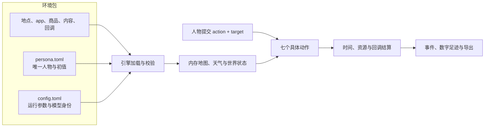

以下回答替代原稿中相互冲突的方案；具体规则只在所属章节定义。

| 主题 | 采用的结论 |
| --- | --- |
| 环境与人物 | 根目录的 `persona.toml`、`config.toml`；删除场景文件和多人运行 |
| 地点与地图 | 每个地点显式声明，可用 `branch_label` 区分；删除 `count`、生成地址及发布的 `map.json` |
| 商品效果 | 商品类别只有 `snack`、`meal`、`drink`、`goods`；娱乐需要和情绪合并为 `relaxation_need`，真实饮料或商品收货减少 0.10 |
| 资金 | 删除商家账户与可售标志；购买付给 `external:scenario`；账户只有 `agent:{agent_id}` 与 `external:scenario` |
| 内容 | 删除内容 `category`、`manner` 与对应枚举；使用体力消耗档位与 `pushable` |
| 并行 | 引擎自动将出行、睡眠放入第一槽，将购买、`interact` 放入第二槽；同槽互斥，睡眠额外要求第二槽为空 |
| 功能 app | app 行直接绑定具体动作；回调足迹是独立的附加效果 |
| 时间与提醒 | 购买随机 1–5 分钟，结束时整次原子付款；取件和纯目录浏览时长由数据集声明；提醒不得唤醒睡眠；耗尽决策预算停止运行 |
| 模型 | 非密模型身份与重试参数写入 `config.toml`，凭据只通过环境变量名称引用 |

<a name="spec-envdataset-包与目录格式"></a>
## 包与目录格式

<a name="spec-envdataset-包的组成"></a>
### 环境数据集包的组成

```text
<环境根>/
├── catalog/
│   ├── manifest.json
│   ├── app-catalog.jsonl
│   ├── callbacks.jsonl
│   ├── content-catalog.jsonl
│   ├── location.jsonl
│   └── merchant-catalog.jsonl
├── persona.toml
└── config.toml
```

环境根与 `catalog/` 均为文件闭集。根目录只允许上述三个条目；`sources/`、`corpora/`、
`README.md`、`scenarios/` 等额外条目都在加载时拒绝。包的使用说明放在包外。
`catalog/` 只允许清单与五个 JSONL 文件；`map.json`、旧 JSON 文件、`actions.jsonl`、
`location-type.jsonl`、`item_callback.py`、人设和运行配置均不得放入目录。
包外条目统一以 `ENVIRONMENT_STALE_FILE` 拒绝，报告给出实际路径，英文原因为
`The environment contains an entry outside its declared package.`。

目录文件必须全部存在。`callbacks.jsonl` 可以为空；其他文件是否允许零行由对应对象规则决定。
目录不声明提供顺序，不新增 `provision_order` 或依赖拓扑配置；全部文件读入后统一解析跨文件引用。
`persona.toml` 与 `config.toml` 不进入清单的 `files` 与 `catalog_content_sha256`，分别冻结输入身份。

<a name="spec-envdataset-目录闭集文件"></a>
### 目录行与清单

| 文件 | 内容 | 排序与身份 |
| --- | --- | --- |
| `app-catalog.jsonl` | app 行 | `app_id`；名称经 `channel_key` 唯一 |
| `location.jsonl` | 显式地点行 | `location_id`；显示名经 `channel_key` 唯一 |
| `merchant-catalog.jsonl` | 商品行 | `goods_id`；名称经 `channel_key` 唯一 |
| `content-catalog.jsonl` | 内容行 | `content_id` |
| `callbacks.jsonl` | 状态声明与回调规则 | 形状、身份与排序见「回调规则表」 |

各身份列表与绑定列表必须无重复、按身份字符串升序排列。重复以 `ENVIRONMENT_ID_DUPLICATE` 拒绝，
未排序以 `ENVIRONMENT_KIND_INVALID` 拒绝。所有行使用严格模型，未知字段直接拒绝，不保留双格式。

`manifest.json` 仍为 JSON 单对象，字段是 `format_version`、`environment_id`、`environment_version`、
`rules_version`、`files[{path, sha256, size_bytes}]`、`catalog_content_sha256`。
`files` 逐个登记五个 JSONL 文件，按路径字典序排列；缺项报 `ENVIRONMENT_FILE_UNLISTED`，
重复报 `ENVIRONMENT_ID_DUPLICATE`，额外路径报 `ENVIRONMENT_STALE_FILE`。

<a name="spec-envdataset-jsonl-行格式"></a>
### JSONL 行格式与登记错误

沿用已有安全文件边界、严格模型与 JSONL 读取约定，不新增第三方依赖。

| 输入或检查 | 规定 |
| --- | --- |
| 文件边界 | 拒绝链接、缺失与越界路径；文件大小、摘要和目录摘要必须与清单一致 |
| 编码与行尾 | UTF-8；任意 CR 都拒绝；不剥离 BOM |
| 行 | 按 LF 切分，每行恰好一个 JSON 对象；零字节表示零行；末尾 LF 后的空串不算一行 |
| 最后一行 | 可以没有结尾 LF；引擎写出每行均以 LF 结尾 |
| 非法行 | 空行、全空白、非法 UTF-8、BOM、坏 JSON、多值、跨行对象、数组和标量均拒绝 |
| 模型 | 合法对象再交给对应严格行模型；未知字段优先按种类错误处理 |
| 诊断 | 行解析或行模型失败的详情以 `<文件相对路径>:<行号>` 开头，后接英文原因 |
| 旧文件形状 | `{"contents": [...]}` 等单对象根不是兼容格式，按未知字段拒绝 |
| 字节身份 | 行内空白与键序自由，身份按实际文件字节计算，不先规范化输入 |

登记错误与英文原因在 `src/worldmock/catalog/errors.py::REGISTRATION_REASONS` 一处维护。

| 登记码 | 条件与英文原因 |
| --- | --- |
| `ENVIRONMENT_LINE_INVALID` | 非法 JSONL 行；`A catalog JSONL line is not exactly one JSON object.` |
| `ENVIRONMENT_KIND_INVALID` | 未知字段、非法闭集、错误类型或排序；CR 详情保留 `Catalog JSON must use LF line endings.` |
| `ENVIRONMENT_NUMBER_INVALID` | 数字超出允许域；严格整数不接受布尔 |
| `ENVIRONMENT_REF_UNKNOWN` | 引用未登记对象 |
| `ENVIRONMENT_IDENTITY_MISMATCH` | 文件边界、大小、摘要或目录身份不符 |
| `ENVIRONMENT_ID_DUPLICATE` | 身份、要求唯一的显示名、清单路径或绑定列表重复 |
| `ENVIRONMENT_FILE_UNLISTED` | 清单缺少必需的目录文件 |
| `ENVIRONMENT_STALE_FILE` | 环境根、目录或清单中存在包外条目 |
| `RULES_VERSION_MISMATCH` | 规则版本不匹配；`The environment was published for a different rules version.` |

同一输入优先使用所属字段明确规定的拒绝码；未另作规定的缺失和类型错误使用 `ENVIRONMENT_KIND_INVALID`，数值越域使用 `ENVIRONMENT_NUMBER_INVALID`。
其余对象拒绝码在所属章节规定。不再维护按历史码数量推导的总数或要求测试解析本规格。

<a name="spec-envdataset-清单与身份"></a>
### 身份、版本与地图

`format_version` 与 `RULES_VERSION` 均升为 `3`。加载清单原始对象后，先比较严格整数类型的
`rules_version`，再解析严格清单模型；旧规则版本直接报 `RULES_VERSION_MISMATCH`。
缺失、字符串或布尔版本由模型以 `ENVIRONMENT_KIND_INVALID` 拒绝；规则版本相符而目录格式为旧值时，报 `ENVIRONMENT_KIND_INVALID`。
运行清单、检查点、恢复、重放和导出校验均拒绝旧身份，不提供迁移或兼容读取。

`catalog_content_sha256` 继续按路径排序，对文件写入「相对路径、NUL、八字节长度、实际字节」帧，
再加入清单规范 JSON 帧；该帧去掉自身摘要并使用实际文件表。任何目录字节改变都会改变摘要。

环境身份仍为 `environment_id`、`environment_version`、`rules_version`、`catalog_content_sha256`、
`map_sha256`。地图在加载时由全量地点和 `config.toml` 的单一种子生成，规范序列化后计算
`map_sha256`，保存在内存和运行身份中，不写发布的 `map.json`。
单独改变配置种子可以改变地图身份，不改变目录字节身份；恢复仍须核对配置文件身份。

删除 `worldmock environment generate-map`、`--check`、独立地图种子参数、发布地图结构号及
`MAP_NOT_REGENERATED`。保留地图生成算法、连通性和边约束；不再校验人工发布地图是否与重生成文件相同。

<a name="spec-envdataset-加载次序"></a>
### 加载与环境校验

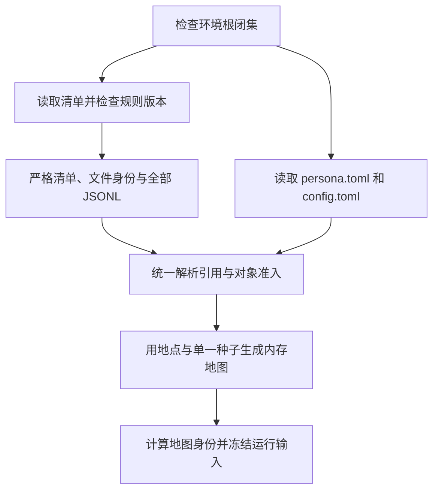

`worldmock validate --environment ROOT` 使用同一纯加载与准入路径，不编译画像、不请求模型、不修改包内文件。
独立输入的失败按路径汇总，不以一个失败掩盖其他可检查输入的错误，非零退出。
全部校验失败统一为 `{path, code, reason}`，JSONL 行号写入 `reason`；根目录多余项报告实际路径。
人设与配置输入失败的固定码和原因见「人设与运行配置」。成功结果保留 `valid`、`environment_id`、
`environment_version`，删除 `scenarios` 及「环境必须含场景」检查。

`refresh_manifest_identity` 只刷新目录文件表与摘要，原子写出规范 JSON 加 LF。
写失败保留旧清单并报 `ENVIRONMENT_IDENTITY_MISMATCH`；不把人设或配置塞进目录清单。
目录变更后由数据集作者决定新的 `environment_version` 并刷新清单。运行和恢复只读取输入，生成内存地图。

### 夹具、删除面与验收

新人工环境位于 `tests/fixtures/dataset-environment/`，由 `tests/data_paths.py::ARTIFICIAL_ENVIRONMENT_ROOT`
引用。清单使用 `environment_id = "artificial-test"`、`environment_version = "2"` 和新的格式、规则版本。
旧的 `tests/fixtures/environment/` 整目录删除；新环境根不放 README。基础回调文件为空，回调测试自行构造目录变体。
不同实验各自构造完整的单人环境，不再在同一环境下维护多个场景。

涉及 `catalog/models.py`、`loader.py`、`identity.py`、`admission.py`、`errors.py`、`mapgen.py`、
`cli.py`、运行装配及测试数据路径。删除旧文件根模型、动作目录加载器、场景环境钉及
`ENVIRONMENT_PIN_MISMATCH`；运行输入身份核对继续保留。正式数据仓重新发布不属于本仓实现范围。

验收覆盖合法与非法 JSONL、严格字段、版本检查先后、引用和排序、两个层级的文件闭集、真实摘要不符、
原子刷新失败、内存地图确定性、只改种子时的身份变化以及加载和校验命令的一致性。
测试使用真实发布入口并刷新清单；测试旧版本拒绝时在新夹具副本上构造反例，不保存兼容夹具。

<a name="spec-envdataset-地点"></a>
## 地点

<a name="spec-envdataset-地点-字段"></a>
### 地点行、显示名与类型

每个实际地点在 `location.jsonl` 中单独一行。没有 `count`，不生成实例身份、虚构地址或地址随机源。

| 字段 | 类型与规则 |
| --- | --- |
| `location_id` | 非空字符串，唯一；关联地图节点、住处、工作地点、商品供给、订单和事件 |
| `name` | 非空字符串，品牌或场所名 |
| `branch_label` | 可省略，缺省 null；非空字符串表示分店标签 |
| `kind` | 非空白严格字符串，由数据集自由命名 |
| `app_ids` | 必填、可为空；引用已登记内容 app，按身份升序且无重复 |
| `is_home` | 可省略的严格布尔，缺省 false |
| `accepts_parcels` | 可省略的严格布尔，缺省 false |
| `opens` | 可省略；显式声明恰为 `{weekly, exceptions?}`，每周与日期时段的形状见营业时段正文 |

删除 `shipping_seconds`；不新增 `sells_goods` 或其他可售标志。`count`、旧运输时长、菜单、坐标、
经纬度、距离和边等未列字段均以 `ENVIRONMENT_KIND_INVALID` 拒绝。布尔字段拒绝字符串、整数和 null。

显示名沿用 `Location.display_name`：无分店标签时为名称，有标签时为「名称（分店标签）」。
同名地点必须用不同 `branch_label` 区分；登记时比较的是经 `channel_key` 处理的显示名，碰撞报
`ENVIRONMENT_ID_DUPLICATE`。人物必须写完整显示名，不通过裸品牌名猜分店。
环境层、工具层、进度层、记忆句、计划、会话名和错误反馈统一使用同一个显示名。

`kind` 不再是枚举，不派生运动资格、商品类别、菜单或中文名称。商品 `store_kinds` 与内容
`location_kinds` 按逐字符相等匹配，不去空白、不折叠大小写、不经 `channel_key`。
引擎不得按旧类型字面量分支；数据集派生的类型索引保留。当前地点的 `place_type` 直接显示 `kind` 原文。

### 住宿、驿站与完整世界

目录至少有一个 `is_home = true` 的地点，人物声明的住处名称必须解析到该集合中的实际地点；
两种失败均报 `HOME_LOCATION_REQUIRED`。目录可以有多个住宿地点，一个地点也可以同时接收包裹或绑定 app。
住处与初始位置分别由 `persona.toml` 声明地点名称，初始位置不要求等于住处。
环境加载时必须核对这些名称在地点目录中实际存在，并解析为唯一地点身份；不自动改成住处或补建地点。
初始位置或工作地点不能唯一解析时，以 `ENVIRONMENT_REF_UNKNOWN` 拒绝并指出对应人设字段；住处仍使用既定住宿校验。

驿站集合只按 `accepts_parcels` 判定。家庭最近驿站按住处到驿站的最短图距离选择，同距取较小
`location_id`。存在 app 侧商品而没有驿站，或任一驿站的地点类型没有绑定内容时，加载报 `PARCEL_STATION_REQUIRED`。
该码英文原因为 `Parcel stations must exist when required and have location content.`，详情指出实际缺失项。
字面量 `home`、`parcel_station` 等不再赋予任何特殊资格。

运行读取目录全部地点，不存在场景选择或第二份地点子集。所有登记地点都可成为出行目标或路径节点，
所有匹配商品在全量地点展开；请求中的未知目的地先由名称解析报 `NAME_NOT_FOUND`，
内部路线规划收到未登记地点身份时仍报 `DESTINATION_NOT_FOUND`。
工具层列当前地点以外的全部地点，不轮转或截断。观察私有地点行保留 `{location_id, name}`，删除 `kind`。
显示名与商品名等同时可见对象的唯一性检查覆盖全量世界；不能用未选地点绕过名称碰撞。

<a name="spec-envdataset-地点-商家账户"></a>
### 购买收款方

删除全部 `merchant:*` 账户、账户角色检查、`MERCHANT_ACCOUNT_MISSING` 与可售标志方案。
商品供给只由 `store_kinds` 或 `app_ids` 声明，数据集不为商店声明账户。
购买从人物账户转到现有资金锚点 `external:scenario`；账户名称不表示保留场景文件。
资金仍然守恒，转账 `cause` 必须能追溯商品、实际店铺和下单 app；快递没有店铺时不虚构店铺。
唯一人物账户为 `agent:<人物身份>`，另一账户为 `external:scenario`；系统只保留这两个账户。

<a name="spec-envdataset-地点-营业时段"></a>
### 营业时段

`opens` 表达每周哪些日子营业、各日的时段，以及节假日、固定休息日等特殊关闭。
字段缺省表示全天营业；提供每周规则后，没有列出的星期视为关闭；特殊日期覆盖每周规则。
完整形状为 `{weekly: {mon..sun: [[HH:MM, HH:MM], ...]}, exceptions: {YYYY-MM-DD: [...]}}`。
`weekly` 必填、`exceptions` 可省略；特殊日期完全替换该日每周规则，空数组关闭，可声明缩短营业时段。
每个时段使用半开区间，按开始时刻升序且不重叠，起点严格小于终点；`24:00` 只作结束，跨午夜拆到两日。
显式 null、未知星期、非规范日期或时刻、倒置及重叠时段均以 `ENVIRONMENT_KIND_INVALID` 拒绝。

闭店时，在当前有售地点到店购买或在该地点 `interact` 以 `LOCATION_CLOSED` 拒绝。
远程候选先排除闭店地点；没有营业且可配送的候选时使用「商品与履约」的 `ACTIVITY_PRECONDITION_UNMET`。
出行前往闭店地点仍允许，工具层显示营业时段。候选商店和最终受理使用同一营业资格判断。

<a name="spec-envdataset-地点-地图与坐标"></a>
### 内存地图

地图节点恰为全部登记 `location_id`，至少两个节点。保留已验证的生成规则：随机标号生成树，
再加入 `floor((n-1)/2)` 条树外边，边长在 200–2000 米之间按序抽取。
边规范化为 `a < b` 的无向边，无自环、无重复、端点已登记、长度为正整数，并按端点排序；图必须连通。
相同地点集合与种子得到相同规范图和摘要，路径使用既有最短路算法。
节点不足报 `MAP_TOO_SMALL`；边约束和连通性失败仍分别使用 `MAP_EDGE_INVALID`、`MAP_DISCONNECTED`。

地图只在系统内生成与维护，不需要为了显示名引入坐标。地点行和人物提示不暴露地图几何。
人物看到显示名、行程时间、路费和费力；天气与四种出行方式的计算见「动作与请求接口」。

### 删除面与验收

删除 `LocationKind`、`PLACE_TYPES`、`PLACE_KIND_ENVIRONMENTS`、`STORE_KINDS`、
`GOODS_CATEGORY_STORE_KINDS`、`Catalog.menus_by_kind`、`Catalog.location_kinds`、
`check_location_kinds`、重复显示名守卫及没有调用者的地点辅助代码。
候选管线删除地点类型资格门，保留实际在场要求。工作安排的地点仍须是登记地点，工作内容分配检查另行删除。

修改落在 `catalog/models.py`、`admission.py`、`loader.py`、`life/load_checks.py`、`semantics.py`、
`observe.py`、`discovery.py`、`presentation.py`、`parcel.py`、`environment_layer.py`、`world_ops.py`
及各人物文字投影。不得保留旧商家账户夹具或在测试中补齐已经删除的商家账户。

验收覆盖任意非空类型、严格布尔、完整显示名和同名分店、两种住处失败、全量地点的出行与供给、
名称碰撞、闭店受理、可前往闭店地点、特殊营业日期、最近驿站的距离与身份决胜、地图确定性。
位置验收覆盖初始位置不等于住处的合法情况，以及住处或初始位置名称未登记的拒绝；营业时段验证周规则、日期替换和半开边界。

<a name="spec-envdataset-app-目录与功能-app"></a>
## app 目录与功能 app

### app 行与角色

| 字段 | 规则 |
| --- | --- |
| `app_id` | 非空字符串，唯一；行按身份升序 |
| `name` | 非空真实 app 名；经 `channel_key` 唯一，不能与地点显示名碰撞 |
| `role` | 必填，只有 `content`、`function`，没有兼容默认值 |
| `actions` | 功能 app 声明一个或多个具体动作，按动作键升序、无重复；内容 app 不声明该字段 |
| `browse_duration_seconds` | 只有商品目录而无显式内容的内容 app 必填，严格整数且至少 60 秒；其他 app 不声明该字段 |

删除 `purposes`、`payment_app_ids` 和 `APP_PURPOSE_INVALID`。删除 shopping 用途、店铺绑定和支付列表的
旧互锁，改按 `role` 校验：只有内容 app 能被地点、商品或内容绑定；只有功能 app 能绑定具体动作。

功能 app 只可绑定 `walk`、`drive`、`take_taxi`、`take_bus`、`purchase`。
该集合从七个动作中去掉 `interact`、`sleep` 派生；动作类型、旧动作词及这两个动作均不能作为功能 app 绑定键。
睡眠不生成自动 app 足迹，也不保留睡眠 app 或睡眠足迹步骤。
一个功能 app 可绑定多个动作，一个动作可以有多个候选功能 app；允许整个数据集没有功能 app。

内容 app 必须至少被一条内容、一个地点或一件商品引用。平台 app 的可浏览商品目录本身即可满足内容要求，
无需再造一条虚假内容记录。纯目录浏览的实际商品集合与时长规则见「商品与履约」和「内容目录」；绑定地点但没有可浏览商品也没有显式内容时不满足内容要求。
没有任何此类有效引用的内容 app 与没有具体动作绑定的功能 app 都以
`APP_UNBOUND` 拒绝，英文原因使用 `An app must have content or a concrete action binding for its role.`。
纯目录 app 缺少 `browse_duration_seconds`、类型不是严格整数或低于 `CONTENT_MIN_SECONDS` 时，
以 `ENVIRONMENT_NUMBER_INVALID` 拒绝；不允许声明该字段的 app 携带它时按 `ENVIRONMENT_KIND_INVALID` 拒绝。
角色与绑定不符报 `APP_ROLE_BINDING_INVALID`，英文原因为
`Only function apps may bind actions, and only content apps may be referenced by locations, goods or contents.`。
未知身份、重复、排序和非法动作键使用通用登记码。
app 名与地点显示名碰撞继续报 `APP_NAME_COLLIDES_LOCATION`。

### 自动记录、付款与回调

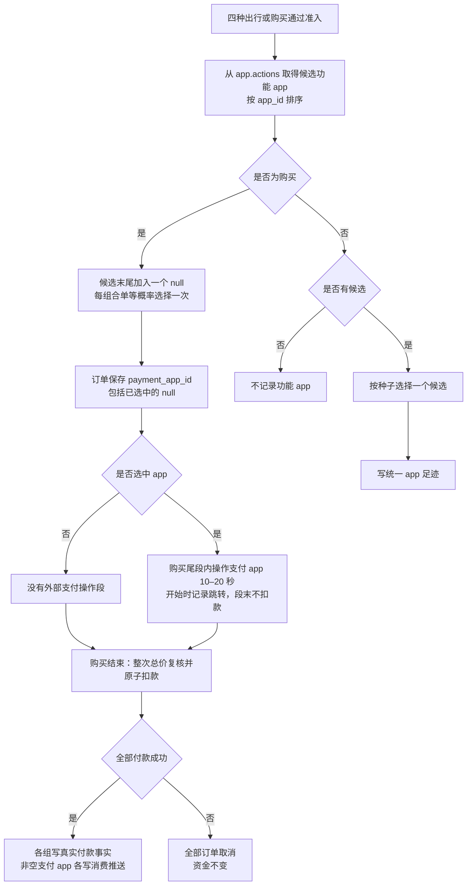

自动绑定由引擎执行，不写入 `callbacks.jsonl`。回调 `footprint_chain` 保留为独立附加效果，
不能因存在自动绑定而丢弃，也不能把两者当作互相替代的配置。

四种出行每个成功受理的活动抽取一次；只有一个候选时必选它，无候选时不记录。
购买先逐件选店和下单 app，再合单。每单从绑定 `purchase` 的功能 app 按 `app_id` 排序后的列表末尾
追加唯一的 `null`，在全部候选中等概率选择一次。绑定支付宝、微信时，两者和 `null` 各占三分之一；
只有一个支付 app 时，该 app 与 `null` 各占一半；没有支付 app 时结果必为 `null`。
`null` 表示不跳转外部支付 app；通过 app 下单时，表示直接使用该下单 app 绑定的银行卡支付。
该结果仍正常扣款、保存订单及真实下单 app，但没有外部支付段、自动支付 `app_touch` 或第三方消费推送；
不新增银行卡对象、账户或配置。
只有购买的自动支付候选加入 `null`，不扩大其他动作或回调足迹链的候选。
选择使用「人设与运行配置」规定的单一种子派生，拒绝或整组回滚不保留抽取结果和足迹。
选中第三方支付 app 的合单组，在购买尾段内操作该 app 10–20 秒；段开始记录跳转，段结束不扣款。
整次购买完成时统一原子付款；只有全请求付款成功，非空支付 app 的各组才生成消费推送。
支付耗时包含在购买总时长内。多组支付顺序、时间与资金结算由「商品与履约」统一规定。

自动功能足迹和回调足迹使用同一事件形状，包含 app、具体动作和步骤，每条导出为 `app_touch`。
自动足迹的 `step` 固定为：四种出行 `navigation`，购买跳转 `payment`；回调另遵守自己的步骤闭集。
事件和因果字段只在「记录、导出与评估」定义。删除出行活动的 `navigation_app_id`，
不引入另一份导航 app 快照；订单继续保存 `payment_app_id`。恢复读取已提交结果，不重抽；
已保存的 `null` 同样是确定的支付选择，不能因它为空而重新选择。
功能 app 不改变路线、行程身份、出行时长或车费，也不自行占用活动槽；第三方支付段不增加购买总时长。

### 人物可见范围与验收

只有内容 app 能作为 `interact` 目标。功能 app 不进入名称簿、工具层候选、允许值、画像可执行媒介覆盖目标，
也不在引擎生成的记忆句、工具结果或错误反馈中暴露自动选择。支付跳转和消费推送只进入系统记录，
不进入人物的进度层、提示、记忆、计划或反思输入，不为此唤醒人物或增加决策机会。
删除请求中的 `app`、`pay_app`，工具层的 `navigation_apps`、`payment_apps`、
「可用某支付 app 付款」文字，以及购买记忆中的付款 app 括注。
作者自己在人设或内容中书写 app 名称不受这条自动投影规则限制。

基础夹具：支付宝、微信为绑定 `purchase` 的功能 app；高德地图绑定 `drive`、`walk`；
哔哩哔哩、抖音、Keep 为内容 app；美团、饿了么由地点供给满足内容下界。
绑定功能 app 的旧通话内容删除。回调测试的足迹单独构造，不为基础绑定填充回调文件。

修改覆盖目录模型和准入、功能 app 选择、动作提交、订单、提示投影、覆盖率目标和足迹导出。
验收覆盖角色互斥、内容下界、地点和商品只能绑定内容 app、绑定到具体动作，以及无绑定、单绑定、多绑定时的确定性。
支付候选须包含唯一 `null`，有支付 app 时也可直接付款；选择 `null` 仍记订单与资金事实，但没有外部支付段、自动支付足迹或第三方消费推送。
支付段抽取 10–20 秒且包含在购买时长内；段开始恰一条跳转，付款成功后每组恰一条系统消费推送，金额与真实付款一致。
每单一次选择，受理拒绝回滚，恢复包含空值在内的选择和时长不重抽，已记跳转与推送不重复；其他功能 app 与回调候选规则不变。
自动足迹与回调足迹并存，功能 app 不泄露到人物提示。

<a name="spec-envdataset-商品与履约"></a>
## 商品与履约

### 商品行与固定类别

| 字段 | 规则 |
| --- | --- |
| `goods_id` | 非空字符串，唯一；行按身份升序 |
| `name` | 非空字符串，经 `channel_key` 唯一，人物按名称购买 |
| `category` | 仅 `snack`、`meal`、`drink`、`goods` |
| `price_fen` | 严格正整数，全店同价 |
| `store_kinds` | 非空字符串数组，缺省空数组；与地点 `kind` 逐字符匹配 |
| `app_ids` | 内容 app 身份数组，缺省空数组 |

两种绑定恰好选择一侧。均为空报 `GOODS_BINDING_MISSING`；均非空报
`GOODS_BINDING_SIDE_EXCLUSIVE`；地点类型没有任何匹配地点报 `GOODS_BINDING_DANGLING`。
绑定列表重复、未排序、未知 app、功能 app 引用分别沿用通用码或 `APP_ROLE_BINDING_INVALID`。
非法价格报 `ENVIRONMENT_NUMBER_INVALID`；旧 `store_ids`、旧类别和额外字段直接拒绝。
字符串 `"all"` 不再表示全店；类型列表的每个值都必须实际匹配地点。

地点侧商品展开到全量匹配地点，按 `goods_id` 排序；app 侧商品不展开为工具层地点商品行。
允许任何商品类别绑定任何地点类型，允许地点不卖商品。没有库存、售罄、供给上限、动态报价、
价位或有效期，这些都是有意省略，不是未完成的功能。

| 商品类别 | 中文名称 | 收货效果 |
| --- | --- | --- |
| `snack` | 零食 | 每份 200 千卡；沿用食品利用效率与能量上限 |
| `meal` | 食品 | 每份 600 千卡；沿用食品利用效率与能量上限 |
| `drink` | 饮料 | 每份真实收货降低 `relaxation_need` 0.1，钳在 0；不提供热量 |
| `goods` | 商品 | 每份真实收货降低 `relaxation_need` 0.1，钳在 0；燃油也是普通商品，其周期状态由回调维护 |

`entertainment_need` 与 `mood_valence` 合并，不保留六类别或两套心理资源的兼容层。
统一心理量为 `relaxation_need`，范围 `[0, 1]`；饮料和商品只在真实收货时应用同一缓解效果，
不能保留旧饮料减娱乐需要、日用品加情绪两条并行结算路径。
饮料仍进入人物饮食喜好覆盖目标，退出按热量计算的食品效率、用餐与饮食指标。
商品收货与热量结算照常记录，但不再自动推进日计划；人物根据这些实际经历自行修订计划。

### 履约与报价

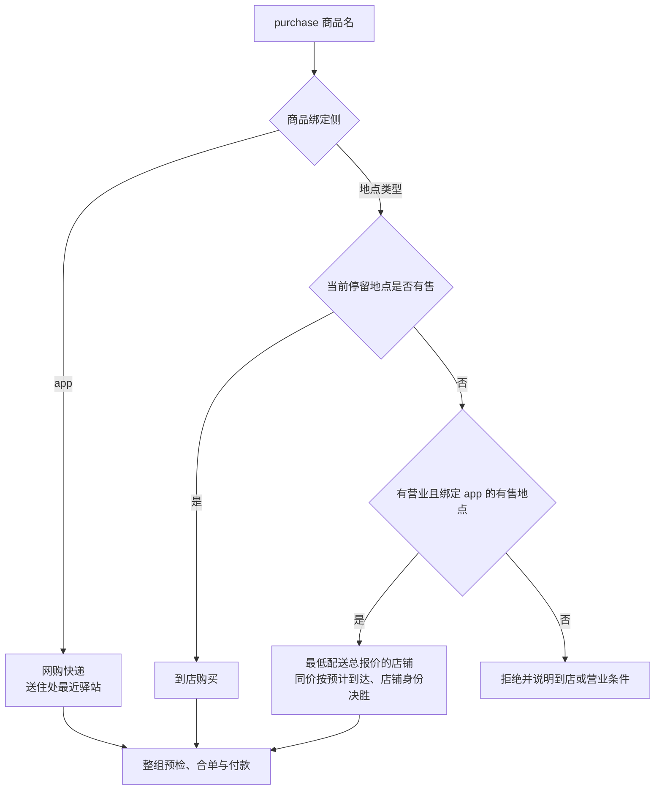

| 履约 | 选择与目的地 | 到达与费用 |
| --- | --- | --- |
| 到店 `pickup` | 当前停留地点有售且营业；`store_id` 为该地点，`app_id` 为 null | 无配送费；购买结束时整次原子付款，对应付款成功即到店收货 |
| 外卖 `delivery` | 从当前营业且可配送的有售地点中选货款加一次配送费最低者，同价先取预计最早到达者，再取较小店铺身份；下单 app 从该店绑定中按种子选取；送当前停留地点 | 备餐 600 秒，加 `ceil(最短图距离 / 5)` 秒；每单 500 分 |
| 快递 `station_pickup` | 下单 app 从商品绑定中按种子选取；无实体店铺、卖方账户或配送路线；目的地为住处最近驿站 | 等概率抽取 2、3、4、5 个本地日，到对应本地日边界到站；运费按商品与下单 app 的组合抽取 0 或 500 分 |

当前停留地点有售时固定走到店购买，闭店直接拒绝，不改走外卖；只有当前地点无售时才选择远程店铺。
到店或外卖按当前地点离散判定，不抽签；选外卖店铺也不抽签。删除 `Location.shipping_seconds`。
外卖不因路程超过一天改送驿站，快递天数不读取图距离或数据集运输时长。
快递订单 `store_id` 为 null，路径只含驿站，`trip_id` 为 null、距离和备餐秒数为零，不生成虚构店铺或路线。

所有报价随机性只依赖查看时已知事实。快递到站日期按商品、下单 app 和本地日期稳定派生，
同商品经同 app 在同一本地日购买，预计到站日相同。运费策略只依赖商品与下单 app，不随订单或查看次数重抽。
远程报价显示当前营业且可配送候选中的最低总价，金额为货款加一次配送费；到店报价使用到店价格。
商品仍按 `price_fen` 全店同价，不新增店铺价格层；现有费用相同时按预计到达、店铺身份确定同价店铺。
预览与受理共用该选择和报价；在影响报价的事实不变时，最终订单必须与预览一致。
受理时冻结报价和履约时间基准，尾段支付不重新起算备餐、配送时长或快递本地日期；实际配送只对已经付款成功的订单生效。
快递每个商品与下单 app 的组合在 0 与 500 分之间等概率稳定抽取。合单全部商品免运费才收 0，
否则整单只收一次 500 分；不逐件累加。受理和完成付款的总价检查均先按此规则合并运费。

地点侧外卖仍需要当前停留收货地点：在途没有该地点时拒绝，不偷偷改送住处。
四种出行使用第一槽，购买使用第二槽，可以跨槽并行；在途可购买不依赖停留点的快递商品。
跨槽并行不取消履约条件：地点侧外卖仍要求实际收货停留点，不能把途中位置当收货地点。
已受理订单保持冻结的目的地，不跟随人物移动；出行到达不提前结束尚未完成的购买。
到店购买与离开该地点的出行不能同时开始。

| 失败情形 | 结果 |
| --- | --- |
| 商品名称不能唯一命中 | `SUPPLY_NOT_FOUND`，要求使用已知商品名称 |
| 不在有售地点且没有可远程下单的店铺 | `ACTIVITY_PRECONDITION_UNMET`，说明最近有售地点及前往要求 |
| 地点侧外卖在途而没有停留收货地 | `ACTIVITY_PRECONDITION_UNMET`，要求到达后再下单 |
| 购买与已有或同组的 `interact`、另一购买过程冲突 | `RESOURCE_CONFLICT`，说明第二槽的占用者 |
| 当前有售地点闭店时到店购买，或闭店地点 interact | `LOCATION_CLOSED`；远程无营业候选按前述前置条件拒绝 |
| 整次请求的全部货款加合并后运费超过余额 | 受理时报 `INSUFFICIENT_FUNDS`，整次拒绝，不先购买可支付的部分 |
| app 侧商品存在而无驿站，或驿站类型未绑定内容 | 加载时报 `PARCEL_STATION_REQUIRED` |

名称解析、逐项预检与整组准入沿用原子受理链。开始受理失败不留下订单、转账、随机选择结果或功能 app 足迹；
组合订单预检合计全部货款与合并后运费，余额不足整次拒绝，不能逐项检查同一份余额或先买可支付部分。
同一开始请求还包含出行时，一并计入该出行的即刻车费；车费与购买总价合计不足则整组拒绝，
不得因请求项顺序不同而接受不同结果。回调的额外转账仍在成功受理后按自身语义执行。
成功受理不扣款；实际购买完成时重新核对整次总价，并在同一原子提交中结算全部付款组。
任一总价检查不足都不允许部分购买；完成时不足则全部订单取消、资金不变、活动失败并记录英文错误。
不冻结资金，不自动退款；受理后余额变化由完成时的整体检查处理。

### 合单、时间与资金

每个购买项一件商品，`quantity = 1`；一次请求项数上限仍由请求接口定义。
逐件派生店铺、下单 app 和履约，再把相同店铺、目的地、app、履约的项合成一单；随机派生所用 `group_key` 规范序列化见「人设与运行配置」。
支付选择不参与合单键，每单按「app 目录与功能 app」从支付 app 与 `null` 中选择一次，每单一笔付款、一次配送费。
整单是一次付款的购买请求单位；沿用现有 `DeliveryState` 按商品保存履约记录的粒度，
每条商品履约记录仍有独立的 `order_id`。同一整单的记录共用支付选择和真实购买结果，
配送费只记一次，付款 `cause` 关联全部记录；不能按履约记录条数重复付款。
`ORDER_ITEM_COUNT_OUT_OF_RANGE`、`ORDER_LOCATION_MISMATCH` 保留；同单重复商品报
`ORDER_DUPLICATE_ITEM`，重复判据不再包含收货人。

购买活动时长在闭区间 60–300 秒内按整数秒等概率抽取，即 1–5 分钟，边界为固定规则，不增加配置项。
同请求所有购买项组成一个活动，成功受理时只抽取一次时长，按「人设与运行配置」的独立随机键派生。
抽取结果保存为该活动的计划时长，开始结果给出实际时长；恢复、重放与幂等重试读取已提交结果，不重新抽取。
购买占用第二槽，不与任何 `interact` 并行；商品数、付款组数、支付方式均不增加或改变已选时长。
购买采用最低体力消耗档 `idle`，系数与该档同源，心理缓解为零；与第一槽出行按既有共享身体规则合并结算。
第三方支付组各抽取一次 10–20 整数秒，等概率且与总时长、app 选择使用独立随机流。
按既有 `group_key` 升序将非空支付组依次放在购买累计执行时间的末尾，支付段之间不重叠；
前面的购买过程占总时长减去这些支付时长的部分。请求最多两个购买项，支付段合计至多 40 秒，始终落在 60–300 秒总时长内。
支付段只表达在支付 app 内的操作过程：开始时写该 app 的跳转 `app_touch`，结束时不扣款，也不生成成功通知。
`payment_app_id = null` 的组没有外部支付操作段，不补银行卡 app 或消费推送。
所有组的实际付款统一发生在购买活动正常完成时；先复核全部货款与合并运费，再在同一提交中原子扣款。
恰好在 `stop_time` 达到计划结束的购买先正常结算；只有到停止边界仍未完成的购买才截断取消。
同刻后台回调与购买完成的先后沿用既有提交顺序，余额检查读取实际轮到购买结算时的账户；不另建排序系统。
成功时按 `group_key` 升序写各组的 `purchase_payment`，该顺序只确定记录顺序，不允许组间插入回调或其他结算。
每个非空支付 app 的组生成一条消费推送，因果指向其真实付款事实；到店组随后在同次提交内收货。
失败则不生成任何付款成功事实、消费推送或收货，不修改账户，全部订单取消，购买活动标为失败。
各组 app、操作时长和顺序在受理时冻结，恢复不重抽；推进不能跳过操作段边界或购买完成边界。
支付段属于购买过程，不单独创建活动、不额外占槽，也不投影为内容 `app_use`。

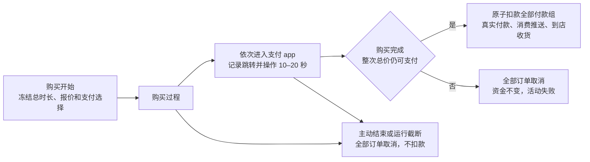

购买不能暂停；人物可以通过 `conclude_activity` 提前结束。完成前主动结束或运行截止截断，
取消整次购买的全部未付款订单，不收费、不收货；已经发生的 app 跳转仍是真实足迹，不回删。
到店商品在购买正常完成并成功付款时立即收货；外卖和快递只有付款成功才进入配送。
正常完成后的收尾不撤销付款；已付款订单继续按已冻结报价与目的地履约，不自动退款。
商品效果只在真实收货时结算一次。
商品履约记录的 `status` 闭集为 `pending`、`ready_for_pickup`、`delivered`、`cancelled`。
受理后未付款记录为 `pending` 且 `paid_at = null`；完成前结束、截断或完成付款检查失败时全部改为 `cancelled`。
只有成功付款的远程订单才能登记配送排程，继续使用受理时冻结的预计到达，不重新报价或起算运输。
`cancelled` 记录不会到站或收货；终结购买的真实事件同时保存订单最终状态，恢复不将取消记录重新排程。


所有购买从人物账户向 `external:scenario` 转账货款加运费。删除卖方账户字段和所有
`merchant:*` 派生；转账 `cause` 关联订单并保留商品、店铺与 app 事实。
`recipient_id`、`request_message_id` 删除，订单 `agent_id` 同时标识付款和收货的唯一人物。
订单保留履约、实际 app、支付 app、目的地、地址、费用与预期时刻，恢复时读取已提交订单，不重新选择。

配送按 `(expected_at, fulfillment, destination_id)` 合并预排事件，因果指向购买结果。
到期配送处理不依赖人物是否睡眠；提醒和到站通知均不能中断睡眠。

### 驿站取件与商品收货

快递到站只进入 `ready_for_pickup`，记录 `arrived_at`、到站证据与「已到驿站，请本人领取」进度，
不写商品收货、不施加商品效果。外卖实际配送到期走唯一收货函数 `settle_receipt`。

人物在 `accepts_parcels` 地点 `interact` 时，一次领取本站全部待取包裹，并正常推荐一条绑定该地点类型的内容。
取件内容时长完全读取数据集声明的 `duration_seconds`，不设系统五分钟常量或五分钟校验。
数据集若希望驿站只用于取件，就只给该地点类型绑定取件内容；绑定其他内容的合理性由数据集作者负责。
若地点类型还绑定其他内容，仍按通常推荐开始内容，同时一次取全包裹；实际耗时遵守该内容的共享进度和接续规则。
不新增第二条隐藏取件活动，也不覆盖数据集时长。
没有待取包裹时以 `PARCEL_NOT_READY` 拒绝。

领取按 `(created_at, order_id)` 顺序逐单调用唯一收货函数，订单变为 `delivered`，
记录 `received_at`、资源分录与 `goods_received`，因果指向本次 `interact` 的真实结果。
未到站或其他站点的订单不受影响；重复提交不重复收货。收货的幂等保护、在站校验、
订单状态与时间配对继续保留，不引入物品持有或库存。

燃油不再有独立类别、购买地点门禁、`FUEL_PURCHASE_INVALID`、`FUEL_DRIVING_DAYS` 或专用收货分支。
所有人物默认有车，删除 `owns_car`、`CAR_REQUIRED`、`fuel.py`、专用 `driving_days` 与
`last_driving_date`；使用回调登记状态替代。收货时匹配 `reset_on_goods` 的状态重置到数据集声明的 cap，
不是叠加；只有实际 `drive` 的本地日扣减，跨午夜按实际驾车日期结算；零值不阻断驾车。

### 发现、人物文字与验收

地点侧商品每件只列一个购买动作，不按 app 拆行；说明、可用性和受理共用履约计算。
app 侧商品只在人物与对应内容 app 交互时展示价格、运费和预计到站，不独立列入工具层商品目标；
平台商品目录取直接绑定该 app 的商品与绑定该 app 的地点所售商品的并集，按 `goods_id` 去重。
当前停留地点无售时，地点侧商品展示当前营业且可配送候选的最低配送总报价，无候选时展示不可购买及原因；
当前停留地点有售时，展示到店报价及该地点的营业可用性，不要求它提供远程渠道。目录展示范围不改变真实购买的选店、选 app 和名称解析规则。
即使平台还有显式内容，互动结果也展示该商品目录，同时按普通规则开始显式内容，目录展示不另加时。
人物已知准确名称时仍可直接购买。`query_world` 的 `app` 筛选删除，不再为该筛选保留冗余绑定投影。

人物购买记忆使用「买了某商品」的表达，删除「经某购物 app」和支付 app、收货人括注。
自动下单 app 不进入购买文字、提示或错误反馈；所在内容 app 的名称仍是合法的交互对象。
后台订单与数字足迹保留实际 app、店铺和付款事实，不因人物可见文字简化而丢失证据。

修改覆盖 `catalog/models.py`、`admission.py`、`loader.py`、`life/named_purchase.py`、
`purchase_offers.py`、`order_routing.py`、`basket.py`、`commerce.py`、`parcel.py`、`receipt.py`、
`models.py`、`tool_layer.py`、`settled_text.py` 及记录投影；删除按旧燃油类别和商家账户构造的测试辅助。

验收覆盖四类别与旧类别拒绝、绑定二选一、悬空类型、全量展开、统一价格、三种履约、
最低配送总价及同价到达时间与店铺身份决胜、营业限制、快递本地日边界、稳定预览、逐件选择后合单、每单一次付款与支付选择、
合计余额和原子回滚、购买时长范围与边界、同请求仅抽一次时长及恢复不重抽、快递到站不收货、数据集取件时长生效和一次取全、空站拒绝、幂等收货、
普通商品触发状态重置及人物文字不暴露自动 app。验收还覆盖购买开始和完成时的整次余额检查、完成前取消、所有组同时成功或全部取消、到店付款即收货与运费整单最多一次；心理量随答复补齐。

<a name="spec-envdataset-内容目录"></a>
## 内容目录

### 目标与依据

内容目录承载具体活动的材料、总时长与消费位置。人物只选择内容 app 或当前地点，
引擎按既有推荐顺序选择内容；不再登记可点名的目录动作，也不再定义内容类别。
`category` 与整个 `ActionCategory` 枚举删除，体力消耗档位由内容的 `exertion` 表达，
推送资格由 `pushable` 表达。`manner`、`AppUseManner`、`MANNER_DEVICE` 与使用方式标签删除，不移动到其他对象上。
内容通过 app 还是地点消费，直接由 target 的类型决定；不再区分手机、电脑或线下辅助使用。
聊天保留为普通话题内容，体力消耗档位取 `light`，没有另一个人物回复。

以上依据 `open-questions.md` 中的回答及后续对系列连播、聊天内容和心理效果档位的明确修正。
心理效果由独立的 `relaxation_relief` 和 `social_relief` 档位表达，
不得用 `pushable` 或体力消耗档位推断心理效果。

### 行为规格

#### 内容条目

`content-catalog.jsonl` 的一行采用以下字段；文件格式与版本见「包与目录格式」。

| 字段 | 形状与规则 |
| --- | --- |
| `content_id` | 非空字符串；文件内唯一，行按身份升序 |
| `title` | 非空字符串；不要求唯一，内容标题不是人物可点名的对象 |
| `exertion` | 必填；体力消耗档位：`idle`、`light`、`moderate`、`heavy`；系统固定各档系数，数据集只选档位 |
| `pushable` | 必填严格布尔，决定该内容是否可被推送；不表达接续、占用或心理效果 |
| `relaxation_relief` | 必填；`none`、`low`、`medium`、`high`；按实际消费时间缓解 `relaxation_need` |
| `social_relief` | 必填；`none`、`low`、`medium`、`high`；按实际消费时间缓解 `social_need` |
| `summary` | 字符串；不超过 `PUSH_SUMMARY_MAX_CHARS`（200）字符 |
| `summary_source` | `{kind, url, notice}`；`kind = real` 时必须提供 URL |
| `duration_seconds` | 严格整数；至少 `CONTENT_MIN_SECONDS`（60），不设上限，不要求按半小时切片 |
| `app_ids` | 缺省 `[]`；所列 app 必须已登记且角色为 `content`，无重复，按身份升序 |
| `location_kinds` | 缺省 `[]`；非空字符串列表，无重复，升序；每项须与至少一个地点的 `kind` 逐字相等，不做归一 |
| `series` | 可省略或为 `null`，否则为 `{title, episode}`；`episode` 为正整数 |

`app_ids` 与 `location_kinds` 恰有一侧非空，每侧可以有多项。地点类型绑定读取全量地点目录；
类型在目录中不存在即拒绝，不借用近似名称或其他地点类型。内容只能绑定内容 app，功能 app 不能承载内容。
内容 app 必须承载内容，或被地点、商品绑定；平台 app 的商品目录本身也属于内容，具体登记规则见「app 目录与功能 app」。
普通地点类型没有必须承载内容的下界；驿站类型必须至少绑定一条内容，登记规则归「地点」。

系统固定各体力消耗档位的系数：

| `exertion` | 代谢当量 |
| --- | --- |
| `idle` | 1.0，表示安静坐着不动的基础消耗，仍消耗体力 |
| `light` | 1.5 |
| `moderate` | 2.0 |
| `heavy` | 5.0 |

`idle` 是最低体力消耗档，不代表零消耗；购买与纯目录浏览使用该档且心理缓解为零。
相同档位在 app 侧与地点侧采用相同系数。聊天话题内容取 `light`；数据集不填任意代谢数值。
原 `CATEGORY_MET` 的类别索引与社交专用布尔索引删除，不能保留一个改名后的类别表。

系列身份改为 `series.title`。同一系列各集的 `app_ids`、`location_kinds` 必须一致，
`(series.title, episode)` 不得重复。删除原同 `category` 要求，不擅自增加同 `exertion` 或同 `pushable` 要求。
系列内容按集号顺序自动接续：当前一集完成后，在原容器内消费同系列的下一条未完成内容。
非系列内容完成后停止，系列耗尽后停止，不跳到其他系列或无关内容；不增加 `autoplay` 开关。
自动接续不由 `pushable` 或体力消耗档位决定，暂停与恢复沿用实际共享进度。
换集仍属于原活动、原 target 和原活动槽，不在集边界释放或重新申请槽位。

内容的心理效果直接随消费时间由引擎结算，采用与体力消耗相同的职责划分：
数据集只选择效果档位，系统固定每档的单位时间变化量。心理效果不借用体力消耗档位，
不通过 `callbacks.jsonl` 配置，也不取决于模型报告了什么。
`relaxation_relief` 与 `social_relief` 分别缓解 `relaxation_need` 与 `social_need`，
`none`、`low`、`medium`、`high` 固定每小时缓解量为 0、0.1、0.3、0.5，按实际正秒数折算并钳在 `[0, 1]`。

`category`、`manner`、`action_id`、`communication_mode`、`kind`、`segments` 等退役字段或切片字段均作为未知字段拒绝，
不忽略、不翻译为新字段。`CommunicationMode` 枚举同时删除。

#### 登记校验与错误码

删除动作身份组、`_check_actions`、`_check_action_contents`；保留内容字段严格解析、来源与摘要校验。
内容逐行校验次序为容器缺失、两侧互斥、app 引用与列表、地点类型悬空与列表、摘要、来源，
最后检查系列。内容绑定功能 app 的拒绝在 app 登记校验中保持同源。

| 码 | 条件与英文原因 |
| --- | --- |
| `CONTENT_CONTAINER_MISSING` | 两侧都为空；"A content must be bound to at least one app or at least one location kind." |
| `CONTENT_CONTAINER_SIDE_EXCLUSIVE` | 两侧都非空；"A content must be bound either to apps or to location kinds, not both." |
| `CONTENT_BINDING_DANGLING` | 地点类型在目录中不存在；"A content is bound to a location kind that no registered location declares." |
| `CONTENT_SERIES_INVALID` | 系列容器不同或集号重复；"Episodes of a series must share one container binding and have unique episode numbers." |
| `CONTENT_SUMMARY_TOO_LONG`、`CONTENT_SOURCE_URL_MISSING` | 保留摘要长度与真实来源 URL 校验 |
| `APP_ROLE_BINDING_INVALID` | 内容指向功能 app，规则与英文原因见「app 目录与功能 app」 |
| `ENVIRONMENT_REF_UNKNOWN` | app 引用未知 |
| `ENVIRONMENT_ID_DUPLICATE` | 内容身份或绑定列表重复 |
| `ENVIRONMENT_NUMBER_INVALID` | 时长缺失、不是严格整数或低于下界，或系列集号非法 |
| `ENVIRONMENT_KIND_INVALID` | 档位不在闭集、布尔字段类型非法、列表未排序、列表项空白，或出现退役字段 |

删除 `CONTENT_ACTION_MISSING`、`CONTENT_APP_BINDING_INVALID`、`ACTION_CONTENT_EMPTY`、
`ACTION_APP_MANNER_INVALID`、`CONTENT_APP_MANNER_INVALID`、`ACTION_NAME_COLLIDES`、`ACTION_COMMUNICATION_MODE_INVALID`，
同时删除加载器对应的错误映射。英文原因只在 `catalog/errors.py::REGISTRATION_REASONS` 定义。
新的体力消耗档位与推送字段均不设缺省值；缺失按严格行模型拒绝，不从旧类别推断或补齐。

#### 索引、选择与恢复

| 索引 | 键与值 |
| --- | --- |
| `contents_by_app` | app 身份 → 绑定该 app 的内容身份，按 `content_id` 升序 |
| `contents_by_location_kind` | 地点类型原文 → 绑定该类型的内容身份，按 `content_id` 升序 |
| `contents_by_series` | `series.title` → 系列内容身份，按集号升序 |

映射为只读映射，值为元组；未出现的键表示没有显式内容条目。平台 app 的商品目录由「商品与履约」的展示路径提供，
不能仅因 `contents_by_app` 为空就把合法平台判为内容耗尽。删除 `Catalog.actions`、`contents_by_action`、
`contents_by_action_app`、`actions_by_app`，不维护目录动作索引。

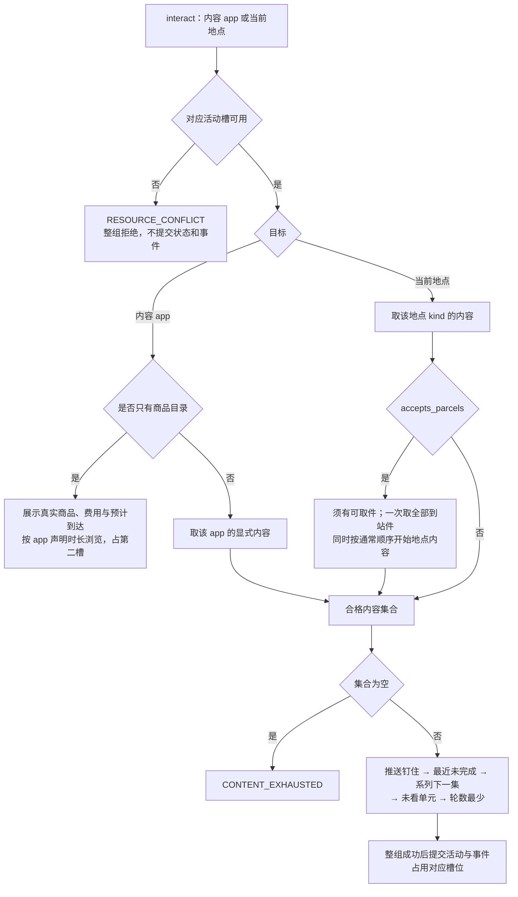

以上推荐流程用于显式内容条目；平台商品目录的展示沿用「商品与履约」。
只有商品目录的平台使用 app 声明的 `browse_duration_seconds` 开始真实 `interact` 浏览过程；
不伪造内容条目，活动保留真实 `app_id` 且 `content_id = null`，不创建共享内容进度或系列游标。
其实际时长、暂停、恢复和结束沿用互动生命周期，每次新开始按声明时长重新浏览；恢复读取剩余时长。
目录浏览使用最低 `idle` 档，心理缓解为零；只记录 `app_use`，不产生 `content_consumed` 或推送打开事实。
目录浏览没有 `details.content` 或内容进度；开始结果返回真实 app、声明时长和商品目录，进度按本次实际累计浏览时间记录。
数据集若给该 app 绑定显式内容，就使用普通内容的时长和进度，不再声明浏览时长；商品目录仍展示但不另计时。
`ContentRequest` 由人物、target 种类与 target 身份确定，不再携带目录动作身份。
app target 读取 `contents_by_app`；地点 target 只能是人物当前所在地点，读取该地点 `kind` 的内容。
驿站取件条件与时长见「动作与请求接口」，收货结算见「商品与履约」。

删除工作指派、`work_content_ids`、`required_work_location`、工作归属与有限次数过滤、`WORK_*` 登记校验，
工作内容与其他内容使用同一推荐规则。删除引擎运动地点门禁、`PLACE_KIND_ENVIRONMENTS` 与
`ELIGIBILITY_LOCATION_KIND_MISMATCH`。地点绑定已经表达在那里才能做的内容；app 绑定内容可以在任何地点消费，
仍受当前地点、出行、睡眠与受理规则约束。

推荐顺序、预留集合、组内排除、单元代表集、每次选择至多一次键控抽取不变。
内容抽取仍使用 `activity_id:draw_index`，推送抽取仍使用 `scheduled_id`，不推进 `WorldState.random_state`。
推送钉住只作用于当前 session 内该 app 的开始请求，状态未释放且内容仍合格时优先取它；地点目标不钉住推送。
`content_duration_range` 仍优先显示推送或最近未完成内容的余量，否则显示合格内容全长范围，查询不抽样。
显式内容推荐路径没有合格内容时仍以 `CONTENT_EXHAUSTED` 拒绝，原因 "Nothing is left to do for this action."，
下一步 "Choose another action."。

不给 app 或地点附虚构的内容类别或统一效果。一个容器允许绑定不同档位的内容，数据集作者负责绑定语义合理。
所有地点和 app 的 `interact` 都使用第二槽，与购买互斥；完整槽位规则归「动作与请求接口」。
引擎只按动作自动分配槽位，不需要先抽取内容，也不依赖请求项顺序、target 类型或额外使用方式。
任意两个 `interact` 都不能并行，即使一个是地点内容、另一个是 app 内容。
不再另设内容 target 锁、手机使用方式锁或设备配置；同槽冲突继续使用 `RESOURCE_CONFLICT`，整组原子拒绝。

内容进度继续按人物与内容保存，单人物运行内跨 app、跨地点共享；暂停时间不计进度。
恢复不重抽内容，以最新共享位置恢复。活动保留 `app_id`、`content_id`、`start_position_seconds`、
`pinned_by_push_id`、`draw_index`、`played` 等已有有效信息，删除 `category`、`manner`、`action_id`、`communication_mode`、`counterpart`。
地点侧活动通过 `ActivityState.location_id` 确定容器；app 侧通过 `app_id` 确定容器。
显式内容活动恢复时核对内容存在、容器绑定匹配、进度和抽取游标合法，并重新检查第二槽；持久身份不符仍报
`IntegrityError("Persisted activity target is invalid")`。不能再要求当前或已播放内容的类别与快照相等。
接续沿用实际容器和同系列顺序，不保留旧类别条件或增加播放开关。

#### 推送与进度

推送仅以 `content.pushable` 判资格，不再读取内容类别或已删除的 `manner`。
作为 app 推送仍须绑定被选 app，地点侧内容不会凭布尔值变成 app 内容。
候选 app 为当前 session 尚无推送且至少有一个可推送合格内容的 app，按身份排序；同一随机流先选 app，
再按正常内容推荐顺序选内容，不再抽目录动作。
预排、窗口、session 状态机、每 session 每 app 至多一条、完成释放、睡眠不被推送唤醒等规则不变。

| 载荷 | 当前合同 |
| --- | --- |
| 人物可见推送事件 | `{kind, push_id, app_id, app, content_id, title, summary, session_id, issued_at}`；预排效果另带 `scheduled_id` |
| 进度层推送记录 | `{occurred_at, type, app, title, summary}` |
| 推送身份 | `<scheduled_id>:<app_id>:<content_id>` |
| 无合格 app | 系统可见 `{kind: "app_push", pushed: false, session_id}` |

删除载荷的 `action_id` 与 `action`。运行期核对 app、内容、绑定与 `pushable`，不符报
`IntegrityError("Runtime app push refers to an invalid app or content")`。
当前 session 对该 app 首次受理并取到钉住内容时打开推送；地点开始与活动接续不打开推送。
工具层该 app 行保留「有推送：《标题》」说明。

长内容不切分目录条目。`config.toml` 中 `progress_report_interval_seconds` 缺省为 1800、必须为正值，
沿用开始、恢复、播报与「播报机会给出即消耗」的锚点。
每个播报边界向进度层写客观记录，统一短语为「《<标题>》进行到 X / Y 分钟」：
X 取 `ContentProgress.position_seconds` 向下取整为分钟，Y 取内容 `duration_seconds` 向上取整为分钟。
不能用当前时刻减活动开始时刻；待收尾游标和尚未建立共享进度时的起点沿用现有合法读取路径。

该短语替代内容的所有「还剩」表述，统一用于工具层状态、暂停待办进度、控制行进度与
`recall_task_summary.objective_progress`；睡眠和出行的进度说法不变。
进度层 Schema 加入客观进度记录，设计文档原「客观进度只在工具层出现」同步改写，
不另立新的唤醒类型或排期。模型只记录进展与感受，不编写或改动耗时。
`pause_activity`、`report_status`、`conclude_activity` 的 `summary` / `self_note` 沿用既有通道，
丢失这些主观文字不影响恢复。`content_consumed` 与 `activity_progress.data.content` 的导出规则保留。

聊天与工作使用同一内容消费机制。聊天材料只给话题，不预写逐轮对话或建立另一人物的回复流程；
在每个由 `progress_report_interval_seconds` 决定的 `report_status` 机会，模型根据话题编写这段时间聊了什么。
聊天带来的心理需要变化按实际消费时长与内容效果档位结算；报告文字不是效果触发器，
不报告、重复报告或编写更长的聊天内容都不能改变已结算的时间与效果。

#### 名称、观察与画像覆盖

`interact` 活动名称为「进行<app 名或地点显示名>（M月D日 HH:MM 起）」，开始时确定，
不把内容标题写进活动名。仅显式内容活动的开始结果包含 `details.content` 为 `{app, title, summary, duration, pushed}`，
地点侧 `app` 为 `null`，删除目录动作名字段。

零点计划已核验经历改为「<起止> 用<app>《<标题>》」，无 app 时为「<起止> 《<标题>》」。
记忆层仍记录实际结算区间、暂停、终局与已完成内容；未完成内容写「（《C》未完）」。
删除 `activity_title` 与 `TitleIndex.actions`；观察控制行 `title` 为 `null`，活动事件快照删除 `title`，
内容活动快照保留当前 `content_title`，供查看器、渲染与检查工具使用。

观察私有证据删除 `actions`，`contents[]` 改为 `{content_id, title}`；投影不再传递目录动作。
画像覆盖目标删除 `action_names`，习惯关键词保留地点显示名，媒介条目仅精确匹配完整内容 app 名，
不做动作名或双向子串匹配。饮食喜好目标与覆盖报告形状保持其有效部分。

### 接口、删除面与文件指引

| 模块 | 修改范围 |
| --- | --- |
| `src/worldmock/catalog/models.py`、`loader.py`、`admission.py`、`errors.py` | 内容字段、容器规则、系列、索引、登记码；删除 `Action`、动作文件模型与全部动作校验 |
| `src/worldmock/exchange/types.py`、`constants.py`、`src/worldmock/catalog/affordances.py` | 删除 `ActionCategory`、`CommunicationMode`、`ACTION_CATEGORY_LABELS` 与类别代谢表；体力消耗固定档位；删目录字段目标发现与观察合同 `target_field` |
| `src/worldmock/life/content_select.py`、`action_run.py`、`activity_validation.py` | 按 app/地点类型候选与恢复，移除工作指派和运动门禁；删除 manner 快照；同系列自动接续，无系列不接续；内容活动按 `interact` 动作占第二槽 |
| `src/worldmock/life/activities.py`、`body.py`、`schedule.py` | 体力消耗档位读取；旧娱乐缓解、运动情绪按新的效果档位改写；删除按类别、活动种类和收货自动推进日计划 |
| `src/worldmock/life/app_push.py`、`progress_layer.py`、`prompt_schemas.py` | `pushable` 推送与无动作载荷、播报边界进度记录、统一进度短语 |
| `src/worldmock/life/activity_titles.py`、`activity_control.py`、`action_evidence.py`、`observe.py`、`settled_text.py` | 活动命名、事件快照、私有证据与核验句；删除 `_validate_action_fields` 的退役请求核对 |
| `src/worldmock/profile/coverage.py`、`coverage_targets.py`、`injection.py` | 覆盖目标与空内容提示；平台商品目录的内容资格与 app 规则一致 |
| `docs/design/02-exchange-engine.md`、`03-resource-engine.md`、`04-simulation-engine.md`、`06-agent.md`、`09-io-formats.md` | 按模块改正文与接口；手册相应修改见「手册与数据集设计方法」 |

旧环境与旧检查点直接失效，不提供兼容读取。目录、规则与世界状态升号合并到各自负责章节，不在本节重复升号。

### 测试要求

| 范围与现有测试入口 | 验收行为 |
| --- | --- |
| `tests/unit/catalog/test_admission.py`、`test_loader.py`；`tests/system/environment/test_validation.py` | 两侧互斥、逐字地点类型、引用/排序/重复、摘要来源、系列规则与错误优先级；manner 等退役字段拒绝；合法两侧内容均可加载；仅测试实际消费索引，不固定人工夹具历史身份清单 |
| `tests/unit/exchange/test_types.py`、`test_constants.py`；`tests/unit/catalog/test_affordances.py` | 档位闭集与固定系数；旧类别、使用方式和通信模式无生产路径；固定两个槽由动作自动分配，与请求项顺序及 target 类型无关，没有环境配置或设备锁 |
| `tests/integration/life/test_content_select.py`、`test_action_run.py` | app 与地点类型候选互不借用；推荐顺序、共享进度、预留排除与确定性；无工作指派/运动门禁；选前槽位冲突整组原子拒绝；同系列顺序接续、系列耗尽与非系列停止；心理效果按真实时长、暂停和重复报告不增效，按已采纳档位精确断言 |
| `tests/integration/life/test_action_restore_and_text.py`、`test_content_catalog_titles.py`、`test_activity_title_embedding.py` | 两侧均可恢复；容器/身份漂移拒绝；恢复核对第二槽；活动名称不含内容标题；开始结果、快照与私有证据不带目录动作、类别或 manner |
| `tests/integration/life/test_app_push.py`、`test_app_progress.py` | 仅按 `pushable` 筛选 app 内容；绑定与完整性核对；同种子序列一致；首次打开、完成释放、地点与接续不打开、睡眠不唤醒 |
| `tests/integration/life/test_progress_events.py`、`test_progress_layer_projection.py`、`test_todo_layer.py` | 跨播报边界产生进度记录；X 向下/Y 向上取整；暂停不推进，跨 app 消费后恢复读最新位置；工具层、待办与任务摘要短语一致 |
| `tests/unit/profile/test_coverage.py`、`test_coverage_targets.py`；`tests/integration/life/test_load_checks.py` | 只按内容 app 完整名和地点显示名覆盖；内容标题与地点重名不冲突，商品/地点/app 可见重名仍拒绝 |
| 完整日与源码变异检查 | 以新字段运行并重冻实际消费基线；改写仍有效的推送、恢复、进度变异目标，不用删除重复规格清单削弱覆盖 |

### 已确认的心理效果

两个必填效果档独立于体力消耗和推送资格。聊天按话题实际消费时间结算社交缓解，
模型播报聊天进展不改变结算量；人物初值与体感投影见「人设与运行配置」和身体规则。

<a name="spec-envdataset-动作与请求接口"></a>
## 动作与请求接口

### 目标与依据

人物只提交「做什么」与「对哪个对象做」。`start_activity` 的每项仅含 `{action, target}`，
七个具体动作是 `walk`、`drive`、`take_taxi`、`take_bus`、`purchase`、`sleep`、`interact`。
渠道、店铺、所用 app、支付 app 与内容由引擎依据目录和种子决定，旧请求直接拒绝。

### 行为规格

#### 请求与目标

```json
{"items": [{"action": "interact", "target": "抖音"}]}
```

`items` 为一至两项，整组原子受理。项数非法时拒绝为
`ValueError("items requires one or two activity objects; acceptance is atomic")`；
同一请求的 `target` 原文不得重复，否则为 `ValueError("a target may appear only once")`。
`action`、`target` 均须为非空白字符串；一项购买一件，不设 `quantity`。
严格模型使用 `extra="forbid"`、`strict=True`。顶层仅 `items`，项内仅 `action`、`target`；
`way`、`app`、`to`、`pay_app`、`answering`、`from`、`quantity`、`duration` 等其他键全部拒绝。
宿主报 `ARGUMENTS_INVALID`，环境报 `ACTION_REQUEST_INVALID`，路径指向非法字段。
工具 Schema 从模型生成，两个项字段均必填；`action` 不在 Schema 写枚举，表外值走名称纠错。

| 动作 | 目标与约束 | 执行 |
| --- | --- | --- |
| `walk` | 目录中的其他地点 | `travel_mode = walking` |
| `drive` | 目录中的其他地点；默认有车，无汽车拥有检查 | `travel_mode = driving` |
| `take_taxi` | 目录中的其他地点 | `travel_mode = taxi` |
| `take_bus` | 目录中的其他地点 | `travel_mode = bus` |
| `purchase` | 商品名；可以直接点名未在窗口列出的商品 | 引擎派生履约；耗时随机 1–5 分钟，正常结束时整次原子付款，不能暂停但可提前结束 |
| `sleep` | 只能是本人家，且人物此刻在家 | 睡眠时长按睡眠需要派生 |
| `interact` | 内容 app，或人物当前停留地点 | 引擎选内容；驿站还同时取走本人全部可取件 |

`START_ACTIVITY_ACTIONS` 为上述顺序的唯一动作闭集。回调 `action` 触发支持全部七项；
功能 app 绑定动作从该闭集去掉 `interact` 和 `sleep` 派生。中文标签为步行、驾车、打车、公共交通、购买、睡觉、进行。
`TRAVEL_ACTION_MODES` 将四个出行动作映射到上述方式；`TRAVEL_WAYS` 是方式中文标签的唯一来源。

公开目标类型为 `location`、`product`、`app`、`activity`。私有商品绑定类型仍为 `supply`。
活动名只用于控制工具的 `activity_name`；内容标题不能点名。删除 `self`、`person`、`contact`、`action` 目标类。
功能 app 不列入工具层、名称簿或 target。收货人恒为本人，选择行和订单都删除 `recipient_id`。

#### 名称解析

宿主与环境在同一冻结观察上共用 `name_resolution.resolve_start`，不另设路由解释层。
`action` 沿用 NFKC 与去全部空白的无损归一，不做大小写归一或同义词匹配。
写法实际变化时记入 `details.resolved` 的 `{written, as}`；对象名沿用既有无损归一。
删除 `WAYS`、`WAY_SYNONYMS`、`ACTION_WAYS`、`LIFE_VERBS`、`way_options`、`way_verb`。

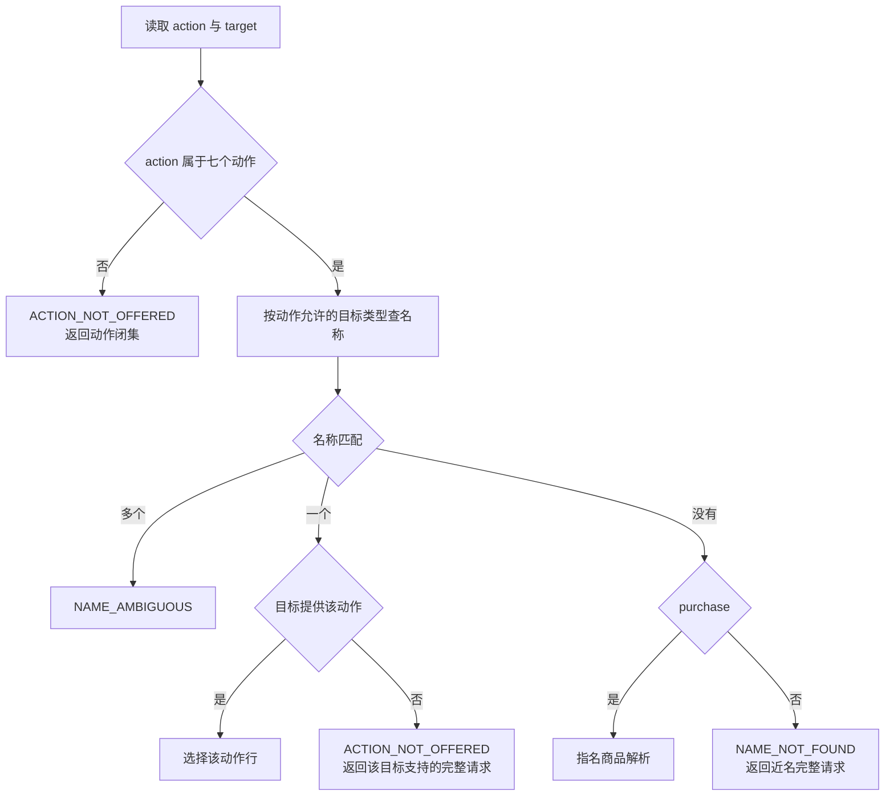

四个出行动作与 `sleep` 只允许地点，`purchase` 只允许商品，`interact` 只允许 app 或地点。
名称簿包含本轮绑定行、未展示的地点和未展示的内容 app；未展示地点提供出行，未展示内容 app 提供 `interact`。
`lookup` 先精确匹配对象标签，再在动作允许类型中沿用三级无损归一与住处写法。
地点按完整显示名匹配：可省略「地点：」前缀，可有全半角与空白差异；`家`、`住处` 指向本人住处。
实例由数据集显式声明，名称为「名称（branch_label）」时不能只写基础名称，不做前缀、子串或自动挑选实例。

| 结果 | 纠错合同 |
| --- | --- |
| 动作不在闭集 | `ACTION_NOT_OFFERED`；路径 `items[i].action`；`allowed_values` 为七个动作；`expected = "An offered activity action is required."`；`why = "The action is outside the declared closed set."`；不带候选 |
| 对象存在但不提供动作 | 同码同路径；允许值为该对象的动作；`expected = "An action offered by this object is required."`；`why = "The known object <label> does not support the written action."`；至多三条完整请求候选 |
| 名称未找到且不是购买 | `NAME_NOT_FOUND`；路径 `items[i].target`；`expected = "A known object name in the selected action's category is required."`；`why = "No known object named <name> supports this action; changing spelling cannot create an object."` |
| 名称未找到且是购买 | 交给 `named_supply_row` 与指名商品解析，不创建不存在的商品 |
| 名称歧义 | `NAME_AMBIGUOUS`，保留现有默认文字与候选机制 |

近名候选仅取本轮列出、类型允许的对象，沿用相似度和此刻可行优先排序，不加入未展示对象的特殊候选通道。
候选形状为 `{"tool":"start_activity","arguments":{"items":[{"action":...,"target":...}]},"note":...}`。
若对象支持原动作就用原动作，否则用该对象首个可用动作，全部不可用时用首个动作；备注沿用原因或时长。
对其他地点 `interact`、对不在场的家 `sleep` 均拒绝；对当前非家地点 `sleep` 也不提供动作。
功能 app、旧动作名称、内容标题和「自己」均不能通过 `interact` 名称解析。

可见名称唯一性继续在加载期检查地点显示名、商品名、内容 app 名，失败仍为
`IntegrityError("Agent <id> would see non-unique object labels: …")`。
内容标题不参与；`APP_NAME_COLLIDES_LOCATION` 保留。`SUBJECT_NOT_KNOWN` 仍服务卡片关系看法，不是社交目标。

#### 工具层与只读查询

完整冻结工具层仍为 `{layer, targets, callable_index}`，公开紧凑渲染仍为 `{layer, groups, callable_index}`。
目标行键序为 `name, kind, phase, state, [last_report], actions, tools`。

| 目标 | 列出与动作 |
| --- | --- |
| 目的地 | 所有可达的其他地点，依次提供四个出行动作；关闭地点仍允许前往 |
| 当前地点 | 有绑定内容时提供 `interact`；收件地点提供取件的 `interact`，无件时标 `PARCEL_NOT_READY`，有件但无可开始内容时标 `CONTENT_EXHAUSTED`；本人家同时提供 `sleep` |
| 商品 | 地点侧可展示商品按既有窗口轮转，每件仅一项 `purchase`；app 侧商品在交互对应 app 时展示价格、运费、预计到达，不单独铺到工具层 |
| 内容 app | 提供 `interact`，包括以商品目录承载内容的平台；暂时耗尽内容仍显示并注明 `CONTENT_EXHAUSTED` |
| 活动 | 进行中与刚结束活动提供相应控制工具，不提供 `start_activity` 动作 |

行序仍为目的地、当前地点、商品、app、活动；同一对象只占一行。永久不能满足的不列，暂时不可行的保留并写原因。
app 与地点行不显示内容类别或已删除的使用方式；推送标题、营业时间、只读时长范围仍可以展示。
查询类别只保留商品四类；不能为容器推断内容类别。

动作行仅含 `{action, available, reason, price, duration, quantity, note}`，删除 `way` 与 `app`。
出行动作显示同源车费、路线时长与费力程度；购买显示派生报价、运费与预计到达，以及 1–5 分钟的购买时长范围，
不展示支付 app 名；睡眠显示派生时长，短于 60 秒时标不可用；内容显示只读时长范围与当前 app 推送说明。
查询不抽取购买时长；只有成功开始后的结果显示本次活动的实际计划时长。
商品实际到达时间与购买本身耗时不得混为一谈。

可用性沿用受理同源规则：决策到期、同刻阶段、待收尾、活动槽与出发前检查、在场、对象条件。
`interact` 固定使用第二槽，其并行资格由槽位和在场条件决定；工具层与实际受理同源，不需要预演内容抽取。
关闭地点的到店购买及在该地点 `interact` 以 `LOCATION_CLOSED` 拒绝；远程候选排除闭店，空候选为 `ACTIVITY_PRECONDITION_UNMET`；
前往关闭地点不拒绝。营业时间在工具层可见，`opens.weekly/exceptions` 使用已经采纳的半开营业时段规则。

紧凑分组为 `{kind, action, shared, targets}`，按相邻目标类别与动作分组；无开始动作时 `action = null`。
只省略 `null` 与空集合，解组后逐值守恒。`callable_index` 删除 `navigation_apps` 与 `payment_apps`；
商品查询索引保留，`query_categories` 只计商品四类的完整计数和例名。

`query_world` 把 `way` 筛选改名为 `action`，取值为七个动作；删除 `app` 筛选，app 通过名称查询。
`name`、`available_only`、`offset` 的行为不变，留下的字符串筛选至少一个非空。
`category` 请求键只允许“零食”“食品”“饮料”“商品”；合法筛选交集为空返回空结果，旧内容类别拒绝。
查询集合由完整地点、允许查询的商品、内容 app 与活动组成；结果为新目标行紧凑投影，不再有动作行 `way`、`app`。
查询只读，不推进时间、不计同刻轮数。

#### 受理、派发与并行

名称解析后派生商品履约与每个动作的固定槽位，先检查同槽占用和睡眠约束，再检查在场及对象条件；
整组准入成功后才建立实际会话并派发。商品预览与受理复用同一报价，内容不在准入前抽取。
内容只在实际开始的会话中选择一次；同槽冲突使用现有 `RESOURCE_CONFLICT` 与整组回滚机制。
选择行为 `{**绑定行, "selected_action": <动作行>}`，不写旧路由字段、收货人、社交对方或消息关联。

| 动作 | 在场与派发 |
| --- | --- |
| 四个出行动作 | `place = None`，创建相应方式行程；非零车费在出发受理时付款；功能 app 由自动绑定记录 |
| `purchase` | 到店须在门店；每项先选店铺与下单 app，再按店铺、app、履约相同合单，每单选择一次支付 app 或 `null`；同请求购买项组成一个随机 1–5 分钟的购买过程，占第二槽，结束时全部组原子付款 |
| `sleep` | `place` 为本人家，受理再次核对在家，按睡眠需要计划时长 |
| 地点 `interact` | `place` 为当前地点；选该 `kind` 内容；收件地点同时批量取件 |
| app `interact` | 无工作地点附加要求；占第二槽；只有商品目录的平台读取数据集 `browse_duration_seconds`，有显式内容时沿普通内容时长 |

`admission.Item` 保留 `action`、`label`、`claims`、`place`、`site`，删除 `canonical`、`way`、`partner`、`manual`。
`place` 非空时继续用同源在场拒绝：不在场为 "<label> requires presence at <place>."，
与出行同组为 "<label> requires presence at <place> and cannot start with travel."，下一步 "Go to <place>."。
组内任何四个出行动作都构成出发；离开地点前只要求结束或暂停依赖该地点在场的第二槽活动；可携带进行中的 app 互动或快递购买出行。
不得因为第二槽有任意活动就统一禁止出发；工具层和实际受理使用同一在场及槽位检查。

删除为瞬时远程下单设置的手动操作标记和驾车专用拒绝分支。出行与购买分属不同槽，不构成槽位冲突；
到店购买与地点互动仍须实际在场，地点侧外卖仍须合法收货停留点。
并行只使用两个固定槽，引擎按动作自动分配，不向请求或数据集增加 `slot` 字段，也不要求模型按槽位排列请求项。

| 动作 | 第一槽 | 第二槽 |
| --- | --- | --- |
| `walk`、`drive`、`take_taxi`、`take_bus`、`sleep` | 占用 | 不占用 |
| `purchase`、`interact`（地点或 app） | 不占用 | 占用 |

同槽同一时刻最多一个活动。进行中和待收尾活动占用对应槽；暂停释放槽位，恢复时重新检查。
任何整组开始或恢复存在冲突都原子拒绝；系列接续不释放槽。请求项顺序不改变槽位、履约或准入结果。
四种出行可与第二槽中不要求原地在场的购买或 app 互动并行；任何购买与互动、两个互动都不能并行。
睡眠虽只占第一槽，开始时额外要求第二槽没有进行中或待收尾活动；睡眠期间不能开始或恢复第二槽活动。
同请求睡眠与第二槽动作以 `RESOURCE_CONFLICT` 整组拒绝；不存在通过交换请求项顺序绕过睡眠约束的路径。
同请求多个购买项先组成一个购买过程，共用一次抽取的 1–5 分钟时长与第二槽，内部按合单规则记录各组。
订单分组不增加占槽数或累计时长；另一次购买必须等第二槽释放后才能开始。
支付、导航和回调的 `app_touch` 是瞬时足迹，不占活动槽，不创建额外活动；下单 app 只保存在订单事实中。
支付 app 的 10–20 秒操作位于购买内部，全部真实扣款与成功通知发生在购买完成时，不改变槽位规则。

同刻请求类中 `purchase` 与四个出行动作、`sleep`、`interact` 均归 `start`；
删除将购买视为瞬时行为的 `RESTRICTED_EXCLUDED_ACTIONS = {"purchase"}` 与旧「不占槽、不建活动」断言。
购买作为有真实时长的活动参与已开始活动与同刻决策阶段的判断；正常付款、到店收货与取消均按「商品与履约」的整次购买规则处理。
操作日志按请求动作原文判组件：购买为 `commerce`，出行为 `travel`，其他为 `engine`。

#### 出行、睡眠与驿站交互

| 方式 | 基础速度 | 车费（分） | 代谢当量 | 占用 |
| --- | --- | --- | --- | --- |
| 步行 | 1.2 米/秒 | 0 | 3.5 | 第一槽 |
| 驾车 | 7 米/秒 | `max(500, ceil(0.2 × 米))` | 1.5 | 第一槽 |
| 打车 | 7 米/秒 | `max(1400, ceil(0.3 × 米))` | 1.5 | 第一槽 |
| 公共交通 | 5 米/秒 | 200 | 1.5 | 第一槽 |

这些速度和车费是引擎常量。所有人物默认有车，删除 `owns_car` 与 `CAR_REQUIRED`；只有 `drive` 触发燃油状态扣减。
时长为 `ceil(distance_meters / (基础速度 × 天气系数))`。天气按本地日期等概率取以下固定组合：
`sunny`（晴）1.0、`cloudy`（多云）1.0、`light_rain`（小雨）0.85、`heavy_rain`（大雨）0.7、`snow`（雪）0.6。
天气系数对四种出行方式均生效，配送时长不乘该系数。新建运行先初始化开始日期的天气，
不补发开始之前或恰在开始时刻的天气事件；随后每个本地零点生成当天天气事实。恢复读取冻结的天气和日期。
环境层给出一行真实天气，例如「今天天气：小雨」。环境层构造器、`prompt_schemas` 与系统层天气规则
必须在同一次实现变更中更新，明确环境是天气的唯一来源；模型文字按提示约束，禁止关键词过滤或模型复核。
同一时刻的工具报价、受理计划与时长核对必须同源；已经受理的行程保留其计划依据，跨天气变化推进或恢复不能改写已发布时长。
`persisted_trip` 核对不符仍报 `IntegrityError("Persisted travel plan does not match the published graph")`。

`trip_id` 仍为 `<起点>-><终点>:<方式值>`；单程 1 秒至 86400 秒，越界 `ROUTE_DURATION_INVALID`，
引用不符 `ROUTE_DURATION_MISMATCH`，目的地未知 `DESTINATION_NOT_FOUND`，余额不足 `INSUFFICIENT_TRAVEL_FUNDS`。
零车费不改变余额；非零车费在出发时支付，收款账户为 `external:scenario`。
出行不能暂停。第二槽 app 互动与购买保留各自生命周期，不因出发或到达而自动结束；
互动可按自己的规则暂停、恢复和结束，购买按其不能暂停的规则处理。地点互动仍受在场条件约束。
环境层显示四种中文方式，已核验到达句分别使用走路、开车、打车、坐公共交通。

出行活动名为「<方式>前往<地点>（M月D日 HH:MM 起）」；睡眠活动名为「睡觉（M月D日 HH:MM 起）」。
购买使用「购买<商品名列表>（M月D日 HH:MM 起）」；列表按 `goods_id` 升序取真实商品名并以「、」连接，
例如「购买咖啡、面包（1月5日 08:00 起）」。这只是现有 `purchase` 过程的显示名称，不新增动作；重名沿用既有消歧。
睡眠只在本人家且本人在家时可开始，时长按 `round(sleep_need_hours × 3600)` 派生并按一天封顶，
低于一分钟为 `ACTIVITY_TOO_SHORT`，不能暂停。
睡眠只有自身计划结束才能结束；任何提醒、值勤边界、兜底边界或订单到达都不能把人物叫醒。
`run_start` 的运行开启例外与合并触发见「唤醒触发」；首次启动不预置睡眠，不反思，也不触发唤醒类别回调。

在 `accepts_parcels` 当前地点 `interact`，一次取走本站全部已到站件，并按正常推荐顺序开始该地点类型的一条内容。
即使该类型同时绑定其他内容，也不跳过批量取件或另开专门领取请求；没有可取件时拒绝为 `PARCEL_NOT_READY`。
取件时长读取实际选中内容的数据集声明与共享进度，不固定为五分钟，也不增加无内容取件路径。
缺少可开始内容时仍遵守内容集合为空的拒绝与整组原子性，不能悄悄成功执行无内容的领取。
不额外创建隐藏的第二条取件活动；商品实际领取与收货效果由「商品与履约」规定。

#### 宿主与提示合同

宿主只做严格模型与名称校验，删除 `routing.combination_issues`、地点交互菜单检查及 `_validate_action_fields`。
名称类失败逐项汇总为一次纠错，环境再次核对请求。`_binding_action` 只读取非空 `action`；
非法私有绑定仍报 `RuntimeError("LifeAgent interaction binding action is invalid")`。
`_visible_names` 删除 `routing`、`recipient_names`、`people`，`objects` 映射到对象提供的动作元组。

生活工具由六个请求工具、三个记忆查询与 `query_world` 构成，共十个；
六个请求工具是 `start_activity`、`recall_task_summary`、`report_status`、`pause_activity`、
`conclude_activity`、`revise_day_plan`。世界请求为其中除 `recall_task_summary` 外的五个，查询共五个。
环境稳定工具面为这六个加 `query_world`；最后回合与截断重试去查询的既有规则不变。
工具用途表另保留只读 `finish`，删除 `set_alarm`、`send_message`。
开始用途句为「开始一项或两项活动：逐项写动作与目标。」；查询用途句加入动作筛选、删除 app 筛选，
查询品类只使用零食、食品、饮料、商品。

系统层不再冻结旧条数或保留没有适用行为的整条规则。以下语义同步写入系统层正文及 `docs/design/06-agent.md`：

| 主题 | 应写入的当前规则 |
| --- | --- |
| 请求 | 每次决策恰好提交一个世界请求；只读查询可同批，世界请求单独提交；每项只写 action 与 target |
| 事实 | 环境结果与 settled 是核验事实；self_note、self_notes、个人看法与事务文字是人物记录；事务完成由环境实际结算确认；删除消息核验句 |
| 时间与空档 | 内容时长由引擎决定，购买耗时随机 1–5 分钟，开始后按已确定时长进行；没有进行中活动时同刻继续决策；确实无事时从工具层选择此刻可做的低消耗活动，不等待环境安排 |
| 中途决策 | 长活动播报、清醒期间的订单到达、提醒、app 推送与作息边界可提供决策；手上的活动照常进行；睡眠排除这些外部唤醒 |
| 并行 | 引擎把出行和睡眠自动放入第一槽，购买与所有互动放入第二槽；每槽同刻一个活动，请求项无需排序或填写槽号；睡眠前清空第二槽且睡眠中不能启动它；驾车可跨槽并行，地点活动仍须在场 |
| 名称与内容 | 商品、地点、内容 app 都可直接点名；地点要完整显示名；只选 app 或当前地点，内容由引擎选；有推送时优先消费该 app 的推送内容 |
| 睡眠 | 本人在家才可睡；按作息与困倦安排；早睡通常早结束；今日计划提醒不会叫醒睡眠，不再建议用提醒控制起床 |
| 取件 | 本人到收件地点 interact，一次取走全部已到站件，同时开始地点内容；时长完全由数据集内容决定 |
| 身体与收货 | 走路比坐车费力；商品真实收到即消费；饮品不承担热量，非饭点有点饿可买零食；正餐与饭点、严重饥饿的现有指引保留 |
| 工作与聊天 | 删除指派工作要求、完成上报和联系人回应；工作与聊天都是内容；聊天只给话题，模型在每个配置的 `report_status` 播报边界编写聊天进展，没有对方回复；心理效果按实际消费时长直接结算，报告不改时长或效果 |

系统层写明系列自动接续与两个固定活动槽；支付段和消费推送只用于系统记录，不增加人物决策；
心理档位采用「人设与运行配置」中已采纳规则；购买的付款、收货和取消规则直接使用「商品与履约」。
`prompt_sha256`、`tool_schema_sha256` 随系统层、七层 Schema、请求工具与可供性字节改变，
在新运行时计算；打开、恢复、重放与验证拒绝旧身份，不做迁移。

#### 错误码

`WAY_NOT_OFFERED` 改为 `ACTION_NOT_OFFERED`，默认原因为 "The target does not support this action."，
改法 "Use one of the target's offered actions."；保留名称类每人每秒前两次免计规则。
`ACTION_REQUEST_INVALID` 默认原因为 "The requested object or action does not satisfy this tool contract."，
改法 "Use the published exact object name and offered action."，下一步 "Choose a known object and an offered action."。
内部 `ACTION_NOT_SUPPORTED` 保留，改法统一为目标所提供的动作。

删除 `ROUTE_FIELDS_INVALID`、`APP_REQUIRED`、`APP_NOT_OFFERED`、`PAYMENT_APP_REQUIRED`、
`PAYMENT_APP_NOT_BOUND`、`COUNTERPART_REQUIRED`、`RECIPIENT_NOT_FOUND`、`SUPPLY_NOT_AT_STORE`、
`REQUEST_ALREADY_HANDLED`、`CAR_REQUIRED`、`TOO_MANY_TARGETS`；同步删除默认文字、宿主集合、业务定位与抛出点。
`start_activity` 业务拒绝统一定位到 `items[i].target`；名称拒绝保持自己的 action/target 路径。

宿主错误闭集保留 `ARGUMENTS_NOT_JSON`、`ARGUMENTS_INVALID`、`TOOL_CALL_REQUIRED`、
`NAME_NOT_FOUND`、`NAME_AMBIGUOUS`、`ACTION_NOT_OFFERED`、`SUBJECT_NOT_KNOWN`、`OUTPUT_TRUNCATED`、
`MODEL_SERVICE_FAILED`、`EVIDENCE_WRITE_FAILED`、`MEMORY_QUERY_FAILED`、`TOOL_SERVICE_FAILED`。
宿主名称集合为名称未找到、名称歧义、动作未提供、关系对象未知；环境名称集合保留 `SUPPLY_NOT_FOUND`、`TASK_NOT_FOUND`。
未知宿主错误码仍以 `ValueError("unknown host error code: <code>")` 拒绝。

### 接口、删除面与文件指引

| 模块 | 修改范围 |
| --- | --- |
| `src/worldmock/life/models.py`、`vocabulary.py`、`src/worldmock/exchange/types.py` | 二字段请求、七动作、四出行方式、私有绑定动作；退役字段与方式词表删除 |
| `src/worldmock/life/name_resolution.py`、`object_labels.py`、`load_checks.py` | 四类目标、内容 app 名、完整地点显示名、统一纠错与名称唯一性 |
| `src/worldmock/life/projection.py`、`tool_layer.py`、`callable_index.py`、`world_query.py`、`prompt_schemas.py` | 新目标和动作行、分组、营业时间、action 查询；删菜单和路由列，不预判内容类别 |
| `src/worldmock/life/admission.py`、`session_actions.py`、`activity_control.py`、`same_moment.py` | 派发、在场与原子准入、两个固定活动槽、睡眠范围；同请求购买项共用一个过程和一次随机时长；尾段顺序操作支付 app，购买完成时整次原子扣款；取消、到店收货与无部分付款验证 |
| `src/worldmock/life/travel.py`、`discovery.py`、`rules.py`、`time_advance.py`、`readable.py` | 四方式、同源报价、天气冻结、行程完整性与人读句 |
| `src/worldmock/life/routing.py`、`request_linking.py` | 整体删除；`order_label` 移到唯一消费者 `progress_layer.py`，不保留消息关联层 |
| `src/worldmock/life/error_contract.py`、`guidance.py`、`business_feedback.py`、`result_projection.py` | 码集合、定位与过时消息明细删除 |
| `custom/agents/life_agent.py`、`custom/envs/life_env.py`、`src/worldmock/agents/life_prompt.py` | 宿主与环境同源、工具集合、提示与指纹 |
| `docs/design/04-simulation-engine.md`、`06-agent.md`、`09-io-formats.md`、`10-runtime.md` | 当前接口与行为；操作变化同步到手册 |

### 测试要求

| 范围与测试入口 | 验收行为 |
| --- | --- |
| `tests/unit/life/test_start_activity_schema.py`、`tests/unit/agent_protocol/test_activity_schema.py`；`tests/integration/life/test_start_activity_contract.py` | 恰二字段、项数与目标唯一、额外键拒绝、闭集由同源常数派生；两商品分别选择后按条件合单 |
| `tests/integration/life/test_name_resolution.py`、`test_control_name_rejections.py`、`test_load_checks.py`；`tests/integration/runtime/test_host_feedback.py` | 名称归一、完整地点名、家别名、未展示 app、功能 app/内容标题拒绝、候选形状、批量纠错；宿主与环境一致 |
| `tests/integration/life/test_tool_layer.py`、`test_public_observation_contract.py`、`test_callable_index.py`、`test_world_query_filters.py` | 新动作行与分组可逆、无 route/app 字段、action 筛选、app 筛选拒绝、选前不虚构类别；品类仅用于商品，旧内容品类请求必须拒绝 |
| `tests/integration/life/test_travel_graph.py`、`test_parallel_admission.py`、`test_duration_boundaries.py` | 四方式速度/费用/代谢/占用；天气同源与跨日已受理行程稳定；四种出行与快递购买或 app 互动可跨槽并行，交换请求项顺序结果不变；地点活动受在场限制；本人在家且第二槽清空才睡，睡眠禁止第二槽；关闭地点可前往，但拒绝到店购买及该地点 interact，不因此禁止快递购买 |
| `tests/integration/life/test_purchase_apps.py`、`test_named_purchase.py`、`test_acs_contract_guards.py`、`test_acs_receipt_readers.py` | 引擎选择 app，支付每单可选 app 或 `null`；同请求两商品即使分属不同店铺，也只创建一个购买活动并抽一次 60–300 秒；每组 app 操作 10–20 秒在尾段内顺序进行，只在段开始记跳转；购买完成全部组原子扣款后才记成功通知与到店收货；开始或完成时总额不足均不部分购买，提前结束或截断不扣款；与互动冲突，与符合履约条件的出行可并行；收件地点一次取全、无件拒绝，使用不同数据集时长验证无五分钟硬编码 |
| `tests/integration/runtime/test_life_agent_protocol.py`、`test_seven_layer_request.py`、`test_agent_branch_coverage.py` | 实际十工具与稳定七工具；旧工具不提供；系统层不出现删除行为或未采纳建议；提示与 Schema 指纹可重算，不再冻结旧条数 |
| `tests/integration/life/test_tool_protocol.py`、`test_public_interface_evidence.py`；系统完整日与变异检查 | 直接提交也严格核验，拒绝原子不改状态/事件；完整日使用新请求；保留仍有效的请求丢字段、原子性、出行与控制变异覆盖 |

### 已确认边界

- 统一心理量、内容效果、商品品类查询、两个资金账户和营业时段均已全部采纳，分别执行所属正文。
- 购买的结束时原子付款、不可暂停而可结束、整次不足全部拒绝或取消、到店付款即收货均已确认，不再保留旧追加建议。
- 纯目录浏览由数据集声明时长，取件由内容声明时长；两槽按动作自动分配，睡眠有清空第二槽的额外条件。


<a name="spec-envdataset-删除的动作与子系统"></a>
## 删除的动作与子系统

### 目标与依据

一个环境只运行一个人物。删除等待、目录动作执行入口、独立领取、闹钟、消息、邮件、联系人、社交互动、
交互菜单与专用燃油模块。聊天内容与社交需要继续存在；心理变化按内容实际消费时间直接结算，不使用回调。
删除内容类别、商家账户、场景文件等跨模块事项分别由所属章节维护。

### 行为规格

#### 等待、空闲与预算耗尽

动作闭集不含 `wait`、`do`、`collect_parcel` 或对应中文同义词；提交后得到 `ACTION_NOT_OFFERED`，
不归一为其他动作。世界不再创建、推进或保存等待活动，不另加空档、静息、idle 等活动或内部动作。
保留睡眠、出行、内容活动，购买按已抽取的 1–5 分钟活动时长记录；不再保留零秒购买路径。
旧状态或检查点包含 `kind="wait"` 时直接结构拒绝。

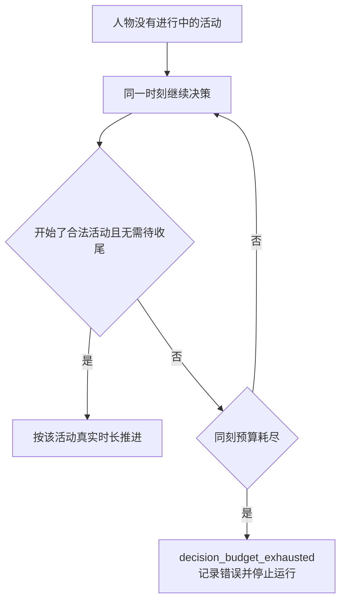

同刻预算耗尽按回答确定为六轮后停止运行；删除原额外跳过 900 秒的技术停顿、`next_decision_at` 延后与空档继续运行。
不把该错误当作可接受计数，也不提供其他降级。`effective_autonomous_decision_rate` 删除，
质量报告不再定义「耗尽的可接受区间」；运行失败证据归「记录、导出与评估」。
同刻计入预算的前三轮为普通阶段，后三轮为受限阶段；第六轮后仍需同刻决策则失败。
开始合法活动且没有待收尾活动时正常推进；名称类免计规则不变，不保留可改变六轮上限的旧配置。

只有进入环境并登记结算的请求计同刻轮数，宿主名称纠错不进入引擎；环境名称类前两次免计的规则保持。
模型始终提交表外动作时先耗尽 `config.toml` 的 `max_react_turns`，记录错误并使人物决策失败，
不合成默认动作，也不伪造 `decision_budget_exhausted`。
同刻阶段请求类删 `wait`，开放、仅收尾、开始或恢复、恢复或结束、仅结束各阶段继续限制其对应合法请求。

删除 `idle_reconsideration_interval_seconds`、`IDLE_RECONSIDERATION_INTERVAL_SECONDS` 与只为选择间隔存在的
`_has_commitments`、快照/查询 `has_commitments`。常规重估只读 `reconsideration_interval_seconds`，
不根据分配工作、暂停活动或事务另选空闲间隔。无活动时仍即时请求决策；达到重估时间时可同时记录常规重估触发。

身体预测不再借 `ActivityKind.WAIT` 表达「非睡眠」。`next_body_boundary_seconds` 以显式 `ActivityFactors` 为输入，
不再接收带隐式默认的活动种类；空集合与只出行的实际因子仍与身体结算同源，不丢失能量和体感边界预测。
空集合使用与最低 `idle` 档同源的基础消耗因子，缓解为零；购买和纯目录浏览也使用该档。
基础消耗不构成一个可推进时间的隐藏活动，身体预测与实际结算读取同一组因子。
删除等待代谢值 1.3，能量恢复豁免只保留睡眠；内容与出行的反馈边界保留。
删除非睡眠统一返回 `activity_feedback_seconds` 的计划时长分支；睡眠、路线、内容、购买各读自己已定义的时长来源，
不借被删等待时长补齐购买生命周期。

#### 独立领取与闹钟

`do` 删除后内容消费全部由 `interact` 受理，目录动作模型、名称和执行字段不留下兼容别名。
`collect_parcel` 与「领取」动作删除后，取件通过当前收件地点 `interact`，一次全取并开始内容，耗时由目录取件内容表达。
保留实际领取结算函数 `parcel.collect_parcels` 与 `receipt._require_parcel_receipt` 供新入口复用，
删除旧工具分派与未调用的 `StorefrontRuntime._collect_parcels`。
原「瞬时、不占槽、不建活动」动作集合整体失去依据；不能继续把购买或取件列入。

删除 `set_alarm`、闹钟时刻解析、预排 `alarm_ring`、到期效果、睡眠中断、事件 `caused_by` 关联与
`pending_alarms` 工具支持。状态与检查点不接受旧闹钟字段和种类。
模型调用退役工具时宿主以 `TOOL_CALL_REQUIRED` 纠错，原因 "The tool is not offered in this round."；
直接提交则为 `ProtocolError("Direct tool call request type does not match its tool")`，不进入领域结算。
睡眠按计划结束；阈值提醒等到醒来后的首个推送时点，静默进入进度层，不唤醒、不强制决策。
今日计划提醒机制保留，唤醒原因统一记录为 `reminder_due`，不能代替闹钟结束睡眠。

#### 消息、邮件、联系人与多人互动

`send_message` 与所有直接消息、交谈邀请、当面交谈、远程通话、联系人回复执行路径删除，
工具拒绝与闹钟相同。引擎不发邀请、不建立通话事实、不按共同秒数缓解社交需要、
不产生 `partner_ended` 或对方结束后的同秒机会。
内容活动没有社交专用「不可暂停」或「随时可结束」例外；统一遵守在进行中、非路上、到决策边界才可暂停/结束的规则。

| 表面 | 删除或当前行为 |
| --- | --- |
| 人物状态 | 删除 `inbox`、`read_inbox_ids`、`outbox`、`visible_message_ids`、`people_at_last_decision` |
| 预排与事件 | 删除 `message_arrival`、`mail_arrival`、`model_npc_reply_pending`、`model_npc_reply` 与对方离开的活动边界 |
| 联系人机器 | 删除回复模型客户端、提示、后验守卫、纠正、模板或兜底回复、延迟送达及 `contact_reply_guard` 质量节 |
| 观察 | 删除联系人/人物绑定、`presented_message_ids`、消息绑定、在场人物集合、消息证据与开场邮件 |
| 进度和记忆 | 删除直接消息、交谈邀请、邮件记录以及收到/发出/未回复消息的句子 |
| 零点计划 | 删除联系人、收件箱和分配工作待办输入；保留个人事务、在途订单与日计划目标 |
| 订单与选择 | 删除 `to`、`recipient_id`、`counterpart`、`request_message_id`、`answering`、`linked_orders`，收货人为唯一人物本人 |

邮件整个子系统也删除，不创建默认邮件 app；工资由数据集的时间回调转账，静默到账，不唤醒人物。
删除邮件 `MessageConfig`、场景邮件声明、预排编译、`visible_mail`、`LifeRuleEngine.messages`、
进度层邮件 Schema、`message_id` 禁键的失效分支、邮件记忆句与公开证据映射。
`plan_day` 不再出现「收件箱」「联系人」或分配工作任务，提示说明同步删除。
测试中借 `wake_by_mail` 固定决策边界的做法改用仍合法的受控活动或调度边界，不能保留测试专用邮件生产路径。

环境不支持多个模拟人物，不再设计互相不可见的多人隔离规则。
`recipients.py` 删除；本人收货位置调用直接使用已有 `admission.present_location`，
收货人姓名与身份比较随订单字段删除。订单拒绝不再出现 "Wait until <name> can receive it, or buy it for yourself."。
人设卡片中的人物关系和已形成的关系看法保留，合法关系对象只来自卡片关系或已有看法；
未知关系对象仍为 `SUBJECT_NOT_KNOWN`，原因 "The relationship subject is unknown."。

#### 社交需要、心理量与内容效果

`BodyState.social_need`、清醒增长、社交体感分级与当日意图「社交」保留。
原交谈、通话、消息的缓解账本和常数删除：`SocialExposure.conversation_hours`、`remote_hours`、`messages_read`，
以及 `SOCIAL_NEED_CONVERSATION_RATE`、`SOCIAL_NEED_REMOTE_RATE`、`SOCIAL_NEED_MESSAGE_RELIEF`、
`CHAT_RELIEF_DECLINED_PER_HOUR` 不再以被删除的互动路径提供效果。
保留清醒增长的有效行为，不把「只有增长、永远无法缓解」作为新的设计。
聊天内容与工作内容走同一消费、暂停、恢复和进度报告流程，只提供话题。
模型在每个配置的 `report_status` 播报边界编写聊天进展；引擎按实际消费时长与效果档位直接缓解社交需要，
不新增对话交互、聊天回调或模型决定的心理增量。具体效果档位与数值见「人设与运行配置」的已采纳规则。

社交画像只保留实际自然增长率；其他已删除互动参数不转入回调，内容直接按两个声明效果结算。
`social_need_growth_per_hour`、`conversation_relief_per_hour`、`invitation_acceptance`、`reply_tendency`、
`present_preference` 的模型和映射表由「人设与运行配置」统一处理，执行用户已全部采纳的拆分。
当日意图只表达人物的计划，不再匹配活动家族或触发引擎自动推进；计划维护按下节执行。

娱乐需要与情绪合并为一个心理量，旧 `entertainment_need` 与 `mood_valence` 不再是并存的产品状态。
消息读取情绪脉冲 `message_received` 与自动目标推进脉冲 `goal_progressed` 删除；其余情绪脉冲、娱乐/运动持续效果不得写为永远不变，
必须按已采纳的统一心理量与内容效果一起改写。
`felt.py`、`body.py`、`rhythm.py`、环境体感 Schema 与预测同源，不能只改展示而保留两套旧结算。

#### 日计划与实际经历

当日计划由模型根据具体目标和实际活动经历维护。零点生成仍使用 `plan_day`，人物通过现有的
`revise_day_plan` 提交当前完整清单，保留、改写或移除目标；不新增完成工具、进展事件或目标状态机。
移除目标只表示它不再列入当前计划，不作为已完成该目标的客观证据。

引擎校验计划结构、登记时刻和提醒规则，记录生成与修订结果；活动时长、内容进度和商品收货仍由引擎核验。
这些事实不再自动证明自然语言目标有所推进或已经完成。删除按内容类别、睡眠、出行和正餐收货自动推进目标的全部分支，
删除活动自动绑定同类目标及把 `report_status` 自述同步到该目标的路径。
`intent_kind` 仅表达计划意图，不匹配活动；`around_time` 仅表达大致安排，不参与完成判定。

`revise_day_plan` 的 `goals` 仍使用现有请求结构，但改为替换当前完整清单，不再永久保留所谓已推进条目。
删除 `PLAN_GOAL_ALREADY_PROGRESSED`、对应禁止重交规则、`GOAL_TIME_TOLERANCE_SECONDS`、`ran_in_goal_window`
及只服务自动匹配的活动家族表。持久目标删除 `progressed_at`、`progress_activity_id`、`progress_order_id`
与自动同步的 `progress_note`；引擎不根据模型文字另建完成状态。

原样保留的目标沿用登记时刻和提醒状态，不能因重交清单重复提醒；新增或改动提醒仍校验其在当前时刻之后、当日结束之前。
移除或替换目标时取消旧提醒。零点生成、跨日失效和睡眠不被计划提醒唤醒的规则保留，个人事务不受日计划修订影响。

待办层、目标回看、上一天计划输入及其 Schema 同步删除「已推进」与 `progressed` 等引擎判定。
是否存在当日待办按当前计划清单判断，不再读取任何目标的自动推进标志。
模型读取当前计划、历史修订和实际活动经历；活动自身的 `objective_progress`、内容消费秒数、订单与个人事务的真实收货证据保留。
删除按未推进目标活动家族增加推荐分数的规则，以及自动推进引起的 `goal_progressed` 心理脉冲。
计划被保留、改写或移除不直接改变身体状态，不计算目标推进率或把移除率当完成率。

实现涉及 `schedule.py`、`day_planning.py`、`session_actions.py`、`rhythm.py`、`todo_layer.py`、
`day_plan_inputs.py`、`prompt_schemas.py`、计划回看与推荐排序；同步改写所属模块设计的计划生命周期和人物请求说明。
验收覆盖完整清单替换、已做过活动后仍可改计划、原样重交不重复提醒、移除取消提醒、活动或收货不会自动修改计划，
以及删除目标不产生完成证据或心理奖励；不得为这些行为恢复内容分类。

#### 菜单、燃油、工作指派与死模块

删除 `interaction_menus_by_location_kind`、`interaction_menu`、`PROTECTED_SELF_ACTIONS`、菜单登记与
`INTERACTION_MENU_DENIED`。受理、工具层、商品发现、可调用索引与宿主均不再经过菜单；
本人家睡眠是独立约束，不能因删菜单而宣称任何地点都可睡。
环境层 `location` 保留 `{session_kind, name, place_type}`，删除菜单生成的 `fixed_rules` 与其 `ACTION_PHRASES` 表。
内容的地点约束只由 `location_kinds` 与当前在场条件表达，不另造动作—地点许可表。

默认有车，删除 `owns_car`、`CAR_REQUIRED` 与任何汽车归属检查。
专用 `fuel.py`、`AgentState.driving_days`、`AgentState.last_driving_date`、`FUEL_DRIVING_DAYS` 删除，
改由 `callbacks.jsonl` 登记状态及通用人物回调状态映射承载。
仅驾车按实际覆盖的本地日期扣减，跨午夜逐日记账，同日不重复；扣到零不阻断。
燃油是普通 `goods`，收货重置到规则声明的 `cap`，初值也在规则文件，
不在商品收货代码或 `persona.toml` 再保存专用燃油效果。
`require_driving_days`、原专用扣日路径与 `DRIVING_DAYS_EXHAUSTED` 删除。

工作指派整个机制删除，包括场景 `work_content_ids`、`WORK_*` 校验、专用工作地点门禁、
`work_content_completed` 事件及其完成脉冲、由分配任务派生的在手承诺与零点待办任务。
工作内容按绑定容器与正常推荐消费，不保留场景副本或单人物场景包装。
无生产调用方的 `src/worldmock/life/retrieval.py` 与同族死代码 `LOCATION_KINDS` 删除，其专属测试随之删除。

#### 占用与错误码

删除 `wait`、`talk`、`travel`、`use_app` 等旧资源划分、`[kinds.wait]` 以及 `category:*`、`manner:*` 条件。
统一按「动作与请求接口」的两个固定活动槽受理，不另保留类别、target 或设备占用锁。
`AppUseManner`、使用方式标签及派生的 `device` 字段删除；app 使用事实由实际 app 内容活动产生。

| 删除的错误码 | 已删除的触发 |
| --- | --- |
| `ALARM_TIME_INVALID` | 人物设闹钟 |
| `INTERACTION_MENU_DENIED` | 菜单禁止动作 |
| `DRIVING_DAYS_EXHAUSTED`、`CAR_REQUIRED` | 油量和有车准入 |
| `MESSAGE_TEXT_TOO_LONG` | 消息正文 |
| `CHAT_PARTNER_NOT_AVAILABLE`、`CHAT_ALREADY_ACTIVE` | 交谈对方或重复交谈 |
| `SOCIAL_ACTIVITY_CANNOT_PAUSE`、`SOCIAL_PARTNER_NOT_FOUND`、`CONTACT_NOT_FOUND` | 社交特殊暂停、对方与联系人 |
| `ELIGIBILITY_LOCATION_KIND_MISMATCH`、`WORK_*` | 运动场所门禁与工作指派 |

`ACTIVITY_TOO_SHORT`、`RESOURCE_CONFLICT`、`SAME_MOMENT_ACTION_RESTRICTED`、`ACTIVITY_FEEDBACK_NOT_DUE`、
`SUBJECT_NOT_KNOWN` 与 `PARCEL_NOT_READY` 保留。
`ACTIVITY_PRECONDITION_UNMET` 保留有效分句，删除交谈对方不在场、驾车发消息与为他人购买收货不可能的分句。
消息路由相关其他错误码由「动作与请求接口」统一删除，不另保留历史默认原因或旧码别名。

### 接口、删除面与文件指引

| 模块 | 当前处置 |
| --- | --- |
| `src/worldmock/life/models.py`、`same_moment.py`、`rhythm.py`、`body.py`、`durations.py` | 删除等待、空闲间隔与过时状态；六轮耗尽失败；显式身体因子与真实时长来源 |
| `src/worldmock/life/social.py`、`social_actions.py`、`contact_exchange.py`、`interaction_menu.py`、`recipients.py`、`retrieval.py`、`fuel.py` | 删除模块及无消费者接口；保留的本人位置/订单文字职责就地交回现有消费者 |
| `src/worldmock/life/content.py`、`observe.py`、`progress_layer.py`、`memory_layer.py`、`settled_text.py`、`day_plan_inputs.py` | 删除邮件、消息、在场人物、菜单与旧待办；保留卡片关系与个人事务 |
| `src/worldmock/scheduling/events.py`、`compile.py`、`effects.py`、`src/worldmock/life/time_advance.py` | 删除消息/邮件/闹钟预排与同秒社交机会；工资改回调，睡眠外部唤醒禁止 |
| `src/worldmock/life/activity_control.py`、`activity_validation.py`、`admission.py`、`session_actions.py` | 删除对方校验、社交暂停例外、菜单准入、专用燃油与独立领取派发 |
| `src/worldmock/life/felt.py`、`body.py`、`src/worldmock/exchange/constants.py`、画像映射 | 保留社交需要，移除被删互动效果；内容效果直接按实际时长和档位结算，统一心理量与档位数值按「人设与运行配置」已采纳规则 |
| 宿主、运行时、记录、评估与查看器 | 去掉联系人回复客户端、守卫、消息事件、等待经历和旧质量指标；文件入口见对应章节 |
| `docs/design/02-exchange-engine.md`、`04-simulation-engine.md`、`06-agent.md`、`08-configuration.md`、`09-io-formats.md` | 正文同步删除退役合同，保留有效状态、资源守恒与失败证据 |

状态字段和预排种类变化纳入统一 `WORLD_SCHEMA_VERSION` 升号；环境结构不再有场景版本。
身体和预算规则纳入 `RULES_VERSION`；工具、提示与可供性文件字节进入各自指纹。
删除旧结构读取，不提供迁移或兼容分支。

### 测试要求

| 范围与现有测试入口 | 验收行为 |
| --- | --- |
| `tests/integration/life/test_decision_budget.py`、`test_same_moment_decisions.py`；`tests/integration/runtime/test_host_feedback.py` | 六轮耗尽停止运行，时间不跳过 900 秒，无默认活动；宿主表外动作纠错不计环境轮数；模型回合耗尽独立失败；受限阶段仍约束合法请求 |
| `tests/integration/life/test_duration_boundaries.py`、`test_activity_effects.py`；`tests/unit/life/test_body.py` | 无等待时长来源；路线/内容/睡眠读取各自真实时长，购买按已抽取的 60–300 秒推进，不被报告节律替换；查询不抽取、同请求只抽一次、恢复不重抽；显式因子的边界预测与真实结算一致 |
| `tests/integration/life/test_wake_reasons.py`、`test_shift_edge_runs.py`、`test_discomfort_and_sleep_messages.py` | 无空闲间隔与在手承诺；所有外部提醒/推送/订单/值勤边界不结束睡眠；保留有效身体结算断言，心理量期望按已采纳规则改写 |
| `tests/integration/life/test_retired_tools.py`、`test_menu_free_world.py`；宿主协议测试 | 旧工具不提供、直接提交拒绝；旧状态字段/等待/消息/邮件/闹钟检查点拒绝；无菜单与人物交互产出；单人物环境拒绝旧场景输入 |
| `tests/integration/life/test_driving_without_fuel.py`、`test_acs_contract_guards.py`、`test_acs_system_core.py` | 无 owns_car 字段也能驾车；回调燃油为零仍可跨午夜行驶；同日不重扣、跨日各扣、收货重置、阈值提醒醒后静默送达 |
| `tests/integration/life/test_day_planning.py`、`test_persona_layer.py`、`test_felt_states.py` | 无收件箱/联系人/分配任务；计划由模型整表修订，删除自动推进及奖励；卡片关系和社交需要保留；聊天按实际消费时长直接缓解，报告不驱动效果，档位数值按已采纳规则；午夜结算/计划/判定顺序仍由可观察结果证明 |
| `tests/integration/life/test_memory_layer.py`、`test_progress_events.py`、`test_sleep_billing.py` | 无等待、消息、邮件或对方结束经历；删除社交账本专属测试后保留合法活动的结算与防重复断言 |
| `tests/unit/catalog/test_affordances.py`、`tests/integration/life/test_parallel_admission.py` | 退役资源条件拒绝；两个出行或出行与睡眠冲突，任意两个互动或购买与互动冲突；跨槽仍核对在场；驾车可跨槽并行，睡眠清空并禁止第二槽；请求顺序和别名不能绕过；暂停释放、恢复重检、系列换集不释放；同请求购买项聚合后只占第二槽 |
| `tests/unit/engineering/test_import_graph.py`、`test_shared_model_clients.py`、`test_single_source.py`；源码变异检查 | 删除死模块、联系人客户端与无效登记；保留真实边界和有效源码变异，不用历史文件枚举充当产品验收 |

删除社交、联系人回复、交互菜单、等待专属与 `retrieval.py` 专属测试文件；仍有效的非菜单断言迁到新入口测试。
原脚本用等待推进时间的地方改为合法、低消耗的真实内容，不用兼容帮助函数包装旧请求。
`wake_by_mail` 使用者改为合法调度边界；夹具与系统完整日只使用一个人物和新格式环境。
变异登记中等待、闹钟、社交、旧菜单、车拥有校验的目标随功能删除；
仍有效的睡眠不被外部唤醒、资源冲突、同日不重扣、取件防重收与请求原子性继续保留覆盖。

### 已确认边界

统一心理量、无类别内容的相关消费者、内容效果档位与画像参数的建议已经全部采纳。
原始讨论来源保留在 `open-questions.md`。购买生命周期按本次明确答复执行。旧的多人物、邮件、油量门禁、工作指派、
运动场所门禁、死模块与预算降级已裁决，不再作为可选方案保留。

<a name="spec-envdataset-唤醒触发"></a>
## 唤醒触发

### 行为规格

唤醒触发由模拟引擎的一张静态触发表维护：触发名是身份，表中同时给出类别、睡眠许可与输出次序。
删除 `WakeReason`、`WAKE_REASON_NAMES`、`SLEEP_ALLOWED_REASONS` 与并列的 `DUTY_EDGE_REASONS`，不留别名、兼容映射或空成员。
只有睡眠自己的计划结束，以及运行首次启动能结束睡眠；提醒、其他活动结束、到货、班次边界与边界兜底都不能提前结束睡眠。

| 名称 | 含义 |
| --- | --- |
| 唤醒触发器 | 静态触发表中的一行：触发名、判定条件、类别与 `can_wake_sleep` |
| 唤醒原因 | 本边界或同刻再决策轮实际命中、通过睡眠过滤的触发名列表；记录字段仍为 `wake_reasons` |
| 类别 | 触发器的属性，供质量统计与回调订阅使用；不另写入事件 |
| 睡眠许可 | `can_wake_sleep` 只允许本人的睡眠计划结束与运行首次启动，不把普通活动结束扩大成睡眠许可 |

#### 静态触发表

静态触发表的行集合是触发名闭集，行序是唯一输出次序。以下顺序沿用原有保留成员的相对次序，合并行占原成员最靠前的位置。

| 序 | 触发名 | 判定条件 | 类别 | `can_wake_sleep` |
| --- | --- | --- | --- | --- |
| 1 | `planned_end` | 本人有活动恰在本边界由世界结束而待收尾；睡眠期间只允许该睡眠自己的计划结束 | `time_boundary` | 是，命中条件必须核对睡眠本身 |
| 2 | `felt_band_change` | 任一体感分级与上次实际提供决策时的分级不同 | `state_change` | 否 |
| 3 | `delivery_arrival` | 本次推进的预排事件旗标含 `delivery_arrival` | `event_arrival` | 否 |
| 4 | `reconsideration_interval` | 距上次实际决策达到 `reconsideration_interval_seconds` | `time_boundary` | 否 |
| 5 | `rejection_feedback` | 只由同刻规则写入同刻再决策轮，边界判定不产生 | `outcome_feedback` | 否 |
| 6 | `session_open` | 本人的睡眠恰在本边界完成，或本人从未获得过决策；两者同时成立只记一次 | `time_boundary` | 是，且只含这两个来源 |
| 7 | `progress_report_due` | 到达既有的进度播报时刻 | `time_boundary` | 否 |
| 8 | `no_active_activity` | 边界结算后没有进行中活动；同刻再决策轮也可记下 | `time_boundary` | 否 |
| 9 | `reminder_due` | 当日目标提醒或个人事务提醒到点；同边界两种来源同时成立只记一次 | `reminder_due` | 否 |
| 10 | `duty_boundary` | 恰是工作安排中某个班次或休息时段的开始或结束；同秒重合只记一次 | `duty_boundary` | 否 |
| 11 | `app_push` | 本次推进实际生成普通内容推送且人物醒着；不包含回调阈值提醒或系统消费推送 | `reminder_due` | 否 |

类别仍为 `time_boundary`、`duty_boundary`、`reminder_due`、`event_arrival`、`state_change`、`outcome_feedback`。
触发名与类别名可以同名，它们分别表示触发身份与统计、订阅分组，不另建同义词。
人物仍在睡眠时，`planned_end` 的命中判定必须先核对结束的是当前睡眠本身，
不能仅因另一个活动结束就通过睡眠过滤；清醒时仍按正常活动结束事实判定。
睡眠已经按计划结束时，人物在后续判定中清醒，同秒的班次边界、提醒或其他条件可共同记录。
运行首次决策的初始待处理原因只有 `session_open`；首次启动不执行唤醒类别订阅，只执行一次 `run_start` 时间回调。
睡眠结束产生的 `session_open` 仍按真实结算边界执行类别订阅。

| 删除或合并对象 | 最终处置 |
| --- | --- |
| `commitment_threatened`、`activity_infeasible`、`discovery_result` | 删除无生产者的成员、快照字段与读取点 |
| `alarm_ring`、`message_arrival`、`mail_arrival` | 随闹钟、消息与邮件子系统删除；不增加替代唤醒触发器 |
| `person_arrived`、`person_left` | 单人运行删除在场他人集合及比较 |
| `shift_start`、`shift_end`、`break_start`、`break_end` | 合并为 `duty_boundary`；具体工作状态仍从排班区间求值 |
| `wake_from_sleep`、`run_start` | 合并为 `session_open` |
| `plan_reminder_due`、`errand_reminder_due` | 在唤醒原因中合并为 `reminder_due`；当日目标提醒与事务提醒本身仍存在 |
| `bill_due`、`payroll` | 专用预排事件删除，账单与工资改由时间回调执行，均不因此唤醒 |

`run_start` 仍可作为时间回调键，但不再是合法的 `wake_reasons` 成员。
保留当日目标的计划提醒，不恢复 `set_alarm`，也不允许它结束睡眠。

#### 判定、提醒与反思

每个结算边界装配 `WakeSnapshot`，得到无序触发名集合，过滤睡眠中不允许的来源，再按静态表排序去重。
结果为空就是静默边界，写 `decision_offered=false` 与 `wake_reasons=[]`。
同刻再决策只使用本轮的 `rejection_feedback` 与 `no_active_activity`，按表序输出，上一轮原因不带入。

删除 `activities.end_sleep_by_reminder` 及任何由提醒或边界兜底提前完成睡眠的路径。
睡眠中到点的目标提醒与事务提醒不消耗、不交付，也不把对应时刻作为提前叫醒的候选。
每个为清醒人物提供决策机会的边界，包括计划睡眠刚结束的边界，交付全部已到点未提醒的事务，每条写一条 `errand_reminded`。
当日目标的到点提醒在同一本地日醒后的首个决策边界补交付；跨入下一本地日后失效，不补交付旧日目标提醒。
已交付的目标提醒不再重复，事务提醒的有效期仍由事务本身决定，不随当日目标一起失效。
交付按“提供决策且清醒”判定，不依赖原因中是否含 `reminder_due`；回调阈值提醒另按静默投递规则执行。

就寝反思以“本决策点有刚结束的睡眠活动”判定，不以 `session_open` 字符串判定。
`memory_write_points`、质量检查、`LifeAgent.memory_sleep_boundary` 与记忆层读取同一已结束睡眠事实；
单纯运行开始不产生反思写入点。反思仍是独立模型调用，使用中性第三人称浓缩，不代入人设。
找不到已结束睡眠的反思条目仍以 `IntegrityError("Bedtime reflection has no ended sleep")` 拒绝。

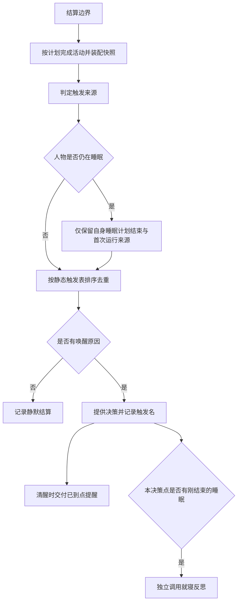

首次运行建立清醒初态；睡眠只由其自身计划结束唤醒，早期附加确认不产生另一条提醒唤醒规则。

### 接口与记录

| 接口或载体 | 要求 |
| --- | --- |
| `WAKE_TRIGGERS` | 位于 `life/schedule.py`；唯一维护触发名、类别、睡眠许可与输出次序 |
| `WakeSnapshot` | 单个触发器字段采用触发名；保留时间、计划结束、体感前后值、上次决策等输入；删除消息、他人、闹钟、发现结果与空闲承诺字段 |
| `evaluate_wake_reasons` | 输出 `WakeVerdict`；原因是字符串列表，次序只来自静态表 |
| `duty_edges` | 返回班次、休息时段边界，不再为四种起止维护不同唤醒名称 |
| `ScheduledOutcome.wake` | 仅静态表触发名或 `None`；普通内容推送与到货沿用醒着时旗标，其余静默事件不制造唤醒 |
| `body_settlement.data.wake_reasons` | 本边界触发名，静默时为空列表 |
| `decision_started.data` | 仍恰为 `round_id`、`round_order`、`world_state_version`、`wake_reasons` |
| `AgentState.pending_wake_reasons` | 已判定尚未决策的原因，初值 `["session_open"]`，随检查点保存 |
| `observation.data.wake_reasons` | 待处理原因的私有证据副本，不进入人物提示 |

写入前共用 `validate_decision_rhythm`。删除缺 `wake_reasons` 就按旧事件放行的分支；失败先记英文错误日志，再抛异常。

| 校验失败 | 英文原因 |
| --- | --- |
| `decision_offered` 存在但不是布尔 | `decision_offered must be a boolean` |
| 缺 `wake_reasons` | `wake_reasons is required` |
| 不是列表 | `wake_reasons must be a list of wake trigger names` |
| 成员不是字符串或不在静态表中 | `wake_reasons[<index>] must be a wake trigger name` |

`decision_started` 本来不带 `decision_offered`，因此缺该键不拒收；身体结算写入方始终写它。
所有删除或合并掉的旧触发名，包括 `discovery_result`，都按未知成员拒绝。

质量报告分别统计身体结算与 `decision_started` 的已知、未知触发名，新增
`wake_category_counts`、`decision_started_wake_category_counts`。每个已知触发名各自映射到类别后累加，
只列出现过的类别，键按名字排序；未知名不归类。同类别多个触发分别统计，回调订阅则同边界只执行一次。
`decision_budget_exhausted` 是运行故障，不再保留为可容忍的报告计数或合格范围。

查看器 `WAKE_LABELS` 只维护现行触发名，`duty_boundary` 显示“班次或休息时段起止”。
`reminder_due` 仅在同人物、同刻、排在该决策之前存在 `errand_reminded` 时附事务名称，
否则只显示提醒，不再报 `Missing errand reminder record for wake reason at event`。
实际事务事件自身缺名仍按既有缺名规则显示。

### 删除面、修改位置与验收

世界结构统一由 `11` 升为 `12`，包括触发名、回调状态及其他章节的活动、订单变化。
打开、恢复和重放拒绝旧结构，不迁移、不补可选旧字段。模型校验包含 `schema_version` 与 `Input should be 12`；
导出认证不符仍报 `Export checkpoint world schema does not match the current code`。
质量报告与其他改动合并升为 `7`，不重复升号，历史版本记录不回写。

| 范围 | 修改位置与职责 |
| --- | --- |
| 判定与提醒 | `src/worldmock/life/schedule.py`、`rhythm.py`、`same_moment.py`、`duty_edges.py`、`activities.py`、`errands.py`：静态表与不可提前结束睡眠 |
| 状态与预排 | `life/world_setup.py`、`models.py`、`scheduling/effects.py`：初始原因、结构号与静默事件 |
| 反思 | `life/memory_evidence.py`、`memory_layer.py`、`footprints/quality.py`、`custom/agents/life_agent.py`：共同的刚结束睡眠事实 |
| 记录与查看器 | `footprints/models.py`、`quality.py`、`tools/run-viewer.html`：严格校验、类别统计与提醒标签 |
| 文档 | 模拟引擎的决策节律、个人事务与提醒；记录引擎的身体结算与质量；代理记忆反思；手册的睡眠行为 |

测试用邮件人为安排唤醒的 `wake_by_mail` 助手删除，改用当前存在的决策边界，不保留测试专用邮件机制。

| 可观察行为 | 必须覆盖 |
| --- | --- |
| 闭集与次序 | 全部条件、逐项条件、合并来源重合、同刻只含本轮原因；预期列表独立写出，不从被测表生成 |
| 睡眠 | 提醒、推送、到货、班次、其他活动结束与兜底均不提前结束；自身计划结束正常醒来 |
| 提醒交付 | 睡眠不消耗，醒后清醒边界交付全部到点事务和同日目标提醒；跨日目标提醒失效；查看器有事件才附名称 |
| 反思与首次启动 | 睡眠结束触发独立第三人称反思；首次启动不反思、不执行类别订阅，只执行一次 `run_start`；恢复后判定一致 |
| 写入与统计 | 缺字段、类型、未知名和退役名被拒并有日志；类别计数与回调去重各符合语义 |
| 持久性 | 待处理原因与完整日导出恢复一致；世界结构 `11` 及更早被拒 |

主要覆盖 `tests/integration/life/test_wake_reasons.py`、`test_shift_edge_runs.py`、`test_errand_reminder.py`、
`tests/integration/footprints/test_event_fields.py`、`tests/unit/footprints/test_quality.py`、
`tests/integration/runtime/test_strict_reflection.py` 与查看器用例。
保留有效变异：删除睡眠过滤、提醒设为可唤醒、恢复旧名、改变表序、运行开始误判为反思均应被杀死。


<a name="spec-envdataset-回调规则表"></a>
## 回调规则表

### 目标与边界

环境在 `catalog/callbacks.jsonl` 声明状态、规则与提醒；引擎提供通用语义与唯一求值器，数据不带可执行代码。
燃油是普通 `goods` 商品，驾车日扣减与收货重置只由登记状态和规则表达。所有人物默认有车，删除 `owns_car`、
`CAR_REQUIRED`、`initial_driving_days`、专用 `driving_days`/`last_driving_date`、`fuel.py` 与 `FUEL_DRIVING_DAYS`。
状态为零仍能驾车，回调转账余额不足只记未付，不阻断动作。

功能 app 在 app 行用 `role` 与 `actions` 绑定，系统随动作自动记足迹；`footprint_chain` 是额外回调效果，不代替功能 app 绑定。
删除 `purposes` 与 `payment_app_ids`。
聊天的心理效果属于内容消费结算，不属于回调。内容按实际时长与系统固定的效果档位直接影响心理需要，
不为聊天扩展 `state_delta` 的引擎身体状态写入能力；具体档位与画像参数按「人设与运行配置」已采纳规则。

### 文件、状态与规则

| 声明 | 字段与约束 |
| --- | --- |
| 状态登记 | 恰为 `{state, initial, cap, reset_on_goods}`；`state` 为非空身份字符串，`initial`、`cap` 为严格整数，`cap` 非负；初值不进入人设 |
| 规则行 | 恰为 `{rule_id, trigger, effect}`，仅可额外带 `notify`；`rule_id` 为非空身份字符串 |
| 状态值 | 初值在 `[0, cap]`，增量钳在区间内，重置直接取 `cap` |
| 收货匹配 | `reset_on_goods` 为商品身份列表，可为空，按身份升序且无重复；收到任一匹配商品就重置，不按商品类别推断 |
| 文件次序 | 全部状态行在前，按 `state` 升序；全部规则行在后，按 `rule_id` 升序；不得交错 |
| 求值次序 | 同次触发按 `rule_id` 升序执行，步骤按声明次序执行 |
| 文件为空 | 允许零字节；无声明就无相应扣减、费用、提醒或足迹链 |

状态行由必填 `state` 区分，规则行由必填 `rule_id` 区分，不增加另一份行类型字段。
两者同时出现、两者皆无或出现所属形状以外的字段均拒绝；状态与规则身份分别唯一。
`trigger` 使用 `class` 与 `key`，`effect` 使用 `type` 区分效果，具体闭集在下面各自的表中定义。
字节规范与清单见「包与目录格式」。拒绝 `script`、`code`、`expression` 等字段，所有字符串仅作为标识或闭集值，不能执行。

`AgentState` 以通用映射保存状态值和按日生效记录，不保留燃油专用字段。
一个状态只有一份当前值。`once_per: local_day` 以规则为单位，对唯一人物同一本地日期至多生效一次；
重置不清除日期，避免同日加油后再次扣日。状态与日期随检查点保存，恢复与分支读取已提交值，不重算已执行触发。
状态集合、取值域或规范 ISO 本地日期不合法时记录错误日志并拒绝打开或提交，不静默修补。
回调状态数值不进入人物提示任何层，只经声明的提醒感知。
社交需要是已有身体状态，由身体与内容结算维护，不能复制为第二份回调状态。

### 触发与求值

| `trigger.class` | `trigger` 的完整形状与键 | 求值时刻 | 直接原因 |
| --- | --- | --- | --- |
| `action` | `{class, key}`；`key` 为 `START_ACTIVITY_ACTIONS` 中的具体动作 | 成功受理时；带 `once_per` 的状态增量改在实际结算时 | 请求的 `action_result` |
| `time` | 通常为 `{class, key}`；`monthly` 恰为 `{class, key, day, time}`，其取值见时间触发正文 | 既有排程到期时 | `time_trigger` 环境事实 |
| `state` | `{class, key, below}`；`key` 为登记状态名，`below` 为阈值 | 每次提交全部结算后比对一次 | 最后一次把值从不低于阈值变为低于阈值的效果对应的触发事件 |
| `event` | `{class, key}`；`key` 为可订阅的预排事件种类或静态触发表类别 | 合格预排事实写下时或提供决策的边界 | 预排事实、身体结算或本轮 `action_result` |

规则作用于唯一人物，不需要人物选择字段或无人物身份时的多人分派。

#### 动作触发

七个具体动作均可订阅；动作类型、中文动作标签和退役动作名以 `ENVIRONMENT_KIND_INVALID` 拒绝。
成功受理的每个匹配请求项各求值一次。业务拒绝不求值，同一动作身份的幂等重放不重复效果和证据。
`footprint_chain`、`transfer` 与不带 `once_per` 的增量在受理时执行。
购买动作回调只表达成功受理并开始购买，与购买付款无关。
尾段各 app 的 10–20 秒操作结束不扣款、不生成付款成功事实或消费推送；
整次购买完成时才按「商品与履约」重新核对总额并原子付款，消费推送不能由动作受理或回调的支付足迹生成。
带 `once_per` 的增量按结算半开区间 `[started_at, ended_at)` 中有正秒数的本地日期逐日执行，
用 `config.toml` 的 `timezone` 换算，不能按 `86400` 秒整除。
同日多次只执行一次，跨午夜两侧有正秒就分属两日，恰在午夜停止不计次日；零秒取消不计，提前结束和截断只计实际推进部分。

购买按已抽取的 1–5 分钟时长结算，驿站取件按实际选中内容的数据集时长结算，不固定为五分钟，也不按零秒动作处理。
购买不能暂停，可以提前结束；完成前主动结束或被运行窗口截断时，整次购买取消，无部分付款和退款。
正常完成时若余额不足，全请求订单取消，购买不移动资金，活动失败；余额足够才同一原子提交结清全部组并结算到店收货。
`once_per` 必须基于真实结算日期，不能凭受理日提前扣减。
功能 app 不可直接成为 `interact` 目标，不等于禁止 `interact` 上的一般附加足迹链；
聊天心理变化不新增细分回调触发，也不由 `report_status` 次数触发。

#### 时间触发与日常费用

| 时间键 | 已确认语义 |
| --- | --- |
| `hourly` | `(start_time, stop_time]` 内的每个本地整点 |
| `daily` | `(start_time, stop_time]` 内每个本地日的 `00:00` |
| `monthly` | `(start_time, stop_time]` 内符合 `day` 与 `time` 的本地时刻；`day` 为 `1` 至 `31` 的严格整数，`time` 为有效的二十四小时制 `HH:MM` 字符串 |
| `run_start` | 运行初始化完成后、首次人物决策之前执行一次 |
| `run_stop` | 正常抵达 `stop_time`，结清该时刻的活动、收货、天气与周期回调后执行一次 |

月度规则仅匹配该月实际存在的日期；该月没有声明的 `day` 时不触发，不挪到月末。
时间规则由 `compile_schedule` 编入既有 `pending_events`，使用带唯一人物身份的 `time_trigger` 排程种类，
到期由 `process_scheduled_events` 写时间事实，再执行相应规则，不增加调度器。
相同时间键和到期时刻共用一条排程；`monthly` 规则还须匹配自身声明的 `day` 与 `time`，不能执行其他日期的月度规则。
周期时间回调不补发运行起点及此前时刻；停止边界先结清该时刻的正常效果，再执行 `run_stop`，然后关闭运行。
提前失败不执行 `run_stop`，不把失败伪装为正常停止。提交前弹出到期项，恢复不重发已提交的时间事实和效果。
`time_trigger` 的记录字段只在「记录、导出与评估」定义，排程身份只在「人设与运行配置」定义。
时间事件的载体种类不是合法 `event` 键，避免重复执行。

账单是否存在、金额、到期日和收款账户由数据集声明为时间触发加 `transfer`，删除 `bills[]` 与 `bill_due`。
工资也改为时间触发加向人物账户转账，删除 `payrolls[]` 和专用 `payroll` 事件。
工资静默入账，不创建默认邮件 app，不唤醒、不强制决策；邮件与 `mail_arrival` 删除。
转账方向必须同时表达支出和收入，不能保留“付款方恒为人物”的旧约束。
资金账户恰为 `agent:<人物身份>` 与 `external:scenario`；回调不声明账户身份或对手方标签。
收入从外部锚点转给人物，支出从人物转给外部锚点，账本仍逐项守恒。

#### 状态与事件触发

状态触发只有 `below`，严格整数且位于 `1` 至 `cap`。
提交开始不低于阈值、全部结算后低于阈值才触发一次；持续低位不重复，回到阈值以上后再次跌破可再触发。
初值不与虚构先前值比较。一次提交只比对一次，状态回调自身的效果不递归触发其他状态规则，也不在下一次提交追补。

可订阅的预排事件键为 `delivery_arrival`、普通 `app_push`、保留的 `calendar_flag` 与 `weather`。
天气在运行开始时按开始时刻所属本地日期初始化；即使开始时刻恰为本地零点，也只初始化，不补写天气事实或触发订阅。
运行开始后的本地零点在 `(start_time, stop_time]` 内写一次 `weather` 预排事实，之后才执行天气订阅；不使用状态阈值。
天气取值与速度因子见「动作与请求接口」，事件字段只在「记录、导出与评估」定义。
`message_arrival`、`mail_arrival`、`alarm_ring`、`bill_due`、`payroll`、`time_trigger` 都不是合法事件键。
事件订阅只响应实际写下的合格 `environment_event`；空配送不写事实，也不触发。
`app_push` 订阅要求本次实际投递普通内容推送；`pushed: false`、回调阈值提醒和支付消费推送均不触发它。

类别订阅读取唯一静态表，同一提供决策的边界同类别只求值一次，睡眠过滤掉的来源不算命中。
运行首次启动不执行类别订阅，只执行 `run_start` 时间回调；睡眠结束和之后的正常决策边界仍按静态表执行。
时间推进或零点决策的直接原因是本边界 `body_settlement`；同刻再决策直接原因是本轮 `action_result`，
包括业务拒绝后产生的同刻再决策。稳定锚点只在「人设与运行配置」定义。

### 效果、证据与提醒

| `effect.type` | 完整形状与语义 |
| --- | --- |
| `state_delta` | 恰为 `{type, state, delta}`，仅可额外带 `once_per: local_day`；`delta` 为非零严格整数，新值 `min(cap, max(0, old + delta))` |
| `footprint_chain` | 恰为 `{type, steps}`；`steps` 非空，每步恰为 `{kind, app_pool, pick}`；`kind` 只为 `browse` 或 `payment`，`app_pool` 非空、按身份升序且无重复，`pick` 只为 `random` |
| `transfer` | 恰为 `{type, direction, amount_fen}`；`direction` 仅 `income` 或 `expense`，金额为严格正整数分，不声明账户引用 |

`reset_to_cap` 是商品收货时的引擎规则，不是第四类效果。匹配 `reset_on_goods` 就直接置为 `cap`，
连续收货仍为上限，不能累加。尚未收货的远程或快递订单不重置，重复收货原样返回，不重复收货事实和重置效果。
购买受理和尾段 app 操作均不提前生成付款成功事实。
只有整次购买完成且全部组原子付款成功，到店商品才通过唯一收货函数结算并重置匹配状态；取消或付款失败不收货、不重置。

足迹链逐步骤按带键随机流抽一个 app，全部步骤的 `caused_by` 指向同一触发事件。
自动功能 app 与回调足迹共用一个事件种类，带 app、动作和步骤语义，每条投影一个 `app_touch`。
统一事件还容纳自动导航的 `navigation` 步骤，这不扩大回调步骤闭集。
删除活动 `navigation_app_id`，订单支付 app 保留。随机抽取不推进世界随机态，不使用墙钟、`hash()`、事件 UUID 或集合迭代序。

足迹只记行为，支付步骤本身不转账。公交、打车和驾车车费按「动作与请求接口」的引擎常数收取，
不要求回调才能收费，也不因支付足迹重复收费。额外 `transfer` 只产生数据集明确声明的资金变化。
转账复用 `settle_money_transfer` 和 `resources/ledger.py` 原子分录，全额支付或不付。
余额不足账户不变、记录未付、`resource_changes={}`，运行和触发动作继续；成功时资金事实逐项等于账户差额并守恒。
账本 `cause` 使用稳定回调锚点，按 `direction` 在人物账户与 `external:scenario` 间确定付款和收款方。

每次实际应用的 `state_delta`、`reset_to_cap`、`transfer` 都写一条字段闭集的 `environment_event`，
转账区分已付和未付，足迹每步骤一条。全部 `source_kind="environment"`，系统证据 `visibility="system"`。
字段闭集和导出投影只在「记录、导出与评估」维护，不用活动快照伪装足迹。

#### 可见提示与阈值提醒

足迹链可带 `notify: {visible: <布尔>}`。
同次触发只要有一条足迹链声明 `visible=true`，就在该触发全部效果结清后计算人物余额的净减少量。
计算范围包含同一动作受理实际收取的车费和该触发所有已付转账，收入与支出相抵；不包含同次提交中其他触发的资金变化。
`X = 该触发结算前人物余额 - 该触发全部结算后人物余额`；只有 `X > 0` 才至多写一条人物可见事件，
`data={"kind":"balance_decreased","amount_fen":X}`，进度层以 `money_phrase` 显示“余额减少了 X 元”。
未付转账不改变差额；净额不减少、`visible=false` 或无声明时不写提示，工资不能写成减少。
足迹和原子资金事实不直接进入人物提示。

| 阈值提醒项 | 规则 |
| --- | --- |
| 声明 | `notify` 恰为 `{when, channel, app_id, text}`；`when` 恰为 `{state, below}`，`channel` 固定为 `app_push`，`text` 为非空提醒文字，`app_id` 必须引用已登记的内容 app |
| 配对 | 提醒只配 `state_delta`，可见提示只配 `footprint_chain`，`transfer` 不带 `notify` |
| 条件 | 投递时值严格低于阈值，与增量规则是否刚执行无关 |
| 时段 | 只复用现有 `app_push` 预排的本地 `08:00`–`21:00` 整点 |
| 频率 | 每个本地日期至多一次，在低于阈值后的首个可投递整点 |
| 睡眠 | 不叫醒、不消耗当日投递；醒后首个符合条件的推送整点投递 |
| 决策 | 静默进入进度层，不产生 `app_push` 或其他唤醒原因，不强制决策 |
| 载荷 | 新增不含 `content_id` 的提醒类型，不能向要求非空 `content_id` 的内容推送填空值 |

共用既有推送调度，不增加通知服务或调度器。内容推送的打开语义不套到无内容提醒。
投递日期随检查点保存，恢复后同日不重复。

### 接口与校验

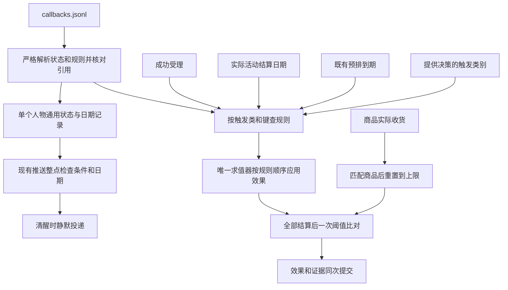

唯一求值器在 `src/worldmock/life/callbacks.py`，按效果类分派，不按 app、动作或规则名写专用函数。
`CallbackCause` 保存触发类、键、人物身份、直接原因事件身份和稳定锚点；`CallbackOutcome` 返回状态和证据草稿。

| 接口职责 | 接入点 |
| --- | --- |
| `evaluate_callbacks` 执行匹配规则 | 成功受理、排程处理、节律判定和同刻再决策 |
| `settle_callback_dates` 按实际区间应用按日增量 | `TimeAdvanceCoordinator._apply_activity_effect`，替代燃油专用结算 |
| `reset_on_receipt` 匹配商品并重置 | `receipt.settle_receipt` |
| `compare_callback_states` 一次边沿比对 | 决策轮、时间推进和零点判定提交前 |
| `validate_callback_states` 核对集合、范围、日期 | 新建、`EngineContext.validate` 和写入复核 |

全部效果仍经 `FootprintStore.commit` 唯一提交入口，不增加回调专用存储或事务系统。

| 校验失败 | 拒绝码 |
| --- | --- |
| 未知字段、类、键、动作类型、退役事件，非法 `once_per`、步骤、`pick`、`channel` 或 `visible` | `ENVIRONMENT_KIND_INVALID` |
| 状态行与规则行交错、身份或绑定列表未升序、月度 `time` 格式或时刻非法 | `ENVIRONMENT_KIND_INVALID` |
| 状态、规则身份或同一绑定列表内身份重复 | `ENVIRONMENT_ID_DUPLICATE` |
| app、商品等目录引用不存在 | `ENVIRONMENT_REF_UNKNOWN` |
| 阈值提醒引用功能 app | `APP_ROLE_BINDING_INVALID` |
| 数字类型或范围不符，包括零增量、无效阈值、非正金额、非法初值、上限或月度 `day` | `ENVIRONMENT_NUMBER_INVALID` |
| 引用未登记状态 | `CALLBACK_STATE_UNREGISTERED` |
| 足迹链或步骤 app 池为空 | `CALLBACK_FOOTPRINT_EMPTY` |
| 提醒、提示与效果不配对 | `CALLBACK_NOTIFY_MISMATCH` |
| 目录内可执行回调文件或清单外文件 | `ENVIRONMENT_STALE_FILE` |

`notify` 同时有 `when` 与 `visible` 或两者皆无，按形状错误拒绝；提醒与可见提示分别只接受其表中列出的字段。
行模型先按 `state` 或 `rule_id` 选择，触发器按 `class`、效果按 `type` 选择；
不能把数字错误误报成另一形状的未知字段错误。
回调中的账户引用和对手方字段均为未知字段，按 `ENVIRONMENT_KIND_INVALID` 拒绝。所有异常分支记录英文错误日志。

| 登记码 | 英文原因 |
| --- | --- |
| `CALLBACK_STATE_UNREGISTERED` | `A callback rule refers to a state that the environment does not register.` |
| `CALLBACK_FOOTPRINT_EMPTY` | `A callback footprint chain needs at least one step and every step at least one app.` |
| `CALLBACK_NOTIFY_MISMATCH` | `A callback reminder needs a state delta effect and a visible hint needs a footprint chain effect.` |

### 修改位置与验收

加载、目录视图和登记校验更新 `catalog/models.py`、`loader.py`、`admission.py`、`errors.py`；
运行接入更新 `life/decision_coordinator.py`、`time_advance.py`、`receipt.py`、`rhythm.py`、`models.py`、`progress_layer.py`、
`scheduling/compile.py`、`effects.py`。证据复用 `footprints/app_usage.py` 和资金账本。
删除 `life/fuel.py`、专用天数、燃油阻断、燃油收货加法、场景账单工资模型和邮件路径。
回调文件字段、排序、引用与登记码的正式正文归 `docs/design/03-resource-engine.md`；
触发、效果、提醒与提交语义归 `docs/design/04-simulation-engine.md`；
事件字段、足迹投影与来源校验归 `docs/design/05-recording-engine.md`；
`docs/design/09-io-formats.md` 只维护回调状态的归属与序列化，其他正文以链接引用，不复制规则。

| 测试范围 | 必须覆盖 |
| --- | --- |
| 加载 | 空文件、状态在前规则在后且各自升序、两类行判别、触发与效果闭集、具体动作和类别键、退役键、引用、数字、月度日期时刻、配对及错误码 |
| 动作 | 无声明无变化；只有 `drive` 扣声明状态；拒绝和幂等重放不执行 |
| 日期 | 同日、跨午夜、恰好午夜停止、夏令时、零秒取消和截断；购买取件有真实结算日期 |
| 状态 | 零值可驾车、上下限、收货重置不是累加、不清日期、未收货不重置、重复收货不重复 |
| 边沿 | 越阈一次、低位不重复、重置后可再越阈、初值不触发、不级联 |
| 足迹资金 | 每步一证据且共同直接原因；足迹不转账；回调转账守恒、不足记未付且触发继续；动作收费与回调收入支出共同计算净额，不串入其他触发；购买受理及尾段 app 操作不提前付款 |
| 可见性 | 隐藏回调状态和系统足迹；净减少为正且有声明时至多提示一次，净额不减少不提示 |
| 提醒 | 只引用内容 app；每日首个符合条件整点一次，睡眠不消耗、醒后补投、不唤醒不决策、无内容载荷合法 |
| 时间事件 | 周期范围为 `(start_time, stop_time]`；起点不补周期，终点结清后 `run_stop`，提前失败无 `run_stop`；首次天气仅初始化，后续零点写事实；恢复不重发；空配送和 `pushed: false` 不触发订阅；无专用工资账单邮件 |
| 持久确定性 | 状态日期和提醒日期往返一致，非法状态被拒，同种子一致，恢复不重抽 |

新增 `tests/unit/catalog/test_callback_rules.py`、`tests/integration/life/test_callback_rules.py`；
改写 `test_acs_system_core.py`、`test_acs_contract_guards.py`、`test_acs_amended_runtime.py`、`test_app_push.py`、
`test_state_write_recheck.py`、`tests/integration/scheduling/test_branch_coverage.py`、`tests/unit/footprints/test_app_usage.py`。
原燃油账单测试改测当前行为，不枚举内部专用字段。
保留有效变异：同日重扣、按受理日计日、删钳制、拒绝仍执行、随机键用事件身份、错误直接原因、
余额不足仍转账、未付仍提示、重置改加法或提前付款时重置、删幂等、边沿改电平、提醒忽略时段或睡眠。

### 已确认边界

聊天效果不属于回调，直接使用内容的两项心理缓解档位。
通用转账方向和两个账户已经确认；购买按随机时长结算、删除商家账户、账单工资走回调和未付不阻断。
购买暂停、提前结束和到店收货不再作为回调开放项，执行规则只在「商品与履约」维护。


<a name="spec-envdataset-人设与运行配置"></a>
## 人设与运行配置

### 文件与职责

根目录 `persona.toml` 是唯一人物来源，`config.toml` 是唯一运行配置来源。删除场景文件、
场景模型、人设文件引用和人物数组。两份文件都是 UTF-8 无 BOM、只用 LF 的严格 TOML，
分别以原文字节 SHA-256 冻结身份，不进入目录清单或目录内容摘要。

新建、恢复、重放、环境与画像校验共用纯加载；纯加载不编译画像、不调用生成模型、不创建运行资产。
实际模型服务的只读元数据核验属于纯加载。地图使用配置唯一种子在内存生成。

### 人物声明

人设结构版本为 `1`。必填 `agent_id`、`name`、`background_story`、`home_location`、
`initial_location`、`initial_balance_fen`、`initial_relaxation_need`、`initial_social_need` 与 `body`。
正文去首尾空白后至少一百字符；余额非负严格整数分；两个需要初值为 `[0,1]` 有限数。
`body` 声明质量、能量与睡眠债初值，沿用现行范围与系统能量上限。

人物可声明 `health_habits`、`social_style`、时型、睡眠需要、午晚餐、下班、到家和就寝窗口。
显式作息覆盖卡片抽取值，冲突警告、格点与覆盖不动点保持。人物没有联系人、邮件、工作内容指派、
车辆归属、专用燃油初值、账单、工资、运行种子或起止时刻。

地点由完整显示名声明，住处必须为住宿地点，初始位置不要求等于住处。
`work_schedule.workplace` 是工作地点显示名，`weekly` 用零至六的星期键，缺项表示不当班；
班次沿用日内分钟 `starts`、`ends`、`breaks`。`exceptions` 用规范日期，班次覆盖当天，
空数组表示休息，避免 TOML 不支持 null。所有地点必须实际登记，禁止补地点或替换初始位置。

心理量统一为需求式 `relaxation_need`，删除旧娱乐需要、情绪与兼容字段。
具体自然增长、体感与商品和内容效果归交换引擎及本规格所属行为章节。
画像心理和社交参数只保留实际接入结算的 `social_need_growth_per_hour`：
`normalized_extraversion = (score - 4) / 3`，增长为 `0.06 + 0.04 * normalized_extraversion`，
沿用格点规则，范围 `0.02–0.10` 每小时，步长 `0.01`。
删除旧对话缓解、邀请、回复、礼物偏好、情绪脉冲幅度与半衰期；其他实际消费者仍使用的参数不因此删除。
字段集合变化同步升画像卡片与映射表结构并拒绝旧结构。

`compile_persona` 只接受已校验的人设声明与文件身份，来源中的 `background_story_sha256`
保留字段名但取整份人设原字节摘要。旧模板字段只在 `parse_persona_file` 拒绝。
新建与画像命令编译唯一卡片，缺正文或卡片即失败；恢复和重放不重新编译，
卡片缺失或损坏报 `Restored persona card structure is invalid`。
`persona_card_text` 只读卡片，不拼接原文替代。

### 运行配置与模型

配置结构版本为 `1`，包含 `timezone`、严格整数 `seed`、原生带偏移 `start_time`、`stop_time`，
实际有消费者的决策、结算、播报、呈现与轮转参数，以及现行日历声明。
时间按自身偏移判整点，偏移与时区一致，停止晚于开始。删除空闲重估、无消费者的候选池上限、
环境钉、另一个目录路径和可配置同刻轮数。环境同刻轮数固定为三轮普通轮加三轮受限轮。

模型配置集中于唯一 `[model]` 表。必填身份、端点、凭据引用与容量声明如下：

```toml
[model]
provider = "openai_compatible"
base_url = "https://api.deepseek.com/beta"
requested_model = "deepseek-flash"
api_key_env = "DEEPSEEK_API_KEY"
metadata_url = "https://api.deepseek.com/models"
context_window = 262144
max_retries = 0
transport_max_retries = 3
max_react_turns = 16
persona_validation_max_retries = 2
reflection_validation_max_retries = 3
day_plan_validation_max_retries = 3
```

这里服务身份是完整合法配置片段，不是固定模型白名单。凭据只读取声明的进程环境变量，
缺失或空值失败，不寻找固定凭据文件；凭据值不进入文件、清单、日志或请求提示。
身份协议只取实际支持的 `openai_compatible`。

`max_retries` 默认零、严格整数零至十；`transport_max_retries` 默认三、严格整数零至十；
`max_react_turns` 默认十六、严格整数一至六十四。
画像校验重试默认二，反思与日计划校验重试默认三，均为严格整数零至五。
重试不包含首次请求，一次服务失败只消耗一种预算，既有 dispatcher 一个循环执行，
总尝试至多 `1 + max_retries + transport_max_retries`；底层隐式重试关闭。
鉴权和参数错误立即失败，输出纠正是新的逻辑请求；所有耗尽均失败，不降级或跳过模拟时间。
多次一致性抽取不是重试。

实际模型容量只由 `metadata_url` 所指同一模型服务提供，按 `requested_model` 精确匹配唯一
`data[].id`，要求正严格整数 `context_window`、`max_output_tokens`。
声明的容量至少 `262144`；服务总容量不得低于声明，输出上限不得超过总容量。
缺失、模型不存在或能力不足直接失败，不用静态表、社区表、输出上限代替总容量或估算。
新建冻结来源和值，恢复核对服务容量一致，纯重放使用冻结结果。
发送前容量及百分之八十五浓缩阈值使用已核验实际总容量，输出预留符合服务上限。
纯元数据接口集中于 `model_endpoint`，已有 LiteLLM 继续负责请求和 token 计数。

### 单一种子与随机键

配置的 `seed` 是唯一随机种子；保持 `random_state = sha256(f"random:{seed}")` 与 `random_seed = seed`。
所有随机流使用 `random_stream(random_state, key)`，不推进持久随机态；候选按身份升序。
禁止墙钟、事件 UUID、`hash()`、集合迭代序及独立评估种子参与派生。

| 用途 | 稳定键与取值 |
| --- | --- |
| 地图 | `map`，抽取六十四位整数后使用现有地图生成器 |
| 天气 | `weather:{local_date}` |
| 购买总时长 | `purchase-duration:{action_id}`，六十至三百整数秒，一次请求只抽一次 |
| 支付段时长 | `payment-duration:{action_id}:{group_key}`，每个非空支付 app 组十至二十整数秒；空支付 app 不抽取 |
| 购买功能 app | `function-app:{action_id}:{group_key}`，排序候选与唯一 null 等概率选择 |
| 出行功能 app | `function-app:{activity_id}`，排序候选等概率选择，不增加 null |
| 下单 app | `order-app:{goods_id}:{store_id_or_courier}:{local_date}`，店铺侧先确定店铺，app 商品使用 `courier` |
| 快递天数 | `courier-days:{goods_id}:{app_id}:{local_date}`，二、三、四、五天等概率 |
| 快递费 | `courier-fee:{goods_id}:{app_id}`，零或五百分等概率，跨日期稳定 |
| 内容选择 | `{activity_id}:{draw_index}` |
| 回调链 | `callback:{rule_id}:{anchor}:{step_index}`，步骤下标从零开始 |
| 指标自举 | `bootstrap-metric:{name}`，抽取六十四位整数供 NumPy |
| 评审自举 | `bootstrap-review:{dimension}`，抽取六十四位整数供 NumPy |
| 评审日期 | `review-day:{block_start}:{calendar_class}`，使用 `randrange` |
| 盲评交换 | `review-swap:{slot}:{item_id}`，抽取一位 |
| 盲评掩码 | `review-mask:{reviewer_slot}`，抽取二百五十六位，以大端序写三十二字节 |

`group_key` 是 `[store_id,destination_id,app_id,fulfillment]` 的规范 JSON，不新增整篮订单身份。
预览只使用已知商品、店铺、app 与日期，不提前分配动作身份；受理冻结同一报价，恢复不得重抽。
商家选择按 `(总价款和配送费, 到达时刻, 店铺身份)` 取最小值，不随机选择远程店铺。
同组全部商品配送策略为零才免配送费，否则整组只收五百分。

普通推送事件身份为 `push-{agent_id}-{local_date}T{HH}`；时间事件为 `time-{key}-{due_at}`，
同一键同一绝对秒一次，夏令时不同绝对秒分别登记。天气使用 `weather-{local_date}`，
起始日只初始化事实；日历使用 `calendar-{local_date}`；配送组使用首件既有订单的 `delivery-{order_id}`。

回调受理锚点为 `{action_id}:{item_index}`；按日动作效果用 `{origin_action_id}:{local_date}`；
预排事件使用其 `scheduled_id`；推进唤醒类别用 `wake:{agent_id}:{current_time}`；
同刻唤醒类别用 `wake:{action_id}`。阈值触发沿用造成越阈的锚点，不触发级联。
回调效果与资金账本原因均为 `callback:{rule_id}:{anchor}`，`caused_by` 必须指向真实触发事件。

评估从已认证 WorldMock 检查点读取非空字符串 `random_state`，缺失时抛出
`EvaluationError("invalid_input", "WorldMock checkpoint random_state is missing")`。
只读重放不得引入另外的种子；测试的字节签名可规范化壁钟、UUID 和运行路径，但不得改变生产随机键。

### 冻结身份与命令

运行清单结构五，分别冻结 `persona_sha256`、`config_sha256`；环境身份仍是五个目录和地图字段。
模型身份与阶段请求预算从实际配置形成，窗口从配置读取。
任一人设或配置原字节变化拒绝恢复、重放与跨臂比较。

`run`、`resume`、`replay` 只接受 `--environment ROOT`；删除模拟运行场景参数及发布地图命令。
`validate --environment` 纯校验；`profile validate --environment` 在纯加载成功后编译唯一人物并校验覆盖。
`profile compile`、`profile check` 只接受 `--persona PATH`，从同根配置读取模型身份和预算，
删除纯文本、标准输入和另一份模型配置。

### 拒绝原因

人物文件缺失、链接、编码、解析、类型、未知字段、正文和初值失败使用 `PERSONA_INVALID`。
运行配置对应输入与上下文核验失败使用 `RUN_CONFIG_INVALID`。
失败分别返回 `path`、`code`、`reason`。文件缺失或链接的原因分别为
`Persona file is missing or is a symbolic link` 与 `Run config file is missing or is a symbolic link`；
编码与换行分别为 `Persona file must be UTF-8 without BOM and use LF line endings` 与
`Run config file must be UTF-8 without BOM and use LF line endings`；其余一般解析失败分别为
`Persona file validation failed` 与 `Run config validation failed`。
正文不足为 `background_story must contain at least 100 characters`，初始能量过高为
`initial energy exceeds maximum energy`。时间没有偏移分别为 `start_time must be timezone-aware` 与
`stop_time must be timezone-aware`，非整点为 `start_time and stop_time must fall on whole hours`，
窗口或时区冲突为 `run time interval or timezone is invalid`。
声明上下文不足为 `context_window must be at least 262144 tokens`，元数据不可核验为
`model context metadata is unavailable`，实际容量不足为
`Model context length {actual} is below the declared context_window {declared}`。
位置未知使用 `ENVIRONMENT_REF_UNKNOWN`，住处失败使用 `HOME_LOCATION_REQUIRED`。
恢复、重放与打开冻结输入损坏继续使用完整性异常，不把持久化损坏当作新输入解析失败。

<a name="spec-envdataset-记录、导出与评估"></a>
## 记录、导出与评估

### 目标与依据

记录应能回答人物实际做了什么、系统代办了什么、钱与身体状态怎样变化，并能从同一冻结输入重放得到相同事实。
本节按 `open-questions.md` 的已答复结论修订事件、五类导出工件、质量报告、评估与只读查看工具。
活动与订单载荷的权威定义仍归产生事实的模块；统一足迹和回调证据的记录闭集在本节维护，
并规定投影、来源校验、统计与展示，不再复制旧实现快照。

- `EventType` 的 14 个成员和五项导出工件保持不变；导出清单结构仍为 4。
- 失去来源的等待、联系人、邮件、闹钟与工作指派记录直接删除，不保留恒空或恒零的报告项。
- 商品的 `category` 保留为 `snack`、`meal`、`drink`、`goods`；内容的 `category` 与 `ActionCategory` 删除。
  删除依赖内容分类的派生报表与比较，不提供替代分类、分类映射或恒零结果；实际内容、活动与时间记录保留。
  体力消耗档位、心理效果档位、`pushable`、app 名称与地点不能用来推断工作、娱乐、运动或家务。
- 已计入环境的六轮同刻决策预算耗尽即运行失败；宿主名称纠错由模型回合预算另行约束。
  删除 900 秒跳时、技术空档与容忍区间，不把失败改称正常空档。
- 目录动作身份删除；请求与结果用来关联一次调用的 `action_id` 仍是请求身份，不能误删。

### 事件与导出事实

#### 环境事件

`resource_changes` 属于事件信封顶层，默认空字典；下文封闭 `data` 字段集只描述领域正文。
资金生产者只写信封字段，正文及嵌套结果出现同名字段一律拒绝，账本只认证这一来源。

| 事件或效果 | 修订后的记录 |
| --- | --- |
| 功能 app 自动记录、回调 `footprint_chain` | 统一使用一种系统可见 `environment_event`，携带实际 app、具体动作与步骤；每条足迹在 `app-usage.jsonl` 投影为一行 `app_touch`，自动功能 app 与回调的步骤范围分别按下文闭集处理 |
| 购买付款 | 购买完成时通过整次购买的总额校验后，每组恰写一条系统可见 `purchase_payment`，银行卡直付也记录；该组账户差额只由这条事实承载，不能由购买受理、进度、收货或消费推送重复承载 |
| 时间触发 | `time_trigger` 是时间回调的直接原因，不可再作为 `event` 订阅键；到期执行与起止边界归「回调规则表」 |
| 每日天气 | `weather` 是可订阅的系统预排事实；启动日只初始化天气，不写该事实；后续零点的生成时点归「回调规则表」 |
| 回调 `transfer` | 每个效果写一条闭集字段的 `environment_event`，明确已付或未付；已付的 `resource_changes` 只等于本效果实际造成的账户差额；同次提交全部资金事实的差额相加才等于该次提交的账户总差额，未付不移动资金、`resource_changes` 为 `{}` |
| 回调 `state_delta`、收货重置到上限 | 每次效果各写一条闭集字段的 `environment_event`，保留真实状态变化证据；执行语义归「回调规则表」，记录闭集见下文 |
| `balance_decreased` | 保留人物可见提示「余额减少了 X 元」，只进入进度层；不投影为 app 使用或公开评估证据 |
| `goods_received` | 商品类别只有四值；零食、食品提供千卡。饮料与商品实际收货将 `relaxation_need` 减少 0.10 |
| 内容推送 | 保留 `app_push`；推送资格由内容 `pushable` 决定，载荷不再带目录动作身份或名称 |
| 第三方支付消费推送 | 每组合单通过非空支付 app 实际付款成功后，生成一条系统可见 `payment_notification`，记录支付 app、消费金额、关联订单与消费文字，原因指向该组 `purchase_payment`；不投递给人物 |
| 回调阈值提醒 | 使用独立提醒载荷，规则给出文字与所属 app，不伪造 `content_id`；与内容推送来源分支分开验证 |
| 运行失败 | `decision_budget_exhausted` 表达运行失败原因，不再包含继续运行的 `next_decision_at`，不产生跳时事件或正常空档指标 |
| 删除的专用事件 | `alarm_ring`、`message_arrival`、`mail_arrival`、`model_npc_reply_pending`、`model_npc_reply`、`work_content_completed` 删除；账单与工资由通用时间回调和转账证据表达，删除专用 `bill_due`、`payroll` 路径 |
| 其他仍有生产者的事件 | `body_settlement`、`delivery_arrival`、日历、当日目标、个人事务、活动生命周期和初始资金证据继续按所属模块记录 |

统一足迹事件的 `data` 恰为 `{kind, app_id, action, step, rule_id}`，`kind` 固定为 `app_touch`。
`app_id` 是实际选择的已登记 app；`action` 是来源中的具体动作，时间、状态、环境事件来源没有动作时为 null。
自动功能 app 的 `step` 只取 `navigation` 或 `payment`，`rule_id = null`；出行自动导航记 `navigation`，
购买进入非空支付 app 记 `payment`。睡眠不绑定功能 app，下单 app 不因系统代选而自动产生 `app_touch`。
回调 `footprint_chain` 的 `step` 只取 `browse` 或 `payment`，`rule_id` 必须是实际回调规则身份。
事件信封使用 `visibility = system`、`source_kind = environment`，`caused_by` 关联真实动作结果或触发源事件。
自动记录与回调效果都保留实际源事件，不能只因没有活动快照而跳过来源校验。
`events.jsonl` 原样导出系统与人物可见事件，不按可见性过滤。

时间事实的 `data` 恰为 `{kind, key, scheduled_id}`，`kind = time_trigger`，
`key` 取「回调规则表」的时间键闭集。天气事实的 `data` 恰为
`{kind, local_date, condition, speed_factor, scheduled_id}`，`kind = weather`；
`local_date` 是配置时区中的规范 ISO 本地日期，`condition` 与 `speed_factor` 取「出行、睡眠与驿站交互」
定义的天气及其对应系数，不另维护一份天气规则。两种事实均为 `environment_event`，`agent_id` 为唯一人物，
`source_kind = environment`、`visibility = system`、`resource_changes = {}`、`caused_by = null`。
它们自身就是排程触发源；回调效果引用该事实，不伪造更早的业务原因。
`scheduled_id` 的唯一格式定义见「人设与运行配置」。

支付跳转 `app_touch` 在支付段实际开始时写入，其 `step = payment`、`rule_id = null`；
该事件记录进入支付 app 的时点，10–20 秒支付过程由订单中的支付起止记录表达，不把一个瞬时事件扩成内容使用活动。
成功付款写 `environment_event`，`data` 恰为 `{kind, activity_id, order_ids, amount_fen}`，
`kind = purchase_payment`。`activity_id` 是真实购买活动，`order_ids` 是该合单组的全部商品履约记录，
非空、唯一、按身份升序；`amount_fen` 是实际支付的货款加一次运费，不能取同次提交的全部余额变化。
信封使用 `source_kind = environment`、`visibility = system`，`occurred_at` 为实际付款时刻，
`caused_by` 指向开始该购买活动的成功受理 `action_result`。
购买正常完成时，在同次原子提交中先校验整次购买的总货款和各合单组配送费之和；
余额足够才按「商品与履约」的组顺序统一付款，每组只写一次 `purchase_payment`，
所有组的 `occurred_at` 均为购买完成时刻，银行卡直付相同。
该组账户差额仅记录在本组付款事件的 `resource_changes`，全部付款、订单状态、到店收货与消费推送一起提交。
完成时余额不足则全部取消订单，购买活动记 `failed`，不移动资金，不写成功付款、消费推送或到店收货事实。
购买不可暂停；完成前主动结束或截断也取消全部订单，没有部分付款或退款。
支付 app 操作段结束只记录操作结束，不扣款，不产生成功付款或消费推送。

消费推送的 `data` 恰为 `{kind, app_id, amount_fen, order_ids, title, summary}`，`kind = payment_notification`。
`app_id` 必须等于该组实际选中的非空 `payment_app_id`；`amount_fen` 与 `order_ids` 必须和对应
`purchase_payment` 完全一致。`title` 为「支付成功」，`summary` 按真实商品和金额确定性生成，
例如「已消费 35.00 元，购买咖啡」，不调用模型编造。
信封使用 `source_kind = environment`、`visibility = system`，`occurred_at` 为实际支付成功时刻，
`caused_by` 指向该组的 `purchase_payment`，`resource_changes = {}`。该通知本身不转账，不能重复扣款。
同一第三方付款事实只产生一条消费推送；未付、失败、尚未完成购买、银行卡直付和幂等重放均不生成第三方消费推送。
不为消费推送添加 `content_id`、`session_id` 或 `push_id`，不要求人物打开、释放或处理，也不进入普通内容推送调度。

状态变化与转账证据直接由执行效果的同一严格结果模型序列化；写入、导出和重放共用同一字段闭集，
不另行拼装允许多余字段的字典。既有事件信封中的 `resource_changes` 继续承载账户变化。

| 效果结果 | 必须记录的闭集信息 |
| --- | --- |
| 状态增量 | 效果类型、规则身份、状态身份、请求增量、应用前值和应用后值；实际变化以应用后减应用前计算，包含钳位结果 |
| 收货重置到上限 | 效果类型、状态身份、触发收货来源、应用前值和重置后值；规则身份为空，真实收货事件由因果关联指出 |
| 转账 | 效果类型、规则身份、执行模型中的金额与对手方信息、`paid` 或 `unpaid` 结果；账户差额由信封逐项核对 |

效果类型和字段仅限其严格结果模型定义的成员，不把通知文字或人物可见内容混入系统证据。
通用转账的收入、账户字段须随资金账户答复在同一执行模型定稿；聊天心理效果记录来自身体结算，不伪造回调效果事件。
这两项未定细节不以新增自由字段、任意账户或任意身体状态写入来占位。

系统足迹和消费推送不进入人物提示，也不产生公开评估证据；回调转账和状态证据同样不新增行为类别或质量报告分组。
订单继续保存 `payment_app_id`；选中 `null` 时不生成自动支付 `app_touch` 或 `payment_notification`，
不能写入 `app_id = null` 的占位足迹或虚构银行卡 app。
真实下单 app 只作为订单事实保存，不因系统代选生成浏览足迹；付款仍记录 `purchase_payment`，不因支付选择为空而丢弃。
出行活动删除 `navigation_app_id`，不再从导航快照生成起止两行 `app_touch`。

阈值提醒每天至多一次，在状态低于阈值后的首个推送整点投递；睡眠期间顺延到醒来后的首个推送整点。
提醒静默进入进度层，不唤醒人物、不额外给予决策机会。它不冒充带内容的 `push_delivered`，内容推送的统计口径不因提醒而扩大。

#### 已核验经历与活动

已核验经历的共同字段仍是 `kind`、`agent_id`、`activity_id`、`source_event_id`、`event_seq`、`occurred_at`。

| `kind` | 另带字段 | 真实来源 |
| --- | --- | --- |
| `arrived` | `location_id`、`access_status` | 出行进度终态中的实际到达 |
| `played` | `content_id`、`app_id`、前后内容位置、`interval_start`、`interval_end` | 内容位置实际正向推进；地点内容的 `app_id` 为 null |
| `received` | `order_id`、`goods_id`、`category`、`quantity` | 本人的 `goods_received`，`activity_id` 为 null |

删除 `waited` 的生产、验证、宿主记忆与零点计划句子。收到 `kind = "waited"` 时仍以
`IntegrityError("Observed experience kind is invalid")` 拒绝；区间校验只针对 `played`。
`verified-experiences.jsonl` 仍按 `(event_seq, agent_id, kind, goods_id)` 排序。

`activities.jsonl` 继续记录最后快照与 `segments`。删除 `wait` 活动与内容快照中的目录动作身份、内容类别、`manner`。
导出投影、导出认证、质量报告与评估适配均先校验事件前缀，再执行各自投影或适配。
事件前缀含退役活动种类时统一拒绝为 `Activity snapshot uses a retired activity kind`，不由下游适配改换错误。
已有的睡眠、出行、内容活动继续按各自真实区间记录。
购买也按实际活动区间记录。同请求所有购买项共用一个活动和一次抽取的 1–5 分钟时长，关联各自履约记录；
报告、恢复、导出与经过时间统计均不能按商品数或付款组数重复计算该活动时间，支付段时长也不能另加一次。
购买完成时一次原子校验和付款；到店收货与付款同刻，所有已付款订单按各自履约方式继续履约。
购买不能暂停；完成前主动结束或截断时全部订单取消，不产生付款；完成时余额不足则活动 `failed`。

纯目录浏览仍是 `interact` 活动，快照的 `app_id` 为真实平台，`content_id = null`，
仅在该 app 的冻结显式内容索引为空且声明了 `browse_duration_seconds` 时允许此形状。
活动保留真实计划时长、经过时间、状态和 `segments`，计划时长取该平台的 `browse_duration_seconds`；
不增加专用活动种类或判别标记，不伪造内容身份、标题、内容位置、抽取游标或推送绑定。
具有显式内容的 app 仍选真实内容并保存非空 `content_id`，不能因内容暂不可选而转成目录浏览。
导出和恢复按上述真实目录条件验证 `content_id = null`，不能把损坏的内容活动解释成目录浏览。

#### 购买事实 `purchases.jsonl`

| `fact_kind` | 字段与来源 |
| --- | --- |
| `purchase` | 保留 `agent_id`、`order_id`、`goods_id`、`category`、`store_id`、`app_id`、`payment_app_id`、`unit_price_fen`、`delivery_fee_fen`、`quantity`、`total_price_fen`、`fulfillment`、`created_at`、请求身份 `action_id`、`source_event_id`；每条商品履约记录在首次出现的动作结果中恰一行 |
| `order_attempt` | `agent_id`、请求身份 `action_id`、`request_event_id`、`action`、`status`、`error_code`、`occurred_at`；`way` 改为 `action`，值恒为 `purchase` |
| `pickup_ready` | `agent_id`、`order_id`、`app_id`、`pickup_location_id`、`arrived_at`、`source_event_id`；每条已到站快递商品履约记录恰一行，领取后保留 |
| `receipt` | `agent_id`、`order_id`、`received_at`、`goods_id`、`category`、`quantity`、`provided`、`applied`、`source_event_id`；只来自本人的 `goods_received` |

`request_message_id`、`recipient_id` 与联系人补收货分支全部删除，订单的 `agent_id` 就是付款人和收货人。
`app_id` 是引擎选择的下单 app：到店为 null；地点侧远程下单与 app 侧快递按「商品与履约」选定。
`payment_app_id` 按「app 目录与功能 app」在绑定 `purchase` 的功能 app 与 `null` 中选择，
有支付 app 时同样可能选中 `null`。`null` 表示不跳转外部支付 app，不表示尚未选择、未付款或失败；恢复不能重抽。
逐商品选店与下单 app，同店、同 app、同履约方式合并付款，每次合单选择一次支付结果、记一次付款。
`order_id` 沿用按商品保存的履约记录身份；合单的各商品履约记录共享支付结果，配送费按「商品与履约」的运费合并规则只记录一次，
由同一购买受理结果与该组 `purchase_payment` 关联，不新增订单层级，也不为每件商品重复扣款。
支付操作与付款状态的权威字段保存在商品履约记录中：`payment_duration_seconds` 为受理时冻结的支付段时长，
非空支付 app 为 10–20 秒，银行卡直付为 0；`payment_started_at`、`payment_ended_at` 为支付 app 操作实际开始和结束时刻，
尚未发生时为 null，不能用将来计划时刻冒充事实。银行卡直付的两个外部支付操作时刻始终为 null。
`paid_at` 是真实付款时刻，未付款及 `cancelled` 记录均为 null；成功完成整次购买后，所有合单组的 `paid_at` 都等于购买完成时刻，
银行卡直付同样保存。`payment_ended_at` 只表示 app 操作结束，不能作为已付款凭据。
同一合单组的商品记录共享相同的支付选择、操作时长、操作起止与 `paid_at`；
购买活动通过所关联订单读取，不在活动上维护另一份支付状态。
订单起止状态在真实事件快照中保存，`purchase` 导出行仍表达首次购买事实，不提前写入未来支付结果，也不回写历史行。
付款与公开付款证据从 `purchase_payment` 读取，不由受理快照或 `payment_ended_at` 推定；
恢复时已经开始的支付段不重写跳转，已提交统一付款的购买不重复扣款、写 `purchase_payment`、收货或消费推送。
`paid_at` 与付款事实必须一致，支付段结束时间本身不能替代真实付款成功证据。
app 侧快递无店铺与卖方账户，`store_id` 为 null，路由只包含驿站；购买资金流向既有资金锚点，`cause` 保留商品、店铺和下单 app 事实。
最终账户全集只有 `agent:{agent_id}` 和 `external:scenario`，通用转账方向为 `income` 或 `expense`。

下单与支付 app 都是冻结目录和种子决定的环境事实，不能从请求回显重建；同输入、同种子和同请求身份的重放得到相同值。
人物可见的购买记忆只写买了什么商品，不写引擎代选的下单 app；内部订单和导出仍保留它。

购买尝试只计未重用的 `start_activity` 请求：请求至少包含一个 `purchase` 项，且该请求的首个结果不是
`ACTION_REQUEST_INVALID`，才恰写一行；状态与错误码取首个结果，没有结果时为 null。
驿站一次 `interact` 领取本人全部待取订单，并开始按普通推荐选中的该地点内容；结果列出全部已领取订单。
每条驿站 `goods_received.caused_by` 指向这次本人的 `action_result`，不允许凭到站事件提前记收货。

#### app 使用事实 `app-usage.jsonl`

既有六种事实继续使用，新增 `payment_notification`，共七种；共同字段为
`fact_kind`、`agent_id`、`activity_id`、`app_id`、`source_event_id`。
删除目录动作 `action_id`、`manner` 和由使用方式派生的 `device`，不补恒定设备值或设备配置。
内容活动的 app 绑定只核对 `app_id`；地点内容没有 app 绑定，不产生该活动的 app 事实。
所有 app 内容活动统一产生持续 `app_use` 与实际 `content_consumed`；暂停区间不计使用，恢复重新申请第二槽。
纯目录浏览同样产生真实区间的 `app_use`，沿用共同五字段与 `segments`、`status`，
不生成 `content_consumed`、`played` 或 `push_opened`，不向这些内容事实填入空值或虚构 `content_id`。
目录浏览使用第二槽；有显式内容的平台展示商品目录不另加浏览时长或重复生成 `app_use`。
删除 `offline_assisted`、`other_device` 等分支，以及内容活动开始、结束生成的 `edge=start/end` 触点。
功能 app 和回调足迹按统一事件逐条投影为 `app_touch`，除共同五字段外恰带 `occurred_at`，
`activity_id = null`，`source_event_id` 指向足迹事件，`occurred_at` 与该事件时刻一致；
导出行不含 `edge`、`action` 或 `step`，具体动作和步骤只从来源事件追溯。
不能将其扩成内容 `app_use` 或另占活动槽。支付 `app_touch` 对应进入支付 app 的时点，
支付过程的实际起止由关联订单的权威状态表达，购买支付 app 同时保留在订单事实中。

`payment_notification` 每条系统消费推送恰投影一行，`activity_id = null`，`source_event_id` 指向该通知事件；
除共用字段外恰带 `occurred_at`、`amount_fen`、`order_ids`、`title`、`summary`。
它表达 app 已生成一条消费推送记录，不表达 persona 已收到或读取；没有 `push_opened`、`push_released` 或过期状态。

内容推送的三种事实按实际 app 和内容关联，不再核对目录动作。
人物可见 `app_push` 的载荷为 `{kind, push_id, app_id, app, content_id, title, summary, session_id, issued_at}`，
预排来源可另带 `scheduled_id`；多出 `action_id` 或 `action` 时以
`App push settlement fields disagree with its delivery state` 拒绝。
同一 session 内第一次以该 app 为目标并打开该推送的受理写一行 `push_opened`。
打开校验核对人物、app 与 session，错误改为 `Opened push disagrees with the actual app or session`。

`content_contact` 只含 `by_app`、`repeat_watch`、`repeat_seconds_share`，删除 `by_action`；
内容推送原有六项统计保留。消费推送不进入内容推送漏斗或内容接触统计，独立阈值提醒不要求虚构内容。

### 足迹不变量与拒绝

`validate_export` 继续逐行比对五个工件与权威事件，并保留以下来源和区间检查。

| 校验 | 修订后的要求 |
| --- | --- |
| app 身份与字段闭集 | 内容活动事实匹配其 `app_id`；系统 `app_touch` 的 app、人物与时刻匹配 `source_event_id` 指向的真实足迹事件，动作和步骤从该来源验证，不要求导出行复制或附有虚构活动；字段闭集之外的键一律拒绝 |
| app 使用区间 | 每条持续使用区间须匹配真实来源活动；同人物任意两项 `app_use` 的实际区间不得重叠，不按设备筛选；暂停区间不计使用，瞬时系统足迹不扩成持续区间 |
| 第三方支付区间 | 正常完成的非空支付组操作用时 10–20 秒，位于购买尾段且同请求内不重叠；起止与真实订单操作状态一致，跳转时刻等于操作开始；操作结束不扣款、不写成功通知，不另计内容消费或人物经过时间 |
| 购买付款 | 购买完成时先核对全部货款与合单配送费；足额则所有组在同一原子提交付款，每组恰有一条 `purchase_payment`，`paid_at` 与事件时刻均为购买完成时刻，金额、全部关联订单、受理来源及该组账户差额一致；不足则全部取消且活动 `failed`，没有付款、到店收货或通知；银行卡直付同样核对 |
| 目录浏览 | `content_id = null` 只允许对应 app 的冻结显式内容索引为空且有 `browse_duration_seconds`；活动计划时长匹配该声明，`app_use` 区间匹配真实活动，不得有 `content_consumed`、`played` 或伪造内容；有显式内容的平台不额外累计目录展示时间 |
| 消费推送 | 仅非空支付 app 的真实成功付款有一条通知；app、金额、订单集合、时间及对应 `purchase_payment` 因果全部一致；无付款、空支付选择或重复付款事实不得多出通知；通知不进入人物输入、内容推送或唤醒 |
| 收货唯一性 | 每条 `delivered` 商品履约记录恰一行 `receipt`、恰一条本人的 `goods_received`；待领取记录没有收货行；每条已到站快递记录恰一行 `pickup_ready` |
| 时间、账户与因果 | `created_at <= arrived_at <= received_at`；`purchase_payment` 关联真实购买受理结果，所有组付款时刻均为购买完成时刻；账户差额只记在付款事实，到站、收货、受理、进度与通知不重复记账。到店收货与本组付款同刻，`goods_received.caused_by` 指向该组 `purchase_payment`；直送收货关联到期送达，驿站收货关联列出该单的本人领取结果；支付 app 为空不影响付款与收货因果 |
| 内容区间 | 同一人物同一内容在一轮内位置单调不减；`content_consumed` 落在所属活动某个 segment 内 |
| 推送关联 | `push_opened`、`push_released` 与非空 `content_consumed.push_id` 指向同一人物此前的 `push_delivered`，且 `(app_id, content_id)` 相同 |
| 事件归属 | 每行 `source_event_id`（购买尝试为 `request_event_id`）属于该行人物；收货和到站均归订单 `agent_id` |

保留以下有效错误，删除只服务联系人收货、等待时长与目录动作身份的旧错误。

| 检查失败 | 英文错误 |
| --- | --- |
| app 行带退役或多余键 | `App usage fact fields are outside the current contract` |
| 内容活动 app 身份不符 | `App usage identity disagrees with its activity` |
| 推送 app 或内容不符 | `Push reference disagrees with its app or content` |
| 收货计数不符 | `Receipt and goods received counts disagree with the actual order status` |
| 收货身份、数量、所有者或时刻不符 | `Receipt identity, quantity, owner, or time disagrees with its order` |
| 商品收货证据不符 | `Goods received evidence disagrees with the actual recipient or receipt` |
| 到站通知不符 | `Parcel pickup notification disagrees with its true recipient arrival` |
| 驿站收货关联他人的结果 | `Parcel receipt must be caused by its recipient collection result` |
| 重签购买工件仍与源事件不同 | `Export purchase facts disagree with committed events` |
| 重签 app 工件仍与源事件不同 | `Export app usage facts disagree with committed events` |

### 质量报告与行为评估

#### 质量报告

`quality.json` 结构由 6 升为 7，删除项与唤醒分组新增项合并在这次升号。
顶层分组依次为 `event_range`、`run_outcome`、`actions`、`activities`、`content_contact`、`app_pushes`、
`conversion_efficiency`、`decision_rhythm`、`memory_references`、`model_usage`、`acceleration`、`day_plan_metrics`、
`errand_metrics`、`conclusion_memories`、`input_warnings`、`timeline_labels`、`name_rejections`、`truncations`。

| 分组或字段 | 处理 |
| --- | --- |
| `contact_reply_guard`、`work_topics` | 整组删除；一并删除联系人回复统计和对冻结清单 `work_content_ids` 的要求 |
| `content_contact.by_action` | 删除 |
| `day_plan_metrics.habitual_consistency` | 删除按活动家族计算的情境一致率及分类样本 |
| `day_plan_metrics.deliberate_goals` | 整组删除，含自动推进率、按优先级分组的推进统计、`routine_goals` 与推进证据重算；保留原始计划生成和修订事件 |
| `day_plan_metrics.external_constraints`、同组 `gates` | 保留实际动作结果和拒绝证据统计，不随计划自动推进指标删除 |
| `decision_rhythm.decision_budget_exhausted_events` | 删除；预算耗尽是 `run_outcome` 对应的运行失败，不再提供容忍范围或正常空档计数 |
| `decision_rhythm.boundaries_missing_decision_field` | 删除旧格式缺失字段的恒零统计，保留现行边界覆盖统计 |
| 唤醒统计 | 增加 `wake_category_counts`、`decision_started_wake_category_counts`，名称来自静态触发表；不读取退役枚举 |
| `conversion_efficiency.food` | 只统计 `GOODS_ENERGY_KCAL` 的键，即 `snack` 与 `meal`；饮料不纳入千卡加权效率 |
| `memory_references` | 就寝反思按「本决策边界结束了一段睡眠」识别，不再依赖旧 `wake_from_sleep` 名称 |
| `timeline_labels`、`name_rejections` | 分别读取当前中文标签与当前名称拒绝码闭集，不另复制一份 |

质量报告必须能从同批事件重算；旧结构或伪造字段即使重新签摘要，也以
`Export quality report disagrees with authoritative events` 拒绝。

#### 行为评估报告

报告标识由 `behavior-metrics-2` 升为 `behavior-metrics-3`。
删除 `wait_minutes`、`unknown_wait_minutes`、`social`、`effective_autonomous_decision_rate`，
删除被动等待判定、`_autonomous_decision_rate`、`_is_passive_action`、`_started_kinds` 与只服务这些指标的常量。
同时删除依赖内容分类的派生报表、计算和参照数据；不保留恒空、恒零或无法计算的占位字段。

| 报表或字段 | 处理 |
| --- | --- |
| `activity_distribution` | 整组删除，含工作、娱乐、运动、家务等活动家族分钟向量与时间利用调查的分类分布距离；不再把社会交往参照分钟挪入其他桶 |
| `persona_distinguishability` | 整组删除，不再按活动类别分钟向量识别人物 |
| `habitual_consistency`、`deliberate_goals` | 与质量报告同源删除；不再报告分类一致率或自动目标推进率 |
| `workload.work_activity_seconds`、`workload.idle_at_workplace_seconds` | 删除；不从内容、app 或地点推断人物正在工作或空闲 |
| 其余班次与在场统计 | 保留 `shift_seconds`、`at_workplace_seconds`、`break_seconds`、`declared_exception_seconds`、`absence_seconds`、`early_leave_seconds`；由班次、停留和出行事实计算 |
| `routine_deviation` | 保留实际离开工作地点、到家、睡眠与人物作息及班次的比较，不读取日计划状态或内容类别 |
| `content_contact_minutes` | 统计全部实际消费内容，删除仅娱乐类别的筛选；只计真实正向推进的内容区间，目录展示、推送与系统足迹不计内容消费 |
| 食品效率、食品多样性、进食次数与首次进食前最低能量 | 只按 `snack`、`meal` 收货计；只有饮料的运行没有进食样本。饮料仍参与画像饮食偏好覆盖 |
| 早到分钟 | 保留实际早到的统计，删除等待累计；营业时段来自地点的每日安排与特殊日期，精确 `opens.weekly/exceptions` 结构按地点营业时段正文接入，不再读取已删除的场景 |
| 人物经过时间、睡眠统计、唤醒分布 | 保留实际时间与状态事实；人物经过时间取区间并集，不把跨槽并行活动的时长相加当成一天经过时间 |

班次、住处改读 `persona.toml`，播报间隔改读 `config.toml`；删除 `AgentWorkday.work_content_ids`。
计划生成、修订和提醒事件继续保存，但移除目标不能成为完成证据，也不保留用餐、睡眠、出行的自动推进率。
社交需要与聊天内容缓解它的产品行为继续保留，删除分类报表不改变真实身体结算。
聊天心理效果按实际消费时长直接结算；档位字段、数值与人物参数去向按已采纳规则，报告只读取实际证据。
这些分类报表原来属于报告项；来源认证、外部约束、静默边界、记忆和资源守恒等有效检查继续保留。

#### 长期比较中的分类报表

长期比较的其他入口同步删除同类派生结果，不能只删主报告后继续生成类别向量、转换或相似度。

| 现有输出 | 处理 |
| --- | --- |
| `category_diversity_transition` | 删除类别熵、有效类别数与类别转换比较 |
| `ten_minute_day_distance` | 删除基于十分钟类别向量的日间距离与跨周漂移 |
| `burstiness_memory` | 删除当前按类别分别输出的爆发性与间隔相关报告，不另造分类维持原字段 |
| 真人参照中的 `category_distribution`、`same_date_hamming` | 删除分类分布与类别向量距离，不再要求内容到官方时间利用类别的映射 |
| `week_hour_rhythm`、`weekday_weekend`、`activity_volume_duration` | 保留基于实际活动起止的节律、每日活动数量与时长统计；删除内容类别筛选，继续核对共同可见渠道与相同的时长语义 |

只被删除报表消费的分类常量、参照分钟、映射配置、向量与适用性判断一并删除。
外部数据本身的原始标签与来源保留，不反向要求 WorldMock 内容增加类别；缺失内容类别不能导致实际活动被排除。
长期比较输出标识由 `evaluation-metrics-1` 升为 `evaluation-metrics-2`，字段严格闭集，不兼容旧输出。
实际共同观察支持的节律和活动数量比较保留，不能忽略渠道、区间或时长语义差异强行比较。

#### 评估随机性

评估从被评 WorldMock 运行取得唯一种子，经「人设与运行配置」登记的带键随机流派生。
`bootstrap.seed`、`review.seed` 及 `EvaluationScenario` 的对应字段删除。

| 用途 | 确定性派生 |
| --- | --- |
| 指标自举 | `bootstrap-metric:{name}` 的 64 位值作为生成器种子 |
| 评审维度自举 | `bootstrap-review:{dimension}` 的 64 位值作为生成器种子 |
| 普通日抽样 | `review-day:{block_start}:{calendar_class}` 从候选列表抽取 |
| 左右换位 | `review-swap:{slot}:{item_id}` 的一位值决定 |
| 匿名引用密钥 | `review-mask:{reviewer_slot}` 的 256 位值转 32 字节大端，用于既有 HMAC-SHA256；候选命名空间、对象类型与对象键的消息不变 |

删除旧独立种子、哈希取模和内联种子派生。同一运行与同一评估配置重复生成盲评包应逐字节相同，
匿名对象引用仍在候选与评审者之间隔离、跨日稳定。其他确定性排序不变。
带旧键的配置分别拒绝为 `bootstrap fields are invalid: missing=[], unexpected=['seed']`、
`review fields are invalid: missing=[], unexpected=['seed']`，错误类型为 `invalid_scenario`。

#### 公开证据与盲评

`start_activity.items[]` 直接读取 `{action, target}`，具体动作必须属于七个动作闭集；
不再从活动种类或旧方式词反解。`_TRAVEL_ACTIONS` 读取动作模块的映射，不复制字面闭集。

| 事实 | 公开投影 |
| --- | --- |
| 四种出行动作 | 保留实际出行动作、`interaction = travel`、`object_type = route`，对象键为真实 `trip_id`；真实车费账户变化另产生付款证据，不再依赖 category 映射 |
| 出行方式 | `walking` 原样为 `walking`，`driving` 原样为 `driving`，`bus` 映射为 `transit`，`taxi` 映射为 `driving`；内部记录仍区分四种方式 |
| `interact` 活动 | 开始动作直接取 `interact`；内容活动的对象为实际内容的匿名引用，纯目录浏览的对象为实际 app 的匿名引用，不伪造内容对象；删除 WorldMock 的使用方式与设备投影；报告、暂停、结束取实际控制结果，不从内容分类生成 work、view 等含义 |
| 购买、到站与收货 | 分别由实际订单、`purchase_payment`、`delivery_arrival`、`goods_received` 投影公开点事实；付款只认真实成功付款事件；`goods_category` 取四种商品类别 |
| 睡眠开始 | 不另产生开始证据，延续既有规则 |
| 系统足迹、消费推送、回调效果、余额提示 | 不产生公开证据 |

删除 `call`、`chat`、`person` 的 WorldMock 来源和公开闭集值、邮件与工作指派事件映射。
删除 `category_mappings.worldmock_activity` 及仅服务已删分类报表的映射，不为内容或系统动作重新分配语义类别。
外部输入若有独立采集的真实设备信息可以保留，但不要求 WorldMock 补造相同字段。
公开证据直接依据真实动作、对象、时刻和活动状态生成；共同证据的可见性按双方支持的字段、对象和渠道判断，
不以工作、娱乐或运动类别求交集。盲评包的 `activities` 保存活动区间，`public_evidence` 保存公开点事实，
两者分别投影，不把订单或付款时刻扩成活动区间，也不因已有点事实而丢掉真实购买活动。
购买区间按实际开始、结束和活动状态记录，支付 app 操作段包含在内；完成前结束或截断的区间仍保留，
但不生成成功付款或收货点事实。购买完成且全部足额付款时，到店收货与各组付款点事实同刻。
银行卡直付仍保留 `purchase_payment` 的公开付款证据，不因没有支付 app 足迹而过滤。
评估适配先按本节的事件前缀规则拒绝退役活动种类；非退役但不在当前闭集中的其他种类
才报 `Activity type is outside the current closed set`，不覆盖退役活动的统一错误。
删除必须读取 `ActionCategory` 的旧校验；缺少内容类别不能成为过滤、拒绝或丢弃真实内容活动的依据。
LabelKit 一侧的 `official_domain_map.social` 与 `labelkit_pattern.social_habit` 属于参照数据映射，
原始标签与来源继续保留；仅为已删分类比较而设置、没有其他消费者的映射随报表删除，不再建立无参照类别桶。

盲评 `travel_mode` 闭集仍为 `walking`、`driving`、`transit`；`goods_category` 直接取 `GoodsCategory` 的值。
`activities` 中的活动行删除 `companion` 与语义 `category`，使用 `action`、`start`、`end`、`status`、`location` 五键，
购买与纯目录浏览同样使用这五键，分别为 `action = purchase` 和 `action = interact`，
不另加公开点事实的对象字段，也不要求目录浏览活动存在内容。
`action` 取引擎实际动作，不能从内容或模型叙述猜测。删除同伴匿名化函数与专用参数。
包标识升为 `blind-review-packet-2`；旧包标识以 `blind review packet schema is invalid` 拒绝，
带 `companion` 的行以 `blind review activity timeline schema is invalid` 拒绝；错误类型均为 `invalid_review`。

### 只读工具与版本

#### 时间线、运行浏览与查看器

| 工具 | 必须保持的行为 |
| --- | --- |
| `scripts/render_day.py` | 名称索引只读商品、地点、app、内容，删除动作、人物和邮件主题来源；内容行用实际 app 与《内容标题》，地点内容显示「动作《内容标题》」；出行用四种中文方式与地点名；没有等待空档行 |
| `scripts/inspect_run.py` | `workday` 从环境的人设和配置读取并核对冻结身份；`queries` 将 `action` 与 `available_only` 作为当前筛选，删除 `app`、`way` 读取；食品统计只计千卡商品；无步行路线写「不适用（路线里没有步行）」；删除预算耗尽后技术停顿的说明 |
| `tools/run-viewer.html` | 删除等待、消息、闹钟、同伴结束、邮件、工作指派标签及其解析；统一足迹和回调效果显示中文标签；系统记录展示支付 app、实际支付起止、消费金额与推送正文，标明仅系统记录；预算耗尽显示运行失败，不能显示「本段无可用动作」 |
| 查看器请求与活动 | `start_activity` 每项显示目标和中文具体动作；查询摘要读取 `action`；内容对象文字只用实际 app 与内容标题；推送摘要不带目录动作；删除 `navigation_app_id` 读取 |
| `tools/run-viewer-context.js` | 工具层读取目标、动作、可用性；删除关系合并、固定菜单、邮件和工作指派说明；上班安排来自 `persona.toml`，出行说明含四种方式，天气说明与实际环境层一致 |

`ACTION_LABELS` 的唯一来源仍是动作模块：步行、驾车、打车、公共交通、购买、睡觉、进行。
查看器测试直接从 Python 表取期望值；不另维护第二份口径。
查看器 `TOOL_LABELS` 仍覆盖五个世界请求与 `recall_task_summary`；完整原生工具为五个世界请求、两个世界查询、三个记忆查询。
同刻确有个人事务提醒事件时才附事务名称，删除缺记录提示。

#### 版本与输入身份

| 结构 | 修订后 | 拒绝或核对 |
| --- | --- | --- |
| 规则、目录格式 | `RULES_VERSION = 3`、`format_version = 3` | 先核对规则版本，旧值为 `RULES_VERSION_MISMATCH`；目录模型拒绝旧格式 |
| 地图 | 不再是发布文件；`map_sha256` 指加载时生成的地图 | 生成规则归「地点」，地图身份与发布文件删除归「包与目录格式」 |
| 场景 | 删除文件、模型和结构号 | 不保留场景输入、环境钉或旧号读取 |
| 人设与运行配置 | `persona.toml`、`config.toml` 各为 `schema_version = 1` | 对应 `Persona file validation failed`、`Run config validation failed` |
| 画像卡片与映射表 | 仅指纹来源变更不升号；实际字段集合改变时同步升卡片与映射表版本 | `background_story_sha256` 名称不变，取整份 `persona.toml` 身份；拒绝变更前的旧结构，具体字段集合随心理或社交字段裁决定稿 |
| 世界 | 12 | 检查点、恢复、重放、导出认证拒绝旧世界结构 |
| 运行清单 | 5 | 冻结人设、配置、环境、模型与代码身份；删除场景和工作指派字段；任一差异拒绝恢复或重放 |
| 导出清单 | 4，不变 | 仍为五项工件，由世界结构和规则身份拒绝旧导出 |
| 质量报告 | 7 | 重算比对权威事件 |
| 行为评估、盲评包 | `behavior-metrics-3`、`blind-review-packet-2` | 区分新形状，盲评包严格拒绝旧标识 |
| 长期比较 | `evaluation-metrics-2` | 删除类别派生报告，严格拒绝旧输出字段 |
| 评估配置 | 删除自举与评审种子，以及只服务已删分类报告的映射 | 旧键拒绝，不提供兼容读取 |

结构号的唯一维护处仍在所属模块设计：规则常数在交换引擎、目录在资源引擎、世界与运行清单在 I/O、
质量报告在记录引擎、评估标识在评估模块。提示与工具定义指纹随实际接口变化重新生成。
保留 `Runtime environment identity mismatch`、`Export frozen run manifest or environment identity is invalid`、
`Export checkpoint world schema does not match the current code` 等当前身份拒绝，不放行旧号、不提供迁移脚本。

#### 基线与录制

完整日改为单人环境，沿用 `scripts/freeze_rrs_baseline.py` 的两个独立候选相等后原子冻结流程。
参考平台沿用基线 `generation` 记载的平台；先取得匹配的成功引导回执，再以同一提交、环境、种子和各自的
`--basetemp` 生成两份候选，冻结后再运行完整日用例核对。候选按既有规范化签名比较，不含随机身份与壁钟。
候选中的旧场景身份字段改取当前人设与运行输入身份，不能继续要求场景文件或两个人物。

只重冻测试实际读取的 `tests/fixtures/dayrun-action-content-baseline.json`；
`tests/fixtures/dayrun-biz-timeline.json` 与 `tests/fixtures/viewer-context.json` 用当前引擎和宿主真实重录，不手改录制事实。
手写输入 `tool_interaction_habits.json`、`control-request-generations.json` 按新请求和环境格式改写。
没有生产读者的旧基线不再为历史开发记录重冻；执行回执、耗时和覆盖明细写到 `.work/`。

### 实施范围与验证

| 范围 | 文件与验证重点 |
| --- | --- |
| 事件、经历与导出 | `src/worldmock/footprints/{experiences,purchases,app_usage,invariants,quality,validation,models}.py`，`src/worldmock/agents/life_memory.py`、`src/worldmock/life/settled_text.py`；验证真实引擎导出五项工件、逐行来源比对、重签伪造仍被拒、系统足迹一事一行、统一付款每组一条 `purchase_payment`、每次成功第三方付款一条消费推送、纯目录浏览有 app 使用而无内容消费 |
| 评估 | `src/worldmock/evaluation/{behavior_metrics,workload_metrics,public_evidence,goal_metrics,adapters,metrics,review,scenario,models}.py`；验证删除指标与家族、四种出行的公开映射、购买活动区间与付款点事实各自保留、食品样本、盲评闭集、共享种子可复现 |
| 查看工具 | `scripts/render_day.py`、`scripts/inspect_run.py`、`tools/run-viewer.html`、`tools/run-viewer-context.js`；验证中文动作、无退役标签、当前筛选和输入来源、真实录制输出 |
| 模块设计 | `docs/design/05-recording-engine.md`、`07-evaluation.md` 为本节主要落点；04 只链接导出规则，09 维护世界和清单结构；删除复制的足迹合同与失去来源的报告说明 |
| 足迹测试 | `tests/unit/footprints/`、`tests/integration/footprints/`、`tests/integration/life/test_export_integration.py`、`test_decision_budget.py`；覆盖七种事实字段闭集、无隐含下单浏览足迹、纯目录浏览的空内容身份与真实 app 使用、支付操作起止不预写且不等同付款、所有组只在购买完成时原子付款、银行卡直付有 paid_at 但无 app 操作或通知、完成时不足全部取消、提前结束或截断无付款、到店付款即收货、每组账户变化只记录一次、消费推送引用实际付款、恢复无重复、时间与天气事实闭集、区间和因果、六轮失败且不跳时、质量报告精确结构 |
| 评估测试 | `tests/unit/evaluation/`、`tests/integration/evaluation/`，以及工作负荷和运行浏览用例；保留有效来源、篡改、随机流和公开词汇反例，验证退役活动在投影前统一拒绝及购买区间与公开点事实的独立形状，删除社交通话、等待与同伴的旧正例 |
| 完整日与查看器测试 | `tests/system/lifecycle/test_dayrun_complete_days.py`、`test_run_viewer_recording.py`、`tests/system/viewer/`、业务时间线录制测试；使用单人新环境和当前请求形状 |

改写有效源码变异检查，使其验证真实产品行为；不要让测试读取本开发规格或冻结历史文字。
保留现有分支覆盖率不低于 85%、公共接口零缺口和源码风格门禁。
心理状态与效果档位已经全部采纳，必须精确验证，不保留旧心理字段；
购买与支付操作时长、购买末尾统一付款、取消、暂停拒绝、到店收货和纯目录浏览按已确定正文验证。
验收须证明无内容类别的实际活动仍完整导出与投影；分类报告键确实删除；内容实际消费分钟仍可重算；
在工作地点的停留不被报告为工作内容消费；日计划修改不制造完成证据或心理奖励；其他有效质量门禁继续执行。

<a name="spec-envdataset-手册与数据集设计方法"></a>
## 手册与数据集设计方法

<a name="spec-envdataset-手册与数据集设计方法-目标与依据"></a>
### 目标与依据

手册教数据集作者如何构造一个世界、一个人物和一次运行。
`manual` 指 `docs/manual/`，不是数据字段。规则、字段、登记码与英文原因仍以对应模块设计为准，
手册只写操作步骤、示例和设计建议；不把本开发记录当作当前产品接口，也不建立第二份总合同。

<a name="spec-envdataset-手册与数据集设计方法-行为规格"></a>
### 手册分工与入口

<a name="spec-envdataset-手册的承载与分工"></a>

| 页面 | 承载内容 |
| --- | --- |
| `docs/manual/README.md` | 从 `tests/fixtures/dataset-environment/` 复制环境，修改人设和运行参数，校验后开始单人运行；入口不再叫「创建场景」 |
| `docs/manual/resources.md` | 页标题改为「设计环境数据集」；编写目录、地点类型、商品供给、app、内容与回调，更新目录身份和校验 |
| `docs/manual/personas.md` | 唯一的 `persona.toml` 编写说明，画像、习惯、作息、住处、工作安排、初始余额与身体状态 |
| `docs/manual/runtime.md` | `config.toml`、模型身份与凭据、运行、恢复、反事实；当前工具请求与查询的操作说明 |
| `docs/manual/rules.md` | 固定规则与人物映射的解释；引用各模块权威定义，不保留退役类别、专用燃油与工作指派规则 |
| `docs/manual/evaluation.md` | 当前评估输入、共享随机种子、公开证据与盲评；删除等待、社交活动与被动决策指标 |
| `docs/manual/scenarios.md` | 删除；有效的人物配置移到 `personas.md`，运行配置移到 `runtime.md`，目录说明移到 `resources.md` |

环境登记失败的「原因 → 修改哪份数据」对照只保留在
`resources.md
人物配置和运行错误仍可在所属手册页引用准确英文原文。
`README.md`、`docs/INDEX.md` 只改简介和导航，移除已删除的场景页与旧锚点入链。

<a name="spec-envdataset-设计环境数据集页的结构"></a>
### 设计环境数据集的阅读顺序

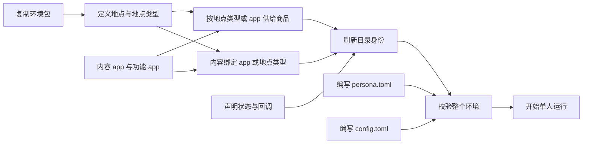

`resources.md` 保留文件名，页首锚点改为 `resources-设计环境数据集`；本页内容导航按以下主题链接。
现有有效锚点能沿用就沿用；退役的「编写生活活动」及动作目录内容删除，不保留空标题或兼容说明。

| 主题 | 手册锚点 |
| --- | --- |
| 环境数据集包 | `resources-先找到应该修改的文件` |
| 最小修改：调整商品价格 | `resources-先完成一个最小修改减少一家门店的初始库存`，正文只讲调价 |
| 地点类型与地点 | `resources-编写地点与营业时间` |
| 商品供给、典型写法、边界与履约 | `resources-编写门店供给与商品`、`resources-商品供给的典型写法`、`resources-商品供给的边界情况`、`resources-商品怎样到人物手里` |
| app 与平台商品浏览 | `resources-app-的两种角色`、`resources-平台-app-与商品浏览` |
| 内容、回调与人物可见范围 | `resources-编写内容与工作材料`、`resources-编写回调规则`、`resources-人物能看到什么` |
| 来源、刷新身份与校验 | `resources-来源与有效期`、`resources-修改后更新文件身份`、`resources-验证修改`、`resources-登记失败对照` |

<a name="spec-envdataset-手册-环境数据集包"></a>
### 环境包、发布与校验

一个环境根只有 `catalog/`、`persona.toml`、`config.toml`，表示一个人物的一次运行。
`catalog/` 内是 `manifest.json` 与五个 JSONL：`app-catalog.jsonl`、`location.jsonl`、
`merchant-catalog.jsonl`、`content-catalog.jsonl`、`callbacks.jsonl`。
没有 `scenarios/`、`map.json`、动作目录、地点类型文件或可执行回调脚本；环境根的包外条目也拒绝。
地图由加载时使用地点与唯一种子生成，作者不写坐标，不运行 `generate-map` 或其 `--check`。

手册应说明每个 JSONL 的一行含义和编写入口，正式字段表链接资源引擎设计。
JSONL 每行一个对象，不写空行、多行对象或注释；UTF-8 不带 BOM，只用 LF，身份与绑定列表按登记规则排序去重。
文件相互引用在全部读入后统一解析，不要求作者以引用顺序排列文件。
目录文件必须是包内普通文件，不使用符号链接、目录联接或越界路径。
`callbacks.jsonl` 可为空；状态声明与规则都在该文件，功能 app 的动作绑定在 app 行。

作者先修改清单的环境版本，再用现有 `refresh_manifest_identity` 刷新文件表与目录摘要，
最后执行 `worldmock validate --environment experiments/my-world`；纯环境校验不调用模型或编译画像。
`persona.toml` 和 `config.toml` 不进入目录文件清单，但进入运行输入身份；修改后开启新运行，不热更新已有世界。
删除「更新各场景环境钉」和发布地图步骤。
失败输出继续包含 `valid: false` 及 `errors` 的 `path`、`code`、`reason`；坏 JSONL 行定位到文件与行号。
旧格式直接拒绝，手册指导按当前格式编写，不提供迁移工具。

地点、店铺、app 名称保持真实名称语义；距离、营养、费用和配送时间是模拟数值。
库存、售罄、供给上限和语料目录是有意省略。
每个示例注明「完整行」或「局部片段」及其前提；未决字段不写成可以直接运行的完整示例。

<a name="spec-envdataset-手册-地点类型与地点"></a>
### 地点与商品供给的写法

地点 `kind` 是自由文本标签，与商品 `store_kinds`、内容 `location_kinds` 逐字匹配；一个地点只有一个类型。
类型原文会被人物看到，宜用自然的场所名称，不把规则写进地点名。
新增一家同类型地点，其类型绑定的商品和内容自动覆盖它。

| 设计需要 | 数据集写法与结果 |
| --- | --- |
| 同品牌多家店 | 每家独立 `location_id`，同名地点以不同 `branch_label` 区分，人物看到「名称（分店）」；不声明 `count`，不生成地址 |
| 住处 | `is_home` 显式标记，人物在 `persona.toml` 声明住处名称，目录中必须存在对应地点；初始位置独立声明，不要求为住处 |
| 驿站 | `accepts_parcels` 显式标记；每个驿站的地点类型至少绑定一条内容；存在 app 侧商品时必须至少有一个驿站，快递送到距住处最近者 |
| 远程购买渠道 | 地点 `app_ids` 只能绑定内容 app；没绑定的地点需要到店购买 |
| 营业安排 | `opens` 描述每周各天时段和特殊日期；缺省全天，工具层显示营业时段。闭店拒绝到店购买和地点互动，远程下单只从营业店铺选择，允许前往；当前地点有售但闭店时不自动改为外卖。精确 JSON 形状与特殊时段按地点营业时段正文 |
| 商家资金 | 不声明商家账户或可售标志；商品的绑定决定供给，购买记录保留商品、店铺与渠道来源 |
| 地图与地点集合 | 所有目录地点进入世界，不另由场景挑选；坐标和地图只由系统维护 |

<a name="spec-envdataset-手册-商品供给"></a>

商品恰选一侧绑定：`store_kinds` 将商品放到所有匹配类型的地点，`app_ids` 表示平台快递商品。
`store_ids` 与 `all` 删除。任何商品类别都可绑定任意地点类型，语义合理性由作者负责。
商品类别固定为 `snack`、`meal`、`drink`、`goods`；燃油也是普通 `goods`。
零食和食品提供千卡，饮料和商品影响统一心理量，真实饮料与商品收货减少 `relaxation_need` 0.10。
价格为正整数分，同一商品各地点同价；删除 `shipping_seconds`。

典型示例应覆盖便利店和超市共同卖零食、加油站卖燃油、独特餐饮类型卖招牌菜、多个同类门店共享供给、
少数指定地点使用共同特殊类型。特殊类型同样会被人物看到，且一个地点只有一个类型；不要把逐店商品清单换成每店一种类型。
同名不同类型的地点仍必须拥有不同显示名，不能只靠内部身份让人物区分。

| 商品绑定与人物状态 | 履约与需要说明的边界 |
| --- | --- |
| 地点侧、人在有售地点 | 到店购买；购买耗时随机 1–5 分钟，活动实际完成时全部合单组统一付款，付款成功的到店组立即收货 |
| 地点侧、人在别处且有远程渠道 | 在营业且可配送的店铺中按货款加运费的最低总价选店，同价取预计最早送达者，再按店铺身份；下单 app 在该店绑定中按种子抽取；沿用备货、速度和每单配送费常数 |
| 地点侧、无远程渠道 | 需要先到店；不凭空生成渠道 |
| app 侧 | 在相应 app 互动时浏览价格、费用和确切预计到站日；快递天数从 2、3、4、5 整日等概率抽取，商品与下单 app 的免运费或 500 分策略等概率且稳定；合单全部商品免运费才免运费，否则整单收 500 分且只收一次 |
| 到驿站领取 | 一次 `interact` 领取全部可取订单，并按正常推荐开始地点内容；时长完全由数据集内容和实际进度决定，不固定五分钟；无可取件时 `PARCEL_NOT_READY` |
| 途中操作 | 四种出行在第一槽，购买与 `interact` 在第二槽；驾车不额外禁止跨槽并行，仍核对在场和收货条件。地点侧配送要求有效的实际收货停留点；睡眠须先清空第二槽，睡眠中不允许第二槽动作 |

人物只写商品名的 `purchase` 请求；履约由商品绑定与当前位置决定，不随机选择到店或外卖。
每件商品先选店和下单 app，再将同店、同 app、同履约的商品合单，每单选择一次支付 app 或 `null`。
整次请求只形成一个购买活动，时长在 60–300 整数秒中均匀抽取一次；查询显示范围，开始后时长固定，多商品不重复计时。
购买活动名称为「购买<按 goods_id 排序的商品名列表>（M月D日 HH:MM 起）」，不增加新动作。
购买的身体消耗取 `idle` 的代谢当量 `1.0`，表示坐着不动，不提供心理需要缓解。
第三方支付操作各占尾段内的 10–20 秒，多笔依次进行且不增加总时长；段开始记录跳转，段结束不扣款或生成成功通知。
购买实际完成时重新检查全部合单组的总货款和运费，足额才原子扣款，各组分别写独立付款事实并开始履约，到店组立即收货。
非空支付 app 的消费推送引用对应付款事实且仅系统可见；直接银行卡支付采用相同付款时点，不生成第三方跳转和消费推送。
受理前按整次请求的总货款和最终运费检查余额，不足则整组拒绝，不先购买其中能够支付的部分。
完成时余额不足则全部取消、资金不变、活动失败；购买不能暂停，完成前主动结束或被截断时全部取消，不产生部分付款或退款。
预览和真实受理复用同一报价与店铺选择，不低报货款或运费；同商品、同 app、同本地日的快递预计到站与受理一致。
下单渠道保留在订单，不额外生成自动下单足迹。
收货效果实际发生一次，没有持有物库存；燃油的状态重置属于回调状态声明。

<a name="spec-envdataset-手册-app-两种角色"></a>
### app、平台浏览与内容

app 行声明 `role: content | function`。功能 app 在同一行用 `actions` 绑定具体动作，
删除 `purposes`、`payment_app_ids`；人物不选择功能 app，也看不到它的名称。
功能 app 至少绑定四种出行动作或 `purchase` 中的一项，不绑定 `sleep`；`interact` 只面向内容 app 或当前地点。
购买的支付候选是绑定 `purchase` 的功能 app 加一个 `null`，各候选等概率；
`null` 对应不跳转外部支付 app，通过 app 下单时直接使用该 app 绑定的银行卡。付款照常，不生成外部支付段、自动支付 app 足迹或第三方消费推送。
四种出行从实际绑定的功能 app 中选择，没有绑定就不记录；不增加银行卡目录、选择开关或概率配置。
回调 `footprint_chain` 是另行声明的额外足迹，不能与 app 行的动作绑定混为一个字段。

内容 app 至少有普通内容，或被地点、商品绑定；平台可浏览商品目录本身就是内容来源。
不允许空无用途的内容 app，也不提供「既没有内容和商品又仅作渠道」的示例。
地点、商品、内容均只能绑定内容 app；内容 app 不绑定具体动作。

<a name="spec-envdataset-手册-平台浏览"></a>

平台说明须明确区分两条购买路径：地点绑定平台使地点侧商品能外卖，商品直接绑定平台使其成为快递商品。
人物互动平台时，目录展示直接绑定该 app 的商品与绑定该 app 的地点商品的并集，报价沿用「商品与履约」的同源路径。
平台绑定显式内容时仍展示该目录，并正常开始内容，目录展示不额外增加时长。
没有显式内容的平台由数据集声明 `browse_duration_seconds`，为至少 60 的严格整数；交互创建真实浏览活动，使用第二槽。
浏览采用 `idle` 的代谢当量 `1.0`，记录 `app_use`，不产生 `content_consumed`，不伪造内容条目。
app 侧商品不单独铺在工具层。数据集可编写普通内容描述商品和使用体验，不必维护手抄价格表。
若摘要写了具体商品名或价格，作者负责它与商品目录一致；引擎不从自然语言摘要提取供给关系。
浏览不会自动下单，也不是按名购买的前置条件；人物记忆只写「买了某商品」，不强调引擎代选渠道。

<a name="spec-envdataset-手册-编写内容"></a>

内容恰绑 app 或地点类型，保留标题、摘要、来源、时长和可选系列。
摘要至多 200 个字符；真实摘要写 URL，合成摘要写 `notice`；时长为不少于 60 秒的整数。
删除内容 `category`、`manner`，改以体力消耗档位选择系统固定代谢系数，以 `pushable` 表示推送资格。
聊天话题为轻度费力，与工作使用同一内容消费机制。系列自动接续，心理效果直接按时长与档位结算；
所有 `interact` 与购买使用第二槽，出行和睡眠使用第一槽；同槽只运行一个活动。
引擎按动作分配槽位，不根据模型提交顺序选择，也不接受槽位参数；睡眠须先清空第二槽，睡眠中禁止第二槽动作。
作者不填写设备或占用配置；计划由模型修订，删除自动推进与分类报表，效果档位数值执行已采纳规则。

| 内容设计 | 手册必须说明的行为 |
| --- | --- |
| 工作 | 绑定工作地点类型，由推荐机制选取；不再给人物指派 `work_content_ids`，删除 `WORK_*` 准入和专用完成事件；人物工作地点和班次仍在 `persona.toml` |
| 运动 | 绑定地点类型时只能在该类地点进行，绑定 app 时可以在任意地点进行；删除额外运动地点门禁 |
| 聊天 | 只给话题，与工作使用同一内容机制；模型在每个 `report_status` 播报机会编写聊了什么，间隔取运行配置。社交需要按实际消费时长和效果档位直接结算，不经过回调；具体档位和画像参数按已采纳规则 |
| 同一容器 | 不要求所有内容具有相同体力消耗或心理效果档位；所有 `interact` 均使用第二槽，作者保证绑定语义合理 |
| 长内容 | 不切成 30 分钟片段；每个播报边界写「进行到 X / Y 分钟」，X 按已结算位置向下取整，Y 按总时长向上取整；暂停不推进，模型只写小结、不生成时长 |
| 当日计划 | 模型依据具体目标和实际经历，通过 `revise_day_plan` 替换当前完整清单；不按活动类别或收货自动推进，不把移除条目解释为客观完成；计划提醒继续存在 |
| 系列 | 保留容器一致和集数不重复，删除类别与使用方式一致性要求；同系列按集号自动接续并保留第二槽，系列耗尽或非系列内容完成时停止，不增加开关 |
| 推送 | 由 `pushable` 选择，不继续限定旧娱乐类别；推送的具体载荷和来源由内容模块维护 |

<a name="spec-envdataset-手册-编写回调规则"></a>
### 回调写法

回调只来自数据集声明，`callbacks.jsonl` 可以为空；引擎不内置燃油、水电费或工资。
文件只包含状态声明和规则数据，字符串与闭集或登记对象比较，从不执行代码。
状态声明含 `state`、`initial`、`cap`、`reset_on_goods`，初值就在回调文件；所有人物默认有车，
删除 `owns_car`、无车初值检查和专用燃油模型。

规则仍由 `rule_id`、`trigger`、`effect` 与可选 `notify` 构成；同次触发按规则身份顺序，
链内按步骤顺序执行。字段形状和登记码链接资源引擎设计，执行语义链接模拟引擎设计，手册不维护另一套语法。

| 想表达的事情 | 用法与边界 |
| --- | --- |
| 每天实际开车耗油 | `drive` 触发的 `state_delta` 配 `once_per: local_day`；按实际正秒覆盖的本地日期逐日一次，跨午夜两日分别结算，零秒取消不计 |
| 收到燃油后加满 | 状态的 `reset_on_goods` 指定商品，真实收货时置为数据集声明的上限，不清除既有按日记录 |
| 油量提醒 | 规则指定文字和内容 app，低于阈值后每天首个推送时点提醒一次；睡着就等醒来后的首个推送时点，静默到达 |
| 打车的浏览和支付足迹 | `take_taxi` 上额外声明 `footprint_chain`；支付步骤只记足迹，不转账、不再次收车费 |
| 水电费和工资 | 数据集用时间触发加 `transfer`；按月键表达日号与时刻，按小时为本地整点、按日为本地零点；周期触发采用 `start_time < due <= stop_time`，工资静默入账，无邮件与发薪唤醒 |
| 天气订阅 | 订阅每日天气预排事件；开始时初始化当天真实天气但不补发此前零点事实，后续本地零点产生每日天气事实，不把天气注册为回调状态 |

状态值钳在零与上限之间，状态触发只在跨过 `below` 边沿时执行，同次提交不级联。
状态为零不阻止任何动作；转账余额不足记未付、不阻断运行；每个效果都有系统事件证据。
提醒只配状态变化效果，余额减少提示只配足迹链；可见提示仅在有 `visible=true` 且同次触发的人物余额净减少大于零时出现一次；包含动作车费，并以同触发收入抵消。
不匹配仍以 `CALLBACK_NOTIFY_MISMATCH` 拒绝。
购买耗时随机 1–5 分钟，领取所用内容的时长完全由数据集决定，不再以「零秒动作缺少本地日期」解释 `once_per`。
购买使用第二槽，不能暂停；仅在实际完成时统一结算全部合单组，付款、收货、提前结束和取消引用「商品与履约」。
支付消费推送引用真实付款成功事实，不要求配置回调，也不触发 `balance_decreased` 或普通内容推送。
运行首次决策不执行类别订阅；`run_stop` 只在配置的停止时刻执行，提前失败不触发它。
资金账户全集只有 `agent:{agent_id}` 与 `external:scenario`；工资与费用以通用回调转账的方向和分为单位的正整数声明。

<a name="spec-envdataset-手册-persona-toml"></a>
### 人物与运行配置的编写

`personas.md` 将「在场景中填写人物」改为 `personas-编写-persona-toml`，
保留 `personas-作息字段与起点困意` 解释作息覆盖与起点困意。
环境根的一份 `persona.toml` 是唯一人物来源，包含姓名、画像正文、习惯、作息、住处、工作地点与班次、
初始余额和身体初值；不使用人物数组或 `persona_file` 引用。
画像正文保留至少 100 个字符的要求，生活事实先于性格倾向；余额写在正文不会改变实际余额。
统一心理量为 `relaxation_need`，两项必填初值字段与分级文字见「人设与运行配置」；初始位置不要求等于住处，声明名称必须有实际地点对应。

人物文件不含联系人、工作指派、邮件、账单、汽车所有权、燃油初值、种子或起止时刻。
旧模板字段 `occupation`、`routine_preference`、`consumption_preference`、`risk_preference` 与独立
`entertainment_preferences` 配置继续拒绝。作息覆盖画像提取值的规则、冲突警告和取值范围保留，载体改为人设文件。
画像编译、覆盖检查和卡片约束保留，`profile compile`、`profile check` 只接受 `persona.toml` 路径。

<a name="spec-envdataset-手册-config-toml"></a>

`runtime.md` 在凭据说明之后新增 `runtime-编写-config-toml`。
环境根的一份配置保存时区、唯一整数种子、起止时刻、决策与播报节奏、传输重试、模型回合上限、
画像抽取与就寝反思重试、上下文窗口，以及 `provider`、`base_url`、`requested_model`、`max_retries` 等非密模型身份。
删除「环境不能指定模型身份」的旧说明。
配置只写凭据环境变量的名称，不写密钥；必填 `[model]` 结构、凭据环境变量和实际服务元数据来源见「人设与运行配置」，
不把已提出的 `[model]` 方案或已知模型静态表写成确定规则。

起止时刻使用 TOML 原生带偏移日期时间，按自身偏移判整点，停止晚于开始。
上下文声明不小于 262144，模型实际权威上下文不小于声明值；容量计算仍按权威数据。
重试耗尽即失败，不加降级；六轮决策失败不跳过时间。
随机性只来自 `config.toml`，覆盖地图、天气、推荐、推送、购买与支付段时长、app 选择、快递与评估；
删除地址生成、多人调度与远程店铺随机选择的说明。
两份 TOML 都不带 BOM、只用 LF；配置改动后使用新运行目录，恢复和重放核对冻结身份。

<a name="spec-envdataset-手册-人物能看到什么"></a>
<a name="spec-envdataset-人物可见范围"></a>
### 人物可见范围

完整范围只在 `docs/design/06-agent.md 维护，位置在观察投影字段内、禁止进入提示字段之前。
资源手册只给简短说明和链接；下表明确该节应呈现的边界，具体层形状仍归各层定义。

| 人物能看到 | 来源与边界 |
| --- | --- |
| 当前时刻、地点显示名、场所类型 | 世界时钟和地点条目；分店用「名称（分店）」 |
| 每日天气 | 环境层的一行天气文字；天气只能来自环境。由人物提示明确环境是天气唯一来源，不增加关键词过滤或模型复核 |
| 营业时段、出行方式、车费、预计时长与费力 | 工具层真实报价与地点安排 |
| 商品名、商品类别标签、价格、费用、预计到达 | 地点商品按工具层规则呈现；app 侧商品在相应平台互动时呈现，预览与受理一致 |
| 内容 app 名、选中内容的标题、摘要、时长与进度 | 内容开始、实际进度与内容推送；不展示完整内容目录 |
| 订单、收货、受理与拒绝结果 | 本人的实际结果与允许的金额短语；不写引擎代选的下单 app |
| 体感分级、画像、作息、当日班次、计划、事务与本人总结 | 当前人设、身体的文字投影和本人记录；统一心理分级按已采纳规则 |
| 阈值提醒和余额减少提示 | 规则声明的内容 app 名、提醒文字与允许的固定提示；工资不额外发邮件或提醒 |

| 人物看不到 | 约束 |
| --- | --- |
| 余额、账户、分录与身体数值 | 只通过拒绝原因、价格、减少额和体感间接知道 |
| 内部身份、哈希、坐标与地图几何 | 仍由禁键、哈希后缀和数值身体检查阻止进入请求 |
| 功能 app 名称与身份、订单代选渠道 | 自动记录属于系统事实；人物可以主动互动内容 app，不等于看见系统代选渠道 |
| 支付 app 的消费推送 | 系统保留 app、金额、消费正文与订单关联；不进入人物的提示、进度层、记忆、计划、反思，也不唤醒或额外触发决策 |
| 回调状态、系统足迹、回调转账与状态证据 | 只经已定义提醒和提示得知结果 |
| 运行参数 | 种子、停止时刻、重试和上下文配置不进入人物请求 |
| 其他模拟人物 | 单人世界不存在其他模拟人物、联系人、同场人物或邮件对象 |

范围覆盖决策请求，也覆盖零点计划与就寝反思输入；后台请求只读允许事实的子集和本人记忆。
就寝反思仍是中立第三人称压缩的独立模型调用，不扮演人物。
命中禁止字段时失败关闭，不以过滤来掩盖投影错误；本节不新增人物层字段。

<a name="spec-envdataset-手册-发布与校验"></a>
### 登记失败的操作指引

| 失败码或事实 | 作者应检查的内容 |
| --- | --- |
| `ENVIRONMENT_LINE_INVALID` | 空行、多行对象、BOM 和 JSON 对象格式 |
| `ENVIRONMENT_KIND_INVALID` | 当前字段、闭集、排序与换行要求；删除 `store_ids`、内容 `category`、目录动作身份、`communication_mode`、片段、`shipping_seconds`、app 旧用途字段 |
| `ENVIRONMENT_ID_DUPLICATE`、`ENVIRONMENT_REF_UNKNOWN` | 重复身份、显示名或绑定，或未登记的 app、商品等目录引用 |
| `ENVIRONMENT_NUMBER_INVALID` | 严格整数、正数范围、时长下限、非零状态增量与合法阈值 |
| `ENVIRONMENT_STALE_FILE`、`ENVIRONMENT_FILE_UNLISTED`、`ENVIRONMENT_IDENTITY_MISMATCH` | 包中只有当前文件，全部为包内普通文件，修改后刷新身份；环境根也不放包外文件 |
| `RULES_VERSION_MISMATCH` | 按当前格式和规则发布；没有旧版放行或转换脚本 |
| `HOME_LOCATION_REQUIRED`、`PARCEL_STATION_REQUIRED` | 人物住处有效，存在平台快递商品时有驿站，各驿站的地点类型有绑定内容 |
| `APP_UNBOUND`、`APP_ROLE_BINDING_INVALID`、`APP_NAME_COLLIDES_LOCATION` | 功能 app 绑定允许的具体动作；内容 app 有内容或商品目录来源；地点、商品、内容与提醒显示只引用内容 app；app 与地点显示名不冲突 |
| `GOODS_BINDING_MISSING`、`GOODS_BINDING_SIDE_EXCLUSIVE`、`GOODS_BINDING_DANGLING` | 商品恰绑一侧，类型与已登记地点逐字相同 |
| 内容容器、系列、摘要与来源码 | 恰绑一侧、系列容器一致、集数不重复、摘要及来源合规；拒绝 `category`、`manner` 等退役字段，不做内容类别或使用方式检查 |
| `CALLBACK_STATE_UNREGISTERED`、`CALLBACK_FOOTPRINT_EMPTY`、`CALLBACK_NOTIFY_MISMATCH` | 状态先声明、足迹每步有候选 app、通知与效果配对正确 |

删除商家账户、可售标志、`WORK_*`、`APP_PURPOSE_INVALID`、场景环境钉和发布地图的修复指导。
营业时段、通用资金账户与内容心理效果档位全部采用已确认规则，拒绝码只使用正文明确规定的闭集。

<a name="spec-envdataset-手册-漂移"></a>
<a name="spec-envdataset-手册与数据集设计方法-删除面"></a>
### 删除面与已有文档漂移

- 请求示例统一为 `{action, target}`，查询使用 `action`，删除 `way`、`app` 筛选与人物指定支付、收货人字段。
- 删除等待、闹钟、联系人、消息、交互菜单、工作分配、无车限制、旧燃油与场景配置说明。
- 删除「内容 `genre` 精确匹配」的未完成段落、无依据的 14400 秒上限、空标题和重复模板句。
- `rules.md` 的重复动机评分文字只保留一处；三处工作分配段全部删除。
- 环境登记码链接统一指向 `resource-engine-注册校验与错误`，不再误链到文件列表。
- 删除场景页后将有效操作归入人物和运行页，更新所有现行入链；历史 `docs/dev/` 记录不回写。
- `evaluation.md` 删除等待、被动决策、内容分类报表、自动目标推进指标、自举与评审独立种子；直接展示真实动作与对象证据，不展示旧四分类或替代类别映射。
- 手册版本值引用模块设计，不重复维护版本号和旧格式白名单；运行命令不再接受场景文件或发布地图。

<a name="spec-envdataset-手册与数据集设计方法-接口与数据结构"></a>
<a name="spec-envdataset-手册与数据集设计方法-修改清单"></a>
### 文档接口与实施范围

入口按人物、环境、运行、规则、评估分工。`docs/INDEX.md` 与手册入口链接到
`personas-编写-persona-toml`、`resources-设计环境数据集`、`runtime-编写-config-toml`，删除「创建场景」入口。
`docs/design/06-agent.md` 新增人物可见范围，既有范围概括和禁键说明改为引用该节。
`docs/manual/resources.md` 删除旧「编写动作」和独立查询说明；查询说明归运行页的工具交互检查。

手册说明引用资源、模拟、人物、配置、记录与评估模块的当前规则，不复制字段全集或英文错误表。
实现时同步更新 `docs/manual/{README,resources,personas,runtime,rules,evaluation}.md`、`docs/INDEX.md` 与相关模块设计；
删除 `docs/manual/scenarios.md`。

<a name="spec-envdataset-手册与数据集设计方法-测试要求"></a>
### 验证要求

文档只运行当前链接检查与设计构建，不新增解析开发规格、核对历史清单、验证历史指纹或自动执行手册示例的测试。
示例标注完整程度并人工核对；未决答案到位后再补完整语法，不用未经确认的建议补齐。

| 验证 | 要证明的行为 |
| --- | --- |
| `tests/unit/engineering/test_documentation_gate.py` | 当前链接可解析、显式锚点不重复；删除场景页和旧入口后无现行断链 |
| `tests/unit/engineering/test_design_doc_build.py` | 当前模块设计汇编确定，无标题标识冲突 |
| 人物可见范围运行测试 | 截取实际原生工具、系统层、各层 JSON、续接消息和后台请求；能看到地点类型、天气、营业时段、报价与真实内容，不出现余额、内部身份、哈希、身体数值、功能 app 或订单代选渠道 |
| 目录与商品测试 | 证明类型自动展开、逐字匹配、供给两侧互斥、角色限制、缺驿站或驿站无绑定内容拒绝、报价与受理一致、单人包和旧字段拒绝 |
| 内容与回调测试 | 证明实际内容选择、`pushable` 推送、固定进度短语、状态按日与跨午夜结算、真实收货重置、静默提醒、效果事件和资金守恒 |
| 人设、配置与评估测试 | 证明唯一来源、合法初值、共享种子、整点起止、输入冻结、失败停止和评估重放；未决行为不写假定断言 |

人物可见范围测试复用 `tests/integration/runtime/test_seven_layer_request.py` 捕获真实请求的方式，
放入 `tests/integration/runtime/test_persona_visibility.py`。
夹具选一个不与价格或价款和重合的初始余额，确保内部身份与可见名称不同，再验证所有请求不泄漏初始及购买后余额。
功能 app、回调状态和余额提示的细节继续由各自所属行为测试覆盖，避免复制相同断言。
平台浏览的说明由普通内容选择与商品浏览、履约的真实测试共同证明，不建立文字匹配测试。

<a name="spec-envdataset-手册与数据集设计方法-待裁决与缺口"></a>
### 已确认的手册内容

手册只引用各主题正文中的已确认规则，导航见「已采纳规则」，不另维护重复清单。
原始回答保留在 `open-questions.md`；后续对话的明确修正以所属正文为准。
未获确认的建议不能写成操作规则或可运行示例，也不把旧规则当作缺省结论。

<a name="spec-envdataset-实施与验证"></a>
## 实施与验证

### 修改边界与文档归属

本规格记录本次已完成的环境包与交互变化。模块设计、实现、手册和实际消费的夹具已同步，并已通过完整放行检查。
实施时在一个集成分支完成，不保留兼容层、迁移脚本、旧协议双读或失败后的降级路径。

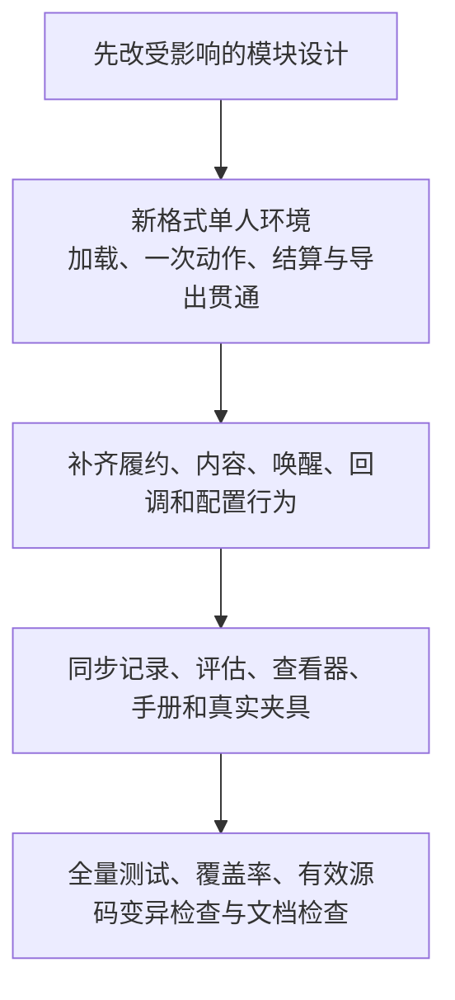

首先跑通可运行的最小端到端链路，再按依赖补齐其他行为；不为尚未实现的复杂度拆掉已经贯通的链路。
受未确认问题影响的字段和行为不能以临时默认值写入冻结格式。

| 模块 | 实施时维护的正文与范围 |
| --- | --- |
| 固定规则与交换 | `docs/design/02-exchange-engine.md`：商品类别、身体资源、出行、规则版本与固定数值 |
| 环境资源 | `docs/design/03-resource-engine.md`：包闭集、目录字段、绑定、登记错误、内存地图与发布身份；`callbacks.jsonl` 文件形状与登记码 |
| 模拟运行 | `docs/design/04-simulation-engine.md`：动作、活动、订单、时间、唤醒、回调执行语义、求值与事务 |
| 记录 | `docs/design/05-recording-engine.md`：事件字段闭集、因果、足迹、导出、不变量和查看器 |
| 人物 | `docs/design/06-agent.md`：画像、提示、记忆、天气来源与可见范围 |
| 评估 | `docs/design/07-evaluation.md`：删除指标与活动家族、公开证据与对比边界 |
| 配置与格式 | `docs/design/08-configuration.md`：人设、运行参数与模型身份；`09-io-formats.md`：运行状态、检查点与严格持久化格式，不重复事件字段定义 |
| 命令与生命周期 | `docs/design/10-runtime.md`：环境入口、校验、运行、恢复和错误终止 |
| 概述与导航 | `docs/design/00-overview.md`、`01-architecture.md`、`README.md`、`docs/INDEX.md`：同步当前边界与导航 |

每条规则只在所属模块正文维护，其他模块和手册链接，不复制包表、版本表、错误码表或新建全局合同。
删除已失效的 `experiments/published-environment/` 示例、`--environment-root` 参数与地图发布步骤；
仓内实例只能引用实际存在的输入，正式数据仓路径须注明为外部环境。
已冻结的 `docs/dev/` 历史提案和旧规格不回写；不存在的旧合同或验收文件不重建。
设计 HTML 仍只生成到 `.work/docs/design/worldmock-design.html`，不直接编辑或提交。

### 验收范围

各主题章节的验收要求覆盖当前可观察行为，删除旧功能同时删除不再成立的测试，保留仍有效的不变量。
尤其不能因删去过程台账、重复清单和内部快照而降低实际模块边界、覆盖率或有效源码变异检查。

- 目录与配置：真实文件加载、闭集、严格行格式、版本、身份、引用、住处、营业时段和单人约束。
- 运行行为：七个动作、名称解析、全量世界、天气与出行、两槽分配、内容选择、购买与取件时间、同源报价、收货幂等和资金守恒。
- 回调与时间：状态登记、跨日驾车、周期时间窗口、定时账单与工资、阈值提醒、无级联、睡眠边界、失败停止及检查点恢复。
- 人物与证据：提示结构、内容进度、自动 app 隐藏、独立付款事实与通知因果、订单快照、统一 app 足迹、公开评估与查看器一致。
- 删除面：旧场景文件、地图文件、商家账户、内容类别、旧动作、邮件、社交交互、燃油专用状态和旧配置均不可继续使用。

修改范围内先运行对应 unit、integration、system 用例；完整放行运行 `python -m pytest tests`。
`scripts/coverage_gate.py` 的分支覆盖率不得低于 85%，公共接口不得留缺口；风格门禁不得新增
`_OUTSTANDING` 条目。生产代码按仓库的行长、函数长度、参数数量、中文注释和英文日志要求实施。

文档检查运行 `python scripts/documentation_gate.py` 和 `python scripts/build_design_doc.py`。
当前文档门禁不解析本规格或历史开发散文来构造产品测试，不核对历史章节、文件清单或阶段完成集合。
本次规格修订可一次性检查自身链接、锚点和未确认项的一致性，但不把这些检查变成产品合同。

真实执行报告、覆盖率明细与机器回执写入 `.work/`；实际消费的输入、期望与基线留在 `tests/`。
录制夹具用新实现真实重录，基线按既有双候选冻结规程重建，不手改摘要掩盖行为变化。

### 完成判据

规格冻结要求所有影响接口与行为的未确认细节已经答复并回填，正文不再留待裁决占位。
实施完成要求模块正文、实现、手册和实际消费的夹具同步，行为测试与完整放行检查通过。
删除能力应由真实拒绝或不可见行为证明，例如旧 `way` 字段被拒、包外旧文件被拒、工具列表没有闹钟和消息接口。
不得以「文档已经修订」代替实施完成，也不得通过接受未知字段或保留旧路径绕过未完成的部分。

<a name="spec-envdataset-待裁决与缺口"></a>
## 已采纳规则

用户已明确全部采纳完整推荐，所有影响接口与行为的细节已回填所属正文。
`relaxation_need`、两项内容效果、`opens.weekly/exceptions`、两个资金账户、必填 `[model]` 与
实际服务元数据核验均为最终合同。原始讨论证据保留在 [open-questions.md](open-questions.md)。

不得将已采纳规则继续标成待实施建议，不得增加规格没有描述的功能。
