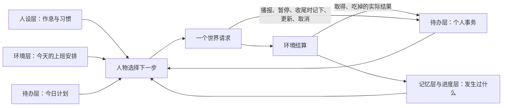
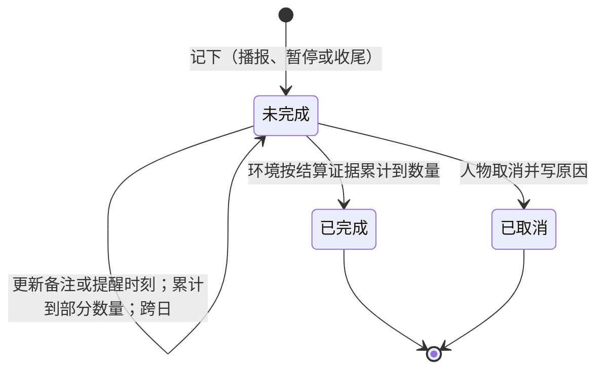
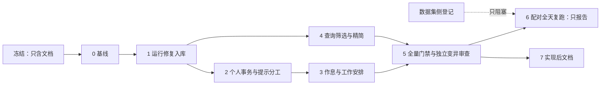

> 历史记录：本文件保存提交 `72f004b0087efa1b6f6d662ac6a143e087e4e21c` 时的过程与判断，不再定义当前系统。
> 当前设计见 [文档入口](../../INDEX.md)；正文中的路径、规则和结果按当时上下文理解。

> 归档基线：2cf230115f4084aef2376e9d77bc976efbed43ea
> 原始路径：`docs/dev/SPEC-errands-workday.md`
> 归档说明：此提交仅定位归档原文快照，不是审查执行证明；原始执行记录与未执行事实按原文保留。

# 特性规格：个人事务、工作安排、查询筛选与运行修复

> 状态：**FROZEN**。2026-10-02 由[未完成任务、人物行为约束与全天运行修复提案](PROPOSAL_2026-10-02_TASK_MEMORY_AND_RUNTIME_FIXES.md)经设计评审收敛；同日用户指示实施本规格、不延后任何尚未完成的工作，并采纳全部推荐：「裁决记录」二十二项（含标 † 的 R1、E1、E4、W1、Q2）据此按「推荐」列定为已定，`docs/INDEX.md` 状态列同步；「冻结条款修订」随冻结生效；定稿不等于已实现，实施进度按「实施计划」各阶段落地。阶段 6 的配对全天复跑是计费的真实运行，用户指示本次不启动；「数据集侧登记」由用户另开会话在 WorldMock-Dataset 仓库完成。
> 日期：2026-10-02
> 来源：上述提案；[设计评审记录](research/2026-10-02-errands-workday-design-review.md)（七路源码映射、十路现行规格与设计文档扫描、六个视角评审并逐条反证，草稿写成后又经两轮反向核对与四路终审）；[运行核查证据](research/2026-10-02-dayrun-review-evidence.json)；WorldMock-Dataset 仓库的 `RUN_REPORT_2026-10-02_3B4AFE5.md`（白领林悦、商务赵铭两次全天运行）。
> 代码基线：`3b4afe5` 加工作树未提交修改；代码与文档行号都取这一工作树。AS2 行号取锁定提交 `8768e14`。
> 本文只写目标设计；运行证据、业界对照与被放弃的方案见提案，各分岔的取舍记在「裁决记录」，评审逐条结论见设计评审记录。
> 配套：[实施计划](research/errands-workday-implementation-plan.md)承载逐文档的文档同步作业、逐阶段的文件修改清单与被钉点，随本文冻结，作实施台账并随各阶段维护。作业里转引的规格文字与本文不一致时以本文为准。

## 摘要

| 主题 | 要改什么 | 章节 |
| --- | --- | --- |
| 运行修复入库 | 就寝反思经唯一严格工具提交并核验引用；回看任务经环境 actor 转发并等待真实结果；计划重复意图逐条定位；决策与工具分发失败留完整异常链。四项都已在工作树，按合同补齐后作为阶段 1 入库 | 一 |
| 个人事务 | 人物在播报、暂停、收尾时记下「要取得或吃掉某件具体东西」的事务；事务存在人物状态里，跨午夜保留，显示在待办层；完成只由环境按结算结果确认，人物只能取消并写原因 | 二 |
| 提示信息分工 | 系统层第 1、4、6 条原位改写：能由结算确认的事记成个人事务，其余延续打算仍写暂停与收尾的 summary；想记住的事只记以后用得上的新情况；就寝反思不代替登记 | 三 |
| 作息与工作安排 | 卡片与场景补下班、到家两个作息窗口；场景按人物显式声明工作安排（每周班次、日期例外、休息时段）；环境层每轮写明今天的上班安排，今日计划改不了它 | 四 |
| 查询 | `query_world` 增购买来源与只看此刻能做的两个筛选，来源解析与购买同一函数；结果不再逐项附完整候选，只省略空值 | 五 |
| 度量与下游 | 质量报告增个人事务与收尾记忆两组只报告项；行为评估增工作负荷与作息偏离；世界结构、场景结构、卡片结构、质量报告各升一版 | 六 |

## 术语

本文与随后修订的合同只用下表的说法；提案里的「待办任务」「未完成任务」一律指个人事务。

| 术语 | 标识符 | 含义 |
| --- | --- | --- |
| 个人事务 | `errand`、`errands` | 人物自己记下、跨日保留、由结算结果结束的一件事 |
| 工作任务 | `task`、`work_task` | 场景声明的世界合同，既有含义不变；零点计划输入里的键「待办任务」仍指它 |
| 当日目标 | `day_plan.goals` | 今天打算重点做什么；`progressed` 只表示获得过活动推进 |
| 工作安排 | `work_schedule`、`duty` | 场景按人物声明的班次；`duty` 是环境层对今天班次的呈现，提示里称「上班安排」 |
| 待办层 | `todo_layer` | 层名不变；内容为暂停的活动、未完成的个人事务与今日计划 |

## 心智模型

人物同时知道四件事：平常怎样生活（人设层作息）、今天有什么定下的安排（环境层上班安排）、还有什么没办完（待办层个人事务与今日计划）、刚才实际发生了什么（进度层与记忆层）。
系统不替人物办事，也不替人物记账：人物记下想办的事，环境按真实结算确认办没办成。



## 证据与范围

### 证据口径

- 两个人物各一次对照运行与一次新运行的计数见运行核查证据；本文只引用证据文件里可追溯的数字。提案中的时刻（到家时间、00:16 的反思、19:09 的查询）只能在数据集仓库复算，本文不引用。
- 两次新运行跑在 `3b4afe5` 加未提交修复上，白领与商务的运行时源码摘要不同，两份数据集预检均未通过。它们是设计依据，不是任何冻结规格的验收运行；提案里的 36.6%、31.8% 不作为收益或阈值。
- 对工作树源码与现行文档的只读核对；评审结论经独立复核，被证伪或部分成立的结论按修正后的表述采用。本机的项目解释器不可用，核对期间没有运行测试，凡「会失败」都是静态推断。

### 决定方案形状的事实

| 现象或缺口 | 直接原因 | 章节 |
| --- | --- | --- |
| 夜里想到要补购食材，次日仍只停留在记忆文字里 | 延续打算只写进 summary；跨本地零点后较早 session 的 `self_notes` 不再进入记忆层，`report_status` 的 summary 从不进记忆层；没有持续身份、提醒与结束条件 | 二、三 |
| 零点计划仍打算用已经吃掉的食材 | 零点计划输入里没有人物未办完的事 | 二 2.8 |
| 人物在 15 点前后离开办公室 | 卡片作息只有起床、出门、午饭、晚饭、就寝；每轮提示没有当班信息；系统层允许今日计划改写作息 | 四 |
| 查询一页二十项全不可执行，单次返回约两万字符 | 查询不能按来源与可执行筛选；每项附至多三条完整请求候选 | 五 |
| 真实运行下回看任务到不了环境 | `3b4afe5` 装配的是 AS2 的 `EnvRouterProxy`，它没有 `read_query` | 一 1.2 |
| 重复意图的修订请求崩溃 | 意图是 `Literal`，校验后是字符串，旧代码取 `.value` | 一 1.3 |

### 对提案的更正

本表只列条款级的更正；提案文末「设计评审后的更正与去向」另列示例、归属与数据集事项的去向。

| 提案表述 | 核对结果 | 本文处理 |
| --- | --- | --- |
| 人物为「白领连秋」「商务赵明」 | 数据集场景与运行报告写作林悦、赵铭（运行目录名仍是 `0001-white-collar-lianqiu`） | 本文与提案统一改写 |
| 待办层投影工作任务、订单、待回复消息 | 与人物 Prompt 规格「唯一出现原则」直接冲突：工作合同只在工具层任务目标，在途订单与未回复消息在进度层与记忆层 | 待办层只新增个人事务（裁决 E1） |
| 任务有「已过期」终态 | 只对工作任务成立，且已有 `contract.outlook` 与 `WORK_SUBMISSION_LATE` 表达；个人事务没有截止字段 | 个人事务只有未完成、已完成、已取消（裁决 E4） |
| 触发时刻复用现有提醒 | 现有提醒挂在当日目标上，随计划过期，且到点会结束睡眠 | 事务自带提醒时刻，新增一个不叫醒睡眠的唤醒原因（2.5） |
| 触发「时间或条件」 | 现有调度没有条件触发 | 只支持时刻 |
| 要延续的事务写入待办，summary 不再承担延续打算；不保留新旧两套路径 | 只有能由结算确认的事才能成为事务；起床时刻、回电话这类打算没有可核验的结果 | 可核验的事只走事务；其余延续打算仍写暂停与收尾的 summary（3.1），两者领域不相交 |
| 行动前同时考虑未完成任务、当日目标和当前条件 | 系统层不写决策次序；待办层每轮可见，第 1 条已说明各层是什么 | 不新增行为指令（3.1） |
| 就寝反思一至三条 | 现行合同、锁定 AS2 常量与已登记测试都是至多五条、三个问题引导 | 条数与引导保持现行合同，只修通道（裁决 R1） |
| 重复的工具描述和长合同在每件商品里复制 | 逐项重复的是完整请求候选；商品项没有任务合同，匹配里也没有工具说明 | 删除逐项候选（5.4） |
| 补 `query_world` 的远端行为断言 | 生产路径上 `query_world` 由宿主在冻结观察上本地求值，只有回看任务走远端；两入口等价已有登记用例 | 远端断言守回看任务（1.2） |
| 硬约束、合理例外 | 提案倾向由环境判定行动可用性，但没有写拒绝什么；现行原则是环境只执行可行性与资源约束 | 工作安排作为环境核验的事实呈现，不新增拒绝（裁决 W1，已定） |
| 至少三次配对完整日运行 | 真实运行计费，只在用户要求时启动 | 计划每臂三次，实际次数由用户启动时决定；少于三次时验收记录写明未达复跑要求 |
| 132 passed、11 passed 支撑入库 | 两条命令不含两份仍按旧反思形状应答的已登记用例，也不含任何门禁 | 阶段 1 以全量门禁为入库条件 |
| 工具分发失败走既有错误合同 | 四个失败阶段码只存在于代码，接口合同的宿主错误码表只登记了十一码 | 随阶段 1 补登（1.4） |

### 权威来源与范围

- 行为规则以本文为准；字段、枚举、Schema 与提示词模板登记在 `docs/CONTRACTS.md`；事件字段、检查点、导出与质量报告登记在 `docs/design/05-recording-engine.md`；实验假设登记在 `docs/EXPERIMENT.md`；门禁登记在 `docs/VERIFICATION.md`。冻结时按「冻结条款修订」逐条改写被取代的条款，不用一句「新规格优先」保留两套正文；被测试逐字比对或被守卫按表解析的文本是例外，见「实施计划」。
- **在范围内**：本仓库的运行修复、个人事务、提示分工、作息与工作安排、查询筛选及对应度量。
- **不在范围**：见「范围外登记」与「数据集侧登记」。
- **不改变的既有语义**：只有环境能改世界状态；一次决策恰好一个世界请求；工具面仍是八个请求模型加 `query_world`；`progressed` 只表示获得过活动推进；每项信息在整次请求只有一处完整内容；工作任务收件即开放、截止与提交判定不变；能量不拦人；身体数值与内部身份不进提示；指名购买不自动替换；到店取得的物品留在门店，没有物品搬运；场景作息覆盖的冲突规则不变；查询不登记世界动作、不推进时钟。

## 一、运行修复入库

四项修复只改变 `code_sha256`；`prompt_sha256`、`tool_schema_sha256`、世界结构、场景结构与 AS2 锁定摘要都不变。
它们修的是已标为已实现的行为（工具交互规格的回看任务、时间与能量规格的就寝反思），因此作为独立阶段先行入库，不与后续行为变化混在一个提交里。

### 1.1 就寝反思经严格工具提交

**通道。** 就寝反思的模型调用只带一个工具 `submit_reflection`（`strict`，`tool_choice="required"`）。思考由 AS2 记忆调度关闭，请求不带 `purpose`。
没有可反思的主观记忆时不调用模型。工具参数为 `{insights: [{insight, refs}]}`，两层对象全部属性必填、封闭，Schema 用内联方式生成，不含 `$ref`、`$defs`，也不在生成后改写。

**校验（本地为准）。**

- 响应恰好一次工具调用且函数名为 `submit_reflection`；`message.content` 不读取，自由文本、其他工具、多次调用都不接受。
- `insights` 一至五条，上限直接取 AS2 常量 `MEMORY_REFLECTION_MAX_INSIGHTS`（裁决 R1）。
- 每条 `refs` 非空、元素非空白、条内不重复，且全部属于本次输入的记忆身份；不同洞见可以引用同一条记忆。
- `insight` 与收尾记忆的文字同一校验：至多一千字符，不含八位以上十六进制串。被复用的校验函数改为公开名，由收尾记忆、看法与反思三处共用，英文错误原文不变。反思是唯一把记忆身份交给模型的调用，正文又会进入记忆层，这条校验补齐「记忆字段」对全部条目的既有要求。
- 通过后的条目固定为 `type=reflection`、`source=reflection`、`importance=0.8`、`keywords=[]`，认知状态由存储固定为主观。

**文案。** 反思的 system 文案由 WorldMock 自持为模块常量并在接口合同「请求组成」逐字登记，测试逐字比对。保留现行合同的三个引导问题与「人物自己的语言」，只把输出格式段换成调用工具（裁决 R1）：

```text
Reflect on a simulated person's recent memories.

Answer three questions about the person, drawing only on the supplied
episodes:
1. 最近一段时间，哪些人和事对这个人影响最大？
2. 这个人对自己、对身边的人有了哪些新的认识？
3. 接下来这个人最应该关心或改变什么？

Call submit_reflection exactly once with one to five insights. Each insight
is one first-person sentence in the person's language, and refs lists the ids
of the supplied episodes that support it. Do not write episode ids or long
digit strings inside the insight text. These insights are subjective; do not
present them as verified world facts.
```

**失败。** 输出不合合同属于协议违约，不是业务拒绝：不写入任何洞见、不登记 `memory_updated`、不降级为空反思。
处理方式取与零点计划同形的有界校验重试（裁决 R2）：附回英文校验错误重新请求，首次之外至多三次（连同首次至多四次模型调用，另设独立常量，与零点计划的次数同值），与传输重试分开计数；耗尽即运行故障，本轮中止。工作验收的协议纠正次数不同，不作先例。

- 附回消息的形状与零点计划相同：在原始消息之后加一条 user 消息，带上一次不合法的工具调用、英文校验错误与重新提交的指令；总是基于原始消息，不逐次累积。
- 每次尝试是 AS2 记忆调度下的一次独立模型调用，请求与响应照常留证，各自计入模型用量；校验错误随下一次请求的附回消息留证，耗尽时最后一次错误写进运行故障原因。不覆写 AS2 的记忆调度。
- 反思发生在本步世界请求已登记、收尾记忆已写入人物工作区之后，验收以 Society 层「本轮中止、不提交、无 `memory_updated`」为准。

**身份与判定。** `submit_reflection` 不属于人物工具面，不进 `tool_schema_sha256`；反思文案不进 `prompt_sha256`；二者由 `code_sha256` 绑定，与 `submit_day_plan` 同一处理。
行动请求的判定不变（不带 `purpose`、工具中有 `start_activity`、思考开启），反思请求不产生 `decision_started`；凡以「不带 `purpose` 且带工具」筛选行动请求的读者与用例都改为按 `start_activity` 判定。
交付窗口选取决策提示的现行做法保持：取动作之前最后一份不带 `purpose` 的请求，并核对其工具含该动作的工具名，不满足是完整性故障，不回退到更早的请求；截断重试请求照此被选中，反思请求晚于动作登记、不会被选中。
接口合同、人物 Prompt 规格与 LabelKit 交付规格里「交付窗口取最后一次行动请求」一类表述与这一实现不符（按行动请求的判定，截断重试不是行动请求），随本特性更正，不是新行为。

### 1.2 只读查询转发

- `LifeEnvActor(DirectEnvActor)` 与 `LifeEnvProxy(EnvRouterProxy)` 各只新增 `read_query(context, tool, request)` 一个方法：代理等待远端并返回结果对象，actor 把查询交给唯一的生活环境。actor 类固定 `max_concurrency=1`，不提供参数。运行装配以这两个类建立环境 actor 与代理；`3b4afe5` 装配 AS2 原类正是回看任务到不了环境的原因。
- 这是锁定 AS2 提交上的 Life 扩展：不 monkey patch、不改 AS2、不做多版本兼容。对 `DirectEnvActor._router`、`DirectRouter._environment()`、`EnvRouterProxy._actor` 三个私有成员的依赖登记为随锁定提交验证的耦合点；升级 fork 时逐项复核。
- **执行位置。** `recall_task_summary` 经代理送到环境 actor；`query_world` 由宿主在本次冻结观察上本地求值，`LifeEnv.read_query` 的同名分支是同一组纯函数的第二入口。受理时两入口结果逐值相等，拒绝时两入口给出同一份校验报告；这条等价已有登记用例与变异守着，阶段 1 把它参数化并登记进本特性台账，不另写远端的 `query_world` 断言。
- `read_query` 的合同：`tool` 取 `query_world`、`recall_task_summary` 之一，`request` 是对应请求模型的实例，按决策身份取本决策唯一一条已提交观察；工具与请求类型不符、找不到唯一观察是协议违约。回看的业务拒绝以错误结构作为返回值。不写事件、不改世界版本与时钟、不计同刻轮数。
- **证据分工。** 真实 Ray 用例守「跨进程返回真实结果、世界状态与事件序号不变」，驱动侧与 worker 侧各调用一次代理（后者守住代理随任务序列化）；另加一条进程内用例直接构造未经 `ray.remote` 包装的 `LifeEnvActor` 并调用 `read_query`，守住函数体与私有成员依赖；并发度另用一条不启动 Ray 的主进程断言；运行装配得到的代理具有 `read_query` 另有一条断言。覆盖率门禁只计主进程执行的行，变异执行器也只对主进程生效，所以这几类用例缺一不可；不加 `pragma`，不改覆盖率配置。

### 1.3 计划重复意图

零点计划与 `revise_day_plan` 共用同一校验函数：

- 每个重复的意图，同时定位首次出现与其后每次出现的条目（`goals[i].intent_kind`）。
- 条数超过八条与重复意图在同一次校验里一并报告，定位在 `goals`；不因超限提前返回。
- 修订入口照错误合同给完整 `path`、`written`（该意图字符串；超限时为提交的 `goals`）与 `allowed_values`（全部意图）；零点计划入口的附回文本逐条列位置与原因。
- 英文原因：`intent_kind '<kind>' may occur only once; keep one goal for this intent and merge these entries into it`。原文里的 `tasks` 一词删去，避免被读成把个人事务并进当日目标。
- 至多八条、每意图一条的合同不变（裁决 R3 选择改代码以符合当日目标规格现行条款，而不是改条款迁就实现）。

### 1.4 异常日志

`LifeAgent.step` 在决策失败时写一条带完整异常链的英文 error 日志后原样上抛，异常对象与类型不变；工具分发失败先写日志，再按现行实现的失败阶段码 `TOOL_SERVICE_FAILED` 抛出。
日志走标准 logging，不是持久证据，不新增事件，不改变失败分类。`step` 是新的公共覆写点，登记进 AS2 集成规格的覆写点清单。

四个失败阶段码此前只存在于代码，随阶段 1 照现行实现补登进接口合同的宿主错误码表：模型服务失败记进该次模型证据的失败阶段；证据写入失败与工具服务失败以运行故障上抛；记忆查询失败作为失败的查询结果回给模型，可在剩余回合重试。四码都只标出失败阶段与调用位置，不是对请求参数的协议纠错。

### 1.5 工作树里不属于本特性的修改

`catalog/README.md`、`scripts/build_catalog.py`、`tests/catalog/test_catalog_data.py` 的未提交修改是工具交互特性的文档对齐（目录 5.3、172 个对象），只改说明文字、文档字符串与一条断言消息，不改变任何运行身份。
它们在冻结提交之前作为一个独立提交先行入库，提交前运行 `scripts/build_catalog.py --check`；不并入本特性任何阶段。
该提交同时把 `catalog/README.md` 文首写死的配套结构版本数字改为指向配置设计的发布目标表，使本特性的世界结构与场景结构升版不必再改 `catalog/` 下的任何文件。

## 二、个人事务

### 2.1 范围与状态

- 个人事务只表达**能由世界结算确认的事**：取得或吃掉一件具体商品。不能绑定具体商品的打算（「买点菜」「早点睡」「回个电话」）不记成事务，仍写当日目标、summary 或记忆（裁决 E2）。
- 状态闭集三值：未完成、已完成、已取消。没有截止与过期；运行结束时仍未完成的照实留在最终状态。
- 「已完成」只由确定性环境代码按结算证据写入；请求里没有「标记完成」。「已取消」由人物请求触发并必须写原因。
- 事务是人物记下的打算，与当日目标文字、活动自述同类：它随人物状态保存，但不是世界事实，不改变余额、库存、身体、订单与验收。文字字段只用于呈现，不参与结算与完成判定。
  一日行为规格与接口合同「记忆字段」里「自由主观文字永远不能进入世界状态」一句据此改写为「不能成为完成事实、结构化经历或客观指标的依据，也不能改变任何世界事实」：目标文字与活动自述早已随人物状态保存，原句本就不精确。
- 工作任务、订单、未回复消息的呈现位置与完成事实不变，待办层不复述它们（裁决 E1）。



**存放。** `AgentState.errands: dict[str, ErrandState]`（键为事务身份），只保存未完成事务；完成或取消时从字典移出，终态、原因与证据只写进同一提交的事件。
这样状态有硬上界，恢复后「不重复完成」由「事务已不在未完成集合」保证。事务不放进 `DayPlan`：零点置空与修订整表替换都不得波及它。

| `ErrandState` 字段 | 类型 | 含义 |
| --- | --- | --- |
| `errand_id` | 字符串 | 由来源动作身份与序号确定性生成，只存状态与事件 |
| `name` | 字符串 | 人物起的名称 |
| `outcome` | `obtain`、`eat` | 结果种类 |
| `product_id` | 字符串 | 记下时由商品名解析 |
| `quantity` | 整数 | 要办成的份数 |
| `progress` | 九位小数 | 已累计量，恒小于数量 |
| `memo` | 字符串或 null | 人物写的备注 |
| `registered_at` | 时刻 | 记下的时刻 |
| `remind_at`、`reminded_at` | 时刻或 null | 提醒时刻与已提醒时刻 |
| `origin_action_id`、`origin_event_id` | 字符串 | 来源动作与请求事件 |

**上限（实验假设，登记进 `docs/EXPERIMENT.md`）。** 每人未完成事务至多 8 条；一次请求至多 4 条变更；名称至多 30 字符；备注与取消原因各至多 120 字符；数量 1 至 9。
待办层不浓缩，没有上限就只能以容量故障收场；上限由校验执行，不静默截取、不自动合并。

### 2.2 记下、更新、取消

**入口。** `report_status`、`pause_activity`、`conclude_activity` 各增一个请求级必填字段 `errands`（与 `items` 平级，可为 `[]`）（裁决 E3）。
不放进 `items[]`：事务不属于某项活动。不扩到 `start_activity`、`revise_day_plan`，也不新增工具。

入口的边界照实写明：只有本次决策能点名一项活动时才能变更事务——进行中的可播报、暂停或结束；暂停的在其开始地点可用 `report_status`（会恢复它），在任何地点都可用 `conclude_activity`（会结束它）；待收尾的用 `conclude_activity`。
空闲、只做瞬时动作（购买、给予、发消息、交工、修订计划）期间没有入口；这些既有效果不因携带事务而改变。
就寝反思里想到的事，由人物在其后下一次播报、暂停或收尾时记下；反思文字次日起才进入记忆层。

**每条变更。** 封闭对象，八个键全部必填：

| 键 | 类型 | 说明 |
| --- | --- | --- |
| `change` | 「新增」「更新」「取消」 | 没有「完成」 |
| `name` | 非空白字符串 | 新增时由人物写，兼作描述；更新与取消照待办层写法 |
| `outcome` | 「取得」「吃掉」或 null | 完成依据的结果种类 |
| `item` | 字符串或 null | 商品名称，按名称解析到唯一商品 |
| `quantity` | 整数或 null | 份数 |
| `memo` | 字符串或 null | 人物写的备注：打算怎么办、去哪办 |
| `remind_time` | `HH:MM` 或 null | 想被提醒的钟点，与当日目标的 `remind_time` 同名同形 |
| `reason` | 字符串或 null | 取消原因 |

备注不叫 `next_step`：那是拒绝结果里环境给出的下一步指引，同名会混淆环境核验的内容与人物自述。枚举值不用「登记」：工具说明的扫描把它判为协议说法，说明与枚举用同一个词。

| 变更 | 必须非空 | 必须为 null | 其余 |
| --- | --- | --- | --- |
| 新增 | `outcome`、`item`、`quantity` | `reason` | `memo`、`remind_time` 可空 |
| 更新 | — | `outcome`、`item`、`quantity`、`reason` | `memo`、`remind_time` 为替换语义，null 即清空 |
| 取消 | `reason` | `outcome`、`item`、`quantity`、`memo`、`remind_time` | — |

- 完成依据记下后不可改；要改就取消后重新新增，二者可以在同一请求里完成，并可沿用原名。
- 同一请求内按「取消、更新、新增」的次序求值：重名、同结果同商品与上限都按扣除本请求取消之后的未完成集合判定。同一条未完成事务在一次请求里至多被一条更新或取消点名；两条新增不得同名。
- 事务记下后不可改名，终结后名称可以再用。

```json
{
  "items": [{"activity_name": "睡觉", "summary": "睡醒了，冰箱里的食材包昨晚吃掉了。"}],
  "errands": [{
    "change": "新增",
    "name": "补一份素炒什锦食材包",
    "outcome": "取得",
    "item": "素炒什锦食材包",
    "quantity": 1,
    "memo": "下班前下单送到家",
    "remind_time": "17:00",
    "reason": null
  }]
}
```

**原子性。** 事务变更与同一请求的活动状态转换同批校验、同一事务提交。请求因任何原因被业务拒绝时事务变更一并不生效；任何一条事务变更不合法则整请求被拒、世界不变。
每条被受理的变更恰好写一条事务事件（内容没有变化的更新也写），只在成功分支生成，不经拒绝分支也会提交的暂存通道。
宿主不得旁路写入事务；事务变更不是记忆写入点，不产生 `memory_updated`。同一请求里的 `memories` 仍按既有规则在登记时由宿主写入，二者落地规则不同，验收各守一条。
成功结果恒带回执 `details.errands`：`[{errand, change}]`（`errand` 为名称），顺序同请求里的顺序，没有变更时为 `[]`；被拒结果没有该键。回执是「结果不复述参数」的声明例外：进度层的调用参数略去了 `errands`，回执是事务变更在进度层的唯一呈现。

### 2.3 校验与错误

宿主与环境对同一冻结观察调用同一纯函数，判定一致；不新增任何业务拒绝码。

| 情形 | 宿主纠错 | 说明 |
| --- | --- | --- |
| 缺键、类型、枚举、交叉约束、长度、单次条数、两条新增同名、同一事务被两条更新或取消点名 | `ARGUMENTS_INVALID` | `path` 完整到 `errands[j].<键>`，枚举给全部合法值；`expected` 给类型与格式，上限随校验原因写在 `why` |
| 更新或取消的 `name` 找不到、多于一个 | `NAME_NOT_FOUND`、`NAME_AMBIGUOUS` | `allowed_values` 列本人全部未完成事务名；不替换 |
| 新增的 `item` 解析不到唯一商品 | `NAME_NOT_FOUND`、`NAME_AMBIGUOUS` | 最接近的至多三个商品名写在 `why`；不把全量商品名放进 `allowed_values` |
| 新增的名称与已有未完成事务归一后相同；结果种类与商品都与已有或同请求另一条新增相同；新增后未完成数超过 8 | `ARGUMENTS_INVALID` | 状态相关，但只读冻结观察的私有绑定即可判定；`why` 写明冲突的事务名或上限 |

- 这些错误都不带 `candidates`，与控制工具活动名错误的现行实现一致：完整请求候选要回显人物刚写的 summary 与记忆文字，不值得。数字人交互规格写控制工具的名称错误「给可照填的候选」与实现不符，一并更正。
- 事务名是此刻至多 8 个的有限集合，列进 `allowed_values` 是对「名称字段不列全量」的明示例外（先例：动态品类标签）；商品名仍不列全量。
- 上限写在 `why`、`expected` 只给类型与格式是现行实现的做法；工具交互规格把范围与项数写在 `expected` 的表述属既有漂移，一并更正。
- 同一人物同时至多一条相同（结果种类，商品）的未完成事务。这从源头消除「一条证据完成多条事务」的歧义。
- 环境在三个处理器里用同一函数复核，失败合并为一次 `ACTION_REQUEST_INVALID`（业务拒绝，照常计同刻轮数）。绑定指向的事务不在本人未完成集合（观察与世界对不上）按既有做法处理。
- 事件或导出里的控制请求缺 `errands` 键是完整性故障：旧形状记录直接拒绝，不留读取分支。
- 观察新增两类私有绑定并列入提示禁键：`errand_bindings`（名称、事务身份、结果种类、商品身份）与 `errand_item_bindings`（全部商品名到商品身份）；`errand_id` 同列禁键。商品名本就可按名调用，不扩大权限。事务名不进回看名称。

### 2.4 完成依据与结算

**依据。** 结果种类 × 商品 × 数量。

| 结果种类 | 算数的结算证据（都必须在记下之后） |
| --- | --- |
| 取得 | 本人作为收货人的订单变为已送达：动作结果顶层 `orders` 里状态为已送达的订单（到店成交与当场送达的远程订单），以及配送送达事件里本次新送达的入库行（经订单身份取收货人）；制作产出入库（活动进度的库存转换输出）；本人收到的当面给予（动作结果顶层 `given`） |
| 吃掉 | 本人进食活动的进度结算中该商品的本区间食用量 |

- **不算**：下单受理、未送达订单、活动开始、制作未完成、目标 `progressed`、任何自述；记下前已持有的不算；本人买给别人、送达别人手上的不算本人取得。归属看收货人，不看事件的人物字段。
- **不含地点条件**：到店成交的物品留在门店，事务照样办成；要在家里用的东西应远程下单送到家，人物可以把这层意思写在备注里。给事务加「在某处取得」登记在范围外。
- **先后按事件顺序，不按时刻**：以往提交记下、到本次提交的动作全部结算后仍未完成的事务，对本次提交的全部证据有效；本次提交里新增的事务只认排在其新增事件之后的证据；本次提交里被取消的事务不再接受该提交的证据。决策不耗模拟时间，「同一秒先收尾记下、再到店买下」必须能完成。活动进度类证据另要求其结算区间的起点不早于记下的时刻。
- **只读一处**：动作结果只读顶层的 `orders` 与 `given`，不读并行开始时逐项结果里的同一订单；重放的动作结果不算；只读结果事件，不读受理事件；配送事件只读本次新送达的入库行，重复到期的订单不再产生入库行。
- **累计与容差**：累计量达到数量减 1e-9 即完成；不足时保持未完成并记录已累计量，此后吃掉或给出不回退。每次购买每件商品一份，数量大于一靠多次结算累计。
- 缺货、闭店、买不起时事务保持未完成并继续在待办层；原因只出现在它本来的位置（该次购买的拒绝结果、当日操作备忘与工具层商品目标的原因），待办层不重算可用性。

**结算函数。** 纯函数 `settle(状态, 本次提交的事件草稿)`，每次提交恰好调用一次：决策轮提交在全部动作结算之后；时钟推进在后台事件并入之后、构造节律边界之前。
按草稿先后扫描，命中即累加，达标则把事务移出未完成集合并写完成事件。每条证据至多命中一条事务，证据行只在订单由未送达变为已送达的那一次出现，所以状态里不需要「已消费证据」集合。
逻辑放新模块，引擎只留这两处接线（`engine.py` 已近文件行数上限）。状态模型与逻辑分两个模块，避免与 `models.py` 循环导入。

### 2.5 提醒时刻

- 只支持时刻，不支持条件。`remind_time` 换算为绝对时刻：该钟点的今日时刻严格晚于受理时刻取今天，否则取下一本地日（按本地日历换算），所以它总在二十四小时之内。
- 到点只提供一次决策机会并记一次，不改变事务状态；更新时写新的 `remind_time` 重新计一次；事务完成或取消后不再提醒。没有提醒时刻的事务不另外提供决策机会，只在平常的决策机会里可见。
- 唤醒原因新增成员 `errand_reminder_due`，追加在 `plan_reminder_due` 之后，**不进入睡眠允许集合**（裁决 E5）。想在某个时刻起床仍只用当日目标的提醒。
  新增成员按数字人交互规格规定的程序办：同步调度枚举、足迹侧的唤醒原因词表与写入期校验、质量报告的分桶与两处互锁测试，并在生活运行时规格的冻结词表与触发表、记录引擎设计登记；漏登词表会让带新原因的事件落不了库。
- **调度口径。** 清醒人物的未提醒时刻进入下一边界与下一次决策机会的候选，精确在该时刻到点，预测与唤醒共用同一事实生成器；候选只取严格晚于此刻的时刻。睡眠中的人物不计入候选、不形成静默边界、不交付也不消耗。
  每个为清醒人物提供决策机会的边界（含人物刚醒来的那个边界），都把该人物全部已到点未提醒的事务一并交付：`errand_reminder_due` 与该边界的其他原因按枚举顺序并列、只计一次，每条事务各写一条提醒事件。睡眠期间错过的提醒因此在醒来的边界交付，不另起边界；这期间人物没有观察，待办层显示的钟点不会被读错。
- 事务提醒的候选在下一边界与下一次决策机会两处各自并入、各自按是否在睡过滤；当日目标提醒的候选与到期判定（它会结束睡眠）保持只管当日目标。提醒草稿追加到边界的事件草稿（平常边界与零点边界同理），引擎不为此新增接线。
- 未完成事务不计入在手承诺，不改变常规与空闲重估间隔及闭店预警（裁决 E6）。

### 2.6 待办层与进度层呈现

待办层增一个必填键 `errands`（没有时为 `[]`），键序为 `layer, paused_activities, errands, day_plan`；行按记下的时刻与身份排序，每行：

| 键 | 内容 |
| --- | --- |
| `name` | 人物起的名称 |
| `done_when` | 「取得<商品名> N 份」或「吃掉<商品名> N 份」 |
| `progress` | 「已取得 N 份」或「已吃掉 N 份」，尚无进展写 0 份；数量写法复用既有的份量短语 |
| `memo` | 人物写的备注，可为 null |
| `remind_time` | 尚未提醒的钟点 `HH:MM`；没有或已提醒为 null |
| `noted_on` | 记下的本地日期 |

- 行内不含内部身份、状态枚举与可用性；个人事务不进记忆层，不占记忆层的字符窗口，记忆层不为它写 `settled` 句。
- 进度层新增两种只写名称的记录：`errand_reminder{errand}`（提醒到点）与 `errand_completed{errand}`（环境确认办成），都由事件派生、来源事件计入观察的进度来源。办成的事务由此对人物可见，随后从待办层消失；取消的事务只从待办层消失。
- 记录按所在提交归属 session：落在开启新 session 的那次提交里的办成或提醒（例如一次请求里到店买下并出发、到达那一秒配送送达）归旧 session，不出现在新 session 的进度层；这时办成由事务从待办层消失与同一提交的购买、送达句体现。
- 上下文容量浓缩时，`errand_completed` 折成一句「HH:MM 办成「<事务名>」」（跨日加日期），只用于进度层折叠，记忆层与零点计划输入不写；`errand_reminder` 与当日目标提醒同等对待，折叠后不留句。
- 进度层的工具调用参数略去 `errands`（先例：`views`），本 session 内由结果的 `details.errands` 回执可见。
- **唯一出现的口径。** 在每次请求的六层快照内，事务的完整行只在待办层；别处只以名称引用（进度层两种记录与回执的 `errand` 键）。三处照原始证据回显所写内容的位置不在此列：同秒续接中上一决策原样带回的调用参数与 tool 消息里的改动、当日操作备忘的所写与受理写法、被拒结果明细里的所写内容（与 `views` 的现行处理相同）。
- **同秒续接。** `changes` 增 `errands` 的 `added`（新增或内容有变的完整行）与 `removed`（名称）；两种新记录有来源事件，属于 tool 消息的 `events`，每条只出现一次。

### 2.7 事件、检查点与恢复

事件类型闭集不变，在 `environment_event` 下登记六个 `kind`（登记落点为记录引擎设计）：

| `kind` | 何时写 | `caused_by` | 可见性 |
| --- | --- | --- | --- |
| `errand_registered`、`errand_updated`、`errand_cancelled` | 控制请求受理时，每条变更一条；取消带 `reason` | 请求事件 | `system` |
| `errand_progressed` | 结算证据命中但未达数量 | 证据事件 | `system` |
| `errand_completed` | 结算证据命中并达到数量 | 证据事件 | `agent` |
| `errand_reminded` | 提醒实际交付时 | — | `agent` |

- 六种事件的决策身份与动作身份都为空，只经 `caused_by` 关联：它们不进入任何动作窗口的结果，也不落进别人那次决策的分组（证据可以是别人的动作，例如他人买给本人）。
- 两种被进度层消费的事件必须是人物可见的：交付窗口要求每个进度来源都是本人可见的结果或事件，否则是完整性故障。它们在窗口里作为事件出现时公开投影仍为空对象。其余四种只供审计与指标。
- 一条事件只对应一条事务，人物字段为事务所有人，来源为环境；载荷为 `{kind, errand}`（`errand` 为事务快照），结算两种另带 `quantity_added`，取消另带 `reason`；不得含 `activity` 与 `resource_changes` 键。
- 事务变化与触发它的事件、世界状态在同一 SQLite 事务提交。世界结构版本升为 9（只升一次）：版本 8 的检查点与导出按版本拒绝，不迁移（裁决 E7）。代码注释记载的「其后新增字段都并入 8」随之改写。
- 共同检查点保存未完成事务；恢复后待办层逐字节相同，不重复登记、不重复完成、不重复提醒。

### 2.8 零点计划、修订与只读问答

- 零点置空当日计划、`revise_day_plan` 与目标推进都不改动事务；零点计划的输入只读事务，不创建、不更改、不终结；零点边界照常交付到期的提醒。
- 零点计划输入新增只读键「个人事务」（名称、要办成什么、已办到哪、备注、提醒时刻）；现有键「待办任务」含义不变（工作任务）。模板不在 `prompt_sha256` 内，只变 `code_sha256`；与接口合同的文本块逐字一致，测试里按条号切分的断言同批扩展。
- 模板开头的输入说明是跨三行的一句，阶段 2 把它的末行改为：

```text
以及此刻他能看到的待办任务、还没办完的个人事务、收件箱、在途订单、联系人和上一天目标的推进情况。
```

- 模板现有一至六条，阶段 2 新增第七条：

```text
七、个人事务已经记在待办里，不必照抄成目标；今天打算去办的，可以写一条目标说明什么时候办。
```

- 只读问答仍只带人设层与记忆层，不含待办层；外部问答看不到未完成事务，登记在「范围外登记」。

### 2.9 交付边界

- `control_items` 是控制请求的唯一读取入口，缺 `errands` 键即完整性故障；经它读取的环境处理器、同刻请求分类、宿主校验、进度层、记忆层、记忆证据、零点计划输入、质量报告与交付窗口都随之严格。查看器是独立的镜像实现，同步为缺键报错。
- 意图与 dreaming 窗口对控制请求的投影恒不带 `errands`（与 `memories`、`views` 同等对待，投影函数签名不变，由用例守住而不是靠白名单遗漏）；动作窗口的目标保留完整请求；观察里的待办层原样进入窗口。
- 事务事件不带动作身份，不进入任何窗口的目标。含事务提醒与办成记录的导出必须能构造动作、意图与 dreaming 三类窗口。
- 配对复跑的基线臂产出的是世界结构 8 的运行，用基线提交的查看器查看。

## 三、提示信息分工

### 3.1 系统层第 1、4、6 条

原位改写，保持 18 条与下标不变（裁决 P1）。
受测试逐字比对的三处副本（`custom/agents/life_prompt.py`、人物 Prompt 规格「系统层」编号列表、接口合同「请求组成」JSON 块）与测试、重新汇编的设计说明书同一变更集，随阶段 2 落地；`prompt_sha256` 随之变化。
规则改写与事务入口同批：不存在只删旧规则而没有入口的提交。

第 1 条（只改待办层一句）：

```text
请求由七层组成：本层是交互规则；工具层列出此刻可操作的目标，以及各目标的动作、条件与代价；人设层是你是谁；记忆层是此前各段停留、路程与更早日期中已经发生的事；待办层是暂停的活动、还没办完的个人事务与今日计划；环境层是此刻的身体感受与所在地点；进度层是本段停留或路程中已经发生的事。
```

第 4 条（在「未经核验。」与「消息只核验了」之间插入一句，结尾不变）：

```text
进度层的结果与记忆层的 settled 是环境核验的事实；self_note、self_notes 以及人设层的看法与偏好是你自己写下的，未经核验。待办层个人事务的文字是你自己记下的，办没办成由环境按实际结算确认，自己说办完了不算；办成或取消的事务不再列在待办层。消息只核验了对方这样说过，说已经做了、正在赶来，都不等于发生了。
```

第 6 条（整条替换）：

```text
思考只在同一时刻的连续决策之间保留，时间推进后丢弃。以后要买到、拿到或吃掉的具体东西，在 report_status、pause_activity 或 conclude_activity 的 errands 里记成个人事务，它一直留在待办层，到提醒时刻只提醒一次，不会叫醒睡着的你；其他需要延续的打算写进 pause_activity 或 conclude_activity 的 summary，report_status 的 summary 只留到本段停留或路程结束。想记住的事只记以后做决定用得上的新情况，人设层已有的作息和待办层已有的事务不再记。
```

- 旧第 6 条把 `report_status` 的 summary 也列为延续载体，但它从不进入记忆层；新条照实写。
- 不可核验的延续打算（起床时刻、回电话）仍以暂停与收尾的 summary、记忆为载体：时间与能量规格「次日起床时刻由睡前收尾写明」与零点计划模板第三条不变；这类打算跨日后只经零点计划读取收尾记录延续，登记在范围外。
- 第 16 条不动：它的「睡着时只有提醒或睡够了才会醒」紧接「给今日计划的目标写上提醒时刻」，专指当日目标的提醒；事务提醒不叫醒的说明只在第 6 条。验收守住两条不相抵。
- 不新增「行动前先考虑待办」一类的行为指令：系统层只写各层是什么与交互规则，不写决策次序。

### 3.2 工具用途句与字段说明

工具说明只写用途（一句中文、不含规则说法与拉丁单词），须通过既有说明扫描。`tool_schema_sha256` 随之变化。下表是定稿；扫描不过时只调整措辞、不改含义，并以最终文本登记进接口合同。

| 位置 | 定稿 |
| --- | --- |
| `report_status` | 按活动名写下一两项活动的进展，并写下个人事务的变更。 |
| `pause_activity` | 按活动名暂停一两项进行中的活动并写下进展与个人事务的变更。 |
| `conclude_activity` | 按活动名结束一两项活动，写下总结、想记住的事、形成的看法与个人事务的变更。 |
| `items[].memories` | 关于这项活动、以后做决定用得上的新情况，一条一个对象，没有就写空列表。 |
| `errands` | 要新增、更新或取消的个人事务，一条一个对象，没有就写空列表。 |
| 每条变更 | 一条个人事务的变更：做什么、名称、要办成的事、备注、提醒钟点与取消原因。 |
| `change` | 这条变更做什么，从列出的三种里选一种。 |
| `name` | 事务的名称，新增时自己起，之后照待办层里的写法写。 |
| `outcome` | 要办成的结果，从列出的两种里选一种。 |
| `item` | 要取得或吃掉的商品名称。 |
| `quantity` | 要办成的份数。 |
| `memo` | 用自己的话写打算怎么办、去哪办。 |
| `remind_time` | 想被提醒去办这件事的钟点。 |
| `reason` | 不办了的原因。 |

### 3.3 就寝反思文案补句

阶段 2 在 1.1 的反思文案末尾追加两句并同步登记块（反思输入只有人物自己的主观记忆，补句不借用「已结算」的说法）：

```text
Reflection does not register, finish or cancel errands. The supplied episodes are the person's own notes, not verified results; do not state as a fact that something was obtained, eaten or finished.
```

### 3.4 可判定口径

「想记住的事只记新情况」不做宿主语义拒绝，不改七类记忆类型闭集（裁决 P2）。它落为三类可判定项：

1. 逐字项：系统层三处逐字相同且共 18 条；工具用途句与字段说明与接口合同逐字相同并通过只写用途的扫描；`custom/agents/life_prompt.py`、人物 Prompt 规格「系统层」、接口合同「请求组成」与重新汇编的设计说明书里不再有旧句「需要延续的打算写进 report_status、pause_activity 或 conclude_activity 的 summary」（记录旧运行的测试夹具、版本表与研究材料不在检查范围）。
2. 结构项（经真实请求、引擎与 SQLite）：事务变更不写入主观记忆、不产生 `memory_updated`、不进记忆层 `self_notes`、不进进度层工具调用参数；事务的完整行在六层快照内恰好一处。
3. 只报告项：质量报告新增收尾记忆分组（6.1）；既有记忆重复比例门禁的口径与阈值不变。这类统计是对自述文字本身的计数，不把文字当作已发生事实的依据，不参与任何完成判定与门禁。

## 四、作息补全与工作安排

### 4.1 下班与到家锚点

- `TimeAnchors` 增 `leave_work`、`arrive_home`，类型为可空窗口、必填无缺省；null 统一表示「没有固定时刻或故事未提及」。
- 两者不进入回绕归一的名字元组，也不进入五锚点的全序校验（否则 null 会让归一整体放弃）。另设顺序约束：`leave_work` 非空时出门起点 ≤ 下班起点；两者都非空时下班起点 ≤ 到家起点；`leave_work` 为 null 而 `arrive_home` 非空时出门起点 ≤ 到家起点；任一非空时其起点 ≤ 归一后的就寝起点；与午餐、晚餐不设先后。首版不支持跨午夜的下班与到家。
- **抽取。** 抽取载荷新增独立顶层键 `work_anchors: {leave_work, arrive_home}`，单独取共识，下班锚点的摇摆不连带改变其余五个锚点。提示补一句：故事写明固定的下班或到家时刻才填；没有固定工作地点、时间不固定、落在次日或未提及写 null，不要推测。
- **不设缺省。** 两键为 null 时保持 null，不读映射表缺省（裁决 W2）；`catalog/rules/persona-mapping.toml` 不改，目录身份不变。
- **降级而不失败。** 新锚点不满足顺序约束时按固定顺序降级为 null：先核 `leave_work`（对出门与就寝），再核 `arrive_home`（对仍有效的下班或出门，以及就寝）。单次采样只为放行校验而降级，不写回载荷，也不触发解析重试（格式错误仍走重试）；共识对原始的 `work_anchors` 取众数；降级说明只在共识后的最终卡片上生成，每个被置空的锚点一条。不得因此让整张卡片编译失败。
- **降级说明的出口。** 抽取结果增一个承载说明的只读字段，编译警告把它接在一致性警告之后。画像编译警告进运行输入警告的唯一通道是 `PERSONA_AGREEMENT_LOW`：该码改为泛指「画像编译留下的警告」，消息不再预设原因是一致性偏低，`details.compiler_warning` 带原文；警告码闭集仍为 10。
- 编译产物的卡片结构版本为 3，抽取提示版本 `card-v3`；旧结构化卡片因缺这两个必填键被拒。
- 人设层 `rhythm` 键序为 `wake, leave_home, lunch, leave_work, arrive_home, dinner, bedtime, sleep_midpoint, sleep_need`，两个新键可为 null。画像文本对 `leave_work`、`arrive_home` 各自非空时各追加一个分句，都为 null 时输出与现在逐字节相同；追加分句计入六百汉字预算（裁决 W5）。

### 4.2 场景作息覆盖

人物配置增可选的 `leave_work_window`、`arrive_home_window`（与午餐、晚餐窗口同单位同校验；两者都声明时下班起点不晚于到家起点）。
场景作息覆盖的字段由五项扩为七项，窗口槽由三个扩为五个；沿用 `CARD_FIELD_OVERRIDDEN`、`CARD_FIELD_CONFLICT`，只扩 `details.field` 的取值，警告码闭集仍为 10。
覆盖与冲突规则不变并一体适用于新槽：场景声明的窗口落下后违反顺序约束，或量化后写不成合法窗口时，该槽保留卡片值（新槽的卡片值可以是 null）并记 `CARD_FIELD_CONFLICT`。卡片槽为 null 时覆盖与告警都要能处理，覆盖结果仍是不动点。
零点计划的人物输入增「下班时段」「到家时段」，取场景字段、未声明省略。只来自卡片的下班与到家时刻同起床、出门一样，不进入零点计划的结构化输入；要让零点计划拿到它，由数据集在场景里声明。

### 4.3 工作安排声明

人物配置增必填可空字段 `work_schedule`（裁决 W3）；null 表示这个人物没有任何在岗语义。场景结构版本升为 5，旧场景按版本拒绝；仓库三份场景同批显式写出该字段，它们的 `scenario_sha256` 随之改变。

```json
{
  "workplace_location_id": "office",
  "weekly": {
    "0": {"starts": 540, "ends": 1080, "breaks": [[720, 810]]},
    "1": {"starts": 540, "ends": 1080, "breaks": [[720, 810]]},
    "2": {"starts": 540, "ends": 1080, "breaks": [[720, 810]]},
    "3": {"starts": 540, "ends": 1080, "breaks": [[720, 810]]},
    "4": {"starts": 540, "ends": 1080, "breaks": [[720, 810]]},
    "5": null,
    "6": null
  },
  "exceptions": {"2026-02-14": {"starts": 540, "ends": 1080, "breaks": []}, "2026-02-17": null}
}
```

示例只示意形状；完整声明须按下面的规则覆盖场景日历里落在时间窗内的全部特殊日。

- 命名与单位沿用营业日历：`weekly` 七天全写（周一为 `"0"`），`exceptions` 按 ISO 日期覆盖，时刻为自当地零点起的分钟；null 表示当日不当班。班次同日、`starts < ends`；休息时段落在班次内、升序、互不重叠；区间一律半开。
- 不从星期推断，不从任务分布推断，不带时区字段（复用场景唯一的 `timezone`）。
- **校验的落点。** 班次形状错误留在场景模型的校验器。跨引用放在加载检查（失败为顶层英文明细，写明人物、日期与字段）：工作地点是所选地点；与场景日历交叉核对——补班日必须有班次，春节、病假、事假日必须不当班，加班机会日不要求班次。
  交叉核对只对落在场景时间窗内的日历日期执行；时间窗外的例外日期不拒绝。场景日历是场景级的，病假、事假日对所有声明了班次的人物同时生效。
- 仓库三份场景的全部人物首版写 null，只做结构升级；是否给正式十二周场景声明班次是实验条件，另行裁决并登记实验假设（裁决 W4）。班次行为的验收一律用 `engine_factory` 加 `mutate` 构造。

### 4.4 环境层 `duty`

环境层在 `location` 之后增必填可空键 `duty`，由环境按场景与世界时钟求值；人设层、待办层、工具层与零点计划目标都不重述，宿主不渲染人物档案里的工作安排。

| 情形 | 取值 |
| --- | --- |
| 人物没有工作安排 | `null` |
| 当日不当班 | `{"day": "休息日", "hours": null, "place": null, "breaks": [], "status": null}` |
| 当日当班 | `{"day": "工作日", "hours": "09:00–18:00", "place": "<工作地点名>", "breaks": ["12:00–13:30"], "status": "<状态>"}` |

`status` 闭集：「未到上班时间」「当班中」「休息时段」「已下班」，只由时钟与班次决定，不含人物在不在场。键与值不含内部身份。
同秒续接内时钟不动，`duty` 与所在地点一样在链内不变，不进 `changes`；时钟推进后的请求从新快照整体给出它。

### 4.5 效力：呈现事实，不新增拒绝

工作安排是场景声明、环境求值的事实，不是人物的习惯（裁决 W1，改变提案「硬约束」的字面，用户已裁定取推荐）：

- 零点计划、`revise_day_plan`、工作提交都不改变它；手上的工作交了，`duty` 仍是「当班中」。
- 环境**不新增任何拒绝**：出行照常列出、照常受理。班内离岗是可以发生、可以度量的行为，由 6.2 的工作负荷与作息偏离指标从事件与场景重算，不另写事件。
- 声明的例外只有场景事实：班次内声明的休息时段；前往本人已开放且未结清的工作任务的要求地点（含预约任务，要求地点不是工作地点时）。当日不当班不产生班次。模型写的理由不构成例外。例外只影响指标口径，不影响受理。
- 「工作做完仍在班」时可做的事就是工具层在该地点照常列出的目标，本特性不新增活动、任务或目录条目；班次与任务工时的差距由工作负荷指标如实呈现，不进提示，不新增输入警告码。
- 班次起止不新增唤醒原因：清醒且有进行中活动时，边界后的首个决策机会不晚于一个播报间隔；睡眠中不适用，指标对「边界时刻人物在睡」单独标注。

裁决未取的另一选项（环境在班内业务拒绝离岗）留作记录，采用它须另写：只拒绝从工作地点出发的出行，仅当此刻当班且目的地不属例外；工具层标 `available=false` 与受理同因；复用 `ACTIVITY_PRECONDITION_UNMET` 加 `unmet=("on_duty",)`，计入其他拒绝、不进外部约束闭集；同批改写架构文档与实验文档的自主性原则句，并补防死局规则。

### 4.6 系统层第 1、14 条与零点计划模板

阶段 3 再原位改两条，仍为 18 条，以阶段 2 落地后的文本为基础；受测试比对的副本同 3.1 的三处，随阶段 3 的代码同一变更集。一日运行保真规格对第 14 条的逐字转引不受测试约束，在冻结变更集改写并注明落地阶段。

第 1 条的环境层一句改为：`环境层是此刻的身体感受、所在地点与今天的上班安排`。

第 14 条（现有四个分句逐字保留，只在末尾追加）：

```text
人设层的作息和习惯是你平常的过法：到了平常的钟点、在平常的地方，就照平常做；今日计划写明今天与平常不同的安排时，按计划；身体的感觉没到更强的一档，就不为它改作息。人设层没写作息，或者今天不在平常的环境里，就按身体的感觉来。环境层写了上班安排的日子，那是定下的安排，不是习惯：今日计划改不了它，手上的工作交了也还在班上，写明的休息时段和工作要求去别处的外出除外。
```

这收窄了一日运行保真裁决 S11「今日计划的具体安排优先于作息」：计划优先只对习惯成立，对场景声明的工作安排不成立。

零点计划输入增「上班安排」：按输入里「计划日期」所指的本地日求值（零点边界为新开始的一日），与 `duty` 同源但不含 `status`；没有工作安排为 null。模板输入说明的首行改为：

```text
你要为一个人写出他这一天的当日目标清单。用户消息是一份 JSON，只含世界已经记下的事实：人物档案与背景原文、当天的上班安排、
```

并在阶段 2 的第七条之后新增第八条：

```text
八、输入里有上班安排的日子，目标不要安排在上班时间离开上班地点，写明的休息时段和工作要求去别处的外出除外。
```

### 4.7 与工作任务合同的边界

工作安排不参与任务开放时刻的编译，不改变开工、恢复、提交与迟交判定，不延长或缩短任何截止。班前到岗可以开工，班后可以继续做未到截止的任务。

## 五、查询筛选与返回精简

### 5.1 请求

`query_world(name, way, category, from, available_only, offset)`，六个键全部必填、无缺省；旧四键请求按缺字段拒绝，不留读取分支。

| 键 | 类型 | 含义 |
| --- | --- | --- |
| `name`、`way`、`category` | 字符串或 null | 既有含义不变；非 null 不得为空白 |
| `from` | 字符串或 null | 购买来源：地点显示名（含「家」「住处」）或渠道称呼，与 `start_activity` 购买项的 `from` 同名同义 |
| `available_only` | 布尔 | true 只留已确认此刻可执行的条目；false 不筛选；拒绝字符串、数字与 null |
| `offset` | 非负整数 | 既有含义不变 |

- `name`、`way`、`category`、`from` 至少一个非 null；`available_only` 不单独构成查询条件。四者全空时在四个位置各报一条，不落在空根位置。只写 `from` 合法。
- `name` 只写对象名称，`from` 只写购买来源。门店名写在 `name` 里仍按地点目标匹配。`from` 只匹配供给条目，非供给条目一律排除。
- `way` 写「购买」（及其同义写法）时等同于同时写「到店」与「远程下单」。
- 筛选不改变工具层可调用索引里各品类的计数口径（`query_categories`）：它仍是查询权限内的完整条目数。可调用索引在代码与层 Schema 里是四键，接口合同与设计文档写「恰好三键」属既有漂移，随阶段 4 更正。

### 5.2 来源解析

来源解析与购买共用一个不依赖环境上下文的纯函数：入参为所写来源、地点名表、住处、渠道表；购买侧与查询侧都调用它，同一写法得到的门店集合逐一相等。
来源的合法写法以现行实现为准（全部地点显示名与住处、渠道称呼）；多份现行文档把购买来源写成「门店名」属既有漂移，逐份更正见实施计划。
冻结观察已有地点表与住处身份，只新增两项私有事实：渠道索引 `world_query_channels`（渠道身份、称呼、成员门店，列入提示禁键）与每个供给条目所属门店（键名 `location_id`，已在禁键内）。不再冻结地点与住处的副本。
`from` 不按需求反查门店、不计算路线、不按距离或价格排序；查询仍不是地点发现接口。

### 5.3 只看此刻能做的

- 可执行取本轮冻结观察里该条目动作的 `available`，与工具层、环境受理同源，不另算。写了 `way` 时只看方式命中的动作；`way` 为 null 时看全部动作以及以该目标为参数的工具的 `available`。「购买」取两种取得动作中任一可用。
- 保留的条目照常返回其全部动作与工具（不可用的仍带原因）。
- 筛选在排序与切页之前施加；`total_count` 是全部筛选交集后的完整匹配数，`offset` 合法范围按它计算；排序键与每页大小不变，不新增页长或排序参数。
- 报价未知、营业未知的条目也被滤掉：true 的含义是「已确认可执行」，空页不等于「都不能买」。人不在店里时到店动作不可用，筛选只会留下能配送的条目；配送不通时就是空页。
- 可执行是按本人为收货人、此刻此地的一份求值，成功仍以结算时重验为准。因人物级前置条件（如先收尾）使全部动作不可用时，结果为合法空页。

### 5.4 返回

- 顶层恒为 `{matches, total_count, next_offset}` 三键，不新增说明键。各键取值合法、`offset` 在范围内时，除 5.5 第二行外任何筛选组合无匹配都返回 `matches=[]`、`total_count=0`、`next_offset=null`，不报错、不自动放宽、不换来源；`total_count` 为 0 时合法的 `offset` 只有 0，越界仍按既有错误处理。
- 每项是冻结目标的无损紧凑投影：键取 `name, kind, phase, state, contract`（仅任务）`, actions, tools`；动作取 `action, way, available, reason, price, duration, quantity, note`。只省略 null 与空集合；false、零价格、零剩余与明确的未知原因逐值保留。紧凑规则复用工具层分组已有的实现。
- **不再逐项附 `candidates`**（裁决 Q2，修订工具交互规格刚冻结并实现的条款）：照抄 `name` 与所选动作的 `way` 即可提交；候选只出现在错误合同里。冻结条目里的候选与构造它的函数一并删除，不留双形状。门店商品的来源标记 `note` 首版保留。

### 5.5 错误

| 情形 | 处理 |
| --- | --- |
| `from` 既不是地点显示名也不是渠道称呼 | 查询参数错误：`path` 为 `from`，`allowed_values` 为 `[]`，`expected` 为 `null, a known place name, or a known channel name is required.`；`candidates` 至多三条换了 `from` 的完整 `query_world` 请求，候选来源只取权限内有供给条目的门店与渠道 |
| `from` 为 null，`name` 按对象名称解析无任何匹配，且其写法恰是一个渠道称呼（与其余筛选是否为空无关） | 查询参数错误：`path` 为 `name`，`expected` 为 `A channel name belongs in from; name takes an object name.`，`candidates` 给一条把该值移到 `from`、`name` 写 null 的完整请求；不自动改写 |
| `from` 解析成功但该来源没有权限内供给 | 合法空页，不泄露不可访问门店 |
| `name` 写完整标签而 `from` 写另一家店 | 合法空页（查询是交集筛选，不是购买请求） |

顶层与明细码都是 `ARGUMENTS_INVALID`，不把环境名称类码带进宿主协议反馈。来源错误与方式、品类错误一次全报；`offset` 范围只在全部筛选合法后计算。

### 5.6 执行位置与保留约束

- `query_world` 的权威求值点是宿主本地冻结观察；环境侧同名分支保留（裁决 Q3），其代码不必改。
- 本阶段不改系统层：只改 `query_world` 的用途句，两个新字段与现有四个字段一样不带字段说明。因此只变 `tool_schema_sha256` 与 `code_sha256`，可独立验收与归因。用途句定稿：「按已知名称、方式、公开品类或购买来源查询世界，可只看此刻能做的，按返回的偏移量翻页。」
- 筛选不产生可见凭据、不更新呈现时刻、不扩大读取权限；两个字段不引入否定、或、范围与表达式。
- 工具交互规格的既有条款带上两个新键后保持：同一模型回合内的多个只读查询整批先校验后执行，与世界请求混批整批拒绝；最终回合与截断重试不开放查询。
- 工具交互登记守卫的钉点：按源码原文定位的既有变异锚点随实现逐字保留或同批更新；查询请求字段集的四键断言随阶段 4 同批改为六键；工具交互规格「行为验收」表的行名在任何阶段都不增删改，新增的查询验收只写在本文的验收台账。
- 查看器里的查询请求分支在真实运行下不可达（只读查询不登记为世界动作），不计入验收。

## 六、度量与下游

### 6.1 质量报告

`quality.json` 的 `schema_version` 由 3 升为 4（阶段 2 一次升完），新增两个顶层分组，登记落点为记录引擎设计；沿用质量报告现有的分组与空值约定，只读同批已认证事件与冻结清单，可逐值重算，全部只报告。

`errand_metrics`（不使用任何当日目标指标的键名，不以目标数为分母，不写进 `day_plan_metrics`）。没有任何新增事件时整组为 null；有事务时各计数键没有命中记 0。

| 键 | 定义 |
| --- | --- |
| `registered_count` | 有新增事件的不同事务数，是完成、取消、截止时未完成与跨夜四项的分母 |
| `completed_count`、`cancelled_count`、`open_at_cutoff_count` | 三者之和恒等于 `registered_count` |
| `carried_overnight_count` | 记下后跨过至少一个本地零点仍未完成的事务数 |
| `visible_observation_count`、`expected_observation_count` | 事务未完成期间本人各次观察中待办层含该事务的次数，与同期观察数；二者应相等 |
| `reminded_errand_count`、`acted_after_reminder_count` | 至少被提醒过一次的事务数；其中提醒后到下一个本地零点或终态前，本人有被受理且指向同一商品的购买、制作或进食请求的事务数 |
| `completed_without_evidence_count` | 完成事件缺证据引用或证据不可复核的条数；完整性计数，应恒为 0 |

`conclusion_memories`：`total_count`、`routine_count`（类型为 `routine` 的收尾记忆条数）、`errand_overlap_count`（文字包含同决策观察里某条未完成事务的名称或其商品名称的收尾记忆条数；事务名称取该观察的待办层，商品名称取同一观察的私有绑定）。没有收尾记忆时整组为 null。
「自述完成而没有证据」没有可判定字段，不计量。

### 6.2 行为评估

`behavior_metrics` 的 `reports` 增两个键（阶段 3），只报告；需要事件之外的输入，所以不进 `quality.json`，运行清单不升版，报告自带的结构标识 `behavior-metrics-1` 不变（此前增报告键均未升）：

- `workload`：只统计有工作安排的人物与当班日。班次秒数；班次内在工作地点的秒数；工作活动秒数（班次内进行工作活动的时长）；有效工作秒数（沿用工作结算的有效工时口径）；在岗空闲秒数（在工作地点而没有工作活动）；声明例外秒数（班次内的休息时段与任务要求地点的外出两种）；缺勤秒数（班次内不在工作地点且不属声明例外）；早退秒数（班次结束前最后一次从工作地点出发且不属例外，到班次结束的时长）。不设阈值，不与固定工时参照比较。
- `routine_deviation`：离开工作地点的时刻对班次结束与对下班窗口各报一项偏离分钟，到家的时刻只对到家窗口报一项（窗口内为零，参照为 null 时该项为 null），附证据事件身份。参照物是覆盖后的作息窗口或场景班次，**不是当日计划**；不得使用已删除的 `plan_actual_deviation` 及其字段名。容差等于播报间隔并写进报告；边界时刻人物在睡的单独标注；没有工作安排的人物其离开工作地点一项为 null。
- **输入。** 一个可选的打包对象（不扩入口函数的参数个数）：各人物的班次、任务的预约与要求地点、住处、覆盖后的作息窗口与播报间隔；缺输入的人物报告 null 并写说明。不解析提示文本。
- **产出入口。** `scripts/inspect_run.py` 的只读子命令 `workday --scenario <场景文件>`，打印 `{run_id, workload, routine_deviation, notes}`：班次、任务、住处与播报间隔取自场景文件（其摘要须等于运行清单的 `scenario_sha256`），作息窗口取自运行目录里人物工作区的结构化卡片。

### 6.3 查询成本（只报告）

`scripts/inspect_run.py` 的只读子命令 `queries` 按运行打印 `{run_id, calls, failures, returned_chars, filtered_calls, empty_after_filter, model_calls_to_purchase, reflection_retries}`：查询调用数、失败数、返回字符数、带筛选的调用数、筛选后为空的次数、从首次查询到购买结算的模型调用数，以及反思校验重试次数（工具只有 `submit_reflection` 且带附回消息的模型请求数）。
口径取已落库的模型工具交换证据；决策 token 用量取质量报告既有的模型用量分组。降低返回量不能以购买失败为代价，对照运行同时报告协议错误。

### 6.4 首次受影响发布身份

| 产物 | 阶段 1 | 阶段 2 | 阶段 3 | 阶段 4 |
| --- | --- | --- | --- | --- |
| `code_sha256` | 变 | 变 | 变 | 变 |
| `tool_schema_sha256` | — | 变（三个控制工具） | — | 变（`query_world`） |
| `prompt_sha256` | — | 变（系统层 1、4、6；待办层、进度层 Schema） | 变（系统层 1、14；人设层、环境层 Schema） | — |
| `scenario_sha256`（仓库三份场景） | — | — | 变 | — |
| 世界结构 | 8 | **9** | 9 | 9 |
| 场景结构 | 4 | 4 | **5** | 5 |
| 卡片结构与抽取提示 | 2、`card-v2` | 不变 | **3**、`card-v3` | 不变 |
| 质量报告结构 | 3 | **4** | 4 | 4 |

表按默认顺序 1、2、3、4 列出；阶段 4 提前时其一列只取两个指纹的变化。
不变：地图 3、目录 5.3、品类合同与规则绑定 3、导出清单 2、运行清单 2、行为评估结构标识、AS2 锁定摘要。各结构只升一次，放在首次触及形状的阶段；两个指纹由函数计算，仓库里没有它们的字面钉值，需要同批更新的是条数、键集与版本数字的断言（见实施计划的被钉点）。
旧检查点、旧场景、旧卡片、旧四键查询、缺 `errands` 的旧控制请求一律按版本或缺字段拒绝，不写迁移、不留读取分支。接口合同版本边界段里仍写着更早的场景、地图与目录版本，属既有漂移，随阶段 2 更正。

## 范围外登记

- **待办层统一呈现工作、订单与消息。** 需要先修订人物 Prompt 规格的唯一出现表并改动 `answering` 绑定来源，另立规格。
- **不可核验的个人事务。** 品类级或没有具体商品的打算（「买点晚饭的菜」）不能记成事务；提案指出的缺口对这类打算并未闭合，仍靠当日目标、summary 与记忆，其跨日延续只经零点计划读取收尾记录。
- **在某处取得。** 「取得」不含地点条件；到店买下的东西留在门店，事务照样办成。
- **只读问答看待办层。** 会改只读系统层与提示指纹，本次不做。
- **环境拒绝班内离岗。** 见裁决 W1 的另一选项。
- **班次边界的唤醒。** 复跑若显示滞后影响判读，再按版本表追加唤醒成员。
- **起床、出门的场景覆盖字段。** 不对称是现行事实，本次不补。
- **门店声明经 `object_ids` 填入整根的校验缺口。** 现行校验只在 `category_ids` 上拦截根品类；补校验会拒绝数据集现有输入，判据需单独裁决。工具交互规格的禁止条款本身不改。
- **干净机器的安装验证。** 提案记录完整依赖同步在 Windows 上因个别依赖构建失败；这与本特性无关，另行处理，不以静默跳过依赖解决。
- **引入向量记忆、知识图谱或新的记忆框架。** 缺口是事务生命周期，不是检索。
- **研究材料。** 提案的文献表与业界对照是裁决依据，不进本文。

## 数据集侧登记

下列事项在 WorldMock-Dataset 仓库另行提交与验收，**不计入本仓库验收台账**，只阻塞「实施计划」的配对复跑阶段；验收记录登记数据集提交号。本仓库测试不读取同级数据集目录，需要回归夹具时复制为 `tests/fixtures/` 下的最小只读文件并写明来源运行。

| 事项 | 说明 | 数据集侧须观察与须杀死的错误 |
| --- | --- | --- |
| 逐店声明 | 用有来源或明确合成的完整菜单与具体子品类替换随机抽取与同类全量复制；供给生成不改写营业日历的核对日期与来源 | 逐店声明等于实际供给；复制根集合到所有店、随机补齐、只改来源日期必须被拦住；营业来源改写要有守卫 |
| 任务输入 | 普通任务不带开放时间、预约为 null 并补关联通知；客户预约保留明确时刻 | 普通任务按通知开放；客户预约不被改成普通工作 |
| 料理 | 删除无产物的料理活动与仍期待旧活动名的预检、夹具，绑定正式库存配方输出 | 购买、制作、入库、食用全链：原料消费产生成品；生成假料理结果必须被拦住 |
| 目录发布 | 冲突显式解决，按内容变更分配版本；本仓库 `catalog/` 的内容文件变化会使数据集重建回执过期 | 绑定完整性核对 |
| 预检 | 按正式加载器检查购买渠道并用渠道称呼发起真实购买；按名请求与完整分页判断可执行；去掉对无产物料理活动与旧开放时间字段的假设 | 失败不得改成通过或删行；预检误判要有守卫 |
| 重建与运行驱动 | 隔离重建覆盖全部人物；常用运行能力并入正式工具，去掉对日期目录与固定两个人物的依赖；小型索引、摘要、命令与回执入库，大体积产物按既有交付规则保存 | 重导出的派生产物登记身份与来源，不当作重跑；失败中止并保留尝试 |
| 场景与卡片 | 场景结构 5：全部人物显式写 `work_schedule`，白领按故事声明班次与 `leave_work_window`、`arrive_home_window`，例外覆盖时间窗内的日历特殊日；世界结构 9 生效后各人物输入重建 | 新结构下各人物输入可加载 |
| 控制请求与 LabelKit | 生成器、LabelKit 输入与独立审计随 `errands` 键同步；审计脚本移到稳定入口 | 每个 item 均无主观私有字段、活动与 summary 来源逐项一致；仅移除顶层字段、漏第二项、改原始世界事件必须被拦住 |
| 查询 | 采用六键请求；候选不再逐项返回 | — |

## 裁决记录

2026-10-02 用户裁定：二十二项全部取「推荐」列，正文即按推荐写成；「另一选项及后果」留作取舍记录，不再是待选项。标 † 的行改变了提案的字面语义，或修订了已冻结并实现的条款，用户已一并明确采纳。

| # | 事项 | 推荐 | 另一选项及后果 | 状态 |
| --- | --- | --- | --- | --- |
| G1 | 规格拆分 | 一份规格，运行修复为阶段 1，其后各阶段独立提交、独立验收、独立身份；冻结时一次定完全部裁决 | 运行修复单独成册先冻结：工作树里的修复可以更早入库，但修复与后续特性分属两份台账 | 已定：取推荐 |
| R1 † | 就寝反思的条数、引导与语言 | 保持现行合同：一至五条、三个问题引导、人物自己的语言；只把通道改为严格工具（1.1） | 按工作树改为一至三条、去掉三问、要求中文：须修订接口合同与人物规格的数值，重写依赖五条洞见的已登记用例 | 已定：取推荐 |
| R2 | 反思输出不合合同 | 与零点计划同形的有界校验重试（首次之外至多三次），耗尽即运行故障（1.1） | 零重试：与 AS2 原语义相同，但代码身份冻结后正式运行中途无法追加重试，一次违约即中止整轮；它将是唯一没有校验重试的强制工具后台调用 | 已定：取推荐 |
| R3 | 重复意图的定位 | 改代码：同时定位首次与其后各次出现，超限同批报告（1.3） | 改条款迁就实现（只定位后出现的条目、超限先报）：代码不动，但要修订当日目标规格与工具交互规格的「一次全报」 | 已定：取推荐 |
| E1 † | 待办层承载什么 | 只新增个人事务；工作任务、订单、未回复消息位置不变（2.1） | 既有对象迁入或在待办层列名称：要改唯一出现表、`answering` 绑定来源与已登记守卫 | 已定：取推荐 |
| E2 | 能记成事务的是什么 | 只记可核验的事：结果种类取「取得」「吃掉」，绑定具体商品与数量（2.1、2.4） | 允许没有完成依据的事务：待办层只增不减，人物会用取消变相自报完成 | 已定：取推荐 |
| E3 | 入口 | 只在三个控制工具上加请求级 `errands`（2.2）；每次播报都要多写一个必填数组，对协议错误率的影响列入复跑观察 | 加到 `start_activity`：全部完整请求候选都要补键；新增工具：打破工具面闭集 | 已定：取推荐 |
| E4 † | 过期与终态 | 个人事务没有过期；终态事务移出状态，事实留在事件（2.1） | 加截止与已过期终态：引入新的自动终结与截止判定；终态留在状态：状态单调增长 | 已定：取推荐 |
| E5 | 事务提醒的唤醒 | 新增唤醒原因成员，不叫醒睡眠（2.5） | 复用当日目标提醒：会把人叫醒并混淆两类提醒的统计 | 已定：取推荐 |
| E6 | 在手承诺 | 未完成事务不计入（2.5） | 计入：长期挂着事务的人物用不到空闲重估间隔，决策次数上升 | 已定：取推荐 |
| E7 | 世界结构版本 | 升为 9：新增持久语义状态，旧导出不应通过交付的版本门禁（2.7） | 并入 8：沿用代码注释记载的现行做法（此前新增字段都并入 8），旧检查点只靠 `code_sha256` 拒绝，版本 8 的旧导出仍能过交付门禁 | 已定：取推荐 |
| P1 | 系统层改写方式 | 原位改写，保持 18 条；第 1、4、6 条随阶段 2，第 1、14 条随阶段 3（3.1、4.6） | 新增条目：下标位移，连锁改动按序号引用的规格与断言；合并为一次：阶段 2 的提示里出现尚未实现的工作安排 | 已定：取推荐 |
| P2 | 「只记新情况」如何落地 | 逐字项、结构项与只报告指标（3.4） | 宿主按相似度拒绝重复记忆：属于既有规格禁止的主观文本语义判别 | 已定：取推荐 |
| W1 † | 工作安排的效力 | 作为环境核验的事实每轮呈现，计划改不了它；不新增拒绝，离岗由指标度量（4.5） | 环境在班内拒绝离岗：更贴近提案「硬约束」字面，但要改写自主性原则句、定义例外闭集与防死局规则，且只拦得住离开拦不住不去 | 已定：取推荐 |
| W2 | 新锚点缺省 | 不设缺省，没写即 null（4.1） | 在映射表设白领缺省：把白领模板套给所有人物，并触发目录发布 | 已定：取推荐 |
| W3 | 工作安排放在哪 | 人物配置上的必填可空 `work_schedule`，场景结构升 5（4.3） | 做成带缺省的可选字段：缺字段即默认无班次，静默放行 | 已定：取推荐 |
| W4 | 正式场景的班次 | 三份场景首版都写 null；是否声明班次另行裁决并登记实验假设（4.3） | 给正式白领场景声明班次：在结构升版之外再次改变 `scenario_sha256` 并改变实验条件，取值需用户确认，且同一人物在三份场景里应一致 | 已定：取推荐 |
| W5 | 画像文本 | 新锚点各自非空时追加分句（4.1） | 不改画像文本：巩固与长期记忆视图看到的作息与人设层不一致 | 已定：取推荐 |
| Q1 | 筛选字段 | `from`（字符串或 null）与 `available_only`（布尔）；四个筛选至少一个非 null（5.1） | `available` 三值：多一个需要解释的取值 | 已定：取推荐 |
| Q2 † | 返回精简 | 删除逐项候选，只省略空值；这修订了工具交互规格刚冻结并实现的「完整请求候选」条款，逐条列入冻结条款修订（5.4） | 每项保留一条候选：体积仍大 | 已定：取推荐 |
| Q3 | 权威求值点 | 宿主本地求值，环境分支以等价性测试守住（5.6） | 改走远端：每次查询多一次 actor 往返 | 已定：取推荐 |
| M1 | 指标落点 | 事务与收尾记忆进质量报告；工作负荷与作息偏离进行为评估（六） | 全进质量报告：要把作息窗口与工作安排冻进运行清单并升版 | 已定：取推荐 |

## 冻结条款修订

修订随本规格冻结生效。下表按主题汇总被改写的现行条款；每条的条款位置（章节标题与行号）、逐句改法与时机见实施计划的文档同步作业，表中给出作业号。
冻结时改写不被测试锁定的条款正文并注明落地阶段；被测试逐字比对或被守卫按表解析的条款只加修订指针，正文随对应阶段的代码同一提交（见「实施计划」）。

| # | 主题（本文条款） | 被改写的现行条款（实施计划作业号） | 修订后 |
| --- | --- | --- | --- |
| 1 | 就寝反思严格工具与文案（1.1） | 接口合同 C06、C07；时间与能量规格 TE24、TE35；一日行为规格 DB8；人物规格 LR10、LR11；AS2 集成规格 AS3、AS4、AS13；LabelKit 交付规格 LK1；实验文档 EX4；设计 05 D5-04 | 就寝反思经唯一严格工具 `submit_reflection` 提交，一至五条、三个问题引导不变；引用与正文本地校验；不合合同按与零点计划同形的有界校验重试处理，耗尽即运行故障；「反思的模型调用不带工具」与「交付窗口取最后一次行动请求」一类表述照实改写 |
| 2 | 只读查询转发与执行位置（1.2） | 决策上下文规格 DC4；生活运行时规格 RT18；工具交互规格 TI6；AS2 集成规格 AS1、AS2、AS7、AS12、AS14；架构文档 AR7、AR11 | 回看任务经 `LifeEnvProxy`、`LifeEnvActor` 的 `read_query` 转发并等待真实结果，运行装配使用这两个类；`query_world` 由宿主本地求值、环境分支为等价的第二入口；三处 AS2 私有成员依赖登记为耦合点 |
| 3 | 计划重复意图定位（1.3） | 当日目标规格 DP11；时间与能量规格 TE13；工具交互规格 TI8 | 零点计划与修订共用校验：每个重复意图同时定位首次与其后各次出现，超限与重复同批报告；至多八条、每意图一条不变 |
| 4 | 异常日志、覆写点与失败阶段码（1.4） | 生活运行时规格 RT9；工具交互规格 TI15；AS2 集成规格 AS6 | 决策失败与工具分发失败写完整异常链日志后原样上抛；`LifeAgent.step` 登记为覆写点；四个失败阶段码补登进宿主错误码表 |
| 5 | 个人事务状态与世界结构 9（2.1、2.7） | 接口合同 C25、C77；人物 Prompt 规格 PP29、PP32；数字人交互规格 AI3、AI4、AI5、AI7、AI24、AI25；当日目标规格 DP4；时间与能量规格 TE31；一日行为规格 DB6；人物规格 LR2、LR3；生活运行时规格 RT2；架构文档 AR2、AR3、AR4、AR9；实验文档 EX13、EX17；设计 05 D5-09、D5-13、D5-17 | 人物状态新增只存未完成事务的 `errands`；状态闭集未完成、已完成、已取消；六种事务事件登记在 `environment_event` 下；世界结构升为 9；「自由主观文字不能进入世界状态」改写为不能成为完成事实、结构化经历或客观指标的依据 |
| 6 | 控制请求 `errands` 字段、校验与错误（2.2、2.3） | 接口合同 C15、C29；人物 Prompt 规格 PP38；数字人交互规格 AI9、AI11、AI12、AI16、AI23、AI26、AI28；决策上下文规格 DC3；交互菜单规格 IM4；时间与能量规格 TE36、TE19、TE21、TE22、TE23；一日运行保真规格 DF31、DF19、DF21、DF22；一日行为规格 DB4；人物规格 LR5、LR7；生活运行时规格 RT11；工具交互规格 TI1、TI7、TI14；AS2 集成规格 AS5、AS9；设计 05 D5-10 | 三个控制工具增请求级必填 `errands`；每条变更八键全必填、取消必带原因、没有完成；请求被拒时事务变更不落地；名称错误列出本人未完成事务名、商品名错误给最接近的名称，都不带候选；旧形状控制请求按缺键拒绝 |
| 7 | 事务提醒与唤醒原因（2.5） | 接口合同 C19；数字人交互规格 AI17、AI18、AI27；当日目标规格 DP2、DP6、DP7；时间与能量规格 TE5、TE6、TE15、TE16；一日运行保真规格 DF15；一日行为规格 DB5、DB9；生活运行时规格 RT4、RT5、RT6、RT7、RT8；实验文档 EX10、EX11；设计 05 D5-12 | 事务自带提醒时刻；新增不进入睡眠允许集合的唤醒原因 `errand_reminder_due`；清醒时精确到点，为清醒人物提供决策机会的边界一并交付已到点的提醒，睡眠中不入候选；「只有 `remind_time` 触发定时决策」限定为当日目标之内；未完成事务不计入在手承诺 |
| 8 | 待办层、进度层与同秒续接呈现（2.6） | 接口合同 C16、C27、C28、C78、C30、C36；人物 Prompt 规格 PP2、PP5、PP7、PP21、PP23、PP24、PP25、PP27、PP28；数字人交互规格 AI6、AI20、AI22、AI33；决策上下文规格 DC2；当日目标规格 DP8；时间与能量规格 TE20；一日行为规格 DB7；人物规格 LR9；生活运行时规格 RT13、RT14、RT28；查看器上下文规格 RV5；设计 05 D5-15 | 待办层增 `errands` 一组；进度层增由事件派生的提醒与办成两种记录；同秒续接 `changes` 增事务增删；唯一出现口径限定为六层快照内完整行只在待办层；工作合同、订单与消息的位置不变 |
| 9 | 零点计划输入与模板第七条（2.8） | 接口合同 C34、C74；当日目标规格 DP5；时间与能量规格 TE8、TE10、TE14；一日运行保真规格 DF10、DF13；人物规格 LR13 | 零点计划输入增只读键「个人事务」，模板输入说明改写并新增第七条；零点计划与修订不读写事务 |
| 10 | 交付边界（2.9） | 接口合同 C17、C38；人物 Prompt 规格 PP31、PP40；时间与能量规格 TE27；人物规格 LR19；LabelKit 交付规格 LK2、LK3、LK5；查看器名称规格 RV1 | 意图与 dreaming 投影恒不带 `errands`，动作目标保留完整请求；六种事务事件不带决策与动作身份，提醒与办成两种为人物可见以满足进度来源校验；缺 `errands` 的控制请求是完整性故障 |
| 11 | 系统层第 1、4、6 条与反思补句（3.1、3.3） | 接口合同 C33、C73；人物 Prompt 规格 PP8、PP10、PP11、PP12；时间与能量规格 TE25；人物规格 LR8、LR12；实验文档 EX5 | 系统层第 1、4、6 条原位改写并保持 18 条：待办层含个人事务；事务办没办成由环境确认；能由结算确认的事记成事务，其余延续打算写暂停与收尾的 summary；反思文案补两句：不代替登记，也不把自述说成已核验的结果 |
| 12 | 下班与到家锚点、卡片结构 3（4.1） | 接口合同 C43、C45、C52、C55、C56、C58；人物 Prompt 规格 PP18、PP20；一日运行保真规格 DF30；人物规格 LR15、LR16 | `TimeAnchors` 增可空的 `leave_work`、`arrive_home`，不设缺省；独立取共识，乱序只降级不失败；画像编译警告码泛化；卡片结构 3、抽取提示 `card-v3`；画像文本条件追加分句 |
| 13 | 场景作息覆盖七字段（4.2） | 接口合同 C49、C54；人物 Prompt 规格 PP19；时间与能量规格 TE9；一日运行保真规格 DF7；人物规格 LR17 | 场景作息覆盖字段由五项扩为七项、窗口槽由三个扩为五个；覆盖与冲突规则不变并一体适用于新槽（冲突时该槽保留卡片值并记冲突）；警告码闭集仍为 10 |
| 14 | `work_schedule` 与场景结构 5（4.3） | 接口合同 C42；时间与能量规格 TE7；生活运行时规格 RT3；架构文档 AR10；实验文档 EX3、EX14 | 人物配置增必填可空的 `work_schedule`（每周班次、日期例外、休息时段）；与场景日历在时间窗内交叉核对；场景结构升为 5 |
| 15 | 环境层 `duty` 与效力（4.4、4.5、4.7） | 接口合同 C44、C46、C51；人物 Prompt 规格 PP3、PP6、PP22、PP26；数字人交互规格 AI19、AI21；时间与能量规格 TE26；人物规格 LR18；生活运行时规格 RT15；查看器上下文规格 RV6；架构文档 AR5、AR6；实验文档 EX2、EX9、EX12 | 环境层增必填可空的 `duty`，只由时钟与班次决定；计划与工作提交都不改变它；环境不新增拒绝，离岗由指标度量；工作安排不参与任务开放、提交与截止判定 |
| 16 | 系统层第 1、14 条与零点计划模板第八条（4.6） | 接口合同 C48、C50；人物 Prompt 规格 PP13、PP14；当日目标规格 DP3；时间与能量规格 TE11；一日运行保真规格 DF8、DF9、DF11、DF14、DF25；人物规格 LR14；实验文档 EX6 | 系统层第 1 条环境层一句与第 14 条末尾追加工作安排句，收窄一日运行保真裁决 S11；零点计划输入增上班安排并新增第八条 |
| 17 | `query_world` 六键、筛选、返回与错误（五） | 接口合同 C59、C60；人物 Prompt 规格 PP16、PP17；数字人交互规格 AI8、AI14、AI15；决策上下文规格 DC5、DC6；交互菜单规格 IM3；时间与能量规格 TE17、TE18；一日运行保真规格 DF18、DF23、DF24；一日行为规格 DB2、DB3；人物规格 LR6；生活运行时规格 RT16、RT17；工具交互规格 TI2、TI3、TI4、TI5、TI9；地图与门店规格 MS1、MS2、MS3、MS4；AS2 集成规格 AS10、AS11；架构文档 AR8；实验文档 EX7；设计 05 D5-24 | `query_world` 改为六键必填；来源解析与购买共用纯函数；只看此刻能做的筛选在切页之前施加；返回不再逐项附候选、只省略空值；来源写错与渠道称呼误写的参数错误；旧四键请求被拒 |
| 18 | 质量报告结构 4 的两个分组（6.1） | 人物 Prompt 规格 PP30；当日目标规格 DP10；生活运行时规格 RT10；设计 05 D5-19、D5-20 | 质量报告结构升为 4，新增 `errand_metrics` 与 `conclusion_memories` 两个只报告分组；不使用当日目标指标的键名与分母 |
| 19 | 行为评估的工作负荷与作息偏离（6.2） | 当日目标规格 DP9 | 行为评估增 `workload` 与 `routine_deviation` 两个只报告键，参照物是作息窗口或班次而不是当日计划；经只读子命令产出 |
| 20 | 顺带更正的既有漂移（—） | 接口合同 C09、C26、C39、C53、C79、C65；人物 Prompt 规格 PP15、PP39；数字人交互规格 AI10、AI32；决策上下文规格 DC10；交互菜单规格 IM2、IM5、IM6；时间与能量规格 TE12、TE34、TE28；一日运行保真规格 DF17、DF20；生活运行时规格 RT27、RT12、RT29；工具交互规格 TI16；地图与门店规格 MS11 | 随同批合同一并更正的既有漂移：宿主错误码表缺失败阶段码、可调用索引键数、版本边界段的旧版本数字、购买来源写成「门店名」、控制工具名称错误「给候选」、上限写在 `expected` 的表述等 |

**未被修订的既有语义**：见「权威来源与范围」的「不改变的既有语义」。

## 实施计划

每个阶段都是可以独立运行、验收并冻结身份的完整变化；进入下一阶段后直接采用新合同，删除旧形状，不加运行开关、双读、兼容或迁移。
逐文档的同步作业、逐阶段的文件修改清单与被钉点见[实施计划](research/errands-workday-implementation-plan.md)。作业的时机分三种：【冻】随冻结变更集（只含文档）、【同】随对应阶段的代码同一变更集、【后】在实现之后。



| 阶段 | 内容 | 依赖 | 完成判据 |
| --- | --- | --- | --- |
| 冻结 | 用户裁定「裁决记录」；规格改 FROZEN；「冻结条款修订」与【冻】作业落地；不动代码。1.5 的目录文档对齐在此之前单独提交 | — | 文档门禁与设计汇编检查通过；变更集只含文档 |
| 0 基线 | 在冻结提交上跑全量测试 | 冻结 | 全量测试通过；AS2 锁定副本可导入 |
| 1 运行修复入库 | 一 的四项修复，按四个可归因提交入库（异常日志、计划校验、只读转发、严格反思） | 阶段 0 | 两份已登记用例的脚本模型与行动请求筛选改写后通过；`LifeEnvActor.read_query` 有主进程用例；全量门禁通过 |
| 2 个人事务与提示分工 | 二、三 与 6.1 | 阶段 1 | 补购链路：收尾记下、跨零点仍在待办层、配送未到不完成、到货完成、检查点恢复一致；系统层三处逐字 |
| 3 作息与工作安排 | 四 与 6.2 | 阶段 2（系统层第 1 条与零点计划模板以阶段 2 的文本为基础） | 下班与到家贯通到人设层；固定班次、午休、任务外出、休息日、无班次人物各一例；计划修订后 `duty` 不变 |
| 4 查询筛选与精简 | 五 与 6.3 | 阶段 1 | 来源与购买解析一致；筛选后跨页遍历等于完整匹配集；筛出的可执行项照抄可受理 |
| 5 全量门禁与变异审查 | 全量测试、风格、覆盖率、文档门禁与设计汇编检查；在干净提交的隔离 worktree 做独立源码变异审查 | 阶段 1–4 | 全部门禁通过；存活变异补测后原补丁复验；覆盖率报告重新生成并提交 |
| 6 配对全天复跑（只报告） | 白领与商务，同一模型身份、同一份数据集供给；基线臂为阶段 1 提交，处理臂为阶段 2、3、4 各自完成的提交；计划每臂三次；另跑一个没有参与本次设计取证的情境 | 阶段 5；数据集侧登记落地；用户明确要求时才启动 | 「验收台账」复跑指标写入验收记录，报告全部成功与失败；不作门禁 |
| 7 实现后文档 | 全部【后】作业，实现状态最后 | 阶段 5 | 文档门禁通过；实现状态是最后一个提交 |

先后约束与门禁：

- **先合同后代码，但逐字锁定的文本随代码。** 冻结变更集只含文档，且冻结提交上全量测试必须仍然通过。因此下列文本不在冻结变更集改写，而随对应阶段的代码、测试同一提交：人物 Prompt 规格「系统层」编号列表与接口合同「请求组成」的系统层块（测试三方逐字比对并断言 18 条）、零点计划模板登记块、反思文案登记块、工具交互规格「行为验收」表与各规格被守卫按表解析的验收台账；冻结时只在这些条款旁加修订指针（注记行不得以数字加点开头）。描述现行实现、以相对链接指向源码文件的设计章节与接口合同字段条款同样随代码提交。其余不被测试锁定的【同】作业先于本阶段代码提交。工作树里已有的阶段 1 代码在冻结之前不得提交。
- **阶段顺序。** 阶段 3 以阶段 2 的系统层与模板文本为基础，顺序固定；阶段 4 只依赖阶段 1，可提前。阶段 2 与阶段 3 各改一次系统层，`prompt_sha256` 各变一次。
- **冻结到实现之间的状态词。** 被修订文档写「修订部分未实现，见本规格阶段 N」。
  既有的文档守卫登记了一组表示验收尚未执行的临时状态词，并扫描 `docs/` 下除研究目录外的全部 Markdown：引用块行、表格状态格的开头、点名相应特性规格的行都不得出现这些词；标记清单见 `tests/test_dayrun_fidelity_acceptance.py`。
  本文受扫描，不使用也不引用这些词；实施计划在研究目录下、不受扫描，但其中写给被修订文档的注记原文落到目标文档后受扫描，同样避开。`docs/VERIFICATION.md` 的测试矩阵在冻结时不动，只登记特性门禁节，各行证据在实现后补。特性生产文件与登记测试不出现延期标记。
- **文件行数。** `engine.py`、`models.py`、`session_actions.py` 接近或逼近风格门禁上限：事务、工作安排求值都放新模块，引擎与处理器只接线。
- **不新增故障路径。** 模型输入或世界状态能触发的情形一律表达为宿主纠错、业务拒绝或状态转换；完整性与协议故障只留给旧形状记录、观察与世界对不上、后台严格工具的重试耗尽。
- **台账形态。** 登记表 `tests/errands_workday_acceptance.py` 取分阶段形态（每行带阶段与测试节点，已完成阶段随实施增长），带变异清单与特性文件清单；守卫 `tests/test_errands_workday_acceptance.py` 复用既有守卫工具。现有变异执行器写在工具交互登记表里并写死了子进程入口、回执目录与超时：把它上移到共用模块并参数化，新台账用自己的回执目录。
  变异只能登记在主进程内执行的生产代码上；适配器类文件（人物与环境两个适配器）经 AS2 注册表以另一个模块名加载，针对它们的变异须由直接导入该模块的用例杀死，经 Society 或 actor 的路径只算覆盖与行为证据。工作树新增的四份测试中只断言辅助函数的部分只能作补充证据。
- **配对复跑的边界。** 阶段 3 之后场景与卡片结构都已升版，基线臂与处理臂不可能共用同一份输入，只能做到语义等价并如实登记差异；各臂使用同一份数据集供给，供给变化不与代码变化混在同一对照。实际次数由用户启动时决定，少于三次时验收记录写明未达复跑要求。小样本只用于发现回归，不写显著性；它不构成行为节律或十二周验收的证据，项目整体仍为 NOT-COMPLETE。

## 验收台账

每行必须有经真实请求、引擎与 SQLite 路径的证据；只断言辅助函数不算。复跑指标只报告，不作门禁。

| 契约点 | 阶段 | 必须通过的验证 |
| --- | --- | --- |
| 严格反思 | 1 | 恰一次 `submit_reflection`；一至五条；引用非空、条内不重复、全部取自输入；正文超长或含身份串被拒；自由文本、其他工具、多次调用、未知引用不被接受；没有可反思的记忆时不调用模型；首次之外至多三次校验重试、耗尽即故障；故障时本轮中止、无 `memory_updated`；请求关闭思考；文案与接口合同逐字相同；反思请求不被当作行动请求，含反思的决策其交付窗口提示仍是行动请求 |
| 只读查询转发 | 1 | 运行装配得到的环境代理具有 `read_query`；真实 Ray 下回看任务返回结果字典而非引用，世界状态逐字节不变；驱动侧与 worker 侧经代理调用都成功；主进程内直接调用 actor 的 `read_query` 等于环境直调；`query_world` 两入口受理时逐值相等、拒绝时同一报告；并发度为 1 |
| 计划重复意图 | 1 | 零点计划与修订共用校验；首次与其后各次出现都被定位；超限与重复同批报告；真实 JSON 入口不崩溃；至多八条、每意图一条不变 |
| 故障传播 | 1 | 决策失败与工具分发失败各有英文日志，异常对象、类型与失败阶段码不变 |
| 事务变更与原子受理 | 2 | 三个控制工具带 `errands`；空数组合法且回执为空数组；每种结构错误给完整 `path`；每条被受理的变更恰好一条事件，回执顺序同请求；被业务拒绝的收尾：记忆入库而事务未记下、没有事务事件；请求里无法自报完成 |
| 事务名称与错误 | 2 | 更新、取消按待办层名称，名称错误列出本人全部未完成事务名、不替换；商品名错误给最接近的名称；取消必带原因；两条新增同名、同结果同商品、超过八条各一例；同一请求取消旧事务并以原名、新数量新增被受理；宿主受理的环境也受理（性质测试） |
| 跨夜可见 | 2 | 零点后、零点计划后、修订计划后事务仍在待办层；记忆层超过字符窗口与上下文浓缩时仍在；实际行动请求的待办层含该事务且本决策没有记忆查询；零点计划输入含个人事务，模板第七条与输入说明末行与接口合同逐字相同 |
| 完成依据 | 2 | 远程下单受理后未完成、送达的同一提交完成；到店同一秒先记下后买下当场完成（物品在门店）；数量 2 只取得 1 件仍未完成；记下前已持有、记下前开始的进度区间不算；他人买给本人、当面给予本人算，本人买给他人不算；制作未完成不算、产出算；进食按实际食用量；缺货被拒后事务与累计量不变；多人同轮先给予后取消时证据不落到已取消的事务 |
| 结算幂等 | 2 | 重放动作与重复到期配送不增加累计；并行开始的合并结果不重复计数；一次提交只结算一次 |
| 事务提醒 | 2 | 清醒时精确到点一次并写事件；钟点等于受理时刻取下一本地日；不改状态；睡眠中不交付不消耗、不形成边界，醒来的边界交付；多条同刻到期合并为一次机会，与当日目标提醒同刻时并列；完成或取消后不提醒；更新时刻后重新计一次；零点边界同样成立；带新唤醒原因的事件可落库，质量报告把它计入已知原因；有未完成事务时重估间隔与闭店预警不变 |
| 检查点 | 2 | 共同检查点恢复后待办层逐字节相同；不重复记下、完成与提醒；版本 8 检查点被拒 |
| 提示与唯一出现 | 2 | 系统层三处逐字且 18 条，第 6 条与第 16 条不相抵；旧延续句不再出现；工具用途句与字段说明与接口合同逐字且通过用途扫描；反思文案含 3.3 补句并与登记块逐字相同；非续接请求里事务的完整行只在待办层，别处只有名称引用；内部身份与新绑定键不进任何层；同秒续接 `changes` 含事务增改删，同秒办成的事务在续接 `events` 中出现一次；同一 session 内办成的事务在进度层有一条记录，浓缩后折成一句 |
| 交付边界 | 2 | 意图与 dreaming 投影不含 `memories`、`views` 与请求级 `errands`，原事件不被原地修改；动作目标保留完整请求；事务事件不带决策与动作身份，他人动作触发的办成事件不落进对方决策的分组；缺 `errands` 的旧控制请求被拒；含事务提醒与办成记录的导出能构造三类窗口 |
| 事务与收尾记忆指标 | 2 | `errand_metrics` 各键定义与恒等式、`conclusion_memories` 三键；没有样本为 null；`day_plan_metrics` 键集不变；质量报告结构 4；导出认证逐值重算一致 |
| 作息锚点 | 3 | 故事写明时产出窗口，未提及为 null 且不取缺省；下班摇摆不改变其余五锚点；乱序时降级为 null、不失败，三次采样各自乱序但共识合法时不降级；降级说明经画像编译警告透传；实际请求的人设层按 4.1 键序含两个新键；画像文本各自非空时追加分句、都为 null 时逐字节不变；场景覆盖七字段，冲突时该槽保留卡片值并记冲突；卡片槽为 null 时覆盖与告警不崩溃；零点计划人物输入在场景声明时含下班、到家时段；缺两键的旧卡片被拒 |
| 工作安排加载 | 3 | 每个人物显式声明或 null；地点、时段、休息时段非法各一例被拒；时间窗内与场景日历不一致被拒，时间窗外不核对；场景结构 4 被拒 |
| 上班安排呈现 | 3 | 工作日班内为当班中；提交工作后仍为当班中；修订计划后不变；休息时段、班前、班后、休息日、无工作安排各一例；检查点恢复后环境层逐字节相同；班内离岗照常受理；同秒续接链内 `duty` 不变 |
| 计划与义务 | 3 | 系统层第 1、14 条逐字；零点计划模板第八条与输入说明首行逐字；零点计划输入含计划日期当天的上班安排（前一日休息、当日当班一例） |
| 工作合同边界 | 3 | 班前到岗可开工；班后可继续做未到截止的任务；班次不改变开放与截止 |
| 工作负荷与作息偏离 | 3 | 各字段定义；两种声明例外不计缺勤，不当班日不进统计；缺输入为 null；不出现已删除的偏离指标键名；`workday` 子命令核对场景摘要 |
| 查询请求 | 4 | 六键必填；四键旧请求被拒；四个筛选全空逐字段报错；只写 `from` 合法；`available_only` 非布尔被拒；来源、方式、品类错误一次全报 |
| 来源筛选 | 4 | 门店名、「家」、渠道称呼（隔离语料）、未知来源各一例；查询与购买得到的门店集合逐一相等；渠道称呼写进 `name` 给移到 `from` 的候选 |
| 可执行筛选 | 4 | 与 `way` 组合；「购买」等同两种取得方式；未知条件被滤掉；人物级阻断下合法空页；筛出的每条以完整名称与可用方式提交被受理 |
| 分页与返回 | 4 | 任意筛选组合沿 `next_offset` 遍历等于完整匹配集；`total_count` 为筛选后总数；除 5.5 第二行外无匹配为合法空页，偏移越界仍报错；false 与零值保留；无候选、无内部身份；可调用索引的品类计数不随筛选变化 |
| 查询只读 | 4 | 世界、时钟、事件序号不变；不产生可见凭据、不更新呈现时刻；同一回合的查询批次原子；最终回合与截断重试不开放查询；`queries` 子命令的输出键 |
| 工程门禁 | 5 | 风格、覆盖率（含新模块公共接口）与全量测试通过；覆盖率报告重新生成并提交 |
| 复跑指标（只报告） | 6 | 事务记下后次日可见并被办成的比例、提醒后行动、取消与结束时未完成；离开工作地点与到家相对窗口的偏离；工作负荷；查询调用、返回量、决策 token 与购买结果；协议错误、截断与反思校验重试同时报告 |
| 文档一致性 | 7 | 「冻结条款修订」与实施计划的文档同步作业逐条完成；设计汇编与源一致；相对链接可解析；文档门禁通过 |

源码变异必须覆盖：反思接受自由文本、跳过未知引用校验、失败返回空列表、重试不设上限；运行装配改回 AS2 原类；代理不等待远端结果；重复意图只报笼统错误；日志后吞掉异常；
零点清空事务、修订计划丢事务、待办层不投影事务、记忆层超窗或上下文浓缩时丢掉待办层事务；业务拒绝时事务变更照落；事务名近似时取第一个候选；请求可把状态置为完成；
把受理、未送达订单、活动开始、`progressed` 或自述当完成；把记下之前的证据（含同一提交内排在新增事件之前的）或记下前开始的进度区间计入；当面给予不计入取得；按事件人物字段而非收货人判归属；读取逐项结果里的重复订单；一次提交结算两次；检查点漏存事务；
取消后仍提醒；提醒即置完成；提醒叫醒睡眠；事务计入在手承诺；新唤醒原因漏登足迹词表；提醒与办成事件写成系统可见；结算事件沿用证据事件的决策身份；事务文字写进进度层参数或 `self_notes`；意图或 dreaming 投影带出请求级 `errands`；投影原地修改原事件；事务指标以目标数为分母；版本 8 检查点被放行；
抽取或人设层投影丢掉故事写明的下班、到家锚点；抽取对下班锚点取缺省；新锚点并入回绕归一；乱序时整卡失败；场景声明的下班、到家窗口不进零点计划输入；按星期推断休息日；所有人物套班次；计划修订后 `duty` 消失；休息时段显示为当班中；班次并入任务开放判定；忽略例外日期；宿主在人设层重复渲染工作安排；
忽略来源；来源解析另写一套；「购买」不展开；可执行筛选放到切页之后或在未命中方式的动作上判定；精简时按真假值丢掉 false 或零；查询写世界；四键旧请求被受理。
每个非等价变异必须被行为测试杀死；存活变异、未执行变异或基础测试失败都不放行。

## 版本表

| 版本 | 日期 | 修订内容 |
| --- | --- | --- |
| 0.1 | 2026-10-02 | 初稿：由 2026-10-02 提案经设计评审收敛。七路源码映射与十路文档扫描确认现状，六个视角评审并逐条反证；与源码或现行条款不符的提案表述改正在「对提案的更正」。补全提案缺失的实现细节：事务请求形状与闭集、完成依据的证据载体与事件先后口径、提醒的唤醒原因、待办层与进度层字段、事件种类、作息锚点的抽取与降级、工作安排模型与加载校验、环境层 `duty`、查询六键合同与错误、度量定义与各阶段身份。二十二项分岔各给推荐，全部待裁决 |
| 0.2 | 2026-10-02 | 十三路反向核对后的修订（对照现行规格、设计文档与源码）：被进度层消费的提醒与办成事件改为人物可见，否则交付窗口以完整性故障拒绝；零点计划模板阶段 2 新增第七条、阶段 3 新增第八条并给出输入说明定稿；事务备注键由与拒绝结果撞名的 `next_step` 改为 `memo`；同一请求内的求值次序；名称类错误的载体与无候选的理由；「取得」不含地点条件；提醒的调度口径与新增唤醒成员的同步程序；唯一出现口径限定为六层快照；系统层第 6 条不再把 `report_status` 的 summary 写成延续载体；反思重试只以零点计划为先例并写明证据形状；`duty` 不进同秒续接差分；工作安排示例与日历交叉核对限定在时间窗内，例外扩为任务要求地点；查询空页与参数错误的边界、守卫钉点；指标输入打包为一个对象并定名两个只读子命令；发布身份表补 `scenario_sha256`；逐字锁定文本随代码提交的例外。逐文档同步作业与文件修改清单移入配套实施计划 |
| 0.3 | 2026-10-02 | 十三路按 0.2 校正作业并经四路终审（内部一致性、源码可行性、冻结条款冲突、提案覆盖）后的修订：填入「冻结条款修订」表；改写会触发既有文档守卫的状态词说明；变更种类的枚举值由「登记」改为「新增」，与不得含该词的字段说明一致；同一请求取消后可沿用原名新增；每条受理的变更恰好一条事件，六种事务事件都不带决策与动作身份；结算证据写到可判定的键，并定下同一提交内取消与证据的先后；提醒在为清醒人物提供决策机会的边界一并交付，相等钟点取次日；待办层键序与两句短语模板、session 边界的归属与浓缩句式；回显所写内容的三处例外；名称列入合法值与上限写在原因的两处既有漂移；场景作息覆盖沿用现行冲突规则，不另设场景优先；下班为空时到家对出门的顺序约束；降级只在共识后的卡片上留说明；提示里的例外说法与指标口径统一；工作负荷各项的定义与两种例外；偏离对班次与窗口分别报告；事务指标的分母与空值规则；失败阶段码分别描述；运行装配写入只读转发条款；数据集侧登记补任务输入、料理、重建与须观察的错误；复跑加留出情境、同一供给与 token；实施计划流程图与阶段依赖对齐；验收台账与变异清单补齐正文已有而无对应行的条款 |
| 1.0 | 2026-10-02 | 冻结：用户指示实施本规格并采纳全部推荐，「裁决记录」二十二项按「推荐」列定为已定，状态改 FROZEN，「冻结条款修订」随之生效，实施计划改作实施台账。阶段 6 配对全天复跑本次不启动；「数据集侧登记」由用户另开会话完成。条款正文未改 |
