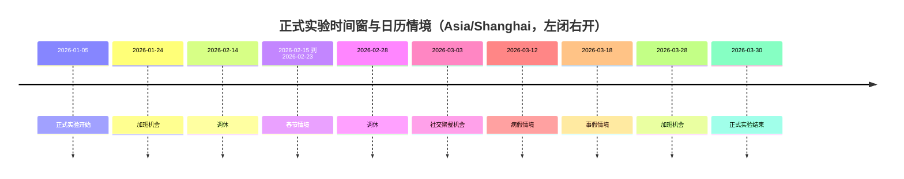

> 历史记录：本文件保存提交 `72f004b0087efa1b6f6d662ac6a143e087e4e21c` 时的过程与判断，不再定义当前系统。
> 当前设计见 [文档入口](../../INDEX.md)；正文中的路径、规则和结果按当时上下文理解。

# 张江白领十二周实验记录

## 实验身份与范围

本次实验运行在 AgentSociety 2（下称 AS2）之上：由 AS2 调度进程并提供模型服务，驱动一个数字人过日常生活；这一过程产生的可追溯记录构成数字足迹，认证导出交给 LabelKit-DataSet 加工。本文件只绑定城市、职业、日期、模型、内容、身体参数和评估参照。

| 项目 | 冻结值 |
| --- | --- |
| 仿真类型 | 单机 AS2 原生 Ray actor 与人物 runner；正式单人物十二周，同时交付多人测试与实际短运行 |
| 正式日期 | Asia/Shanghai，2026-01-05 00:00:00 到 2026-03-30 00:00:00，左闭右开，共 84 天 |
| 人物共同背景 | 白领；生活区为上海张江生活区，工作园区为张江高科技园区；与基线数据对齐到可证明的程度 |
| 未共同定义的属性 | 年龄、工资、初始存款、身体参数单独声明为新实验假设，不能当作基线数据已匹配条件 |
| 场景定义 | `../WorldMock-Dataset/environment/zhangjiang-baseline/scenarios/single-person.json` |

本文件绑定的全部能力均属于本次交付：不使用占位实现、跳过测试、延期清单或旧入口维持表面可用；接口穿刺是实现顺序，不是缩小最终范围。正式仿真不预设与基线数据相同的事件数量或意图比例——人物根据可见内容、需求、合同和记忆做出选择，消息等预排事件只陈述真实到达边界，食品店铺固定全天服务，不编写人物每天必须执行的活动序列。场景可以按人物声明工作安排（每周班次、日期例外与休息时段）：它由环境按世界时钟求值后作为事实呈现，不新增拒绝，也不编写班内必须执行的活动。依赖导入、原生工具调用和一个完整决策必须真实通过，才允许进入后续完整链路。

### 环境发布与运行身份

现行身份是目录格式 2、`RULES_VERSION = 2`、场景结构 8、世界结构 11、运行清单 4。
运行、检查点与恢复使用五字段 `environment_identity`：`environment_id`、`environment_version`、
`rules_version`、`catalog_content_sha256`、`map_sha256`。
规则文件只从引擎包读取，环境不发布副本，也不添加规则哈希；`code_sha256` 额外覆盖 `src/worldmock/data/` 下每个文件。
旧格式与旧结构号直接拒绝，不迁移、不双读。

环境由数据仓发布，WorldMock 只保留人工环境；完整回归显式传入重制环境的 `--environment-root`。
类别、使用方式、效果与供给表由系统固定，内容标题与摘要来自目录。历史模型运行和导出不改写，也不证明当前版本的新运行。

## 时间窗与日历情境

正式时间窗为 Asia/Shanghai 的 2026-01-05 00:00:00 到 2026-03-30 00:00:00，左闭右开，共 84 天；场景定义文件的 `start_at` 与 `end_at` 与该窗口一致。

日历情境只改变机会与约束，不保证人物执行；春节情境同样只改变机会与约束。

## 基线数据参照

基线数据指 Dataset-Person 中更早的一次张江白领十二周运行，只作为外部参照，不构成对本次仿真的事先约束。

| 项目 | 值 |
| --- | --- |
| 基线数据来源 | Dataset-Person 的 `archive/white-collar-12-weeks-deepseek16-glm52/repaired/` |
| 基线数据验证 | 原 manifest、修复报告和最终审计共同验证 |
| 基线数据身份 | run `ec5742eff472d320dac4f98c6d1fd478`；main 4,380 行、stream 16,320 行、84 个自然日 |

## 实验假设声明

以下参数为实验假设，不宣称来自已验证的人类生理或心理模型：

- 睡眠对食品利用效率的影响。
- 工作效率与睡眠不足的关系。
- 娱乐需要增长与减少规则。
- 社交需要增长与减少规则。
- 重复接触对娱乐效果的影响。
- 低能量显示：能量低于 100 kcal（`APPETITE_STARVING_KCAL`）为「饿得发慌」。
- 路线费力的 MET 分界与商品热量的取整（见「能量感知标签」）。
- 能量对工作效率的影响（见「效率曲线」）。
- 初始睡眠压力按惯常起床时刻反推。
- 联系人回复延迟 `CONTACT_REPLY_DELAY_SECONDS`，缺省 300 秒。
- 思考只在同一秒的连续决策之间回传，时间推进后丢弃。
- 记忆层 JSON 至多 8000 字符的窗口。
- 本人位于联系人的收货地点即视为与该联系人同处（给予的同处条件）。
- 受限轮用完仍无进行中活动或仍有待收尾活动时的技术停顿，身体按静息结算。
- app 使用的娱乐缓解只取当前内容类型的固定每小时速率，不乘人物口味、不设下限，也不按接触次数递减。
- 困意档界的 KSS 等价刻度标定：`K = 7 + 7.6 · (困意 − 1)`，斜率 7.6 由 Shochat 等 2021 的两个锚点对三个人物的工作日稳态拟合（得 7.47–7.81）；
  在 K = 5.5、6.5、7.5、8.4 处切出档界 0.80、0.93、1.07、1.18（该规格 1.4）。
- 饥饿为「饿」时，离平常饭点一小时以内可以提前准备或下单：一小时覆盖外卖 20–40 分钟的送达，敏感区间 30–120 分钟（该规格 2.2，系统层第 15 条）。
- 名称类拒绝每人每秒至多 2 次不计同刻轮数、不施加情绪脉冲，第 3 次起照常（该规格 3.4）。
- 当日目标大致时刻的推进容差为前后 90 分钟（`GOAL_TIME_TOLERANCE_SECONDS = 5400`），敏感区间 60–120 分钟，复跑后按数据校准（该规格 8.2）。
- 个人事务的容量上限：每人未完成事务至多 8 条，一次请求至多 4 条变更，名称至多 30 字符，备注与取消原因各至多 120 字符，数量 1 至 9；
  待办层不浓缩，上限由校验执行，不静默截取、不自动合并（[个人事务与工作安排规格](../../design/10-runtime.md) 2.1）。

| 简化规格新增假设 | 当前值或生效边界 |
| --- | --- |
| 食品类别常数 | snack 200 千卡，drink 100 千卡，meal 600 千卡每份；没有食用秒数 |
| 出行速度与车费 | 步行 1.2、驾车 7.0 米/秒；驾车至少 500 分、每米 0.2 分向上取整 |
| 配送 | 5.0 米/秒、备餐 600 秒、500 分/单 |
| 地图生成器 | 至少两节点，先树后补 ⌊(n−1)/2⌋ 边，边长 200–2000 米，规则版本 1 |
| 推送窗口 | 当地时间每日 08:00 至 21:00 的每个整点；重复当地小时取 `fold=0`，不同网格点映射到同一绝对秒时两项都保留 |
| 娱乐缓解 | ENTERTAINMENT_RELIEF_PER_HOUR 固定 0.3 娱乐需要单位/小时 |

这些数值以 `RULES_VERSION` 冻结，依据见[资源与规则引擎简化规格](../../design/02-exchange-engine.md)。

| 动作与内容简化新增假设 | 固定值 |
| --- | --- |
| `GOODS_RECEIPT_EFFECTS` | leisure 每条订单行缓解娱乐需要 0.10，daily 每条订单行情绪 +0.05 |
| `CATEGORY_MET` | exercise 5.0、daily_care 2.0；其他类别取现有代谢值 |
| `CONTENT_MIN_SECONDS` | 60 秒，内容登记下限，无上限 |
| `FUEL_DRIVING_DAYS` | 本人现场加油每笔实际收货增加 7 个驾车可用日；每个有正驾驶秒数的本地日期扣 1 日，同日不重复扣 |
| 长途运送边界 | 完整报价严格大于 86400 秒时到家庭最近驿站；到站只通知，本人领取才收货。环境声明 shipping_seconds 或明确为 null，不重算末端报价 |

## 验收范围与外部参照

工具交互修订已实现，必须按[工具交互特性门禁](../../design/01-architecture.md)补齐生产行为与独立变异证据。
错误、查询、完整通知、类别供给和两份种子地图的确定性验收不能用真实模型的个别成功调用替代，
跨时刻重复拒绝、提示容量与任务等待时间只按冻结报告口径统计，不追加未经支持的数值门槛。

个人事务与工作安排修订按[个人事务与工作安排特性门禁](../../design/01-architecture.md)验收；
个人事务、收尾记忆、工作负荷、作息偏离与查询成本只按冻结报告口径统计，不追加数值门槛，配对全天复跑只报告。

最后的验收对象包括 AS2、LifeEnv、完整数据生产及真实性评估。外部参照的人群适用性、模型自身选择与来源数据的局限都要如实交代，不得掩盖缺失的实现。
