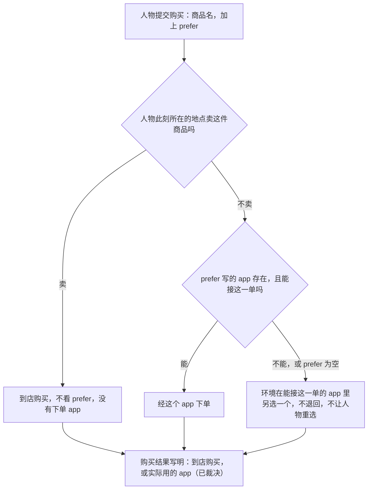

# 首次真实模型单日运行：问题与修复提案

> 状态：已冻结。所有者 2026-10-12 第三轮答复「没问题，按你说的来」，十八行事项全部照建议裁决，据此写规格；本文不改变任何现行行为，代码一行未动。
> 日期：2026-10-12。
> 来源：issue 13（环境合同修订后第一次真实模型单日运行）和所有者 2026-10-12 的三轮答复。
> 第二稿按所有者第二轮的三条意见重写：购买时用 `prefer` 写想用的 app；删除 `query_world`，查询改成一个花时间的动作；
> 晚上在家看起来零碎的归因更正为数据集的内容标题和查看器的显示。
> 代码基线：主干提交 `79304ff7`。运行用的是 `b7efdf01`，其后主干只改了三个源文件，与本文各项无关。
> 证据：这次运行的完整轨迹（数据集仓库提交 `c28268a` 里的 `footprints.sqlite`，sha256 与仓库登记值一致），读了模型每次决策收到的提示、思考原文和环境结果；
> 六个只读的核查子任务逐条给出了文件行号，写完后又由五个子任务对照代码和轨迹核对了一遍，查出的问题已改入本稿；另有本机离线复现三处。没有新的模型调用。
> 叫法：「人物」指被模拟的林悦；「一次决策」指环境请人物选下一步的一次模型调用；
> 「收尾」指人物用一次决策写下总结、结束一项已经做完的活动，今天任何活动做完都要先收尾才能做下一件事；
> 「进度层」「记忆层」「工具层」「系统层」是提示里的几个分层，名称与设计文档《人物》一致。
> 读法：正文保留讨论时的写法（「我建议」「请裁决」）。定下来的做法以「裁决结果」一节和文末「裁决清单」为准。

## 裁决结果

所有者 2026-10-12 第三轮答复：「没问题，按你说的来，frozen文档」。文末清单的十八行全部照「我的建议」一栏裁决；
正文里我按最省事的做法处理、没有单列的几处，所有者没有提出不同意见，一并照此执行。定下来的做法汇总如下，规格据此编写。

**购买**

| 情形 | 定下来的做法 |
| --- | --- |
| 请求怎么写 | `start_side_activity` 多一个 `prefer`，每次都要写。购买时写想用来下单的内容 app，没有意向写 `null`；打开 app 时必须是 `null` |
| 人在卖这件商品的地点 | 营业就到店购买，不看 `prefer`，没有下单 app。已打烊照今天的规则拒绝 |
| `prefer` 用得上 | 这个 app 存在，且此刻有营业、卖这件商品、登记了这个 app 的店：在这些店里照今天的选店规则选一家，经这个 app 下单。可以因此换到更远的店 |
| `prefer` 用不上或为空 | 照今天的规则选店、抽 app（同一家店同一天同一个 app）。不退回，不让人物重选 |
| 只在 app 里卖的快递商品 | `prefer` 在商品登记的 app 之内就用它，否则照今天的规则抽 |
| 一次买多件 | 每件商品各自判断，可能多出一张订单 |
| 人物读到什么 | 购买结果写明实际用的 app，到店购买写明是到店。工具层列出可以写进 `prefer` 的 app 全名 |

**查询**

| 情形 | 定下来的做法 |
| --- | --- |
| 接口 | 删除 `query_world`。`start_side_activity` 新增 `query` 动作，是第五种活动，占槽位 2，时长由系统在 300 到 600 秒之间抽，不能暂停 |
| `target` | 商品名或商品类别名。写不对当场拒绝，不花时间 |
| `prefer` | 想在哪个 app 里查。它存在且卖其中至少一件：这几分钟它在前台，答案只列经它能买的。否则环境在卖这些商品的 app 里选一个放到前台，答案列出全部途径。答案里写明是在哪个 app 里查的 |
| 答案 | 查询做完时给，按做完那一刻的世界算。每件商品每家店一行，写店名、这家店能用的 app、价格、运费、预计送达、此刻能不能买。一次最多 20 件，能买的在前，再按送达先后。留到这段停留结束。中途结束的查询没有答案 |
| 做完之后 | 查询自己结束，不需要收尾，人物在这次决策里就能接着下单 |
| 人在路上 | 不能查询，与出发同一次回复里提交的也不行；查询没做完要出发，得先结束它 |
| 打开 app | 不再附带商品清单。没有内容的购物 app 不能再单独打开，只在下单和查询时出现；app 目录的浏览时长字段删除，数据集仓库重新发布环境包 |
| 人物读到的规则 | 系统层写明打开 app 只是看、买东西只有购买、不知道买什么先查询。草稿见正文，定稿写进规格 |

**显示**

查看器、导出的一天时间线、`inspect_run.py` 和人物零点做计划时读到的句子，统一成正文[提议的统一写法](#提议的统一写法)那张表的写法，名称从运行冻结的环境目录取。

**其余**

| 事项 | 定下来的做法 |
| --- | --- |
| 活动做完后人物看不到看了什么 | 修。第二条结果带上内容的标题、简介、时长，连播的各集都列出 |
| 与出发同一次回复里开始的 app 使用，在路上没有记录 | 修。记录跟着人物进入路上那一段。这一条没有单列在清单里，随整体同意一并采纳 |
| 打开一次内容 app 只看一条短内容就结束 | 处理，让一次打开成为一段连续的使用。具体做法本文没有定，在规格里提出后请所有者确认 |
| 提前结束的事 | 在地点做的事「结束」就算做完，只有「暂停」才保留进度；app 里的内容不变 |
| 地点里做的事能不能解饿 | 数据集给地点里的每一件事、系列里的每一集写明供不供一餐，必填，引擎不补值 |
| 思考额度 | 每次决策的输出上限从 8,000 提到 16,000。截断后的重试保持现状 |
| issue 的十条缺陷 | 照[已同意修复的缺陷](#已同意修复的缺陷)的方案修 |
| 作者手册 | 照[作者手册要补的规则](#作者手册要补的规则)补 |
| 不改的 | 导航 app 的前台仍是出发到到达；食品仍然到手即吃，没有库存 |

## 结论先看

1. **购买。** 按所有者的意见，人物在 `start_side_activity` 里多写一个 `prefer`，说明想用哪个 app 下单；人在卖这件商品的地点时直接到店买；意向用不上时环境悄悄另选。
   引擎今天是先定店、再在这家店登记的 app 里抽，所以「商品没有绑定这个 app」有两种算法。所有者裁决为可以换店。
2. **查询。** 按所有者的意见，删除 `query_world`，新增 `query` 动作，花 5 到 10 分钟，打开 app 不再附带商品清单。
   核对发现 `query_world` 今天回答不了「商品从哪家店来、能经哪个 app 买」。所以查询的答案是新内容，有几处当时没有定义，现已裁决：答案什么时候给人物、查完能不能马上买、手机上这几分钟显示什么、没有内容的购物 app 还能不能打开。
3. **「开始结果」和「结束结果」** 指环境对同一次请求先后写下的两条结果，人物只看得到最新的一条。下一节用咖啡的例子讲清，新的查询动作正好踩在这一点上。
4. **晚上在家。** 更正上一稿的归因：问题是数据集里短内容的标题读起来像动作，而查看器和导出的时间线都不写 app 名，
   于是「在哔哩哔哩看到一条叫《散步装备准备》的内容」被读成「在家准备散步装备」。
5. issue 列的十一条缺陷，十条在主干上成立，一条（加载时的 Pydantic 警告）还没能复现，方案见[已同意修复的缺陷](#已同意修复的缺陷)。

十八行事项已全部裁决，见[裁决结果](#裁决结果)和文末[裁决清单](#裁决清单)。

## 先讲清两个词：开始时的结果和结束时的结果

所有者说没看懂这两个词。它们不是新概念，就是环境对同一次请求先后回的两句话。用咖啡那次请求来看：

| 时刻 | 发生的事 | 人物看得到吗 |
| --- | --- | --- |
| 08:46:00 | 人物提交「打开瑞幸咖啡」。提交即结束这次决策 | |
| 08:46:00 | 环境受理，写下**第一条结果**：已开始，计划 3 分钟，附商品清单（冰美式咖啡 22 元，运费 5 元，预计 09:11 到） | 看不到。人物要到下一次决策才读提示 |
| 08:49:00 | 活动做完，环境写下**第二条结果**：已完成 | |
| 08:49:00 | 轮到人物决策。进度层对这次请求只显示最新的一条，也就是第二条：「已完成，明细为空」 | 只看到第二条 |

上一稿说的「开始结果」是第一条，「结束结果」是第二条。两个事实决定了后果：

- **人物通常读不到第一条。** 提交之后有活动在进行，下一次决策要等到这项活动结束、饿感变化、整点推送这类时刻。三五分钟的活动，下一次决策几乎总是在它结束的那一秒。
- **第二条里今天只有订单和到达。** 内容的标题和简介、商品清单、计划时长都只在第一条里，活动一结束就从人物眼前消失。

午饭那次人物看到了清单，是因为浏览到一半被饿感变化叫了起来，那时最新的还是第一条。

这对新设计有直接影响：查询要花 5 到 10 分钟，人物在查询做完时才再次决策，所以**查询的答案必须写在第二条里**，否则会重演咖啡那一幕。

## 购买：用 `prefer` 写想用的 app

所有者的设计：

- `start_side_activity` 新增 `prefer` 字段。购买时人物可以在里面写想用的内容 app，系统优先经这个 app 生成购买记录。
- app 不存在，或商品没有绑定这个 app，就悄悄在合法的 app 里随机选一个。
- 人物当前所在的地点已经在卖这件商品，就不看 `prefer`，直接在所在地购买。

最后一格不是所有者的原话。所有者说的「静默」我理解为不退回、不让人物重选；实际用的 app 只作为事实写在购买结果里。所有者已确认这一理解。

### 引擎今天怎么做

| 事 | 今天 |
| --- | --- |
| 购买请求里有什么 | 只有动作和商品名。请求里原来有 `app` 字段，10 月 9 日实现环境数据集合同时删掉了；设计文档《概述》写的是「人物不选渠道」 |
| 下单 app 怎么定 | 先定店：在营业、且登记了至少一个 app 的店里，取价格加运费最低的，同价取最近的。再在这家店登记的 app 里抽一个，抽取只看店铺和当地日期，所以同一家店同一天总是同一个 app |
| 店和 app 的关系 | 商品绑定的是店铺种类，店铺再各自登记 app。**商品和 app 之间没有直接的绑定**，除了下一行这一类 |
| 只在 app 里卖的商品 | 商品直接登记 app，一律走快递到离家最近的驿站，人在路上也能下单。在登记的 app 里按商品和日期抽，运费（0 或 5 元）和到货天数（2 到 5 天）随 app 不同 |
| 人在卖这件商品的地点 | 营业就到店买，没有下单 app，整次购买 1 到 5 分钟里至多最后 10 到 20 秒是支付 app。**已打烊则整次购买被拒**，不会改成外卖 |
| 能下单的 app 是哪一类 | 全部是内容 app。功能 app（支付、导航）不能接单。所有者说的「内容 app」与目录的叫法一致 |
| 人物知道用了哪个 app 吗 | 不知道。工具层、购买结果、记忆、通知都不写。《概述》《模拟引擎》《记录引擎》《人物》四份设计文档都写明这是有意的 |

### 设计里还没定义的地方

**意向 app 能不能让订单换一家店。** 这是最要紧的一处。示意：人物在办公室买冰美式，`prefer` 写「瑞幸咖啡」；最近的咖啡店只上了美团外卖，远一些的另一家上了瑞幸咖啡。

- 不换店：店照今天的规则选最近的那家，它没上瑞幸咖啡，意向作废，手机上是美团外卖。
- 可换店：先在上了瑞幸咖啡的店里选，订单从远的那家送来，晚一些到，手机上是瑞幸咖啡。

我建议可换店。人设里「用瑞幸咖啡点」的意思就是从瑞幸的店下单；不换店的话，意向能不能兑现取决于人物看不到的选店结果。代价是实际的送达时间和工具层商品行上显示的可能不同，以购买结果为准。

**一次买多件。** `prefer` 只有一个值，而一次购买可以写好几件商品，来自不同的店。我建议每件商品各自判断：能走意向 app 的走它，不能的另选。
这样一次购买可能多出一张订单：各付一次款，各有一段付款时间和一组「订单已下单」「支付成功」通知。运费今天就按店铺收，不同店的商品本来各收一份。

**人物要不要知道实际用了哪个 app。** 意向用不上时环境悄悄另选，而人物自己写的 `prefer` 会一直留在它的进度层里。如果购买结果不写实际的 app，人物会照着自己的请求记下「在瑞幸咖啡下了单」，手机上却是淘宝闪购，午饭那次的错位就会原样再现。
所以我建议购买结果写明实际用的 app；到店购买时写明是到店。所有者上一轮对这件事答了「ok」，我按同意理解，所有者已确认。

**`prefer` 写得不准。** 按所有者的裁决悄悄另选，不退回候选。系统层现有一句「写得不准会返回候选，不会替你更改」，地点、内容 app、在地点做的事都照这句处理（商品名找不到时今天是直接拒绝，不给候选）；这句话要加一个例外，说明 `prefer` 只是意向。
这个裁决有一个要知道的代价：`prefer` 写得不准不会有任何提示。这次运行里人物自己写计划时用的是「用瑞幸点一杯冰美式」「用美团点午饭」；照这样把「瑞幸」「美团」写进 `prefer`，它们都不是登记的 app 名，订单会落到别的 app，人设里的习惯悄悄落空，人物要看购买结果才知道。
所以需要让人物看得到能写的全名：工具层列出可以写进 `prefer` 的 app 名称，系统层写明照列出的名称写。

下面几处我按最省事的做法处理，不单独列入清单。所有者没有提出不同意见，照此执行：

- `prefer` 每次调用都要写，没有意向写 `null`。模型的工具格式不允许可省略的字段，槽位 1 的开始工具里 `detail` 就是这样处理的。
- 打开 app（`interact`）时 `prefer` 必须是 `null`，写了别的按参数错误退回，与睡觉时 `detail` 必须为 `null` 一致。
- `prefer` 里的名称先做和其他名称相同的规整（去掉多余空格、全角半角），再判断存在不存在。
- 另选时沿用今天的抽取：同一家店同一天抽到同一个 app。
- 人在卖这件商品的地点而它已打烊时，照今天的规则拒绝并告诉人物这里关门了。
- 购买请求被退回并附带可以照抄的纠正写法时，`prefer` 照人物写的原样带上；纠正写法改成打开 app 时，`prefer` 写 `null`。

## 查询：`query` 动作取代 `query_world`

所有者的设计：

- 看商品不该只有打开 app 这一条路。删除 `query_world`，给 `start_side_activity` 新增 `query` 动作，`target` 写人物想查的内容。
- 打开 app（`interact`）不再负责显示商品清单。
- 查询的时长由系统随机，5 到 10 分钟。

### `query_world` 今天能做什么

| 事 | 今天 |
| --- | --- |
| 怎么用 | 决策过程中随时问，当场得到答案。不花模拟时间，不占槽位，一次决策可以问多次 |
| 怎么筛 | 按完整名称、按动作、按四个商品类别（零食、食品、饮料、商品），每页 20 行，可以不花时间地翻页 |
| 查一件商品返回什么 | 价格、购买耗时「1–5 分钟」、份数、此刻能不能买及原因、运费和预计送达。没有店铺字段，也没有 app。只有一种情形会带出地点：此刻送不了的商品，原因里写着最近一家有售的地点 |
| 查不到的 | 只在 app 里卖的快递商品。它们今天只出现在打开 app 时附带的商品清单里 |
| 只有它和商品清单能给的 | 工具层这一次没列出的商品（工具层每次只列约 20 件）的价格和可买性，以及某个类别的全部商品。这次运行的环境包里食品 58 件、饮料 145 件、零食 193 件 |

所有者说这个接口应该能直接查商品在哪里卖。今天它只在商品送不了时点出最近一家有售的地点；能送的商品不说从哪家店送，任何情形都不说能经哪个 app 买。所以「从哪家店、经哪个 app」是新查询要新增的内容，不是搬过来就有。

### 改成花时间的动作之后，代价是什么

| 事 | 今天 | 改后 |
| --- | --- | --- |
| 查一次 | 当场得到，不花时间 | 5 到 10 分钟 |
| 查完再买 | 同一次决策里查完就买 | 已裁决查询自己结束、不需要收尾：两次决策，查完那次决策里就能买。两种做法的差别见下面一段 |
| 查的时候能做别的吗 | 能 | 占着槽位 2。这期间不能用内容 app，不能购买，不能睡觉；正在看视频时要先暂停或结束才能查 |
| 看一个类别的全部商品 | 能，每页 20 行翻页，不花时间；打开购物 app 也会附上它的全部商品 | 不能。已裁决一次最多 20 件，其余靠写出商品名查到 |
| 系统层的话 | 「查询只读，不推进时间」「提交前可以查询记忆、回看任务或查询世界」 | 回忆和回看任务仍然当场完成；查商品要花时间。这两句要改写 |

**查完再买要多久**，要分人物当时有没有同时在做地点里的事（上班、做饭、休息）：

- 没有同时做别的事：查询做完，人物收尾，同一秒再决策，下单。三次决策，付款在想买之后 6 到 15 分钟。
- 同时在做别的事，这是更常见的情形：查询做完，人物收尾。因为还有活动在进行，环境不会在同一秒再请它决策，要等下一个叫它的时刻。这次运行里这样的间隔有 10 次，最短 1 分钟，最长 28 分钟，多数 5 到 8 分钟（例如 08:49 给瑞幸咖啡收尾后，下一次决策在 08:55）。下单从那时才开始，答案里的预计送达到那时已经过期。

如果查询做完不需要收尾，人物在查询做完的那一次决策里就能直接下单，两种情形都是两次决策。

人设里已经写明「用瑞幸咖啡点冰美式」的事不需要查询，一次购买加 `prefer` 就够。查询只在人物不知道买什么、在哪买时才用。

### 我建议的查询长什么样

每一点都列在裁决清单里，已全部照此裁决。

| 方面 | 建议 |
| --- | --- |
| `target` 写什么 | 商品名或商品类别名的数组。类别名不在四个之内按参数错误退回并列出四个允许值；商品名找不到照今天购买的规则直接拒绝，不给候选。两种退回都不花时间。不支持「附近哪里能买咖啡」这样的自由文字，引擎没有按意思检索的能力 |
| `prefer` 写什么 | 想在哪个 app 里查。这个 app 存在、且卖查询里的至少一件商品：这几分钟它在前台，答案只列经它能买的，它不卖的商品各写一行「这个 app 里没有」。没写、app 不存在、或它一件都不卖：环境在卖这些商品的 app 里选一个放到前台，答案列出全部途径。答案开头写明这次是在哪个 app 里查的。查的商品只能到店买、没有任何 app 卖时，这几分钟手机上没有 app |
| 答案什么时候给 | 查询做完时，写在第二条结果里，按做完那一刻的世界计算，离人物读到它的时刻最近。中途结束的查询没有答案，记录里写明「没有查完」 |
| 答案里有什么 | 每件商品，每家此刻营业、卖这件商品的店各一行（人在这家店里是到店，否则是外卖），只在 app 里卖的商品一行快递：商品、途径、哪家店、这家店能经哪些 app、价格、运费、从这家店送来的预计送达、此刻能不能买及原因。「意向 app 能不能让订单换一家店」裁决为不换店时，外卖只列最近的那一家 |
| 列多少 | 一次最多 20 件商品，按固定次序：此刻能买的在前，再按预计送达先后。超出时写明还有多少件没列，其余只能靠写出商品名查到 |
| 留多久 | 和进度层其他记录一样，留到这段停留结束 |
| 时长 | 300 到 600 秒之间的整数秒，每次查询抽一次，受理时定下。不能暂停 |
| 做完之后 | 查询自己结束，不需要收尾，人物在这次决策里就能接着下单 |
| 人在路上 | 不能发起查询，与出发同一次回复里提交的也不行；查询没做完时要出发，得先结束它，没有答案 |

答案的样子，示意（店铺登记了哪些 app 以数据集为准）：

| 商品 | 途径 | 哪家店 | 可用的 app | 价格 | 运费 | 预计送达 | 此刻 |
| --- | --- | --- | --- | --- | --- | --- | --- |
| 冰美式咖啡 | 外卖 | 瑞幸咖啡（金泽古镇店） | 瑞幸咖啡、美团外卖 | 22 元 | 5 元 | 09:14 | 可以下单 |

改后三种常见情形：

| 人物想做的事 | 怎么做 | 手机时间线 |
| --- | --- | --- |
| 照习惯用瑞幸咖啡点冰美式 | 一次请求：购买「冰美式咖啡」，`prefer` 写「瑞幸咖啡」 | 整次购买 1 到 5 分钟，付款包在里面：先是瑞幸咖啡在前台，最后 10 到 20 秒付款（抽到支付 app 时是它在前台，直付时仍是瑞幸咖啡），付款那一秒起是订单通知 |
| 不知道午饭吃什么，想在美团外卖上看看 | 查询「食品」，`prefer` 写「美团外卖」；做完后购买选中的那件，`prefer` 写「美团外卖」 | 美团外卖 5 到 10 分钟，接着美团外卖下单 |
| 人在瑞幸门店里买冰美式 | 购买「冰美式咖啡」 | 没有下单 app，至多 10 到 20 秒的支付 app |

### 没有内容的购物 app 还能不能打开

这是新设计里最容易重演咖啡事故的一处。瑞幸咖啡、美团外卖、盒马这样的 app 没有登记任何内容，今天打开它们唯一的产出就是那张商品清单。
清单拿掉之后如果仍然能打开，人物得到的是：手机上 3 到 10 分钟的前台、一条「已完成，明细为空」的结果、没有订单。这正是它当初以为自己点了咖啡的情形。

我建议这类 app 不再能用 `interact` 打开：

- 它们从「可以打开的 app」里去掉，仍然保留在目录里。工具层另列一组「下单和查询时可以写进 prefer 的 app」，人物从这里看到它们的全名。
- 人物仍然写「打开瑞幸咖啡」时退回，并告诉它：这个 app 用来下单，购买时把它写进 `prefer`，想看商品用查询。
- 既有内容又卖东西的 app（例如淘宝闪购：它登记了内容，这次运行的午饭也是经它下的单）照常打开，只看内容。它卖的东西通过查询看到，通过购买加 `prefer` 买到。
- app 目录里的 `browse_duration_seconds`（浏览时长）字段随之删除。这是数据集要跟着改的格式变化：现有环境包声明了这个字段，改后加载会被拒，数据集仓库要重新发布。

### 导出里多一种活动

今天活动只有四种：睡眠、出行、互动、购买。引擎、导出、评估、查看器，以及数据集提醒规则里可以写的活动种类，都按这四种写死。
查询是有起止时间、占槽位的活动，会成为第五种。世界状态和导出各自的格式版本号要动，读导出的下游（LabelKit-DataSet）要认识这种新活动。

### 人物读到的规则（草稿）

所有者上一轮已裁决：系统层要写明打开 app 只是看、买东西要另起购买，并教会人物先看后买。本稿沿用，按新设计写成下面这段，购买和查询一起讲：

> 用内容 app（interact）只是看这个 app 里的内容，不显示商品，也不会下单；看到的内容像菜单或商品介绍，也不等于买了。
> 买东西只有 purchase：逐份写商品名。在 prefer 里写想用来下单的 app，照工具层列出的名称写，没有想法就写 null。你所在的地点就卖这件商品时直接到店买；那个 app 接不了这一单时环境另选一个，不会退回。实际是到店买的还是用了哪个 app，写在购买结果里。
> 不知道买什么、在哪买，用 query：target 写商品名或类别名，prefer 写想在哪个 app 里查，没有就写 null。查询要 5 到 10 分钟，占槽位 2，不能暂停；答案在查询做完时才写进这次请求的结果，中途结束就没有答案。查询不下单，要买再用 purchase 写答案里的商品名。

## 晚上在家：更正后的归因

所有者的更正：晚上看起来琐碎、无厘头，实际的问题是数据集准备的内容标题不像内容标题，更像一个动作；另外查看器的显示有误导，动作写的是互动，内容写的是「散步装备准备」，让人以为人物在家里准备散步装备，而不是在看 app。

我核对了轨迹和三处显示代码，更正成立。上一稿把它归为几条引擎规则叠加，方向错了。

### 数据集：标题读起来像动作

这晚哔哩哔哩和微信里被环境挑中的短内容，标题是：

| app | 标题 | 时长 |
| --- | --- | --- |
| 哔哩哔哩 | 散步装备准备 | 90 秒 |
| 哔哩哔哩 | 雨天出门准备 | 150 秒 |
| 哔哩哔哩 | 拼图边框练习 | 150 秒 |
| 哔哩哔哩 | 家庭合照挑选 | 90 秒 |
| 哔哩哔哩 | 冰美式制作小记 | 150 秒 |
| 哔哩哔哩 | 桌面物品拍摄 | 120 秒 |
| 哔哩哔哩 | 骑行头盔检查 | 90 秒 |
| 微信 | 亲子阅读角 | 90 秒 |
| 微信 | 旅行行李清单 | 90 秒 |

同一晚的长内容标题就没有这个问题：《回家吃饭》20160208、《美丽中国 自然》秦岭系列、晚间歌单·老歌回顾。
推送里也有同类标题，例如朴朴超市的「家庭清洁用品选择」，简介是「围绕家庭清洁用品选择完成本次整理超市购物清单，按实际经过的时间记录进度」，写的是一件要做的事。

这归数据集仓库改。按既有裁决引擎不替数据集把关，不加检查；作者手册补一句：app 里的内容，标题要写成这个 app 里会出现的一条内容的标题。

### 显示：分不清是在 app 里看，还是在地点做

在家做的「早上洗漱」和在哔哩哔哩里看到的「散步装备准备」，在记录里是同一种活动（互动）带一个标题，唯一的区别是有没有 app。几处显示都没有把这个区别写出来：

| 哪里 | 用 app 看到一条内容 | 在地点做一件事 | 购买 |
| --- | --- | --- | --- |
| 查看器的时间线、活动泳道、活动表 | 互动 · 散步装备准备 | 互动 · 早上洗漱 | 购买 · — |
| 导出的一天时间线 | 互动《散步装备准备》 | 互动《早上洗漱》 | 购买 |
| 人物零点做计划时读到的「已核验经历」句 | 9月28日 19:52–9月28日 19:53 进行《散步装备准备》 | 9月28日 08:01–9月28日 08:15 进行《早上洗漱》 | 不适用 |

几点事实：

- 查看器里，带内容的 app 使用在受理、活动段、泳道、活动表上都只有标题。app 名只在别的行出现：开始请求（人物自己写的目标）、收尾请求里的活动名「进行哔哩哔哩（…起）」、地点会话表、app 推送行。
- 没有内容的 app 相反：查看器的活动行写「互动 · 瑞幸咖啡」，导出时间线只写「互动」。
- 导出的时间线其实写好了「使用哔哩哔哩《…》」这种写法，但名称是从观察记录里的几组字段取的，这些字段引擎已经不写了，所以这个分支在真实运行里从不生效。这就是 issue 里「时间线不解析名称」那条缺陷，两件事是同一处。
- 购买的活动行不写商品，也不写下单的 app；商品名只在请求行和结果行里。查看器里手机事件那几行（app 前台区间、订单通知）不写 app 名。结果行上的支付 app 因为记录里没有功能 app 的名称，显示成「名称缺失」。
- 第三行是给模型看的。零点计划的输入里同一次使用出现两处：「已核验经历」写「进行《散步装备准备》」，不带 app 名；「动作结果」写「进行哔哩哔哩（9月28日 19:52 起）：…，按计划结束，《散步装备准备》」，带 app 名，记忆层也是后一种。模型并非读不到 app，这次生成的次日计划没有把标题当成动作；问题是两处写法不一致，前一处单看会被读成在做这件事。
- 英文原词 `interact` 只出现在查看器「上下文」画面的工具层列表和展开的原始 JSON 里。所有者看到的若是别的画面，请指出。

### 提议的统一写法

| 情形 | 改后 |
| --- | --- |
| 用 app 看到一条内容 | 使用哔哩哔哩《散步装备准备》 |
| 一次使用里连播了几集 | 同一行依次列出各集标题 |
| 在地点做一件事 | 在淀山湖大道东渡悦来城公寓：早上洗漱 |
| 购买，经 app 下单 | 购买冰美式咖啡（经瑞幸咖啡下单） |
| 购买，到店 | 购买冰美式咖啡（到店） |
| 查询（新增） | 查询冰美式咖啡（瑞幸咖啡） |
| 手机事件 | app 前台 · 淘宝闪购 · 下单；订单通知 · 淘宝闪购 · 订单已送达 |

名称从这次运行冻结的环境目录里取（运行目录里按运行清单登记的 app、内容、商户目录），功能 app 的名称也取得到；购买行另经订单记录取到商品和下单的 app。
查看器今天只读一个数据库文件，库里没有功能 app 的名称，所以查看器要一并读运行目录里的这几份目录文件。查看器「上下文」画面里的 `interact` 换成中文。
这套写法改到哪几处，代价不同。所有者裁决为查看器、导出时间线、`inspect_run.py` 和人物读到的句子一起改。

### 改标题和改显示之后还剩什么

这一晚读起来不再像一串琐事，但手机时间线上的时段不变：哔哩哔哩每打开一次只放一条内容就结束，19:52 到 22:52 之间仍是七段 90 到 150 秒、彼此隔开的前台。
人物自己也把它记成了问题（当晚的自述：「零碎地点开几次，每次只看两三分钟…还把睡前时间切得七零八落」），并写进了第二天的计划（「避免在短视频上反复起停」）。
按所有者的更正，这不是晚上看起来无厘头的原因；它是否要处理在清单里单列了一行，所有者裁决为处理，做法在规格里提出。

### 上一稿那几条原因怎么处理

| 上一稿说的原因 | 现在怎么处理 |
| --- | --- |
| 打开内容 app 看到什么由环境挑，挑到的多是两分钟短片 | 作为「看起来无厘头」的解释撤回。事实成立，见清单「打开一次内容 app 只看一条短内容就结束」。上一稿建议的做法随之撤回，方案另提 |
| 看完之后人物不知道自己看了什么 | 事实成立，是缺陷，见清单「活动做完后保留该让人物知道的事」 |
| 每条内容结束都要先收尾、再决策 | 不再单独处理。它和查询的关系见清单「查询做完要不要先收尾」 |
| 「在家休息」留下一两分钟的残段 | 事实成立，见清单「提前结束的事留不留进度」 |
| 做好的晚饭没有办法吃 | 上一稿说错了一半，见下一节更正，清单「地点里做的事能不能解饿」 |

## 其余观察

这些与显示无关，上一稿提过而当时所有者还没有答复，或是这次核查新发现的。各条的处理已随裁决定下，见「裁决结果」。

| 观察 | 证据 | 我的看法 |
| --- | --- | --- |
| 活动做完后，人物在这段停留里看不到自己看了什么、做了哪几集 | 19:53 的提示里，刚结束的哔哩哔哩那条记录是「已完成，明细为空」。人物思考原文：The app content wasn't detailed. I'll say scrolled a couple of videos。标题要等离开这个地点后才出现在记忆层 | 这是缺陷，和咖啡清单消失是同一个原因。建议第二条结果带上内容的标题、简介和时长，连播的各集都列出 |
| 晚饭系列里有《吃晚饭》一集，但它不解饿，人物也不知道自己做过这一集 | 「做晚饭」是三集连播：18:30–19:00《备菜做饭》、19:00–19:25《吃晚饭》、19:25–19:40《洗碗收拾厨房》。人物只在第一条结果里看到第一集，后两集的标题从未进入提示。地点里做的事不改变饥饿，所以 19:40 人物仍然「有点想吃」，以为饭做好了还没吃，五次决策卡在「没有吃饭这个动作」，每次 3,000 到 5,000 个思考 token。上一稿说「家里没有吃饭这件事」是照着人物的误解写的，不对 | 两件事。一是上一行的缺陷，修了之后人物知道自己吃过了。二是地点里的一件事不能解饿，是否要改见清单 |
| 和出发同一次回复里开始的 app 使用，在路上结束时人物没有它的记录 | 已按代码复核，属实。出发那次提交整体算在出发前的停留里，路上那一段的进度层只读它之后的请求。人物在路上只能在工具层看到这项活动的名称，没有内容标题 | 是缺陷，建议这条记录跟着人物进入路上那一段 |
| 「在家休息」留下一两分钟的残段 | 人物三次提前结束「在家休息」，每次剩下的零头在下一次点它时接着做：18:30 结束于 29 分钟，19:50 再点只剩 60 秒；20:19 结束于 27 分 33 秒，21:28 再点只剩 147 秒；又提前结束，22:52 再点只剩 29 秒 | 建议在地点做的事「结束」就算做完，只有「暂停」才保留进度 |
| 「买第二天的食材」表达不了 | 食品到手即吃，没有库存，食材包 20:10 一到就被当成一餐吃掉 | 不提改动，写进作者手册 |

## 思考额度

所有者上一轮问：能不能设置思考预算让模型到点强制输出，一百万的上下文怎么会用完。所有者裁决为把上限提到 16,000。

| 项 | 数值 |
| --- | --- |
| 输入容量 | 1,048,576 token。这天最大的一次提示约 4.6 万（11:49 美团外卖的商品清单进了记录之后），其余都在 3.5 万以内 |
| 模型的输出上限 | 393,216 token |
| 引擎给每次决策的输出上限 | 8,000 token，思考和回答共用（`custom/agents/life_agent.py` 的 `ACTION_MAX_TOKENS`） |
| 引擎发给模型的思考力度 | 不发送，按 DeepSeek 默认是「高」 |

用尽的是引擎自己设的 8,000，和一百万无关。DeepSeek 没有按 token 数的思考预算，能调的只有思考力度（低、高、最高三档）和输出上限；思考把上限用完时模型不会被强制作答，而是直接停下，回答和工具调用都是空的。

全天 108 次带思考的调用：中位数 728，九成在 3,591 以内，超过 6,000 的三次，都卡在世界讲不清楚的地方：

| 时刻 | 思考 token | 在想什么 |
| --- | --- | --- |
| 11:49 | 6,664 | 打开美团外卖到底算不算已经下单 |
| 11:50 | 6,861 | 办公室有「吃午饭」这件事，可外卖 12:43 才到，两者是什么关系，等外卖的五十分钟做什么 |
| 22:20 | 8,000，被截断 | 想和人说话，又在听歌占着第二个槽位，要不要暂停去打电话，要不要睡 |

第一处按本稿的购买设计会消失。第二处不会，购买和查询的改动都不涉及它；「地点里做的事能不能解饿」若裁决为可以，系统层还要写明地点里的吃饭和外卖各自什么时候算吃了饭。
截断之后的重试关闭了思考，模型盲选了此刻不能做的睡觉，被拒后多走了一轮；这一步我建议保持现状。

## 数据集差距里引擎的份

issue 的运行报告逐行写了原因，多数归到数据集和人设文字，也点了几处引擎规则。逐行核对的结果，以及按裁决改完之后的情况：

| 差距 | issue 写的原因 | 引擎或提示的份 | 按裁决改后 |
| --- | --- | --- | --- |
| 早上的咖啡整段缺失 | 习惯写的是 app 名而不是商品名，瑞幸是只能浏览的 app；浏览结果丢失 | 主要在引擎。提示里打开 app 和购买商品是两条不相干的路，浏览结束后结果为空，人物把猜测写成了记忆 | 购买加 `prefer` 一步完成；瑞幸咖啡不再能单独打开 |
| 午饭由淘宝闪购送到，需求是美团外卖 | 下单 app 按店铺和日期抽取，当天没有店抽到美团外卖 | 有。人物看的是美团外卖，引擎把下单抽到了淘宝闪购 | `prefer` 写美团外卖即走美团外卖 |
| 午饭 12:43 才到，需求是 12:20 | 家常菜只在离办公室 13.2 公里的那家店卖 | 没有。送达时间人物是看见的（思考原文：ETA 12:43 … that's a bit late for lunch. But fine） | 不变 |
| 晚上的使用时段很短、看起来零碎 | 163 条哔哩哔哩内容里 90 条不超过 3 分钟 | 有。显示不写 app 名，标题又像动作，见[晚上在家](#晚上在家更正后的归因) | 读得出是在看 app；标题归数据集改；时段仍是一段段两分钟 |
| 盒马在 19:40 打开，需求是 20:00 | 做晚饭系列 70 分钟，买菜是宽松习惯 | 有。系列里的《吃晚饭》一集不解饿，人物也看不到这一集，以为饭还没吃，把八点的事提前做了 | 人物看得到自己吃过了；数据集给《吃晚饭》一集写明供一餐后不再饿 |
| 买的食材包一到就被吃掉 | 食材包被标成了「餐」 | 有，结构性的。引擎没有库存 | 不变，写进手册 |
| 睡前的哔哩哔哩缺失，23:17 就睡了 | 习惯没有钟点窗口 | 有一点。人物 22:01 开始睡前洗漱、22:11 洗完，之后家里没有别的事可做 | 不变 |
| 早上各行早 5 到 10 分钟；傍晚各行早 9 到 19 分钟 | 出门窗口和声明的距离 | 只有一处，且已裁决不改：导航 app 的前台恰好是出发到到达 | 不变 |
| 内容简介里露出内部标识；两处距离与调研不符 | 数据集 | 没有 | 不变 |

## 已同意修复的缺陷

以下十条所有者已答复「修复」。按要求先写方案，全部讨论完再决定是否动手。

| 序号 | 现象 | 原因 | 修复方案 |
| --- | --- | --- | --- |
| 1 | 按手册敲 `worldmock run` 起不来，恢复运行同样 | 读模型身份要导入 `custom` 和 AgentSociety2，而配置环境变量、设置导入路径排在它后面。离线测试预设了那两个环境变量，所以没发现 | 新建和恢复两条路径都在读完环境目录之后、读模型身份之前配置进程，并把项目根加进本进程的导入路径。补一条不预设任何 `AGENTSOCIETY_*` 变量、从别的目录启动的子进程测试。`validate` 的顺序一并核对 |
| 2 | 中文 Windows 上 `worldmock status` 崩溃 | 三处读 JSON 文件没写编码，中文系统默认按 GBK 读 | 三处都指明 UTF-8。同类写法全仓还有三处（反事实干预文件、`inspect_run.py` 读清单和状态），一并改 |
| 3 | 导出的一天时间线里有些行只写「互动」「购买」 | 「互动」行：渲染器从观察记录里找 app 的名称，这组字段观察里已经没有了。「购买」行：渲染器本来就没有购买的写法，只写种类名 | 并入上面的统一写法 |
| 4 | 运行结果里的 token 统计少了零点日计划的调用 | 结果取的是 AgentSociety2 人物一侧的计数；日计划由环境进程调用，不在其中 | 结果里的统计改为从已落盘的模型响应累计，与 `status` 的实测用量用同一个函数，全系统只留这一个来源 |
| 5 | 外卖送到那一刻，身体记录的「结算后」已含这顿饭，收货记录又记一次 | 时钟每推进一段，环境给身体记一笔账。这一笔的「结算后」被整个换成了那一刻的最终身体，而送到的那顿饭在它之前已经处理过 | 「结算后」只反映这一笔自己的增减，收货的效果只记在收货记录里。加一条自检：结算后等于结算前逐项加减这一笔的增减 |
| 6 | 一条收货记录写成 `540.0000000000001` | 用补能前后的两个浮点数相减得到 | 改用这一笔登记的数额，它本来就是 540.0 |
| 7 | 每个进程启动时打一条「输出被截断」的 ERROR | 模块导入时为了生成一段固定文字，调用了会写错误日志的函数 | 固定文字改为直接由错误结构生成；只有真的截断时才写日志 |
| 8 | 每次加载环境出现 Pydantic 序列化警告 | issue 说来自两个被冻结成元组的列表字段。我这边还没有复现 | 先复现，再让这两个字段的声明类型与冻结后的实际类型一致 |
| 9 | `inspect_run.py` 按电脑时区显示时间 | 没带运行的时区 | 用运行清单里的时区 |
| 10 | `inspect_run.py` 里「动作已受理」显示「?」、「记忆更新」显示「0 条」 | 读的字段名已经改了 | 按现在的事件字段读。顺带把 `render_day.py` 在 Windows 上写出的换行统一成 LF |

上一稿另列的「浏览结束后看不到商品清单」不再单独修：按本稿的设计，打开 app 不再附带清单。代码里有三句说明与实际行为相反（说浏览到的商品在第二条结果里、说第二条结果不带订单、说没做完的浏览会写明没有取得结果），随改动一并更正。

## 作者手册要补的规则

所有者已答复「写」。补进作者手册的内容，按裁决写：

| 规则 | 对手机时间线的影响 |
| --- | --- |
| 送达时刻 = 开始购买的时刻 + 600 秒备货 + 距离 ÷ 每秒 5 米 | 店离得远，外卖就晚。13.2 公里要 54 分钟 |
| 「已发货」通知 = 付款时刻 + （送达 − 付款）÷ 10 | 可能早于备货结束，这是规则如此 |
| 下单 app：人物在 `prefer` 里写了 app，且此刻营业又卖这件商品的店里有登记了这个 app 的，就用它；否则店铺商品按店铺和当地日期抽取，只在 app 里卖的快递商品按商品和当地日期抽取 | 人设里写「用美团外卖点午餐」时，作者要让卖午餐的店登记美团外卖；习惯里的 app 名要和 app 目录里的名称一字不差，人物照着写错不会被纠正，订单会落到别的 app |
| 人在卖这件商品的地点时一律到店购买；店已打烊时这次购买被拒，不会改成外卖 | 这时手机上没有下单 app，至多 10 到 20 秒的支付 app |
| 导航 app 的前台时段恰好是出发到到达 | 「出门五分钟后才打开导航」这类行出现不了。所有者已裁决不改引擎 |
| 没有内容的购物 app 不能单独打开，只在下单和查询时出现 | 人设里不要写「打开某购物 app 看看」这类习惯 |
| app 里的内容，标题要写成这个 app 里会出现的一条内容的标题 | 标题写成动作会被读成人物在做这件事 |
| 食品到手即吃，没有库存 | 「买明天的食材」会被当场吃掉 |

## 裁决清单

所有者 2026-10-12 答复：「没问题，按你说的来」。十八行全部照「我的建议」一栏裁决，「回复」一栏据此填写。

| 序号 | 事项 | 背景 | 选项 | 我的建议 | 回复 |
| --- | --- | --- | --- | --- | --- |
| 1 | 意向 app 能不能让订单换一家店 | 引擎先定店再定 app。最近的店没上人物想用的 app，远一些的店上了 | 甲：不换店，意向用不上就另选，手机上是别的 app。乙：先在上了这个 app 的店里选，可能从更远的店送、晚一些到 | 乙 | 同意，照建议 |
| 2 | 一次买多件时 `prefer` 怎么用 | 几件商品可能来自不同的店，`prefer` 只有一个值 | 甲：每件各自判断，可能多出一张订单、多付一次款。乙：只有全部商品都能走这个 app 时才用，否则整单另选 | 甲 | 同意，照建议 |
| 3 | 购买结果里写明实际用的 app，或写明到店购买 | 不写的话，人物会照自己的 `prefer` 记成用了那个 app。上一轮所有者答了「ok」；这一轮说的「静默」我理解为不退回，不是连结果也不写 | 写；不写 | 写。请确认我的两处理解 | 同意，照建议 |
| 4 | 查询的答案什么时候给人物 | 人物在查询做完时才再次决策，开始时写下的结果它读不到 | 甲：做完时给，按做完那一刻的世界算。乙：开始时就算好，做完时原样带出 | 甲。离人物读到它的时刻最近 | 同意，照建议 |
| 5 | 查询做完要不要先收尾 | 今天任何活动做完都要先收尾。人物同时在上班、做饭时，收尾用掉这次决策，下单要等下一次被叫到，这次运行里多数隔 5 到 8 分钟 | 甲：要，和其他活动一致。人物可以借收尾把查到的写进记忆；同时在做别的事时，查完不能马上买。乙：不要，查询自己结束，人物在查询做完的那次决策里就能直接买；要给查询单开一套结束规则 | 乙。查完隔好几分钟才下单不像真人，手机上也是断开的两段 | 同意，照建议 |
| 6 | 查询的 `target` 能写什么 | 今天名称都要和登记的完整名称对上 | 甲：商品名和商品类别名。乙：再加 app 名，表示查这个 app 卖什么。丙：自由文字 | 甲。「查这个 app 卖什么」用 `prefer` 表达，所以这一条依赖下一行选乙。丙做不到，引擎没有按意思检索 | 同意，照建议 |
| 7 | 查询期间手机上显示什么 | 用内容 app 和经 app 下单的购买都有一个 app 在前台；到店购买没有下单 app。查询若不带 app，这 5 到 10 分钟手机上是空的 | 甲：没有 app。乙：人物在 `prefer` 里写在哪个 app 里查；没写、app 不存在或它不卖这些商品时，环境在卖这些商品的 app 里选一个，并在答案里写明是哪个。丙：总是由环境选 | 乙 | 同意，照建议 |
| 8 | 答案里写什么 | 今天不告诉人物商品从哪家店来、能经哪个 app 买，只在送不了时点出最近一家有售的地点 | 甲：每件商品每家店一行，写店名和这家店能用的 app。乙：不写店名，只写途径和能用的 app | 甲。行怎么分取决于第 1 行：裁决为不换店时，外卖只列最近的那一家 | 同意，照建议 |
| 9 | 答案列多少 | 一个类别可以有上百件商品（这次食品 58、饮料 145、零食 193）。今天可以不花时间地翻页 | 甲：全部列出，零食一类约两万字符，之后这段停留里每次决策都带着。乙：最多 20 件，按固定次序（能买的在前，再按送达先后），其余只能靠写出商品名查到。丙：加翻页，每翻一页再花 5 到 10 分钟 | 乙。和工具层今天只列约 20 件商品是同一个尺度 | 同意，照建议 |
| 10 | 人在路上能不能查询 | 外卖在路上下不了单。代价：只在 app 里卖的快递商品路上本来可以下单，改后人物在路上只能买事先知道名称的 | 甲：不能，含与出发同一次回复提交的；查询没做完要出发得先结束它。乙：能，答案按人物当时的位置算 | 甲。「其余观察」里那条记录不跟着上路的缺陷修好之后，可以再放开与出发同批的查询 | 同意，照建议 |
| 11 | 没有内容的购物 app 还能不能用 `interact` 打开 | 清单拿掉后，打开它什么也得不到，正是咖啡事故的情形 | 甲：不能打开，只在下单和查询时出现；工具层另列它们的名称供 `prefer` 用；删除浏览时长字段，数据集仓库要重新发布环境包。乙：仍能打开，结束时写明「只是打开看了看，没有下单」。丙：仍能打开，什么也不写 | 甲。这一条依赖第 7 行选乙，否则这几个 app 只在下单的一到五分钟出现在手机上 | 同意，照建议 |
| 12 | 导出里多一种活动「查询」 | 今天只有睡眠、出行、互动、购买四种，下游按四种读 | 甲：新增第五种，下游跟着认。乙：查询不留活动记录，只留 app 前台 | 甲。占槽位、有起止的事就是一项活动 | 同意，照建议 |
| 13 | 统一写法改到哪几处 | 所有者指出的是查看器。同样不写 app 名的还有导出的一天时间线（已同意修复的那条缺陷）和人物零点做计划时读到的句子 | 甲：只改查看器，不用重新冻结基线。乙：再加导出时间线和 `inspect_run.py`，两份完整日基线要重新冻结。丙：再加人物读到的句子，人物读到的文字变了，第二天的计划可能跟着变 | 丙，写法照上文表格 | 同意，照建议 |
| 14 | 活动做完后保留该让人物知道的事 | 人物在这段停留里不知道自己看了什么、系列做了哪几集 | 修；不修 | 修 | 同意，照建议 |
| 15 | 打开一次内容 app 只看一条短内容就结束 | 这次运行有七段 90 到 150 秒的哔哩哔哩前台；人物自己把它记成问题，第二天的计划回避短视频。所有者已更正：这不是晚上看起来无厘头的原因 | 甲：保持。乙：处理，让一次打开成为一段连续的使用，方案另提 | 乙。真人刷短视频在手机上是一段连续的前台。这是我的看法，不影响其余各行 | 同意，照建议 |
| 16 | 提前结束的事留不留进度 | 人物提前结束「在家休息」，下次点它只剩一分钟 | 甲：保持。乙：在地点做的事「结束」就算做完，只有「暂停」才保留进度；app 里的内容不变 | 乙 | 同意，照建议 |
| 17 | 地点里做的事能不能解饿 | 「做晚饭」系列里已有《吃晚饭》一集，但地点里做的事不能解饿，人物做完仍然饿 | 甲：不改引擎，系统层写明在地点做的事不解饿，吃饭靠买来的食品。乙：数据集给地点里的每一件事、系列里的每一集都写明供不供一餐，必填，引擎不替没写的补值 | 乙 | 同意，照建议 |
| 18 | 思考额度 | 引擎给每次决策的输出上限是 8,000，思考和回答共用。全天触顶一次、逼近两次 | 甲：保持，只修让模型犹豫的地方。乙：提到 16,000，想不清楚时一次多花一倍。丙：加发思考力度为低，可能影响决策质量，要一次真实运行对比 | 乙，同时修犹豫点 | 同意，照建议 |

几行互相依赖，上表的建议栏里已注明：查询的 `target` 和「没有内容的购物 app」两行的建议，都以「查询期间手机上显示什么」选乙为前提；答案的行怎么分取决于「意向 app 能不能让订单换一家店」；统一写法里的「查询冰美式咖啡（瑞幸咖啡）」以「导出里多一种活动」选甲为前提。裁决结果满足这些前提。

## 改动的牵连

以下各条按裁决写。

- **已有运行不能再恢复。** `src/` 或 `custom/` 下任何改动都会改变代码指纹；系统层文字、分层格式改变提示指纹；工具的说明和参数改变工具指纹。这是预期内的。
- **两份完整日基线要重新冻结。** 任何生产源码改动都要求按两个独立进程各录一份、比对一致后写入的办法重新冻结；导出时间线的写法变了也要重冻。只改查看器不需要。建议全部裁决过的改动放进同一个分支，只重冻一次。查看器的录制样本也要重录。
- **几个格式版本号会动。** 新增一种活动改变世界状态和导出的取值范围；删除浏览时长字段改变 app 目录的字段集。具体数字在规格里定。
- **数据集仓库要跟着改。** 删除浏览时长字段后，现有环境包要重新发布才能加载；内容标题由数据集自己改。购买请求多一个字段不涉及环境包。
- **下游要跟着认。** LabelKit-DataSet 读导出时要认识「查询」这种活动，以及它名下的 app 前台。
- **与现有成文规则相反的四处要改写。** 「人物不选渠道」在《概述》的购买一段，没有测试钉住。「人物不知道实际用了哪个 app」散见四份设计文档。「查询只读，不推进时间」和「提交前可以查询记忆、回看任务或查询世界」是系统层原文，《人物》有转述和十一个工具的清单，《模拟引擎》写着 `query_world` 不推进时钟。「写得不准会返回候选，不会替你更改」是系统层原文，《模拟引擎》有转述。系统层的原文由测试逐字钉住，设计文档是转述，两边都要改。
- **系统层另有新增。** 讲 `start_side_activity` 的那一句今天写的是「填 action、target 两项」，要改成三项；另加上文那段规则草稿。《模拟引擎》的参数表、下单 app 抽取一段和《配置》里登记随机抽取的表也要跟着改。
- **顺序。** 先改所属的设计文档和作者手册，再改代码，再补测试。
- **证据层级。** 离线测试通过只能证明规则按写的那样执行。咖啡能不能买成、人物会不会用好 `prefer` 和查询，要再跑一次真实模型的单日运行才算数。

## 外部资料

- DeepSeek 文档《Thinking Mode》：<https://api-docs.deepseek.com/guides/thinking_mode/>
- DeepSeek 文档《Chat Completions API》：<https://api-docs.deepseek.com/api/create-chat-completion/>
