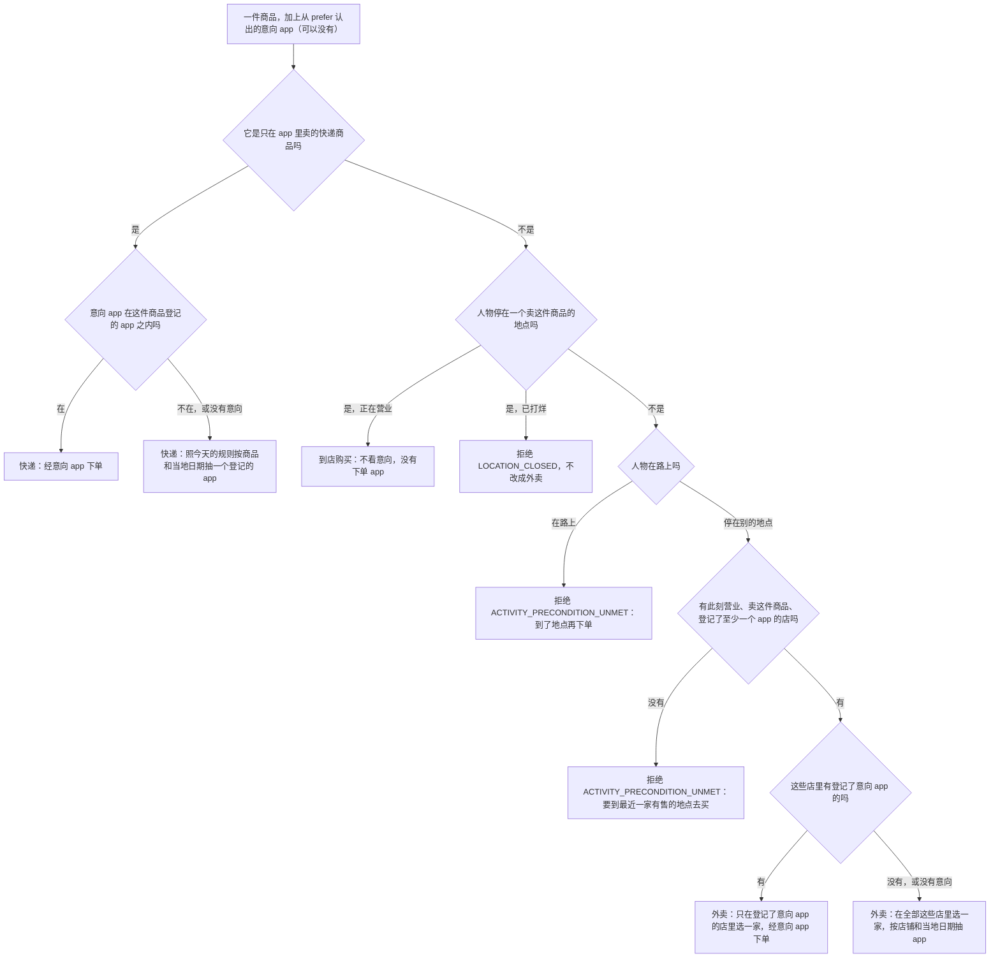
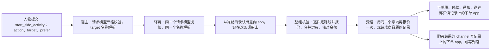
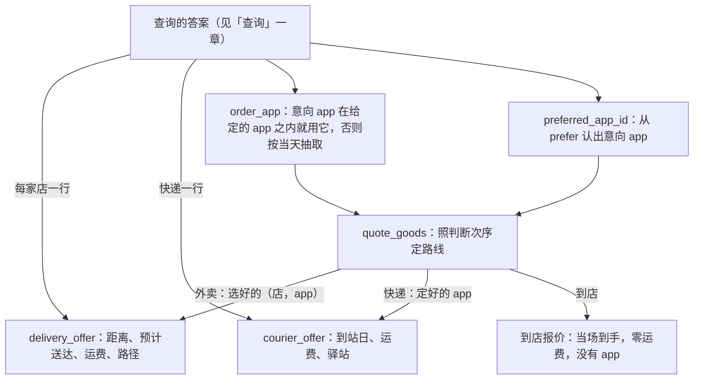

# 购买时写想用的 app

> 本章属于[首次真实模型单日运行：修复与新增规格](../SPEC-first-real-day-run.md)，读法和叫法见那一页。

## 目标与依据

人物早上在办公室想照习惯「用瑞幸咖啡点一杯冰美式」，中午想「在美团外卖上点午饭」。改后它在购买请求里多写一项 `prefer`，说明想用哪个 app 下单。只要此刻有营业、卖这件商品、又上了这个 app 的店，订单就经这个 app 下出：手机时间线上下单的那几分钟在前台的是它写的 app，「订单已下单」这些通知也由这个 app 发。人已经站在卖这件商品的店里时照旧到店买，手机上没有下单 app。这个 app 接不了这一单时，环境不退回、不让人物重选，照今天的办法另选一个。实际用了哪个 app、还是到店买的，写在购买结果里，人物下一次决策就读得到。

今天购买请求只有 `action` 和 `target` 两项（`src/worldmock/life/models.py:866-871`）。引擎先在此刻营业、登记了至少一个 app 的店里取离收货地点最近的一家，再在这家店登记的 app 里按「店铺、当地日期」抽一个（`src/worldmock/life/purchase_offers.py:97-104`、`:116-123`）；购买结果只写商品、份数、价款、送达地点和时刻，不写 app（`src/worldmock/life/result_projection.py:66-73`）。首次真实运行里人物看的是美团外卖，午饭却经淘宝闪购下出，人物自己并不知道。

本章实现提案「裁决结果」里「购买」一表的七行，以及裁决清单里的三行：「意向 app 能不能让订单换一家店」裁决为可以换（提案原话「可以因此换到更远的店」）；「一次买多件时 `prefer` 怎么用」裁决为「每件商品各自判断，可能多出一张订单」；「购买结果里写明实际用的 app，或写明到店购买」裁决为写。提案购买一节末尾按最省事的做法处理的六处也在本章：`prefer` 每次都要写、打开 app 时必须是 `null`、名称先做和其他名称相同的规整、另选沿用今天的抽取、人在卖这件商品的地点而它已打烊时照今天的规则拒绝、退回时可以照抄的纠正写法带上 `prefer`。

## 行为规格

### 三个叫法

| 叫法 | 含义 |
| --- | --- |
| 下单 app | 能接单的内容 app：它直接登记了商品，或者被一个确实卖商品的地点登记。功能 app（支付、导航）和只有内容、不卖东西的内容 app 都不是下单 app。判据与目录登记规则里的同一条相同（`src/worldmock/catalog/admission.py:300-302`） |
| 意向 app | 人物写在 `prefer` 里、规整后在全部下单 app 的名称里唯一对上的那一个。对不上就没有意向 app |
| 另选 | 照今天的规则选店，并照今天的规则按当天抽取定下单 app |

意向只改变两件事：外卖从哪些店里选，下单 app 是抽的还是人物写的。订单怎样归组、怎样付款、怎样分段、发哪些通知、怎样收货，都只读商品履约记录上的下单 app，规则一条不改。

### 请求里的 `prefer`

`start_side_activity` 的参数由两项变成三项，次序是 `action`、`target`、`prefer`。

| 字段 | 类型 | 是否必填 | 约束 | 含义 |
| --- | --- | --- | --- | --- |
| `prefer` | 字符串或 null | 必填，没有缺省值 | 字符串至少含一个非空白字符（`pattern` 为 `\S`）；`action` 是 `interact` 时必须是 null | 购买时想用来下单的 app 的名称；没有想法写 null |

生成的参数 Schema 里，`prefer` 的形状与主工具的 `detail` 相同：`{"anyOf": [{"pattern": "\\S", "type": "string"}, {"type": "null"}], "description": …}`；`required` 是 `["action", "target", "prefer"]`。其中 `description` 的文字：购买轨道落下时用的那一句见下文「本章定下的细节」，定稿见[「人物读到的规则」](./10-persona-rules.md)一章。模型的工具格式不允许可省略的字段，所以「没有意向」只能写 null，不能不写。

```json
{"action": "purchase", "target": ["冰美式咖啡"], "prefer": "瑞幸咖啡"}
{"action": "purchase", "target": ["牛肉面", "柠檬茶"], "prefer": null}
{"action": "interact", "target": ["哔哩哔哩"], "prefer": null}
```

写错形状时当场退回，不花时间，不开始任何活动。四种情形各报一条明细，定位都是 `prefer`（完整路径 `["tool_calls", <这条调用的位置>, "function", "arguments", "prefer"]`），`allowed_values` 为空：

| 情形 | `written` | `why`（英文原文） |
| --- | --- | --- |
| 没有写 `prefer` | null | `This required field was omitted.` |
| 写了空串或只有空白 | 所写原值 | `A non-blank string matching the declared format is required.` |
| 写的不是字符串也不是 null，例如数字或数组 | 所写原值 | `A JSON string is required.` |
| `action` 是 `interact` 而 `prefer` 不是 null | 所写原值 | `prefer must be null when action is interact` |

- 宿主一侧的码是 `ARGUMENTS_INVALID`，环境一侧复核的码是 `ACTION_REQUEST_INVALID`；两侧的 `reason` 都是各条 `why` 用 `; ` 相连，`fix` 都是 `Correct every reported parameter.`。明细里的 `expected` 仍由现有函数从字段的 Schema 生成，本章不为它新增文字。
- 同一次请求里 `target` 也写错时（例如打开 app 写了两个名称又带了 `prefer`），每条违背各报一条，一次报全。
- 「打开 app 时 `prefer` 必须为 null」与睡觉时 `detail` 必须为 null 是同一种写法（`src/worldmock/life/models.py:859-860`）。
- `action` 是 `query` 时 `prefer` 写什么，见[「查询」](./02-query.md)一章；本章落下的校验只管购买和打开 app。

### 从 `prefer` 认出意向 app

- 认的范围只有下单 app 的名称，取自这次运行冻结的环境目录，不取自这一次的观察。
- 规整用与 `detail` 相同的那个函数 `object_labels.resolve_name`（`src/worldmock/life/object_labels.py:64-75`）：先比原文，原文相等就认它；再统一全角半角与括号、去掉全部空白、忽略「（模拟）」后比较；唯一对上才算。这个函数后面还有两级放宽（去掉活动名的开始时刻后缀、去掉「地点:」前缀），对 app 名没有实际用处，原样沿用，不为 `prefer` 另写一份规整。
- 不折叠大小写，不认简称。夹具里已核对：「美 团」「美团（模拟）」对得上「美团」，「Ｋｅｅｐ」对得上「Keep」；「美团外卖」对不上「美团」，「keep」对不上「Keep」。
- 下面几种情形都当作没有意向，和写 null 一样处理：名称不存在；写的是功能 app（例如「支付宝」）；写的是不卖东西的内容 app（夹具里的「抖音」「Keep」）；规整后同时对上两个下单 app。
- 认不出不是错误：不退回，不给候选，结果里不写 `items`、`resolved` 或 `notes`，不记成一次拒绝，不新增事件，也不写错误日志。人物只能从购买结果的 `channel` 看出实际走了哪里。
- 认出来也不留规整记录：`prefer` 写「饿 了 么」、规整后对上「饿了么」时，结果的 `details.resolved` 里不为它记「所写、认成」那一条。`target` 和 `detail` 照旧记，只有 `prefer` 不记，因为实际用的 app 已经写在 `channel` 里。

这是所有者裁决接受的代价：人设里写「用瑞幸点一杯冰美式」，人物照着把「瑞幸」写进 `prefer`，它不是登记的 app 名，订单会落到别的 app 上而没有任何提示。所以工具层要列出可写的全名（见下文「工具层的 `prefer_apps`」），作者手册要提醒习惯里的 app 名与目录一字不差。

### 一件商品怎样定路线

「路线」指一件商品这一次怎样到手：到店、外卖还是快递，从哪家店，经哪个 app。判断次序与今天相同，只在两处多看一眼意向。



| 情形 | 今天 | 改后 |
| --- | --- | --- |
| 只在 app 里卖的快递商品 | 在商品登记的 app 里按 `order-app:{goods_id}:courier:{local_date}` 抽 | 意向 app 在商品登记的 app 之内就用它，否则照今天抽。到货天数和运费按最终的 app 取（它们的键里带 app），所以换 app 可能换天数和运费。人在路上也能下单，意向照常生效 |
| 人停在卖这件商品的地点，营业 | 到店购买，没有下单 app，运费 0 | 不变，不看 `prefer` |
| 人停在卖这件商品的地点，已打烊 | 整次购买被拒，不改成外卖 | 不变。别处有营业又登记了意向 app 的店也一样被拒 |
| 人在路上买店铺商品 | 被拒 | 不变，不看 `prefer` |
| 没有营业且登记了 app 的店 | 被拒，原因里点出最近一家有售的地点 | 不变，不看 `prefer` |
| 外卖，意向用得上 | 没有这种情形 | 候选店收窄到登记了意向 app 的那几家，在其中照今天的规则选一家，下单 app 就是意向 app，不抽。可以因此换到更远的店，送达更晚 |
| 外卖，意向用不上或没有意向 | 在全部候选店里选，按 `order-app:{store_id}:{local_date}` 抽 | 与今天逐字段相同 |

几条判据写准：

- 「卖这件商品的地点」只看地点类型在不在商品的 `store_kinds` 里，不看这个地点有没有登记 app（`src/worldmock/life/purchase_offers.py:86-89`）。
- 「候选店」是卖这件商品、登记了至少一个 app、此刻营业的地点（`src/worldmock/life/purchase_offers.py:97-98`）。意向用得上的判据是候选店里至少有一家登记了意向 app，所以登记了意向 app 但此刻打烊的店不算。
- 「照今天的规则选一家」是按（商品价加固定运费，店到收货地点的最短距离，店铺身份）取最小。第一项对同一件商品的各家店都相同，实际就是最近的一家，同距取较小的店铺身份。
- 意向从不产生拒绝，也从不消除拒绝：上表三种拒绝的条件都不看 `prefer`。

### 一次买多件

一次购买只有一个 `prefer`，数组里的每一件商品各自走一遍上面的判断：能走意向 app 的走它，不能的另选。同一个名称写两次的两份走同一条路线。

| 随之变化的东西 | 规则（都与今天相同，只是输入变了） |
| --- | --- |
| 订单 | 一次购买里下单 app 相同的记录是一张订单，到店的记录合成一张到店订单。意向让商品落在不同的 app 上时，订单可能比没有意向时多，也可能少 |
| 配送组与运费 | 配送组的键是（店，收货地点，下单 app，履约方式）。意向让商品分到两家店时就是两个配送组、两份运费（各 5 元） |
| 付款 | 每张订单抽一次付款方式和付款时长，购买完成时每张订单一条付款记录 |
| 手机上的分段 | 下单时间按订单键升序分给各张带下单 app 的订单：前面每张各得整除后的秒数，最后一张拿剩下的全部；付款段首尾相接排在最后 |
| 通知 | 每张带下单 app 的订单各有一条「订单已下单」；支付 app 与下单 app 不全为空的订单各有一条「支付成功」；发货和送达通知按一趟配送计 |

一次购买里，同一家店仍然只有一个下单 app：经意向选中的店都登记了意向 app，另选选中的店一定没有登记它（否则这件商品就用得上意向），两类店不会重合。同一家店同一天的两次购买可以落在不同的 app 上，一次经意向、一次经抽取。

### 整组核验与余额

- 整组核验逐件定路线、报价、合并运费时带着这条调用的意向；受理时用同一个意向再算一次并冻结。两次得到的是同一条路线。
- 余额按带意向的路线算：全部货款，加各配送组的运费，同一次回复里有出行时再加车费。意向让商品分到两家店、多出的那份运费使余额不够时，照今天的 `INSUFFICIENT_FUNDS` 整组拒绝，不为了余额放弃意向。
- 与出发同一次回复里的购买：路线按出发前的停留地点算，意向照常生效；报价里有到店购买时照今天的规则拒绝。
- 工具层商品行上的运费和预计到达仍按没有意向的路线预览，人物写了意向之后实际的店、运费合计和送达时间可能不同，以购买结果为准。

意向只在受理那一刻用一次：



记录冻结之后不再看 `prefer`：购买完成时复核总价读的是记录，恢复和重放读的也是记录，不重选店、不重抽 app。

### 路线先定，报价后算

这一小节讲的是代码怎样拆，人物看到的行为不因它多出或少掉什么；要拆是为了让购买冻结在订单上的运费、预计送达，与查询答案里同一家店的那两个数出自同一个函数。

今天定 app 和算报价混在一起：外卖报价函数自己抽下单 app（`src/worldmock/life/purchase_offers.py:130`），快递报价函数也是（`:138`），而且外卖报价函数已经有五个入参（`:126`），不能再加。改后拆成「先定路线、后报价」，购买轨道一次落下，查询的答案直接复用报价的那一半，不再改签名。



| 函数 | 入参 | 做什么 |
| --- | --- | --- |
| `preferred_app_id(catalog, written)` | 冻结目录，人物所写的 `prefer` 原文 | 认出意向 app 的身份；写的是 null 或认不出时返回 null。购买与查询共用这一份 |
| `order_app_ids(catalog)` | 冻结目录 | 全部下单 app 的身份，按 `app_id` 升序。判据落在目录的索引上：`goods_by_app[app_id]` 非空（它直接登记了商品），或 `stores_by_app[app_id]` 里至少有一个地点的 `goods_by_store` 非空（登记它的地点确实卖商品）。查询轨道之后在同一个模块里新增 `selling_app_ids(catalog, goods_ids)`，并把本函数改成调用它，签名与结果不变，见[「查询」](./02-query.md)一章 |
| `quote_goods(inputs, state, agent_id, goods_id, prefer)` | `prefer` 是已认出的意向 app 身份或 null | 只负责定路线：照上一小节的次序判断、选店、定 app，再交给下面两个报价函数；到店报价仍在这里直接给出 |
| `order_app(state, source, apps, prefer)` | `source` 是抽取来源（店铺商品是店铺身份，快递商品是 `{goods_id}:courier`），`apps` 是这家店或这件商品登记的 app | `prefer` 在 `apps` 之内就返回它，否则按 `order-app:{source}:{local_date}` 在 `apps` 里抽。外卖和快递定 app 都走它 |
| `delivery_offer(inputs, state, goods, route, here)` | `route` 是选好的（店铺身份，下单 app 身份）二元组，`here` 是收货地点 | 给出这家店送到收货地点的报价。运费、预计送达和路径只取决于店和收货地点，app 原样写进报价。不判断营业，也不判断这家店有没有登记这个 app，由定路线的一方保证 |
| `courier_offer(inputs, state, goods, app)` | `app` 是定好的下单 app | 给出经这个 app 下单的快递报价：到站日和运费按这个 app 的键取 |

逐份报价的入口 `quoted_basket` 和受理入口 `prepare_purchase` 各多一个 `prefer` 入参，原样传给每一件的 `quote_goods`。这几个函数的 `prefer` 都不设缺省值，每个调用点写明自己带什么：

| 调用点 | 带什么 |
| --- | --- |
| 整组核验里逐份报价的那一处（`src/worldmock/life/admission.py:235`） | 这条调用的意向 |
| 余额核验（`src/worldmock/life/admission.py:250`） | 这条调用的意向。漏了它，余额会按近的那家店少算一份运费，购买要到完成时才因余额不足失败 |
| 受理（`src/worldmock/life/storefront_runtime.py:35`） | 这条调用的意向 |
| 工具层商品行的预览（`src/worldmock/life/tool_layer.py:180`） | null：预览按没有意向 |
| 打开 app 附带商品清单的那一处（`src/worldmock/life/purchase_offers.py:67`） | null，直到内容轨道把这个函数删除 |

### 购买结果里的 `channel`

进度层里这次请求的结果，`details.purchases` 的每一行多一个键 `channel`：

| 这条记录怎样买的 | `channel` 的值 |
| --- | --- |
| 经 app 下单的外卖或快递 | 实际下单 app 的完整名称，例如「瑞幸咖啡」。它就是可以照抄回 `prefer` 的写法 |
| 到店购买 | 「到店」 |

- 值取自商品履约记录上的下单 app，不取人物写的 `prefer`。请求参数原文照旧留在进度层这条记录的 `arguments` 里，所以 `prefer` 用不上时人物会同时看到自己写的和实际用的。
- `details.purchases` 一行是一份商品。同一张订单的各行 `channel` 相同；一次购买分成几张订单时，各行各写各的。
- 第一条结果（已开始）和第二条结果（做完、提前结束或失败）走同一个投影函数，都带 `channel`。没有付款的记录配 `price`，付了款的配 `paid`，与今天相同。
- 每行的键和次序：`product`、`quantity`、`channel`、`destination`、`expected_at`，最后是 `price` 或 `paid`。

夹具环境里人物在家买柠檬茶、`prefer` 写「饿了么」时，这条记录读起来是（只列有关的键）：

```json
{
  "arguments": {"action": "purchase", "target": ["柠檬茶"], "prefer": "饿了么"},
  "result": {"status": "in_progress", "details": {"purchases": [
    {"product": "柠檬茶", "quantity": "1 份", "channel": "饿了么", "destination": "家",
     "expected_at": "2026-01-05T08:25:46+08:00", "price": "17 元"}
  ]}}
}
```

记忆层和零点做计划时读到的购买句不改（`src/worldmock/life/settled_text.py:105-114`），仍是「（付款时刻）买了柠檬茶 1 份，付 17 元，预计 08:25 送到家」这样的写法，不带 app。裁决只要求购买结果写明；购买做完后人物要先收尾，收尾那次决策读得到结果里的 `channel`，想记住可以写进自己的总结。

### 工具层的 `prefer_apps`

工具层的 `callable_index` 多一组 `prefer_apps`：

- 成员：全部下单 app 的完整名称，只列名称。
- 次序：按 `app_id` 升序。
- 不变：只取决于冻结目录，整次运行每一次观察都相同；不按此刻营业与否筛选，不轮转，不截断。
- 不参加工具层目标行的分组渲染，分组后的工具层原样带着它；不进续接时的变化比较；容量浓缩不删它。
- 没有任何下单 app 的环境里它是空数组，键仍然在。

夹具环境里它是 `["哔哩哔哩", "饿了么", "美团"]`：哔哩哔哩直接卖「平台笔记本」，饿了么和美团被卖商品的店登记；抖音和 Keep 只有内容，支付宝、微信、高德地图是功能 app，都不在。既有内容又卖东西的 app（夹具里的哔哩哔哩）同时出现在可以打开的 app 行和这一组里。

### 退回时可以照抄的写法

购买请求因为名称被退回时，环境附带的候选是可以照抄提交的完整调用。改后副工具的候选恒为三个键 `action`、`target`、`prefer`，否则人物照抄会因为缺 `prefer` 再被退回。

候选里的 `prefer` 只有一条规则：候选的动作是 `purchase` 时，取被退回的那条请求所写的原样（那条请求是主工具的调用或打开 app 时，它没有写过意向，就是 null）；候选的动作是 `interact` 时恒为 null。下表把各种情形逐个摆出来，表里没列的情形（例如打开 app 时名称规整后对上多个 app）照同一条规则。

| 被退回的请求 | 候选 | 候选里的 `prefer` |
| --- | --- | --- |
| 购买，所写名称规整后对上多件商品（`NAME_AMBIGUOUS`） | 购买，只替换数组里出错的那一项 | 人物所写的原样，包括它认不出的写法和 null |
| 购买，所写名称恰是一个可以打开的内容 app（`ACTION_NOT_OFFERED`） | 打开这个 app | null |
| 打开 app，所写名称是一件商品 | 购买这件商品 | null（打开 app 的请求里 `prefer` 本来就只能是 null） |
| 打开 app，名称写得不准（`NAME_NOT_FOUND`） | 打开近名的 app | null |
| 主工具的请求里写了商品名或 app 名 | 副工具的购买或打开 app | null（主工具没有 `prefer`） |
| 购买，所写名称恰是一个地点 | 主工具的调用 | 主工具的候选仍是 `action`、`target`、`detail` 三个键，不变 |

购买的 `target` 里写了一个只用于下单和查询的 app 名称时怎样退回，见[「打开 app 与 app 目录字段」](./04-app-opening.md)一章。商品名找不到仍然直接拒绝、不给候选，不变。

### 宿主与环境用同一套判断

- 宿主（人物一侧）用请求模型严格校验（`custom/agents/life_agent.py:511-530`），环境用同一个请求模型复核（`src/worldmock/life/start_group.py:130-145`）。「没写 `prefer`」「空白」「打开 app 时非空」因此两侧天然一致，只是码不同。
- 名称解析两侧共用同一个函数、同一份冻结观察（`custom/agents/life_agent.py:909-913`、`src/worldmock/life/start_group.py:147-162`）。`prefer` 不参加名称解析，不产生任何名称类的失败，所以宿主放行的 `prefer` 环境一定放行。
- 宿主不认意向 app，也不拿 `prefer` 去对 `prefer_apps`；认意向只在环境里做一次。

### 随机抽取的键

没有新增的键。按键派生的随机流互不影响，少取一个不会改变别的抽取。

| 键 | 今天 | 改后 |
| --- | --- | --- |
| `order-app:{store_id}:{local_date}` | 每次外卖报价都取 | 只在选中的店没有登记意向 app 时取（没有意向、认不出，或候选店里没有登记它的）。候选与取法不变 |
| `order-app:{goods_id}:courier:{local_date}` | 每次快递报价都取 | 只在意向 app 不在商品登记的 app 之内时取 |
| `courier-days:{goods_id}:{app_id}:{local_date}`、`courier-fee:{goods_id}:{app_id}` | `app_id` 是抽到的 app | `app_id` 是最终的下单 app，意向用得上时就是意向 app |
| `function-app:{action_id}:{payment_order_key}`、`payment-duration:{action_id}:{payment_order_key}` | 每张订单各取一次 | 写法不变；订单张数随意向变了，取的次数跟着变 |
| `purchase-duration:{action_id}` | 一次购买取一次 | 不变 |

### 记录、导出与评估

- 人物写的 `prefer` 原文留在请求事件里，实际的下单 app 在商品履约记录上，两者可以对出意向有没有兑现。记录上不另存「人物写的意向」或「意向是否兑现」；商品履约记录的字段、`purchases.jsonl` 的字段都不变。
- 评估读请求事件时把副工具的参数键集钉成 `action`、`target` 两个（`src/worldmock/evaluation/public_evidence.py:254`），改成三个。少键、多键仍然报 `Start request arguments are outside the current contract`。不改的话，新运行一做评估就报这一句。

### 算例

**咖啡。** 店名和距离是示意，时间照送达规则算（600 秒备货，加距离除以每秒 5 米）。人物在办公室，08:46:00 购买「冰美式咖啡」（22 元），`prefer` 写「瑞幸咖啡」。离办公室 1,500 米的街角咖啡只上了美团外卖；4,500 米外的瑞幸咖啡（金泽古镇店）上了瑞幸咖啡和美团外卖。

| | `prefer` 写 null（与今天相同） | `prefer` 写「瑞幸咖啡」 |
| --- | --- | --- |
| 从哪家店 | 街角咖啡，1,500 米 | 瑞幸咖啡（金泽古镇店），4,500 米 |
| 下单 app | 美团外卖 | 瑞幸咖啡 |
| 价款 | 22 元加运费 5 元 | 22 元加运费 5 元 |
| 预计送达 | 09:01:00 | 09:11:00 |
| 结果里的 `channel` | 美团外卖 | 瑞幸咖啡 |

设购买时长抽到 180 秒、付款抽到支付宝 15 秒：手机上瑞幸咖啡 08:46:00–08:48:45 在前台，支付宝 08:48:45–08:49:00；08:49:00 扣 27 元，瑞幸咖啡发「订单已下单」，支付宝发「支付成功」；08:51:12 瑞幸咖啡发「订单已发货」；09:11:00 送达。人物若把 `prefer` 写成「瑞幸」，就是左边那一栏，没有任何提示，`channel` 写着「美团外卖」。

**午饭。** 人物 11:49:00 在办公室买午饭，`prefer` 写「美团外卖」。这份午饭只有离办公室 13.2 公里的一家店卖，这家店登记了淘宝闪购和美团外卖（示意）。今天当天抽到淘宝闪购，手机上是淘宝闪购；改后经美团外卖下单。店没有换，预计送达仍是 12:43:00（600 秒加 13,200 米除以每秒 5 米，共 54 分钟）。意向换的是 app，换不了送达时间。

**到店。** 夹具环境，人物在四季便利，08:00:00 购买「柠檬茶」（12 元），`prefer` 写「饿了么」。四季便利卖柠檬茶，所以到店购买：没有下单 app，没有运费，三杯咖啡虽然上了饿了么也不看。设购买时长抽到 150 秒、付款抽到微信 12 秒：08:00:00–08:02:18 手机上没有 app，微信 08:02:18–08:02:30 在前台，08:02:30 扣 12 元并当场拿到。结果里是 `"channel": "到店"`，`arguments` 里仍留着人物写的「饿了么」。提案里「人在瑞幸门店里买冰美式」是同一种情形。

**换到更远的店（夹具环境，已离线核对）。** 人物在家，2026 年 1 月 5 日 08:00:00 购买「柠檬茶」。四季便利（1,156 米）和二味小炒（1,910 米）没有登记 app，不能外卖；一心面馆（2,524 米）只登记了美团；三杯咖啡（4,729 米）登记了饿了么和美团。

| `prefer` | 从哪家店 | 下单 app | 预计送达 | 合计 |
| --- | --- | --- | --- | --- |
| null | 一心面馆，2,524 米 | 美团 | 08:18:25 | 17 元 |
| 「美团」 | 一心面馆（两家登记了美团的店里较近的一家） | 美团 | 08:18:25 | 17 元 |
| 「饿了么」 | 三杯咖啡，4,729 米 | 饿了么 | 08:25:46 | 17 元 |
| 「美团外卖」「支付宝」「抖音」「keep」 | 一心面馆 | 美团 | 08:18:25 | 17 元 |

同一刻工具层柠檬茶那一行的说明写的是没有意向的路线：「运费5 元，预计01月05日 08:18到达」。

**一次买两件，分成两张订单（夹具环境）。** 人物在家，08:00:00 购买「牛肉面」（28 元）和「柠檬茶」（12 元），`prefer` 写「饿了么」。卖牛肉面又能外卖的只有一心面馆，它没有登记饿了么，这一件另选；柠檬茶走意向，从三杯咖啡来。

| | `prefer` 写 null | `prefer` 写「饿了么」 |
| --- | --- | --- |
| 牛肉面 | 一心面馆，美团，08:18:25 | 一心面馆，美团，08:18:25 |
| 柠檬茶 | 一心面馆，美团，08:18:25 | 三杯咖啡，饿了么，08:25:46 |
| 订单 | 一张（美团） | 两张（饿了么、美团） |
| 配送组与运费 | 一组，5 元 | 两组，各 5 元 |
| 总价 | 45 元 | 50 元 |
| 付款记录 | 一条，45 元 | 两条：饿了么 17 元，美团 33 元 |
| 「订单已下单」 | 一条 | 两条 |
| 到达 | 一趟，08:18:25 | 两趟，08:18:25 和 08:25:46 |

右边一栏设购买时长抽到 200 秒，饿了么那张订单付款抽到支付宝 15 秒，美团那张抽到直付 12 秒：下单时间 173 秒分给两张订单（前一张 86 秒，后一张拿剩下的 87 秒），饿了么 08:00:00–08:01:26，美团 08:01:26–08:02:53；付款支付宝 08:02:53–08:03:08，美团 08:03:08–08:03:20；08:03:20 两张订单各扣一次款。余额只有 47 元时，左边一栏受理，右边一栏按 `INSUFFICIENT_FUNDS` 拒绝，一件也不买。结果里柠檬茶一行是 `"channel": "饿了么"`，牛肉面一行是 `"channel": "美团"`。

### 拒绝一览

本章不新增拒绝码，不改任何拒绝的文字。请求形状的四条见上文「请求里的 `prefer`」。业务拒绝与今天相同，列在这里说明哪一条看意向。同一次回复里有两条开始调用时，原因后面照今天追加一句 ` Neither start request was started.`（前面一个空格，`src/worldmock/life/start_group.py:44`），下表不重复写：

| 码 | 何时 | 英文 `reason` | 看不看意向 |
| --- | --- | --- | --- |
| `SUPPLY_NOT_FOUND` | 商品名不能唯一对上一件商品 | `No goods exist for the written name; changing spelling cannot create goods.` | 不看 |
| `LOCATION_CLOSED` | 人停在卖这件商品的地点而它已打烊 | `The location is closed at the current time.` | 不看 |
| `ACTIVITY_PRECONDITION_UNMET` | 人在路上买店铺商品 | `Place the order after arriving at a location.` | 不看 |
| `ACTIVITY_PRECONDITION_UNMET` | 没有营业且登记了 app 的店 | `Purchase requires presence at {地点名} while it is open.` | 不看 |
| `ACTIVITY_PRECONDITION_UNMET` | 到店购买与出发同一次回复 | `A local purchase cannot start with departure.`，`next_step` 是 `Complete or conclude the local purchase before leaving.` | 不看 |
| `INSUFFICIENT_FUNDS` | 总价（同一次回复里有出行时加车费）超过余额 | `The caller's available balance is below the actual purchase total.` | 看：总价按带意向的路线算 |

### 明确不做

- 不改记忆层和零点计划里的购买句。起草时提过把渠道写进这一句，没有采用：裁决只要求购买结果写明。
- 不在记录上存人物写的意向或意向是否兑现；`purchases.jsonl` 不加字段；不新增事件种类、质量指标或报告。
- 意向用不上时不给任何提示：不退回，不给候选，不记 `details.resolved`，不写 `notes`。意向经规整认出来时同样不记 `details.resolved`。
- 不为了余额放弃意向；不在意向和没有意向两条路线之间挑便宜的。
- 工具层商品行不按意向预览，也不逐件列出它能经哪些 app 买。后者是查询答案的内容。
- 不折叠大小写，不认简称，不做近名匹配；不检查人设习惯里的 app 名是否与目录一致。引擎不替数据集把关，这一条写进作者手册。
- 不改到店的判定（只看地点类型）、选店的排序键、送达时间、运费、付款方式的抽取、购买时长和分段。人物仍然不能选支付 app。
- 不改购买活动的名称「购买某某（M月D日 HH:MM 起）」，它不带 app。
- 导出认证不新增「下单 app 必须是这家店登记的 app」之类的自查。
- 系统层文字、工具用途句和三个字段说明的定稿不在本章，见[「人物读到的规则」](./10-persona-rules.md)一章；查看器的请求行显示 `prefer`、购买行写「（经某 app 下单）」不在本章，见[「统一显示写法」](./08-display.md)一章；`query` 的 `prefer` 不在本章，见[「查询」](./02-query.md)一章。
- 不留兼容：缺 `prefer` 的请求一律按现行合同拒绝；改动前的运行不能恢复或重放，见[「版本、身份与基线」](./12-versions.md)一章。

### 本章定下的细节

| 事项 | 定下的做法 | 理由 |
| --- | --- | --- |
| `channel` 在购买明细一行里的位置 | 排在 `quantity` 之后、`destination` 之前 | 层的文字按键的写入次序渲染，次序要定死才能逐字比较；「买了什么、几份、怎么买的、送到哪、几点到、多少钱」读起来顺 |
| 购买明细 Schema 里的 `channel` 键由谁加 | 结果与结束轨道的第一个提交已加：`_PURCHASE` 是封闭对象，`channel` 列为必有的非空文字。购买轨道在那个提交之上开发，只写出 `channel` 的投影，不改这份 Schema | 结果明细 Schema 的几处改动由那一个提交一次落下，见[「做完之后读到什么，提前结束算不算做完」](./05-results-and-ending.md)一章。那个提交之后到购买轨道并入之前，真实的购买明细还没有 `channel`；这段时间没有用例校验带购买明细的真实进度层（今天也没有），中间提交不会因此失败 |
| 规整函数后两级放宽（去掉开始时刻后缀、去掉「地点:」前缀）对 `prefer` 生不生效 | 生效，原样调用 `object_labels.resolve_name`，不另写只比前两级的版本 | 提案写的是「和其他名称相同的规整」；另写一份就成了第二套规整规则 |
| `prefer_apps` 能不能是空数组 | 能。键必有；元素是非空文字、互不相同 | 只有到店商品、没有任何下单 app 的环境是合法的，不为它加拒绝 |
| 认意向的两个函数放在哪 | 新模块 `src/worldmock/life/order_apps.py`，并在单一归宿的登记表里登记。查询轨道之后在这个模块里新增 `selling_app_ids(catalog, goods_ids)`，`order_app_ids` 改成调用它，签名与结果不变 | 购买、工具层、查询三处要用，放进其中任何一个现有模块都会让另外两个反向依赖 |
| 意向在哪一步认、记在哪 | 环境名称解析之后、整组核验之前，从冻结目录认一次，记在这条调用上，核验与受理读同一个值 | 与指名商品从全量商品里解析是同一做法；认一次才能保证核验和受理是同一条路线 |
| 报价拆分后的具体签名 | 见「路线先定，报价后算」的表：`order_app` 一个函数管外卖和快递两处定 app；外卖报价把（店，app）并成一个入参。`order_app(state, source, apps, prefer)`、`delivery_offer(inputs, state, goods, route, here)`、`courier_offer(inputs, state, goods, app)` 三个名称与签名就此定下，其他各章照此引用 | 外卖报价已有五个入参，不能再加；两处定 app 的规则本来就是同一句话 |
| 内部函数的 `prefer` 入参设不设缺省值 | `quote_goods`、`order_app`、`quoted_basket`、`prepare_purchase` 都不设，预览的调用点显式写 null；直接调用它们的约五十处测试补一个 null。记在调用上的那个成员缺省为 null，因为主工具的调用和工具层的单行预览本来就没有意向 | 三处必须带同一个意向，设了缺省值漏传不会报错，后果是余额少算运费 |
| 整组核验里逐份报价的那一处带不带意向 | 带，但不为它登记源码变异 | 那一处只判断拒绝和「与出发同组不能到店」，两者都不看意向，带不带结果相同，登记的变异杀不死；带上是为了三处读同一条路线 |
| 主工具的请求被纠正成购买候选时 `prefer` 写什么 | null | 主工具没有 `prefer`，人物没有写过意向 |
| 候选里的 `prefer` 是原文还是规整后的名称 | 原文，一字不改 | 提案写的是「照人物写的原样带上」；环境不替人物改写意向 |
| 认不出意向时写不写日志 | 不写 | 这不是异常分支，是所有者裁决的正常结果 |
| 请求模型里交叉校验的写法 | 追加在现有的校验器里，校验器改名为 `validate_action_arguments`，与主工具的同名 | 它管的已经不只是名称个数 |
| 购买轨道落 `prefer` 字段时的说明文字 | 先写一句不含 `query` 的过渡文字：「purchase 写想用来下单的内容 app 的完整名称，没有想法写 null；interact 写 null。」同一步给副工具的放行词表加 `null`，只加这一个词。查询轨道把副工具的三条字段说明一起换成[「人物读到的规则」](./10-persona-rules.md)一章的原文，`query` 这个词在它进 `SIDE_ACTIVITY_ACTIONS` 的同一个提交里进放行词表。放行词表里不放 `prefer` 这类键名 | `query` 要到查询轨道才进动作闭集，字段说明里的拉丁字母单词必须与放行词表逐个相等、放行的词都要用到，定稿提前写进去过不了门；整次改动一次并入主干，过渡文字不会单独发布 |
| 手写完整日脚本的那条测试由谁补键 | 购买轨道只给三处手写的参数字典补 `"prefer": null`，脚本内容的改动留在收尾 | 请求形状一变这条测试当场就红，不能等到收尾 |

## 接口、删除面与文件指引

### 归属

本章的实现归购买轨道，排在版本提交之后、与结果与结束轨道同一波。下面几件事与本章有关但归别的轨道：

| 事 | 归谁 |
| --- | --- |
| 进度层结果明细 Schema 的补全（今天不认投影写出的 `content` 等键；购买行必有的 `channel` 键也在其中，`src/worldmock/life/prompt_schemas.py:200-203`）和「真实进度层通过层校验」的那条参数化用例 | 结果与结束轨道，是它的第一个提交，见[「做完之后读到什么，提前结束算不算做完」](./05-results-and-ending.md)一章；购买轨道在它之上开发，只写出 `channel` 的投影，并往那条用例里加一个带购买明细的参数 |
| 系统层文字、`start_side_activity` 的用途句、三个字段说明的定稿；放行词表里的 `query` | 查询轨道一次落下，三条字段说明的定稿与 `query` 进 `SIDE_ACTIVITY_ACTIONS` 在同一个提交里；见[「人物读到的规则」](./10-persona-rules.md)一章 |
| `callable_index.query_categories` 与 `INDEX_KEYS` 的删除 | 查询轨道；购买轨道不去同步那个没有读者的 `INDEX_KEYS` |
| `order_apps.py` 里新增 `selling_app_ids(catalog, goods_ids)`，`order_app_ids` 改成调用它（签名与结果不变） | 查询轨道；见[「查询」](./02-query.md)一章 |
| 购买的 `target` 里写了只用于下单和查询的 app；`app_goods` 的删除 | 内容轨道 |
| 查看器请求行显示 `prefer`；时间线购买行的写法 | 显示轨道与收尾 |
| 两个脚本化日子的脚本内容：活动日的那次购买把 `prefer` 写成「饿了么」（夹具环境里能外卖的店都上了美团，只有写「饿了么」订单才会换店），回调日是一次 `prefer` 为 null 的到店购买；两份完整日基线和查看器录制样例重做 | 收尾，脚本见[「版本、身份与基线」](./12-versions.md)一章。购买轨道在 `tests/system/lifecycle/test_complete_day_scripts.py` 里只给三处手写的参数字典补 `"prefer": null` |

### 生产文件

| 文件 | 改动 |
| --- | --- |
| `src/worldmock/life/models.py` | `StartSideActivityRequest` 增加第三个字段 `prefer`（必填，可为 null，没有缺省值；字段说明用「本章定下的细节」里的过渡文字）；校验器 `validate_target_count` 改名 `validate_action_arguments`，追加「打开 app 时 `prefer` 必须为 null」一条，与已有两条一起经 `_cross_errors` 逐条报出 |
| `src/worldmock/life/order_apps.py`（新） | `order_app_ids(catalog)`、`preferred_app_id(catalog, written)` 两个纯函数。查询轨道之后在这个模块里新增 `selling_app_ids(catalog, goods_ids)`，并让 `order_app_ids` 调用它，签名与结果不变 |
| `src/worldmock/life/purchase_offers.py` | `quote_goods` 加 `prefer` 入参，外卖分支先收窄候选店再选店；`_order_app` 改为公开的 `order_app(state, source, apps, prefer)`；`_delivery_offer` 改为公开的 `delivery_offer(inputs, state, goods, route, here)`，不再自己定 app；`_courier_offer` 改为公开的 `courier_offer(inputs, state, goods, app)`，不再自己定 app；`Offer.app_id` 的成员说明改为「下单 app：意向用得上时是意向 app，否则是当天抽到的；到店为空」；`app_goods` 里那一处调用补 null |
| `src/worldmock/life/basket.py` | `quoted_basket` 加 `prefer` 入参，原样传给每一份的 `quote_goods` |
| `src/worldmock/life/admission.py` | `Call` 增加成员 `prefer`（这条购买调用认出的意向 app 身份，缺省 null，带中文说明）；`_purchase_refusal` 与 `_funds_refusal` 调 `quoted_basket` 时带上它 |
| `src/worldmock/life/start_group.py` | `_resolved` 构造 `Call` 时对购买调用认一次意向；`_start` 把它交给 `prepare_purchase` |
| `src/worldmock/life/storefront_runtime.py` | `prepare_purchase` 加 `prefer` 入参，传给 `quoted_basket` |
| `src/worldmock/life/name_resolution.py` | `StartItem` 增加成员 `prefer`（人物所写的原文，缺省 null，主工具的解析项就是 null）；`start_items` 给副工具的每一项带上它；`call_candidate` 的副工具候选恒为三个键 |
| `src/worldmock/life/result_projection.py` | `_purchase` 写出 `channel`；说明里「不含应用、账户与身份」改为「写明下单 app 或到店，不含支付 app、账户与身份」；模块首行说明里的「不公开内部状态或自动渠道」同步改成与此一致的说法（下单 app 写明，支付 app 仍不公开） |
| `src/worldmock/life/callable_index.py` | `callable_index` 的结果增加 `prefer_apps` |
| `src/worldmock/life/prompt_schemas.py` | `_CALLABLE_INDEX` 增加必有的键 `prefer_apps`（元素为非空文字、互不相同的数组） |
| `src/worldmock/life/tool_layer.py` | `_purchase_facts` 调 `quote_goods` 时显式带 null |
| `src/worldmock/evaluation/public_evidence.py` | `_start_shapes` 里副工具的参数键集改为三个 |
| `custom/agents/life_agent.py` | 不加逻辑。工具 Schema 由请求模型生成，宿主校验与候选都随上面的改动自动带上 `prefer` |

引擎内部各函数的 `prefer` 入参和 `Call.prefer` 都是已经认出的意向 app 身份；只有请求模型的字段和 `StartItem.prefer` 是人物所写的原文。

核对过、不需要改的：`order_routing.py`、`purchase_phases.py`、`order_notices.py`、`receipt.py`、`parcel.py`、`time_advance.py` 的购买分支、`settled_text.py`、`progress_layer.py`（请求参数照原文写出，`prefer` 自然出现）、`memory_layer.py`、`day_plan_inputs.py`、`footprints/purchases.py`、`footprints/app_usage.py`、`footprints/invariants.py`、`footprints/frozen_environment.py`、`custom/envs/life_env.py`。`scripts/` 与 `tools/` 下没有本章的改动。

### 删除面

直接删除，不留兼容：

- 两个键的副工具请求。缺 `prefer` 的请求在宿主和环境两侧都被请求模型拒绝，评估读到两个键的请求事件报 `Start request arguments are outside the current contract`。
- 「人物不选渠道」「人物不知道实际用了哪个 app」两条成文规则（在设计文档里，见下）。
- `purchase_offers` 里三个私有函数的旧名和旧签名，不留别名。

### 夹具

基础夹具环境 `tests/fixtures/dataset-environment/` 不为本章改动：它今天就能表达「意向让订单换到更远的店」（上文已离线核对）。`tests/fixtures/viewer-context.json` 里录下的工具 Schema 和两份完整日基线随请求形状变化失效，在收尾步各重做一次。

### 先改的设计文档

逐行清单见[「设计文档与手册改动清单」](./11-design-docs.md)一章，这里只列文档和小节。

- 《模拟引擎》「动作、名称与并行」：参数表加 `prefer` 一列；名称解析写明 `prefer` 的例外；候选恒带 `prefer`；整组核验按带意向的路线报价和核对余额。
- 《模拟引擎》「购买、付款与收货」：选店与下单 app 的完整规则写在这里（本章规则的归属处）；每件各自判断；购买结果的 `channel`；工具层预览按没有意向。
- 《人物》「提示与工具」：第一次写下 `callable_index` 的键，其中的 `prefer_apps`；「进度、待办与记忆」：购买明细带 `channel`，购买句不写渠道。
- 《配置》「唯一种子与随机键」：下单 app 的两个键只在意向用不上时取；快递天数与快递费键里的 app 是最终的下单 app；预览按没有意向，受理按请求里的意向报价并冻结；商家选择先收窄到登记了意向 app 的店。
- 《概述》「解决方案」「地图中的消费行为」「核心术语」：改写「人物不选渠道」「下单 app 从中抽取」「引擎代为使用」几句。
- 《资源引擎》「固定价格与配送费」、《记录引擎》「事件与来源」「数字足迹」：各补一句与新规则相接的话。
- 作者手册：下单 app 与到店两条规则写进 `docs/manual/resources.md` 新节的表；「习惯里的 app 名要与 app 目录一字不差」写进 `docs/manual/personas.md`；`docs/manual/rules.md` 只更新固定规则的叙述。

### 在这里咬人的约束

- 每个函数至多 5 个入参：`quote_goods`、`quoted_basket`、`delivery_offer` 改后都正好 5 个，不能再加。每个函数至多 50 行，每个函数都要有含中文的 Doxygen 说明，新增的数据类成员逐个注明语义。
- 单一归宿的门拒绝两处相同的函数体：下单 app 的判据只在 `order_app_ids` 里写一次，工具层、查询和内容轨道都调用它，不各写一遍。`preferred_app_id` 与 `order_app_ids` 登记进 `tests/unit/engineering/test_single_source.py` 的 `OWNERS`，归宿是 `life/order_apps.py`。查询轨道在这个模块里新增 `selling_app_ids` 之后，判据的函数体挪到那里，`order_app_ids` 调用它，仍然只有一份。
- 新模块用模块级导入；`purchase_offers` 已被 `basket`、`order_routing`、`receipt`、`parcel`、`tool_layer`、`start_group` 导入，新依赖不要成环。`order_apps.py` 只依赖 `object_labels`，`purchase_offers` 不需要导入它（`quote_goods` 收到的已经是认出的身份）。
- 覆盖率门要求新增的五个公开函数每一行都被测试执行到。
- 错误文字全部英文；本章新增的英文只有 `prefer must be null when action is interact` 一句。
- 字段说明的门（`tests/unit/agent_protocol/test_tool_description_references.py:42-48`、`:116-133`）：说明恰一句，拉丁字母单词必须与放行词表逐个相等、放行的词都要用到。购买轨道给副工具的放行词表只加 `null` 一个词；放行词表里不放 `prefer` 这类键名，`query` 由查询轨道加。
- 源码变异按原文行定位，下面几行不要改写：`start_group.py` 里 `changed = self._start(changed, item, stay_location_id)` 和 `orders = start_orders(before, changed, [activity]) if located else activity_orders(changed, [activity])`；`admission.py` 的 `group_refusal` 里 `side = next((call for call in calls if call.tool == START_TOOLS[1]), None)`；`storefront_runtime.py` 里 `delivery_events(changed, activity_orders(changed, activity), payments)`；`name_resolution.py` 的 `_resolve_detail` 里 `match = object_labels.resolve_name(item.detail, [option.detail for option in options])`。

## 测试要求

### 行为测试

新增两个文件：`tests/integration/start_interfaces/test_purchase_prefer.py`（下表简称「意向用例」，全部经真实请求、引擎和 SQLite：`engine_factory`、`act`、`act_group`、`events`、`progress_calls`，导出用 `tests/footprints/recording.py` 的 `export_completed`）和 `tests/unit/life/test_order_apps.py`。目录变体用 `tests/life/environment_inputs.py` 的 `copy_environment`、`catalog_rows`、`write_catalog_rows` 在副本上构造；依赖距离的用例对照夹具生成的距离先断言一次（家到一心面馆 2,524 米、到三杯咖啡 4,729 米），需要调换远近时用 `map.jsonl` 声明距离。

| 规则 | 层 | 测试文件 | 验收行为 |
| --- | --- | --- | --- |
| `prefer` 必填、可为 null | unit | `tests/unit/agent_protocol/test_start_request_models.py` | 副工具 Schema 的属性次序和 `required` 是 `action`、`target`、`prefer`，`prefer` 的 `anyOf` 形状如规格；写 null 和写名称都通过；缺 `prefer`、空白、数字各报规格里的那一句 |
| 打开 app 时 `prefer` 必须为 null | unit | 同上 | 报 `prefer must be null when action is interact`，定位 `prefer`，`written` 是所写原值；同时写了两个 app 名时两条都报 |
| 宿主与环境同一套判断 | integration | 意向用例 | 缺 `prefer` 和打开 app 带 `prefer` 的请求，经宿主 `validate_react_decisions` 得 `ARGUMENTS_INVALID`，绕过宿主直接登记得 `ACTION_REQUEST_INVALID`，明细路径都以 `"arguments", "prefer"` 结尾，原因相同；什么都没有开始，时钟没有动。宿主放行的任意非空 `prefer`（含认不出的）环境都受理 |
| 认意向：范围与规整 | unit | `tests/unit/life/test_order_apps.py` | 夹具目录的 `order_app_ids` 是 `bilibili`、`eleme`、`meituan`；「饿了么」「饿 了 么」「饿了么（模拟）」认成 `eleme`；null、「美团外卖」「支付宝」「抖音」「Keep」「不存在」都是 null。副本一把现成的 Keep 也登记到三杯咖啡（它于是成了下单 app，而且是唯一一个拉丁字母名称的）：`order_app_ids` 多出 `keep`；「Keep」「Ｋｅｅｐ」「K eep」认成 `keep`；小写的「keep」得 null。副本二在副本一上把抖音改名为全角的「Ｋｅｅｐ」并同样登记到三杯咖啡：写「Keep」「Ｋｅｅｐ」各认成各自（原文相等优先）；写「K eep」规整后同时对上两个，得 null。两个副本都不新增 app 行 |
| 写得不准悄悄另选 | integration | 意向用例 | 人在家买柠檬茶，`prefer` 逐个取「美团外卖」「支付宝」「抖音」「keep」「不存在的 app」：全部受理；商品履约记录与同一请求身份下 `prefer` 为 null 的另一台引擎逐字段相同；没有拒绝事件；结果里没有 `items`、`resolved`、`notes`；进度层 `arguments.prefer` 是所写原文，`channel` 是「美团」 |
| 规整后对上就算意向，不留规整记录 | integration | 意向用例 | `prefer` 写「饿 了 么」与写「饿了么」得到相同的记录（三杯咖啡，饿了么）；受理结果的 `details` 里没有 `resolved`；同一次请求把商品名写成「柠 檬 茶」时，`resolved` 里只有商品名那一条 |
| 意向用得上可以换到更远的店 | integration | 意向用例 | 人在家买柠檬茶：`prefer` 为 null 时记录是（一心面馆，美团），2,524 米，08:18:25；写「饿了么」时是（三杯咖啡，饿了么），4,729 米，08:25:46 |
| 在登记了意向 app 的店里照今天的规则选 | integration | 意向用例 | `prefer` 写「美团」选一心面馆；声明距离把两家调换后选三杯咖啡；声明成同距时取身份较小的三杯咖啡 |
| 选中登记了意向 app 的店后不再抽 | integration | 意向用例 | 副本里只有三杯咖啡能外卖：`prefer` 取当天 `order-app:cafe:{local_date}` 没抽到的那个 app，记录上是它；`prefer` 为 null 时是抽到的那个 |
| 意向店须此刻营业 | integration | 意向用例 | 副本里三杯咖啡此刻打烊，`prefer` 写「饿了么」：受理，记录是（一心面馆，美团） |
| 意向不产生也不消除拒绝 | integration | 意向用例 | 带着用得上的 `prefer`：人在路上买柠檬茶仍报 `Place the order after arriving at a location.`；两家能外卖的店都打烊时仍报 `Purchase requires presence at 四季便利 while it is open.` |
| 人在卖这件商品的地点不看意向 | integration | 意向用例 | 人在四季便利买柠檬茶，`prefer` 写「饿了么」：记录是到店、下单 app 为空、店是四季便利；没有下单段的前台区间，没有「订单已下单」；`channel` 是「到店」 |
| 所在地点打烊照今天的规则拒绝 | integration | 意向用例 | 副本里四季便利此刻打烊、三杯咖啡营业，人在四季便利，`prefer` 写「饿了么」：`LOCATION_CLOSED`，原因 `The location is closed at the current time.`，没有记录和活动 |
| 只在 app 里卖的快递商品 | integration | 意向用例 | 副本里「平台笔记本」登记两个 app：`prefer` 取没抽到的那个时记录上是它，预计到站和运费等于按它的两个键算出的值；`prefer` 写不在其内的「饿了么」或 null 时等于按商品和日期抽的结果；人在路上同样成立 |
| 一次买多件各自判断 | integration | 意向用例 | 人在家买牛肉面和柠檬茶，`prefer` 写「饿了么」：两条记录分属（三杯咖啡，饿了么）和（一心面馆，美团），两个配送组，总价 5,000 分；做完后两条付款记录（1,700 分、3,300 分）、两条「订单已下单」、两趟到达。对照 `prefer` 为 null：一张订单、一份运费、4,500 分。柠檬茶写两次、`prefer` 写「饿了么」：两条记录都在（三杯咖啡，饿了么），一个配送组、一份运费，总价 2,900 分 |
| 一家店一次购买只有一个下单 app | integration | 意向用例 | 买薯片、柠檬茶、牛肉面，`prefer` 写「饿了么」：薯片和柠檬茶同在（三杯咖啡，饿了么）一个配送组、一份运费，牛肉面在（一心面馆，美团）；每个店铺身份只对应一个下单 app；导出认证通过 |
| 余额按带意向的路线核对 | integration | 意向用例 | 余额 4,700 分，买牛肉面和柠檬茶：`prefer` 为 null 受理；写「饿了么」得 `INSUFFICIENT_FUNDS`，原因逐字，没有记录和活动，余额不变 |
| 与出发同一次回复 | integration | 意向用例 | 在家同组提交出行和带「饿了么」的柠檬茶购买：受理，记录是（三杯咖啡，饿了么），收货地点是家；人在四季便利同组提交时报 `A local purchase cannot start with departure.` |
| 购买结果写明 `channel` | integration | 意向用例 | 上面各情形在购买进行中和做完后各观察一次：两次的 `details.purchases` 每行都有 `channel`，值是记录上下单 app 的名称或「到店」，键的次序如规格；分成两张订单时各行各写各的；提前结束的购买 `channel` 仍在，配的是 `price`；每次观察到的进度层都交给 `validate_layer` 通过 |
| 带购买明细的进度层通过层校验 | integration | `tests/integration/life/test_progress_layer_schema.py::test_real_progress_layer_passes_layer_validation`（结果与结束轨道写的参数化用例，购买轨道加一个参数） | 走到「经饿了么买柠檬茶，购买进行中」的真实进度层交给 `validate_layer` 通过 |
| 投影函数 | unit | `tests/unit/life/test_memory_progress_contract.py` | 订单字典的 `app_id` 是 `eleme`、`payment_app_id` 是 `alipay` 时，明细行多出 `channel` 且是「饿了么」；`app_id` 为空时是「到店」；支付 app 的名称、账户、配送组键仍不出现 |
| 购买句不变 | unit、integration | `tests/unit/life/test_memory_progress_contract.py`、意向用例 | `purchase_sentence` 的句子不含下单 app 的名称；经饿了么买完并离开这段停留后，记忆层的那一句与今天的写法逐字相同 |
| 工具层的 `prefer_apps` | integration | 意向用例 | 观察里 `tool_layer.callable_index.prefer_apps` 等于 `["哔哩哔哩", "饿了么", "美团"]`；换时刻、换地点、三杯咖啡打烊后再观察仍相同；分组渲染后的工具层里还在；整层通过 `validate_layer`；副本里没有任何下单 app 时是空数组 |
| 工具层商品行按没有意向预览 | integration | 意向用例 | 人在家时柠檬茶一行的说明是「运费5 元，预计01月05日 08:18到达」；紧接着带「饿了么」购买，记录的预计送达是 08:25:46 |
| 候选恒带 `prefer` | unit | `tests/unit/start_interfaces/test_name_resolution.py` | 名称有歧义的购买，候选的 `prefer` 等于人物所写（含认不出的写法）；购买写了 app 名、打开 app 写了商品名或近名、主工具写了商品名，候选的 `prefer` 都是 null；每条副工具候选的键集恰是三个，并能通过请求模型 |
| 候选照抄就能提交 | integration | 意向用例 | 人在家，绕过宿主登记一条购买，`target` 写「哔哩哔哩」、`prefer` 写「饿了么」：`ACTION_REQUEST_INVALID`，明细的码是 `ACTION_NOT_OFFERED`，候选的参数恰是 `{"action": "interact", "target": ["哔哩哔哩"], "prefer": null}`；把这份参数原样再提交，被受理并开始使用哔哩哔哩 |
| 报价拆分 | unit | `tests/unit/life/test_environment_commerce.py` | 对 `quote_goods` 选中的（店，app）直接调 `delivery_offer` 得到同一份报价；对没被选中的较远的店调用，得到那家店的距离和预计送达；`courier_offer` 对商品登记的每个 app 各按自己的键给出到站日和运费；到店报价没有 app |
| 抽取的键 | unit | `tests/unit/life/test_purchase_phases.py` | 十六个随机态下，意向在登记的 app 之内时 `order_app` 总返回意向；不在其内或为 null 时等于 `order-app:{source}:{local_date}` 的抽取；现有「同一家店同一天抽到同一个 app」「两个 app 跨运行都抽得到」的用例保留 |
| 手机记录与导出跟着实际的 app | integration | `tests/integration/life/test_phone_records.py` | 经意向买的外卖做完并送达：下单段前台区间的 app、「订单已下单」「订单已发货」「订单已送达」的发送方都是意向 app；导出认证通过；`purchases.jsonl` 的字段集与今天相同，其中的下单 app 是实际的那个 |
| 受理冻结，恢复不重选 | integration | 意向用例 | 带意向的购买进行到一半生成检查点并重开运行：记录上的店、下单 app、预计送达不变，做完后付款与通知照旧 |
| 评估认三个键 | integration | `tests/integration/evaluation/test_public_evidence.py` | 带 `prefer` 的副工具请求事件正常投影；缺 `prefer` 的两键请求、多一个键的请求都报 `Start request arguments are outside the current contract` |

### 钉住今天行为、要改或要删的测试

先改共享助手，约八十个测试文件随之不用动：`tests/life/conftest.py` 的 `side_arguments`、`purchase`（各加关键字参数 `prefer`，缺省 null，输出三个键）、`use_app`（输出三个键）；`tests/life/request_fixtures.py` 的 `side_request`。

| 文件 | 用例 | 改成 |
| --- | --- | --- |
| `tests/unit/agent_protocol/test_start_request_models.py` | `_SIDE_VALID`、`test_side_request_accepts_arrays_and_repeated_names`、`test_both_models_generate_closed_strict_schemas_with_verbatim_descriptions`、`test_every_parameter_is_required_and_extra_keys_are_refused`、`test_side_target_is_always_a_non_empty_array_and_one_app` | 三个字段；`prefer` 的形状与说明逐字；手写的九处参数字典补 `prefer` |
| `tests/unit/agent_protocol/test_grounded_targets.py` | `test_retired_items_shape_is_refused_by_both_start_tools`、`test_tool_schema_has_current_shape_and_no_per_round_names` | 副工具的必填键和字段表加 `prefer`；已删除的 `app` 字段仍被拒的那一行保留 |
| `tests/unit/agent_protocol/test_tool_description_references.py` | `_FIELD_WORDS`；`test_description_scan_has_teeth` | 副工具的放行词只加 `null`（不加 `prefer` 这类键名，`query` 留给查询轨道），表上方那句说明跟着改。`test_description_scan_has_teeth` 里有一行今天钉着「副工具的说明里 `null` 算违规」（`:97`，`_violations("sleep 写 null。", _FIELD_WORDS[SIDE_TOOL])` 等于 `["sleep", "null"]`），放行之后期望值改成 `["sleep"]`；主工具的说明里出现 `purchase`、`app` 仍算违规的那一行不动 |
| `tests/unit/start_interfaces/test_name_resolution.py` | `test_unknown_object_reports_name_not_found_with_complete_call_candidates`、`test_ambiguous_object_lists_each_match_as_a_candidate`、`test_object_of_the_other_tool_offers_nothing_here_and_points_to_its_own_tool` | 副工具候选的参数是三个键 |
| `tests/unit/life/test_memory_progress_contract.py` | `test_purchase_fact_hides_automatic_app_and_account_details`、`test_unpaid_order_is_a_quote_without_a_payment_claim`、`test_parcel_collected_at_the_station_is_carried_as_evidence_but_not_reported_as_a_purchase` | `test_purchase_fact_hides_automatic_app_and_account_details` 改名并反过来断言：明细带 `channel`，句子仍不带 app；三条用例里的订单字典都补上目录里真实存在的 `app_id` 或 null |
| `tests/integration/start_interfaces/test_purchase_array.py` | `test_same_name_twice_buys_two_portions_in_one_delivery_group` | 进度层的 `arguments` 含 `prefer`，明细含 `channel` |
| `tests/integration/start_interfaces/test_start_group.py` | `test_bypassing_the_host_gets_the_shared_error_shape` | 绕过校验构造的副请求补 `prefer`，否则多出一条缺字段 |
| `tests/integration/evaluation/test_public_evidence.py` | `test_public_projection_rejects_start_arguments_outside_the_current_contract` | 副工具的合法键集是三个；加「缺 `prefer`」一例 |
| `tests/integration/life/test_phone_records.py` | `test_phone_records_never_reach_any_prompt_layer` | 说明与断言补一句：下单 app 的名称作为购买结果的事实出现在进度层，支付 app 的名称和通知标题仍不出现 |
| 手写副工具参数字典的其余十个文件 | `tests/unit/life/test_request_contract.py`、`test_environment_contract.py`、`test_native_environment_contract.py`、`test_activity_boundary_contract.py`、`tests/unit/start_interfaces/test_batch_shapes.py`、`tests/unit/footprints/test_purchases.py`、`tests/unit/evaluation/test_behavior_metrics.py`、`tests/integration/footprints/test_acs_export.py`、`test_render_day.py`、`tests/system/lifecycle/test_complete_day_scripts.py` | 逐处补 `prefer`。其中 `test_complete_day_scripts.py` 只给三处手写的参数字典补 `"prefer": null`，脚本内容留到收尾 |
| 直接调用报价函数的七个文件 | `tests/unit/life/test_environment_commerce.py`、`test_purchase_phases.py`、`test_content_and_commerce_boundaries.py`、`tests/integration/life/test_purchase_orders.py`、`test_purchase_travel_admission.py`、`test_constant_table_runtime.py`、`test_content_start_evidence.py` | `quote_goods`、`quoted_basket`、`prepare_purchase` 的调用各补一个 null。这些用例继续证明没有意向时选店和抽取与今天相同，一条都不删 |
| `tests/unit/engineering/test_single_source.py` | `OWNERS` | 加 `life/order_apps.py` 一行 |

没有要删除的测试。

### 登记的源码变异

每条规则都有上面「行为测试」一表里一条走真实路径的用例。源码变异只为裁决事项登记，每项一条，取改坏这一项中心规则的那一条，用来证明它的测试咬得住。裁决事项指提案「裁决结果」里「购买」一表的各行、裁决清单里关于购买的三行和购买一节末尾的六处；同一条规则在几处都出现的只登记一次，照今天的规则办、这次不改行为的两处不登记，共十条。登记进 `tests/dataset_acceptance.py` 的 `MUTATIONS`，锚点取实现后的真实源码。杀死的判据是断言失败，所以「改成拒绝」的那一条要落在让请求被业务拒绝的那一行上，不能落在让解释器抛错的地方；候选那一条的杀手把断言写成键集和取值的比较。

| 把规则改坏的方式 | 被哪条测试杀死 | 层 |
| --- | --- | --- |
| 请求模型给 `prefer` 一个缺省值，可以不写 | `test_start_request_models.py` 的 `test_every_parameter_is_required_and_extra_keys_are_refused`（行为测试「`prefer` 必填、可为 null」一行） | unit |
| 打开 app 时 `prefer` 非空不拒绝 | `test_start_request_models.py` 里新增的交叉约束用例（行为测试「打开 app 时 `prefer` 必须为 null」一行） | unit |
| 认意向时只比原文，不做规整 | 意向用例「规整后对上就算意向，不留规整记录」 | integration |
| 外卖选店不看意向，总在全部候选店里选 | 意向用例「意向用得上可以换到更远的店」 | integration |
| 意向 app 存在但候选店里没有登记它的，就拒绝而不是另选 | 意向用例「一次买多件各自判断」（牛肉面那一件） | integration |
| 人在卖这件商品的地点时有意向就改走外卖 | 意向用例「人在卖这件商品的地点不看意向」 | integration |
| 快递商品不看意向，总是抽 | 意向用例「只在 app 里卖的快递商品」 | integration |
| 一次买多件时只要商品不止一种就整单不用意向 | 意向用例「一次买多件各自判断」 | integration |
| 购买明细不写 `channel` | 意向用例「购买结果写明 `channel`」、`test_memory_progress_contract.py` 的投影用例 | integration、unit |
| 副工具候选不带 `prefer` | `test_name_resolution.py` 的候选用例；意向用例「候选照抄就能提交」 | unit、integration |

照今天的规则办、因此不登记的两处：人在卖这件商品的地点而它已打烊时拒绝，由意向用例「所在地点打烊照今天的规则拒绝」守住；另选沿用今天的抽取，由 `test_purchase_phases.py` 里保留的两条现有用例守住。上表以外的其余规则也不另登记，规则没有实现时它的行为测试先失败。下面几条是「不加东西」的规则，没有可以改坏的源码行，各由行为测试的断言守住：购买句不写渠道（`test_memory_progress_contract.py` 里句子不含 app 名的断言）；记录和 `purchases.jsonl` 不加字段（手机记录与导出那条用例里字段集与今天相同的断言）；`channel` 不取人物写的 `prefer`（投影函数手里只有记录，「写得不准悄悄另选」断言 `channel` 是「美团」而所写原文留在 `arguments` 里）；`prefer` 经规整认出来时不记 `details.resolved`（「规整后对上就算意向，不留规整记录」的断言）；`prefer_apps` 不按此刻营业与否筛选（「工具层的 `prefer_apps`」里三杯咖啡打烊后名单不变的断言）；工具层商品行按没有意向预览（工具层手里没有意向可带）；恢复不重选（沿用今天的冻结，没有新代码）。整组核验里逐份报价那一处带不带意向结果相同，也不登记（见「本章定下的细节」）。现有锚定在 `start_group.py`、`admission.py`、`storefront_runtime.py`、`name_resolution.py` 上的变异，改动后用 `tests/system/mutations/test_source_mutations.py` 重新确认锚点仍然唯一。

### 夹具

本章的测试不改基础夹具环境，所有目录变体都由测试在副本上构造并经生产入口刷新清单；两份完整日基线与查看器录制样例的重做见[「版本、身份与基线」](./12-versions.md)一章。
