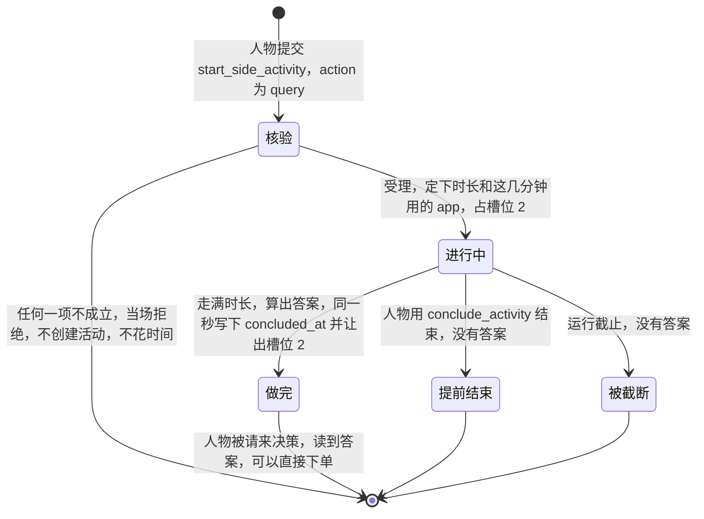
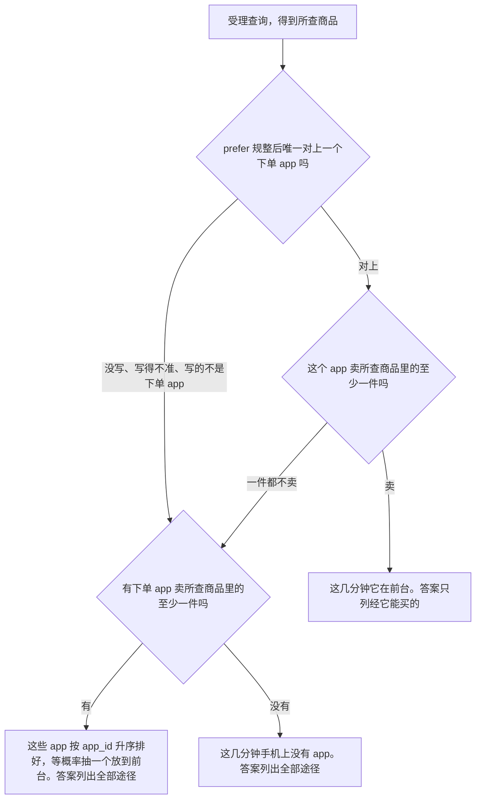
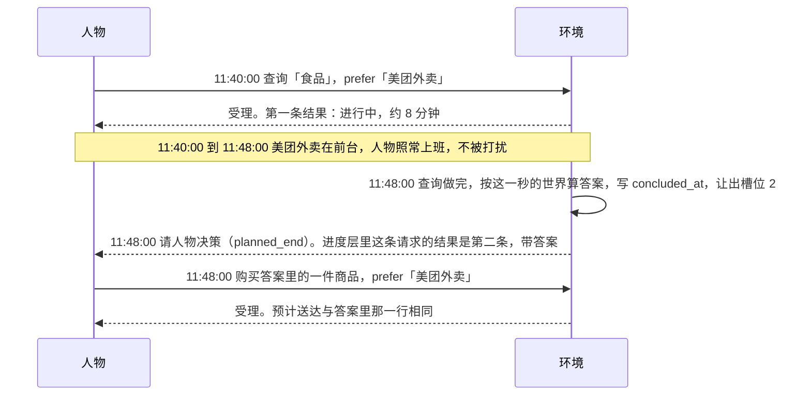
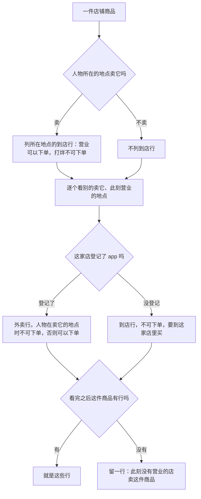

# 查询

> 本章属于[首次真实模型单日运行：修复与新增规格](../SPEC-first-real-day-run.md)，读法和叫法见那一页。

## 目标与依据

人物中午在公司上着班，不知道午饭吃什么。改后它提交一次查询：想查「食品」，想在「美团外卖」里查。接下来的 5 到 10 分钟，手机上是美团外卖在前台，班照常上。查询做完的那一秒人物被请来决策，读到答案：哪件商品、从哪家店来、这家店能经哪些 app 下单、多少钱、运费多少、几点送到、此刻能不能下单。它不用先收尾，在这同一次决策里就能下单。查询不能暂停，人在路上不能查。

今天没有这样的动作。人物靠 `query_world` 当场得到答案，不花时间，也不占槽位（`custom/agents/life_agent.py:585-587`）；商品行只有价格、运费和预计到达，不说从哪家店来、能经哪个 app 买（`src/worldmock/life/tool_layer.py:175-186`）。任何活动做完都要先收尾才能做下一件事（`src/worldmock/life/start_group.py:117-119`），而且「活动做完」这条唤醒只认待收尾的活动（`src/worldmock/life/rhythm.py:96-97`）。

本章实现提案「裁决结果」里「查询」一表的引擎一侧，以及正文「我建议的查询长什么样」那张表，对应裁决清单里这几件事：查询的答案什么时候给人物（「查询做完时给，按做完那一刻的世界算」）、查询做完要不要先收尾（「查询自己结束，不需要收尾，人物在这次决策里就能接着下单」）、查询的 `target` 能写什么、查询期间手机上显示什么、答案里写什么（「每件商品每家店一行」）、答案列多少（「一次最多 20 件」）、人在路上能不能查询。删除 `query_world`、第五种活动在导出、评估和查看器里的连带改动，见[「删除 query_world 与第五种活动」](./03-fifth-activity-kind.md)一章；人物读到的系统层文字见[「人物读到的规则」](./10-persona-rules.md)一章。

有一处与提案的字面不同，要在规格开头向所有者交代：提案把「类别名写错」和「商品名找不到」写成两种退回；两者写在同一个数组里，引擎分不出写错的是哪一种，本章合成一种拒绝。

## 行为规格

### 一次查询的全过程

查询是一项占槽位 2 的活动，种类 `query`，由 `start_side_activity` 开始。它有四种结局：



| 状态 | 活动的 `status` | `concluded_at` | 槽位 2 | `data.answer` | 这条请求此刻最新的结果 |
| --- | --- | --- | --- | --- | --- |
| 进行中 | `active` | null | 占着 | 没有 | 第一条：`in_progress`，只有计划时长 |
| 做完 | `completed`，`boundary_type` 为 `planned_end` | 等于 `ended_at` | 已让出 | 有 | 第二条：`completed`，`details.query` 是答案 |
| 提前结束 | `cancelled`，`interruption_reason` 为 `agent_cancelled` | 结束的那一秒 | 已让出 | 没有 | 第二条：`cancelled`，`details.query` 写「没有查完」 |
| 被截断 | `truncated`，`interruption_reason` 为 `experiment_end` | null | 运行已结束 | 没有 | 第二条：`cancelled`，`details.query` 写「没有查完」 |

查询没有「待收尾」这个阶段。今天别的活动做完后 `concluded_at` 为空，占着槽位等人物收尾（`src/worldmock/life/activity_control.py:55-57`、`:70-72`）；查询做完的同一次时钟推进里就把 `concluded_at` 写成 `ended_at`。

### 请求

| 字段 | 类型 | 约束 | 含义 |
| --- | --- | --- | --- |
| `action` | 字符串 | `query`。副工具的动作闭集改为 `SIDE_ACTIVITY_ACTIONS = ("purchase", "interact", "query")` | 查询商品 |
| `target` | 非空白字符串的数组 | 至少一项，不设上限。每一项是一件商品的完整名称，或四个类别名「零食」「食品」「饮料」「商品」之一。两者可以混写；同一件商品或同一个类别写几次只算一次 | 想查什么 |
| `prefer` | 非空白字符串，或 null | 每次都要写。规整办法、判断存在的名称集合与购买完全相同，见[「购买时写想用的 app」](./01-purchase-prefer.md)一章 | 想在哪个 app 里查 |

- 空数组按请求形状错误退回，原因是现有的 `target requires at least one name`（`src/worldmock/life/models.py:877-878`）。缺 `prefer`、`prefer` 是空白字符串的退回由[「购买时写想用的 app」](./01-purchase-prefer.md)一章规定，查询不另立文字。
- `target` 不接受 app 名、地点名和自由文字。「查这个 app 卖什么」用 `prefer` 表达。
- 工具层没有查询的可用性行：查询能不能开始，人物在提交之后才知道。

### 名称怎样认

`target` 的每一项按下面的次序认，宿主和环境用同一个函数、同一份冻结观察：

| 次序 | 判断 | 结果 |
| --- | --- | --- |
| 类别 | 所写名称经 `object_labels.resolve_name` 在四个类别名里唯一对上 | 是类别。类别名优先：即使有商品与类别同名，也按类别认 |
| 本轮展示的商品与只用于下单和查询的 app，同一次匹配 | 把本轮展示的商品和只用于下单和查询的 app 放在一起，按现有的逐级规整匹配一次（`src/worldmock/life/name_resolution.py:94-108`），不看地点和能打开的 app | 唯一对上一件商品：是这件商品。唯一对上一个只用于下单和查询的 app：退回，码是 `ACTION_NOT_OFFERED`。对上多个（几件商品，或一件商品与一个这类 app）：`NAME_AMBIGUOUS`，带候选 |
| 其余 | 交给环境，在全量商品（含只在 app 里卖的商品）的名称里用 `object_labels.resolve_name` 找 | 唯一对上：是这件商品。否则 `SUPPLY_NOT_FOUND` |

- 把只用于下单和查询的 app 写进 `target` 的退回，对打开、购买、查询三种动作是同一条规则，判断、码与文字归[「打开 app 与 app 目录字段」](./04-app-opening.md)一章。它不是排在商品之前的单独一步：与这类 app 同名的商品正在展示时，所写名称对上两个对象，得到的是 `NAME_AMBIGUOUS`，不是退回。
- 查询这一支由查询轨道先落下，那时「同一次匹配」那一行只在本轮展示的商品里匹配；内容轨道并入时把这类 app 加进同一次匹配。在那之前，把这类 app 写进查询的 `target` 落进「其余」，得到 `SUPPLY_NOT_FOUND`。
- 类别名或展示的商品名规整后与所写不同时，照现有做法在受理结果的 `details.resolved` 里记一条 `{"written": 所写, "as": 规范名称}`。
- 认完之后按所写次序去重：同一个 `goods_id`、同一个类别只留第一次出现的那一项。
- `NAME_AMBIGUOUS` 的原因与期望是现有文字（`The name {所写} identifies several known objects.`、`One unambiguous complete object name is required.`）。候选是可以照抄提交的查询调用：`action` 为 `query`，`target` 只替换出错的那一项、其余照写，`prefer` 照人物所写原样带上，三个键齐全。每件对上的商品一条，至多三条，对上的只用于下单和查询的 app 不出候选；候选的 `note` 为 null（今天商品候选的 `note` 取购买动作行的不可用原因或购买耗时，`src/worldmock/life/name_resolution.py:231`，那是购买的事，与查询无关）。
- 地点名、有内容的内容 app 名、不存在的名称，都落进「其余」，得到同一种 `SUPPLY_NOT_FOUND`。购买写了内容 app 名时会给一条「改成打开这个 app」的候选；查询不给，免得把人物引回「打开 app 看商品」。

`SUPPLY_NOT_FOUND` 的写法（数组里有几项写错时，只报按数组次序的第一项，与购买今天的做法相同）：

| 键 | 取值 |
| --- | --- |
| `error_code` | `SUPPLY_NOT_FOUND` |
| `reason` | `No goods or goods category is named {所写}; the goods categories are 零食, 食品, 饮料, 商品.` 同一次回复里还有主工具的调用时，照现有规则在后面追加 ` Neither start request was started.` |
| `fix` | `Use an exact known goods name or one of the goods categories.` |
| `next_step` | `Choose a known product or one of the goods categories.` |
| `items` | 恰一条：`path` 是 `["tool_calls", 调用位置, "function", "arguments", "target", 数组位置]`，数组位置是这一项在人物所写数组里的下标，从 0 起，按去重之前算；`written` 是所写的那个名称；`error_code` 是 `SUPPLY_NOT_FOUND`；`allowed_values` 是 `["零食", "食品", "饮料", "商品"]`（`GOODS_CATEGORY_LABELS` 的声明次序，`src/worldmock/exchange/types.py:11-13`）；`expected` 是 `An exact known goods name or one of the goods categories is required.`；`why` 等于不带追加句的 `reason`；`candidates` 为空 |

这条拒绝不创建活动，不推进时钟，不抽任何随机数。它属于名称类拒绝码，每人每秒前两次不计同刻轮数（`src/worldmock/life/same_moment.py:22`、`:69-84`）。

### 受理：核验的次序、槽位与冲突

查询走现有的整组核验（`src/worldmock/life/start_group.py:111-128`、`src/worldmock/life/admission.py:83-94`），次序不变。各步里查询会遇到的：

| 核验 | 查询在这一步的情形 | 码 |
| --- | --- | --- |
| 请求形状 | 见「请求」 | 环境一侧 `ACTION_REQUEST_INVALID`，宿主一侧 `ARGUMENTS_INVALID` |
| 待收尾 | 有别的活动刚结束待收尾 | `ACTIVITY_CONCLUSION_REQUIRED`，现有文字 |
| 名称、指名商品 | 见「名称怎样认」 | `NAME_AMBIGUOUS`、`SUPPLY_NOT_FOUND`；写了只用于下单和查询的 app 时是 `ACTION_NOT_OFFERED`，见[「打开 app 与 app 目录字段」](./04-app-opening.md)一章 |
| 槽位 | 槽位 2 已有进行中或待收尾的活动 | `RESOURCE_CONFLICT`，现有文字 |
| 睡眠 | 与睡眠同一次回复提交，或人物睡着 | `RESOURCE_CONFLICT`，现有文字 |
| 副调用的对象条件 | 人在路上；与出发同一次回复 | `ACTIVITY_PRECONDITION_UNMET`，见「人在路上」 |
| 余额 | 查询不参加 | 无 |

- 查询占槽位 2：`activity_slot("query", 任意 app)` 恒为 `second`，活动的 `resource_claims` 恒为 `{"second"}`。
- 查询进行中，槽位 2 被它占着：这期间不能购买、不能用内容 app、不能再查一次，也不能睡觉。占用者是查询时，冲突拒绝的下一步只写结束，不写暂停：`The second activity slot is occupied by {查询的活动名}.`、`Conclude {查询的活动名} first.`；睡眠的拒绝是 `Sleep requires the second activity slot to be empty.`、`Conclude the second activity first.`。这两句由现有的 `pausable` 判定给出（`src/worldmock/life/admission.py:116-131`、`:139-146`），不用为查询另写。
- 槽位 2 被别的活动占着时查询被拒；占用者是离结束不少于 180 秒的内容 app 使用时，下一步照现有规则写 `Conclude or pause`。
- 查询可以与在地点做的事并行，也可以与它在同一次回复里一起开始。
- 查询不能暂停。`pause_activity` 点名查询时照现有规则拒绝：`ACTIVITY_PAUSE_UNAVAILABLE`，原因 `This activity cannot be paused at its current phase or location.`，改法 `Conclude this activity instead.`（`src/worldmock/life/activity_control.py:298-310`）。查询进行中在工具层是一个活动目标，`pause_activity` 一行不可用，原因一字不差是这一句；`report_status` 和 `conclude_activity` 两行可用。

### 时长

受理时抽一次：`random_stream(random_state, f"query-duration:{action_id}").randint(300, 600)`，300 到 600 的整数秒，两端都能取到。`action_id` 是这条查询请求的动作身份。计划结束等于受理时刻加这个时长，此后不再变；恢复和重放读活动上存的值，不重抽。

### 这几分钟用哪个 app

受理时定下，写进活动数据的 `app_id`，此后不变。

先说四个词。「下单 app」是能接单的内容 app：直接登记了商品，或被实际卖商品的地点登记。「意向 app」是人物写在 `prefer` 里、规整后唯一对上的那个下单 app。这两个词的定义与[「购买时写想用的 app」](./01-purchase-prefer.md)一章相同。「所查商品」是指名的商品加上各类别下的全部商品，类别下只在 app 里卖的商品也算。「一个 app 卖一件商品」按环境目录的登记算，不看此刻营业：商品的 `app_ids` 里有这个 app；或者有一个地点，它的类型在商品的 `store_kinds` 里，并且它的 `app_ids` 里有这个 app。



| 情形 | `data.app_id` | `data.scoped` | 抽取 |
| --- | --- | --- | --- |
| `prefer` 用得上 | 这个 app | `true` | 不抽 |
| `prefer` 用不上，有 app 卖所查商品 | 抽到的 app | `false` | `random_stream(random_state, f"query-app:{action_id}").choice(候选)`，候选按 `app_id` 升序 |
| 没有任何 app 卖所查商品 | null | `false` | 不抽 |

`scoped` 记的就是裁决里的「答案只列经它能买的」。下文说「`scoped` 为真」，指这次查询的答案限定在意向 app；说「`scoped` 为假」，指答案列出全部途径。

- `prefer` 对不对得上，用购买轨道落下的 `preferred_app_id(catalog, written)` 判断，名称集合是 `order_app_ids(catalog)`。写了功能 app、写了不能接单的内容 app、写了不存在的名称、规整后对上多个，都按没写处理：不退回，不给候选，不记 `details.resolved`。整组核验时对查询调用认一次，认出的意向 app 记在这条调用上带到受理，与购买走同一处。
- 候选是卖所查商品里任何一件的下单 app 的并集，「这个 app 卖至少一件」与候选用同一个静态判据算出（`selling_app_ids`，见「接口、删除面与文件指引」）。
- 「卖至少一件」看的是登记，所以意向 app 的店在受理那一刻全都打烊时，它照样在前台，答案也照样只列经它能买的。这与购买不同：购买的 `prefer` 要求此刻有营业的店。原因是 app 在受理时定、答案在做完时算，两个时刻的营业状态可以不同，登记不随时刻变。
- 导出里，这几分钟是这项查询活动名下的一行 `app_use`：`activity_id` 是这项查询，`app_id` 是活动数据里的 `app_id`，`segments` 是这项活动的执行区间，`status` 是活动的最后状态，与带 app 的 `interact` 走同一条路。提前结束或被截断的查询，区间止于结束的那一秒。`app_id` 为 null 的查询没有 `app_use` 行。查询不写 `app_foreground` 事件，不新增前台步骤。实现落点见[「删除 query_world 与第五种活动」](./03-fifth-activity-kind.md)一章。
- 一次查询从头到尾只有一个 app。

### 做完的那一刻

查询的计划结束是一个时钟边界（`src/worldmock/life/time_advance.py:419-422`）。时钟推进到这一秒时，在同一次提交里依次发生：

1. 世界时刻置成这一秒（`src/worldmock/life/time_advance.py:103`），结算这段时间的共同身体。
2. 查询走满时长：`status` 为 `completed`，`boundary_type` 为 `planned_end`，`ended_at` 为这一秒。
3. 按这一秒的世界算出答案，写进活动数据的 `answer`；同时把 `concluded_at` 写成 `ended_at`。槽位 2 从这一秒起空着。
4. 写这项活动的 `activity_progress` 事件，带上已含答案的活动快照。
5. 给开始它的那条动作写第二条 `action_result`：状态 `completed`，消息 `Activity completed`，`data` 是 `{"activity": 快照, "orders": []}`；`processed_actions` 里这条动作存的结果随之替换。这是现有的终态结果路径（`src/worldmock/life/action_evidence.py:46-62`），不用改它的构造。
6. 这一秒记 `planned_end` 唤醒，人物被请来决策。

- 做完不写 `activity_concluded` 事件，也不新增事件类型。记忆层的结束句由带终态快照的最早事件派生，不依赖收尾事件。
- 同一秒到期的外卖送达、app 推送在活动推进之后处理（`src/worldmock/life/time_advance.py:105-106`），答案不读它们。
- 为什么做完要唤醒人物：今天「活动做完」的唤醒只认待收尾的活动，查询自己结束后不在其中。人物同时在上班时，查询做完的那一秒没有别的唤醒原因，环境不会请它决策（`src/worldmock/life/rhythm.py:116-121`），要等到下一次整点、饿感变化之类的时刻；裁决要的「查完这次决策里就能买」会落空。所以改后「本边界做完的活动」是：待收尾且结束于这一秒的活动，加上结束于这一秒、已完成的查询。唤醒原因仍叫 `planned_end`，不新增原因。
- 这次决策里人物可以直接购买：没有待收尾的活动挡着，槽位 2 空着。它也可以再查一次，或者什么都不做、只给主活动写一条进展。
- 查询与人物的主活动恰好在同一秒做完时，主活动仍要先收尾（现有规则），收尾后同一秒再决策，那时可以购买。



### 答案：查哪些商品、每件商品几行

下文的「此刻」都指查询做完的那一秒。「营业」指 `Location.is_open(此刻的本地时刻)`。「人物所在的地点卖这件商品」指这个地点的类型在商品的 `store_kinds` 里，与购买判断到店的口径相同（`src/worldmock/life/purchase_offers.py:85-89`）；它不看这个地点有没有登记 app。

**查哪些商品。** `scoped` 为假时，就是「所查商品」。`scoped` 为真时：指名的商品全部保留；类别只展开意向 app 卖的商品。

**店铺商品**（登记了 `store_kinds` 的商品），`scoped` 为假时，卖它的每个地点按下表出行：

| 这个地点 | 人物此刻在不在卖这件商品的地点 | 行 |
| --- | --- | --- |
| 就是人物所在的地点 | 在 | 到店行，总是列出。营业：可以下单。已打烊：不可下单，原因「这家店此刻已打烊」 |
| 别的地点，营业，登记了 app | 不在 | 外卖行，可以下单。可用的 app 是这家店登记的全部 app；运费与预计送达取外卖报价 |
| 别的地点，营业，登记了 app | 在 | 外卖行，照列，但不可下单，原因是购买只会在所在地点到店完成。不带运费与预计送达 |
| 别的地点，营业，没登记任何 app | 都一样 | 到店行，不可下单，原因写明要到这家店里买 |
| 别的地点，已打烊 | 都一样 | 不列 |

**只在 app 里卖的商品**（登记了 `app_ids` 的商品）：恰一行快递，可以下单。可用的 app 是商品登记的全部 app。运费与预计送达取「此刻照这次查询的 `prefer` 下单会得到的那一份报价」：`scoped` 为假时，就是照今天的规则按 `order-app:{goods_id}:courier:{本地日期}` 抽到的那个 app 的报价。换一个 app 下单，运费和到货天数可能不同，以购买结果为准。

**`scoped` 为真时**，在上面的基础上只留经意向 app 能买的：

| 商品 | 行 |
| --- | --- |
| 店铺商品，意向 app 卖它 | 人物所在地点的到店行照列，不受筛选。别的地点只留营业、且登记了意向 app 的店；这些外卖行的「可用的 app」只写意向 app。没登记 app 的店不列 |
| 只在 app 里卖的商品，意向 app 在它的 `app_ids` 里 | 一行快递，「可用的 app」只写意向 app，运费与预计送达取意向 app 的报价 |
| 指名的商品，意向 app 不卖它 | 一行，不可下单，没有途径、没有店、没有可用的 app（与下文「一行都没有的商品」那一行同形），原因「这个 app 里没有」。人物所在的地点卖它时，到店行另外照列 |

**一行都没有的商品**留一行：不可下单，没有途径、没有店。原因在 `scoped` 为假时是「此刻没有营业的店卖这件商品」，在 `scoped` 为真时是「上了这个 app、卖这件商品的店此刻都没有营业」。只有店铺商品会落到这一行：人物不在卖它的地点，此刻又没有一家该列的店。

几条共同的规则：

- 外卖行的运费是 `delivery_fee_fen()`，预计送达是此刻加 `delivery_seconds(这家店到人物所在地点的最短距离)`，也就是此刻加 600 秒备货加距离除以每秒 5 米。这两个数与同一秒、从同一家店下单的购买冻结在订单上的数相同：它们由购买轨道拆出的同一个外卖报价函数 `delivery_offer(inputs, state, goods, route, here)` 算出，不另写一份。这个函数的 `route` 是一对（店，app）：app 传这家店登记的 app 里 `app_id` 最小的一个，`scoped` 为真时传意向 app；答案只取报价里的运费与预计送达，这两个数与传哪个 app 无关。
- 快递行同理：先用购买轨道的 `order_app(state, source, apps, prefer)` 定下「此刻照这次查询的意向下单会用的 app」（`scoped` 为真时就是意向 app，为假时是当天抽到的那个），再用它调同一个快递报价函数 `courier_offer(inputs, state, goods, app)`，取运费与到驿站的时刻。
- 到店行不带运费与预计送达，「可用的 app」为空：到店买没有下单 app。
- 「此刻能不能下单」只说这条路此刻通不通，不看余额，也不看槽位。
- 答案列的是每家店此刻能不能送。人物不能指定从哪家店下单：购买按 `prefer` 在登记了这个 app 的营业店里取最近的一家，见[「购买时写想用的 app」](./01-purchase-prefer.md)一章。答案里某家较远的店，它登记的每个 app 都被更近的店登记了时，人物怎么写 `prefer` 都下不到这家店，这一行仍标「可以下单」。这是「每家店一行」的已知结果，实际从哪家店来以购买结果为准。
- 每件商品的行数不设上限。
- 答案里出现的商品不算一次曝光，不写 `presentation_state`。

一件店铺商品在 `scoped` 为假时的出行次序，画成图：



### 答案：次序与 20 件上限

- 件数上限是固定常数 `QUERY_PRODUCT_LIMIT = 20`，不读配置。
- 商品的排序键是（有没有可以下单的行，有的在前；最早的可下单送达时刻；`goods_id`）。到店行的送达时刻按此刻算；没有可下单行的商品，第二项取 0。
- 排好后取前 20 件，其余只计数。没列出的件数大于 0 时，答案里写「还有 N 件没列」。
- 一件商品之内，行的排序键是（可以下单的在前；可下单行的送达时刻，到店行按此刻算，不可下单的行取 0；`store_id`，没有店的行取空串）。
- 指名的商品不比类别展开的商品优先。同一次查询里既写了商品名又写了大类别时，指名的那件可能排到 20 件之外。只写商品名、不超过 20 个，就一定都列出。
- 类别下没有任何商品时照常受理，答案没有行。

### 存在活动里的答案

查询活动的私有数据（`ActivityState.data`）键集如下，一次列全：

| 键 | 类型 | 何时写 | 含义 |
| --- | --- | --- | --- |
| `action` | 字符串 | 受理 | 恒为 `query` |
| `targets` | 数组 | 受理 | 认出的各项，按所写次序去重。商品是 `{"kind": "goods", "goods_id": 身份}`，类别是 `{"kind": "category", "category": 类别键}`，类别键是 `snack`、`meal`、`drink`、`goods` 之一 |
| `app_id` | 字符串或 null | 受理 | 这几分钟在前台的 app |
| `scoped` | 布尔 | 受理 | 答案是否只列经 `app_id` 能买的 |
| `accepted_event_id` | 字符串 | 受理 | 现有机制回写的受理结果事件身份（`src/worldmock/life/decision_coordinator.py:363-365`） |
| `answer` | 对象 | 做完 | 只有做完的查询才有 |

不写 `exertion`、放松与社交缓解的键，也不存人物写的 `prefer` 原文（请求事件里有）。

`answer` 是机器形式，只有身份、分和纪元秒，没有给人读的文字：

| 键 | 类型 | 含义 |
| --- | --- | --- |
| `rows` | 数组 | 已排序、已截取的各行 |
| `omitted` | 非负整数 | 没列出的商品件数 |

`rows` 的每一行：

| 键 | 类型 | 含义 |
| --- | --- | --- |
| `goods_id` | 字符串 | 商品 |
| `route` | `pickup`、`delivery`、`station_pickup` 或 null | 到店、外卖、快递；没有途径的行为 null。取值沿用 `FulfillmentKind` |
| `store_id` | 字符串或 null | 哪家店；快递行和没有途径的行为 null |
| `app_ids` | 字符串数组 | 这一行可用的 app，按 `app_id` 升序；到店行和没有途径的行为空数组 |
| `price_fen` | 正整数 | 商品价格 |
| `delivery_fee_fen` | 非负整数或 null | 可下单的外卖行、快递行有值，其余为 null |
| `expected_at` | 纪元秒或 null | 同上 |
| `available` | 布尔 | 此刻能不能下单 |
| `reason` | 下表六个码之一，或 null | `available` 为真时为 null |

答案同时留在活动数据和 `processed_actions` 里这条动作的结果快照中。实现后量一次带查询的世界状态体积，结果写进实施回执；它不是合入条件。

### 人物读到的答案：`details.query`

结果投影把机器形式换成显示名和人读短语。进度层里，这条请求的 `result.details.query` 是下面两种形状之一。

查完的：

| 键 | 类型 | 取值 |
| --- | --- | --- |
| `app` | 字符串或 null | 这次是在哪个 app 里查的：app 的完整名称，可以照抄进 `prefer`。这几分钟手机上没有 app 时为 null |
| `scope` | 字符串 | 「只列经这个 app 能买的」或「列出全部途径」。`app` 为 null 时一定是后者 |
| `rows` | 数组 | 各行，次序与机器形式相同 |
| `omitted` | 字符串 | 「还有 N 件没列」，N 是正整数，数字两侧各一个空格。没列出的件数为 0 时不写这个键 |

`rows` 的每一行（九个键都出现）：

| 键 | 类型 | 取值 |
| --- | --- | --- |
| `product` | 字符串 | 商品的完整名称，可以照抄进购买的 `target` |
| `route` | 字符串或 null | 「到店」「外卖」「快递」；没有途径的行为 null。「到店」与购买结果 `channel` 里的「到店」是同一个词 |
| `store` | 字符串或 null | 地点的显示名，分店带全角括号，例如「瑞幸咖啡（金泽古镇店）」 |
| `apps` | 字符串数组 | app 的完整名称，次序同 `app_ids` |
| `price` | 字符串 | 金额短语，例如「22 元」 |
| `delivery_fee` | 字符串或 null | 金额短语，例如「5 元」「0 元」 |
| `expected_at` | 字符串或 null | 带时区的 ISO 8601 时刻，与购买明细的 `expected_at` 同一写法。快递行是到驿站的时刻 |
| `now` | 字符串 | 「可以下单」或「不可下单」。到店行的「可以下单」指此刻提交购买会被受理 |
| `reason` | 字符串或 null | 「不可下单」时是下表的一句，「可以下单」时为 null |

原因的六种说法（全部是固定文字，花括号处填显示名）：

| 机器形式的 `reason` | 人物读到的 `reason` | 出现在哪种行 |
| --- | --- | --- |
| `location_closed` | 这家店此刻已打烊 | 人物所在地点的到店行，该地点已打烊 |
| `present_at_seller` | 你所在的{人物所在地点的显示名}就卖这件商品，此刻购买只在所在地点到店完成，不从这家店送 | 人物在卖这件商品的地点时，别家店的外卖行 |
| `store_without_app` | 这家店没有上任何 app，要到店里买 | 别处营业、没登记 app 的店的到店行 |
| `no_open_store` | 此刻没有营业的店卖这件商品 | 一行都没有的商品，`scoped` 为假 |
| `no_open_store_on_app` | 上了这个 app、卖这件商品的店此刻都没有营业 | 一行都没有的商品，`scoped` 为真 |
| `not_sold_on_app` | 这个 app 里没有 | 指名的商品，意向 app 不卖它 |

没有查完的（提前结束或被截断），恰两个键：

| 键 | 类型 | 取值 |
| --- | --- | --- |
| `app` | 字符串或 null | 同上 |
| `state` | 字符串 | 「没有查完」 |

投影的判据只有一条：终态结果的活动快照（开始这项查询的那条动作的结果里的 `data.activity`）种类是 `query` 时，快照里有 `answer` 就投影成查完的形状，没有就投影成没有查完的形状。状态为 `in_progress` 的结果不写 `query` 键；人物那条 `conclude_activity` 请求自己的结果不带活动快照（`src/worldmock/life/session_actions.py:243-254`），也不写。「你所在的地点」取快照的 `location_id`：查询期间人物不会离开这个地点。

它在 `prompt_schemas._RESULT_DETAILS` 里是一个可选键 `query`，Schema 如下（这个键由结果与结束轨道的第一个提交加进 Schema，见「接口、删除面与文件指引」；实现时用现有的 `_object`、`_TEXT`、`_NULLABLE_TEXT`、`_TIME` 拼出，闭合对象，列出的键除 `omitted` 外都必填）：

```json
{
  "oneOf": [
    {
      "type": "object",
      "additionalProperties": false,
      "required": ["app", "scope", "rows"],
      "properties": {
        "app": {"type": ["string", "null"], "minLength": 1},
        "scope": {"enum": ["只列经这个 app 能买的", "列出全部途径"]},
        "rows": {
          "type": "array",
          "items": {
            "type": "object",
            "additionalProperties": false,
            "required": ["product", "route", "store", "apps", "price", "delivery_fee", "expected_at", "now", "reason"],
            "properties": {
              "product": {"type": "string", "minLength": 1},
              "route": {"enum": ["到店", "外卖", "快递", null]},
              "store": {"type": ["string", "null"], "minLength": 1},
              "apps": {"type": "array", "uniqueItems": true, "items": {"type": "string", "minLength": 1}},
              "price": {"type": "string", "minLength": 1},
              "delivery_fee": {"type": ["string", "null"], "minLength": 1},
              "expected_at": {
                "type": ["string", "null"],
                "pattern": "^\\d{4}-\\d{2}-\\d{2}T\\d{2}:\\d{2}:\\d{2}[+-]\\d{2}:\\d{2}$"
              },
              "now": {"enum": ["可以下单", "不可下单"]},
              "reason": {"type": ["string", "null"], "minLength": 1}
            },
            "if": {"properties": {"now": {"const": "可以下单"}}},
            "then": {"properties": {"reason": {"type": "null"}}},
            "else": {"properties": {"reason": {"type": "string", "minLength": 1}}}
          }
        },
        "omitted": {"type": "string", "pattern": "^还有 [1-9][0-9]* 件没列$"}
      },
      "if": {"properties": {"app": {"type": "null"}}},
      "then": {"properties": {"scope": {"const": "列出全部途径"}}}
    },
    {
      "type": "object",
      "additionalProperties": false,
      "required": ["app", "state"],
      "properties": {
        "app": {"type": ["string", "null"], "minLength": 1},
        "state": {"const": "没有查完"}
      }
    }
  ]
}
```

### 两条结果各带什么，答案留多久

| 结果 | 状态与消息 | `details` 里与查询有关的键 |
| --- | --- | --- |
| 第一条，受理时 | `in_progress`，`Activities started` | `planned`：`[{"name": 活动名, "duration": 时长短语}]`，例如「约 7 分钟」。名称经过规整时另有 `resolved`。没有 `query`，不写在哪个 app 里查，不带任何商品 |
| 第二条，做完时 | `completed`，`Activity completed` | `query`：查完的形状 |
| 第二条，提前结束时 | `cancelled`，`Activity cancelled` | `query`：没有查完的形状 |
| 第二条，运行截止时 | `cancelled`，`Activity truncated at experiment end` | `query`：没有查完的形状 |

- 进度层对一条请求只显示最新的一条结果（`src/worldmock/life/progress_layer.py:120-134`），读取逻辑不用改。人物在查询做完的那次决策里读到的就是第二条。
- 人物在查询中途被别的事叫起来（饿感变化、整点推送）时，读到的是第一条：只知道查询还在进行、计划多久。工具层的活动目标另写「已做约 3 分钟，还剩约 4 分钟」这样的进度。
- 答案和进度层的其他记录一样，留到这段停留结束。同一段停留里之后每次决策都读得到它。人物出发后，这条记录离开进度层；记忆层留下这项活动的一句结束句，例如「查询冰美式咖啡（9月28日 08:42 起）：08:42–08:49，按计划结束」，不带答案。
- 提前结束的查询，人物那条 `conclude_activity` 请求自己的结果照现有规则写 `outcome`：`[{"activity": 活动名, "outcome": "提前结束"}]`。
- 已经自己结束的查询不在工具层的活动目标里，不需要也不能再收尾。
- 进度层在上下文超过 85% 时会把不受保护的旧记录折成只剩结算句（`src/worldmock/life/prompt_capacity.py:110-124`）。查询的记录没有结算句，折叠后答案不再出现；刚做完的那次决策里它受保护，不会被折。这是现有机制，本章不改。

### 人在路上

| 情形 | 码 | `reason` | `next_step` | 未满足条件 |
| --- | --- | --- | --- | --- |
| 人在路上时提交查询 | `ACTIVITY_PRECONDITION_UNMET` | `A query cannot start while travelling.` | `Start the query after arriving at a location.` | `stay_location` |
| 查询与出发在同一次回复里提交 | `ACTIVITY_PRECONDITION_UNMET` | `A query cannot start with departure.`，整组拒绝时后面追加现有的 ` Neither start request was started.` | `Finish or conclude the query before leaving.` | `stay_location` |
| 查询没做完时提交出发 | `ACTIVITY_PRECONDITION_UNMET` | `Conclude {查询的活动名} before departure.`（现有文字，今天用于进行中的到店购买，`src/worldmock/life/admission.py:175-178`） | `Conclude {查询的活动名}.` | `activities_before_departure` |

- 「人在路上」的判据是人物当前没有停留会话（`admission.present_location` 为空，`src/worldmock/life/admission.py:77-80`）。
- 「人在路上」「与出发同一次回复」这两种属于副调用的对象条件，排在槽位、睡眠和主调用的对象条件之后；与出发同组时两条调用都不开始，责任落在查询这一条上。「查询没做完时出发」属于出行的对象条件，与进行中的到店购买并列。
- 没做完的查询要出发，得先用 `conclude_activity` 结束它，没有答案。结束之后人物没有别的进行中活动时，同一秒再决策，那时可以出发。
- 查询因此从不在路上进行，导出里导航的前台区间不会与查询的执行区间重叠。
- 代价照提案所说：只在 app 里卖的快递商品，人在路上本来可以下单；改后人物在路上只能买事先知道名称的。

### 身体消耗、活动名、类别名、回调

- **身体消耗。** 与购买相同：代谢当量 1.0，没有放松缓解，没有社交缓解。固定代谢表 `activity_met` 加一项 `"query": 1.0`（`src/worldmock/exchange/body.py:22-25`）。不加这一项，查询开始后的第一次身体结算就是运行故障（`src/worldmock/life/activities.py:152-157`）。
- **活动名。** 「查询」加各项的规范名称，再加开始时刻：`查询{名称}、{名称}（M月D日 HH:MM 起）`。规范名称是商品的完整名称或类别的中文名，按所写次序、去重之后以「、」连接，不截断。例如「查询冰美式咖啡（9月28日 08:42 起）」「查询食品、柠檬茶（1月5日 11:40 起）」。动作的中文标签登记为 `ACTION_LABELS["query"] = "查询"`。
- **人物从哪里读到四个类别名。** 工具层 `callable_index.goods` 的品类行，每行的 `category` 就是可以写进 `target` 的类别名。这张索引的统计范围不改，只数店铺商品（`src/worldmock/life/discovery.py:17-21`）；按类别查询时还会展开只在 app 里卖的商品，所以答案里的件数可以多于索引里的计数。某个类别没有任何店铺商品时，索引里没有它这一行，人物仍可以写这个类别名；写错时拒绝的 `allowed_values` 列出全部四个。
- **不触发数据集的动作回调。** 回调规则里动作触发的 `key` 闭集不变，仍是 `purchase`、`interact`、`sleep` 和出行（`src/worldmock/catalog/callback_models.py:27-39`）。受理查询时引擎照常以活动记下的动作 `query` 求值一次动作回调（`src/worldmock/life/decision_coordinator.py:409-431`），没有规则能订阅它，所以没有任何效果。写了 `{"class": "action", "key": "query"}` 的环境包照现有的严格模型被拒。查询做完的那次唤醒，照任何活动做完一样按 `planned_end` 所属的唤醒类别求值唤醒类别回调，那不是动作回调。

### 算例

**提案的三种常见情形。** 只有「不知道午饭吃什么」那一种用到查询。

| 人物想做的事 | 怎么做 | 手机时间线 |
| --- | --- | --- |
| 照习惯用瑞幸咖啡点冰美式 | 08:46:00 一次请求：购买「冰美式咖啡」，`prefer` 写「瑞幸咖啡」。不查询 | 整次购买 1 到 5 分钟，付款包在里面：先是瑞幸咖啡在前台，最后 10 到 20 秒付款 |
| 不知道午饭吃什么，想在美团外卖上看看 | 11:40:00 查询「食品」，`prefer` 写「美团外卖」，时长抽到 480 秒。11:48:00 查询做完，人物在这次决策里购买选中的那件，`prefer` 写「美团外卖」 | 美团外卖 11:40:00 到 11:48:00，紧接着美团外卖下单 |
| 人在瑞幸门店里买冰美式 | 购买「冰美式咖啡」。不查询 | 没有下单 app，至多 10 到 20 秒的支付 app |

**提案的那一行答案。** 人物 08:42:00 在办公室，想知道冰美式从哪里来，查询「冰美式咖啡」，`prefer` 写 null。时长抽到 420 秒，08:49:00 做完。卖冰美式咖啡的只有瑞幸咖啡（金泽古镇店），它登记了瑞幸咖啡、美团外卖两个 app，离办公室 4,500 米：送达要 600 加 900 共 1,500 秒。`prefer` 为空，环境在这两个 app 里抽一个放到前台，假定抽到美团外卖。08:49:00 人物读到：

```json
{
  "app": "美团外卖",
  "scope": "列出全部途径",
  "rows": [
    {"product": "冰美式咖啡", "route": "外卖", "store": "瑞幸咖啡（金泽古镇店）",
     "apps": ["瑞幸咖啡", "美团外卖"], "price": "22 元", "delivery_fee": "5 元",
     "expected_at": "2026-09-28T09:14:00+08:00", "now": "可以下单", "reason": null}
  ]
}
```

人物在 08:49:00 这次决策里购买「冰美式咖啡」、`prefer` 写「瑞幸咖啡」，订单上冻结的预计送达同样是 09:14:00。手机时间线：美团外卖 08:42:00 到 08:49:00，接着是瑞幸咖啡下单。

**按类别查，`prefer` 用得上**（测试夹具环境，人物在公司）。夹具里食品有牛肉面（28 元，餐馆类地点卖）和饭团（10 元，便利店卖）；一心面馆登记了美团，离公司 991 米；二味小炒和四季便利没有登记 app。11:40:00 查询「食品」，`prefer` 写「美团」，时长抽到 480 秒。美团卖牛肉面，所以它在前台，答案只列经它能买的；类别只展开美团卖的商品，饭团不展开。11:48:00 做完，送达是 600 加 199 共 799 秒之后：

```json
{
  "app": "美团",
  "scope": "只列经这个 app 能买的",
  "rows": [
    {"product": "牛肉面", "route": "外卖", "store": "一心面馆", "apps": ["美团"], "price": "28 元",
     "delivery_fee": "5 元", "expected_at": "2026-01-05T12:01:19+08:00", "now": "可以下单", "reason": null}
  ]
}
```

同一时刻把 `prefer` 写成 null：卖这两件商品的下单 app 只有美团，前台仍是美团，但答案列出全部途径，共三行，次序是先牛肉面（有可下单的行）、后饭团。下面几张表为了好读，时刻只写钟点、空数组写成「空」，实际的写法以键表为准：

| `product` | `route` | `store` | `apps` | `price` | `delivery_fee` | `expected_at` | `now` | `reason` |
| --- | --- | --- | --- | --- | --- | --- | --- | --- |
| 牛肉面 | 外卖 | 一心面馆 | 美团 | 28 元 | 5 元 | 12:01:19 | 可以下单 | null |
| 牛肉面 | 到店 | 二味小炒 | 空 | 28 元 | null | null | 不可下单 | 这家店没有上任何 app，要到店里买 |
| 饭团 | 到店 | 四季便利 | 空 | 10 元 | null | null | 不可下单 | 这家店没有上任何 app，要到店里买 |

**人在卖这件商品的地点**（夹具环境，人物在三杯咖啡，查询「柠檬茶」，`prefer` 为 null）。所在这家店的到店行排第一；一心面馆的外卖行照列，但不可下单：

| `product` | `route` | `store` | `apps` | `now` | `reason` |
| --- | --- | --- | --- | --- | --- |
| 柠檬茶 | 到店 | 三杯咖啡 | 空 | 可以下单 | null |
| 柠檬茶 | 外卖 | 一心面馆 | 美团 | 不可下单 | 你所在的三杯咖啡就卖这件商品，此刻购买只在所在地点到店完成，不从这家店送 |
| 柠檬茶 | 到店 | 二味小炒 | 空 | 不可下单 | 这家店没有上任何 app，要到店里买 |
| 柠檬茶 | 到店 | 四季便利 | 空 | 不可下单 | 这家店没有上任何 app，要到店里买 |

**超过 20 件。** 这次真实运行的环境包里食品有 58 件。查询「食品」、`prefer` 为 null 时列出排序后的前 20 件，末尾写 `"omitted": "还有 38 件没列"`。

**中途结束**（夹具环境）。人物 19:40:00 在家查询「零食」，`prefer` 为 null，时长抽到 540 秒，计划 19:49:00 做完；卖零食的下单 app 有饿了么和美团，环境抽到饿了么在前台。19:44:00 饿感变化把人物叫起来，它决定不查了，用 `conclude_activity` 结束这项查询。这条查询请求的结果变成第二条：状态 `cancelled`，`details.query` 是 `{"app": "饿了么", "state": "没有查完"}`，没有任何商品行。手机时间线上饿了么是 19:40:00 到 19:44:00。人物没有别的进行中活动，19:44:00 同一秒再决策，这时可以出发。

### 边界情形

| 情形 | 结果 |
| --- | --- |
| 受理时营业的店，做完时已打烊 | 不在答案里。反过来，受理时打烊、做完时已开门的店在答案里 |
| `prefer` 用得上，但做完时上了这个 app、卖某件店铺商品的店全都打烊，人物也不在卖它的地点 | 这件商品只有一行，不可下单，原因是「上了这个 app、卖这件商品的店此刻都没有营业」 |
| `prefer` 用得上，按类别查，人物所在的店卖这个类别里某件意向 app 不卖的商品（夹具里：人在四季便利查询「食品」、`prefer` 写「美团」，饭团只有便利店卖） | 这件商品不在所查之列，答案里没有它，也没有它的到店行：类别只展开意向 app 卖的商品。「到店行不受筛选」说的是已经在所查之列的商品。要看到它，指名这件商品，或者 `prefer` 写 null |
| 查询的计划结束恰好等于运行截止时刻 | 先正常做完并带答案，不截断 |
| 查询恰在本地零点做完 | 照常做完并带答案；唤醒判定在零点计划登记之后执行，仍记 `planned_end` |
| 查询进行中做检查点，恢复后做完 | 时长、app 不重抽，答案与不中断时逐值相同 |
| 同一 `action_id` 重放 | 照现有规则返回存档的结果 |
| `prefer` 写了一个下单 app，它一件所查商品都不卖 | 按没写处理，环境另选 |
| 所查商品里既有店铺商品又有只在 app 里卖的商品 | 候选 app 是卖其中任何一件的下单 app 的并集 |
| 人物所在的地点卖这件商品，但已打烊 | 所在地点的到店行不可下单；别家店的外卖行同样不可下单。此刻购买会照现有规则以 `LOCATION_CLOSED` 被拒，不会改成外卖 |

### 拒绝一览

| 何时 | 码 | 英文 `reason` | 英文 `next_step` 或 `fix` |
| --- | --- | --- | --- |
| `target` 里的名称既不是商品也不是类别 | `SUPPLY_NOT_FOUND` | `No goods or goods category is named {所写}; the goods categories are 零食, 食品, 饮料, 商品.` | `fix`：`Use an exact known goods name or one of the goods categories.`；`next_step`：`Choose a known product or one of the goods categories.` |
| 所写名称对上多件展示的商品，或同时对上一件展示的商品和一个只用于下单和查询的 app | 明细码 `NAME_AMBIGUOUS` | `The name {所写} identifies several known objects.` | `fix`：`Use a complete candidate name.`（现有文字）；带至多三个查询候选 |
| 人在路上 | `ACTIVITY_PRECONDITION_UNMET` | `A query cannot start while travelling.` | `next_step`：`Start the query after arriving at a location.` |
| 与出发同一次回复 | `ACTIVITY_PRECONDITION_UNMET` | `A query cannot start with departure.` | `next_step`：`Finish or conclude the query before leaving.` |
| 查询没做完时出发 | `ACTIVITY_PRECONDITION_UNMET` | `Conclude {活动名} before departure.` | `next_step`：`Conclude {活动名}.` |
| 槽位 2 已被占，或查询占着槽位 2 时开始别的 | `RESOURCE_CONFLICT` | `The second activity slot is occupied by {活动名}.` | `next_step`：`Conclude {活动名} first.`，占用者此刻能暂停时是 `Conclude or pause {活动名} first.` |
| 查询进行中睡觉 | `RESOURCE_CONFLICT` | `Sleep requires the second activity slot to be empty.` | `next_step`：`Conclude the second activity first.` |
| 查询与睡眠同一次回复 | `RESOURCE_CONFLICT` | `Sleep requires the second activity slot to be empty.` | `fix`：`Submit start_main_activity alone to sleep.` |
| 暂停查询 | `ACTIVITY_PAUSE_UNAVAILABLE` | `This activity cannot be paused at its current phase or location.` | `fix`：`Conclude this activity instead.` |

写错的名称、人在路上、与出发同一次回复这三种的文字是本章新定的，其余是现有文字。把只用于下单和查询的 app 写进 `target` 的退回（`ACTION_NOT_OFFERED`）不在上表里，它的文字见[「打开 app 与 app 目录字段」](./04-app-opening.md)一章。不新增错误码，不新增宿主拒绝码。

### 明确不做

- 不支持自由文字检索，不支持把 app 名或地点名写进 `target`，不支持翻页。20 件之外的商品只能靠写出商品名查到。
- 不为查询新增 `app_foreground` 的步骤，也不在做完或结束时写前台事件。写规格时比较过「新增一个前台步骤」的做法，没有采用：一次查询从头到尾只有一个 app，活动自己带着它就够了。
- 第一条结果不写这次在哪个 app 里查。
- 恢复运行时不为查询活动另加专门核对；导出认证不新增「查询的 app 必须是内容 app」的检查。
- 回调规则不能订阅查询，`ActionTrigger.key` 不加 `query`。
- 快递商品不按每个登记的 app 各出一行；人在卖这件商品的地点时不是只列到店一行。这两处照裁决的字面写。
- 「此刻能不能下单」不看余额和槽位；每件商品的行数不设上限；20 这个数不进配置。
- 答案里的商品不算曝光；查询没有已核验经历，不是下单尝试，不进记忆层的结算句。
- 工具层不加查询的可用性行；`callable_index.goods` 的统计范围不扩到只在 app 里卖的商品。
- 指名的商品不优先于类别展开的商品。
- 不把答案挪出世界状态。世界状态体积只量不改。
- 不记录人物写的 `prefer` 有没有用上；从请求事件的原文和活动的 `scoped` 可以对出。
- 修好「与出发同批开始的记录不跟着上路」之后，也不借机放开与出发同批的查询；提案把它留作以后的事。

### 本章定下的细节

| 事项 | 定下的做法 | 理由 |
| --- | --- | --- |
| `details.query` 的键名 | 查完：`app`、`scope`、`rows`、可选的 `omitted`；没有查完：`app`、`state` | 与现有明细一样用英文键、中文值；两种形状靠必填键就能分开，不另加判别键 |
| 「是否只列经它能买的」怎样写 | 键 `scope`，两句固定文字「只列经这个 app 能买的」「列出全部途径」 | 用提案里的原话，人物一眼读得懂 |
| 没列出的件数怎样写 | 键 `omitted`，短语「还有 N 件没列」；件数为 0 时不写这个键 | 与「空列表不写键」的做法一致；机器形式里存整数 |
| 查完与没查完怎样分辨 | 终态结果的快照里有 `answer` 就是查完 | 不另存一个状态；`answer` 只在做完时写 |
| `targets` 的机器形式 | 一个按所写次序的数组，商品与类别各带 `kind` | 显示「查询某某、某某」要按所写次序，商品与类别混写时只有一个数组能保住次序 |
| 「此刻能不能下单」的写法 | 键 `now`，值是「可以下单」「不可下单」两句固定文字，不用布尔 | 照提案答案示意那一栏的原话；工具层的 `available` 说的是动作可不可提交，避免混用 |
| 原因的语言 | 中文固定文字；机器形式存六个码 | 答案是世界事实，不是拒绝；提案定下的「这个 app 里没有」「没有查完」就是中文。存码不存文字，世界状态里没有给人读的句子 |
| 时刻与金额的写法 | `expected_at` 用带时区的 ISO 8601，`price`、`delivery_fee` 用金额短语 | 与进度层购买明细同一写法（`src/worldmock/life/result_projection.py:66-73`） |
| 到店行与不可下单的行 | 不带运费与预计送达 | 到店没有运费和送达；不可下单的行没有报价可言，写出来的数无法兑现 |
| 到店行的「可用的 app」 | 空数组 | 到店买没有下单 app |
| `scoped` 为真时外卖行的「可用的 app」 | 只写意向 app | 与快递行的写法一致；人物是在这个 app 里查，看不到别的 app |
| 人物所在的地点已打烊 | 到店行仍然列出，不可下单，原因「这家店此刻已打烊」 | 所在这家店的到店行总是列出；此刻购买会以 `LOCATION_CLOSED` 被拒，要让人物看到为什么 |
| 一行都没有的商品写什么原因 | 两句固定文字，不点名最近的有售地点 | 营业而没上 app 的店已经各有一行；全部打烊时点出最近的店也无法下单 |
| 一件商品之内各行的次序 | 可以下单的在前，再按送达时刻，再按 `store_id` | 与商品的排序同一思路；需要一个确定的次序才能逐字节重现 |
| 没有可下单行的商品的排序键 | 第二项取 0，实际按 `goods_id` | 「最早的可下单送达时刻」在这种商品上没有定义 |
| `target` 里写了地点名或有内容的内容 app 名 | 与不存在的名称一样，`SUPPLY_NOT_FOUND`，不带候选 | 写错的名称只有一种拒绝；给「改成打开这个 app」的候选会把人物引回打开 app 看商品 |
| 数组里几项都写错 | 只报按数组次序的第一项 | 与购买今天的做法相同（`src/worldmock/life/start_group.py:169-175`） |
| `SUPPLY_NOT_FOUND` 的英文原文 | 见「名称怎样认」 | 原因里要列出四个类别名，不给候选；句式照今天购买的那一句改写 |
| 路上与同批两种拒绝的下一步与未满足条件 | 见「人在路上」 | 原因之外的部分照进行中到店购买的句式写 |
| 类别名怎样规整 | `object_labels.resolve_name`，规整后与所写不同时记 `details.resolved` | 与其他名称同一个函数、同一种留痕 |
| 活动数据不存 `prefer` 原文，不写放松与社交缓解键 | 见「存在活动里的答案」 | 算答案只需要 `app_id` 与 `scoped`；缓解键缺省就是 0（`src/worldmock/life/activities.py:156-157`） |
| `route` 的机器取值 | 沿用 `FulfillmentKind` 的三个值 | 不另立一套词 |
| 被截断的查询读到什么 | 与提前结束相同的「没有查完」 | 两者都没有答案；截断后运行已结束，没有人读 |
| 做完时写不写收尾事件 | 不写 | 不新增事件类型；结束句不依赖它 |
| 查询候选的 `note` | null，每件对上的商品一条，至多三条 | 查询在工具层没有动作行，没有可用性和时长可写；购买动作行的备注与查询无关 |
| 「这个 app 里没有」那一行的形状 | 没有途径、没有店、没有可用的 app，与「一行都没有的商品」那一行同形 | 这一行说的是这个 app 不卖，不属于任何一家店 |
| 按类别查、答案限定在意向 app 时，人物所在的店卖而意向 app 不卖的商品 | 不在所查之列，没有它的到店行 | 写规格时定下：类别只展开这个 app 卖的商品；「到店行不受筛选」只管已经在所查之列的商品 |
| 调外卖报价函数时传哪个 app | 这家店登记的 app 里 `app_id` 最小的一个；答案限定在意向 app 时传意向 app | 报价里的运费与预计送达和 app 无关；定一个确定的取法，两个实现者写出同一个调用 |
| 新增的两个共用判定叫什么、放哪 | `selling_app_ids(catalog, goods_ids)` 放 `src/worldmock/life/order_apps.py`；`finished_at(activity, now)` 放 `src/worldmock/life/activity_control.py` | 静态判据与下单 app 的判据同一个归宿；「做完」的判定与「待收尾」的判定放在一起，种类判断不散到唤醒那一侧 |
| 新模块 | `src/worldmock/life/query_activity.py` 管受理与做完，`src/worldmock/life/query_answer.py` 管答案与投影 | 时钟推进、开始组这些文件只加调用，不往里堆逻辑 |

## 接口、删除面与文件指引

### 生产文件

| 文件 | 改动 |
| --- | --- |
| `src/worldmock/life/action_contract.py` | `ACTIVITY_ACTIONS` 末尾加 `query`；`SIDE_ACTIVITY_ACTIONS` 改为三个；`ACTION_LABELS` 加 `"query": "查询"`；`activity_slot` 让查询恒占 `second`；说明文字里的「四个生活动作」改成五个 |
| `src/worldmock/life/models.py` | `ActivityKind` 加 `QUERY = "query"`；`StartSideActivityRequest` 的类说明加查询，`action`、`target`、`prefer` 三条字段说明换成定稿（`prefer` 那一条换掉购买轨道落下的过渡句），文字都照[「人物读到的规则」](./10-persona-rules.md)一章；这三条定稿与 `SIDE_ACTIVITY_ACTIONS` 加 `query` 放在同一个提交里，字段说明的放行词表读这个常量，同一个提交里多出 `query`；`active_side_activities` 的说明加查询。`prefer` 字段本身由购买轨道加，查询只要求它对 `query` 接受字符串或 null。版本常量由版本提交改 |
| `src/worldmock/exchange/body.py` | `activity_met` 加 `"query": 1.0` |
| `src/worldmock/life/query_activity.py`（新） | `QUERY_SECONDS_MIN = 300`、`QUERY_SECONDS_MAX = 600`；`query_seconds(random_state, action_id)`；`queried_goods(catalog, targets)`，把认出的各项展开成所查商品；`query_app(catalog, random_state, action_id, goods_ids, prefer_app_id)`，返回这几分钟的 app 与 `scoped`；`start_query(context, state, pending, call)`，`call` 是名称已解析、带着意向 app 的这条调用，由它组装开始参数与活动名，经现有的 `start_activity` 建活动并登记；`complete_query(inputs, state, activity)`，做完时写 `answer` 与 `concluded_at` |
| `src/worldmock/life/query_answer.py`（新） | `QUERY_PRODUCT_LIMIT = 20`；`query_answer(inputs, state, activity)`，算机器形式的答案；`query_details(snapshot, inputs)`，投影成 `details.query`；途径的三个中文名与原因的六句文字各只在这里定义一次 |
| `src/worldmock/life/order_apps.py`（购买轨道新建） | 新增 `selling_app_ids(catalog, goods_ids)`：卖这组商品里至少一件的下单 app，按 `app_id` 升序。`order_app_ids` 的函数体改为对全部商品调用它，签名与返回值不变。静态判据只留一份函数体 |
| `src/worldmock/life/name_resolution.py` | `_resolve_item` 加查询一支：类别、只在商品里匹配、交给环境；`named_supply_row` 带上所写的动作；`call_candidate` 能写出查询候选。只用于下单和查询的 app 并进商品那一次匹配，由内容轨道在这一支上后加，见[「打开 app 与 app 目录字段」](./04-app-opening.md)一章 |
| `src/worldmock/life/start_group.py` | `_resolved` 构造调用时对查询也认一次意向：购买轨道给购买调用加的 `Call.prefer`，条件从「是购买」放宽到「是购买或查询」；`_named_goods` 对查询同样解析未展示的商品名，跳过类别行，找不到时给出本章的拒绝与明细；`_start` 加查询一支，调 `start_query`。`_result` 不用为查询改：查询活动没有订单，结果里的 `orders` 自然为空，取订单的那一行是变异锚点 |
| `src/worldmock/life/admission.py` | `_side_refusal` 加查询一支（人在路上、与出发同组）；`_travel_refusal` 把进行中的查询与进行中的到店购买并列 |
| `src/worldmock/life/time_advance.py` | `_apply_activity_effect` 加查询一支：活动已完成时调用 `complete_query` 并写回 |
| `src/worldmock/life/activity_control.py`、`src/worldmock/life/rhythm.py` | `activity_control` 新增 `finished_at(activity, now)`：待收尾且结束于这一秒，或是结束于这一秒、已完成的查询；`rhythm._wake_snapshot` 用它取代今天只认待收尾的那个条件。种类判断不写在 `rhythm` 里 |
| `src/worldmock/life/result_projection.py` | `_details` 对种类为 `query` 的终态快照调用 `query_details`，函数说明同步 |
| `src/worldmock/life/prompt_schemas.py` | 查询轨道不改结果明细的 Schema。`_RESULT_DETAILS` 的可选键 `query`（形状照本章）已由结果与结束轨道的第一个提交加好，同一个提交还加了 `content`、`contents` 和购买行必填的 `channel`，见[「做完之后读到什么，提前结束算不算做完」](./05-results-and-ending.md)一章。查询轨道在此之上只写上一行的投影，并给层校验的那条参数化用例加查询的两组参数 |
| `src/worldmock/footprints/app_usage.py`、`src/worldmock/footprints/invariants.py`、`src/worldmock/evaluation/adapters.py` | 「带 app 的活动」的三处判断认查询，见[「删除 query_world 与第五种活动」](./03-fifth-activity-kind.md)一章 |
| `custom/`、`scripts/`、`tools/` | 本章没有专属改动。宿主对查询的校验走共享的请求模型与名称解析；`query_world` 的删除、查看器和脚本里的查询一行分别见「删除 query_world 与第五种活动」「统一显示写法」两章 |

### 删除面

本章自己不删文件。随查询落地而消失、不留兼容分支的行为：

- 「活动做完」的唤醒只认待收尾活动的写法。
- `admission._side_refusal` 里「不是购买就按内容 app 判前提」、`start_group._start` 里「不是出行、睡眠、购买就按 `interact` 开始」、`name_resolution._kinds` 里「副工具不是购买就只认内容 app」这三处兜底写法：新动作落进别的动作的分支不会报错，只会产生错的记录，改后每个动作各走自己的一支。
- 世界状态结构号是 13 的检查点不能再加载，没有迁移；见[「版本、身份与基线」](./12-versions.md)一章。

### 夹具

基础夹具 `tests/fixtures/dataset-environment/` 不为本章加行。本章要的形状都由测试在夹具副本上构造。

### 先改的设计文档

逐行清单见[「设计文档与手册改动清单」](./11-design-docs.md)一章，这里只列文档与小节：

- 《模拟引擎》「动作、名称与并行」：参数表、名称解析与拒绝、槽位表、并行组合表、整组核验的对象条件、暂停与收尾的规则。
- 《模拟引擎》「出行、内容与查询」（原「出行、内容与目录浏览」）：新增查询小节，写请求、时长、用哪个 app、答案怎样算、怎样结束。
- 《模拟引擎》「唤醒、日计划与个人事务」：查询做完记 `planned_end`。
- 《资源引擎》「声明式回调」：动作触发的 `key` 不含 `query`、受理查询不触发任何动作回调，这句话只写在这里（原文见[「删除 query_world 与第五种活动」](./03-fifth-activity-kind.md)一章）；《模拟引擎》「回调事务」引用它。
- 《人物》「提示与工具」：人物从哪里读类别名，工具层没有查询的可用性行。
- 《人物》「进度、待办与记忆」：`details.query` 的键表、「没有查完」、留多久。
- 《记录引擎》「数字足迹」：查询名下的 `app_use` 行。
- 《状态与序列化》「世界、人物与活动」：查询活动的私有数据与 `answer` 的机器形式。
- 《配置》「唯一种子与随机键」：`query-duration:{action_id}`、`query-app:{action_id}` 两行。
- 《交换引擎》「身体共同结算」：查询的代谢当量。
- 手册 `docs/manual/rules.md`、`docs/manual/runtime.md`：查询占槽位 2、不能暂停、做完自己结束，以及一条查询的请求示例。

### 归属与次序

本章归查询轨道，排在购买轨道并入之后：它要用购买轨道落下的 `prefer` 字段、调用上的 `Call.prefer`、`preferred_app_id`、`order_app_ids`、`order_app`、工具层的 `prefer_apps`，以及拆好的外卖报价函数 `delivery_offer` 和快递报价函数 `courier_offer`。查询轨道不再改这两个报价函数的签名。结果明细的 Schema 由结果与结束轨道的第一个提交一次补全：`_RESULT_DETAILS` 的 `content`、`contents`、`query` 三个键和购买行必填的 `channel`，那条参数化的层校验用例也由它创建；查询轨道在此之上只写 `details.query` 的投影、给那条用例加查询的两组参数，不再改这份 Schema。四个版本号由版本提交改；系统层整份定稿与副工具的字段说明见[「人物读到的规则」](./10-persona-rules.md)一章；时间线、查看器和 `inspect_run.py` 里查询那一行由显示轨道在收尾时补。

### 在这里会碰到的约束

- 每个函数至多 50 行、5 个入参，每个文件至多 2000 行，每个函数都有中文的 Doxygen 说明，日志与报错用英文，异常分支要有错误日志。`name_resolution._resolve_item` 今天 22 行，查询一支另写成一个函数；答案的出行按「店铺商品」「快递商品」「补一行」拆成几个小函数。
- 单一归宿检查会拒绝函数体相同的两个函数和内容相同的两张模块级表：四个类别名只从 `GOODS_CATEGORY_LABELS` 读；外卖与快递的报价不照抄，直接调购买轨道的函数；「哪个 app 卖哪件商品」的判据只有一份，就是 `selling_app_ids`，它与购买轨道的两个函数一样登记进 `tests/unit/engineering/test_single_source.py` 的归宿表，归宿是 `life/order_apps.py`。
- 函数内导入要在 `tests/unit/engineering/test_import_graph.py` 的登记表里逐条登记；新模块用模块级导入，不要导入 `time_advance` 或 `decision_coordinator`，否则成环。
- 新增的每个公开函数，函数体每一行都要被测试执行到；`query_app` 的三支、答案的每一种行、六种原因都要有用例。
- 源码变异按原文行定位，下面这些行不能改写：`action_contract.activity_slot` 里的 `return "first" if main else "second"` 与 `return "first" if app_id is None else "second"`（查询的判断加在它们上面的条件里）；`rhythm._wake_snapshot` 里的 `session_open=woke, progress_report_due=_progress_report_due(`；`admission.group_refusal` 里取 `side` 的那一行；`admission._sleep_refusal` 里拼 `step` 的那一行；`activity_control.pausable` 的两处条件；`start_group._start_all` 里的 `changed = self._start(changed, item, stay_location_id)`；`start_group._result` 里取 `orders` 的那一行；`models.active_side_activities` 的条件。完整的表见[「实施顺序与验收」](./13-implementation-order.md)一章。

## 测试要求

### 行为测试

除标明 unit 的以外，都用 `engine_factory` 建真实引擎，经 `act`、`act_group` 提交真实请求，用 `advance_next` 逐边界推进，从 `events` 和下一次观察里断言；需要别的店铺、app 或商品时在夹具副本上改目录。新文件：`tests/integration/life/test_query_activity.py`（生命周期）、`tests/integration/life/test_query_answer.py`（答案）、`tests/integration/runtime/test_query_host_flow.py`（经真实宿主）、`tests/unit/life/test_query_rules.py`（抽取、选 app、展开、排序这些纯函数）。表里只写文件名的，指的就是这几个新文件。查询在导出里的样子和回调词表这两组规则，用例写在[「删除 query_world 与第五种活动」](./03-fifth-activity-kind.md)一章，本表只指过去，不另立一套。

| 规则 | 层 | 测试文件 | 验收行为 |
| --- | --- | --- | --- |
| 请求的形状 | unit | `tests/unit/agent_protocol/test_start_request_models.py` | `action` 的枚举恰为三个；查询的 `target` 为空数组被拒并定位到 `target`；二十一项的数组被接受；`prefer` 为字符串或 null 都被接受 |
| 类别名被受理 | integration | `test_query_activity.py` | 四个类别名各自开始一项查询；带空白或全角的写法被受理，受理结果的 `details.resolved` 记下所写与规范名称 |
| 类别名优先、重复项去重 | integration | `test_query_activity.py` | 副本里加一件与类别同名的商品，所写名称按类别认；`["薯片", "薯片", "零食"]` 的活动数据 `targets` 恰两项，活动名是「查询薯片、零食（…起）」 |
| 只在 app 里卖的商品查得到 | integration | `test_query_answer.py` | 查询「平台笔记本」被受理，答案里有它的快递行 |
| 写错的名称只有一种拒绝 | integration | `test_query_activity.py` | 不存在的名称、地点名、有内容的内容 app 名各得 `SUPPLY_NOT_FOUND`：原因、改法、下一步逐字；明细的 `path` 指到数组里的那一项，`allowed_values` 是四个类别名，`candidates` 为空；没有新活动，时钟不动，世界状态除拒绝留痕外不变，本人这一秒的同刻轮数不变；两项都写错时只报第一项，`path` 末位是它在所写数组里的下标 |
| 对上多件商品给候选 | unit、integration | `tests/unit/start_interfaces/test_name_resolution.py`、`tests/integration/runtime/test_query_host_flow.py` | 明细码 `NAME_AMBIGUOUS`；每条候选是三个键齐全的查询调用，`action` 是 `query`，只替换出错的一项，`prefer` 照所写，`note` 为 null；每条候选都能通过 `StartSideActivityRequest.model_validate`。经真实宿主时当场纠错，不登记世界请求 |
| 先收尾再查询 | integration | `test_query_activity.py` | 有一项活动刚做完待收尾时提交查询，得 `ACTIVITY_CONCLUSION_REQUIRED` 并点名那项活动，没有新活动 |
| 占槽位 2 与双向冲突 | integration | `test_query_activity.py` | 查询的 `resource_claims` 是 `{"second"}`；查询进行中开始购买、用内容 app、再查一次都得 `RESOURCE_CONFLICT`，下一步只写 `Conclude`；槽位 2 被离结束不少于 180 秒的内容 app 使用占着时查询被拒，下一步写 `Conclude or pause` |
| 与在地点做的事并行 | integration | `test_query_activity.py` | 做着地点里的事时可以开始查询；两者在同一次回复里一起开始，两项活动同一秒开始 |
| 与睡眠互斥 | integration | `test_query_activity.py` | 查询进行中睡觉被拒，下一步是 `Conclude the second activity first.`；睡眠与查询同一次回复被拒，两项都不开始 |
| 时长 | unit、integration | `test_query_rules.py`、`test_query_activity.py` | 若干个 `action_id` 的时长都等于测试里独立算出的 `random_stream(random_state, f"query-duration:{action_id}").randint(300, 600)`，其中有取到 300 和 600 的；活动的计划时长等于它。检查点恢复后不重抽，由「检查点与恢复」那条用例断言 |
| 不能暂停 | integration | `test_query_activity.py` | `pause_activity` 点名查询得 `ACTIVITY_PAUSE_UNAVAILABLE`，原因与改法逐字；工具层这项活动的 `pause_activity` 一行不可用且原因一字不差，另两行可用 |
| 用哪个 app | unit、integration | `test_query_rules.py`、`test_query_activity.py` | `prefer` 用得上：`app_id` 是它，`scoped` 为真；`prefer` 为 null、写了不存在的名称、写了功能 app、写了一件都不卖的下单 app：`app_id` 等于在按 `app_id` 升序排好的候选里按 `query-app:{action_id}` 独立算出的那一个，`scoped` 为假，没有拒绝事件；同时查一件店铺商品和一件只在 app 里卖的商品（「柠檬茶」「平台笔记本」）时，候选是饿了么、美团、哔哩哔哩三个的并集；所查商品只有没上 app 的店卖（「纸巾」）：`app_id` 为 null，`scoped` 为假 |
| 「卖至少一件」不看营业 | integration | `test_query_activity.py` | 把意向 app 的店全部设为受理时打烊，`app_id` 仍是它，`scoped` 为真 |
| 进行中读到什么 | integration | `test_query_activity.py` | 第一条结果只有 `planned`，时长短语与抽到的时长相符，没有 `query` 键；人物中途被叫起时进度层显示的是这一条；工具层有这项活动，写着已做与还剩 |
| 做完自己结束 | integration | `test_query_activity.py` | 推进到计划结束后：`status` 为 `completed`，`concluded_at` 等于 `ended_at`；没有待收尾的活动；工具层不再列它；这次推进没有写 `activity_concluded` 事件 |
| 做完即唤醒 | integration | `test_query_activity.py` | 人物同时做着地点里的一件长事，查询做完的边界上 `scheduling_state().ready_agent_ids` 含本人，这一秒身体结算记录的唤醒原因含 `planned_end` |
| 与主活动同一秒做完 | integration | `test_query_activity.py` | 查询与地点里的那件事在同一秒做完：这次决策里提交购买得 `ACTIVITY_CONCLUSION_REQUIRED`，点名的只有地点里的那件事，没有查询；收尾之后同一秒再决策，购买被受理 |
| 查完这次决策就能买 | integration | `test_query_answer.py` | 人物同时做着地点里的事，在查询做完的那次决策里直接提交购买被受理，没有先收尾；购买的开始时刻等于查询的结束时刻；订单上冻结的预计送达、运费与答案里那家店的行逐值相同 |
| 答案在第二条结果里 | integration | `test_query_answer.py` | 做完后的观察里，这条请求的 `result.status` 是 `completed`，`details.query.rows` 非空；用同一个 `action_id` 再提交一次，返回的是存档的第二条结果，没有新活动 |
| 人物真的读到答案 | integration | `tests/integration/runtime/test_query_host_flow.py` | 经真实宿主的下一次决策，落库的模型请求的用户消息里有答案里的店名与「可以下单」 |
| 按做完那一刻算 | integration | `test_query_answer.py` | 把开始时刻放在一家店关门前不到 5 分钟：受理时营业、做完时已打烊的店不在答案里；反过来的那家在答案里 |
| 每家营业的店一行 | integration | `test_query_answer.py` | 人在家查询「柠檬茶」、`prefer` 为 null：这件商品恰四行。三杯咖啡、一心面馆各一条外卖行，「可以下单」，三杯咖啡的 `apps` 是 `["饿了么", "美团"]`，一心面馆的是 `["美团"]`，运费都是 5 元，预计送达分别等于做完时刻加 1,546 秒和 1,105 秒；较近的一心面馆排在前 |
| 没上 app 的店 | integration | `test_query_answer.py` | 同一次查询里二味小炒、四季便利各一条到店行，排在两条外卖行之后，「不可下单」，原因逐字，`apps` 为空数组，运费与送达为 null |
| 不看余额和槽位 | integration | `test_query_answer.py` | 用 `engine_factory` 的 `mutate` 把人设的 `initial_balance_fen` 设为 0，人在家，查询「柠檬茶」期间槽位 1 做着地点里的一件事：答案里一心面馆的外卖行仍是「可以下单」，`reason` 为 null |
| 人物所在的店 | integration | `test_query_answer.py` | 人在三杯咖啡查询「柠檬茶」：第一行是三杯咖啡的到店行，「可以下单」，`apps` 为空数组，运费与送达为 null；一心面馆的外卖行照列，「不可下单」，原因逐字并带「三杯咖啡」，运费与送达为 null；把三杯咖啡设为做完时已打烊，到店行仍在，原因「这家店此刻已打烊」，一心面馆的外卖行仍是「不可下单」 |
| 快递一行 | integration | `test_query_answer.py` | 副本里一件商品登记两个 app。`prefer` 为 null：答案恰一行快递，`store` 为 null，`apps` 是两个 app 的名称，运费与到站时刻等于同一秒、`prefer` 为 null 购买这件商品冻结在订单上的数。`prefer` 写其中没被当天抽到的那个 app：`apps` 只有它，运费与到站时刻等于同一秒带同一个 `prefer` 购买冻结的数 |
| 一行都没有的商品 | integration | `test_query_answer.py` | 卖它的店全部打烊、人不在其中：恰一行，途径与店为 null，原因「此刻没有营业的店卖这件商品」 |
| `prefer` 用得上时的筛选 | integration | `test_query_answer.py` | 人在公司查询「食品」、`prefer` 写「美团」：`app` 是「美团」，`scope` 是「只列经这个 app 能买的」，只有牛肉面在一心面馆的外卖行，`apps` 只有「美团」，没有二味小炒的到店行，没有饭团。查询「食品」「饭团」时多一行饭团：途径与店为 null，`apps` 为空数组，原因「这个 app 里没有」。把一心面馆设为做完时已打烊：牛肉面只剩一行，原因「上了这个 app、卖这件商品的店此刻都没有营业」 |
| 人物所在的店不被 `prefer` 筛掉 | integration | `test_query_answer.py` | 人在三杯咖啡查询「柠檬茶」、`prefer` 写「美团」：三杯咖啡的到店行在，「可以下单」；一心面馆的外卖行 `apps` 只有「美团」，「不可下单」；没有二味小炒和四季便利的行。人在四季便利查询「牛肉面」「纸巾」、`prefer` 写「美团」：纸巾有两行，先是四季便利的到店行「可以下单」，再是「这个 app 里没有」那一行。人在四季便利查询「食品」、`prefer` 写「美团」：答案里没有饭团 |
| 次序与 20 件上限 | unit、integration | `test_query_rules.py`、`test_query_answer.py` | 副本里一个类别 23 件商品：恰 20 件，`omitted` 是「还有 3 件没列」；有可下单行的商品排在前，其间按最早送达，再按 `goods_id`；商品内各行的次序符合行的排序键；件数不超过 20 时没有 `omitted` 键；同一次查询里另指名一件排序靠后的商品，它照排序键落在 20 件之外，不因指名而提前 |
| 类别下没有商品 | integration | `test_query_answer.py` | 副本里去掉一个类别的全部商品：查询被受理，`app` 为 null，`rows` 为空 |
| 答案通过层校验 | integration | `tests/integration/life/test_progress_layer_schema.py::test_real_progress_layer_passes_layer_validation`（[「做完之后读到什么，提前结束算不算做完」](./05-results-and-ending.md)一章那条参数化的用例） | 往里加两组参数：带查完的查询的真实进度层（答案里有可以下单的行、不可下单的行和 `omitted`）、带没有查完的查询的真实进度层，都通过 `validate_layer` |
| 机器形式 | integration | `test_query_answer.py` | 做完的查询，活动数据的键集恰为 `action`、`targets`、`app_id`、`scoped`、`accepted_event_id`、`answer`；`answer` 恰有 `rows`、`omitted` 两个键，每行恰九个键，其中身份是 `goods_id`、`store_id`、`app_ids`，金额是整数分，时刻是纪元秒，没有显示名和中文；`reason` 只取六个码或 null |
| 提前结束 | integration | `test_query_activity.py` | `conclude_activity` 结束进行中的查询：活动 `cancelled`，没有 `answer`；这条查询请求的最新结果是 `cancelled`，`details.query` 恰为 `app` 与「没有查完」两个键；那条 `conclude_activity` 请求自己的结果里 `outcome` 是这项活动的「提前结束」；槽位 2 空出，人物没有别的进行中活动，同一秒再决策，这次提交购买被受理 |
| 运行截止 | integration | `test_query_activity.py` | 计划结束晚于截止时刻的查询被截断，没有 `answer`，终态结果的 `details.query` 是没有查完的形状；计划结束恰等于截止时刻的查询正常做完并带答案 |
| 答案留多久 | integration | `test_query_answer.py` | 同一段停留里之后两次观察都还有这条答案；出发后进度层没有它，到达后记忆层有这项查询的结束句 |
| 人在路上不能查 | integration | `test_query_activity.py` | 路上提交查询被拒，码、原因、下一步逐字，`unmet` 是 `["stay_location"]` |
| 不能与出发同批 | integration | `test_query_activity.py` | `act_group(travel(...), query(...))` 两条都不开始，原因是 `A query cannot start with departure. Neither start request was started.`，人物仍在原地 |
| 出发前要先结束 | integration | `test_query_activity.py` | 查询进行中出发被拒并点名查询；结束查询后同一秒再决策，出发被受理 |
| 身体消耗 | unit、integration | `tests/unit/life/test_environment_body.py`、`test_query_activity.py` | 代谢表里 `query` 是 1.0（[「删除 query_world 与第五种活动」](./03-fifth-activity-kind.md)一章那条整表相等的用例）；真实引擎里只有查询在进行的一段时间，身体结算与同样长的空闲逐值相同，放松与社交需要照自然增长，活动数据里没有 `exertion` |
| 活动名 | integration | `test_query_activity.py` | 运行开始那一刻提交的查询「柠檬茶」，活动名是「查询柠檬茶（1月5日 08:00 起）」；`["食品", "柠檬茶", "食品"]` 的活动名是「查询食品、柠檬茶（…起）」；带全角或空白写的类别名，活动名里是规范的类别名 |
| 类别名从工具层读 | integration | `test_query_activity.py` | 观察的 `callable_index.goods` 每行的 `category` 写进 `target` 都被受理；「商品」一行的计数是 2 个，不含只在 app 里卖的平台笔记本，而查询「商品」的答案里有平台笔记本；工具层没有任何 `action` 为 `query` 的动作行 |
| 不触发动作回调 | unit、integration | `tests/unit/catalog/test_dataset_negative_contract.py`、`tests/integration/life/test_callback_runtime.py`（[「删除 query_world 与第五种活动」](./03-fifth-activity-kind.md)一章的两条用例，不另写） | `{"class": "action", "key": "query"}` 的规则加载被拒，码 `ENVIRONMENT_KIND_INVALID`；环境里登记了订阅购买、`interact`、睡眠的回调规则时，受理一次查询并走到做完，不产生任何回调效果事件 |
| 查询名下的 app 使用 | integration | `tests/integration/footprints/test_query_export.py`（[「删除 query_world 与第五种活动」](./03-fifth-activity-kind.md)一章的用例，不另写） | 带 app 的查询做完后导出恰一行 `app_use`，`app_id`、`segments`、`status` 等于活动的；没有 app 的查询没有行；提前结束与被截断的查询区间止于那一秒；全程没有这项查询的 `app_foreground` 事件 |
| 答案不算曝光 | integration | `test_query_answer.py` | 一件只出现在答案里、从未进过工具层窗口的商品，做完后 `presentation_state` 里没有它 |
| 测试助手不替查询收尾 | integration | `test_query_activity.py` | 对一条查询的受理结果调用 `finish_activity`，再用 `run_to_end` 跑到截止：全程没有任何点名这项查询的 `conclude_activity` 请求，运行正常结束 |
| 检查点与恢复 | integration | `tests/integration/life/test_state_serialization.py::test_world_state_with_a_running_query_round_trips`（与[「删除 query_world 与第五种活动」](./03-fifth-activity-kind.md)一章共用的同一条用例，不另写） | 查询进行中写检查点、重开引擎后做完：时长与 `app_id` 不重抽，答案与不中断时逐值相同。读回的世界状态与写入前逐值相等的断言见那一章 |
| 零点做完 | integration | `test_query_activity.py` | 计划结束恰为本地零点的查询照常带答案，零点计划登记之后人物得到决策 |
| 从查询到导出 | integration | `tests/integration/footprints/test_query_export.py`（同上一章的用例） | 一次查询做完、一次查询提前结束的运行，写检查点、导出、通过导出认证，`activities.jsonl` 里各有一行 `activity_type` 为 `query` |

### 钉住今天行为、要改的现有测试

| 测试 | 今天钉的 | 处理 |
| --- | --- | --- |
| `tests/unit/agent_protocol/test_start_request_models.py::test_action_closed_sets_and_start_tools_are_declared_once`（`:44-46`）、`::test_both_models_generate_closed_strict_schemas_with_verbatim_descriptions`（`:99`） | 动作四个、副工具两个 | 改成五个、三个 |
| `tests/unit/agent_protocol/test_start_request_models.py::test_action_outside_the_enum_is_refused_with_all_allowed_values`（`:143`） | 副工具写了表外动作时，允许值是 `("purchase", "interact")` | 允许值加 `query` |
| `tests/unit/agent_protocol/test_activity_schema.py::test_start_tools_declare_the_model_schema_and_take_readable_frozen_names`（`:145`） | 同上，经宿主纠错 | 允许值加 `query` |
| `tests/unit/agent_protocol/test_action_bindings.py::test_binding_row_carries_action_detail_and_note`（`:7-12`） | 四个动作 | 参数与集合加 `query` |
| `tests/unit/agent_protocol/test_grounded_targets.py::test_tool_schema_has_current_shape_and_no_per_round_names`（`:97`） | 副工具枚举两个 | 改 |
| `tests/unit/life/test_environment_contract.py::test_action_contract_and_request_shapes`（`:64-66`） | 三个动作元组 | 改 |
| `tests/unit/life/test_native_environment_contract.py::test_sleep_resolves_to_its_minutes_without_any_named_object`（`:50`）、`::test_request_schema_closes_the_action_set_of_each_start_tool`（`:74`） | 动作四个、副工具枚举两个 | 改 |
| `tests/unit/life/test_pause_limit.py::test_travel_sleep_and_purchase_are_never_pausable`（`:63-70`） | 不能暂停的种类三个 | 加查询一组参数，函数名带上查询 |
| `tests/unit/engineering/test_single_source.py::test_observation_offers_only_current_actions_without_retired_resource_gate`（`:189-196`） | 观察的 `known_activity_actions` 是四个 | 改成五个，说明文字同改 |
| `tests/integration/life/test_environment_runtime.py::test_public_layers_validate_and_contain_four_felt_signals`（`:54`） | 同上 | 改 |
| `tests/integration/runtime/test_current_runtime_contract.py::test_real_agent_registers_current_action_and_persists_complete_wire`（`:31`）、`test_agent_branch_coverage.py::test_empty_interactive_layer_decision_continues_without_failure`（`:185`）、`test_host_feedback.py::test_reported_allowed_action_can_be_resubmitted_to_real_engine`（`:212`）、`test_life_agent_protocol.py::test_life_agent_schema_is_closed_and_host_fields_are_hidden`（`:319`） | 副工具枚举或允许值是 `["purchase", "interact"]` | 加 `query` |
| `tests/life/conftest.py`、`tests/life/request_fixtures.py` | 请求助手只有购买与用 app | 加 `query(*targets, prefer=None)` |

上表里钉住动作闭集与 `known_activity_actions` 的几行，在[「删除 query_world 与第五种活动」](./03-fifth-activity-kind.md)一章也列了；两章都归查询轨道，是同一次修改。钉住 `query_world`、世界状态结构号、导出结构号、系统层文字和工具个数的测试，分别见「删除 query_world 与第五种活动」「版本、身份与基线」「人物读到的规则」三章，不在这里重列。

### 要登记的源码变异

每个定下的事项只登记一条变异，取改坏它中心规则的那一条；其余规则由上表的行为测试守住，规则没有实现时它的行为测试本来就不通过。下表各条登记进 `tests/dataset_acceptance.py`，锚点取实现后的真实源码；杀手是上表里的测试（用「」括起的是上表的规则名），层在 unit 或 integration。

| 把规则改坏的方式 | 被哪条测试杀死 | 层 |
| --- | --- | --- |
| 时长的下限偏一秒 | `test_query_rules.py` 的时长用例 | unit |
| 查询可以暂停 | 「不能暂停」 | integration |
| 做完不写 `concluded_at` | 「做完自己结束」 | integration |
| 做完的唤醒不认查询 | 「做完即唤醒」 | integration |
| 答案在受理时就算好 | 「按做完那一刻算」 | integration |
| 中途结束的查询带出答案 | 「提前结束」 | integration |
| 人在路上的查询被受理 | 「人在路上不能查」 | integration |
| 与出发同批的查询被受理 | 「不能与出发同批」 | integration |
| 写错的名称被悄悄略过 | 「写错的名称只有一种拒绝」 | integration |
| `prefer` 用得上时答案仍列全部途径 | 「`prefer` 用得上时的筛选」 | integration |
| `prefer` 用不上时不抽，手机上没有 app | 「用哪个 app」 | integration |
| 外卖只列最近的一家店 | 「每家营业的店一行」 | integration |
| 超过 20 件不截取 | `test_query_rules.py` 的上限用例 | unit |
| 终态结果不投影 `query` | 「答案在第二条结果里」「答案留多久」 | integration |

上表之外有两处只引用、不在本章登记：

- 「查询占槽位 1」「带 app 的查询不形成 `app_use` 行」这两条守的规则本章也讲，变异只列在[「删除 query_world 与第五种活动」](./03-fifth-activity-kind.md)一章的表里，各只登记一次，本章不另列。本章验收同一条规则的用例写进它们的杀手列表：前一条是「与在地点做的事并行」，后一条是「查询名下的 app 使用」（它引用的就是那一章的用例）。
- 「结果明细的 Schema 不认 `query`」由结果与结束轨道随它的第一个提交登记，见[「做完之后读到什么，提前结束算不算做完」](./05-results-and-ending.md)一章；查询轨道不另登记，只把「答案通过层校验」写进它的杀手列表。

### 夹具

基础夹具不变；打烊的店、登记两个 app 的快递商品、23 件商品的类别、与类别同名的商品，都由测试用 `copy_environment`、`catalog_rows`、`write_catalog_rows` 在副本上构造；算例里提案的那一行答案是示意，要在测试里走咖啡的例子，用 `tests/life/phone_records.py` 的 `phone_environment`（它的商品叫「冰美式」、16 元，咖啡店只登记了瑞幸咖啡），按它自己的名称和价格断言。
