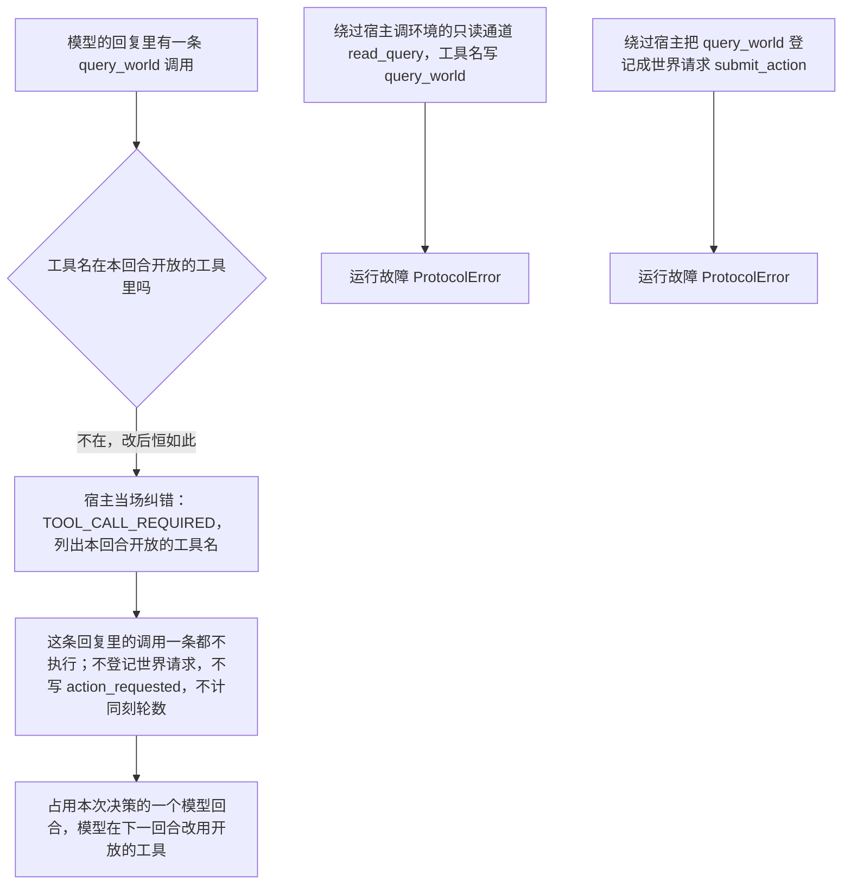
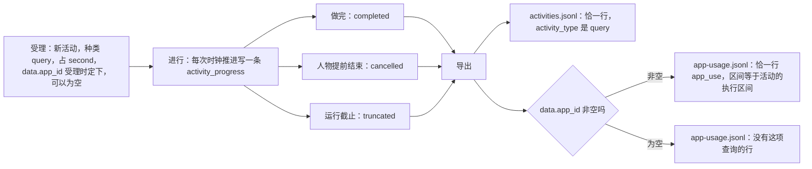

# 删除 query_world 与第五种活动

> 本章属于[首次真实模型单日运行：修复与新增规格](../SPEC-first-real-day-run.md)，读法和叫法见那一页。

## 目标与依据

改后，人物这一天里不再有「当场问世界、不花时间」这件事。它想知道买什么、在哪买，只能做一次查询：手机被占五到十分钟，做完才读到答案（查询本身的规则见[「查询」](./02-query.md)一章）。手机时间线上因此多出一种时段，查询那几分钟所在的 app 在前台；活动记录里多出一种活动「查询」，与睡眠、出行、互动、购买并列，导出、评估和查看器都要认识它。

今天相反：`query_world` 是十一个原生工具之一，由宿主在冻结观察上当场作答，不经环境、不占槽位、不推进时钟（`custom/agents/life_agent.py:160-166`、`:585-587`）；活动只有四种，引擎、导出、评估和查看器各自把这四种写死（`src/worldmock/life/action_contract.py:6`、`src/worldmock/footprints/app_usage.py:103`、`:173`、`src/worldmock/evaluation/public_evidence.py:494`、`tools/run-viewer.html:318`）。

本章实现提案里的这几项：

- 查询的接口：「删除 `query_world`。`start_side_activity` 新增 `query` 动作，是第五种活动，占槽位 2」。
- 「导出里多一种活动「查询」」裁决为新增第五种、下游跟着认，理由是提案原话「占槽位、有起止的事就是一项活动」。
- 「改动的牵连」里「下游要跟着认」，以及「与现有成文规则相反的四处要改写」中讲 `query_world` 和十一个工具的那几句。
- 规格开头「写规格时定下的细节」里与本章有关的三条：查询不触发数据集的动作回调；查询那几分钟的 app 在导出里记成这项查询活动名下的 app 使用；`inspect_run.py` 的 `queries` 子命令删除。

本章不讲查询怎样受理、花多久、答案是什么、怎样自己结束（见[「查询」](./02-query.md)一章），不给系统层全文（见[「人物读到的规则」](./10-persona-rules.md)一章），不定查询在时间线和查看器里的写法（见[「统一显示写法」](./08-display.md)一章），也不讲四个版本号在哪一步升（见[「版本、身份与基线」](./12-versions.md)一章）。

## 行为规格

### 几个叫法

| 叫法 | 意思 |
| --- | --- |
| 原生工具 | 生活决策时发给模型的工具定义。今天十一个，改后十个 |
| 世界请求 | 会改变世界的工具调用：两个开始工具、三个活动控制工具和计划修订，共六个，改前改后相同 |
| 只读工具 | 当场作答、不改世界、不花模拟时间的工具。今天是回看任务、`query_world` 和三个记忆查询，改后少掉 `query_world` |
| 活动种类 | 活动记录上的 `kind`，导出里叫 `activity_type`；与活动私有数据里的 `data.action` 取值相同 |
| 自带 app 的活动 | 私有数据里有 `app_id` 的活动：人物点名使用的内容 app，和查询所在的 app。与之相对的是引擎代为打开的 app（导航、下单、付款），它们靠 `app_foreground` 事件记录 |
| 显示轨道先做的那一步、收尾步 | 显示轨道分两次落地（见[「统一显示写法」](./08-display.md)一章）：先做的那一步与购买轨道同时进行，那时世界里还没有查询；收尾步在查询轨道和内容轨道并入之后，补上查询的整句写法 |

### 人物的工具从十一个变成十个

改后的十个原生工具：

| 类别 | 个数 | 成员 | 性质 |
| --- | --- | --- | --- |
| 开始工具 | 两个 | `start_main_activity`、`start_side_activity` | 世界请求 |
| 活动控制与计划修订 | 四个 | `report_status`、`pause_activity`、`conclude_activity`、`revise_day_plan` | 世界请求 |
| 回看任务 | 一个 | `recall_task_summary` | 只读，经环境的只读通道当场作答 |
| 记忆查询 | 三个 | `memory_recent`、`memory_search`、`memory_time_range` | 只读，由宿主当场作答 |

工具在两个地方各有固定次序，改后都只是去掉 `query_world`，其余相对位置不变：

| 场合 | 今天 | 改后 |
| --- | --- | --- |
| 计算工具指纹的次序（`_TOOL_MODELS` 的键序，`custom/agents/life_agent.py:162-166`、`:933-939`） | 七个请求工具、三个记忆查询、`query_world` | `start_main_activity`、`start_side_activity`、`recall_task_summary`、`report_status`、`pause_activity`、`conclude_activity`、`revise_day_plan`、`memory_recent`、`memory_search`、`memory_time_range` |
| 每次模型请求的 `tools` 数组（`:369-376`） | 六个世界请求、`recall_task_summary`、`query_world`、三个记忆查询 | `start_main_activity`、`start_side_activity`、`report_status`、`pause_activity`、`conclude_activity`、`revise_day_plan`、`recall_task_summary`、`memory_recent`、`memory_search`、`memory_time_range` |
| 本次决策只剩最后一个回合，或输出被截断后的那一次重试 | 只有六个世界请求 | 不变 |
| 只读问答 | 三个记忆查询加 `finish`，最后一个回合只有 `finish` | 不变 |

- 工具指纹 `tool_schema_sha256` 随之改变；`finish` 与 `submit_reflection` 仍不进指纹。
- 工具用途说明 `TOOL_DESCRIPTIONS` 的键从十二个变成十一个（十个原生工具加只读问答的 `finish`）。
- 系统层里讲 `query_world` 的两句话改写，全文见[「人物读到的规则」](./10-persona-rules.md)一章。这里只列出被替换的原文：

| 位置（今天） | 今天 | 改后 |
| --- | --- | --- |
| `src/worldmock/agents/life_prompt.py:30` | 提交前可以查询记忆、回看任务或查询世界， | 提交前可以查询记忆或回看任务， |
| `src/worldmock/agents/life_prompt.py:58` | 查询只读，不推进时间。 | 查询记忆和回看任务当场完成，不推进时间。 |

留下来、职责不变的东西：

| 留下的 | 说明 |
| --- | --- |
| `recall_task_summary` | 仍由宿主送到环境的只读通道，返回值与业务拒绝的形状不变 |
| 三个记忆查询 | 不变 |
| 只读通道 `read_query` | 环境代理、环境 actor、`LifeEnv`、引擎四处同名薄转发，参数仍是（决策上下文，工具名，请求）。改后它只回答回看任务 |
| `due_reflection` | 不变 |
| 「一次回复全部是只读查询」这种合法的批次形状 | 仍成立，指回看任务和记忆查询 |

### 人物仍然调用 query_world 时

模型可能凭旧习惯回一条 `query_world`。改后它在哪一层都不是一个存在的工具：



宿主的纠错沿用今天「调用了本回合没有提供的工具」的现成路径（`custom/agents/life_agent.py:964-967`），不为 `query_world` 另写文字。这一回合照常计入本次决策的回合数（上限是配置项 `max_react_turns`，缺省 16）。模型在下一回合读到的 JSON 如下：各键的先后与各个值逐字相同，实际是不折行的一行（`src/worldmock/agents/life_feedback.py:67-69`），这里为了阅读折了行。其中调用下标是这条调用在回复里的位置，`allowed_values` 是这个回合 `tools` 数组里的工具名，次序与数组相同：

```json
{"error_code": "TOOL_CALL_REQUIRED",
 "reason": "The tool call batch is invalid.",
 "fix": "Submit one world request, the two start tools together, or only read queries.",
 "items": [{"path": ["tool_calls", 0, "function", "name"], "written": "query_world",
            "error_code": "TOOL_CALL_REQUIRED",
            "allowed_values": ["start_main_activity", "start_side_activity", "report_status", "pause_activity",
                               "conclude_activity", "revise_day_plan", "recall_task_summary", "memory_recent",
                               "memory_search", "memory_time_range"],
            "expected": "A tool offered in this round is required.",
            "why": "The tool is not offered in this round.", "candidates": []}],
 "unmet": [],
 "instruction": "No world action was registered. Correct the reported parameters and submit again."}
```

环境一侧有三个不经宿主的入口。只读通道和登记世界请求这两处遇到 `query_world` 是运行故障（`ProtocolError`），运行停止；动作派发那一处是今天就有的兜底，不变：

| 入口 | 今天 | 改后 |
| --- | --- | --- |
| 只读通道 `LifeEnv.read_query`（`custom/envs/life_env.py:154-173`） | 认 `query_world` 与 `recall_task_summary` 两个工具名，各自核对请求类型 | 只认 `recall_task_summary` 且请求类型是它的请求模型；其余一律 `ProtocolError`，原文 `Read query tool and request type do not match`，不写事件、不改世界 |
| 登记世界请求（`src/worldmock/life/decision_coordinator.py:281-283`、`:290-292`） | `query_world` 与 `recall_task_summary` 都报 `Read-only queries must use the immediate query channel` | `recall_task_summary` 仍报这一句（先写英文错误日志 `Read-only query cannot be registered as a world action: recall_task_summary`）；`query_world` 不再是任何工具，落到「工具名没有对应的请求模型」，报 `ProtocolError`：`Direct tool call request type does not match its tool` |
| 动作派发（`src/worldmock/life/session_actions.py:437-439`） | 不在请求模型里的工具名抛 `BusinessRuleError("ACTION_REQUEST_INVALID")`，日志 `Read-only or unknown tool reached world dispatch` | 不变，`query_world` 属于不认识的工具名 |

环境与人物两侧在初始化时把工具面对一遍（`custom/envs/life_env.py:116-132`）。改后环境登记的恰是七个请求工具，人物一侧去掉三个记忆查询后也恰是这七个：

| 核对 | 改后的判据 | 不成立时 |
| --- | --- | --- |
| 环境登记的工具等于稳定工具面 | `frozenset(REQUEST_MODELS)` 等于 `_STABLE_TOOL_SURFACE`（七个名字，不含 `query_world`） | `ProtocolError`：`LifeEnv registered tool surface disagrees with the stable tool surface: [<不一致的名字，升序>]` |
| 人物一侧开放的动作工具等于环境登记的工具 | `life_action_tool_names()` 等于 `frozenset(REQUEST_MODELS)` | `ProtocolError`：`LifeEnv tool surface disagrees with the LifeAgent action tool set` |

所以只删一侧的 `query_world` 时运行起不来，不会带着两侧不一致的工具面跑下去。

### 观察、工具层里随之消失的东西

人物读到的工具层里，原来专门给 `query_world` 用的那一栏类别索引不见了，商品类别的名称和件数仍然看得到。下表其余几项人物本来就读不到，是环境交给宿主的私有数据。

| 今天 | 改后 |
| --- | --- |
| 每次观察多写两个私有键：`world_query_bindings`（查询集合）与 `world_query_page_size`（每页行数），见 `src/worldmock/life/observe.py:54`、`src/worldmock/life/world_query.py:51-65` | 不再写。禁止进入提示的键表 `FORBIDDEN_OBSERVATION_KEYS` 同时去掉这两个名字（`src/worldmock/life/narration.py:37-38`） |
| 工具层 `callable_index.query_categories`：四个类别的名称、件数、例名，只为 `query_world` 的类别筛选存在（`src/worldmock/life/callable_index.py:19-30`） | 删除。类别名和各类件数仍在 `callable_index.goods`，查询按类别名写 `target` 时人物读的是它（见[「查询」](./02-query.md)一章）。`callable_index.goods` 的内容与统计范围不变：只数地点侧商品（`src/worldmock/life/discovery.py:17-21`），所以只列有这类商品的类别；样例环境里四类都有 |
| `callable_index.INDEX_KEYS`（`:8`） | 删除，它没有任何读者 |
| 配置项 `candidate_presentation_limit` 兼作 `query_world` 的每页行数（`world_query.py:64`） | 只剩工具层商品窗口这一个用途（`src/worldmock/life/observe.py:94`），配置项本身不变 |
| 工具层 Schema 的 `callable_index` 有 `query_categories` 一项（`src/worldmock/life/prompt_schemas.py:97-102`） | 去掉这一项；提示指纹随之改变 |

### 检查脚本和查看器里随之消失的东西

- `scripts/inspect_run.py` 的 `queries` 子命令整个删除。它打印的八个键里，除运行身份外有六个量的是「当场回答的查询」（调用数、失败数、结果页字符数、带筛选的调用、筛选后为空的调用、从首次查询到购买的模型调用数），删掉 `query_world` 后没有对象。改后在命令行写 `queries` 得到 argparse 的拒绝：退出码 2，标准错误里有 `invalid choice: 'queries'`。
- 寄放在这个子命令里、与查询无关的那个数字 `reflection_retries`（就寝反思的校验重试次数）随之没有了，不搬到别处。
- 查看器里 `query_world` 的中文名、请求摘要的那一支删除；上下文画面「工具定义」的说明改成下面两句（其余文字不变）：

| 位置（今天） | 今天 | 改后 |
| --- | --- | --- |
| `tools/run-viewer-context.js:84-85` | 六个世界请求工具（两个开始工具、三个活动控制工具与计划修订）、两个世界查询工具（query_world、recall_task_summary）与三个记忆查询工具，共十一个，严格参数结构，整次运行字节相同。 | 六个世界请求工具（两个开始工具、三个活动控制工具与计划修订）、一个回看工具（recall_task_summary）与三个记忆查询工具，共十个，严格参数结构，整次运行字节相同。 |
| `tools/run-viewer-context.js:88` | 只剩最后一个回合时与输出截断后的那次重试时去掉全部查询工具（世界查询与记忆查询），只留世界请求工具。 | 只剩最后一个回合时与输出截断后的那次重试时去掉全部只读工具（回看任务与记忆查询），只留世界请求工具。 |

### 查询是第五种活动

改后人物能开始的事从四种变成五种：出行、购买、睡觉、在地点做事或用内容 app、查询。记录里每项活动都写着自己是哪一种，下面是这个「哪一种」在引擎各处的定稿。

动作闭集新动作加在末尾，已有动作的次序不动：

```python
ACTIVITY_ACTIONS = ("travel", "purchase", "sleep", "interact", "query")
MAIN_ACTIVITY_ACTIONS = ("travel", "interact", "sleep")          # 不变
SIDE_ACTIVITY_ACTIONS = ("purchase", "interact", "query")
APP_BOUND_ACTIONS = ("interact", "query")                         # 新增：自带 app 的活动
```

次序是有后果的：`ACTIVITY_ACTIONS` 进工具层 Schema 的两处枚举和观察里的 `known_activity_actions`，从而进提示指纹；`SIDE_ACTIVITY_ACTIONS` 是副工具 `action` 参数的枚举，进工具指纹。活动种类枚举 `ActivityKind` 加 `QUERY = "query"`；查询活动的 `kind` 与 `data.action` 都是 `query`。

五种活动一览（暂停、收尾两栏的规则在[「查询」](./02-query.md)一章，这里只为对照）：

| 活动 | 由哪个工具开始 | 槽位（`resource_claims`） | 能否暂停 | 做完后要不要人物收尾 | 代谢当量 | 自带 app |
| --- | --- | --- | --- | --- | --- | --- |
| 睡眠 `sleep` | 主工具 | `first` | 否 | 要 | 表里的 `sleep`，0.95 | 没有 |
| 出行 `travel` | 主工具 | `first` | 否 | 要 | 受理时写下的 `data.exertion` | 没有，导航由引擎代开 |
| 在地点做事 `interact` | 主工具 | `first` | 能 | 要 | `data.exertion` | 没有 |
| 用内容 app `interact` | 副工具 | `second` | 能 | 要 | `data.exertion` | `data.app_id`，恒非空 |
| 购买 `purchase` | 副工具 | `second` | 否 | 要 | 表里的 `purchase`，1.0 | 没有，下单和付款的 app 由引擎代开 |
| 查询 `query` | 副工具 | `second` | 否 | 不要，自己结束 | 表里的 `query`，1.0 | `data.app_id`，可以为空 |

槽位只有一处规则 `activity_slot(action, app_id)`（`src/worldmock/life/action_contract.py:17-29`）。改后查询不论 `app_id` 是什么都占 `second`；不认识的动作仍然写英文错误日志 `Unknown activity action: <动作>` 并抛 `ValueError("Unknown activity action")`。世界状态在写入和加载时用同一函数复核，这些核对对查询自动生效，不另写分支：

| 世界状态里的情形 | 结果 |
| --- | --- |
| 查询活动的 `resource_claims` 不是恰好 `{"second"}` | 拒绝：`world activity resource claims disagree with the registry` |
| 进行中的查询与另一项进行中或待收尾的槽位 2 活动（购买、用内容 app、另一次查询）并存 | 拒绝：`world active activities claim the same resource` |
| 进行中的睡眠与进行中的查询并存 | 拒绝：`Sleep requires the second activity slot to be empty` |
| 进行中的查询与在地点做的事并存 | 允许 |
| 进行中的查询与进行中的出行并存 | 槽位核对不拦；这种状态由受理规则挡在前面（人在路上不能查询，查询没做完不能出发，见[「查询」](./02-query.md)一章） |
| 活动的 `data.action` 不在五个动作之内 | 拒绝：`Activity action is missing or unknown` |

代谢当量表 `activity_met`（`src/worldmock/exchange/body.py:22-25`）加一项 `"query": 1.0`，改后整张表是 `sleep` 0.95、`walking` 3.5、`purchase` 1.0、`query` 1.0、`idle` 1.0、`light` 1.5、`moderate` 2.0、`heavy` 5.0。身体结算对出行和 `interact` 以外的活动按 `data.action` 取键（`src/worldmock/life/activities.py:152-157`），表里没有这一项的话查询第一次结算就是 `KeyError`，表现为运行中断。

中文说法一律是「查询」：

| 表 | 今天 | 改后增加 | 谁读它 |
| --- | --- | --- | --- |
| `ACTION_LABELS`（`src/worldmock/life/action_contract.py:14`） | `purchase` 购买、`sleep` 睡觉、`interact` 进行 | `query` 查询 | 今天只有睡眠的活动名读它（`src/worldmock/life/start_group.py:226`）；查询活动名开头的「查询」两个字也取这里，活动名的规则见[「查询」](./02-query.md)一章 |
| `ACTIVITY_KIND_LABELS`（`src/worldmock/life/readable.py:22`） | `sleep` 睡觉、`travel` 出行、`interact` 互动、`purchase` 购买 | `query` 查询 | 时间线渲染器在没有专门写法时的种类名 |
| `ACTIVITY_DOING_LABELS`（`:24`） | `sleep` 睡觉、`travel` 赶路、`interact` 互动、`purchase` 买东西 | `query` 查询 | 今天没有读者，只参与下一行的英文词表 |
| `ENGLISH_KIND_NAMES`（`:27-28`） | 由上面两张表的键、`ACTIVITY_ACTIONS` 和 `walking` 合成 | 自动含 `query` | 质量报告据此数时间线里漏出的英文种类名：改后时间线任何一行出现英文 `query` 都计一项 |

读常量的地方自动跟着变，不改代码：

| 位置 | 改后的取值 |
| --- | --- |
| 观察里的 `known_activity_actions`（`src/worldmock/life/observe.py:52`） | `["travel", "purchase", "sleep", "interact", "query"]` |
| 工具层 Schema 动作行与分组行的 `action` 枚举（`src/worldmock/life/prompt_schemas.py:67`、`:111`） | 多出 `query`。工具层本身不会出现 `query` 的动作行（见[「查询」](./02-query.md)一章），枚举只是照读常量 |
| 回调足迹 `app_touch.action` 的合法值（`src/worldmock/footprints/app_usage.py:302`） | 多出 `query`。没有规则能以查询为起因写出这种足迹（见下文「数据集的回调词表不变」），所以这里没有可达的行为，不设用例 |
| 评估对副工具请求动作的核对（`src/worldmock/evaluation/public_evidence.py:257`） | 认 `query`；主工具请求里写 `query` 仍报 `Start request action is outside the current closed set` |

### 查询在导出里的样子



各份导出工件对一项查询的处理：

| 工件 | 查询留下什么 | 机制 |
| --- | --- | --- |
| `activities.jsonl` | 一行。`activity_type` 是 `query`，`resource_claims` 是 `["second"]`，`segments` 是真实执行区间，`data` 原样带出活动私有数据（键集见[「查询」](./02-query.md)一章） | 重建活动不分种类（`src/worldmock/footprints/export.py:158-195`）；种类闭集的核对改读 `ACTIVITY_ACTIONS` |
| `app-usage.jsonl` | `data.app_id` 非空时恰一行 `app_use`；为空时没有行。没有 `content_consumed`，没有推送事实 | 与人物点名使用的内容 app 同一条路：行取这项活动自己的结算区间，不经 `app_foreground` |
| `events.jsonl` | 请求、受理、结果、活动进度这些现成的事件类型。没有 `app_foreground`，没有新的事件类型 | 一次查询从头到尾只有一个 app，用不着购买那套分段的前台事件 |
| `purchases.jsonl` | 什么都没有 | 只有 `action` 是 `purchase` 的副工具请求算下单尝试（`src/worldmock/footprints/purchases.py:105-111`） |
| `verified-experiences.jsonl` | 什么都没有 | 只有带内容的 `interact` 和出行产生已核验经历（`src/worldmock/footprints/experiences.py:162-171`） |
| `location-stays.jsonl` | 不受影响 | 停留只看出行 |
| `quality.json` | 结构号仍是 8，键集不变。查询计入活动的状态计数；不计入内容接触（内容接触只数真实的内容推进） | 质量报告不按种类计数（`src/worldmock/footprints/quality.py:178-207`） |
| `timeline/<人物>-<日期>.md` | 一行查询，以「查询」两个字开头，不得出现英文 `query`。整句写法见[「统一显示写法」](./08-display.md)一章；收尾步之前的写法见下文「运行日志、状态与检查脚本」 | 写法由显示一侧的写法函数给出，不在本章实现 |

查询的 `app_use` 行与今天内容 app 的行字段完全相同：

| 字段 | 取值 |
| --- | --- |
| `fact_kind` | `app_use` |
| `agent_id` | 人物身份 |
| `activity_id` | 这项查询活动的身份 |
| `app_id` | 等于活动的 `data.app_id` |
| `segments` | 等于 `activities.jsonl` 里这项活动的 `segments`。查询不能暂停，所以只要走过时间就恰是一段，从受理那一秒到做完、被结束或被截断的那一秒 |
| `status` | 这项活动在导出截止时的状态 |
| `source_event_id` | 最后一条带这项活动快照的事件 |

行的排列规则不变：`app_use` 行在文件最前，按各行第一条来源事件的先后；查询那一行的第一条来源是它的受理事件。

下游（LabelKit-DataSet）分辨一行 `app_use` 是怎么来的，办法与今天相同，只是多一个取值：拿 `activity_id` 到 `activities.jsonl` 里看 `activity_type`。

| `activity_type` | 这行 `app_use` 是什么 |
| --- | --- |
| `interact` | 人物点名使用的内容 app |
| `query` | 查询那几分钟所在的 app（人物在 `prefer` 里写的，或环境代选的） |
| `travel` | 导航 |
| `purchase` | 下单或付款 |

算例：提案的咖啡。人物在办公室，不确定哪里能点到冰美式：

| 时刻 | 发生的事 | 导出里的记录 |
| --- | --- | --- |
| 08:46:00 | 提交查询「冰美式咖啡」，`prefer` 写「瑞幸咖啡」；时长抽到 420 秒 | 查询活动开始，`data.app_id` 是瑞幸咖啡的身份 |
| 08:53:00 | 查询做完；同一次决策里购买「冰美式咖啡」，`prefer` 写「瑞幸咖啡」，购买时长抽到 200 秒，付款抽到支付宝 15 秒 | 查询的 `app_use` 行：瑞幸咖啡，一段 08:46:00–08:53:00，所属活动 `activity_type` 是 `query` |
| 08:56:05 | 下单段走完，进入付款段 | 购买的 `app_use` 行：瑞幸咖啡，一段 08:53:00–08:56:05，所属活动 `activity_type` 是 `purchase` |
| 08:56:20 | 购买完成 | 购买的另一行 `app_use`：支付宝，一段 08:56:05–08:56:20 |

手机时间线上瑞幸咖啡从 08:46:00 连续到 08:56:05，但在 `app-usage.jsonl` 里是两行：行按（活动，app）分，不同活动的行不合并。两段首尾相接、不重叠，「同一时刻只有一个 app 在前台」的自查通过。

算例：提案的午饭。11:40:00 查询「食品」，`prefer` 写「美团外卖」，时长抽到 540 秒；11:49:00 做完。`activities.jsonl` 多一行 `query`，`app-usage.jsonl` 多一行美团外卖 11:40:00–11:49:00。答案里列了几件商品与导出无关：答案只在活动的私有数据里，不产生别的行。

算例：夹具环境里的柠檬茶与纸巾（时刻用夹具的时区 Asia/Shanghai）。人物 2026 年 1 月 5 日 08:00:00 在家查询「柠檬茶」，`prefer` 写「美团」，时长按 420 秒示意（实际时长由 `query-duration:{action_id}` 抽出，用例照抽到的数算），08:07:00 做完。下游读到的两行里与本章有关的字段：

| 工件 | 字段与值 |
| --- | --- |
| `activities.jsonl` | `activity_type` `"query"`；`status` `"completed"`；`started_at` 1767571200；`ended_at` 1767571620；`planned_duration_seconds` 420；`elapsed_seconds` 420；`resource_claims` `["second"]`；`data.action` `"query"`；`data.app_id` `"meituan"`；`segments` `[{"started_at": 1767571200, "ended_at": 1767571620}]` |
| `app-usage.jsonl` | `fact_kind` `"app_use"`；`app_id` `"meituan"`；`status` `"completed"`；`segments` `[{"started_at": 1767571200, "ended_at": 1767571620}]`；`activity_id` 与上一行相同 |

同一个环境里查询「纸巾」：只有四季便利卖它，而这家店没有登记任何 app，所以 `data.app_id` 为空，`activities.jsonl` 有一行 `query`，`app-usage.jsonl` 没有这项查询的行，这几分钟手机上没有 app。

### 导出自查怎样对待查询

改后的检查都复用今天的英文原文，不新造句子：

| 检查 | 查询满足什么才通过 | 不满足时（`IntegrityError`） |
| --- | --- | --- |
| 活动快照的种类在闭集内（`src/worldmock/footprints/app_usage.py:103`、`:173`） | 种类在 `ACTIVITY_ACTIONS` 之内，`query` 通过 | 表外的词仍报 `Activity snapshot uses a retired activity kind` |
| `app_use` 行所属活动有真实的 app 身份（`src/worldmock/footprints/invariants.py:69-73`） | 所属活动是出行或购买（引擎代开的 app，另有检查）；否则它的种类在 `APP_BOUND_ACTIONS` 之内且 `data.app_id` 非空 | `App usage activity has no actual app identity`。给没有 app 的查询挂一行 `app_use` 就报这一句 |
| `app_use` 行的 app 等于活动的 app（`:76-77`） | 行的 `app_id` 等于查询的 `data.app_id` | `App usage identity disagrees with its activity` |
| `app_use` 行的区间等于活动的执行区间（`:78-79`） | 行的 `segments` 等于查询活动的 `segments` | `App use intervals disagree with actual execution` |
| 同一时刻只有一个 app 在前台（`:82-93`） | 查询的区间与同一人物其他 `app_use` 区间不重叠、长度为正 | `App use intervals overlap or have no positive duration` |
| 活动的执行区间之和等于已做时长（`src/worldmock/footprints/export.py:192-194`） | 查询照常写活动进度 | `Activity intervals do not account for its executed duration` |
| 前台事件的步骤在闭集内（`src/worldmock/footprints/app_usage.py:34`、`:314`） | 闭集仍是 `navigation`、`ordering`、`payment`；查询不写前台事件 | 步骤写成 `query` 的 `app_foreground` 报 `App foreground step or interval is invalid` |
| 内容消费只属于 `interact`（`:183`） | 查询的活动进度不带 `content` | `Content consumption must use the current interact content contract` |
| 导航区间不与槽位 2 活动重叠（`src/worldmock/footprints/invariants.py:383-385`） | 人在路上不存在进行中的查询（见[「查询」](./02-query.md)一章），所以自动满足 | `Navigation app use overlaps a side activity or leaves its trip` |

`_AUTOMATIC_ACTIVITY_TYPES`（引擎代为使用 app 的活动种类，`invariants.py:30`）仍是出行和购买两种；冻结目录里前台步骤到 app 角色的表（`src/worldmock/footprints/frozen_environment.py:129`）仍是三个键。导出认证不核对查询的 app 在冻结目录里是什么角色，带 app 的 `interact` 今天也不核对。

### 数据集的回调词表不变

提案讲「导出里多一种活动」时提到，「数据集提醒规则里可以写的活动种类」今天也按四种写死。这半句可以读成「回调规则也要能订阅查询」；规格的选择是这一处不放开：放开是提案没有要求的数据集能力，目录的格式变化只限于提案点名的那几项。

数据集的 `callbacks.jsonl` 里，动作触发能写的 `key` 今天是 `purchase`、`interact`、`sleep`，出行另用带 `travel_method_id` 的写法（`src/worldmock/catalog/callback_models.py:27-39`）。改后一个字不改：

- `key` 写 `query` 的规则由严格行模型拒绝，码 `ENVIRONMENT_KIND_INVALID`，详情以 `callbacks.jsonl:<行号> ` 开头，与今天写了别的不认识的 `key` 完全相同。
- 引擎受理一次查询时照常以这项活动的动作为键求值动作回调（`src/worldmock/life/decision_coordinator.py:409-431`），键是 `query`；没有规则能订阅它，所以不触发任何状态增量、足迹链或转账，带 `once_per: local_day` 的增量也不因查询的执行区间结算。
- 目录格式号不因本章变化。

设计文档必须带上这句话，写在《资源引擎》「声明式回调」，其余文档只引用：

> 动作触发的 `key` 只有 `purchase`、`interact`、`sleep` 三个值，出行另用带 `travel_method_id` 的写法。查询（`query`）不是合法的 `key`，写了报 `ENVIRONMENT_KIND_INVALID`；受理查询不触发任何动作回调。

### 评估怎样读查询

评估（行为报告、长期比较、盲评）读的是导出。带查询的一天要能照常评估：查询的那几分钟照实进活动行，带 app 的算在手机上，查询本身不算一条公开的点事实。

| 评估的环节 | 今天 | 改后 |
| --- | --- | --- |
| 读入活动行（`src/worldmock/evaluation/public_evidence.py:490-500`） | 种类不在四种之内报 `Activity type is outside the current closed set` | 闭集改读 `ACTIVITY_ACTIONS`，含查询的导出可以评估。种类与 `data.action` 不相等仍报 `Activity action disagrees with its kind`，`data.action` 不在闭集仍报 `Activity requires its actual action` |
| 开始请求的公开形状（`:266-275`） | `interact`、`purchase`、`sleep` 各一支，其余一律按出行造路线对象 | 查询单写一支，返回空：查询的请求和受理不产生公开点事实，与睡眠开始同样处理。不写这一支的话查询会落进出行分支，造出一条没有路线的「出行」证据 |
| 活动控制的公开形状（`:300-311`） | 出行和 `interact` 之外返回空 | 不变，所以用 `conclude_activity` 提前结束查询、用 `report_status` 点到进行中的查询也都不产生公开点事实 |
| 渠道与时长语义（`src/worldmock/evaluation/adapters.py:577-579`） | 只有带 `app_id` 的 `interact` 算数字交互 | 种类在 `APP_BOUND_ACTIONS` 之内且 `data.app_id` 非空的算数字交互（`digital_interaction`、`world_internet_session`、领域 `internet_use`）；没有 app 的查询算现实活动（`physical_activity`、`world_activity`） |
| 盲评包的活动行 | `{action, start, end, status, location}`，`action` 只要求非空 | 不变。查询的行 `action` 是 `query`，区间是真实执行区间 |
| 长期比较的活动类别 | 从两边数据里现取 | 不变，出现过查询就多一个类别 `query` |
| 公开点事实的三个闭集（`src/worldmock/evaluation/review.py:41-66`） | — | 不动 |
| `behavior-metrics-4`、`evaluation-metrics-2`、`blind-review-packet-2` | — | 三个标识都不变 |

两句成文规则的定稿：

| 文档与小节 | 今天（行号） | 改后 |
| --- | --- | --- |
| 《行为评估》「行为报告」 | `docs/design/07-evaluation.md:42`：内容接触只取实际正向播放；纯目录展示、推送和系统应用足迹不算消费。 | 内容接触只取实际正向播放；查询、推送和系统应用足迹不算消费。 |
| 手册 `docs/manual/evaluation.md`「修改类别映射和公开参照」 | `:118`：数字交互只来自真实 app 绑定活动；目录浏览、内容消费和系统应用触点分别依据实际证据呈现。 | 数字交互只来自真实 app 绑定活动；内容消费和系统应用触点分别依据实际证据呈现。带 app 的查询算数字交互，不带 app 的查询算现实活动。 |

### 运行日志、状态与检查脚本

- 运行日志的组件仍按调用判定：购买记 `commerce`，出行记 `travel`，其余记 `engine`（`src/worldmock/life/decision_coordinator.py:211-221`）。查询的受理与拒绝都记在 `engine` 下，这个函数不改。
- `worldmock status` 原样列出进行中的活动，不分种类（`src/worldmock/status.py:40`、`:78-80`）；进行中的查询以 `kind` 为 `query` 出现，不改代码。
- `scripts/inspect_run.py` 的事件摘要写活动名和状态，不分种类（`:106-127`）；除删除 `queries` 之外不因本章再改。

查询那一行的整句写法「查询冰美式咖啡（瑞幸咖啡）」由显示轨道在收尾步补上（见[「统一显示写法」](./08-display.md)一章）。可是导出每次都要生成时间线（`src/worldmock/footprints/export.py:113-131`），本章和[「查询」](./02-query.md)一章的导出用例在查询轨道并入时就要通过，所以查询轨道并入到收尾步之间要有确定的写法。这条写法是[「统一显示写法」](./08-display.md)一章的一般规则，不是本章另立的：没有专门写法的种类，写中文种类表 `ACTIVITY_KIND_LABELS` 里的种类名，表里没有的种类才是故障。睡眠今天就是这样写成「睡觉」的。查询轨道给这张表加上 `query` 之后，这一段里各处显示如下（定义在[「统一显示写法」](./08-display.md)一章，这里照录）：

| 哪里 | 查询轨道并入到收尾步之间 | 收尾步之后 |
| --- | --- | --- |
| 导出的一天时间线 | 「查询」两个字 | 查询冰美式咖啡（瑞幸咖啡） |
| `scripts/inspect_run.py events` 的活动进度行 | 「查询 → <status>」 | 「查询冰美式咖啡（瑞幸咖啡） → <status>」 |
| 查看器 | 目标处显示「—」，类型列显示原值 `query` | 整句写法，类型列显示「查询」 |

显示轨道先做的那一步改写渲染器时要带着这条一般规则，否则查询轨道一并入，带查询的运行就导不出来。

### 边界情形

| 情形 | 结果 |
| --- | --- |
| 人物提前结束查询 | 活动行 `status` 是 `cancelled`，`segments` 止于结束那一秒；有 app 时 `app_use` 行的区间和状态与之相同 |
| 运行截止时查询还在进行 | 活动行 `status` 是 `truncated`，区间止于截止时刻；`app_use` 行相同 |
| 查询做完的同一秒接着购买 | 两项活动的区间首尾相接；槽位在查询做完那一刻已经让出（见[「查询」](./02-query.md)一章），世界状态的同槽位核对与导出的前台不重叠自查都通过 |
| 查询与在地点做的事并行 | 两行活动，一个占 `first`、一个占 `second` |
| 没有任何 app 卖所查的商品 | 活动行照常，`data.app_id` 为空，没有 `app_use` 行，评估算现实活动 |
| 从带着进行中查询的检查点恢复或重放 | 世界状态按上文的槽位规则复核后照常继续；恢复时不为查询活动另加专门核对 |
| 模型在同一条回复里既调 `query_world` 又调合法工具 | 整条回复纠错，合法的那一条也不执行，与今天调用未提供的工具时相同 |
| 结构号是 13 的世界状态、结构号是 5 的导出 | 由严格比较直接拒绝，不迁移（见[「版本、身份与基线」](./12-versions.md)一章） |

### 明确不做

- 不新增 `app_foreground` 的步骤，不改 `_FOREGROUND_STEPS`、`_AUTOMATIC_ACTIVITY_TYPES` 和冻结目录的步骤表。起草时提过的另一种做法「查询结束那一秒写一条步骤为 `query` 的前台事件」不采纳：它要新写一段事件、三处闭集各加一项、再加一条区间自查，而一次查询从头到尾只有一个 app。
- 回调动作触发的 `key` 不加 `query`。
- 不新增「查询的 app 必须是内容 app」「能经它买到至少一件」这类导出认证。
- 不把 `queries` 子命令改造成新的查询成本报告，也不为 `reflection_retries` 另留子命令。
- 只读通道 `read_query` 不改名，三个参数不变；不借机删除观察里没有生产读者的 `known_activity_actions`。
- 不给 `quality.json` 增删键，不给运行清单增删字段，不新增事件类型，不新增宿主拒绝码，不为查询新增公开点事实类型。
- 不为世界状态新增「活动种类必须等于 `data.action`」的核对；这一条今天只在评估读入时判，保持原样。
- 不留兼容：不把模型发来的 `query_world` 翻译成查询动作，不读带 `world_query_bindings` 或 `query_categories` 的旧观察，不保留 `world_query` 模块的任何再导出。
- 不加扫描 `query_world` 字样的守卫测试，也不用「模块找不到」这类断言证明删除；删除面由上文的真实拒绝证明。
- LabelKit-DataSet 认识第五种活动不在本仓；本仓只把它要读的合同写清楚。
- 查询在时间线、查看器、`inspect_run.py` 里的整句写法不在本章定。

### 本章定下的细节

| 事项 | 定下的做法 | 理由 |
| --- | --- | --- |
| 「自带 app 的活动」怎样登记 | 在 `life/action_contract.py` 新增常量 `APP_BOUND_ACTIONS = ("interact", "query")`，导出、导出自查、评估三处判断都从这里导入 | 三处各写一份同值元组会被单一归宿检查判成规则表克隆；动作闭集本来就只在这个文件声明 |
| `activity_slot` 怎样认查询 | 条件写成 `if main or action in ("purchase", "query"):`，其后两行 `return` 一字不改 | 现有两条源码变异锚在那两行上；查询与购买同属「不看 app、恒占槽位 2」 |
| `ACTIVITY_DOING_LABELS` 里查询的说法 | 「查询」 | 这张表没有读者，全仓只用一个中文说法 |
| 工具层 Schema 的动作枚举 | 照读 `ACTIVITY_ACTIONS`，多出 `query`，不因「工具层没有查询的动作行」另写一个四项的枚举 | 不留第二份动作表 |
| `start_tool`、`binding_action` 对 `query` | 自动认得，不另加拒绝 | 这两个函数只判动作是否在闭集内；谁会传 `query` 进来见[「查询」](./02-query.md)一章 |
| 登记世界请求时遇到 `query_world` | 不再走「只读查询不能登记」那一句，落到「工具名没有对应的请求模型」 | 它已经不是任何工具，不应当留着一条专门认它的分支 |
| 只读通道的判定 | `tool != "recall_task_summary"` 或请求类型不是回看的请求模型，都报今天那一句原文 | 只剩一个工具，不必再查表；错误文字不变，测试不用另认新句 |
| 禁止进入提示的键表 | 去掉 `world_query_bindings`、`world_query_page_size` 两个名字 | 这两个键不再存在；留着是为已删除的东西设防 |
| 评估里查询的那一支 | 在睡眠那一支之后独立写 `if action == "query": return None`，不与睡眠合并成一个条件 | 不写这一支，查询的开始请求会落进出行分支；查询与睡眠是两条规则，各占一行 |
| `queries` 子命令由谁、何时删 | 显示轨道在先做的那一步里删，连同它的测试 | 它与别的改动无关；那条测试经真实宿主调用 `query_world`，必须先于查询轨道删掉 |
| 删除 `queries` 怎样证明 | 子进程运行 `scripts/inspect_run.py <运行目录> queries`，断言退出码 2 与 `invalid choice: 'queries'` | 这是用户看得见的行为；不靠检查脚本里还有没有某个函数 |
| 查看器「工具定义」说明的两句话 | 上文表里的定稿 | 说明文字由查看器用例逐字比较，必须给出原文 |
| 查看器 `KIND_COLORS` 里查询的颜色 | `#5b8def` | 与现有四种颜色都不同；显示轨道落地 |
| 收尾步之前各处怎样显示查询 | 时间线和 `inspect_run.py` 写种类名「查询」，查看器目标处「—」、类型列原值；规则本身是[「统一显示写法」](./08-display.md)一章的「没有专门写法的种类写中文种类名」，本章不另立 | 查询轨道并入时查询的整句写法还没有落地，而导出要生成时间线，不能因此失败。与「没有内容的 app 使用」在内容轨道并入前用过渡写法是同一个道理 |
| 回调那句话写在哪 | 只写在《资源引擎》「声明式回调」，《模拟引擎》「回调事务」引用它 | 词表归《资源引擎》；一条规则只写一处 |
| 两句评估成文规则的措辞 | 上文表里的定稿 | 规格开头只定了意思，这里给出原文 |
| `test_observation_agent_seam.py` 里那条 `query_world` 用例 | 删除，不改写 | 它证明的「只读查询先于一个世界请求、读的是冻结观察」已由 `test_read_query_runtime.py::test_host_tool_message_is_the_environment_recall_result` 用回看任务证明 |
| 本章的导出用例放哪 | 新文件 `tests/integration/footprints/test_query_export.py`，一个真实引擎跑出带 app 的查询、不带 app 的查询、提前结束的查询后导出一次，各用例共用 | 导出认证慢，不为每条断言各导出一次 |

## 接口、删除面与文件指引

### 整个删除，不留兼容

- `src/worldmock/life/world_query.py` 整个文件：`QueryWorldRequest`、`attach_world_query`、`_filter_issues`、`validate_world_query`、`query_argument_report`、`_matching_entries`、`query_world`。它用到的 `compact`、`argument_report`、`resolve_name`、`product_bindings`、`purpose_only_schema` 各有别的调用方，留下。
- `callable_index.query_category_index`、`callable_index.INDEX_KEYS`，以及 `callable_index()` 返回值里的 `query_categories`。
- 观察里的 `world_query_bindings`、`world_query_page_size` 两个键和禁键表里对应的两项。
- `LifeEnv.read_query` 里 `query_world` 的分支；宿主 `_decision_error` 与 `dispatch_react_tool` 里 `query_world` 的三段。
- `TOOL_DESCRIPTIONS["query_world"]` 和系统层的两句旧话。
- `scripts/inspect_run.py` 的 `queries` 子命令及只为它服务的全部符号：`QUERY_REPORT_KEYS`、`QUERY_TOOL`、`DECISION_TOOL`、`REFLECTION_TOOL`、`REFLECTION_ORIGINAL_MESSAGES`、`_QUERY_CALLS`、`_TOOL_MESSAGES`、`_MODEL_REQUESTS`、`_json_object`、`_query_calls`、`_tool_answers`、`_query_page`、`_query_filtered`、`_model_requests`、`_purchase_settlements`、`_calls_to_purchase`、`_reflection_retries`、`query_cost_report`、`cmd_queries`。
- 查看器 `TOOL_LABELS.query_world` 与 `readableReq` 的 `case 'query_world'`。

### 生产文件：删除 query_world

| 文件 | 改动 | 轨道 |
| --- | --- | --- |
| `src/worldmock/life/world_query.py` | 删除文件 | 查询轨道 |
| `custom/agents/life_agent.py` | 删 `:61` 的导入；`_TOOL_MODELS`（`:162-166`）与 `_QUERY_TOOL_MODELS`（`:168-169`）去掉 `query_world`；`_decision_error`（`:511-530`）删两段 `query_world` 分支，说明里删去讲查询筛选的半句；`dispatch_react_tool` 删 `:585-587`；注释 `:160-161` 与 `build_react_tool_schemas` 的说明 `:325` 改成十个、不提 `query_world`。`life_action_tool_names()` 不改，结果自然是七个请求工具 | 查询轨道 |
| `custom/envs/life_env.py` | 删 `:21` 的导入；`_STABLE_TOOL_SURFACE`（`:26-37`）去掉 `query_world`，注释 `:24` 改成「恰好受理七个请求工具」；`_validate_registered_tool_surface` 的 `:125` 改成 `registered = frozenset(REQUEST_MODELS)`；`read_query` 的 `:159-161` 改成只认 `recall_task_summary`，删 `:171-173` | 查询轨道 |
| `src/worldmock/life/observe.py` | 删 `:17` 的导入与 `:54` 的调用，观察数据直接返回 | 查询轨道 |
| `src/worldmock/life/narration.py` | 禁键表删 `:37-38` 两项，注释 `:19` 删去讲分页参数的半句 | 查询轨道 |
| `src/worldmock/life/callable_index.py` | 删 `INDEX_KEYS`（`:8`）、`query_category_index`（`:23-30`）和返回值里的 `query_categories`（`:19-20`）。同一函数由购买轨道加 `prefer_apps`，见[「购买时写想用的 app」](./01-purchase-prefer.md)一章 | 查询轨道 |
| `src/worldmock/life/prompt_schemas.py` | `_CALLABLE_INDEX`（`:97-102`）去掉 `query_categories` | 查询轨道 |
| `src/worldmock/life/decision_coordinator.py` | `:281` 改成只判 `recall_task_summary` | 查询轨道 |
| `src/worldmock/life/action_contract.py` | 注释 `:5` 删去「query_world 的 action 筛选」 | 查询轨道 |
| `src/worldmock/life/tool_groups.py` | `compact` 的说明（`:15-16`）删去「与世界查询的返回项」，只讲工具层分组。同一句里引用的小节名改成「出行、内容与查询」归内容轨道，见[「打开 app 与 app 目录字段」](./04-app-opening.md)一章 | 查询轨道 |
| `src/worldmock/life/read_query_runtime.py` | 只改说明：`read_query` 回答的是回看任务（`:4` 等处） | 查询轨道 |
| `src/worldmock/agents/life_prompt.py` | `TOOL_DESCRIPTIONS` 删 `query_world`（`:80`）；系统层整份定稿见[「人物读到的规则」](./10-persona-rules.md)一章，由同一条轨道一次落下 | 查询轨道 |
| `scripts/inspect_run.py` | 模块说明删 `:14`、`:21-22`；删 `:693-828` 整段；删 `:853` 的子解析器与 `:858` 派发表里的 `queries`。脚本里有四处引用指向《记录引擎》并不存在的「调试工具」一节：`:21`、`:693` 两处就在删掉的这几段里，随 `queries` 子命令一起没有；`:16`、`:420` 两处改指《记录引擎》「显示写法与检查工具」，不是本章的改动，见[「统一显示写法」](./08-display.md)一章 | 显示轨道，先做的那一步 |
| `tools/run-viewer.html` | `TOOL_LABELS` 删 `query_world`（`:320`）；`readableReq` 删 `:724-725` | 显示轨道，收尾步 |
| `tools/run-viewer-context.js` | `:84-85`、`:88` 换成上文定稿 | 显示轨道，收尾步 |

### 每一处写死活动种类或动作的位置

「不改」的行也列出，免得实现时误改或漏核。标「见[「查询」](./02-query.md)一章」的是引擎内部按种类分支的地方，行为由那一章规定，这里只登记位置。

| 位置（今天） | 今天的写法 | 改后 | 轨道 |
| --- | --- | --- | --- |
| `src/worldmock/life/action_contract.py:1`、`:20` | 说明写「四个生活动作」 | 五个 | 查询轨道 |
| `action_contract.py:6` | `ACTIVITY_ACTIONS` 四项 | 末尾加 `"query"` | 查询轨道 |
| `action_contract.py:10` | `SIDE_ACTIVITY_ACTIONS` 两项 | 末尾加 `"query"` | 查询轨道 |
| `action_contract.py:14` | `ACTION_LABELS` 三项 | 加 `"query": "查询"` | 查询轨道 |
| `action_contract.py:17-29` | `activity_slot`：出行、睡眠占 `first`，购买占 `second`，`interact` 看 `app_id` | 查询占 `second`；写法见「本章定下的细节」 | 查询轨道 |
| `action_contract.py:32-45` | `start_tool`、`binding_action` 读 `ACTIVITY_ACTIONS` | 不改 | — |
| `action_contract.py`（新增） | — | 新增 `APP_BOUND_ACTIONS`，并登记进 `tests/unit/engineering/test_single_source.py` 的归宿表 | 查询轨道 |
| `src/worldmock/life/models.py:29` | `WORLD_SCHEMA_VERSION = 13` | 14 | 版本提交 |
| `models.py:137-143` | `ActivityKind` 四个成员 | 加 `QUERY = "query"` | 查询轨道 |
| `models.py:628-631` | `active_side_activities`：说明写「购买或用 app」 | 说明加上查询；条件那一行不改 | 查询轨道 |
| `models.py:669-685`、`:729-735` | 槽位占用、睡眠与槽位 2 互斥：读 `ACTIVITY_ACTIONS` 与 `activity_slot` | 不改，自动对查询生效 | — |
| `models.py:713-714` | 订单核对只看购买 | 不改 | — |
| `models.py:866-883` | `StartSideActivityRequest.action` 的枚举读 `SIDE_ACTIVITY_ACTIONS` | 枚举自动多出 `query`；字段说明与交叉约束见「查询」「购买时写想用的 app」「人物读到的规则」三章 | 购买轨道、查询轨道 |
| `src/worldmock/life/readable.py:22`、`:24` | 两张中文种类表各四项 | 各加 `"query": "查询"` | 查询轨道 |
| `readable.py:25-28` | `ENGLISH_KIND_NAMES`，注释写「四个动作」 | 自动含 `query`；注释改成五个 | 查询轨道 |
| `readable.py:9` | 文件头说明写「环境层与时间线渲染器 scripts/render_day.py 共用这些说法」 | 改成指向显示写法模块 `src/worldmock/footprints/display_wording.py`：显示轨道先做的那一步之后，读 `ACTIVITY_KIND_LABELS` 的是这个模块，不再是渲染脚本（见[「统一显示写法」](./08-display.md)一章） | 查询轨道 |
| `src/worldmock/exchange/body.py:22-25` | `activity_met` 七项 | 加 `"query": 1.0` | 查询轨道 |
| `src/worldmock/life/activities.py:21` | 注释写「四个生活动作之一」 | 五个 | 查询轨道 |
| `activities.py:152-157`、`src/worldmock/life/body.py:93-99` | 出行与 `interact` 读 `data.exertion`，其余按动作或种类取代谢键 | 不改，查询取 `query` | — |
| `src/worldmock/life/observe.py:52` | `known_activity_actions` 读常量 | 不改 | — |
| `src/worldmock/life/prompt_schemas.py:67`、`:111` | 工具层动作枚举读常量 | 不改 | — |
| `src/worldmock/life/decision_coordinator.py:211-221` | 运行日志组件：购买、出行之外记 `engine` | 不改 | — |
| `src/worldmock/life/admission.py:217-229`、`start_group.py:201-215`、`name_resolution.py:183-187`、`time_advance.py:316-344`、`activity_control.py:80-87`、`:298-310`、`activities.py:59-66`、`:96-99`、`activity_validation.py:22-31`、`tool_layer.py:137-152` | 「不是购买就按内容 app」「不是出行、睡眠、购买就按 `interact`」这类分支 | 见[「查询」](./02-query.md)一章；每一处都要有一条以查询为输入的用例 | 查询轨道 |
| `src/worldmock/footprints/app_usage.py:103`、`:173` | 字面集合 `{"sleep", "travel", "interact", "purchase"}` | 改读 `ACTIVITY_ACTIONS`（本文件 `:13` 已导入） | 查询轨道 |
| `app_usage.py:152` | 只有 `kind == "interact"` 且带 app 的活动形成 `app_use` 行 | 种类在 `APP_BOUND_ACTIONS` 之内且 `data.app_id` 非空 | 查询轨道 |
| `app_usage.py:1`、`:63-67`、`:91-93` | 模块与两个函数的说明只提人物点名使用 | 写明查询所在的 app | 查询轨道 |
| `app_usage.py:34`、`:183`、`:302` | 前台步骤闭集；内容消费只属 `interact`；回调足迹的动作读常量 | 不改 | — |
| `src/worldmock/footprints/invariants.py:69-73` | `app_use` 行所属活动不是出行、购买，就必须是带 app 的 `interact` | 改成种类在 `APP_BOUND_ACTIONS` 之内且带 app；函数说明同步 | 查询轨道 |
| `invariants.py:30`、`:383-385` | 引擎代开 app 的种类；导航与槽位 2 活动不重叠 | 不改 | — |
| `src/worldmock/footprints/frozen_environment.py:129` | 前台步骤到 app 角色的表 | 不改 | — |
| `frozen_environment.py:73-83` | 纯目录浏览的认证，只看 `interact` | 整段由内容轨道删除，见[「打开 app 与 app 目录字段」](./04-app-opening.md)一章 | 内容轨道 |
| `src/worldmock/footprints/export.py:28-29` | `EXPORT_SCHEMA_VERSION = 5` | 6，注释补上活动种类含查询 | 版本提交 |
| `src/worldmock/footprints/` 下的 `export.py:158-195`、`experiences.py:162-171`、`purchases.py:105-111`、`quality.py:178-207`、`:437`、`timeline_labels.py:20`、`:70`、`location_stays.py:49` | 不分种类，或只认某一两种而其余落空 | 不改；「查询落空」由测试钉住 | — |
| `src/worldmock/evaluation/public_evidence.py:29` | 注释写「只取现行四类」 | 五类 | 查询轨道 |
| `public_evidence.py:254` | 副工具请求的键集恰为两个 | 三个，见[「购买时写想用的 app」](./01-purchase-prefer.md)一章 | 购买轨道 |
| `public_evidence.py:257` | 动作读 `SIDE_ACTIVITY_ACTIONS` | 不改 | — |
| `public_evidence.py:266-275` | `_start_shape` 其余动作落进出行分支 | 加查询一支，返回空 | 查询轨道 |
| `public_evidence.py:300-311` | `_activity_shape` 出行与 `interact` 之外返回空 | 对查询不改（对象类型那一行由内容轨道改） | — |
| `public_evidence.py:494` | 字面集合 | 改读 `ACTIVITY_ACTIONS`（本文件已导入） | 查询轨道 |
| `src/worldmock/evaluation/adapters.py:577` | `activity_type == "interact"` 且带 app | 种类在 `APP_BOUND_ACTIONS` 之内且带 app；注释 `:78` 同步 | 查询轨道 |
| `src/worldmock/evaluation/review.py:41-66`、`:640-641`、`metrics.py:139`、`:415`、`behavior_metrics.py:222`、`:334`、`:429` | 公开闭集；活动行的 `action` 非闭集；类别现取；只取睡眠和出行 | 不改 | — |
| `src/worldmock/catalog/callback_models.py:27-39` | 动作触发的 `key` 三个值，出行另一个模型 | 不改 | — |
| `src/worldmock/status.py:40`、`:78-80` | 原样列出进行中的活动 | 不改 | — |
| `scripts/inspect_run.py:106-127` | 事件摘要不分种类 | 本章不改；活动行的统一写法见[「统一显示写法」](./08-display.md)一章 | — |
| 时间线里把一项活动写成一行的那一段（今天在 `scripts/render_day.py`） | 出行、`interact` 之外取中文种类名；注释写「只按四种当前活动读取」 | 本章不改，归[「统一显示写法」](./08-display.md)一章：这一段连同注释由显示轨道先做的那一步换成调用显示写法函数，那里保留「没有专门写法的种类写 `ACTIVITY_KIND_LABELS` 里的种类名」；查询的整句写法在收尾步加进写法函数 | 显示轨道 |
| `tools/run-viewer.html:306` | `KIND_COLORS` 四项 | 加 `query:'#5b8def'` | 显示轨道，收尾步 |
| `tools/run-viewer.html:318` | `KIND_LABELS` 四项 | 加 `query:'查询'` | 显示轨道，收尾步 |
| 查看器里动作的中文表（显示轨道先做的那一步之后只有一张，在 `tools/run-viewer-context.js`） | 四个动作 | 本章不改，归[「统一显示写法」](./08-display.md)一章：收尾步在 `tools/run-viewer-context.js` 的那张表里加 `query`「查询」 | 显示轨道，收尾步 |
| `tools/run-viewer.html:1164-1173` | `actTargetText`：`interact` 一支，其余按出行拼路线 | 查询的目标写法见[「统一显示写法」](./08-display.md)一章 | 显示轨道，收尾步 |

### 夹具

基础夹具环境 `tests/fixtures/dataset-environment/` 不因本章改任何一行；清单里的版本字段由版本提交改。`tests/fixtures/viewer-context.json`（两个请求各带十一个工具）和两份完整日基线在收尾步重做，不手改。

### 先改的设计文档与手册

只列文档与小节，逐行清单见[「设计文档与手册改动清单」](./11-design-docs.md)一章。

- 《概述》「核心术语」：开始活动的方式由四种改五种。
- 《交换引擎》「身体共同结算」：代谢当量表加查询；「放松与社交需要」：查询没有内容缓解效果。
- 《资源引擎》「声明式回调」：上文那句话。
- 《模拟引擎》「动作、名称与并行」：槽位表与不能暂停的种类加查询；「出行、内容与查询」（原「出行、内容与目录浏览」）：删去讲 `query_world` 分页与类别筛选的那一句；「回调事务」：引用《资源引擎》的那句话。
- 《记录引擎》「事件与来源」：活动种类五种；「数字足迹」：`app_use` 的两种来源改成「自带 app 的活动」与前台事件，下游按 `activity_type` 分辨的那一句加 `query`；「完整导出认证」：结构号 6，导航区间与「同一时刻只有一个 app」两行的措辞带上查询。
- 《人物》「提示与工具」：原生工具十个，删去「环境查询」一行和三处转述 `query_world` 的句子；「进度、待办与记忆」：「查询只读，不推进时间或产生新事实」改写成只讲回忆与回看。
- 《行为评估》「行为报告」「认证与适配」「公开点事实」「盲评与随机性」：上文两句定稿之一，以及「动作取请求所写」「不增加公开点事实」「保留真实区间」三句带上查询。
- 《状态与序列化》「单一状态归属」：世界状态结构版本 14；「世界、人物与活动」：活动种类五种，查询占 `second`。
- 《运行与框架集成》「原生模型与工具」：十个原生工具；`read_query` 回答回看任务。
- 手册《安装、运行与恢复》「检查工具交互」：讲 `query_world` 的那一句换成查询动作的说明；手册《理解固定世界规则》：槽位与暂停的叙述加查询；手册 `docs/manual/evaluation.md`「修改类别映射和公开参照」：上文两句定稿之一。

### 归哪条实施轨道

| 轨道 | 本章归它的事 |
| --- | --- |
| 版本提交 | `WORLD_SCHEMA_VERSION` 14、`EXPORT_SCHEMA_VERSION` 6 和钉住它们的断言 |
| 购买轨道 | `public_evidence.py:254` 的键集；`tests/life/conftest.py` 的请求助手（本章的用例用它写查询请求） |
| 显示轨道（先做的那一步） | 删除 `scripts/inspect_run.py` 的 `queries` 子命令和它的测试，写命令行拒绝 `queries` 的那条用例；改写时间线渲染器时带着「没有专门写法的种类写中文种类名」这条一般规则 |
| 查询轨道 | 两张生产文件表里标给它的全部改动；系统层整份定稿连同逐字钉住它的测试；`tests/integration/footprints/test_query_export.py` 与本章其余新用例；本章登记的源码变异 |
| 内容轨道 | `frozen_environment.py:73-83` 的删除；`tests/integration/life/test_content_start_evidence.py::test_current_started_activity_public_result_and_complete_export` 去掉「美团」参数和没有内容的那一支。这条用例先由结果与结束轨道加上它的断言，写成两种状态下都成立；内容轨道并入得晚，在那之后再改 |
| 显示轨道（收尾步） | 查看器的种类表、颜色表和并到 `tools/run-viewer-context.js` 的动作表各加 `query`，删 `query_world`，说明文字两句；显示写法函数里查询的整句写法（见[「统一显示写法」](./08-display.md)一章）；两个 `.cjs` 测试文件 |
| 收尾 | 重录 `viewer-context.json`，改 `test_run_viewer_recording.py`；两个脚本化的日子里，活动日加一次对「柠檬茶」的查询（脚本见[「版本、身份与基线」](./12-versions.md)一章），之后重冻两份基线 |

查询轨道并入之后、收尾之前，`test_run_viewer_recording.py` 与录制样例不一致（样例里还是十一个工具），这是[「版本、身份与基线」](./12-versions.md)一章规定的中间状态，中间提交的门不含这个文件。

### 在这里会咬人的约束

- 源码变异按原文行定位，下面几行不能改写，否则要同步改 `tests/dataset_acceptance.py`：`action_contract.activity_slot` 里的 `return "first" if main else "second"` 与 `return "first" if app_id is None else "second"`；`models.active_side_activities` 的 `if "second" in activity.resource_claims)`；同在本章要改的两个文件里、但本章不该碰的 `LifeAgent._observe_environment` 的函数体和 `decision_coordinator._decision_groups` 里的 `groups.setdefault(pending.decision_id, []).append(pending)`。
- 单一归宿检查把两张内容相同的模块级表、两个函数体相同的函数都判为克隆。`APP_BOUND_ACTIONS` 只能定义一次再导入；新增的常量要登记进归宿表。
- `worldmock.life.action_contract` 属于基础层，导出、评估可以在模块顶层导入它，不需要函数内导入，也就不用动函数内导入登记表。
- 每个函数不超过 50 行、5 个参数，每个文件不超过 2000 行，每个函数有中文 Doxygen 说明，日志和错误文字是英文。本章只减不增：`LifeEnv.read_query` 与宿主的 `_decision_error` 变短，`invariants._app_invariants` 只改一个条件。`tools/run-viewer.html` 今天 1805 行，本章在它里面只给种类表、颜色表各加一项，删两处。
- 覆盖率门要求每个公开函数的每一行都被执行。本章不新增公开函数；删除 `world_query.py` 只让分母变小。
- 动作闭集一变，提示指纹和工具指纹都变，已有运行不能恢复或重放，属预期；中间提交上的录制样例和两份基线都是旧的，只在最终提交上重做一次。
- 导出要生成时间线，所以查询轨道的导出用例依赖显示一侧能写出查询那一行。显示轨道先做的那一步如果把没有专门写法的种类一律当成故障，查询轨道并入后含查询的运行就导不出来；两条轨道按上文「运行日志、状态与检查脚本」里那张过渡期的表对齐，`scripts/inspect_run.py` 的活动行同理。
- `SIDE_ACTIVITY_ACTIONS` 一加 `query`，`tests/unit/agent_protocol/test_tool_description_references.py` 就要求副工具的字段说明里真的出现 `query` 这个词：放行的拉丁字母单词读这个常量（`:45-46`），而且放行的词必须都被用到（`:130-133`）。所以元组的改动与副工具字段说明的定稿（见[「人物读到的规则」](./10-persona-rules.md)一章）必须在同一次提交里。

## 测试要求

### 行为测试

| 规则 | 层 | 测试文件 | 验收行为 |
| --- | --- | --- | --- |
| 原生工具恰十个，两种次序如规格 | integration | `tests/integration/runtime/test_seven_layer_request.py` | 真实宿主请求的 `tools` 恰十个且名单、次序与规格相同；`tuple(_TOOL_MODELS)` 等于指纹次序；工具指纹等于按这十个重算的值；逐个改用途句只变工具指纹、提示指纹不变 |
| 最后一个回合与截断后的重试只剩六个世界请求，只读问答不变 | integration | `tests/integration/runtime/test_output_truncation.py`、`test_life_agent_protocol.py` | 截断前的请求是十个工具，重试的请求是六个；最后一个回合的请求是六个；只读问答的工具是三个记忆查询加 `finish` |
| 模型调用 `query_world` 时宿主的纠错 | integration | `tests/integration/runtime/test_current_runtime_contract.py::test_removed_query_world_reply_is_refused_as_a_tool_that_is_not_offered` | 脚本模型先回 `query_world`、再回一条合法的开始请求：第二个模型请求的最后一条消息是规格里的 JSON，`allowed_values` 等于第一个请求的十个工具名；运行里只有一条 `action_requested`，属于合法的那条；结果是 `in_progress` |
| 同一条回复里 `query_world` 与合法调用并列时整批纠错 | unit | `tests/unit/start_interfaces/test_batch_shapes.py::test_removed_query_world_next_to_a_valid_call_fails_the_whole_batch` | 两条调用一起校验：返回 `TOOL_CALL_REQUIRED`，明细指向 `query_world` 那一条的工具名，`allowed_values` 不含 `query_world`；校验不通过，整批都不执行 |
| 环境的只读通道只回答回看任务 | integration | `tests/integration/runtime/test_read_query_runtime.py::test_read_query_answers_only_task_recall` | 直接导入并构造 `LifeEnv`：工具名写 `query_world` 或 `memory_recent`、或工具名对而请求类型不对，都抛 `ProtocolError`，原文 `Read query tool and request type do not match`；回看任务照常返回；事件序号与世界状态不变 |
| `query_world` 不能登记成世界请求，也进不了派发 | unit、integration | `tests/unit/life/test_current_lifecycle_coverage.py::test_removed_query_world_cannot_be_registered_as_a_world_action`、`tests/integration/life/test_action_dispatch_contract.py::test_read_only_tools_cannot_enter_action_dispatch` | 真实引擎 `submit_action`：工具名 `query_world` 抛 `Direct tool call request type does not match its tool`，工具名 `recall_task_summary` 抛 `Read-only queries must use the immediate query channel`；两次都不写事件、不入队。直接派发工具名为 `query_world` 的动作仍以 `ACTION_REQUEST_INVALID` 被拒，内存世界、持久世界与事件流不变 |
| 两侧工具面恰七个，不一致时运行起不来 | integration | `tests/integration/runtime/test_env_lifecycle_coverage.py::test_registered_tool_surface_fails_closed`、`test_life_agent_protocol.py::test_plan_day_is_no_person_tool_and_revision_carries_remind_time` | `_STABLE_TOOL_SURFACE`、`frozenset(REQUEST_MODELS)`、`life_action_tool_names()` 三者相等且恰七个；人物一侧多出 `query_world` 时初始化抛 `LifeEnv tool surface disagrees with the LifeAgent action tool set`，环境一侧多出一个名字时抛另一句 |
| 观察与工具层不再带查询的私有键和 `query_categories` | integration | `tests/integration/life/test_environment_runtime.py::test_observation_carries_no_world_query_keys` | 真实观察没有 `world_query_bindings`、`world_query_page_size`；`tool_layer.callable_index` 没有 `query_categories`，`goods` 仍列出样例环境的四个类别；工具层通过 `validate_layer` |
| 禁键表去掉两个名字，其余禁键照旧被拒 | unit | `tests/unit/life/test_narration.py` | 带 `world_query_bindings` 或 `world_query_page_size` 键的输入经 `enforce_field_blacklist` 与真实渲染入口 `render_layer_json` 不再抛 `ForbiddenObservationFieldError`；私有键清单里其余每个键仍逐键被拒；清单去掉两个名字后是 56 个，不少于 55 的断言照旧成立 |
| 系统层两句与工具说明的键集 | unit | `tests/unit/start_interfaces/test_system_layer_text.py`、`tests/unit/agent_protocol/test_tool_description_references.py` | 系统层逐字断言见[「人物读到的规则」](./10-persona-rules.md)一章；本章要求 `TOOL_DESCRIPTIONS` 的键恰十一个且等于全部参数模型的键集 |
| `queries` 不再是检查脚本的子命令 | integration | `tests/integration/footprints/test_inspect_current_activity.py::test_queries_is_no_longer_a_subcommand` | 子进程运行 `scripts/inspect_run.py <运行目录> queries`：退出码 2，标准错误含 `invalid choice: 'queries'`；同一运行目录的 `summary` 退出码 0 |
| 查看器不再认 `query_world`，说明写十个工具 | system | `tests/system/viewer/run_viewer.test.cjs`、`run_viewer_context.test.cjs` | `TOOL_LABELS.query_world` 是 `undefined`；工具定义说明含规格里的两句定稿；录制样例的工具名数组是请求次序的十个 |
| 两个动作闭集的成员与次序 | unit | `tests/unit/agent_protocol/test_start_request_models.py::test_action_closed_sets_and_start_tools_are_declared_once` | 三个元组逐项等于规格；副工具参数 Schema 的 `action` 枚举是 `["purchase", "interact", "query"]`，主工具的不变 |
| 查询恒占槽位 2 | unit | `tests/unit/agent_protocol/test_start_request_models.py::test_slot_is_given_by_the_action_and_the_content_app` | `activity_slot("query", None)` 与 `activity_slot("query", "meituan")` 都是 `second`；不认识的动作仍抛 `Unknown activity action` |
| 世界状态对查询的槽位核对 | unit | `tests/unit/life/test_environment_contract.py::test_two_slots_and_pending_conclusion_occupancy`、`::test_sleep_requires_empty_second_slot` | 查询与在地点做的事并存通过；查询占 `first`、查询与进行中的购买并存、查询与进行中的睡眠并存，各以规格里的三句原文被拒；`data.action` 写成表外的词报 `Activity action is missing or unknown` |
| 带查询活动的世界状态能写入、能读回 | integration | `tests/integration/life/test_state_serialization.py::test_world_state_with_a_running_query_round_trips` | 真实引擎开始一次查询后做检查点，读回的世界状态与写入前逐值相等，查询活动的种类、槽位、`data.app_id` 都在。[「查询」](./02-query.md)一章讲检查点与恢复的也是这一条用例，不另写：重开引擎后把查询做完的断言见那一章 |
| 代谢当量表有查询一项 | unit | `tests/unit/life/test_environment_body.py::test_activity_met_table_has_walking_and_the_four_exertion_levels_but_no_fixed_vehicles` | 整张表逐项等于规格里的八项 |
| 中文种类名与英文不外漏 | unit、integration | `tests/unit/footprints/test_quality.py`、`tests/integration/footprints/test_query_export.py::test_query_line_of_the_timeline_is_chinese` | 含英文 `query` 的时间线标签计入 `english_kind_names`；真实导出的时间线里查询那一行以「查询」开头、不含 `query`，该计数为 0。这条断言在显示轨道补上统一写法之后仍然成立 |
| `known_activity_actions` 与工具层枚举随常量变 | integration、unit | `tests/integration/life/test_environment_runtime.py::test_public_layers_validate_and_contain_four_felt_signals`、`tests/unit/engineering/test_single_source.py::test_observation_offers_only_current_actions_without_retired_resource_gate` | 真实观察的 `known_activity_actions` 是规格里的五项 |
| 导出里查询是第五种活动 | integration | `tests/integration/footprints/test_query_export.py::test_query_is_exported_as_the_fifth_activity_type` | 真实引擎在做一件地点里的事的同时做完一次查询并导出：`activities.jsonl` 有一行 `activity_type` 为 `query`，`resource_claims` 为 `["second"]`，`segments` 恰一段且长度等于 `elapsed_seconds`；并行的那件事另有一行，占 `["first"]`；导出认证通过 |
| 带 app 的查询恰一行 `app_use` | integration | `test_query_export.py::test_query_with_an_app_has_one_app_use_row_over_its_execution` | 查询「柠檬茶」、`prefer` 写「美团」：`app-usage.jsonl` 里这项活动恰一行 `app_use`，`app_id` 为 `meituan`，`segments`、`status` 与活动行相同 |
| 没有 app 的查询没有 `app_use` 行 | integration | `test_query_export.py::test_query_without_an_app_has_no_app_use_row` | 查询「纸巾」：活动行存在、`data.app_id` 为空，`app-usage.jsonl` 没有这项活动的任何行 |
| 提前结束与运行截止的查询区间止于那一秒 | integration | `test_query_export.py::test_concluded_and_truncated_queries_keep_their_actual_interval` | 提前结束的查询活动行与 `app_use` 行状态都是 `cancelled`，区间止于结束时刻；跑到截止仍在进行的查询状态是 `truncated`，区间止于截止时刻 |
| 查询做完同一秒接着购买，前台不重叠 | integration | `test_query_export.py::test_query_then_purchase_in_the_same_second_keeps_one_app_in_the_foreground` | 查询的区间终点等于购买第一段的起点；`app-usage.jsonl` 里查询的那一行排在购买的两行之前（按各行第一条来源事件的先后）；导出认证通过 |
| 查询不写前台事件，不是下单尝试，没有已核验经历，不算内容接触 | integration | `test_query_export.py::test_query_leaves_no_foreground_event_order_attempt_experience_or_content_contact` | 运行里没有 `activity_id` 是查询的 `app_foreground`；`purchases.jsonl` 没有它的 `order_attempt`；`verified-experiences.jsonl` 没有它的行；`app-usage.jsonl` 没有它的 `content_consumed`；`quality.json` 结构号 8、顶层键集与没有查询的导出相同 |
| 查询的 `app_use` 行不可伪造 | unit | `tests/unit/footprints/test_phone_records.py::test_app_use_row_of_a_query_must_agree_with_the_query` | 改行的 `app_id`、改行的 `segments`、给没有 app 的查询挂一行、让查询的区间与同一人物另一行重叠，各以规格里的四句原文被拒；给查询的活动进度挂上 `content` 报 `Content consumption must use the current interact content contract` |
| 不新增前台步骤 | unit | `tests/unit/footprints/test_phone_records.py::test_foreground_and_order_notice_events_outside_their_contract_are_refused` | 步骤写成 `query` 的前台事件报 `App foreground step or interval is invalid` |
| 导出与各投影认 `query`，表外种类仍被拒 | unit | `tests/unit/footprints/test_environment_contract.py::test_query_snapshot_is_admitted_by_every_downstream_projection`、`::test_retired_activity_is_rejected_before_any_downstream_projection` | 种类为 `query` 的快照经 app 使用投影（它同时走到 `app_usage.py:103` 与 `:173` 两处闭集）、活动重建、已核验经历投影都不被拒；质量报告认查询由 `test_query_export.py` 的真实导出证明，不在这里用空清单调用；表外的词在现有那条用例的四处仍报 `Activity snapshot uses a retired activity kind` |
| 回调不能订阅查询 | unit | `tests/unit/catalog/test_dataset_negative_contract.py::test_callback_travel_trigger_names_exactly_one_registered_travel_method` | `{"class": "action", "key": "query"}` 的规则报 `ENVIRONMENT_KIND_INVALID`，详情以 `callbacks.jsonl:2 ` 开头 |
| 受理查询不触发任何动作回调 | integration | `tests/integration/life/test_callback_runtime.py::test_accepted_query_fires_no_action_callback` | 环境里登记订阅 `purchase`、`interact`、`sleep` 的三条规则，真实受理一次查询并走到做完：没有任何回调效果事件，回调状态不变 |
| 评估读入查询活动 | integration | `tests/integration/evaluation/test_public_evidence.py::test_activity_action_is_taken_directly_from_the_current_closed_contract`、`::test_unknown_activity_kind_and_wrong_actual_action_are_rejected` | `worldmock_activity_action("query", {"action": "query"})` 返回 `query`；表外种类仍报 `outside the current closed set` |
| 查询不产生公开点事实 | integration | `tests/integration/evaluation/test_public_evidence.py::test_query_request_acceptance_and_ending_produce_no_public_point_fact` | 含一次做完的查询和一次被 `conclude_activity` 提前结束的查询的事件序列：公开证据里没有任何一条的来源事件属于这两次查询；主工具请求里写 `query` 报 `Start request action is outside the current closed set` |
| 带 app 的查询算数字交互，不带的算现实活动 | integration | `tests/integration/evaluation/test_adapters.py::test_query_with_an_app_is_a_digital_interaction_and_without_one_a_physical_activity` | 两行查询活动经适配后，渠道分别是 `digital_interaction` 与 `physical_activity`，时长语义分别是 `world_internet_session` 与 `world_activity` |
| 盲评包列出查询的活动行，三个标识不变 | integration | `tests/integration/evaluation/test_review.py::test_blind_review_packet_lists_a_query_as_an_activity_row` | 活动行里有 `action` 为 `query` 的一行，区间等于真实执行区间；盲评包标识仍是 `blind-review-packet-2` |
| 运行日志里查询记在 `engine` 组件下 | integration | `tests/integration/life/test_opslog.py::test_opslog_component_follows_each_start_call` | 受理一次查询后，那条 `ACTION_ACCEPTED` 记录的组件是 `engine` |
| `status` 原样列出进行中的查询 | integration | `test_query_export.py::test_status_lists_a_running_query` | 查询进行中时 `read_status` 的 `active_activities` 里有一项 `kind` 为 `query` |

写查询请求用 `tests/life/conftest.py` 的请求助手 `query("柠檬茶", prefer="美团")`（由查询轨道新增，见[「查询」](./02-query.md)一章）；提交、推进、读事件、导出用 `act`、`advance_next`、`events`、`export_completed`。[「查询」](./02-query.md)一章不另写查询名下的 app 使用、从查询到导出、回调和代谢表的用例，直接引用本章上表里的这几条；那一章点到的断言（做完与提前结束各有一行 `query` 活动、截断的区间、全程没有这项查询的 `app_foreground`、订阅购买与 `interact` 与睡眠的规则都不被触发）都在上表的验收行为里。

### 要改或删的现有测试

钉住工具个数或次序的测试与文档，全部列在这里：

| 文件 | 位置 | 钉住什么 | 处理 |
| --- | --- | --- | --- |
| `tests/integration/runtime/test_seven_layer_request.py` | `:13-16`、`:34-37`、`:43-49`、`:60-62` | `_NATIVE_TOOLS` 十一项及其次序；`len(request["tools"]) == 11`；`len(_TOOL_MODELS) == 11`；用例名里的 eleven | 去掉末项，改成十；用例名改成 ten |
| `tests/integration/runtime/test_life_agent_protocol.py` | `:68`、`:357-372`、`:391-394` | `_READ_QUERY_NAMES` 含 `query_world`；指纹用例的 `len(offered) == 11` 与次序表；`len(_STABLE_TOOL_SURFACE) == 8` 与「请求工具加 `query_world`」 | 去掉 `query_world`；十；七。其余用 `_READ_QUERY_NAMES` 写的期望（`:311`、`:954`、`:1016-1018`、`:1051`）随常量自动改变 |
| `tests/integration/runtime/test_current_runtime_contract.py` | `:83-90` | `len(offered) == 11` | 十 |
| `tests/integration/runtime/test_interaction_menu_roundtrip.py` | `:13`、`:29` | 「十一个原生工具的声明不随地点改变」 | 十 |
| `tests/unit/agent_protocol/test_activity_schema.py` | `:249` | `len(names) == 11` | 十 |
| `tests/unit/start_interfaces/test_batch_shapes.py` | `:42` | `len(offered) == 11` | 十 |
| `tests/integration/runtime/test_conclude_memories.py` | `:123-124` | 动作工具等于请求工具加 `query_world` | 等于请求工具 |
| `tests/integration/runtime/test_output_truncation.py` | `:144`、`:179`、`:215`、`:239` | 期望的工具集含 `query_world` | 去掉 |
| `tests/unit/start_interfaces/test_system_layer_text.py` | `:76-79` | `TOOL_DESCRIPTIONS` 的键恰十二个 | 十一个；其余逐字常量见[「人物读到的规则」](./10-persona-rules.md)一章 |
| `tests/unit/agent_protocol/test_tool_description_references.py` | `:26`、`:39`、`:164-180` | 参数模型表含 `query_world`；`test_query_world_purpose_describes_filters_and_changes_only_the_tool_fingerprint` | 删导入与表项；删这条用例 |
| `tests/unit/agent_protocol/test_start_request_models.py` | `:48-49` | 请求模型七个及其次序 | 不变，保留作证 |
| `tests/system/lifecycle/test_run_viewer_recording.py` | `:35-40` | 样例里十一个工具且含 `query_world` | 收尾步改成十个、不含 |
| `tests/system/viewer/run_viewer.test.cjs` | `:331-339` | `request.tools.length` 为 11；说明文字「共十一个」 | 收尾步改成 10 与定稿 |
| `tests/system/viewer/run_viewer_context.test.cjs` | `:66-80` | 用例名里的 eleven；十一个工具名的次序数组；长度 11 | 收尾步改成请求次序的十个 |
| `tests/fixtures/viewer-context.json` | 两个请求的 `tools` | 各十一个工具定义 | 收尾步用真实宿主重录 |
| `docs/design/06-agent.md` | `:52`、`:54-58`、`:60` | 「共十一个」；工具表的「环境查询」一行；只读工具的名单 | 文档先行时改 |
| `docs/design/10-runtime.md` | `:40`、`:42` | 「十一个原生工具」两处 | 文档先行时改 |
| `tools/run-viewer-context.js` | `:84-85` | 「共十一个」 | 收尾步改成定稿 |
| `custom/agents/life_agent.py`、`custom/envs/life_env.py` | `:160-161`、`:325`；`:24` | 注释里的「共十一个」「七个请求工具与 query_world」 | 随代码改 |

用到 `query_world`、查询私有键或 `query_categories` 的测试：

| 文件 | 用例或位置 | 处理 |
| --- | --- | --- |
| `tests/integration/runtime/test_query_prompt_contract.py` | `test_real_query_returns_an_intersection_and_allows_the_result_end`、`test_query_schema_and_declared_filter_errors_are_reported_together`，以及 `:16-20` 的导入与助手 | 删除；其余五条留下 |
| `tests/unit/life/test_native_environment_contract.py` | `test_query_category_action_and_name_are_intersected_without_content_category_inference`、`test_query_is_readonly_and_rejects_retired_filter_keys`、助手 `query_observation` | 删除；`test_compact_groups_conserve_false_zero_and_all_new_action_fields` 改成自己造目标行，`callable_index` 不带 `query_categories` |
| `tests/unit/life/test_shared_observation_contract.py` | `test_query_requires_an_actual_nonblank_filter_and_reports_all_bad_fields`、`test_query_offset_larger_than_actual_result_reports_the_observed_bound` | 删除；`:79` 的工具名换成 `recall_task_summary` |
| `tests/integration/runtime/test_read_query_runtime.py` | `test_unwrapped_actor_read_query_equals_direct_environment_call` 的 `:156-161`、`:169-172`，导入 `:38` | 删经只读通道调 `query_world` 的那一段（取类别、构造请求、调用和两条断言）与导入；类型不符的循环改成规格里的三种写错：工具名 `query_world` 配回看的请求、工具名 `memory_recent` 配回看的请求、工具名 `recall_task_summary` 配别的请求模型 |
| `tests/integration/life/test_content_start_evidence.py` | `test_clock_in_refusal_repeats_the_tool_layer_reason_and_changes_nothing` 的 `:270-271`，导入 `:25` | 删「query_world 查到的是同一行」那一段 |
| `tests/integration/life/test_environment_runtime.py` | `test_query_keeps_world_random_state_and_occupancy_unchanged`，导入 `:23` | 删除 |
| `tests/integration/life/test_action_dispatch_contract.py` | `test_read_only_tools_cannot_enter_action_dispatch` 的 `query_world` 参数 | 留着：它现在是不认识的工具名，仍以 `ACTION_REQUEST_INVALID` 被拒；用例说明里把它从「只读工具」改称「已删除的工具」 |
| `tests/unit/life/test_current_lifecycle_coverage.py` | `test_only_typed_mutations_can_enter_the_real_action_queue` 的 `query_world` 参数 | 留着，它仍被拒 |
| `tests/integration/start_interfaces/test_location_activities.py` | `test_other_locations_only_offer_travel_by_each_travel_method` 的 `:95-104` 与说明半句，导入 `:20` | 删查询断言；同文件登记为变异杀手的用例名不动 |
| `tests/integration/footprints/test_inspect_current_activity.py` | `test_query_report_counts_the_decision_requests_that_offer_start_main_activity` | 删除（显示轨道，先做的那一步） |
| `tests/integration/runtime/test_observation_agent_seam.py` | `test_query_world_uses_frozen_observation_before_one_world_request` | 删除 |
| `tests/integration/runtime/test_unique_presence_run.py` | `test_actual_query_and_start_requests_keep_facts_public_and_names_unique`，私有键清单 `:9` | 第一条脚本回复换成对已登记目标的 `recall_task_summary`；清单去掉 `world_query_bindings` |
| `tests/integration/runtime/test_storefront_tools.py` | `test_real_goods_targets_validate_against_the_production_tool_layer_schema` 的 `:14` | 改读工具层的目标行 |
| `tests/unit/life/test_narration.py` | `:27-28`、`:174`、`:187`；手写的 `callable_index` `:119`、`:123` | 去掉两个键；手写夹具不带 `query_categories` |
| `tests/integration/runtime/test_same_second_continuation.py`、`test_life_agent_protocol.py` | 手写的 `callable_index`（`:930`、`:975`、`:998`；`:196`） | 去掉 `query_categories`。它们不过 Schema 校验，漏改不会失败，但会留下旧形状的假数据 |

钉住四种活动的测试：

| 文件 | 用例或位置 | 处理 |
| --- | --- | --- |
| `tests/unit/agent_protocol/test_action_bindings.py` | `test_binding_row_carries_action_detail_and_note`（`:7-12`） | 集合改成五个，参数加 `query` |
| `tests/unit/agent_protocol/test_start_request_models.py` | `test_action_closed_sets_and_start_tools_are_declared_once`（`:44-46`）；副工具枚举 `:99`；槽位参数 `:55-57` | 按规格改 |
| `tests/unit/life/test_environment_contract.py` | `test_action_contract_and_request_shapes`（`:64-66`）；助手 `activity` 的种类表 `:33-34` | 按规格改；种类表加查询 |
| `tests/unit/life/test_native_environment_contract.py` | `test_sleep_resolves_to_its_minutes_without_any_named_object`（`:50`）；`test_request_schema_closes_the_action_set_of_each_start_tool`（`:73-74`） | 元组五项；副工具枚举三项 |
| `tests/integration/life/test_environment_runtime.py`、`tests/unit/engineering/test_single_source.py` | `known_activity_actions` 的期望（`:54`；`:195`），归宿表 `:94-100` | 五项；归宿表加 `APP_BOUND_ACTIONS` |
| `tests/unit/life/test_environment_body.py` | `test_activity_met_table_has_walking_and_the_four_exertion_levels_but_no_fixed_vehicles` | 表加 `query` |
| `tests/unit/life/test_pause_limit.py` | `test_travel_sleep_and_purchase_are_never_pausable` | 加查询一项，见[「查询」](./02-query.md)一章 |
| `tests/integration/evaluation/test_public_evidence.py` | `test_activity_action_is_taken_directly_from_the_current_closed_contract`、`test_public_projection_rejects_start_action_outside_the_tool_closed_set` | 前者加 `query`；后者说明里的副工具动作改成三个，加「主工具写 `query`」一例 |
| `tests/integration/footprints/test_render_day.py` | `test_unresolvable_targets_show_only_the_chinese_kind_name` | 它遍历 `ActivityKind`，归显示轨道随统一写法改 |
| `tests/system/viewer/run_viewer.test.cjs` | 动作的中文表整表相等的断言（今天在 `:677-678`） | 归显示轨道，照[「统一显示写法」](./08-display.md)一章：先做的那一步随动作表并到 `tools/run-viewer-context.js` 改写这条断言，收尾步给那张表的期望加 `query` |
| `tests/system/viewer/run_viewer_context.test.cjs` | `:84-90`，工具层只有四个动作的断言 | 不变：工具层没有查询的动作行 |
| `tests/unit/footprints/test_environment_contract.py`、`tests/integration/footprints/test_acs_source_guards.py` | 表外种类被拒的用例 | 不变，继续成立 |
| `tests/integration/life/test_state_serialization.py`、`tests/integration/footprints/test_acs_export.py`、`test_phone_record_export.py`、`tests/system/lifecycle/test_complete_day_scripts.py` | 世界状态结构版本 13、导出结构号 5 | 归版本提交，见[「版本、身份与基线」](./12-versions.md)一章 |

### 要登记的源码变异

登记进 `tests/dataset_acceptance.py`。变异套件只承认真实的断言失败或「该抛而没抛」，所以每条杀手都写成值断言或 `pytest.raises`；锚点取实现后的真实源码行。本章的每条规则都有上表里一条经真实路径的行为测试；变异只给每个定下的事项登记一条，取改坏它中心规则的那一种，证明这条测试咬得住。下表四条依次对应：删除 `query_world`；查询是占槽位 2 的第五种活动；导出里查询那几分钟的 app 记在查询活动名下；评估跟着认查询。

| 把规则改坏的方式 | 被哪条测试杀死 | 层 |
| --- | --- | --- |
| 环境的只读通道不再核对工具名，`query_world` 配上回看的请求也能得到回答（`LifeEnv.read_query`） | `test_read_query_runtime.py::test_read_query_answers_only_task_recall` | integration |
| 查询占槽位 1（`activity_slot` 里把 `query` 归进主活动） | `test_start_request_models.py::test_slot_is_given_by_the_action_and_the_content_app` | unit |
| 带 app 的查询不形成 `app_use` 行（`app_usage._visit` 只认 `interact`） | `test_query_export.py::test_query_with_an_app_has_one_app_use_row_over_its_execution` | integration |
| 带 app 的查询不算数字交互（`adapters._adapt_world_activity` 只认 `interact`） | `test_adapters.py::test_query_with_an_app_is_a_digital_interaction_and_without_one_a_physical_activity` | integration |

「查询占槽位 1」「带 app 的查询不形成 `app_use` 行」这两条守的规则[「查询」](./02-query.md)一章也讲：变异只列在本章这张表里，那一章引用这里、不另列，那一章里验收同一条规则的用例也写进这两条的杀手列表。

其余规则不登记变异，由上表的行为测试守住：

- 纯删除的东西没有可以改坏的现行规则。`world_query.py` 的删除由「工具恰十个」「调用被纠错」「只读通道只回答回看任务」这几条行为测试证明，`queries` 子命令的删除由命令行拒绝的那条用例证明，`INDEX_KEYS` 没有读者也就没有可观察的行为。
- 今天就有、这次规则不变的几处：回调的词表、前台步骤的闭集、运行日志的组件、两侧工具面的核对、宿主对没有提供的工具的纠错、表外的活动种类被拒。
- 本章新规则里不是中心的几处：两个动作元组里 `query` 的位置、查询的代谢当量、没有 app 的查询不出 `app_use` 行、查询不产生公开点事实。

针对 `custom/envs/life_env.py` 的变异只对按模块名直接导入的用例生效；只读通道那一条的杀手直接导入并构造 `LifeEnv`，不经 AS2 的注册表。

### 夹具

除回调的两条用例照今天的做法在夹具副本上写 `callbacks.jsonl` 之外，本章的用例都用基础夹具环境原样运行（查询「柠檬茶」配「美团」得到带 app 的查询，查询「纸巾」得到没有 app 的查询）；`viewer-context.json` 与两份完整日基线只在收尾步重做一次。
