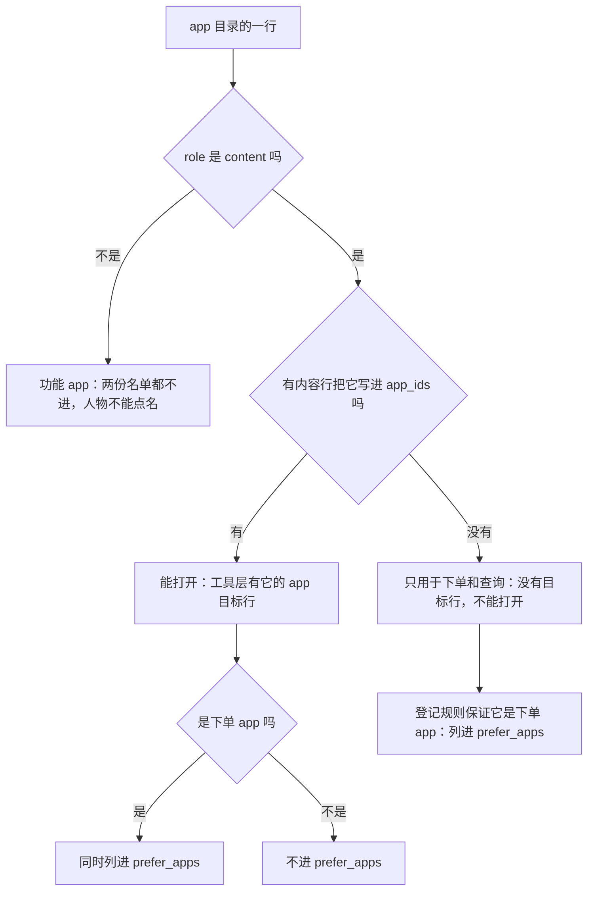
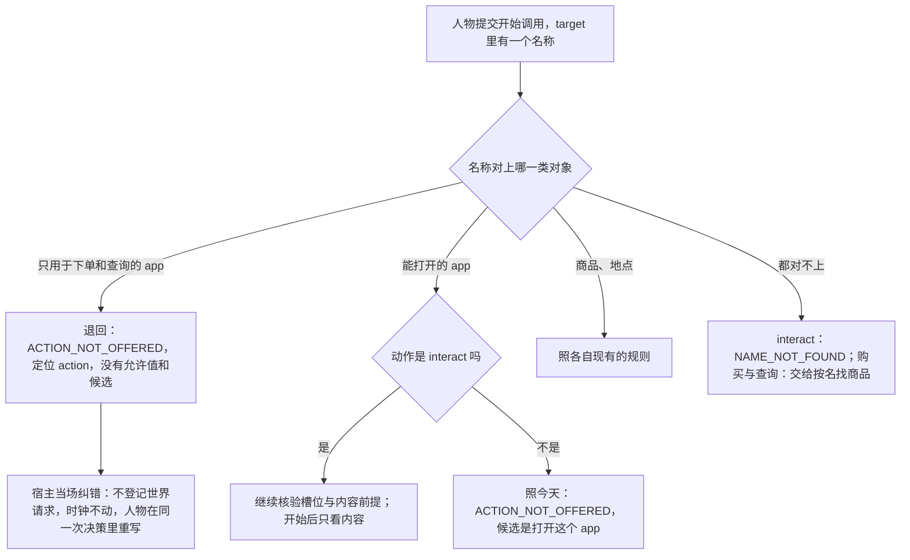

# 打开 app 与 app 目录字段

> 本章属于[首次真实模型单日运行：修复与新增规格](../SPEC-first-real-day-run.md)，读法和叫法见那一页。

## 目标与依据

真实运行那天 08:46，人物想照习惯用瑞幸咖啡点一杯冰美式，提交的却是「打开瑞幸咖啡」。手机时间线上于是有 3 分钟的瑞幸咖啡前台，没有订单，也没有咖啡；08:49 人物读到的是「已完成，明细为空」，把「点了咖啡」当成事实写进了记忆。午饭前它又打开美团外卖看了一遍商品清单，花了六千多个思考 token 去想「打开算不算已经下单」。

今天的引擎把每一个内容 app 都列成可以打开的目标（`src/worldmock/life/observe.py:80-82`）。没有登记内容的 app 打开后走一段「纯目录浏览」，时长读 app 行上的 `browse_duration_seconds`（`src/worldmock/life/interact.py:56-57`）；打开任何内容 app，第一条结果都附带一张商品清单（`src/worldmock/life/start_group.py:269-270`），而人物通常读不到第一条结果。

本章落实提案里已经定下的这几项：

- 查询表「打开 app」一行：「不再附带商品清单。没有内容的购物 app 不能再单独打开，只在下单和查询时出现；app 目录的浏览时长字段删除，数据集仓库重新发布环境包」。
- 裁决清单里「没有内容的购物 app 还能不能用 `interact` 打开」一行，裁决为「不能打开，只在下单和查询时出现；工具层另列它们的名称供 `prefer` 用」。
- 「没有内容的购物 app 还能不能打开」一节的四点：这类 app 从可以打开的 app 里去掉、仍留在目录里；人物仍写「打开瑞幸咖啡」时退回，并告诉它「这个 app 用来下单，购买时把它写进 prefer，想看商品用查询」；既有内容又卖东西的 app 照常打开、只看内容；`browse_duration_seconds` 删除。
- 「已同意修复的缺陷」表后那一段：代码里三句与实际行为相反的说明随改动更正。
- 作者手册「没有内容的购物 app 不能单独打开，只在下单和查询时出现」一行。

看商品改走查询（见[「查询」](./02-query.md)一章），下单改走购买加 `prefer`（见[「购买时写想用的 app」](./01-purchase-prefer.md)一章）。本章只管「打开」这一条路还剩什么。

## 行为规格

### 四种 app 与两份名单

本章用到的叫法。「内容 app」「功能 app」沿用设计文档，「下单 app」的定义在[「购买时写想用的 app」](./01-purchase-prefer.md)一章，余下两个由本章定义：

| 叫法 | 目录里的判据 |
| --- | --- |
| 内容 app、功能 app | app 行的 `role` 是 `content` 或 `function` |
| 下单 app | 能接单的内容 app：直接登记了商品，或被实际卖商品的地点登记 |
| 只用于下单和查询的 app | 没有登记任何内容的内容 app：`role == "content"` 且 `catalog.contents_by_app[app_id]` 为空 |
| 能打开的 app | 登记了内容的内容 app：`role == "content"` 且 `catalog.contents_by_app[app_id]` 非空 |

- 「只用于下单和查询」的判据只有一条：有没有内容行把这个 app 写进 `app_ids`。它不看此刻有没有合格内容，也不看这个 app 卖不卖东西。
- 登记规则保证这类 app 一定是下单 app：内容 app 既没有内容、也不接单时加载报 `APP_UNBOUND`（`src/worldmock/catalog/admission.py:300-304`，不变）。
- app 的名称在目录里互不相同：两个 app 规整后同名时加载报 `ENVIRONMENT_ID_DUPLICATE`（`src/worldmock/catalog/admission.py:104-106`，不变）。所以「`prefer_apps` 里的名称，去掉能打开的 app 的名称」恰好就是这类 app 的名称，下文名称簿靠的是这一点。
- 一个 app 可以既能打开、又是下单 app（真实运行里的淘宝闪购；夹具里的哔哩哔哩）。



人物从工具层读到两份名单：

| 名单 | 位置 | 成员 | 次序 |
| --- | --- | --- | --- |
| 可以打开的 app | 工具层 `targets` 里 `kind` 为 `app` 的目标行 | 全部能打开的 app，每个一行、一条 `interact` 动作行；不参加轮转 | `app_id` 升序 |
| 可以写进 `prefer` 的 app | 工具层 `callable_index.prefer_apps` | 全部下单 app 的全名（定义见[「购买时写想用的 app」](./01-purchase-prefer.md)一章） | `app_id` 升序 |

夹具环境的八个 app 改后各在哪里：

| `app_id` | 名称 | 种类 | app 目标行 | `prefer_apps` |
| --- | --- | --- | --- | --- |
| `alipay` | 支付宝 | 功能 app（付款） | 没有 | 没有 |
| `amap` | 高德地图 | 功能 app（导航） | 没有 | 没有 |
| `bilibili` | 哔哩哔哩 | 有内容，又卖「平台笔记本」 | 有 | 有 |
| `douyin` | 抖音 | 只有内容 | 有 | 没有 |
| `eleme` | 饿了么 | 只用于下单和查询 | **没有（今天有）** | 有 |
| `keep` | Keep | 只有内容 | 有 | 没有 |
| `meituan` | 美团 | 只用于下单和查询 | **没有（今天有）** | 有 |
| `wechat` | 微信 | 功能 app（付款） | 没有 | 没有 |

所以夹具里人物读到的 app 目标行是哔哩哔哩、抖音、Keep 三行（今天是五行），`prefer_apps` 是 `["哔哩哔哩", "饿了么", "美团"]`。

### 打开一个 app 得到什么

请求不变：`start_side_activity`，`action` 为 `interact`，`target` 是恰含一个能打开的 app 名的数组，`prefer` 为 `null`。受理条件、占槽位 2、看到哪一条由环境挑、时长、暂停与结束都不变。变的只有结果里带什么。

第一条结果（活动开始时写下）的 `details`：

| 键 | 今天 | 改后 |
| --- | --- | --- |
| `planned` | 有：活动名与计划时长 | 不变 |
| `content` | 打开登记了内容的 app 时有：`app`、`title`、`summary`、`duration`、`pushed` | 每次打开都有，五个键不变 |
| `goods` | 打开任何内容 app 都有：这个 app 直接卖的和它绑定的店卖的每件商品一行 | **删除** |
| `app`、`duration` | 只在打开没有登记内容的 app 时有 | **删除**（这种打开不再存在） |

- `action_result` 事件正文里的 `data.goods` 同时消失；受理结果的数据只剩 `activities`、`orders` 和名称规整时的 `resolved`。
- 第二条结果（活动做完或被结束时写下）带什么，见[「做完之后读到什么，提前结束算不算做完」](./05-results-and-ending.md)一章；本章不动它。
- 这个 app 卖的东西，人物用查询看、用购买加 `prefer` 买。只在 app 里卖的快递商品（夹具里的「平台笔记本」）今天只出现在这张清单里（`src/worldmock/life/purchase_offers.py:55-75` 是把它们报给人物的唯一一处）；改后它们只在查询的答案里出现，仍可以按名称购买。
- 工具层这一行的 `duration` 仍是今天的算法（会被钉住的推送或没看完的那条的余量，否则合格内容全长的最小到最大）。
- 人物从系统层读到的话（定稿与下标见[「人物读到的规则」](./10-persona-rules.md)一章）：「用内容 app 只是看这个 app 里的内容，不显示商品，也不会下单；看到的内容像菜单或商品介绍，也不等于买了。只列在 prefer_apps 里的 app 用来下单和查询，不能用 interact 打开。」

### 人物把只用于下单和查询的 app 写进 target

这类 app 只有一个合法的位置：购买或查询的 `prefer`。人物把它写进打开、购买或查询的 `target`，这条调用都被退回，并读到同一句话；一字不差地写进出行或在地点做事的 `target` 也一样。

下文的「宿主」指人物一侧替模型把关的程序（`LifeAgent`）：模型的回复先经它核对，不合格的当场让模型重写，合格的才登记成世界请求。「环境」指裁定并结算的一侧，它对登记进来的请求再核对一遍。

| 人物写的（夹具环境，人在家） | 今天 | 改后 |
| --- | --- | --- |
| `interact`，`target` 为 `["美团"]` | 受理，浏览 10 分钟，第一条结果附商品清单 | 退回（本章的退回） |
| `purchase`，`target` 为 `["牛肉面", "美团"]` | 退回：`ACTION_NOT_OFFERED`，允许值 `["interact"]`，候选是「打开美团」 | 退回（本章的退回），没有候选；牛肉面也不买 |
| `query`，`target` 为 `["美团"]` | 没有这个动作 | 退回（本章的退回） |
| `interact`，`target` 为 `["美 团"]`（多一个空格） | 规整后受理 | 退回（本章的退回） |
| `interact`，`target` 为 `["美团外卖"]`（不是登记的名称） | `NAME_NOT_FOUND`，候选是「打开美团」 | `NAME_NOT_FOUND`，没有候选 |
| `interact`，`target` 为 `["哔哩哔哩"]` | 受理 | 受理，只看内容 |
| `purchase`，`target` 为 `["哔哩哔哩"]` | 退回：`ACTION_NOT_OFFERED`，候选是「打开哔哩哔哩」 | 不变（候选多一个 `"prefer": null`，见[「购买时写想用的 app」](./01-purchase-prefer.md)一章） |
| `interact`，`target` 为 `["支付宝"]` | `NAME_NOT_FOUND`，没有候选 | 不变 |

退回的明细，每个写错位置的名称一条：

| 字段 | 值 |
| --- | --- |
| `error_code` | `ACTION_NOT_OFFERED`（沿用现有的码，不新增） |
| `path` | 定位到 `action`：`["tool_calls", <这条调用在回复里的下标>, "function", "arguments", "action"]` |
| `written` | 人物写的动作：`"interact"`、`"purchase"` 或 `"query"`；写在主工具里时是那条调用的动作，例如 `"travel"` |
| `allowed_values` | `[]` |
| `candidates` | `[]` |
| `why` | `Write <app 全名> in prefer of purchase or query, not in target: this app only takes orders and has no content to open.` |
| `expected` | `A target that the written action accepts is required; an app that only takes orders is written in prefer.` |

人物在夹具里写「打开美团」时，宿主纠错的完整报告：

```json
{
  "error_code": "ACTION_NOT_OFFERED",
  "reason": "Write 美团 in prefer of purchase or query, not in target: this app only takes orders and has no content to open.",
  "fix": "Use one of the object's offered actions.",
  "items": [{
    "path": ["tool_calls", 0, "function", "arguments", "action"],
    "written": "interact",
    "error_code": "ACTION_NOT_OFFERED",
    "allowed_values": [],
    "expected": "A target that the written action accepts is required; an app that only takes orders is written in prefer.",
    "why": "Write 美团 in prefer of purchase or query, not in target: this app only takes orders and has no content to open.",
    "candidates": []
  }],
  "unmet": []
}
```

上面是落库在这次模型响应 `protocol_feedback` 里的五个键；模型读到的纠错正文是同样的五个键再加现有的那句固定 `instruction`，本章不改它。

- `<app 全名>` 是目录登记的名称原文，不翻译、不加引号。写「美 团」时句子里写的是「美团」，人物可以照抄进 `prefer`。
- 三种动作共用同一句 `why` 和同一句 `expected`。
- 顶层报告：宿主纠错时 `error_code` 是 `ACTION_NOT_OFFERED`（取第一条明细的码），环境复核时是 `ACTION_REQUEST_INVALID`；两处的 `fix` 都是这个码现有的默认句 `Use one of the object's offered actions.`，`unmet` 为空。
- 顶层的 `reason`：宿主一侧是各条明细的 `why` 以 `; ` 相连。环境一侧相同，只在同一次回复里有两条开始调用时，照现有的整组拒绝在后面追加 ` Neither start request was started.`（`src/worldmock/life/start_group.py:81`）。
- 进度层 `rejected_today` 只留 `why` 的前 60 个字符（`src/worldmock/life/progress_layer.py:320`）。可照做的半句 `Write <app 全名> in prefer of purchase or query` 长 37 个字符加名称，名称不超过 23 个字符时完整留下；名称不超过 8 个字符时连 `, not in target` 也在内。夹具里这一行是 `Write 美团 in prefer of purchase or query, not in target: this`。



宿主与环境怎样共用这项检查：

- 检查写在名称解析里，只有一份：`name_resolution.resolve_start`。宿主在 `custom/agents/life_agent.py:909-913` 调用它，环境在 `src/worldmock/life/start_group.py:147-162` 调用它，两处读的是同一份冻结观察。
- 宿主一侧：这是一次协议纠错。回复不登记成世界请求（没有 `action_requested`），不算同刻决策轮数，没有拒绝带来的身体脉冲，世界时刻不动；纠错连同原因落在这次模型响应的 `protocol_feedback` 里，人物在同一次决策里接着写。质量报告把它计在 `host_codes` 的 `ACTION_NOT_OFFERED` 上，键集不变。
- 环境一侧：只有绕过宿主直接登记请求时才走得到。照今天名称类问题的处理：整组以 `ACTION_REQUEST_INVALID` 拒绝，同组的另一条调用也不开始；这条拒绝照这个码今天的规则计入同刻决策轮数、带拒绝的身体脉冲，写一条 `action_rejected`。
- 检查的先后：请求形状在名称之前。`interact` 而 `prefer` 非空时先得到 `prefer must be null when action is interact`（见[「购买时写想用的 app」](./01-purchase-prefer.md)一章），这一轮不再报名称问题。环境一侧「有活动刚做完、还没收尾」的检查也排在名称之前（`src/worldmock/life/start_group.py:117-119`），那时环境给的是现有的 `ACTIVITY_CONCLUSION_REQUIRED`，本章不改这个次序。

### 名称簿从哪里认得这类 app

名称簿是宿主和环境解析名称时共用的那张「名称到对象」的表（`name_resolution.name_book`，`src/worldmock/life/name_resolution.py:141-150`）。今天它的对象来自本轮私有绑定和全量目录绑定，只用于下单和查询的 app 改后两处都不在。

- 来源：同一份冻结观察里工具层的 `callable_index.prefer_apps`（在观察里的位置是 `tool_layer.callable_index.prefer_apps`）。不给观察增加私有键。
- 怎样得到这类 app：现有的两步（本轮私有绑定、全量目录绑定）做完之后，按 `prefer_apps` 的次序逐个看名称。名称簿里已经有一个 `kind` 为 `app`、名称与它一字不差的对象时跳过（不论那个对象来自哪一步）；否则登记一个新对象，排在现有对象之后。只与 `app` 对象比，不与商品、地点比。
- 新对象的六个成员：`label` 是全名，`kind` 是 `order_app`（常量 `ORDER_APP_KIND`），`object_id` 为 `None`，`options` 为空，`listed` 为 `False`，`row` 为 `None`。
- 判断只有一条：所写名称在名称簿里唯一对上的那个对象是 `order_app`，就给上一小节的退回。「对上」沿用现有的匹配（`name_resolution.lookup`，`src/worldmock/life/name_resolution.py:94-108`）：先在参加比较的对象里找一字不差的，找不到再在这个动作允许的类型里逐级规整（全角半角、括号、多余空白）。

各种写法在哪一步判断：

| 人物写的 | 参加比较的对象 | 规整时允许的类型 | 判断的位置 |
| --- | --- | --- | --- |
| `interact`（副工具） | 名称簿全部对象 | `app`、`order_app` | 通用路径 `_resolve_item`：取到唯一对象之后、筛动作行之前 |
| `purchase` | 名称簿全部对象 | `supply`、`order_app` | 同上。对不上任何对象的名称照今天交给按名找商品 |
| `query` | 名称簿里的商品和 `order_app` 对象；地点和能打开的 app 不参加（见[「查询」](./02-query.md)一章） | `supply`、`order_app` | 查询那一支：类别之后，这类 app 与「本轮展示的商品」放在同一次匹配里，不另起一步。唯一对上这类 app 就退回；唯一对上商品就受理；对上多个得到 `NAME_AMBIGUOUS`；都对不上的照[「查询」](./02-query.md)一章交给环境按名找商品 |
| 主工具的出行或在地点做事 | 名称簿全部对象 | `location`（不变） | 通用路径，位置与副工具的 `interact` 相同。主工具规整时只认地点，所以只有一字不差的写法会对上这类 app |

- 规整后才对上的写法（「美 团」、全角、带括号）在副工具三种动作里与一字不差的写法结果相同。
- 近名候选只取 `listed` 为真的对象，所以这类 app 永远不会成为候选：人物写了一个不存在的近似名称时，不会被引到一个打不开的 app 上。
- 查询的 `target` 里类别名优先（见[「查询」](./02-query.md)一章）：规整后恰为四个类别名之一的按类别处理，其余才进这一步。

### app 目录字段与旧环境包

改后 app 行只有五个字段：

| 字段 | 类型 | 谁写 |
| --- | --- | --- |
| `app_id` | 非空字符串 | 都写 |
| `name` | 非空字符串 | 都写 |
| `role` | `content` 或 `function` | 都写 |
| `actions` | 功能动作的数组 | 只有功能 app |
| `travel_method_ids` | 出行方式身份的数组 | 只有功能 app |

- `browse_duration_seconds` 从行模型里删除。没有登记内容的内容 app 仍是合法登记，一行只写 `app_id`、`name`、`role`。
- 登记检查里读这个字段的三处一并删除：功能 app 不得声明、没有内容的内容 app 必须声明、有内容的内容 app 不得声明。其余检查不变：功能 app 至少一种绑定、内容 app 不得带绑定字段、内容 app 至少有内容或接单、app 名不与地点名相同。
- 不为已删除的字段另写检查。行模型拒绝未知字段，写了它的行就是多了一个未知字段。

旧环境包加载时在第一处不符就被拒：

| 包的样子 | 拒绝 |
| --- | --- |
| 清单的 `rules_version` 还是 4 | `RULES_VERSION_MISMATCH`，先于一切形状检查（`src/worldmock/catalog/loader.py:59-60`） |
| `rules_version` 已是 5，`format_version` 还是 4 | `ENVIRONMENT_KIND_INVALID`，来自清单的严格模型 |
| 两个号都是 5，某个 app 行还写着 `browse_duration_seconds` | `ENVIRONMENT_KIND_INVALID`；详情以 `app-catalog.jsonl:<行号>` 开头，后面是行模型的原文，其中有字段名 `browse_duration_seconds` 和 `Extra inputs are not permitted` |

写着已删字段的那一种拒绝，对功能 app、有内容的内容 app、没有内容的内容 app 都一样。两个版本号的新值与升号见[「版本、身份与基线」](./12-versions.md)一章。数据集仓库重新发布环境包不在本仓。

### 每一项用 app 的活动都有内容

今天「没有内容的 app 使用」是一种真实存在的活动：`data.content_id` 为空、七个键、强度为静坐、没有缓解。改后它不可能再产生：

- 每一项 `interact` 活动的 `data.content_id` 都不为空，私有数据的键集恒为 `activity_validation._CONTENT_FIELDS` 规定的那一组，也就是今天带内容时的键集（`src/worldmock/life/activity_validation.py:10-11`）。
- 读这种活动的分支全部删除，清单见「接口、删除面与文件指引」。不保留退役形状的读取，也不为它新增检查。
- 退役形状若仍出现，由现有的两处报运行故障：恢复世界状态时 `Persisted activity target is invalid`；导出认证投影已核验经历时 `Playback progress has no app content evidence`。

### 本章涉及的拒绝与运行故障

人物读到的（宿主纠错或环境拒绝）：

| 码 | 何时 | 英文原文 | 本章是否改动 |
| --- | --- | --- | --- |
| `ACTION_NOT_OFFERED` | `target` 里的名称唯一对上一个只用于下单和查询的 app | `why`：`Write <app 全名> in prefer of purchase or query, not in target: this app only takes orders and has no content to open.`；`expected`：`A target that the written action accepts is required; an app that only takes orders is written in prefer.`；顶层 `fix`：`Use one of the object's offered actions.` | 新增的情形，码与 `fix` 沿用 |
| `ACTION_NOT_OFFERED` | 能打开的 app 写进了购买的 `target` | `why`：`The known object <名称> does not support the written action.`；`expected`：`An action offered by this object is required.` | 不改 |
| `NAME_NOT_FOUND` | `interact` 的名称对不上任何对象，包括功能 app 的名称和近似名称 | `why`：`No known object named <所写> supports this action; changing spelling cannot create an object.`；`expected`：`A known object name in the selected action's category is required.` | 不改；近名候选里不再有只用于下单和查询的 app |
| `CONTENT_PREREQUISITE_UNMET` | 能打开的 app 此刻没有一条合格内容 | `reason`：`Nothing in <app 名> can start now: <逐条内容的分句>.`，差地点前提时是 `can start here now`（今天的写法） | 不改 |

数据集作者读到的（加载环境包时）：

| 码 | 何时 | 英文原文 | 本章是否改动 |
| --- | --- | --- | --- |
| `ENVIRONMENT_KIND_INVALID` | app 行写了 `browse_duration_seconds`（或任何未知字段） | `A declared kind is outside the fixed set.`，详情以 `app-catalog.jsonl:<行号> 1 validation error for App` 开头，随后一行是字段名，再一行含 `Extra inputs are not permitted` | 码与文字不变；今天这个字段在三种 app 上分别得到「不得声明」「必须声明」两种专门的拒绝，改后只剩这一种 |
| `APP_UNBOUND` | 内容 app 既没有内容也不接单；功能 app 两种绑定都空 | `An app must have content, or an action or travel method binding, for its role.` | 不改 |
| `ENVIRONMENT_NUMBER_INVALID` | 今天：没有内容的内容 app 没写浏览时长 | `A declared number is outside its allowed domain.` | 这一种情形删除，码仍用于别的数值字段 |

运行故障（运行停下，保留已确认的部分）：

| 英文信息 | 何时 | 本章是否改动 |
| --- | --- | --- |
| `Persisted activity target is invalid` | 恢复的世界状态里有 `content_id` 为空的 `interact` | 文字不变；今天这种活动按浏览的七个键核对后放行 |
| `Playback progress has no app content evidence` | 导出认证遇到没有内容证据的 `interact` 进度 | 文字不变；今天这种进度被跳过 |
| `Directory browse disagrees with its frozen app content contract` | 今天：导出里的浏览与冻结目录不符 | 删除 |

### 夹具环境

`tests/fixtures/dataset-environment/catalog/app-catalog.jsonl` 的两行改成（其余六行不变）：

```json
{"app_id":"eleme","name":"饿了么","role":"content"}
{"app_id":"meituan","name":"美团","role":"content"}
```

夹具保留两个只用于下单和查询的 app 和一个既有内容又卖东西的 app，本章的测试直接用它们。清单的版本字段由版本提交改，文件表与目录摘要用 `worldmock.catalog.identity.refresh_manifest_identity` 重算，不手写。

### 与查看器的耦合

今天查看器靠观察里的 `interaction_bindings` 把 app 身份换成名称（`tools/run-viewer.html:487-490`），饿了么、美团这样的 app 也在其中。改后它们不在任何绑定里，`prefer_apps` 又只有名称没有身份，数据库里不再有这些 app 的「身份到名称」。订单、下单前台、订单通知上的下单 app 恰好多是这一类。

所以本章的改动必须和[「统一显示写法」](./08-display.md)一章里「查看器改读运行冻结的环境目录」在同一个集成分支里一起并入主干：显示轨道那一步先并入，内容轨道后并入。单独并入本章，查看器会把这些 app 全部显示成「名称缺失」。

### 算例：08:46 的咖啡

真实运行里的这一次决策，照新规则重放。价格与送达时刻取提案记录的那次报价（冰美式咖啡 22 元，运费 5 元，预计 09:11 到）。

| 时刻 | 今天（真实运行里发生的） | 改后 |
| --- | --- | --- |
| 08:46:00 读提示 | 工具层有「瑞幸咖啡」的 app 目标行；没有哪里说打开不等于下单 | 没有「瑞幸咖啡」的 app 目标行，它只在 `prefer_apps` 里；系统层写明只列在 `prefer_apps` 里的 app 不能用 interact 打开 |
| 08:46:00 第一次回复 | `{"action":"interact","target":["瑞幸咖啡"]}` 受理，开始「进行瑞幸咖啡（9月28日 08:46 起）」，计划 3 分钟；第一条结果附商品清单，人物读不到 | `{"action":"interact","target":["瑞幸咖啡"],"prefer":null}` 被宿主当场退回，时钟不动，没有活动。人物读到 `Write 瑞幸咖啡 in prefer of purchase or query, not in target: this app only takes orders and has no content to open.` |
| 08:46:00 第二次回复 | 没有 | 同一次决策里改写：`{"action":"purchase","target":["冰美式咖啡"],"prefer":"瑞幸咖啡"}`，受理 |
| 08:46:00 起 | 瑞幸咖啡在前台 3 分钟，没有订单 | 购买 1 到 5 分钟。与[「购买时写想用的 app」](./01-purchase-prefer.md)一章的咖啡算例取同一组抽取，购买时长 180 秒、付款抽到支付宝 15 秒：08:46:00–08:48:45 瑞幸咖啡在前台（下单），08:48:45–08:49:00 支付宝在前台（付款） |
| 08:49 | 活动做完，人物读到「已完成，明细为空」，收尾时把「点了咖啡」写成记忆 | 08:49:00 扣款 27 元，瑞幸咖啡发「订单已下单」，支付宝发「支付成功」；购买结果的 `channel` 是「瑞幸咖啡」 |
| 09:11 | 没有咖啡 | 登记了瑞幸咖啡的最近一家店就是那次报价的店时，09:11:00 送达，当场喝掉 |

同一件事在夹具副本上的确定数字，测试照此断言。副本用 `tests/life/phone_records.py::phone_environment`（瑞幸咖啡取代饿了么、只登记在三杯咖啡；冰美式 16 元只有咖啡店卖；声明家到咖啡店 1,500 米），用同一文件的 `phone_window((8, 46), …)` 让运行从 2026 年 10 月 12 日 08:46:00 开始，人在家：

| 步骤 | 结果 |
| --- | --- |
| 观察 | app 目标行是哔哩哔哩、抖音、Keep；`prefer_apps` 是 `["哔哩哔哩", "瑞幸咖啡", "美团"]`；商品行「冰美式」的 `note` 是「运费5 元，预计10月12日 09:01到达」 |
| 提交 `interact`、`["瑞幸咖啡"]`、`prefer` 为 `null` | 退回，原文如上表；没有活动，余额不变，时刻仍是 08:46:00 |
| 提交 `purchase`、`["冰美式"]`、`prefer` 为 `"瑞幸咖啡"` | 受理。此刻营业、卖冰美式、登记了瑞幸咖啡的店只有三杯咖啡；订单的下单 app 是 `luckin`；预计送达 08:46:00 + 600 秒备货 + 1,500 ÷ 5 秒 = 09:01:00；购买结果的 `channel` 是「瑞幸咖啡」 |
| 推进到 09:01:00 | 送达并收货；整个过程里瑞幸咖啡没有任何 `interact` 活动，只有购买名下的下单前台 |

### 边界情形

| 情形 | 结果 |
| --- | --- |
| 一条购买里写了商品又写了这类 app 名 | 整条调用退回，商品也不买；人物把 app 名挪进 `prefer` 再提交 |
| 一条调用里写了两个这类 app 名 | 各出一条明细，按数组里的先后；顶层 `reason` 是两句以 `; ` 相连。两条明细的定位和所写相同，进度层备忘按「定位加所写」只记一行，留的是第一条的那一句 |
| 与出发同一次回复里「打开饿了么」 | 宿主当场纠错，两条调用都不登记。绕过宿主时环境整组拒绝，两条调用都不开始：没有路上那一段，不扣车费；两条动作读到同一份拒绝，明细只有副调用的那一条，`reason` 是那句 `why` 后面加 ` Neither start request was started.` |
| 主工具的 `target` 一字不差地写了这类 app 名 | 同一条退回。主工具只认地点，规整后才对上的写法照今天得到 `NAME_NOT_FOUND` |
| app 登记了内容，但此刻每一条都不满足前提 | 它仍是 app 目标行，`available` 为假；打开得到今天的 `CONTENT_PREREQUISITE_UNMET`，不是本章的退回 |
| 提醒规则的文字里点到这类 app | 提醒照发，名称照写；人物随后去打开它，得到本章的退回 |
| 这类 app 的推送 | 没有：推送只来自内容，这一点今天就是这样 |
| `prefer` 里写了这类 app 的名称 | 这正是它该在的位置，怎样用见「购买时写想用的 app」与「查询」两章 |
| 某件商品与这类 app 完全同名 | 照今天同名对象的规则，三种动作一样：那件商品正在工具层展示时，名称对上两个对象，得到 `NAME_AMBIGUOUS`，候选只有那件商品的那一条调用（打开和购买时是购买它，查询时是查询它）；没在展示时得到本章的退回。今天内容 app 与商品同名时也是这样，本章不为它加登记检查 |
| 环境包里没有一个 app 登记内容 | 工具层没有 app 目标行，任何 `interact` 的 app 名都被退回或找不到 |
| 旧运行的世界状态里留着没有内容的 app 使用 | 世界状态版本已经不符；即使版本相符，恢复时也以 `Persisted activity target is invalid` 停下 |

### 明确不做

- 不新增拒绝码。起草时提过「新增一个专门的宿主名称码」，没有采用：它会改变质量报告 `host_codes` 的键集。
- 不保留「仍能打开、标成不可用、受理时再拒绝」的做法：与「从可以打开的 app 里去掉」相反。
- 不给观察增加私有键。起草时提过给观察加一份「下单 app 绑定」供名称簿和查看器共用，没有采用：名称簿读工具层的名单就够，查看器改读冻结目录。
- 不为已删除的字段写专门的登记检查；不为「没有内容的 interact」写新的导出认证。
- 不加扫描 `browse_duration_seconds`、「纯目录浏览」这类字面的守卫测试；删除面由上面几处真实的拒绝证明。
- 不改 `content_duration_range` 除浏览分支以外的部分，不改工具层 app 行 `duration` 的算法，不改内容怎样挑、一次打开放几条，不改带内容的 `interact` 活动私有数据的键集。同一个 app 首尾相接的几次使用只在运行查看器里连成一段来画（见[「查看器里的连续使用」](./06-continuous-use.md)一章），引擎、app 行和工具层都不为它改。
- 不改功能 app：支付和导航仍由引擎选，导航的前台仍是出发到到达。不改会话、推送和暂停的规则。
- 不给近似名称加引导：写了「美团外卖」而登记名是「美团」时只得到 `NAME_NOT_FOUND`。人物从 `prefer_apps` 读全名。
- 不替人设把关：人设里写着「打开某购物 app 看看」不会在加载时被拦，只在作者手册里写明不要这样写。
- 不改回调足迹步骤里的 `browse`（`src/worldmock/catalog/callback_models.py:96`）：那是提醒规则的步骤名，与打开 app 无关。
- 不给基础夹具加新 app。
- 数据集仓库重新发布环境包不在本仓；人物读到退回之后会不会改用购买加 `prefer`，要下一次真实模型的单日运行才能证明，它不是合入条件。

### 本章定下的细节

| 事项 | 定下的做法 | 理由 |
| --- | --- | --- |
| 退回的两句英文 | `why` 与 `expected` 照上文原文，三种动作共用 | 提案要告诉人物的是「购买时把它写进 prefer，想看商品用查询」，一句话里两件事都说到；进度层备忘只留前 60 个字符，所以可照做的半句放最前；三种动作共用一句，少两份要逐字钉住的文字 |
| 句子里的 app 名 | 写登记的全名，不写人物所写的写法 | 人物要把它照抄进 `prefer` |
| 顶层的 `fix` | 保持 `ACTION_NOT_OFFERED` 现有的默认句，不为这种情形另写 | `fix` 按码取，今天没有逐条明细的 `fix`；另写就得新增码或新增机制。真正的指引在 `reason` 里 |
| 新对象类型 | `order_app`，常量名 `ORDER_APP_KIND`；没有内部身份、没有动作行、`listed` 为假 | 名称簿只需要名称；`listed` 为假就不会成为近名候选 |
| 名单里的名称怎样算「已经能打开」 | 只与名称簿里 `kind` 为 `app` 的对象比，名称一字不差才算 | app 名在目录里互不相同，一字不差就够；不与商品比，同名商品才能照今天的同名规则处理 |
| 检查分不分工具 | 不分：只要名称唯一对上这类对象就给这条退回，主工具里一字不差写了也一样 | 只有一条规则；否则主工具会落到「这个对象不提供所写动作」而没有任何指引 |
| 查询的 `target` 在哪一步判断 | 类别之后，把这类对象并进「本轮展示的商品」那一次匹配，不另起一步：唯一对上这类 app 退回，唯一对上商品受理，对上多个得到 `NAME_AMBIGUOUS` | 三种动作只有一条规则，归本章，[「查询」](./02-query.md)一章的次序表照此写成同一次匹配。并进同一次匹配，同名的边界就与打开、购买是同一条规则；另起一步的话，与这类 app 同名的展示中商品也会被退回 |
| 一条调用里几个这类名称 | 每个一条明细 | 与今天「每个解析项各自报错」一致 |
| 既有内容又卖东西的 app 写进购买的 `target` | 不变：仍是今天的 `ACTION_NOT_OFFERED`，候选是打开它 | 提案只改没有内容的那一类；候选里 `prefer` 写 `null` 提案已经定了 |
| 与商品同名 | 照今天同名对象的规则，不加登记检查 | 不加提案没有要求的检查 |
| `content_duration_range` 删掉浏览分支之后 | 对没有登记内容的 app 自然得到 `None`（没有合格内容） | 不另写分支；这类 app 也不再有目标行来问它 |
| `app_prerequisite_refusal` 里「没有登记内容时返回空」 | 不动 | 它保护的是「对空列表求全部」这一步，不是读退役活动的分支 |
| 评估里 `interact` 的对象类型 | 恒为 `content`，对象身份只取 `content_id`，不再拿 `app_id` 顶替 | 「目录浏览取 app」那一支随浏览删除 |
| 只为商品清单存在的测试断言 | `tests/integration/life/test_constant_table_runtime.py` 里读「平台明细」运费与送达的三处，改读工具层「牛肉面」商品行的 `note` | 那是人物下单前读到同一份报价的地方，不依赖查询轨道 |
| 测试里拿「打开美团」当一项活动的地方 | 只需要「任意一项槽位 2 活动」的换成打开 Keep（只有一条 1,200 秒的内容，时长确定）；需要静坐强度、恰 600 秒的换成钉钉副本上一条 600 秒的静坐内容 | 不为测试给基础夹具加新 app |
| 代码里引用旧节名的两处说明 | `life/rotation.py:2`、`life/tool_groups.py:16` 改成「出行、内容与查询」，由最后并入的内容轨道改 | 节名随「目录浏览」退场而改，两处只是文字引用 |
| `test_inspect_current_activity.py` 里经真实引擎打开「美团」的那个参数（今天叫 `plain-browse`） | 内容轨道并入集成分支时这个参数必须已经不在；由显示轨道在它先做的那一步里删除，过渡期「没有内容的 app 使用」的写法改用手写的快照作证据。显示一侧读这种活动的生产分支和那些手写用例留到收尾步，由显示轨道删除 | 文件归显示轨道；这个参数真的去打开美团，内容轨道一并入它就被退回，留不到收尾步。删它不依赖本章的改动；手写的快照不经真实引擎，内容轨道并入后照样通过 |
| 走不到的读取分支怎样验收 | 删掉后会改变可见结果的五处有用例（恢复世界状态、恢复暂停的活动、已核验经历、工具层时长、评估的对象类型）；`settled_text`、`activities`、`interact.advance`、`content_select` 预留集合、`frozen_environment` 里余下的几处只删不测 | 这些分支在合法的世界里走不到，留着不改变任何行为；写规格时定下不用扫描字面的测试来证明删除 |

## 接口、删除面与文件指引

### 生产文件

| 文件 | 改动 |
| --- | --- |
| `src/worldmock/catalog/models.py` | `App` 删除字段 `browse_duration_seconds`（`:63`）；类说明（`:56`）改成「内容 app，或功能 app 的购买绑定与出行方式绑定」。`format_version`（`:47`）由版本提交改 |
| `src/worldmock/catalog/admission.py` | `_check_apps`（`:282-308`）删除读浏览时长的三处判断（`:295-296`、`:305-306`、`:307-308`），说明（`:283`）去掉「纯目录 app 使用数据集浏览时长」。`explicit`、`directory` 两个判据和其余拒绝不动 |
| `src/worldmock/catalog/loader.py` | `parse_catalog_model` 的数值字段集合删去 `"browse_duration_seconds"`（`:84`） |
| `src/worldmock/life/observe.py` | `_catalog_bindings`（`:61-83`）：app 行的条件由 `app.role == "content"` 改成「是内容 app 且 `contents_by_app[app.app_id]` 非空」；说明写明只用于下单和查询的 app 不在其中 |
| `src/worldmock/life/name_resolution.py` | 新增常量 `ORDER_APP_KIND = "order_app"`。`name_book`（`:141-150`）读 `observation["tool_layer"]["callable_index"]["prefer_apps"]`，把名称簿里还没有同名 `app` 对象的名称登记成 `order_app` 对象。`_kinds`（`:183-187`）给副工具的 `interact`、`purchase` 的允许类型加上它。`_resolve_item`（`:190-211`）在取到唯一对象之后、筛动作行之前，对象是这一类就返回新的失败。查询那一支随查询轨道落下，内容轨道给它加这项检查：类别之后那一次按名匹配的对象里加上 `order_app` 对象，唯一对上且是这一类时返回同一条失败，唯一对上商品照旧受理，对上多个照旧是 `NAME_AMBIGUOUS`；不在匹配之前另起一步。新增私有函数 `_order_app_failure(target, item)` 生成这条失败，两处共用。`NameBook`、`name_book`、`_kinds` 的说明跟着改；`near_candidates` 不改 |
| `src/worldmock/life/start_group.py` | `_result`（`:259-273`）删除 `data["goods"]` 那两行（`:269-270`）和 `app_goods` 的导入（`:33`） |
| `src/worldmock/life/purchase_offers.py` | 删除 `app_goods`（`:55-75`），连同并入时只剩它在用的导入（今天是 `logging`、`rejection_guidance`、`iso_time`、`money_phrase`，`:6`、`:15-16`） |
| `src/worldmock/life/result_projection.py` | `_PASSTHROUGH_DETAILS` 删去 `"goods"`（`:12-13`）；`_interact_details`（`:45-58`）删除末行的浏览分支（`:58`），连同 `:53` 那句「有内容才写」的判断，改成直接返回 `content`；说明（`:46`）改成「开始结果展示实际开始的那条内容」 |
| `src/worldmock/life/interact.py` | `_app_plan`（`:51-62`）删除浏览分支（`:56-57`）并改写说明（`:52-53`）；删除 `_browse_data`（`:166-169`）；`advance`、`resume` 里 `content_id is None` 的提前返回删除（`:84-85`、`:140-141`） |
| `src/worldmock/life/content_select.py` | `content_duration_range`（`:63-80`）删除浏览分支（`:66-68`）和说明里两处讲浏览时长的话（`:64-65`），其余不动。`_exclude_reserved` 的预留集合去掉「`content_id` 不为空」这一条件（`:123`）：改后每一项 `interact` 都有内容，这个条件恒真，去掉它不改变挑到哪一条；函数其余部分不动 |
| `src/worldmock/life/activities.py` | `advance_activity_shared` 的条件（`:126`）简化成只看活动种类是 `interact` |
| `src/worldmock/life/activity_validation.py` | 删除 `_BROWSE_FIELDS`（`:12-13`）和浏览分支（`:40-43`）；`content_id` 为空的 `interact` 落到后面的内容绑定核对，报 `Persisted activity target is invalid` |
| `src/worldmock/life/settled_text.py` | `_content_sentence` 删除 `content_id` 为空的提前返回（`:82-83`） |
| `src/worldmock/life/discovery.py` | `product_rows` 的说明（`:18`）「app 侧商品留在真实交互目录中」改成「app 侧商品只在查询与按名购买时出现」 |
| `src/worldmock/footprints/frozen_environment.py` | 删除 `_validate_browse`（`:73-83`）、它的调用（`:40`）和只为它读的 `contents`（`:36`）；模块说明（`:1`）与 `validate_frozen_environment` 的说明（`:19`）去掉目录浏览 |
| `src/worldmock/footprints/experiences.py` | `_project_event` 删除「没有内容就跳过」（`:164-165`） |
| `src/worldmock/evaluation/public_evidence.py` | `_activity_shape`（`:300-311`）对象类型恒为 `content`；说明（`:301`）去掉「目录浏览使用真实应用」 |
| `src/worldmock/evaluation/behavior_metrics.py` | `_content_contact_minutes` 的说明（`:347`）去掉「浏览目录」 |
| `src/worldmock/life/rotation.py`、`src/worldmock/life/tool_groups.py` | 说明里引用的节名（`:2`、`:16`）改成「出行、内容与查询」 |
| `tools/run-viewer.html`、`scripts/render_day.py` | 活动目标「没有内容就显示 app 名」的分支（`:1163-1166`）与标签的无内容分支（`:167-173`）由显示轨道在收尾步删除，连同它为过渡期写法手写的那些用例，见[「统一显示写法」](./08-display.md)一章 |

不改的文件：`custom/agents/life_agent.py`（`_validate_start` 经 `resolve_start` 自动得到新的退回）；`src/worldmock/life/` 下的 `error_contract.py`（不新增码）、`tool_layer.py`、`content_prerequisite.py`、`admission.py`、`storefront_runtime.py`、`sessions.py`、`app_push.py`；`src/worldmock/footprints/` 下的 `app_usage.py`、`quality.py`。

### 直接删除，不留兼容

- app 行的 `browse_duration_seconds`，以及登记里围绕它的三处判断。
- 「纯目录浏览」这种活动：七个键的活动数据、它的计划时长来源、恢复时对它的专门核对、导出认证 `_validate_browse` 和错误文字 `Directory browse disagrees with its frozen app content contract`。
- 打开 app 附带的商品清单：`app_goods`、受理结果里的 `goods`、公开明细里的 `goods`、`app`、`duration` 三个键。
- 评估里「目录浏览的对象是 app」这一种公开点事实形状。
- 不写迁移，不留读旧形状的分支；旧环境包与旧运行按上文的拒绝处理。

### 读取侧的浏览分支清单

| 位置 | 今天做什么 | 处理 |
| --- | --- | --- |
| `src/worldmock/life/interact.py:56-57` | 没有登记内容的 app 走浏览，读声明的时长 | 删 |
| `src/worldmock/life/interact.py:84-85` | 推进时没有内容直接返回 | 删 |
| `src/worldmock/life/interact.py:140-141` | 恢复暂停时没有内容直接返回 | 删 |
| `src/worldmock/life/interact.py:166-169` | 生成浏览的活动数据 | 删 |
| `src/worldmock/life/content_select.py:66-68` | 工具层时长取声明的浏览时长 | 删 |
| `src/worldmock/life/content_select.py:123` | 算「别的活动正占着哪些内容」时跳过没有内容的 `interact` | 条件去掉这一项 |
| `src/worldmock/life/activities.py:126` | 只有带内容的 `interact` 才推进媒体位置 | 条件去掉后半 |
| `src/worldmock/life/activity_validation.py:12-13`、`:40-43` | 恢复时按浏览的七个键核对 | 删 |
| `src/worldmock/life/settled_text.py:82-83` | 已结算句对没有内容的活动不写内容 | 删 |
| `src/worldmock/life/result_projection.py:53`、`:58` | 有内容才写 `content`，否则写 `app` 与 `duration` | 判断与后一支都删，恒写 `content` |
| `src/worldmock/life/start_group.py:269-270` | 受理结果附商品清单 | 删 |
| `src/worldmock/footprints/frozen_environment.py:36`、`:40`、`:73-83` | 导出认证核对浏览 | 删 |
| `src/worldmock/footprints/experiences.py:164-165` | 没有内容的进度不产生已核验经历 | 删 |
| `src/worldmock/evaluation/public_evidence.py:311` | 没有内容时对象类型取 `app` | 恒为 `content` |
| `tools/run-viewer.html:1163-1166` | 活动行没有内容时显示 app 名 | 显示轨道在收尾步删 |
| `scripts/render_day.py:167-173` | 没有内容时标签只写「使用某 app」或「互动」 | 显示轨道在收尾步删 |

### 三句与实际行为相反的代码说明

由结果与结束轨道更正，改后写什么见[「做完之后读到什么，提前结束算不算做完」](./05-results-and-ending.md)一章。本章只给出与打开 app 有关的事实；更正后的文字不得再提浏览和商品清单：

| 位置 | 今天写的 | 实际 |
| --- | --- | --- |
| `src/worldmock/life/progress_layer.py:102-103` | 浏览得到的商品名、到达等事实只在终态结果里 | 商品清单只在第一条结果里；终态结果只有活动和订单 |
| `src/worldmock/life/progress_layer.py:123` | 终态结果不带当时的订单，购买明细取即时结果的订单 | 终态结果带同一批订单，所以 `:127-129` 的补取分支走不到 |
| `src/worldmock/life/session_actions.py:85-86` | 未完成的浏览写未取得浏览结果 | 终局只有「完成」「提前结束」「失败」，全仓没有这句文字 |

### 夹具与测试输入

- `tests/fixtures/dataset-environment/catalog/app-catalog.jsonl`：`eleme`、`meituan` 两行删字段；`manifest.json` 重算文件表与摘要。同一份夹具还要给地点内容加供餐字段（见[「在地点吃的一餐」](./07-meals.md)一章），两处合在内容轨道里一次重算。
- 带这个字段的测试输入一并删键：`tests/life/phone_records.py:106`（瑞幸咖啡）、`tests/integration/life/test_purchase_orders.py:82`（批量造的购物 app）、`tests/integration/runtime/test_input_warnings.py:26`（整行删除，去掉内容后哔哩哔哩仍因卖商品而合法）。
- 显示轨道新增的两种语言共读的用例文件 `tests/fixtures/display-wording-cases.json` 里是完整的目录行（见[「统一显示写法」](./08-display.md)一章）。内容轨道在改夹具环境的同一次改动里改这些行：app 行删 `browse_duration_seconds`，地点内容行加 `provides_meal`（见[「在地点吃的一餐」](./07-meals.md)一章）。
- 手写观察里经名称簿的那一处补上 `prefer_apps`：`tests/integration/runtime/test_life_agent_protocol.py::_layers`（`:196`）。
- 两份完整日基线与查看器录制样例在收尾步各重做一次；录制样例的第二步改成打开「哔哩哔哩」。

### 先改的设计文档与手册

行级清单见[「设计文档与手册改动清单」](./11-design-docs.md)一章，这里只列文档与小节：

- 《资源引擎》「环境目录文件」「注册校验与错误」「app、内容与候选呈现」：app 行的字段集、没有内容的内容 app 仍是合法登记、写了已删字段的拒绝。
- 《模拟引擎》「动作、名称与并行」：`interact` 的目标是登记了内容的内容 app；名称解析结果表加本章的退回。「出行、内容与目录浏览」改名「出行、内容与查询」：删去纯目录浏览与平台商品清单两段，流程图里「没有登记内容」一支改成在名称解析时退回。
- 《人物》「提示与工具」：工具层只列能打开的 app；`callable_index` 的键第一次成文。「进度、待办与记忆」：删去纯目录浏览半句。
- 《记录引擎》「数字足迹」：删去纯目录浏览的认证一句。
- 《交换引擎》「身体共同结算」「放松与社交需要」：两处去掉纯目录浏览。
- 《行为评估》「行为报告」「公开点事实」「盲评与随机性」：去掉纯目录展示与纯目录浏览。
- 《状态与序列化》「世界、人物与活动」：`interact` 活动的私有数据恒带非空的 `content_id`。
- 《概述》「核心术语」：app 一行。
- 引用旧节名「出行、内容与目录浏览」的几处随改名同步：《概述》「算法与工程背书总表」、《模拟引擎》「动作、名称与并行」。
- 手册《设计环境数据集》：app 行不再写浏览时长；只卖东西的 app 不能单独打开；「前提都不满足时也看不到它的商品列表」一句改写。《理解固定世界规则》：纯目录浏览一句换成打开只看内容。《编写 persona.toml》：不要写「打开某购物 app 看看」。《自定义评估与盲评输入》：去掉目录浏览。

### 归属与次序

| 工作 | 轨道 |
| --- | --- |
| 本章全部生产改动、夹具两行、上文列的测试 | 内容轨道（购买轨道并入之后开工，与查询轨道并行；按「查询先、内容后」的次序并入） |
| `format_version`、`rules_version`、夹具清单的版本字段。本章不要求改任何结构号：目录格式与规则版本各升到 5 已含本章的字段删除与规则变化；`interact` 活动的 `content_id` 不再可空不是世界状态或导出清单升号的理由，这两个号各自只因查询升一次，见[「版本、身份与基线」](./12-versions.md)一章 | 版本提交 |
| `callable_index.prefer_apps`、下单 app 的定义 | 购买轨道（本章的前提） |
| 进度层结果明细的 Schema（登记 `content`，不登记 `goods`、`app`、`duration`）、三句说明、走不到的补取分支 | 结果与结束轨道 |
| 系统层里与本章有关的两句 | 查询轨道（系统层整份由它一次落下） |
| 查看器改读冻结目录（本章并入的前提）；`test_inspect_current_activity.py` 里经真实引擎打开「美团」的参数（先做的那一步删，过渡期写法用手写快照作证据）；查看器与 `render_day.py` 的浏览分支及其手写样本（收尾步删） | 显示轨道 |
| 录制样例、两份完整日基线 | 收尾 |

内容轨道要动 `observe.py`、`name_resolution.py`、`start_group.py`，这三个文件查询轨道同时也在改；内容轨道只动「生产文件」表里点名的函数，并在查询轨道并入之后再并入。本章对查询 `target` 的那条退回，也因此在查询动作已经存在的代码上落下：内容轨道先接上已并入的查询轨道，再改查询那一支和三种动作共用的那条单元用例。

### 约束

- 每个函数不超过 50 行、5 个参数，每个文件不超过 2,000 行；新函数 `_order_app_failure` 和改过说明的函数都要有含中文的 Doxygen 说明（`"""@brief …"""`）。`_resolve_item` 今天 22 行，`name_resolution.py` 331 行，余量足够。
- 错误文字全部英文；app 名保持目录里的原文。
- 源码变异按原文定位，下面几行不得改写：`start_group.py:267` 的 `orders = start_orders(before, changed, [activity]) if located else activity_orders(changed, [activity])`（所以 `_result` 里的 `located` 要留着）；`interact.py:66` 里的 `for key in action["content_ids"]]`；`content_select.py:32` 里的 `if not prerequisite_unmet(item, stay, moment)`；`name_resolution.py:216` 的 `match = object_labels.resolve_name(item.detail, [option.detail for option in options])`。
- `tests/unit/engineering/test_single_source.py` 拒绝两处相同的函数体：下单 app 的判据只在购买轨道落下的那一处，本章删掉 `app_goods` 之后不再另写一份「这个 app 卖哪些商品」。
- 覆盖率门：`name_book` 是公开函数，新加的每一行都要被执行到；`_order_app_failure` 是私有函数，但整体分支覆盖率仍要过线。

## 测试要求

### 行为测试

新文件两个：`tests/integration/life/test_app_opening.py`（真实引擎）和 `tests/integration/runtime/test_order_app_refusal.py`（真实宿主）。其余加进现有文件。

| 规则 | 层 | 测试文件 | 验收行为 |
| --- | --- | --- | --- |
| 打开 app 的第一条结果只有计划时长和开始的那条内容 | integration | `tests/integration/life/test_app_opening.py::test_opening_an_app_returns_content_only` | 夹具里 `act(engine, …, use_app("哔哩哔哩"))`（它卖平台笔记本）：`result.data` 没有 `goods`；公开结果 `details` 的键恰为 `planned`、`content`；从存储读回的这条 `action_result` 事件正文没有 `goods`。进行中的 app 使用所在的进度层通过层校验：在删掉 `goods` 的同一次改动里，往结果与结束轨道那条参数化用例 `tests/integration/life/test_progress_layer_schema.py::test_real_progress_layer_passes_layer_validation` 里加「用内容 app 进行中」的两个参数（这一段之内的、带入下一段的，见[「做完之后读到什么，提前结束算不算做完」](./05-results-and-ending.md)一章） |
| 既有内容又卖东西的 app 照常打开、只看内容，它卖的东西仍可购买 | integration | 同上文件 `::test_app_with_content_and_goods_opens_and_still_sells` | `act(engine, …, use_app("哔哩哔哩"))` 被受理：活动占槽位 2，`data.content_id` 非空，私有数据的键集恰为 `activity_validation._CONTENT_FIELDS` 规定的键集；工具层里「哔哩哔哩」既是 app 目标又在 `prefer_apps`；同一份观察的名称簿里名为「哔哩哔哩」的对象只有 `app` 一个；结束这项活动后 `purchase("平台笔记本")` 被受理，记录的下单 app 是 `bilibili` |
| 只用于下单和查询的 app 没有目标行，只在 `prefer_apps` | integration | 同上文件 `::test_order_only_apps_are_not_targets_and_appear_only_in_prefer_apps` | 真实观察里 `kind` 为 `app` 的目标恰为哔哩哔哩、抖音、Keep；`interaction_bindings` 与 `catalog_bindings` 里没有 `eleme`、`meituan`；`prefer_apps` 是 `["哔哩哔哩", "饿了么", "美团"]`；工具层通过 `TOOL_LAYER_SCHEMA`；人物到了公司之后再观察一次，两份名单不变 |
| 写成 `interact` 的目标被退回，环境用同一函数复核 | integration | 同上文件 `::test_environment_refuses_opening_an_order_only_app` | `act(engine, …, use_app("美团"))`：结果是 `rejected`，顶层 `ACTION_REQUEST_INVALID`，`reason` 等于 `why`，`fix` 是 `Use one of the object's offered actions.`；明细恰一条，`error_code`、`path` 末项 `action`、`written`、空的 `allowed_values` 与 `candidates`、`why`、`expected` 逐字相等；没有活动，停留那一段、余额、内容进度与请求前相同；存储里有这条 `action_rejected` |
| 宿主当场纠错，不登记世界请求 | integration | `tests/integration/runtime/test_order_app_refusal.py::test_host_corrects_opening_an_order_only_app_without_registering_a_request` | 用 `decide` 脚本两次回复：先打开美团，再打开 Keep。先那一条模型响应的 `protocol_feedback` 顶层码是 `ACTION_NOT_OFFERED`，`reason` 等于 `why`，明细与环境复核那条用例逐字相同（定位里的调用下标是 0）；整次决策只有一条 `action_requested`（Keep 那条），没有 `action_rejected`；同刻决策轮数与只回复打开 Keep 时相同；世界时刻没有动 |
| 进度层备忘留下可照做的半句 | integration | 同上文件 `::test_rejected_today_keeps_the_actionable_half` | 同样的两次回复之后再观察一次：`rejected_today` 有一行，`written` 是 `"interact"`，`why` 恰为 `Write 美团 in prefer of purchase or query, not in target: this`；整层通过 `PROGRESS_LAYER_SCHEMA` |
| 购买、查询的 `target` 里写这类 app 得到同一条退回 | unit | `tests/unit/start_interfaces/test_name_resolution.py::test_order_only_app_in_target_is_refused_with_the_prefer_sentence` | 真实观察上的名称簿，三种动作各一例（打开美团；购买牛肉面和美团；查询美团）：各得一条失败，码、定位、`written` 为各自的动作、原文逐字，没有允许值和候选。购买美团和饿了么得两条，按数组先后 |
| 购买里写了这类 app 时什么都不买 | integration | `tests/integration/life/test_app_opening.py::test_purchase_naming_an_order_only_app_buys_nothing` | `act(engine, …, purchase("牛肉面", "美团"))` 被拒，明细恰一条、`written` 是 `"purchase"`、原文逐字；没有商品履约记录，余额不变 |
| 查询里写了这类 app 时不开始查询 | integration | 同上文件 `::test_query_naming_an_order_only_app_starts_no_query` | 经副工具提交 `action` 为 `query`、`target` 为 `["美团"]`、`prefer` 为 `null` 的真实请求：被拒，明细恰一条、`written` 是 `"query"`、原文逐字，不是 `SUPPLY_NOT_FOUND`；没有查询活动，时刻不动。`target` 写 `["零食", "美团"]` 同样整条被拒 |
| 规整后的写法同样退回 | unit | `tests/unit/start_interfaces/test_name_resolution.py::test_normalised_order_only_app_name_is_refused_in_every_side_action` | 「美 团」和全角写法在三种动作里都得到本章的退回，句子里写的是「美团」 |
| 近似名称与功能 app 不变 | unit | 同上文件 `::test_near_miss_and_function_apps_keep_name_not_found` | 打开「美团外卖」是 `NAME_NOT_FOUND`，候选里没有美团、饿了么；打开「支付宝」「高德地图」是 `NAME_NOT_FOUND`、没有候选；名称簿里没有功能 app |
| 主工具里一字不差写了这类 app 名，得到同一条退回 | unit | 同上文件 `::test_main_tool_naming_an_order_only_app_gets_the_same_refusal` | 出行的 `target` 写「美团」：码、原文与副工具相同，`written` 是 `"travel"`；写「美 团」是 `NAME_NOT_FOUND` |
| 与这类 app 同名的商品正在展示时按同名对象处理 | unit | 同上文件 `::test_goods_sharing_a_name_with_an_order_only_app_is_ambiguous_while_listed` | 手写的名称簿里一件展示中的商品与一个 `order_app` 对象同名：购买它得到 `NAME_AMBIGUOUS`，候选恰一条、是购买那件商品；查询它得到 `NAME_AMBIGUOUS`，候选恰一条、是查询那件商品；去掉那件商品后两种动作都得到本章的退回 |
| 请求形状先于这条退回 | integration | `tests/integration/runtime/test_order_app_refusal.py::test_shape_errors_come_before_the_order_app_refusal` | 回复 `interact`、`["美团"]` 而 `prefer` 写了「美团」：纠错是 `ARGUMENTS_INVALID`，明细只有 `prefer` 那一条（`prefer must be null when action is interact`），没有名称明细 |
| 与出发同组时两条都不开始 | integration | `tests/integration/life/test_app_opening.py::test_departure_with_an_order_only_app_starts_neither` | `act_group(engine, …, travel("公司"), use_app("饿了么"))`：两条都是 `rejected`；没有路上那一段，没有扣车费，没有活动 |
| 登记了内容而此刻都不合格的 app 仍是目标行、照旧拒绝 | integration | `tests/integration/life/test_content_start_evidence.py::test_clock_in_refusal_repeats_the_tool_layer_reason_and_changes_nothing`（现有，保持通过） | 钉钉副本上的拒绝仍是 `CONTENT_PREREQUISITE_UNMET`，不是本章的退回 |
| 每一项用 app 的活动都有内容 | integration | `tests/integration/life/test_app_opening.py::test_every_content_app_either_starts_with_content_or_is_refused` | 对目录里每个内容 app 各用一个新引擎提交打开：登记了内容的开始后 `data.content_id` 非空，没有登记内容的被退回，没有第三种结果 |
| 恢复时拒绝没有内容的 `interact` | integration | `tests/integration/life/test_persisted_dataset_contract.py::test_interact_without_content_is_rejected_at_restore` | 真实开始一项 app 使用后，把快照改成两种形状各试一次（键集照 `activity_validation._CONTENT_FIELDS` 而 `content_id` 为空；退役的七个键）：`validate_activity_targets` 抛 `IntegrityError`，文字 `Persisted activity target is invalid` |
| 导出认证拒绝没有内容的 `interact` 进度 | unit | `tests/unit/footprints/test_environment_contract.py::test_interact_progress_without_content_evidence_is_rejected` | 一条没有内容证据的 `interact` 进度事件：`project_verified_experiences` 抛 `IntegrityError`，文字 `Playback progress has no app content evidence` |
| 带 app 使用的运行导出后通过认证，没有浏览行 | integration | `tests/integration/footprints/test_dataset_recording.py::test_complete_run_exports_authenticated_app_use_and_frozen_inputs` | 打开 Keep 的完整运行导出并 `validate_export`：`activities.jsonl` 里每个 `interact` 的 `data.content_id` 非空；`app-usage.jsonl` 里这项活动有 `app_use` 行，也有 `content_consumed` 行（今天断言的是没有后一种） |
| 评估里 `interact` 的对象是内容，不拿 app 顶替 | integration | `tests/integration/evaluation/test_public_evidence.py::test_interaction_reads_actual_object_and_never_infers_category_or_device` | `app-browse` 参数改成「快照里没有内容身份、只有 app 身份」：对象类型是 `content`、对象身份为空，不是 `app` 与那个 app 身份；其余两个参数不变 |
| app 行写了已删除的字段被拒 | unit | `tests/unit/catalog/test_dataset_negative_contract.py::test_registration_enforces_actual_roles_and_exclusive_bindings`（三行参数）与 `::test_removed_browse_duration_is_refused_as_an_unknown_field_with_its_line` | `amap`、`bilibili`、`eleme` 各写 `browse_duration_seconds: 60`：都报 `ENVIRONMENT_KIND_INVALID`。`eleme` 那一例的详情以 `app-catalog.jsonl:5 ` 开头，含 `browse_duration_seconds` 与 `Extra inputs are not permitted`；`App.model_fields` 里没有这个字段 |
| 没有内容、只卖东西的内容 app 不写任何时长就能登记 | unit | `tests/unit/catalog/test_dataset_catalog.py::test_content_less_ordering_app_is_registered_without_any_duration` | 在用例体内加载夹具：`contents_by_app["eleme"]` 为空、`stores_by_app["eleme"]` 非空、`apps["eleme"].model_fields_set` 恰为 `app_id`、`name`、`role`。把 `eleme` 从三杯咖啡的 `app_ids` 里去掉再加载，报 `APP_UNBOUND` |
| 工具层 app 行的时长算法不变，只是不再有浏览时长 | unit | `tests/unit/life/test_environment_content.py::test_duration_range_counts_only_eligible_contents`（由现有用例改名） | 钉钉在办公室是 `(60, 300)`、在家是 `(300, 300)` 两条断言不变；没有登记内容的 app 得到 `None` |
| 咖啡算例 | integration | `tests/integration/life/test_app_opening.py::test_coffee_decision_is_refused_then_bought_with_prefer` | `phone_environment` 副本，08:46:00 人在家：照上文夹具算例逐步断言——两份名单、退回原文、购买受理后记录的店与下单 app、预计送达 09:01:00、购买结果的 `channel`、全程没有瑞幸咖啡的 `interact` 活动 |
| 没有内容的 `interact` 不能恢复执行 | unit | `tests/unit/life/test_content_and_commerce_boundaries.py::test_resume_rejects_an_activity_without_content_or_with_unknown_content`（由现有用例改写） | 用哔哩哔哩真实开始一项活动，把活动数据的 `content_id` 改成 `None`，再改成 `"unknown"`：`InteractivityRuntime.resume` 两次都抛 `IntegrityError`，文字 `Persisted activity target is invalid`，世界状态不变 |
| 不新增宿主名称码 | unit | `tests/unit/footprints/test_quality.py::test_name_rejections_are_counted_apart_from_other_protocol_errors`（现有，保持通过） | `host_codes` 的键集仍是 `ACTION_NOT_OFFERED`、`NAME_AMBIGUOUS`、`NAME_NOT_FOUND`、`SUBJECT_NOT_KNOWN` |
| 旧版本号的环境包先被版本检查拒绝 | unit | `tests/unit/catalog/test_manifest_version.py`（由版本提交改参数，见[「版本、身份与基线」](./12-versions.md)一章） | 清单写规则版本 4 报 `RULES_VERSION_MISMATCH`；规则版本对而目录格式写 4 报 `ENVIRONMENT_KIND_INVALID` |
| 夹具两行改后能加载 | unit | 现有的夹具加载与 `validate_catalog_files` 用例（保持通过） | 未知字段或摘要不符都会失败 |

查看器对这类 app 名称的显示，由[「统一显示写法」](./08-display.md)一章的 `tests/system/viewer/*.cjs` 用例验收。

两点说明。其一，读取侧的浏览分支里，删掉后会改变可见结果的五处在上表各有用例（恢复世界状态、恢复暂停的活动、已核验经历、工具层时长、评估的对象类型）；`settled_text.py:82-83`、`activities.py:126`、`interact.py:84-85`、`content_select.py:123`、`frozen_environment.py` 的 `_validate_browse` 这几处在合法的世界里走不到，留着不改变任何行为，删没删由评审和独立的源码变异评审对照「读取侧的浏览分支清单」核对，不为它们写扫描字面的测试。其二，「边界情形」表里「提醒规则的文字里点到这类 app」「这类 app 的推送」两行是今天就有的行为，本章不改相关代码，不另加用例。

### 要改或删的现有测试

| 文件与测试 | 今天钉住什么 | 处理 |
| --- | --- | --- |
| `tests/integration/life/test_content_start_evidence.py::test_content_platform_returns_same_origin_goods_quotes_and_unavailable_closed_goods` | 打开哔哩哔哩附带 `details.goods` | 删除；由新的「只有内容」用例取代 |
| 同上 `::test_parallel_travel_platform_catalog_uses_actual_departed_presence` | 与出发同组打开美团附带清单 | 删除；由新的「与出发同组」用例取代 |
| 同上 `::test_current_started_activity_public_result_and_complete_export` | 参数 `美团` 的 `details.app`、`details.duration`、`details.goods` | 两条轨道各改一次：结果与结束轨道在第一波先加它的断言，写成「美团」参数还在和去掉之后两种状态下都成立；内容轨道在第二波再去掉 `美团` 参数和没有内容的那一支（`content_id is None` 的分支）。模块说明与 `:249` 的说明去掉浏览，随内容轨道 |
| `tests/integration/life/test_constant_table_runtime.py::test_unreplaced_delivery_quote_shipping_and_arrival_are_unchanged`、`::test_delivery_fee_follows_the_constant_table`、`::test_delivery_preparation_time_follows_the_constant_table`（助手 `delivered_order`） | 调 `app_goods` 读平台明细里的运费与送达 | 助手改读工具层「牛肉面」商品行的 `note`；三处断言改成 `note` 里的「运费5 元」「运费7 元」「预计01月05日 08:23到达」 |
| `tests/integration/life/test_environment_runtime.py::test_action_id_replay_is_idempotent_and_parameter_conflict_is_protocol_error`、`::test_completed_interaction_keeps_its_slot_until_actual_conclusion` | 拿打开美团当一项固定十分钟的活动 | 换成打开 Keep |
| `tests/integration/life/test_purchase_runtime.py::test_errand_completion_waits_for_real_receipt_and_counts_actual_units` | 同上 | 换成打开 Keep |
| `tests/integration/footprints/test_errand_export.py::test_errand_completion_recertifies_actual_received_goods` | 同上 | 换成打开 Keep |
| `tests/system/lifecycle/test_selected_environment_lifecycle.py::test_selected_environment_runs_relocates_and_exports_its_actual_input` | 同上 | 换成打开 Keep |
| `tests/integration/life/test_body_mass_runtime.py::test_committed_body_settlements_charge_the_body_mass_per_hour` | 一段静坐强度、合计 600 秒的目录浏览 | 换成钉钉副本上一条 600 秒的静坐内容（`dingtalk_environment` 加 `app_content(…, duration_seconds=600)`） |
| `tests/integration/life/test_persisted_dataset_contract.py::test_platform_browse_restore_requires_its_actual_zero_effect_snapshot` | 恢复时浏览快照的七个键 | 删除；由新的「恢复时拒绝」用例取代 |
| `tests/integration/footprints/test_dataset_recording.py`（夹具 `completed_engine` 与 `::test_complete_run_exports_authenticated_browse_and_frozen_inputs`） | 导出里有 `content_id` 为空的 `interact` | 换成打开 Keep，改名并改断言（见上表） |
| `tests/integration/evaluation/test_public_evidence.py::test_interaction_reads_actual_object_and_never_infers_category_or_device` | 参数 `app-browse`（`:38`）的对象类型 `app`、对象身份是 app 身份 | 改这个参数的期望：对象类型 `content`、对象身份为空（见上表），参数改名去掉 browse |
| `tests/unit/catalog/test_dataset_negative_contract.py::test_registration_enforces_actual_roles_and_exclusive_bindings` | `:71`、`:76` 两行：功能 app 与有内容的 app 写浏览时长被拒 | 码不变，保留；加一行 `eleme` |
| `tests/unit/footprints/test_environment_contract.py::test_directory_browse_has_real_app_use_without_content_or_wait_evidence`、`::test_directory_browse_rejects_explicit_content_or_wrong_declared_duration` | 浏览的投影与 `_validate_browse` | 删除 |
| `tests/unit/life/test_environment_content.py::test_duration_range_counts_only_eligible_contents_and_never_falls_back_to_browsing`、`::test_app_whose_contents_are_all_ineligible_has_no_duration_and_does_not_read_a_browse_duration` | `:327` 没有内容的 app 返回 `(600, 600)`；`:335-339` 往 app 上塞浏览时长 | 前者改名并把 `:327` 改成断言 `None`；后者删去 `:335-339`，改名去掉后半 |
| `tests/unit/life/test_content_and_commerce_boundaries.py::test_browse_resume_keeps_the_same_activity_and_unknown_content_resume_is_rejected` | 前半（`:95-96`）：打开美团得到没有内容的活动，恢复时原样返回 | 前半改成「`content_id` 为空的活动恢复时被拒」，后半未知内容被拒不变，改名（见上表） |
| `tests/unit/life/test_environment_body.py::test_no_active_effects_pure_browse_and_purchase_have_only_growth` | 名字里有 browse，断言与浏览无关 | 只改名 |
| `tests/unit/evaluation/test_behavior_metrics.py::test_all_true_content_advances_count_without_a_content_category` | 样本里一行 `content_id` 为空的浏览进度（`:749-750`） | 删这一行，断言不变 |
| `tests/unit/life/test_error_contract.py::test_prerequisite_refusal_is_absent_when_something_can_start_or_the_app_has_no_content` | 没有内容的 app 不产生前提拒绝 | 不改：函数的这一事实没有变 |
| `tests/unit/start_interfaces/test_name_resolution.py::test_unknown_object_reports_name_not_found_with_complete_call_candidates` 等现有用例 | 名称解析的五种结果 | 不受本章影响（候选多一个 `prefer` 键归购买轨道） |
| `tests/integration/footprints/test_inspect_current_activity.py::test_inspector_activity_summary_uses_actual_current_content_title` | 参数 `plain-browse`（`:14`，经真实引擎打开美团） | 显示轨道在它先做的那一步里删这个参数，过渡期的写法改用手写的快照作证据。内容轨道并入时这个参数必须已经不在：内容轨道一并入，这次打开就被退回 |
| `tests/unit/footprints/test_quality.py`（`_timeline_events`，`:911-912`）、`tests/system/viewer/run_viewer.test.cjs` 里 `content_id:null` 的样本 | 时间线与查看器对浏览的显示 | 手写的样本，不经真实引擎，内容轨道并入后照样通过；显示轨道在收尾步随显示一侧的浏览分支一起改，它为过渡期写法手写的用例也在那一步删除 |
| `tests/system/lifecycle/test_run_viewer_recording.py::test_viewer_fixture_is_recorded_from_the_current_host` 与 `tests/fixtures/viewer-context.json` | 录制靠打开美团，末尾断言 `content_id is None` | 收尾步：第二步改成打开哔哩哔哩，断言改成 `content_id` 非空，样例重录；读这份样例的 `tests/system/viewer/run_viewer.test.cjs:317-318`（「美团（app）」「美团 · interact · 可用」）随之改 |

### 源码变异

提案定下的每一件事登记一条变异，取改坏这件事中心规则的那一条，登记进 `tests/dataset_acceptance.py`，锚点取实现后的真实源码。下表五条依次对应：没有内容的购物 app 不在可以打开的 app 里；既有内容又卖东西的 app 照常打开；把这类 app 写进 `target` 时退回并读到那一句；打开 app 不再附带商品清单；`browse_duration_seconds` 删除。

| 把规则改坏的方式 | 被哪条测试杀死 | 层 |
| --- | --- | --- |
| 观察仍把没有登记内容的内容 app 列成 app 目标（`ObservationBuilder._catalog_bindings` 的条件去掉「登记了内容」） | `tests/integration/life/test_app_opening.py::test_order_only_apps_are_not_targets_and_appear_only_in_prefer_apps` | integration |
| 名称簿不减去已经能打开的 app（`name_book` 把 `prefer_apps` 的每个名称都登记成这类对象），打开「哔哩哔哩」变成名称有歧义 | `tests/integration/life/test_app_opening.py::test_app_with_content_and_goods_opens_and_still_sells` | integration |
| 对上这类对象后不给专门的那一句（`_resolve_item` 去掉那一支），落到通用的 `The known object 美团 does not support the written action.` | `tests/unit/start_interfaces/test_name_resolution.py::test_order_only_app_in_target_is_refused_with_the_prefer_sentence` | unit |
| 打开 app 的受理结果又带上 `goods` 键（`StartGroups._result` 组装数据的那一行） | `tests/integration/life/test_app_opening.py::test_opening_an_app_returns_content_only` | integration |
| app 行模型又接受 `browse_duration_seconds`（`App` 加回这个字段） | `tests/unit/catalog/test_dataset_negative_contract.py::test_registration_enforces_actual_roles_and_exclusive_bindings` | unit |

其余规则不另登记变异：规则没有实现时，「行为测试」一表里它的那条用例已经失败。查看器的 JavaScript 不能登记变异，名称来源的改动由查看器自己的行为用例守住。

### 夹具

基础夹具只改 `app-catalog.jsonl` 的两行并重算清单；咖啡算例、静坐内容和各种反例都在夹具副本上构造（`phone_environment`、`dingtalk_environment`、`copy_environment` 加 `write_catalog_rows`），不往基础夹具里加 app。
