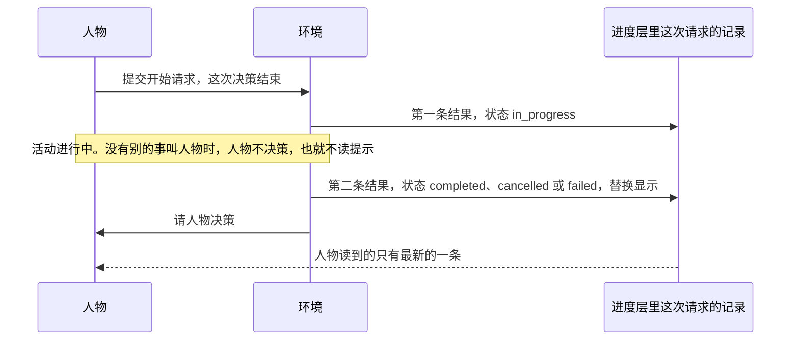
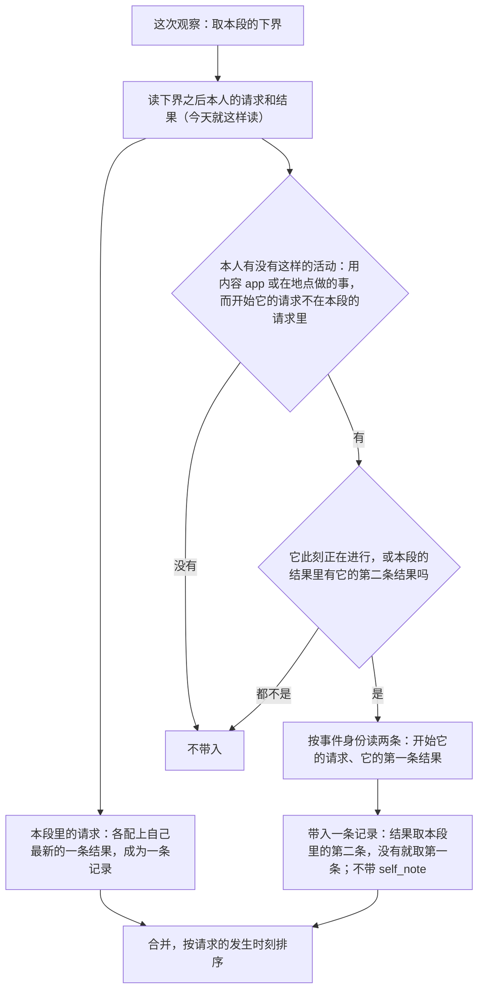
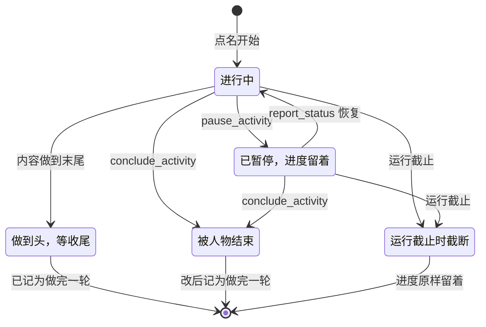

# 做完之后读到什么，提前结束算不算做完

> 本章属于[首次真实模型单日运行：修复与新增规格](../SPEC-first-real-day-run.md)，读法和叫法见那一页。

## 目标与依据

9 月 28 日 19:52 人物打开哔哩哔哩，环境放了一条 90 秒的《散步装备准备》，手机上是 19:52 到 19:53 的一段哔哩哔哩前台。19:53 轮到人物决策，它读到的这次请求只有「已完成，明细为空」，思考里写的是「The app content wasn't detailed. I'll say scrolled a couple of videos」。
同一天 18:30 开始的「做晚饭」连做了三集，人物只读到过第一集的标题，19:40 仍以为饭还没吃；与出发同一次回复里打开的 app，在路上没有任何记录；三次提前结束的「在家休息」各留下 60 秒、147 秒、29 秒的零头，下次点名只做这点零头。

今天引擎对一次开始请求先后写两条结果，进度层只显示最新的一条（`src/worldmock/life/progress_layer.py:126`），而第二条写给人物看的明细里只有订单和到达（`src/worldmock/life/result_projection.py:27-29`、`:37-41`），放过哪些内容留在活动快照（结果事件里带的这项活动当时的完整状态）里没有读出来。
进度层只读当前这段停留或这段路开始之后登记的请求（`progress_layer.py:105-106`），请求登记在上一段的活动在这一段没有记录；人物结束一项活动时引擎只把它记成取消（`src/worldmock/life/activities.py:102-104`），共享进度（人物对每条内容做到哪、做完过几轮的记录）原样留着。

本章落实提案「裁决结果」里「其余」一表的三行：

- 活动做完后人物看不到看了什么：「修。第二条结果带上内容的标题、简介、时长，连播的各集都列出」。
- 与出发同一次回复里开始的 app 使用在路上没有记录：「修。记录跟着人物进入路上那一段」。本章采用比这句话更宽的规则（列在规格开头「与提案不同的地方」），宽在哪里、窄的写法会留下什么，在「记录跟着人物进入后面的段」一节原样交代。
- 提前结束的事：「在地点做的事「结束」就算做完，只有「暂停」才保留进度；app 里的内容不变」。

顺带处理两处与此相连的旧账：进度层结果明细的 Schema 今天就不认投影写出的 `content`；`progress_layer.py` 和 `session_actions.py` 里有三句与实际行为相反的说明和一条走不到的分支。写规格时在 `session_actions.py` 的同一个文档字符串里又发现第四句与代码相反的说明，一并更正。

## 行为规格

### 一次请求的两条结果，人物只读到最新的一条

环境对同一次开始请求先后回两句话。提案用早上的咖啡讲过，原表照录（事件一栏是本章补的）：

| 时刻 | 发生的事 | 落库的事件 | 人物看得到吗 |
| --- | --- | --- | --- |
| 08:46:00 | 人物提交「打开瑞幸咖啡」。提交即结束这次决策 | `action_requested` | |
| 08:46:00 | 环境受理，写下**第一条结果**：已开始，计划 3 分钟，附商品清单（冰美式咖啡 22 元，运费 5 元，预计 09:11 到） | `action_accepted`、`action_result`，状态 `in_progress` | 看不到。人物要到下一次决策才读提示 |
| 08:49:00 | 活动做完，环境写下**第二条结果**：已完成 | `action_result`，状态 `completed`，`action_id` 仍是开始它的那条动作 | |
| 08:49:00 | 轮到人物决策。进度层对这次请求只显示最新的一条，也就是第二条：「已完成，明细为空」 | | 只看到第二条 |



规则（今天就是这样，改后不变）：

- 一条开始请求在进度层里是一条 `tool_call` 记录，`result` 取这条动作在本段里最新的一条 `action_result`（`progress_layer.py:105-117`、`:126`）。一条结果都没有的请求不出记录。
- 第一条结果在受理的那次提交里写下；第二条在活动终结的那一秒写下：自然做完（`src/worldmock/life/time_advance.py:297-314`）、人物提前结束（`src/worldmock/life/activity_control.py:406-417`）、运行截止（`time_advance.py:366-389`）。系列连播不写中间结果，整个系列只有最后一条。
- 人物通常读不到第一条：提交之后有活动在进行，下一次决策要等到这项活动结束、饿感变化、整点推送这类时刻；三五分钟的活动，下一次决策几乎总在它结束的那一秒。午饭那次人物看到了清单，是因为浏览到一半被饿感变化叫了起来，那时最新的还是第一条。
- 控制请求（播报、暂停、结束、改计划）和被拒的请求只有一条结果。

所以凡是要让人物在活动做完后知道的事，都必须写在第二条里。改后两条结果各带的明细：

| 活动 | 第一条结果的明细 | 第二条结果的明细 |
| --- | --- | --- |
| 用内容 app、在地点做事 | `planned`、`content`（开始的那一条内容） | `contents`（本节之后定义） |
| 购买 | `planned`、`purchases`（报价，带 `channel`） | `purchases`（已付或取消，带 `channel`） |
| 查询 | `planned` | `query` |
| 出行 | `planned` | `arrival` |
| 睡眠 | `planned` | 空 |

名称被规整后受理的 `resolved` 和受理时的 `notes` 也只写在第一条结果上，活动做完后随它一起从这条记录上消失。
瑞幸咖啡这类没有内容的 app 改后不能再单独打开（见[「打开 app 与 app 目录字段」](./04-app-opening.md)一章），上表的咖啡一例只用来讲清两条结果。

### 第二条结果里的 `details.contents`

用内容 app 或在地点做事的那条开始请求，第二条结果的明细多一个键 `contents`：按做的先后列出这项活动放过或做过的每一条内容。

| 键 | 类型 | 取值 | 含义 |
| --- | --- | --- | --- |
| `title` | 非空字符串 | 冻结目录里这条内容的 `title` | 标题 |
| `summary` | 字符串，至多 200 字，可以为空 | 冻结目录里这条内容的 `summary` 原文 | 简介 |
| `duration` | 非空字符串 | `duration_phrase(duration_seconds)`，例如「约 2 分钟」 | 这条内容登记的全长，不是这次做了多久；与第一条结果 `content.duration` 同一写法 |
| `finished` | 布尔 | `true` 或 `false` | 这条内容在这项活动里有没有做到头 |

每行恰好这四个键，按上表次序写出。数组的行这样得出：

1. 活动快照 `data.played` 的每一项各一行，保持 `played` 的次序，`finished` 为 `true`。`played` 只收做到末尾的内容（`src/worldmock/life/interact.py:112-114`）。
2. 快照的 `status` 不是 `completed`，且 `media_position_seconds` 大于 `data.start_position_seconds` 时，再加一行当前这一条（`data.content_id`），`finished` 为 `false`，排在最后。
3. 一行都没有时不写 `contents` 这个键。不设行数上限，不去重。

带不带，只看这条结果的状态和它带的活动快照：

| 第二条结果 | `status` | `message` | `contents` |
| --- | --- | --- | --- |
| 自然做完 | `completed` | `Activity completed` | 做到头的各条，全部 `finished: true` |
| 人物用 `conclude_activity` 提前结束（含暂停后再结束） | `cancelled` | `Activity cancelled` | 做到头的各条在前；当前这条有推进时排在最后，`finished: false` |
| 运行截止时截断 | `cancelled` | `Activity truncated at experiment end` | 同上 |
| 失败 | `failed` | `Activity failed` | 同上（用内容 app 和在地点做事今天不会失败，规则统一写） |
| 系列刚接到下一集、这一集还没推进时被结束 | `cancelled` | `Activity cancelled` | 只有做到头的各集，没有当前这一集 |
| 第一条内容一点没做就终结 | `cancelled` | 同上各自的文字 | 没有这个键。真实运行里走不到：开始之后的下一次决策一定晚于开始那一秒，内容已经有推进；规则照样写全 |

- 明细在投影成人物读到的结果时算：读这条 `action_result` 事件里的活动快照（`src/worldmock/life/action_evidence.py:46-62` 写下的 `data.activity`）和这次运行冻结的环境目录。事件的形状和内容都不改，世界状态不加字段。
- 只对 `kind` 为 `interact` 的活动快照写。出行、购买、睡眠、查询的第二条结果，控制请求和被拒请求的结果都没有 `contents`。
- 第一条结果照旧带 `content`（`{app, title, summary, duration, pushed}`，开始的那一条），不带 `contents`。系列做到一半人物被叫起时读到的仍是第一条，只有第一集。
- 暂停不产生第二条结果：暂停期间这条记录仍显示第一条。暂停后恢复，引擎把 `start_position_seconds` 改成恢复时的位置（`interact.py:137-153`），「有没有推进」因此按恢复之后算；恢复后同一秒不会再有决策，所以「恢复后零秒内被结束」不会出现。
- 与第一条结果的差别是有意的：不带 `app`（app 名已在这条记录的 `arguments.target` 里）和 `pushed`（做完之后没有用处）。

算例：19:52 的哔哩哔哩（真实运行，9 月 28 日）。

| 时刻 | 发生的事 | 今天人物读到的这条记录 | 改后 |
| --- | --- | --- | --- |
| 19:52 | 提交「打开哔哩哔哩」；第一条结果带 `planned` 和 `content`（《散步装备准备》） | 读不到，没有决策 | 同左 |
| 19:53 | 90 秒放完，写下第二条结果 | `status: completed`，`message: Activity completed`，`details: {}` | `details.contents` 一行：`title` 为「散步装备准备」，`summary` 是目录里这条内容的简介原文，`duration` 为「约 2 分钟」，`finished` 为 `true` |

人物收尾时不必再写「scrolled a couple of videos」。一次打开放的是一条独立内容时，放完这次使用就结束（`src/worldmock/life/interact.py:115-116`），`contents` 只有这一行；有几行的只有系列连播。
人物接着再打开同一个 app，是另一条请求、另一条记录，各带自己的 `contents`；把首尾相接的几次连成一段来看只在查看器里，见[「查看器里的连续使用」](./06-continuous-use.md)一章。

算例：样例环境里同一件事的完整记录（人在家 08:00:00 打开哔哩哔哩，环境挑中 5 分钟的《测试图文》，08:05:00 放完）。

```json
{"occurred_at": "2026-01-05T08:00:00+08:00", "type": "tool_call", "tool": "start_side_activity",
 "arguments": {"action": "interact", "target": ["哔哩哔哩"], "prefer": null},
 "result": {"occurred_at": "2026-01-05T08:05:00+08:00", "status": "completed", "error_code": null,
            "message": "Activity completed",
            "details": {"contents": [{"title": "测试图文", "summary": "测试图文的测试用合成摘要。",
                                      "duration": "约 5 分钟", "finished": true}]}}}
```

算例：「做晚饭」三集做完（18:30–19:00《备菜做饭》、19:00–19:25《吃晚饭》、19:25–19:40《洗碗收拾厨房》）。19:40 的第二条结果里 `contents` 依次三行，`duration` 分别是「约 30 分钟」「约 25 分钟」「约 15 分钟」，都是 `finished: true`。人物在 19:40 读得到自己做过《吃晚饭》这一集；这一集供不供一餐见[「在地点吃的一餐」](./07-meals.md)一章。

### 进度层结果明细的全部键

进度层每条 `tool_call` 记录的 `result.details` 由 `prompt_schemas._RESULT_DETAILS` 约束，它是封闭对象：没列出的键一律不合格。今天它列了十二个键（`src/worldmock/life/prompt_schemas.py:204-215`），而投影一直在写 `content`、`app`、`duration`、`goods` 四个它不认的键（`result_projection.py:12-13`、`:55-58`）。
任何带着一项进行中的 app 使用或地点活动的真实进度层，今天交给 `validate_layer` 都会被拒；运行时发送前不逐层校验，现有用例又只校验了运行开始时的空进度层，所以没有暴露。

改后的完整键表（全部可选，仍是封闭对象）：

| 键 | 形状 | 哪种结果带 | 相对今天 |
| --- | --- | --- | --- |
| `purchases` | 数组，每行的键依次是 `product`、`quantity`、`channel`、`destination`、`expected_at`，最后是 `price` 或 `paid` 之一 | 购买的两条结果 | 行里新增必填的 `channel`（下单 app 的全名或「到店」），排在 `quantity` 之后、`destination` 之前，见[「购买时写想用的 app」](./01-purchase-prefer.md)一章 |
| `planned` | 数组，每行 `{name, duration}` | 每条 `in_progress` 的开始结果；恢复暂停活动的播报结果 | 不变 |
| `content` | `{app: 字符串或 null, title: 非空字符串, summary: 字符串至多 200 字, duration: 非空字符串, pushed: 布尔}` | 用内容 app、在地点做事的第一条结果 | 投影今天就写，Schema 补上 |
| `contents` | 至少一行的数组，每行 `{title, summary, duration, finished}` | 用内容 app、在地点做事的第二条结果 | 新增，本章定义 |
| `query` | 见[「查询」](./02-query.md)一章 | 查询的第二条结果 | 新增 |
| `arrival` | `{place, access}`，`access` 为「进入」或「没能进去」 | 出行的第二条结果 | 不变 |
| `recall` | 对象 | 回看任务 | 不变 |
| `reason`、`next_step`、`fix` | 非空字符串 | 被拒的结果 | 不变 |
| `items` | 对象数组 | 被拒的结果 | 不变 |
| `outcome` | 数组，每行 `{activity, outcome}` | `conclude_activity` 的结果 | 不变 |
| `resolved` | 对象数组 | 名称被规整后受理的结果 | 不变 |
| `notes` | 非空字符串数组 | 受理时的提示 | 不变 |
| `errands` | 数组，每行 `{errand, change}` | 三个控制工具的结果 | 不变 |

`goods`、`app`、`duration` 三个键随「打开 app 不再附带商品清单」由内容轨道从投影里删除（见[「打开 app 与 app 目录字段」](./04-app-opening.md)一章），不进 Schema；写了它们的明细照封闭对象的规则被拒。

补全这份 Schema 排在所有实现之前，由结果与结束轨道用它的第一个提交一次落下上表的全部改动：加 `content`、`contents`、`query` 三个键，给购买行加必填的 `channel`。
`query` 的形状照[「查询」](./02-query.md)一章，`channel` 照[「购买时写想用的 app」](./01-purchase-prefer.md)一章；购买轨道和查询轨道在这个提交之上开发，只写各自的投影，不再改这份 Schema。
排在最前的原因：购买、查询、打开 app 三处都要往明细里加键或删键，谁只要加一条「真实进度层通过层校验」的用例，就会先撞上今天不认 `content` 这个缺口。
这个提交之后、购买轨道并入之前，真实的购买明细还没有 `channel`，带购买的进度层过不了层校验；这段时间没有用例校验这样的进度层（今天也没有），购买轨道并入时把带购买的参数加进去。
这条用例只写一份、按情形列参数（文件与参数见「测试要求」）：文件和「在地点做事进行中」这个今天就过不了的参数随同一个提交写下，本轨道其余的参数随 `contents` 的实现加上，其余轨道往里加自己的参数。

### 记录跟着人物进入后面的段

「段」指进度层的一个单位：一段停留，或一段路。人物换一段，进度层就从头记起，上一段的事进记忆层。
每一段有一个事件序号的起点，下文叫「下界」：出发那次提交整体算在出发前的停留里，到达那次推进整体算在路上那一段里（`src/worldmock/life/session_bounds.py:19-27`）。

今天进度层从请求出发找结果，而且只读下界之后的请求。所以一项活动的开始请求落在上一段时，它在这一段里即使还在进行、即使在这一段里做完，也没有任何记录；它的第二条结果落在这一段里却无处可挂。人物只在工具层看到活动名、阶段和已做多久。

改后：用内容 app 或在地点做事的开始请求，它的记录出现在这项活动仍在进行、或在其中结束的每一段里。这样带进来的记录下文叫「带入的记录」。每次观察时照下面的条件判定，只读当前世界和本段已经在读的事件：



判定条件有三条，都成立才带入：

- 活动是本人的，`kind` 为 `interact`。
- 本段下界之后没有 `action_id` 等于这项活动 `origin_action_id` 的 `action_requested`。
- 活动此刻的状态是 `active`；或者本段下界之后有 `action_id` 等于它 `origin_action_id` 的 `action_result`（更早的请求在后面的段里只可能再得到一条结果，就是它的第二条）。

带入的记录的形状与本段自己的记录相同，是一条 `tool_call`：

| 字段 | 取值 |
| --- | --- |
| `occurred_at` | 请求的发生时刻。它早于这一段的 `session_started_at`，这是有意的 |
| `tool`、`arguments` | 请求原文 |
| `result` | 本段里有它的第二条结果时取第二条（带 `contents`），否则取第一条（带 `planned`、`content`） |
| `self_note` | 不带。自述是人物提交这次请求的那次回复的正文，记在那次决策的第一条请求上（`src/worldmock/life/decision_coordinator.py:106-107`、`:129`），本段自己的记录照旧带它；带入的记录即使请求上有自述也不写这个键。系统层写的是自述「留到这段停留或路程结束」，这句话不用改 |
| 来源身份（观察事件的 `progress_event_ids`） | 请求事件、第一条结果事件；本段里有第二条结果时再加它 |
| 排序 | 与本段的记录用同一个键：`(请求发生时刻, 1, 0, 0, 来源里最小的事件序号)`。带入的记录因此排在本段最前 |

取数：请求事件的身份是活动上的 `origin_request_event_id`（`src/worldmock/life/models.py:370`），第一条结果的身份是活动数据里的 `accepted_event_id`（受理时写入，`src/worldmock/life/decision_coordinator.py:363-365`）。
这两条用 `FootprintStore` 新增的按身份读单条事件的方法取（`events.event_id` 有唯一索引，`src/worldmock/footprints/store.py:23`）；第二条结果从本段已经读出的结果里按 `action_id` 取。不为带入的记录扩大任何一次读取的范围，不扫描下界之前的事件。

各种情形：

| 情形 | 今天 | 改后 |
| --- | --- | --- |
| 与出发同一次回复里打开 app，人在路上 | 路上没有记录 | 有：进行中显示第一条结果，放完后显示带 `contents` 的第二条 |
| 出发之前就在用，带着上路 | 路上没有记录 | 有，同上 |
| 到达时还没放完（不论是哪一段里打开的），人在到达后的停留里 | 没有记录 | 有，同上 |
| 途中结束出行回到出发地，app 还在放 | 新的那段停留里没有记录 | 有，同上 |
| 在地点做的事暂停后离开，回来用 `report_status` 恢复 | 恢复之后只有那条播报的记录 | 恢复之后开始请求的记录也在，做完后带 `contents` |
| 暂停的活动后来在别处被结束 | 结束它的那一段里没有开始请求的记录 | 有，显示 `cancelled` 的第二条结果和 `contents` |
| 活动暂停着，人在别的段里 | 没有记录；待办层 `paused_activities` 列着它 | 不带入，仍只在待办层。恢复后才带入 |
| 带入之后在这一段里被暂停（路上暂停带着的 app；回家恢复后又暂停） | 没有记录 | 从暂停那一刻起不再带入：开始请求的记录从这一段的进度层消失，活动列在待办层，暂停那次 `pause_activity` 自己的记录照常在。恢复后重新带入 |
| 活动恰在到达那一秒放完 | 到达后的停留里没有记录 | 仍不带入：第二条结果算在路上那一段。它的结束句（带各条标题）已在记忆层路上那一段的条目里，人物在到达后的第一次决策读得到 |
| 出行、购买的开始请求 | 不跨段显示 | 不带入。购买付款后的句子由记忆层在下单那一段的条目里给出，带入会让同一笔购买在两层各出现一次 |
| 睡眠、查询 | 不会跨段 | 不涉及：睡着不能出发；查询没做完要出发得先结束它，也不能与出发同一次回复开始 |

其余不变的地方：段的下界怎样定、记忆层的条目怎样切、活动的结束句归哪一段，都不改。
同一秒内紧接着的下一次决策沿用续接链（同一秒里连续几次决策接在同一段对话后面，后一次只补发上一次观察之后新发生的记录）。链里只列来源全部晚于上一次观察的记录（`progress_layer.py:77-82`），带入的记录和本段更早的请求一样不在其中。
上下文紧张时的浓缩对带入的记录与对本段的记录一视同仁。

**这条规则比提案的字面宽。** 提案写的是「与出发同一次回复里开始的 app 使用，记录跟着人物进入路上那一段」，只有上表「与出发同一次回复里打开 app，人在路上」那一行。本章的规则多带了「出发之前就在用」「到达时还没放完」「途中结束出行」「暂停后回来恢复」「暂停的活动在别处被结束」这几行。理由是它们出自同一个原因（进度层只读本段之内的请求），而「出发前已在看」「到了还没看完」在通勤时比同一次回复里打开更常见。
如果只照字面做，下面这些情形仍然没有记录，人物在活动做完的那一刻照旧读不到自己看了什么，上一节的 `contents` 在这些情形里等于没有：

| 只照字面做时仍然没有记录的情形 | 人物会遇到什么 |
| --- | --- |
| 出发之前打开的 app，在路上放完 | 路上被要求给一项读不到内容的活动收尾 |
| 路上或出发时打开的 app，到达后才放完 | 到了公司被要求给一项读不到内容的活动收尾 |
| 途中结束出行后还在放的 app | 同上 |
| 暂停后回来恢复、再做完的地点活动；在别处结束的暂停活动 | 做完或结束时读不到做过哪几集 |

所有者若只要字面那一种，把「此刻正在进行，或本段里有它的第二条结果」这一条收窄即可：只带入「开启这段路的那次出发所在的决策里开始的 app 使用」，并且只在这一段路上带。规格其余部分不用动。

算例（样例环境，时刻为示意）。人在家，08:00:00 同一次回复里提交「驾车去公司」和「打开哔哩哔哩」，环境挑中 40 分钟的《测试长视频》，08:25 到公司。

| 时刻 | 人在哪一段 | 今天这条 `start_side_activity` 记录 | 改后 |
| --- | --- | --- | --- |
| 08:10 路上被叫起 | 路上 | 没有，`events` 为空 | 有。`occurred_at` 是 08:00:00，结果是第一条：`in_progress`，带 `planned` 和 `content`（《测试长视频》），没有 `self_note` |
| 08:25 到公司后的第一次决策 | 公司 | 没有 | 有，仍是第一条（活动还在进行） |
| 08:40 放完 | 公司 | 没有；人物要给一项读不到内容的活动收尾 | 结果换成第二条：`completed`，`contents` 一行《测试长视频》，`finished: true` |

同一时刻出发的那条 `start_main_activity`（出行）在路上和公司都不带入。

### 在地点做的事：结束算做完，暂停才保留进度

人物面前只有两个词：结束（`conclude_activity`）和暂停（`pause_activity`）。改后它们对在地点做的事的含义分开：结束是不做了，这件事记为做完一轮，下次点名从头做起；暂停是先放下，回头从原位置接着做。



规则。人物用 `conclude_activity` 结束一项在地点做的事（`kind` 为 `interact` 且 `data.app_id` 为 `null`），而它此刻是进行中或暂停中时，在同一次提交里把这件事所在的内容单元记为做完一轮。内容单元是人物能点名的一件事：独立内容是它自己，系列是它的全部各集（《模拟引擎》的既有定义）。

1. 取当前这条内容（`data.content_id`）已完成的轮数，没有进度记录按 0 算，加一，得到目标轮数。
2. 单元里每一条轮数小于目标轮数的内容：位置归零，轮数置为目标轮数。轮数已经不小于目标轮数的内容不动。
3. 此前没有进度记录的内容新建一条，`last_consumed_at` 取结束的时刻；已有记录的保留原值。

独立内容的结果就是位置归零、轮数加一。系列的结果是本轮还没做的各集一并记为做完，各集轮数拉齐，下次点名从第一集开始新的一轮。系列按整件事算是规格定下的，提案没有写，列在规格开头请所有者过目；理由是裁决说的是「在地点做的事」，而人物能点名的一件事就是整个系列，只算当前一集的话，「做晚饭」在备菜时被结束，下次点名会直接从《吃晚饭》开始。

几种停下的方式对比：

| 怎样停下 | 活动状态 | 共享进度，今天 | 共享进度，改后 | 下次点名 |
| --- | --- | --- | --- | --- |
| 做到末尾 | `completed` | 位置归零，轮数加一 | 不变 | 从头，新的一轮 |
| 暂停 | `paused` | 位置留着，这件事被暂停的活动占着 | 不变 | 被拒，`RESOURCE_CONFLICT`，要先恢复或结束那项活动 |
| 暂停后恢复 | `active` | 从暂停的位置接着做 | 不变 | — |
| 进行中被人物结束 | `cancelled` | 位置留着 | 整件事记为做完一轮 | 今天从原位置做剩下的；改后从头 |
| 暂停后被人物结束（原地或别处） | `cancelled` | 位置留着 | 整件事记为做完一轮 | 同上 |
| 已做到末尾、人物来收尾 | `completed` | 不动 | 不动，不再加一轮 | 从头 |
| 运行截止时截断 | `truncated` | 位置留着 | 不动 | 运行已结束 |

边界与不变的地方：

- 活动的状态仍是 `cancelled`，`boundary_type` 仍是 `cancelled`，`interruption_reason` 仍是 `agent_cancelled`；开始请求的第二条结果仍是 `status: cancelled`、`message: Activity cancelled`；收尾结果的 `outcome` 仍是「提前结束」；工具层和记忆层的终局说法仍是「提前结束」。世界把这件事记成做完，不等于这项活动是按计划做完的。
- 不另记事件。这次提交照旧只有 `conclude_activity` 的受理与结果、一条 `activity_concluded`、开始请求的第二条结果；共享进度的变化随同一次提交进世界状态。不写 `activity_progress`，那是真实消费的证据。
- 不设「做了多少才算」的门槛：系列刚接到下一集、这一集还没推进时被结束，照同一规则记为做完。
- 很长的事同样照这条规则，不设例外。样例环境里办公室的「季度销售数据整理」全长 9 小时：做到中午用 `conclude_activity` 结束，这件事就记为做完一轮，下午再点名是从头的 9 小时。人物中途去吃饭、回来接着做，要用暂停。
- 用内容 app 不变：结束后正在放的那条保留位置，下次被环境挑中时接着放。
- 被结束而记为做完不供餐：一集只在真的做到末尾的那一秒供餐（见[「在地点吃的一餐」](./07-meals.md)一章）。在《吃晚饭》做到一半时结束，这一集记为做完一轮，但人物没有吃到这一餐。
- 它的 `contents` 照上文的规则写：被结束时正在做的那一条是 `finished: false`。明细说的是这次实际做到哪，进度说的是下次从哪开始，两者不矛盾。

人物读到的文字：

| 位置 | 今天 | 改后 |
| --- | --- | --- |
| 工具层当前地点下这件事的行（被结束之后） | `duration` 是剩余时长，`note` 含「上次没做完，接着做」 | `available: true`，`duration` 是全长（系列是第一集的全长），`note` 独立内容为 `null`，系列写「第 1 集，共 M 集」；与供餐有关的写法见[「在地点吃的一餐」](./07-meals.md)一章 |
| 「上次没做完，接着做」 | 出现在可点名的行上 | 只可能出现在不可用的行上（正在做，或被暂停的活动占着） |
| 记忆层的结束句 | 「进行在家休息（…起）：18:01–18:30，提前结束，（《在家休息》未完）」 | 「进行在家休息（…起）：18:01–18:30，提前结束」。在地点做的事不再写「（《某某》未完）」那半句，做到头的各集标题照写；用内容 app 的结束句照旧写这半句 |
| 系统层 | 「…做到第几集由环境接着排…」 | 「在地点做的事用 conclude_activity 结束就算做完，下次点名从头做起，只是先放下、回头接着做用 pause_activity；内容 app 里没看完的内容，结束后仍留着进度。」以及「系列只写系列名称，从第一集做起」。整份定稿见[「人物读到的规则」](./10-persona-rules.md)一章 |

算例：「在家休息」做了 29 分钟被结束，之后再点名（真实运行，这条内容全长 30 分钟）。

| 时刻 | 发生的事 | 今天 | 改后 |
| --- | --- | --- | --- |
| 18:01 | 点名「在家休息」 | 从头开始，计划 30 分钟 | 同左 |
| 18:30 | 做了 29 分钟，人物用 `conclude_activity` 结束 | 进度：位置 1740 秒，轮数 0 | 进度：位置 0，轮数 1。开始请求的记录是 `cancelled`，`contents` 一行《在家休息》「约 30 分钟」，`finished: false` |
| 19:50 | 再点名「在家休息」 | 工具层这一行 `duration`「约 1 分钟」，`note`「上次没做完，接着做」；只做剩下的 60 秒 | 这一行 `duration`「约 30 分钟」，`note` 为 `null`；从头开始，计划 30 分钟 |

当天另外两次留下的 147 秒和 29 秒零头同样不再出现。人物想留着进度回头接着歇，要用暂停。

算例：「做晚饭」在第一集做到一半时被结束（18:30 开始，18:45 人物被叫起后决定不做了，这时《备菜做饭》做了 15 分钟）。

| 项 | 今天 | 改后 |
| --- | --- | --- |
| 三集的进度 | 《备菜做饭》位置 900 秒、轮数 0；另两集没有记录 | 三集都是位置 0、轮数 1；《吃晚饭》《洗碗收拾厨房》各新建一条记录，`last_consumed_at` 是 18:45 |
| 开始请求的记录 | `cancelled`，明细为空 | `cancelled`，`contents` 一行《备菜做饭》「约 30 分钟」，`finished: false` |
| 下次点名「做晚饭」 | 行上 `duration`「约 15 分钟」，`note`「第 1 集，共 3 集；上次没做完，接着做」；从《备菜做饭》第 15 分钟接着做 | 行上 `duration`「约 30 分钟」，`note`「第 1 集，共 3 集」；从《备菜做饭》开头做起 |
| 这一餐 | 没有 | 没有。《吃晚饭》没有做到末尾 |

若是 19:10 在《吃晚饭》做了 10 分钟时结束：`contents` 两行，《备菜做饭》`finished: true`、《吃晚饭》`finished: false`；《吃晚饭》和《洗碗收拾厨房》记为做完一轮，《备菜做饭》本来就已是一轮；记忆层的结束句是「进行做晚饭（…起）：18:30–19:10，提前结束，《备菜做饭》」；仍然没有这一餐。

连带。质量报告 `content_contact` 里的重复计数，按「开始消费时这条内容已有完成轮数」算（`src/worldmock/footprints/app_usage.py:381-382`）。在地点做的事被结束后再点名，改后是新的一轮，会计入重复；今天做剩下的零头时不计。键集不变，质量报告的结构号不动。

### 三句与实际行为相反的说明和一条走不到的分支

| 位置 | 今天写的 | 实际 | 改后 |
| --- | --- | --- | --- |
| `progress_layer.py:102-103`（`_tool_records` 的说明） | 浏览得到的商品名、到达等事实只在终态结果里 | 商品清单只在第一条结果里；第二条只有活动快照和订单 | 改写为：开始活动的请求在活动结束后显示第二条结果，做过的内容、付款后的订单、到达写在第二条上；并写明带入的记录 |
| `progress_layer.py:123`（`_tool_record` 的说明） | 终态结果不带当时的订单，`purchases` 取即时结果的订单 | 第二条结果自己带这条动作的订单快照（`action_evidence.py:62`） | 改写为：`result` 取最新一条结果 |
| `session_actions.py:85-86`（`_conclude_activity` 的说明） | 未完成的浏览写未取得浏览结果 | 终局只有完成、提前结束、失败三种 | 删去这半句，并写明在地点做的事被结束即记为做完 |
| `session_actions.py:80-81`（`_conclude_activity` 的说明的首句；写规格时发现的第四句，提案没有点到） | 途中结束出行时路上的其他活动随之结束 | 不随之结束：`sessions.end_transit` 只结束路上那一段、开始新的停留，槽位 2 的活动照常进行（`src/worldmock/life/sessions.py:87-93`） | 改写为：途中结束出行只结束这段路，槽位 2 的活动照常进行 |
| `progress_layer.py:127-129`（代码） | 第一条有 `purchases` 而最新一条没有时，把第一条的补过来 | 走不到：购买的第二条结果一定带同一批订单 | 删除这三行和只为它算的 `first`；购买记录照旧显示最新一条的 `paid` 或 `price` |

前三句是提案点名的。第四句与要改的那半句在同一个文档字符串里，本轨道本来就要改写它，所以一并更正；上文「途中结束出行回到出发地，app 还在放」那一行写的就是代码的实际行为。

### 拒绝与运行故障

本章不新增、不修改任何人物可见的拒绝，也不抽随机数。被暂停的活动占着的那件事再点名，照旧以 `RESOURCE_CONFLICT` 拒绝，原因 `{单元名} is held by the paused activity {活动名}.`，下一步 `Resume {活动名} with report_status, or conclude it.`。

运行故障新增一条：

| 英文信息 | 何时 |
| --- | --- |
| `Event does not exist`（错误日志 `Event %s does not exist`，抛 `IntegrityError`） | 按身份读单条事件而库里没有这个身份。带入的记录要读的两条事件是活动受理时落库的，读不到说明世界状态与事件对不上 |

### 明确不做

- 系列做到一半人物被叫起时，进度层仍只显示第一条结果，也就是第一集。裁决只管做完之后。
- 做完之后 `planned` 和 `resolved` 随第一条结果从这条记录上消失，不搬到第二条。
- `contents` 的行不加供餐、app、推送这些键，不设行数上限：系列做了几集就列几行。
- 带入的记录不带 `self_note`；不带出行和购买；暂停着的活动不带。出行的 `arrival` 明细因此仍然不会显示在进度层，人物照旧靠环境层的位置和记忆层的结束句知道到了。
- 不改段的下界、记忆层条目的切法和结束句的归属；不让同一秒的续接链重发更早请求的记录。
- 不改活动的状态与终局说法，不为「记为做完」新增事件、事件字段或世界状态字段，不升任何结构号（规则版本随整次改动升到 5，见[「版本、身份与基线」](./12-versions.md)一章）。
- 不改工具层单元行的算法：行上的时长和说明仍由共享进度推出，改后位置恒为零只是进度变了的结果。
- 不为旧运行迁移共享进度：改动之后旧运行按代码指纹被拒，不能恢复。
- 不加「提前结束了几次」「零头有多长」这类报告或质量指标。
- 查看器、导出时间线上「同一行依次列出各集标题」不在本章，见[「统一显示写法」](./08-display.md)一章；两处取「做过哪些内容」的口径与本章相同（`played` 的先后，再加确有推进的当前一条）。

### 本章定下的细节

| 事项 | 定下的做法 | 理由 |
| --- | --- | --- |
| `contents` 每行的键序与类型 | `title`、`summary`、`duration`、`finished`；`summary` 可以为空、至多 200 字；Schema 里数组至少一行 | 与第一条结果的 `content` 用同一套写法；空数组不写键，所以数组不会为空 |
| 「没做到头」怎样判 | 只看第二条结果里的活动快照：状态不是 `completed`，且 `media_position_seconds` 大于 `data.start_position_seconds`（这条内容在这项活动里开始或恢复时的位置） | 投影函数只拿得到结果和目录；从进度事件派生要把事件一路传进进度层。两种判法只在走不到的「恢复后零秒内结束」上不同 |
| 带入的三个条件 | 见上文；暂停着的不带，恰在到达那一秒放完的不带 | 只读当前世界和本段已读的事件就能判定；暂停的活动已在待办层，到达那一秒放完的已在记忆层，都不会漏 |
| 带入之后在这一段里被暂停 | 暂停期间不带入，恢复后再带入；不为它另加「曾经带入过」的判断 | 三个条件原样适用，不读本段之前的事件，也不给世界状态加标记；暂停的活动在待办层，暂停那次请求的记录在进度层，人物不会找不到它 |
| 带入的记录排在哪 | 按请求的发生时刻，排在本段最前，时刻可以早于 `session_started_at` | 沿用现有排序键，不为它另立规则；Schema 允许 |
| 带入的记录的来源身份 | 请求事件、第一条结果事件，本段里有第二条结果时再加它，与本段自己的记录同一写法 | 观察事件的 `progress_event_ids` 要能逐条解析到本人更早提交的事件，导出的质量报告按它核对 |
| 按身份读单条事件的方法 | `FootprintStore.read_event(event_id: str) -> Event`；读不到写英文错误日志并抛 `IntegrityError("Event does not exist")` | 与现有 `commit_last_seq` 读不到时的写法一致 |
| 系列记为做完的算法 | 目标轮数取当前一集的轮数加一，单元里轮数更低的各集拉到目标轮数 | 一条规则同时覆盖独立内容和系列；改后一个系列在没有活动占着它时各集轮数总是相同，所以下次必从第一集做起 |
| 新建进度记录的 `last_consumed_at` | 取结束的时刻；已有记录保留原值 | 字段必填且不小于 0；在地点做的事的挑选不读这个字段（只有 app 内容的挑选读它） |
| 单元的范围 | 独立内容是自身；系列取目录索引 `contents_by_series` 里同名的全部各集 | 与系列自动接下一集用的是同一个索引 |
| 结束句不写「未完」的范围 | 在地点做的事一律不写，含运行截止时截断的 | 截断之后没有任何提示再读它；规则只按「有没有 app」一个条件分 |
| 层校验用例的参数由谁加 | 结果与结束轨道写：在地点做事进行中、在地点做事做完、用内容 app 做完、在地点做事被提前结束、带入的记录（活动已做完）。「用内容 app 进行中」两个参数（本段的、带入的）由内容轨道在删掉 `goods` 的同一次改动里加 | 结果与结束轨道在第一波，那时打开 app 的第一条结果还带着 `goods`，这两个参数要等它删掉才过得了校验 |
| `content_id` 为空的活动 | 结果与结束轨道落地时纯浏览还在，这类活动不写 `contents`；内容轨道删浏览分支时把这条判断一并删掉 | 不留退役形状的读取分支 |
| 质量报告的重复计数 | 不改口径，接受上文「连带」里的变化 | 「记为做完」之后再做就是新的一轮，计数如实反映 |
| 说明里的第四句 | `session_actions.py:80-81` 写的「途中结束出行时路上的其他活动随之结束」随同一次改写一并更正 | 提案只点了三句，这一句是写规格时发现的；它与要改的那半句在同一个文档字符串里，不更正的话改过的说明仍有一句与代码相反 |

## 接口、删除面与文件指引

实施归属：本章的全部代码与测试归**结果与结束轨道**（第一波，与购买、缺陷与额度、显示三条轨道并行），例外写在表里。系统层的句子由落系统层整份定稿的那条轨道写（见[「人物读到的规则」](./10-persona-rules.md)一章），本轨道不改 `src/worldmock/agents/life_prompt.py`。
结果明细 Schema 的补全和层校验用例所在的文件是本轨道的第一个提交，这一个提交先行并入集成分支，购买、查询、内容三条轨道在它之上开发、并入时往用例里加参数；本轨道其余的改动照常并入，不必排在别的轨道前面。

| 文件 | 改什么 |
| --- | --- |
| `src/worldmock/life/prompt_schemas.py` | `_RESULT_DETAILS` 加 `content`、`contents`、`query` 三个键并列入可选；`_PURCHASE` 加必填的 `channel`（非空字符串）；`summary` 的写法与 `app_push` 记录的 `summary` 共用一处。`query` 的形状照[「查询」](./02-query.md)一章原样写，购买轨道和查询轨道不再改这两处。这是本轨道的第一个提交 |
| `src/worldmock/life/result_projection.py` | `_details`：状态为 `completed`、`cancelled`、`failed` 时写 `contents`；新增私有函数 `_done_contents(activities, inputs)`；模块与函数说明改写为两条结果各带什么。`_PASSTHROUGH_DETAILS` 里的 `goods` 和 `_interact_details` 的浏览分支归内容轨道删 |
| `src/worldmock/life/progress_layer.py` | `_tool_records` 拆成「本段的请求」与「带入的活动」两部分并合并；新增私有函数找出要带入的活动、把它配成记录；`_tool_record` 删除 `:127-129` 的补取和 `first`；两处说明更正；模块首行写明带入的例外 |
| `src/worldmock/footprints/store.py` | 新增公开方法 `FootprintStore.read_event` |
| `src/worldmock/life/location_activities.py` | 新增公开函数 `unit_done(agent, catalog, content_id, now) -> AgentState`，实现上文「记为做完一轮」的算法 |
| `src/worldmock/life/session_actions.py` | `_change`（`:418-429`）取消一项在地点做的事时调用 `unit_done`，与现有「取消购买」的分支并列；`_conclude_activity` 只改说明：`:85-86` 的那半句，以及写规格时发现的第四句（`:80-81`） |
| `src/worldmock/life/settled_text.py` | `_content_sentence`（`:80-87`）：`app_id` 为空的活动不写「未完」半句；说明同步。这个文件有三条轨道各改一处：本轨道改 `_content_sentence` 的「未完」半句；显示轨道改 `experience_sentence`（见[「统一显示写法」](./08-display.md)一章）；内容轨道删 `content_id` 为空时的提前返回（`:82-83`，见[「打开 app 与 app 目录字段」](./04-app-opening.md)一章）。本轨道与显示轨道同在第一波，改的是不同的函数；内容轨道在第二波，那个提前返回就在 `_content_sentence` 的开头，与本轨道改的不是同一行 |
| `src/worldmock/life/session_bounds.py` | 逻辑不改；模块说明补一句带入的例外，并把引用的设计小节对上 |
| `custom/`、`scripts/`、`tools/` | 本章不改 |

不改的文件：`life/interact.py`（点名仍读共享位置，改后位置恒为零）、`life/activities.py`、`life/activity_control.py`、`life/action_evidence.py`、`life/time_advance.py`、`life/sessions.py`、`life/memory_layer.py`、`life/continuation.py`。

直接删除，不留兼容：

- `progress_layer.py:127-129` 的补取分支。
- 「在地点做的事被结束后保留位置、下次做零头」这一行为连同钉住它的用例；不保留按旧进度继续的读取路径，不迁移旧运行的 `content_progress`。
- 三句与实际相反的说明，连同写规格时发现的第四句。

夹具：`tests/fixtures/dataset-environment/` 不因本章改动。

先改设计文档（行级清单见[「设计文档与手册改动清单」](./11-design-docs.md)一章）：

- 《模拟引擎》「动作、名称与并行」：讲「不到一分钟的余量仍会出现」的那一句，改成只对 app 内容成立。
- 《模拟引擎》「出行、内容与查询」（今天叫「出行、内容与目录浏览」）：点名后从哪里开始；结束、暂停与共享进度（结束算做完的规则全文只写在这里）；在开始结果的 `details.content` 之后新增第二条结果的 `details.contents`。
- 《人物》「提示与工具」：工具层地点行的 `duration` 与 `note`、「在地点做的一件事」那张表删去「上次没做完且已收尾」一行。
- 《人物》「进度、待办与记忆」：一次请求的两条结果与进度层显示最新一条；结果明细的全部键；段的事件区间（今天只写在 `session_bounds.py` 的说明里，设计文档缺）；带入的记录；在地点做的事的结束句。
- 《概述》「算法与工程背书总表」里讲内容进度的一行；《状态与序列化》「世界、人物与活动」里讲内容共享进度的一句。
- 手册《理解固定世界规则》讲暂停的一段之后加结束与暂停的差别；《设计环境数据集》讲系列的一句改成每次点名从第一集做起、中途结束整件事算做完。

约束：

- 每个函数不超过 50 行、5 个参数，文件不超过 2000 行，每个函数（含私有的）有带中文的 Doxygen 说明；错误文字与日志用英文。
- `ActionHandlers._conclude_activity` 已经 48 行（`session_actions.py:77-124`），新逻辑不能加进去，放在 `_change`。`_tool_records` 加带入之后要拆，每个函数各自不超过 50 行。
- `unit_done` 与 `read_event` 是公开函数，覆盖率门要求函数体每一行被测试执行到，含 `read_event` 读不到的分支。
- `tests/unit/engineering/test_single_source.py` 拒绝语法树相同的两个函数体，新函数不要照抄现有函数；`location_activities` 用模块顶部导入，函数内导入要在 `tests/unit/engineering/test_import_graph.py` 逐条登记。
- 源码变异按原文行定位，本章碰到的文件里这几行不能改写：`location_activities.held_refusal` 里的 `held = set(action["content_ids"])`；`activity_control.pausable` 里的 `and activity.planned_end_at - state.current_time >= PAUSE_MIN_REMAINING_SECONDS)`；`interact._unit_plan` 里的 `for key in action["content_ids"]]`。
- 被登记为变异杀手的现有用例不改名、不删除：`test_location_activities.py` 的 `test_naming_a_unit_starts_exactly_that_content`、`test_paused_unit_is_held_until_resumed_or_concluded`、`test_episode_title_and_unknown_detail_are_corrected_without_substitution`，`tests/integration/life/test_pause_limit.py` 的 `test_pause_with_179_seconds_left_is_refused_changes_nothing_and_conclude_succeeds`、`test_pause_with_exactly_180_seconds_left_succeeds`。
- Schema 进提示指纹，补键之后 `prompt_sha256` 改变；任何生产改动都改变代码指纹。两者都是预期内的。

## 测试要求

凡是引擎规则，用例都经真实请求、引擎和 SQLite：用 `engine_factory` 建引擎，`act`、`act_group` 提交，`advance_until_ready`、`reach`、`finish_activity` 推进，`progress_calls` 读观察里的进度层，`events` 读落库的事件，`tests/footprints/recording.py` 的 `export_completed` 做导出认证。系列用 `test_location_activities.py` 里现成的夹具副本「工作日晚饭」（备菜 1200 秒、吃饭 1500 秒、洗碗 600 秒）。

### 规则与用例

| 规则 | 层 | 测试文件 | 验收行为 |
| --- | --- | --- | --- |
| 进度层对一次请求显示最新一条；删掉补取分支后购买记录不变 | integration | `tests/integration/life/test_result_contents.py::test_purchase_record_shows_the_latest_result` | 购买进行中，这条记录的 `purchases` 行写 `price`；完成后同一条记录的同几行写 `paid`，行数不变 |
| 用内容 app 做完，第二条结果带 `contents` | integration | `tests/integration/life/test_result_contents.py::test_finished_app_use_lists_what_was_watched` | 打开 Keep（样例环境里它只登记了《测试慢跑》）；做完后 `start_side_activity` 记录的 `details` 恰为 `{contents: [一行]}`，四个键与目录一致，`finished` 为真；收尾之后这条记录仍在 |
| 连播的各集依次列出 | integration | 同文件 `::test_finished_app_series_lists_every_episode_in_order`（夹具副本里哔哩哔哩只留「测试剧集」）；`tests/integration/start_interfaces/test_location_activities.py::test_series_starts_at_its_representative_and_continues_to_the_end`（加断言） | 「测试剧集」三集、「工作日晚饭」三集做完，`contents` 各三行，次序是集号，`duration` 是各集全长 |
| 提前结束：做到头的在前，没做到头的排最后 | integration | `test_result_contents.py::test_ended_activity_lists_finished_items_then_the_unfinished_one` | 「工作日晚饭」做到第二集一半时结束：两行，`finished` 依次为真、假；第二行的 `duration` 是「约 25 分钟」而不是已做的时长 |
| 系列刚接到下一集就被结束：只列做到头的各集，照样记为做完 | integration | 同文件 `::test_series_ended_at_an_episode_boundary_lists_only_finished_episodes` | 把重估间隔设成第一集的时长，人物恰在第一集做完的那一秒结束「工作日晚饭」：`contents` 只有《备菜》一行，`finished` 为真；三集的轮数都是 1、位置都是 0 |
| 暂停后结束，暂停前做过的照列 | integration | 同文件 `::test_paused_then_ended_activity_lists_what_was_done_before_the_pause` | 做 5 分钟后暂停，稍后结束：一行，`finished` 为假 |
| 运行截止时截断的活动带 `contents` | integration | 同文件 `::test_activity_cut_off_at_run_end_lists_what_was_done` | 短运行窗口跑到截止，对落库的第二条 `action_result` 做投影：`cancelled`、`Activity truncated at experiment end`，`contents` 列出已做的 |
| 第一条结果照旧带 `content`，不带 `contents` | integration | `tests/integration/start_interfaces/test_location_activities.py::test_start_result_shows_the_content_that_actually_started`（现有，加一句断言） | 进行中的记录 `details` 有 `content`、`planned`，没有 `contents` |
| 明细在投影时算，事件不变 | integration | `tests/integration/life/test_result_contents.py::test_terminal_result_event_carries_no_contents_of_its_own` | 落库的第二条 `action_result` 事件里，结果的 `data`（事件正文的 `data.data`）键集仍是 `activity`、`orders`，没有 `contents`；对同一事件做投影得到 `contents` |
| 投影规则本身（多条 `played`、当前一条有无推进、一条都没有时不写键、`completed`、`cancelled`、`failed` 三种终态都写、非 `interact` 与控制结果不写、`completed` 不重复列最后一条） | unit | `tests/unit/life/test_result_contents.py::test_public_result_contents_follow_the_snapshot`（参数化） | 对手工快照调用 `public_result`，逐情形断言行与键序 |
| 结果明细的 Schema 认上文键表的全部键，不认 `goods`、`app`、`duration` | unit | 同文件 `::test_result_details_schema_accepts_every_listed_key`、`::test_result_details_schema_rejects_retired_keys` | 手工拼的进度层：带 `content`、带 `contents`、购买行带 `channel`、带[「查询」](./02-query.md)一章两种形状的 `query`，各自通过 `validate_layer`；购买行缺 `channel`、`contents` 是空数组、`contents` 的行多一个键、带三个退役键之一，各自被拒 |
| 真实进度层通过层校验 | integration | `tests/integration/life/test_progress_layer_schema.py::test_real_progress_layer_passes_layer_validation`（参数化） | 每个参数走真实引擎到指定情形后，观察里的进度层通过 `validate_layer`。参数见「本章定下的细节」，其余轨道往里加 |
| 人物真的读到 | integration | `tests/integration/runtime/test_finished_activity_prompt.py::test_next_decision_prompt_shows_what_was_watched` | 经 `current_contract_fixtures.decide` 走一次真实提示：活动做完后的下一次决策，落库的 `model_request` 用户消息里有那条内容的标题与简介 |
| 与出发同一次回复里打开的 app，路上有记录 | integration | `tests/integration/life/test_carried_records.py::test_app_use_started_with_departure_is_recorded_on_the_road` | `act_group` 出发并打开 app；路上第一次观察的进度层有这条 `start_side_activity` 记录，结果是第一条，带 `content` |
| 出发前已在用的 app，路上有记录 | integration | 同文件 `::test_app_use_started_before_departure_is_recorded_on_the_road` | 先打开 app，下一次决策出发；路上有记录 |
| 到达时没放完的 app，到达后的停留里有记录 | integration | 同文件 `::test_app_use_still_running_on_arrival_is_recorded_in_the_new_stay` | 到达后的观察里有记录；放完后同一条记录带 `contents` |
| 途中结束出行后还在放的 app，新的那段停留里有记录 | integration | 同文件 `::test_app_use_still_running_after_the_trip_is_ended_midway_is_recorded_in_the_new_stay` | 出发并打开 app，路上用 `conclude_activity` 只结束出行：人回到出发地，新停留的观察里有这条 `start_side_activity` 记录，结果是第一条；放完后带 `contents` |
| 暂停后回来恢复的地点活动、在别处结束的暂停活动 | integration | 同文件 `::test_location_activity_resumed_in_a_later_stay_is_recorded_there`、`::test_paused_activity_concluded_elsewhere_is_recorded_where_it_ended` | 恢复之后开始请求的记录出现；在别处结束后记录是 `cancelled` 并带 `contents` |
| 带入的记录显示最新一条 | integration | 同文件 `::test_carried_record_shows_contents_after_finishing_on_the_road` | 路上放完之后，同一条记录的结果从第一条换成带 `contents` 的第二条 |
| 带入的记录不带 `self_note` | integration | 同文件 `::test_carried_record_has_no_self_note` | 经 `current_contract_fixtures.decide` 的真实宿主：一次决策只打开 app，回复带正文，落库的这条 `action_requested` 上有自述；出发前的观察里这条记录带 `self_note`；下一次决策出发，路上带入的同一条记录没有这个键。不能用开始组代替：开始组里自述只记在第一条请求上 |
| 不带出行和购买 | integration | 同文件 `::test_departure_and_purchase_records_are_not_carried` | 出发加快递购买的开始组：路上进度层没有这两条开始请求；付款后的购买句照旧在记忆层出发地那一段 |
| 暂停着不带；到达那一秒放完的不带、记忆层有结束句 | integration | 同文件 `::test_paused_activity_is_not_carried_until_resumed`（两个参数）、`::test_activity_finishing_at_the_arrival_second_is_told_by_the_memory_layer` | 前者，在别的段里暂停着：别处的观察没有它的记录，待办层有。前者，带入之后在这一段里暂停：「测试休息」暂停后出门再回家、恢复（记录带入），再做 5 分钟后又暂停，这时开始请求的记录不在进度层、暂停请求的记录在、待办层有它；再恢复后记录重新出现。后者：到达后的进度层没有它，记忆层路上那一段的条目有带标题的结束句 |
| 来源可追，导出认证不报错 | integration | 同文件 `::test_carried_record_sources_resolve_and_the_export_certifies` | 路上观察事件的 `progress_event_ids` 含请求、第一条结果，放完后再含第二条；跑到截止导出，认证通过，质量报告没有 `invalid_observed_result_reference` |
| 排在本段最前，时刻早于段的开始 | integration | 同文件 `::test_carried_record_sorts_first` | 带入的记录在 `events` 首位，`occurred_at` 不晚于 `session_started_at` |
| 同一秒续接不含带入的记录 | integration | `tests/integration/runtime/test_same_second_continuation.py::test_a_carried_record_is_not_repeated_in_the_continuation`（新增） | 路上被拒后同一秒再决策：续接链成立，`tool_results` 只有被拒那条，`events` 不含带入的记录 |
| 按身份读单条事件 | unit | `tests/unit/footprints/test_store.py::test_read_event_returns_the_event_and_rejects_an_unknown_identity` | 读到的事件与写入的相同；未知身份抛 `IntegrityError`，信息为 `Event does not exist` |
| 在地点做的事结束算做完（独立内容） | integration | `test_location_activities.py::test_concluded_unit_starts_again_at_full_length` | 「测试休息」做 5 分钟后结束：`content_progress` 位置 0、轮数 1；工具层这一行可用、「约 15 分钟」、`note` 为空；再点名的活动 `start_position_seconds` 为 0、计划 900 秒 |
| 系列整件事算做完，下次从第一集 | integration | 同文件 `::test_concluding_a_series_counts_the_whole_unit_and_the_next_start_is_episode_one`（由现有用例改写） | 第二集做到一半结束：三集轮数都是 1、位置都是 0；这一行「约 20 分钟」「第 1 集，共 3 集」；再点名从 `d-1-prep` 开头做起 |
| 记为做完的算法 | unit | `tests/unit/start_interfaces/test_location_units.py::test_unit_done_raises_every_content_behind_to_the_next_round`（参数化） | 独立内容有无记录、系列在第一集与第二集、已有更高轮数的集不动；新建记录的 `last_consumed_at` 是传入的时刻，已有记录的不变 |
| 暂停后结束同样算做完（原地、别处） | integration | `test_location_activities.py::test_paused_unit_concluded_later_counts_as_done_and_starts_from_the_beginning`（两个参数，由现有用例改写） | 暂停在 300 秒处，之后结束：再点名从 0 开始、计划全长 |
| 只有暂停保留进度 | integration | 同文件 `::test_paused_unit_is_held_until_resumed_or_concluded`（现有，不改） | 暂停后位置 300，恢复后从 300 接着做 |
| 已做到末尾的活动被收尾不加一轮 | integration | 同文件 `::test_concluding_a_finished_activity_does_not_add_a_round` | 自然做完后轮数 1；收尾之后仍是 1 |
| 运行截止不动进度 | integration | 同文件 `::test_run_cut_off_keeps_location_progress` | 短窗口里做到一半截止：位置留着、轮数 0 |
| 状态、说法不变，不另记事件 | integration | 同文件 `::test_concluded_location_activity_stays_cancelled_and_writes_no_extra_event` | 活动 `cancelled`、`agent_cancelled`；收尾结果 `outcome` 为「提前结束」；这次提交里这项活动的事件恰是一条 `activity_concluded` 和一条第二条结果，没有 `activity_progress` |
| 用内容 app 不变 | integration | `tests/integration/life/test_environment_runtime.py::test_pause_resume_and_conclude_keep_actual_shared_content_progress`（现有，不改） | 结束后位置留在结束时的位置 |
| 结束句：在地点做的事不写「未完」，app 照写 | integration | `test_location_activities.py::test_memory_sentence_keeps_the_unfinished_half_only_for_app_content`（两个参数） | 结束后离开这一段，记忆层条目里：地点活动的句子以「提前结束」收尾，app 使用的句子含「（《…》未完）」 |
| 长内容结束后再点名是全长 | integration | 同文件 `::test_long_office_content_concluded_midway_starts_again_at_full_length` | 办公室九小时的「季度销售数据整理」做一段后结束，再点名计划 32400 秒 |
| 被结束的一集不供餐 | integration | 见[「在地点吃的一餐」](./07-meals.md)一章（内容轨道写，那时才有供餐字段） | 供餐的一集做到一半被结束：没有进账，没有 `data.meal` |
| 提前结束过地点活动的运行仍可导出认证；再点名计入重复 | integration | `test_location_activities.py::test_export_certifies_a_run_with_a_concluded_location_activity` | 结束、再点名、跑到截止、检查点、导出、认证通过；质量报告 `content_contact.repeat_watch` 不小于 1（再点名之后的进度事件算重复，今天这个情形是 0） |

「不扫描下界之前的事件」是实现约束，不是可观察的行为，不为它写探测内部调用的用例；可观察的一面由「来源可追」和「按身份读单条事件」两行守住。

### 钉住今天行为、要改或删的现有用例

| 用例 | 钉的旧行为 | 处理 |
| --- | --- | --- |
| `tests/integration/start_interfaces/test_location_activities.py::test_series_resumes_the_unfinished_episode_then_starts_a_new_round` | 系列中途结束后再点名，从没做完的一集原位置接着做 | 改写成上表的系列用例 |
| 同文件 `::test_paused_unit_is_concluded_later_and_then_continues_from_its_position`（两个参数） | 暂停后结束，再点名从 300 秒处接着做 | 改写成上表的暂停后结束用例 |
| 同文件 `::test_unit_with_under_a_minute_left_starts_for_the_remainder_and_completes_the_round` | 结束后剩 30 秒的零头可以点名 | 删除，由「结束后再点名是全长」取代 |
| `tests/integration/life/test_pause_limit.py::test_a_remainder_under_a_minute_left_by_concluding_can_still_be_named_and_finished` | 结束后剩 50 秒的零头 | 删除；「整段不到三分钟的内容不能暂停」仍由同文件 `test_a_sixty_second_content_is_never_pausable` 守着 |
| `tests/integration/life/test_content_start_evidence.py::test_current_started_activity_public_result_and_complete_export` | 状态改成 `completed` 的开始结果里没有 `content` | 两条轨道先后改这条用例。结果与结束轨道（第一波）先加断言：保留「没有 `content`」的断言，另用真实做完的结果加 `contents` 的断言，写成「美团」参数还在和去掉之后两种状态下都成立，即按活动有没有内容分支，没有内容的（「美团」这个参数还在时）断言没有 `contents` 键。内容轨道（第二波）随后去掉「美团」参数和没有内容的那一支，本轨道为那一支写的断言随之删掉 |
| `tests/unit/start_interfaces/test_location_units.py::test_series_starts_at_the_lowest_episode_with_the_fewest_rounds`、`::test_standalone_unit_shows_remaining_time_and_the_resume_note` | 说明写的是「做到一半从原位置接着做」 | 函数行为没变（暂停时位置大于零仍成立），只改说明文字 |
| `tests/unit/start_interfaces/test_system_layer_text.py` | 系统层旧文字 | 不归本轨道，见[「人物读到的规则」](./10-persona-rules.md)一章 |

检索 `tests/` 没有找到断言路上进度层为空的用例；并入时若有用例在出发并打开 app 之后逐条比对路上或到达后的进度层，按多出一条带入的记录改断言。

两份完整日基线和 `tests/fixtures/viewer-context.json`：活动日脚本有「驾车去公司并打开哔哩哔哩」的开始组，路上各次观察的进度层与 `progress_event_ids` 会多出带入的记录。它们只在收尾步重做一次（见[「版本、身份与基线」](./12-versions.md)一章），本轨道不动。

### 源码变异

每条规则都有「规则与用例」一表里经真实路径的行为用例。每一项定下的事另登记一条源码变异，取改坏它中心规则的那一条，证明守它的用例咬得住；其余规则不登记变异，规则没有实现时它的行为用例本来就不通过。
本章登记六条：提案「裁决结果」的「其余」一表里归本章的三行各一条，「裁决清单」里归本章的两行各一条，结果明细 Schema 的补全一条。「做完后读到什么」「提前结束的事」两项裁决在这两张表里各有一行，两行各取这项裁决里的一处规则，不把同一条变异登记两次。

登记进 `tests/dataset_acceptance.py`，锚点取实现后的真实源码，杀手都是「规则与用例」一表里在主进程里执行被改代码的用例（经 `engine_factory` 的真实引擎，或直接调用被改的函数）。
四句说明文字和删掉的那条走不到的分支没有可登记的变异，行为由「规则与用例」一表里「进度层对一次请求显示最新一条；删掉补取分支后购买记录不变」那一行的用例守住。

| 定下的事项 | 把规则改坏的方式 | 被哪条测试杀死 | 层 |
| --- | --- | --- | --- |
| 「裁决清单」的「活动做完后保留该让人物知道的事」 | 第二条结果不写 `contents` | `test_result_contents.py::test_finished_app_use_lists_what_was_watched` | integration |
| 「其余」一表的「活动做完后人物看不到看了什么」：连播的各集都列出 | 只列当前一条，不列 `played` 里做到头的各条 | `test_result_contents.py::test_finished_app_series_lists_every_episode_in_order` | integration |
| 结果明细 Schema 的补全，本轨道的第一个提交 | 结果明细的 Schema 不认 `query` | `tests/unit/life/test_result_contents.py::test_result_details_schema_accepts_every_listed_key` | unit |
| 「其余」一表的「与出发同一次回复里开始的 app 使用，在路上没有记录」 | 不带入任何记录 | `test_carried_records.py::test_app_use_started_with_departure_is_recorded_on_the_road` | integration |
| 「其余」一表的「提前结束的事」：在地点做的事结束就算做完 | 在地点做的事被结束后仍保留位置 | `test_location_activities.py::test_concluded_unit_starts_again_at_full_length` | integration |
| 「裁决清单」的「提前结束的事留不留进度」：结束就算做完，用在系列上是整件事 | 系列只把当前一集记为做完 | `test_location_activities.py::test_concluding_a_series_counts_the_whole_unit_and_the_next_start_is_episode_one`；`test_location_units.py::test_unit_done_raises_every_content_behind_to_the_next_round` | integration、unit |

结果明细 Schema 的那一条只登记这一次，由本轨道随第一个提交登记：[「查询」](./02-query.md)一章不另登记，查询轨道并入时把 `test_progress_layer_schema.py::test_real_progress_layer_passes_layer_validation` 里带查询答案的两组参数补进它的杀手。
新增的杀手都在 unit 或 integration 层，单条控制在几秒之内，避免拖长变异套件。

### 夹具

本章不改基础夹具；系列与单条 app 内容的情形由用例在夹具副本上构造（`copy_environment`、`catalog_rows`、`write_catalog_rows`），基线和录制样例随整次改动在收尾步统一重做。
