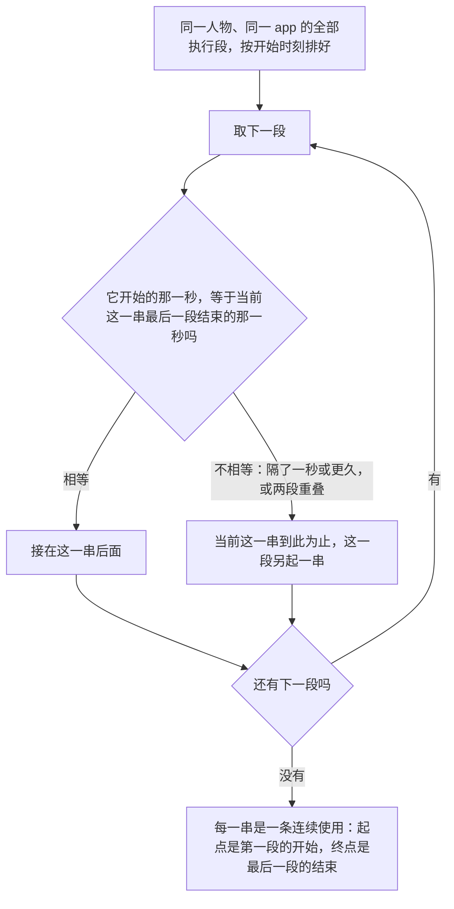

# 查看器里的连续使用

> 本章属于[首次真实模型单日运行：修复与新增规格](../SPEC-first-real-day-run.md)，读法和叫法见那一页。

## 目标与依据

### 所有者的答复

提案裁决清单里「打开一次内容 app 只看一条短内容就结束」一行的裁决是「处理，让一次打开成为一段连续的使用。具体做法本文没有定，在规格里提出后请所有者确认」，依据是「真人刷短视频在手机上是一段连续的前台」（`docs/dev/first-real-day-run/PROPOSAL-first-real-day-run.md:56`、`:437`）。
规格为此提出过三种做法：数据集给每个 app 声明使用时长，引擎固定一个时长范围，人物每次写打算用几分钟。三种都要改引擎。所有者 2026-10-12 的答复一种也没有选，原话是：

> 打开一次内容 app 怎样成为一段连续的使用 - 不需要改引擎，就是在viewer的地方合并或者表明都是一个app连续使用的就可以

本章照这句话办。引擎、环境数据集的字段、工具接口和提示一个字不改，人物用 app 的方式和今天完全一样；运行查看器把同一个 app 首尾相接的几次使用连成一段来画（合并），并在每一次使用上写明它属于哪一段（表明）。

### 那一晚手机上是什么样，改后怎样读

2026 年 9 月 28 日晚上人物在家，19:52 到 22:52 之间打开了九次哔哩哔哩。每次环境挑一条内容，放完这次使用就结束，人物收尾之后再决定下一件事。

| 开始 | 结束 | 时长 | 放的内容 | 与上一次哔哩哔哩的间隔 | 改后读成 |
| --- | --- | --- | --- | --- | --- |
| 19:52:00 | 19:53:30 | 90 秒 | 《散步装备准备》 | — | 单独一段，90 秒 |
| 20:00:00 | 20:02:30 | 150 秒 | 《雨天出门准备》 | 390 秒 | 单独一段，150 秒 |
| 20:19:33 | 20:22:03 | 150 秒 | 《拼图边框练习》 | 1023 秒 | 20:19:33 到 20:43:33 的一段，24 分钟，三条内容 |
| 20:22:03 | 20:42:03 | 1200 秒 | `content-long-video-cooking-002` | 0 | 同上 |
| 20:42:03 | 20:43:33 | 90 秒 | 《家庭合照挑选》 | 0 | 同上 |
| 21:23:33 | 21:26:03 | 150 秒 | 《冰美式制作小记》 | 2400 秒，中间是 20:43:33 到 21:23:33 的网易云音乐 | 21:23:33 到 21:58:03 的一段，34 分 30 秒，三条内容 |
| 21:26:03 | 21:28:03 | 120 秒 | 《桌面物品拍摄》 | 0 | 同上 |
| 21:28:03 | 21:58:03 | 1800 秒 | `content-long-video-nature-009` | 0 | 同上 |
| 22:51:03 | 22:52:33 | 90 秒 | 《骑行头盔检查》 | 3180 秒 | 单独一段，90 秒 |

同一晚微信在 21:58:03 到 21:59:33、21:59:33 到 22:01:03 也是首尾相接的两次（《亲子阅读角》《旅行行李清单》，各 90 秒），改后读成 21:58:03 到 22:01:03 的一段。

今天的查看器把哔哩哔哩这九次画成九行、九个很短的条块，读的人看到的是三小时里九次零碎的点开。改后是五段：两段各一条短内容，一段 24 分钟，一段 34 分 30 秒，睡前再一段 90 秒。
提案说的「七段 90 到 150 秒、彼此隔开的前台」（同一文件 `:317`）数的是七条短内容；数据库里这一晚一共九次，另两次各放了一条长内容，九次里有六次首尾相接。

上表的起止读自首次真实单日运行（issue 13）的运行数据库，只读。七条哔哩哔哩短内容和两条微信内容的标题取自提案的表（同一文件 `:263-273`），按时长和先后对上；微信两条的先后照那张表的次序写。
两条长内容不在那张表里，内容推进记录只带内容身份、不带标题（`src/worldmock/life/interact.py:101-103`），所以本章用内容身份称呼它们，例子里写成《…cooking-002》《…nature-009》；网易云音乐那 40 分钟放的内容写成《…》。
提案在表后提到这一晚的长内容标题有《回家吃饭》20160208、《美丽中国 自然》秦岭系列和「晚间歌单·老歌回顾」，没有写各是哪一次，本章不凭推测对号。查看器实际写的是冻结目录里各个身份的标题。

### 为什么几次使用会首尾相接

- 一条独立内容放完，这次使用就结束（`src/worldmock/life/interact.py:115-116`），成为待收尾的活动并占着槽位 2（`src/worldmock/life/activity_control.py:55-57`、`:70-72`），收尾之前不能开始别的（`src/worldmock/life/start_group.py:117-119`）。
- 活动结束的那一秒人物得到决策机会（`src/worldmock/life/time_advance.py:281-283`）。决策不耗模拟时间：收尾之后她没有进行中的活动，下一次决策仍排在同一秒（`src/worldmock/life/same_moment.py:126-137`）。
- 这一秒再打开同一个 app，新活动的开始时刻和上次结算时刻都是这一秒（`src/worldmock/life/activities.py:67-70`），它第一条进度事件的区间起点取的就是这个时刻（`src/worldmock/life/time_advance.py:284`）。
- 所以前一次最后一个结算区间的终点和后一次第一个结算区间的起点是同一个整数秒，间隔恰为 0，没有「差一两秒」的情形。手机前台事实上没有断过，只是记成了几项活动。
- 收尾时若还有一项槽位 1 的活动在进行（例如正在做饭），下一次决策按决策节律排到之后（`src/worldmock/life/same_moment.py:135-137`），再打开时已经隔了一段时间，两次使用不相接，查看器也不连。

### 只有查看器变

生产一侧改的只有查看器的两个文件。连续使用在显示时由查看器已经读入的数据算出，不写进数据库、导出或任何文件；引擎、环境目录、工具接口、提示、导出文件、导出的一天时间线、`scripts/inspect_run.py` 和人物读到的句子都不因这一项变化，逐项见下文「不变的部分」。
本章建在[「统一显示写法」](./08-display.md)一章之上：那一章把「互动 散步装备准备」改成「使用哔哩哔哩《散步装备准备》」，本章用它的写法函数给一段连续使用写标签，新代码放进它新增的并列脚本，不再动那些字。

## 行为规格

### 名词

| 名词 | 含义 |
| --- | --- |
| app 使用 | 查看器合并出来的一项活动，种类是 `interact`，`data.app_id` 不为空。在地点做的事（`app_id` 为空）、购买、查询、出行、睡眠都不是 |
| 执行段 | 一项活动真正在执行的一段时间。查看器今天就有：这项活动各条进度事件的结算区间，首尾相接的并成一段，暂停留下空档（`tools/run-viewer.html:791-799`、`:834-838`） |
| 连续使用 | 同一个人物、同一个 app 的 app 使用的若干执行段，一个接一个，后一段开始的那一秒正是前一段结束的那一秒；取尽可能长的一串。每个执行段恰好属于一条连续使用，不与别的段相接的执行段自成一条 |
| 段 | 一条连续使用里的一个执行段。「共 3 段」就是三个执行段连在一起 |

只有一段的连续使用，各处的显示照[「统一显示写法」](./08-display.md)一章，本章不动。下文的显示规则说的都是两段及以上的连续使用。

### 查看器各处显示什么

**活动泳道。** 今天每项活动一行，每个执行段一个条块（`tools/run-viewer.html:1181-1190`）。改后别的种类的行不变，app 使用的行分两种：

- 没有任何执行段落在两段及以上连续使用里的 app 使用，仍是自己一行、每个执行段一个条块，标签和悬停文字就是[「统一显示写法」](./08-display.md)一章给的那一句。暂停后又恢复、前后都没有别的使用相接的，属于这一种。
- 其余的 app 使用合到一行里画：有执行段同属一条两段及以上连续使用的几项活动画在同一行。这种连带可以传递：一项暂停过的使用，前半段连着一次、后半段连着另一次，三项都在同一行。

并在一起的行这样画：

- 行里每条连续使用一个条块（行里只有一段的那几条也各一个），从它的开始画到它的结束，颜色仍是互动的颜色。
- 行的标签是这一行全部执行段放过的内容按先后接起来的写法：「使用<app 名>《标题》《标题》……」。相邻两条是同一条内容时只写一次，所以上一次没看完、下一次接着放的那条内容只出现一次。例：「使用哔哩哔哩《拼图边框练习》《…cooking-002》《家庭合照挑选》」。
- 条块的悬停文字是「<起>–<止> · <这一条连续使用的写法>」，两段及以上的在后面加「 · 连续使用，共 <n> 段」；起止照今天悬停文字的格式（年/月/日 时:分:秒）。例：「2026/09/28 20:19:33–2026/09/28 20:43:33 · 使用哔哩哔哩《拼图边框练习》《…cooking-002》《家庭合照挑选》 · 连续使用，共 3 段」。
- 行的位置按行里各项活动最早的开始时刻，和这个人物的其他行一起排；并列时保持今天的相对次序。

泳道上方的提示在今天那一句后面加一句，成为：「同一时间轴上的条块表示实际执行区间；空白表示尚无结算记录。同一个 app 首尾相接的几次使用画在同一行，连成一个条块。」

**活动表。** 仍是每项活动一行，原有六列（开始、人物、活动类型、目标、结束、实际时长）的内容不变。表的最后加一列（下文叫标记栏），表头是「连续使用」，不能点，不参加排序：

- 这项活动有执行段属于一条两段及以上的连续使用时，写「<整条的开始>–<整条的结束> · 第 <i> 段，共 <n> 段」，时刻的格式与「开始」「结束」两列相同（月/日 时:分）。例：「09/28 20:19–09/28 20:43 · 第 1 段，共 3 段」。
- 这项活动在同一条里占了几段时，段号以「、」相连：「第 1、3 段，共 3 段」。
- 它的执行段分属两条两段及以上的连续使用时，两条都写，按先后以「；」相连。它另有自成一条的执行段时，那一段不写。
- 其余活动（包括不是 app 使用的）这一格是「—」。

**时间线。** 每条事件仍是一行。一次 app 使用的第一个执行段若不是所在连续使用的第一段，开始它的那条受理行在末尾加「 · 接续 <整条的开始> 起的连续使用」，时刻的格式同上。例：「已受理 · 使用哔哩哔哩《家庭合照挑选》 · 计划 1分 · 接续 09/28 20:19 起的连续使用」。

- 「开始它的那条受理行」指带着这项活动的受理事件里序号最小的那一条；库里没有这样的事件时不加任何字。
- 连续使用第一段的受理行、同一项活动后来的受理行、活动段行、结果行、活动收尾和活动恢复的世界事件行都不加字。
- 这半句是摘要文字的一部分，所以在时间线里搜「连续使用」能找出全部后续各段的受理行。

**查看器里其余数到或列出 app 使用的地方，都不变：**

| 位置 | 改后 |
| --- | --- |
| 泳道与活动表之间的「共 N 段活动 · 点击表头排序」（`tools/run-viewer.html:1242`） | 不变，N 仍是活动数；这里的「段」是页面原有的叫法，与连续使用的段无关 |
| 活动表的行数、分页、排序和图例 | 不变 |
| 加载日志「索引完成：…… / N 活动段」（`:658`） | 不变 |
| 总览「行动统计」的请求、接受、拒绝（`:959-966`）和事件类型分布 | 不变 |
| 观察行的「进行中：互动」（`:746-751`） | 不变 |
| 地点会话表的成员（`:1197-1216`） | 不变，写的是活动名，每次使用各一项 |
| 「一天」画面（`:1590-1637`） | 不变。它原样显示导出的一天时间线文件，那里每次使用各一行 |
| 「世界事件」里的 app 前台（导航、下单、付款） | 不变，也不参加连续使用 |
| 身体曲线、经济流水、记忆、思考记录、上下文、SQL 查询 | 不变 |

### 算例：那一晚

只列哔哩哔哩、网易云音乐、微信三个 app 的行。今天的查看器（`tools/run-viewer.html:1182`）每次使用一行、一个条块，标签是「互动 <标题>」，例如「互动 散步装备准备」。泳道：

| 今天的查看器 | 改后的行 | 改后的条块 |
| --- | --- | --- |
| 一行 | 使用哔哩哔哩《散步装备准备》 | 19:52:00–19:53:30 |
| 一行 | 使用哔哩哔哩《雨天出门准备》 | 20:00:00–20:02:30 |
| 三行，各一个条块 | 使用哔哩哔哩《拼图边框练习》《…cooking-002》《家庭合照挑选》 | 20:19:33–20:43:33，一个条块 |
| 一行 | 使用网易云音乐《…》 | 20:43:33–21:23:33 |
| 三行，各一个条块 | 使用哔哩哔哩《冰美式制作小记》《桌面物品拍摄》《…nature-009》 | 21:23:33–21:58:03，一个条块 |
| 两行，各一个条块 | 使用微信《亲子阅读角》《旅行行李清单》 | 21:58:03–22:01:03，一个条块 |
| 一行 | 使用哔哩哔哩《骑行头盔检查》 | 22:51:03–22:52:33 |

十二行变成七行。哔哩哔哩 20:43:33 结束、网易云音乐 20:43:33 开始，是两个 app，各在各的行；21:23:33 和 21:58:03 两处同理。19:52:00 和 20:00:00 两次隔了 390 秒，不连。
行里写 app 名和书名号是[「统一显示写法」](./08-display.md)一章的事；本章决定的是几行、几个条块和下面的标记。

活动表仍是十二行，下面列其中七行（人物一列从略）：

| 开始 | 活动类型 | 目标 | 结束 | 实际时长 | 连续使用 |
| --- | --- | --- | --- | --- | --- |
| 09/28 19:52 | 互动 | 使用哔哩哔哩《散步装备准备》 | 09/28 19:53 | 1分 | — |
| 09/28 20:19 | 互动 | 使用哔哩哔哩《拼图边框练习》 | 09/28 20:22 | 2分 | 09/28 20:19–09/28 20:43 · 第 1 段，共 3 段 |
| 09/28 20:22 | 互动 | 使用哔哩哔哩《…cooking-002》 | 09/28 20:42 | 20分 | 09/28 20:19–09/28 20:43 · 第 2 段，共 3 段 |
| 09/28 20:42 | 互动 | 使用哔哩哔哩《家庭合照挑选》 | 09/28 20:43 | 1分 | 09/28 20:19–09/28 20:43 · 第 3 段，共 3 段 |
| 09/28 20:43 | 互动 | 使用网易云音乐《…》 | 09/28 21:23 | 40分 | — |
| 09/28 21:58 | 互动 | 使用微信《亲子阅读角》 | 09/28 21:59 | 1分 | 09/28 21:58–09/28 22:01 · 第 1 段，共 2 段 |
| 09/28 21:59 | 互动 | 使用微信《旅行行李清单》 | 09/28 22:01 | 1分 | 09/28 21:58–09/28 22:01 · 第 2 段，共 2 段 |

时间线里这一晚加了半句的受理行有五条，时刻是 20:22:03、20:42:03、21:26:03、21:28:03、21:59:33。下表列其中三条，和两条不加的作对照：

| 时刻 | 受理行 |
| --- | --- |
| 20:19:33 | 已受理 · 使用哔哩哔哩《拼图边框练习》 · 计划 2分 |
| 20:22:03 | 已受理 · 使用哔哩哔哩《…cooking-002》 · 计划 20分 · 接续 09/28 20:19 起的连续使用 |
| 20:42:03 | 已受理 · 使用哔哩哔哩《家庭合照挑选》 · 计划 1分 · 接续 09/28 20:19 起的连续使用 |
| 20:43:33 | 已受理 · 使用网易云音乐《…》 · 计划 40分 |
| 21:59:33 | 已受理 · 使用微信《旅行行李清单》 · 计划 1分 · 接续 09/28 21:58 起的连续使用 |

### 怎样算出连续使用

用到的数据查看器都已经在读，只有最后一行是[「统一显示写法」](./08-display.md)一章加的：

| 要的东西 | 取自 | 今天读它的地方 |
| --- | --- | --- |
| 人物 | 事件的 `agent_id` | `tools/run-viewer.html:523-527` |
| 活动、种类、app | 受理事件和进度事件的 `activity_id`、`data.activity.kind`、`data.activity.data.app_id` | `:558-562`、`:580-586` |
| 结算区间 | 进度事件的 `data.interval_start`、`data.interval_end`，整数秒 | `:585`、`:596` |
| 执行段 | 区间为正的进度事件才算；同一项活动里首尾相接的区间并成一段 | `:834`、`:838` |
| 每段放过的内容 | 区间落在这一段里的各条进度事件指向的内容身份，按事件序号；一条事件指向哪条内容照[「统一显示写法」](./08-display.md)一章的规则取 | 那一章新增的投影 |

算法只有一步，在加载数据库时对全库做一次：把同一个人物、同一个 app 的全部执行段按开始时刻排好（并列时按结束时刻，再按这一段第一条进度事件的序号），从前往后逐段看。

- 相等怎样判断：两个数照数据库里读到的原样比较（`===`），不取整，不留余量。差一秒不连；后一段开始得比前一段结束还早（两段重叠，现行引擎不会产生）也不连。
- 规则只比较秒数，不另外检查中间插了什么。别的 app、购买、查询只要真的执行过，就占掉至少一秒，后一段不会正好从前一段结束的那一秒开始；用 app 和购买都占槽位 2（`src/worldmock/life/action_contract.py:17-27`），查询改后也占槽位 2（见[「查询」](./02-query.md)一章）。
- 成串只看人物、app 和时刻，不看放了什么。没有内容的 app 使用（内容轨道并入之前仍会产生）照样成串，标签由写法函数按[「统一显示写法」](./08-display.md)一章的过渡写法给出。
- 只按已经结算的执行段算。受理之后还没有任何进度事件的使用没有执行段，不属于任何连续使用，显示照[「统一显示写法」](./08-display.md)一章。

### 各种情形

下面带「示意」的时刻不是那次运行里的。

| 情形 | 结果 |
| --- | --- |
| 暂停后恢复的一次使用，没有别的使用相接 | 两个执行段中间隔着暂停，是两条各一段的连续使用。显示不因本章变化：泳道一行两个条块，活动表一行，标记栏是「—」 |
| 同一个 app 的两项活动，一项暂停着（示意）：21:00:00 打开哔哩哔哩，21:08:00 暂停；同一秒再打开哔哩哔哩，21:10:30 放完；同一秒恢复先开的那次，21:22:30 放完 | 三个执行段首尾相接，是一条 21:00:00 到 21:22:30、共 3 段的连续使用。泳道一行一个条块；活动表两行，先开的那次标「09/28 21:00–09/28 21:22 · 第 1、3 段，共 3 段」，后开的那次标「09/28 21:00–09/28 21:22 · 第 2 段，共 3 段」，只有后开的那次受理行带「接续」 |
| 上一种情形里恢复晚了一秒 | 先开那次的前半段和后开的那次连成 2 段，后半段自成一条。两项活动仍画在同一行，行里两个条块；先开的那次只标前半段所在的那一条：「09/28 21:00–09/28 21:10 · 第 1 段，共 2 段」 |
| 一项使用的两个执行段各连着别的使用（示意）：上面先开的那次暂停到 21:38:00，其间 21:30:00 另开一次哔哩哔哩、21:38:00 放完，同一秒恢复先开的那次，21:50:00 放完 | 两条连续使用：21:00:00 到 21:10:30 和 21:30:00 到 21:50:00，各 2 段。三项活动画在同一行，行里两个条块；先开的那次标「09/28 21:00–09/28 21:10 · 第 1 段，共 2 段；09/28 21:30–09/28 21:50 · 第 2 段，共 2 段」，它的受理行不加半句 |
| 运行在使用途中截止 | 最后一段到最后一次结算的时刻为止，它前面相接的各段照样连着，没有特别处理 |
| 跨过零点 | 连续使用按秒算，不看日期，跨零点仍是一条；标记里起止都带日期 |
| 活动表按人物筛选、排序、翻页 | 连续使用在加载时按全库算好，之后不重算；它不跨人物，按人物筛选不会拆开它。一条连续使用的几行被分到两页时，每一行的标记仍写整条的起止和自己是第几段 |
| 时间线的时间范围、类型、关键词筛选 | 同上。前几段被筛掉时，后面各段受理行里写的仍是整条连续使用的起点 |
| 泳道的时间轴 | 仍是整个运行的起止（`tools/run-viewer.html:1176-1177`），没有按日选择，条块不会被显示范围截断 |
| 不同人物 | 各算各的；两个人在同一秒先后用同一个 app 也不连 |
| 只拖数据库、读不到冻结目录 | 连续使用照算，它只用身份和时刻；标签里的名称照[「统一显示写法」](./08-display.md)一章显示成「名称缺失（身份）」 |

### 不变的部分

| 对象 | 这一项之后 |
| --- | --- |
| 人物怎样用 app | 不变。一次打开仍只放一条独立内容或一部系列，放完待收尾；每次使用仍由人物用自己的一次决策收尾，想接着看就再打开一次，晚上那些零碎的收尾决策不会减少 |
| 人物读到和记下的 | 不变。系统层、工具层、结果、记忆层和零点计划的句子都照别的章，不因这一项多一个字；她仍可能把这一晚记成零碎地点开了几次 |
| 引擎、环境目录、工具接口 | 不因这一项变化：app 行不为它加字段，活动数据不为它加键，暂停的判定不变，开始工具不为它加参数 |
| 导出文件 | 不变。每次使用仍是自己的一行 `app_use`（`src/worldmock/footprints/app_usage.py:63-82`），同一个 app 首尾相接的行在导出里不合并；要一段连续前台的下游读者自己把相接的行并起来，这句话列在[「版本、身份与基线」](./12-versions.md)一章交给下游的清单里 |
| 导出的一天时间线、`scripts/inspect_run.py` | 不变。时间线按活动合行（`scripts/render_day.py:92-114`），每次使用各一行 |
| 版本号、指纹、基线、样例环境 | 不变，见「接口、删除面与文件指引」 |

### 明确不做

- 不采用规格提出过的三种做法：app 行不加使用时长字段，引擎不抽也不固定使用时长，不在一项活动里放完一条接着挑下一条，`start_side_activity` 不加写分钟数的参数。
- 不留容差：隔一秒也不连，不设「几分钟以内算连续」。
- 不把连续使用写进数据库、导出或任何文件。
- 不合并不同的 app；不把查询、购买、引擎代用的 app 前台与使用连起来，即使是同一个 app、首尾相接；不合并在地点做的事、出行、睡眠。
- 不合并活动表的行，不减少时间线的事件行，不改任何计数。
- 不给查看器加「合并或不合并」的开关，不给泳道加按日选择或缩放。整段运行很长时条块很窄，今天就是这样。

### 本章定下的细节

| 事项 | 定下的做法 | 理由 |
| --- | --- | --- |
| 以什么为单位 | 执行段，不是活动 | 暂停把一项活动切成几段，手机前台是按段连续的；查看器今天画的也是执行段 |
| 相等怎样判断 | 两个整数秒原样比较，重叠也算不相等 | 引擎的区间端点都是整数秒，同一秒再决策时间隔恰为 0；任何余量都是所有者没有要的 |
| 分组与次序 | 按人物和 `app_id` 分组；按开始、结束、这一段第一条进度事件的序号排 | 序号在库里唯一，同一个库每次打开结果都一样 |
| 何时算 | 加载时对全库算一次：先合并活动，再算连续使用，最后生成各行摘要 | 受理行的摘要要读它；与筛选、排序、翻页无关 |
| 时刻用哪个时区 | 运行的时区，用页面现成的两个格式函数 | 今天生成摘要早于读入世界状态的时区（`tools/run-viewer.html:638`、`:647-654`）；[「统一显示写法」](./08-display.md)一章把生成摘要挪到读完运行文件之后，那时时区已经读入 |
| 泳道的行 | 有执行段同属一条两段及以上连续使用的活动同一行，连带可以传递；其余 app 使用仍各自一行 | 每项活动只出现在一行里；没有相接的使用（含暂停过的）不因本章变化 |
| 行的标签 | 把这一行各段的内容身份按先后接起来，交给[「统一显示写法」](./08-display.md)一章的活动写法函数，快照只带 `kind`（`interact`）和 `data.app_id` | 写法只有一处实现，相邻重复由它去掉 |
| 悬停文字 | 两段及以上的加「 · 连续使用，共 n 段」 | 条块连起来之后看不出是几次使用 |
| 活动表的标记放哪 | 末尾新增一列「连续使用」，不动「目标」列 | 「目标」列由共用用例文件逐字核对；现有用例按位置取第四格 |
| 标记里的时刻 | 起止都写月/日 时:分 | 与同表的「开始」「结束」同一格式；跨零点时只写钟点会读错 |
| 「共 n 段」数什么 | 执行段 | 与定义同一口径；一次使用占两段时写「第 1、3 段」 |
| 时间线 | 只给后续各段的受理行加半句 | 所有者的答复是「合并或者表明」；时间线一条事件一行，只能表明 |
| 哪一条受理行 | 带着这项活动的受理事件里序号最小的那一条 | 同一项活动可能不止一条受理事件带着它，例如重放时带 `reused` 的那一条 |
| 「接续」写哪个时刻 | 整条连续使用的开始 | 前几段被筛掉时这一行单独也读得懂 |
| 各处计数 | 一律不变 | 它们数的是活动和事件，没有变 |
| 新代码放哪 | 并列脚本 `tools/run-viewer-wording.js` | 页面本体的行数约束；不再添一个要随查看器分发的文件 |
| 两条长内容怎样称呼 | 内容身份 | 提案的标题表里没有它们，没有核对过的标题不写 |

## 接口、删除面与文件指引

### 改哪些文件

| 文件 | 改什么 |
| --- | --- |
| `tools/run-viewer-wording.js`（[「统一显示写法」](./08-display.md)一章新增） | 全局对象 `ViewerWording` 再加五个函数，都带中文说明；除名称表照那一章的办法取得外，只由入参算出结果，不读页面的全局状态。`continuousUses(activities)`：由合并后的活动求全部连续使用，每条有人物、`appId`、起、止和按先后的各段（活动身份、这项活动第一条受理事件的序号、起、止、内容身份序列），另带按活动身份和按受理事件序号查的两张索引。`useLaneRows(activities, uses)`：把传入的 app 使用分成泳道的行，每行给出画在一起的几项活动、行里的各条连续使用和行的最早开始时刻。`continuousUseLabel(segments)`：若干段的写法，把各段的内容身份按先后接起来，连同只带 `kind` 和 `data.app_id` 的快照交给那一章的活动写法函数。`continuousUseMark(activity, uses, formatTime)`：活动表那一格的文字，没有可写的返回「—」。`continuationNote(sequence, uses, formatTime)`：受理行末尾的半句，不是后续段的受理事件返回空串 |
| `tools/run-viewer.html` | `buildActivities`（`:802-844`）给每项活动多记两样：每条区间为正的进度事件的起、止、序号和它指向的内容身份（`:834` 处），带着这项活动的第一条受理事件的序号；末尾调 `continuousUses`，结果放进全局状态 `S` 新增的一项 `uses`（`:242-262`），换库时与 `S.acts` 一起清空（`:1783`）。`renderActivityLanes`（`:1175-1195`）：app 使用的行改由 `useLaneRows` 给，提示文字加一句。`renderActivities`（`:1245-1254`）：表头和每行各加一格。`makeSummary` 的受理行（`:758-760`）：末尾接 `continuationNote`。[「统一显示写法」](./08-display.md)一章把生成摘要和合并活动都挪到读完运行文件之后；本章定这两步的先后：今天先生成摘要（`:638`）、后合并活动（`:657`），改成先合并活动并算出连续使用，再生成摘要 |
| `tools/run-viewer-context.js`、`tools/run-viewer-context-view.js`、`tools/run-viewer-context.css` | 不改。「上下文」画面显示的是模型请求各层的原文，不读合并后的活动 |

时刻的格式由页面把现成的 `fmtHM`、`fmtT`（`tools/run-viewer.html:287-288`）传给并列脚本，脚本里不另写一份。

### 不删除，不改夹具与版本

- 这一项不删除任何代码、字段或文件。
- 不改样例环境，不新增夹具文件，不改共用用例文件 `tests/fixtures/display-wording-cases.json`：连续使用只有查看器一处实现，Python 一侧没有对应的东西可比。
- `tools/` 不在代码指纹里（`src/worldmock/run_setup.py:100-110`），导出文件一个字节不变，所以各个版本号、提示指纹、工具指纹、代码指纹、两份完整日基线和查看器录制样例都不因这一项变化。

### 先改的设计文档

规则写进《记录引擎》（`docs/design/05-recording-engine.md`）新增的「显示写法与检查工具」一节，放在讲查看器的那一段之后：连续使用的定义（同一人物、同一 app、执行段首尾相接、没有容差），泳道、活动表、时间线三处各写什么，以及「只在查看器里合并，导出不合并」。行号级的清单和这条规则在「新规则的归宿」里的登记见[「设计文档与手册改动清单」](./11-design-docs.md)一章。本章不给手册加字。

### 归哪条轨道

显示轨道，在它先做的那一步里，排在[「统一显示写法」](./08-display.md)一章的查看器改动之后（要用它的写法函数、名称表和按事件取内容身份的投影）。不依赖购买、查询、内容、结果与结束各轨道，也不在收尾里留事情；唯一随收尾走的是下文测试表里注明的一句断言。

### 这里会碰到的约束

- `tools/run-viewer.html` 今天 1805 行，上限 2000 行，[「统一显示写法」](./08-display.md)一章还要求改后不比今天多。本章的逻辑全部放进并列脚本，页面本体只加调用，两章的改动合起来仍守那一条。
- 查看器要打开很大的运行：连续使用和两张索引一次加载只算一遍，画表格的每一行、生成每条摘要时按索引取，不逐条扫描全部连续使用。
- 排序必须是确定的：并列时按结束时刻、再按这一段第一条进度事件的序号，不依赖对象的遍历次序。
- 查看器的 JavaScript 不能登记源码变异，原因见「测试要求」。
- 中间提交的门禁排除了 `tests/system/viewer/test_run_viewer.py`，查看器的 Node 用例那时不随 pytest 执行；显示轨道并入之前照[「统一显示写法」](./08-display.md)一章的办法直接用 `node --test` 跑。
- 本章不新增任何错误输出；注释和函数说明用中文。新写的行照生产代码的上限写：每行至多 120 字符，每个函数至多 50 行、5 个入参。

## 测试要求

### 每条规则的行为测试

用例都写在 `tests/system/viewer/run_viewer.test.cjs`，把手写的事件写进测试用的 SQLite，经页面的同一个加载入口建索引，再读泳道、活动表和时间线摘要的渲染结果；不用直接调用新函数来代替这条路径。「那一晚」指上文十二次使用的真实起止。

| 规则 | 层 | 测试文件 | 验收行为 |
| --- | --- | --- | --- |
| 同一个 app 首尾相接的使用连成一个条块 | system | `run_viewer.test.cjs`：`touching uses of one app are drawn as one lane block labelled with every item in order` | 那一晚：泳道 7 行、7 个条块，自上而下按开始时刻；20:19:33 那一行只有一个条块，左端和宽度对应 20:19:33 到 20:43:33，标签依次是三条内容的标题，悬停文字以「 · 连续使用，共 3 段」结尾；21:23:33 那一行到 21:58:03；两次微信一行一个条块，21:58:03 到 22:01:03；提示文字含新增的那一句 |
| 隔开的不连，重叠的不连，不同的 app 不连 | system | 同一文件：`a gap, an overlap or a different app ends a continuous use` | 那一晚：19:52:00 和 20:00:00 两次各自一行，标签和悬停文字里没有「连续使用」；哔哩哔哩 20:43:33 结束、网易云音乐 20:43:33 开始，各在各的行，21:23:33 和 21:58:03 两处同理。另加相隔恰好 1 秒的两次同 app 使用，再加区间重叠 1 秒的两次：都是两行、两个条块，标记栏都是「—」 |
| 只有同一个人物的 app 使用参加 | system | 同一文件：`only app uses of one person join, never location activities, purchases, queries, phone foreground records or other people` | 同一秒相接的两项在地点做的事、一次哔哩哔哩使用后紧接一次经哔哩哔哩下单的购买、一项手写的种类为 `query` 且带同一个 `app_id` 的活动、一条同一 app 的 `app_foreground` 世界事件、另一个人物在同一秒接着用同一个 app：泳道行数等于活动数，没有标记，没有「接续」 |
| 活动表每项活动一行并标明位置，计数不变 | system | 同一文件：`the activity table keeps one row per activity and marks its place in the continuous use` | 那一晚：表体 12 行；表头最后一格是「连续使用」且不带排序标记；20:19、20:22、20:42 三行最后一格依次是「09/28 20:19–09/28 20:43 · 第 1 段，共 3 段」到「第 3 段」；孤立的各行是「—」；各行第四格仍是自己的写法；「共 12 段活动」不变，总览「行动统计」的接受数仍是 12 |
| 后续各段的受理行写明接续 | system | 同一文件：`the acceptance of a later use names the continuous use it continues` | 那一晚：20:22:03、20:42:03 两条受理行以「 · 接续 09/28 20:19 起的连续使用」结尾，21:26:03、21:28:03 两条写 09/28 21:23，21:59:33 那条写 09/28 21:58；其余七条受理行和全部活动段行没有这半句。给 20:22:03 那次再加一条序号更大、带着同一项活动的受理事件：后加的那条不加半句 |
| 暂停后恢复、没有别的使用相接 | system | 同一文件：`a paused and resumed use keeps its own row and two blocks` | 一次使用两个执行段、中间隔着暂停：泳道一行两个条块，标记栏「—」，标签里没有多出或少掉内容 |
| 暂停期间同一个 app 的另一次使用 | system | 同一文件：`a use of the same app that fills a pause joins both halves` | 三个执行段首尾相接：泳道一行一个条块；先开的那次标「第 1、3 段，共 3 段」，后开的那次标「第 2 段，共 3 段」且受理行带「接续」，先开的那次受理行不带；标签里先开的那条内容出现两次、中间是另一条。把恢复推迟一秒：同一行两个条块，先开的那次只标「第 1 段，共 2 段」 |
| 一项使用的两个执行段各连着别的使用 | system | 同一文件：`a paused use that touches another use on each side is marked with both continuous uses` | 「各种情形」里那组时刻：三项活动一行、两个条块；先开的那次最后一格是两条标记以「；」相连，另两次各标自己那一条 |
| 跨零点、时区、翻页、排序和时间线筛选 | system | 同一文件：`midnight, time zone, paging, sorting and timeline filters never cut a continuous use` | 23:58:00 到 00:00:30、00:00:30 到 00:03:00 两次相接：泳道一个条块；后一次标「09/28 23:58–09/29 00:03 · 第 2 段，共 2 段」；每页行数调成 1 后两页各一行，标记不变；按活动类型倒序排后标记不变；把时间线的起点设到零点后重新筛选，筛出的后一次受理行仍写「接续 09/28 23:58 起的连续使用」。世界状态的时区换成 `Asia/Tokyo` 重新加载同一组事件：标记和半句里的时刻都晚一小时 |
| 运行在使用途中截止 | system | 同一文件：`a use cut by the run end keeps the uses that touch it` | 前一次放完，后一次只有一条进度事件、状态仍是进行中：连成一条，终点是最后一次结算的时刻。后一次受理后没有任何进度事件：前一次标记栏「—」，后一次受理行不加半句 |
| 标签里相邻的同一条内容只写一次；成串不看内容 | system | 同一文件：`an item continued in the next use is written once in the label of the continuous use` | 前一次看到一半被结束，同一秒再打开接着放同一条内容，放完后同一秒又打开看另一条：三段一条，标签里那条内容只出现一次。两次没有内容的同 app 使用相接：一个条块，标签是「使用<app 名>」；这一句断言随[「统一显示写法」](./08-display.md)一章的过渡写法在收尾时删除 |
| 不依赖名称 | system | 同一文件：`continuous uses are found without the frozen catalog` | 只给数据库：条块、标记和「接续」照样，标签里是「名称缺失（身份）」，每个身份一次英文错误 |

### 现有的查看器用例

本章不使任何现有用例改期望：今天没有哪条用例给 app 使用写带区间的进度事件。下面几条要原样保持通过，它们守着本章不该碰的东西。

| 测试 | 处理 |
| --- | --- |
| `tests/system/viewer/run_viewer.test.cjs`：`activity lanes preserve simultaneous actions and pauses using settled intervals`（`:1274-1306`） | 不改。两项在地点做的活动，一项暂停过：仍是各自一行、共三个条块，提示文字里原有的那一句仍在 |
| 同一文件的辅助函数 `targets`（`:448-450`） | 不改。它按位置取活动表的第四格；新列加在最后，「目标」仍是第四格 |
| 同一文件：`activities page lists location sessions from the final world state`（`:1126-1157`） | 不改。地点会话表不变 |
| [「统一显示写法」](./08-display.md)一章新写的 `activity table lanes and timeline write the shared wording and keep the kind label` | 期望不因本章变化；它若要放同一个 app 的两次使用，两次之间要留出间隔 |
| `tests/system/viewer/test_run_viewer.py` | 本章不另加 `.cjs` 文件，执行的文件表照[「统一显示写法」](./08-display.md)一章 |

### 没有登记的源码变异

这一项不登记变异。登记的变异按 `模块::函数` 定位一段 Python 源码，替换后编译（`tests/mutation_runner.py:51-57`、`:103-135`），查看器的 JavaScript 进不了这套机制；这一项也没有任何 Python 改动可以登记。规则由上表的 Node 用例守住，其中「那一晚」的几条同时证明了连与不连两个方向。

### 夹具与助手

- 那一晚的十二次使用写成测试文件里的一张表（app、内容身份、起、止），不新增夹具文件。两条长内容和网易云音乐那一条的标题由用例自拟，三个 app 和十二条内容经假的运行目录里的目录文件喂入。
- 新增两个辅助函数：`appUse(id, appId, contentId, start, end)` 给出一次使用的受理事件和一条进度事件；`pausedUse` 给出带两段区间的一次使用。时刻都显式给，不用事件序号推算。
