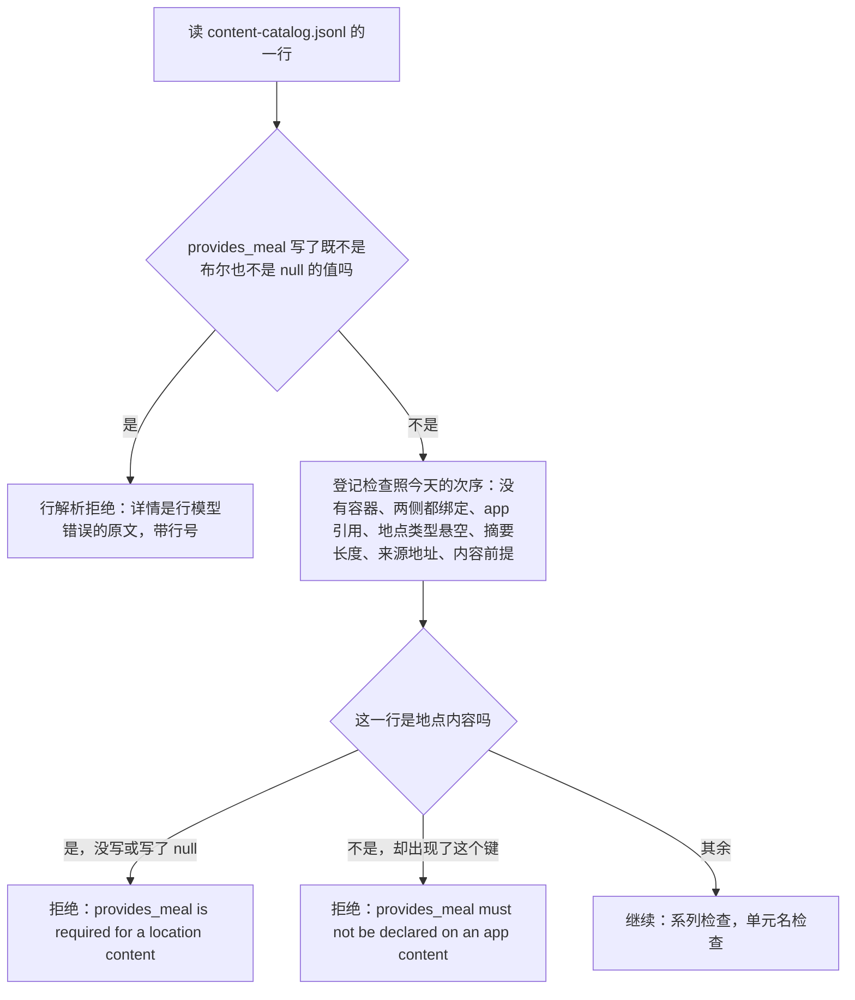
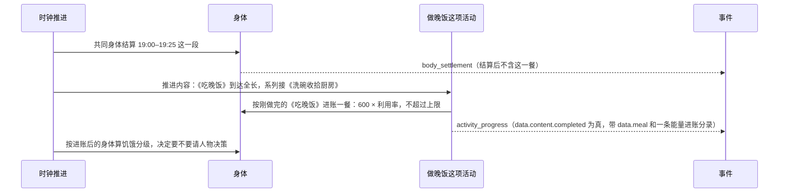
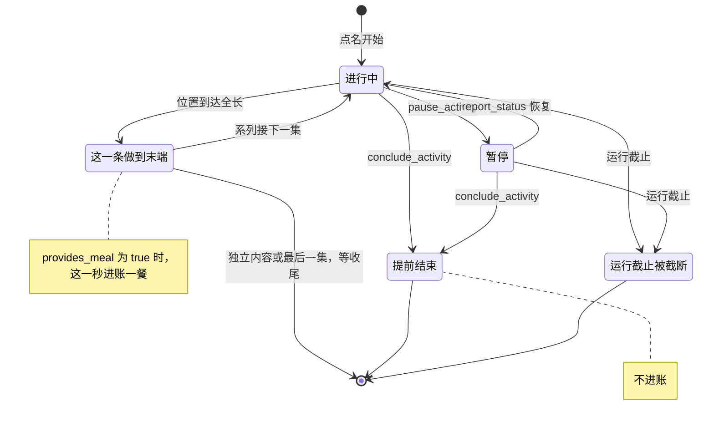

# 在地点吃的一餐

> 本章属于[首次真实模型单日运行：修复与新增规格](../SPEC-first-real-day-run.md)，读法和叫法见那一页。

## 目标与依据

人物林悦 18:30 在家点名「做晚饭」，三集连着做：18:30–19:00《备菜做饭》、19:00–19:25《吃晚饭》、19:25–19:40《洗碗收拾厨房》。今天她 19:40 做完仍然「有点想吃」，以为饭做好了还没吃，五次决策卡在「没有吃饭这个动作」，手机时间线上原定 20:00 的盒马买菜被提前到 19:40。

今天的引擎里，在地点做的事只按体力档位消耗能量，从不进账。能量唯一的进账函数 `apply_food`（`src/worldmock/life/body.py:137-146`）在生产代码里只被食品收货调用（`src/worldmock/life/receipt.py:86-95`）；时钟推进里 `interact` 的分支只推进内容位置（`src/worldmock/life/time_advance.py:335-339`）。内容行模型里没有任何与吃饭有关的字段（`src/worldmock/catalog/models.py:189-207`），今天的引擎读到这样的字段会按未知字段拒绝。行号以提交 `2b10aa9c` 为准。

本章实现裁决清单里「地点里做的事能不能解饿」一行，所有者同意的做法是提案原话「数据集给地点里的每一件事、系列里的每一集写明供不供一餐，必填，引擎不补值」。提案只定了这一句；字段名、数额、进账时刻、记录位置和连带口径是写规格时定下的，其中要请所有者过目的两处是：工具层用 `note` 标出哪件事、哪一集供一餐；被结束的地点活动不供餐。

有一处与提案的字面不同，先说在前面：提案差距表写的是《吃晚饭》写明供一餐后「不再饿」。能量确实进账，但人物自己写的饭点时段之内，饥饿分级至少是「有点想吃」，吃过也一样，买来的食品今天就是这样；身体模型本次不改。数字见下文「要告诉所有者的事实」。

## 行为规格

### 名词

| 名词 | 含义 |
| --- | --- |
| 地点内容 | `content-catalog.jsonl` 里绑定地点类型的一行，也就是顶层写了非空 `location_kinds` 的行。人物在地点点名做的「一件事」是一个内容单元：一条独立的地点内容，或同一系列的各集 |
| app 内容 | 同一个文件里绑定 app 的一行，也就是写了非空 `app_ids` 的行 |
| 供一餐 | 这条地点内容做到末端的那一秒，算人物吃了一餐。供不供由数据集在这一行上用 `provides_meal` 写明 |
| 共同身体结算 | 时钟每推进一段，环境给身体记的那一笔账（基础代谢、活动消耗、欠觉、两项需要），记成 `body_settlement` 事件 |

### 字段 `provides_meal`

| 这一行是什么 | `provides_meal` 的写法 | 结果 |
| --- | --- | --- |
| 地点内容：独立的一件事，或系列里的一集 | `true` 或 `false` | 接受。系列的每一集各写各的，不要求相同，一个系列可以有几集写 `true` |
| 地点内容 | 没有这个键 | 拒绝 |
| 地点内容 | `null` | 拒绝，与没写同一句详情 |
| app 内容 | 没有这个键 | 接受 |
| app 内容 | 出现了这个键，值是 `true`、`false` 或 `null` | 拒绝 |
| 任何内容行 | 值既不是 JSON 布尔也不是 `null`，例如 `"yes"`、`1`、`0`、`"true"` | 拒绝 |

- 引擎不补值：没写就拒绝，不当作 `false`；不看标题猜测，标题叫《吃晚饭》而写了 `false`，做完不算吃饭。
- 引擎不替数据集把关：全部地点内容都写 `false` 的环境包照常加载，不发警告；一条 60 秒的内容写 `true` 也接受。
- 行模型上这个字段的缺省是 `None`，只表示「这一行没写」。地点内容的 `None` 在登记阶段就被拒绝，进不了运行；运行时只有「恰为 `true`」才算供一餐。

拒绝的码都是现有的 `ENVIRONMENT_KIND_INVALID`（原因 `A declared kind is outside the fixed set.`），不新增登记码。下表的 `<N>` 是这一行在 `content-catalog.jsonl` 里的行号，从 1 起；`<content_id>` 是这一行的内容身份。

| 情形 | 在哪一步拒绝 | 英文详情 |
| --- | --- | --- |
| 地点内容没写，或写了 `null` | 登记检查 | `content-catalog.jsonl:<N> <content_id>: provides_meal is required for a location content; allowed values: true, false.` |
| app 内容出现了这个键 | 登记检查 | `content-catalog.jsonl:<N> <content_id>: provides_meal must not be declared on an app content.` |
| 值不是布尔 | 行解析，早于全部登记检查 | 行模型错误的原文，以 `content-catalog.jsonl:<N> ` 开头，其中有字段名 `provides_meal` 和 `Input should be a valid boolean` |

- 作者看到的完整文字是「码、原因、详情」相连，例如删掉样例环境第 10 行 `c-rest` 的这个键：`ENVIRONMENT_KIND_INVALID: A declared kind is outside the fixed set. content-catalog.jsonl:10 c-rest: provides_meal is required for a location content; allowed values: true, false.`
- `worldmock validate` 的报告照现有形状：`{"path": "catalog", "code": "ENVIRONMENT_KIND_INVALID", "reason": "A declared kind is outside the fixed set. content-catalog.jsonl:10 c-rest: provides_meal is required for a location content; allowed values: true, false."}`。
- 给样例环境第 1 行的 app 内容 `c-article` 加上 `"provides_meal":false`：详情是 `content-catalog.jsonl:1 c-article: provides_meal must not be declared on an app content.`。这一句没有允许值，因为 app 内容上这个键没有可写的值。
- 值不是布尔时的详情由严格行模型生成，今天 `pushable` 写错也是这种写法（`src/worldmock/catalog/loader.py:77-92`、`:108-116`）；它带 Pydantic 的版本链接，测试只断言行号前缀、字段名和 `Input should be a valid boolean` 三处。同一行里还有别的字段写错时，码照行解析现有的优先次序定。

检查的位置：登记阶段逐行检查内容时，排在内容前提的检查之后、系列检查之前（今天的次序见 `src/worldmock/catalog/admission.py:173-190`）。

次序带来的结果：一行同时犯了排在前面的错（例如地点类型悬空、把前提写在地点内容上），报的仍是前面那一条；一行同时没写 `provides_meal` 又与别的单元重名，或系列各集绑定不一致，先报没写。逐行检查，行号小的那一行先报。

### 一餐是什么，什么时候进账

一餐就是「收到一件食品」的那一次结算，不另设数值：

| 事 | 规则 |
| --- | --- |
| 数额 | `evaluate_goods_receipt("meal", 1)`（`src/worldmock/exchange/operators.py:24-32`），读唯一的常数表 `GOODS_ENERGY_KCAL`（`src/worldmock/exchange/constants.py:16`），今天是 600 千卡 |
| 进账 | `apply_food`（`src/worldmock/life/body.py:137-146`）：实得 = 数额 × 利用率；进账 = 实得与「2,400 − 当前能量」中较小的一个 |
| 利用率 | 按这一秒欠的觉在 0、8、16、24 小时对应 0.90、0.90、0.85、0.80 之间线性取值（`src/worldmock/exchange/body.py:29-32`、`src/worldmock/life/sleep.py:217-221`） |
| 取哪一刻的身体 | 这一秒的共同身体结算之后的身体：先扣掉这一段的消耗，再进账 |
| 什么时候 | 这条内容的位置到达全长的那一秒，也就是内容证据 `completed` 为真的那一次结算（`src/worldmock/life/interact.py:95`）。同一秒、同一次提交 |
| 条件 | 冻结目录里刚做完的这一条 `provides_meal` 恰为 `true`。系列读的是刚做完的那一集，不是接下来要做的那一集 |

与收到一件食品逐项对照：

| 事 | 收到一件食品（今天，不变） | 在地点做完一件供一餐的事（改后） |
| --- | --- | --- |
| 数额、利用率、上限 | 上表 | 同一张表、同一个函数 |
| 时刻 | 到店在购买完成付款时，外卖在送达时，快递在驿站取件时 | 这条内容做到末端的那一秒 |
| 花钱 | 购买时付款 | 不花钱，也不需要先买食材 |
| 记录 | 一条 `goods_received` | 做完那条 `activity_progress` 上的 `data.meal` |
| 订单、通知、购买投影 | 有 | 没有 |
| 回调状态重置、个人事务累计 | 有 | 没有 |

这一秒里的先后（以 19:25:00《吃晚饭》做完为例）：

- 同一秒还有别的进账时不另排次序：进行中的活动照现有次序（开始时刻、活动身份，`src/worldmock/life/models.py:621-625`）逐项推进，预排的外卖送达排在全部活动之后（`src/worldmock/life/time_advance.py:105-106`）。所以在地点吃的一餐先进账，同一秒送到的外卖后进账，上限按这个先后生效。
- 供一餐本身不是唤醒原因，也不发通知。这一秒请不请人物决策，只看现有的原因：整件事做完、饥饿分级跨档、到了播报间隔等（`src/worldmock/life/rhythm.py:93-110`）。「跨档」比的是上一次请人物决策时她读到的分级，不是上一秒的分级（`src/worldmock/life/schedule.py:245`、`src/worldmock/life/felt.py:242-252`）：吃完这一餐之后的分级与那一次相同，就不为它请人物决策。
- 本章没有随机抽取，不新增随机键。

### 暂停、恢复、提前结束、反复做

| 情形 | 进不进账 |
| --- | --- |
| 一条写 `true` 的内容做到末端 | 进账一次，就在那一秒 |
| 一条写 `false` 的内容做到末端 | 不进账 |
| 做到一半的结算边界（人物被请来播报、饥饿跨档等） | 不进账；只有到达末端的那一次结算才进 |
| 暂停 | 暂停期间不推进内容，不进账 |
| 暂停后用 `report_status` 恢复并做到末端 | 进账一次，在做完的那一秒 |
| 进行中用 `conclude_activity` 提前结束，包括刚开始的同一秒就结束 | 不进账 |
| 暂停后再结束，在原地或别处 | 不进账 |
| 系列做到供一餐那一集之前就结束 | 不进账。整件事按「在地点做的事结束就算做完」记进度，下次点名从第一集做起（见[「做完之后读到什么，提前结束算不算做完」](./05-results-and-ending.md)一章），但记进度不等于吃了这一餐 |
| 系列里供一餐的那一集已经做到末端，之后的某一集里才结束 | 那一餐在它做完的那一秒已经进账，结束不追回，也不再进一次 |
| 已经自然做完、等收尾的活动被收尾 | 做完时已进账，收尾不再进 |
| 同一件事再做一遍 | 每做到末端一次进账一次。不设每天次数限制，能量上限自己会挡住 |
| 运行截止时没做完 | 不进账 |
| 恰在运行截止那一秒做到末端 | 照常进账，活动在截断之前先结算 |
| 检查点之后重新打开运行 | 身体能量逐值相同，不重复进账 |

一句话的口径，与[「做完之后读到什么，提前结束算不算做完」](./05-results-and-ending.md)一章写成同一句：一集只在真的做到头时供餐；被结束而「算做完」的不供餐。

### 记录：做完那条 `activity_progress` 上的证据

不新增事件种类。这条内容做完的那条 `activity_progress` 事件（今天它已经带内容证据 `data.content`，六个键）多一个键 `data.meal`，同一条事件的 `resource_flows` 里多一条能量进账分录。

`data.meal` 的键恰为四个：

| 键 | 类型 | 取值 |
| --- | --- | --- |
| `content_id` | 字符串 | 刚做完的那条内容的身份，等于同一事件 `data.content.content_id` |
| `provided` | 数值 | 常数表给的数额，照 `evaluate_goods_receipt("meal", 1)` 的返回值原样写，今天是整数 600 |
| `applied` | 浮点数，不小于 0 | 这一餐实际进账的千卡，等于这一笔登记的分录数额之和；能量已到上限、没有分录时是 `0.0` |
| `efficiency` | 浮点数 | 这一秒的利用率 |

- `provided`、`applied`、`efficiency` 三项与食品收货事件 `goods_received` 的同名三项由同一个函数 `food_intake` 算出，取值规则逐项相同。收货数额「取登记的分录数额之和、不用两个浮点数相减」的修法由缺陷与额度轨道先落在 `receipt._food_effect`（见[「十条缺陷与思考额度」](./09-defects-and-budget.md)一章），内容轨道抽出 `food_intake` 时把它原样搬进去，供一餐一并受益。
- 分录：`{"resource": "energy_kcal", "owner": "agent:<人物身份>", "direction": "source", "amount": <applied>, "cause": "settle:shared:energy_kcal"}`，五个键与食品收货上的能量分录同一写法，排在这条事件 `resource_flows` 的最前。`applied` 为 `0.0` 时没有这条分录，`data.meal` 照写；这条事件此时若没有别的分录，就不带 `resource_flows` 这个键，与今天没有分录的事件同一写法（`src/worldmock/life/time_advance.py:289-291`）。
- 同一秒的 `body_settlement` 不含这一餐：它的「结算后」的能量只反映这一段自己的消耗，分录里也没有这条进账。今天这条记录的「结算后」会被整个换成那一秒的最终身体（`src/worldmock/life/rhythm.py:68-72`），所以这一条依赖[「十条缺陷与思考额度」](./09-defects-and-budget.md)一章里身体结算记录的修法；那一章新增的自检（结算后等于结算前逐项加减这一笔的分录）在供一餐落在同一秒时照样成立。
- 供不供餐不写进活动的私有数据，做完时从冻结目录读；世界状态没有新字段。
- 系列做完一集后 `data.activity` 快照已经是接下来那一集，`data.content` 与 `data.meal` 指的是刚做完的那一集，两者的 `content_id` 相同。

形状检查放在现有内容证据形状检查的旁边（`src/worldmock/footprints/app_usage.py:177-186`），写在同一个 `activity_progress` 分支里、内容证据的两项检查之后；导出、认证、评估读入和手机使用投影读每条事件时都会经过它。只查 `activity_progress` 事件：这类事件带 `data.meal` 时，下面任何一条不成立都是运行故障，写英文错误日志并抛 `IntegrityError`，文字只有一句：`Activity meal must use the current location meal contract`。四个键的取值类型不在这里查，与旁边的内容证据检查同一尺度。

| 要求 |
| --- |
| `data.meal` 是对象，键恰为 `content_id`、`provided`、`applied`、`efficiency` |
| 同一事件带 `data.content`，且 `data.content.completed` 为真 |
| `data.meal.content_id` 等于 `data.content.content_id` |
| `data.content.app_id` 为 `null`，也就是这是在地点做的事 |

没有 `data.meal` 的 `activity_progress` 事件和其余种类的事件不受这项检查影响。

### 人物做之前读到什么

人物停在某个地点时，工具层这个地点下每件事一行（`interact`）。这一行的 `note` 今天有两种说法：系列写「第 N 集，共 M 集」，没做完写「上次没做完，接着做」，由 `location_activities.unit_facts` 生成（`src/worldmock/life/location_activities.py:61-70`），经 `tool_layer._action_row` 放进工具层（`src/worldmock/life/tool_layer.py:137-152`）。改后同一个函数多写一种说法：

| 这件事 | 条件 | 多出来的说法 |
| --- | --- | --- |
| 独立的一件事 | 它写了 `true` | `供一餐` |
| 独立的一件事 | 它写了 `false` | 不写 |
| 系列 | 各集里有写 `true` 的 | `第 K 集供一餐`，K 是这个系列里全部写 `true` 的集号（各集 `series.episode` 的值），升序，多集以「、」相连 |
| 系列 | 各集都写 `false` | 不写 |

- 三种说法的先后固定：第几集、接着做、供一餐，以「；」相连，都没有时 `note` 为 `null`。
- 数字两侧各一个半角空格，与现有的「第 N 集，共 M 集」一致；多集时集号之间只有「、」，没有空格。逐字的例子：`供一餐`；`上次没做完，接着做；供一餐`；`第 1 集，共 3 集；第 2 集供一餐`；`第 1 集，共 4 集；第 2、4 集供一餐`；`第 2 集，共 3 集；上次没做完，接着做；第 2 集供一餐`；`第 3 集，共 3 集；第 2 集供一餐`。
- 系列列的是整件事里全部供一餐的集号，不随做到第几集而变。做晚饭做到第三集时，这一行写 `第 3 集，共 3 集；第 2 集供一餐`：人物读得出第二集已经做过，这一餐已经吃了。这样写也与系统层那一条对得上：那一条说 note 没写供一餐的事不解饿，所以一件供一餐的事在任何进度上 note 都要写着。改后可以点名的系列总是从第一集做起（见[「做完之后读到什么，提前结束算不算做完」](./05-results-and-ending.md)一章），点名之前人物看到的就是 `第 1 集，共 M 集` 加全部供一餐的集号。
- 这一行只在人物停在这个地点时出现；人在别处或在路上时看不到这件事，也就看不到它供不供一餐。这是地点行今天的规则，不改。
- 工具层的 Schema 不变，`note` 仍是可空文本。

系统层讲清两种解饿的办法，定稿和位置见[「人物读到的规则」](./10-persona-rules.md)一章，原文是：

> 解饿只有两种办法：一是收到买来的食品或零食，收到的那一刻吃掉；二是在地点做完一件工具层 note 写着「供一餐」的事，做完的那一刻算吃了一餐，系列的 note 写的是第几集供一餐，做完那一集时算。中途用 conclude_activity 结束的不算，暂停后恢复做完的照算。note 没写供一餐的事不解饿，名称像吃饭也一样。

提案里午饭那一幕（11:50，人物想不清办公室的「吃午饭」和 12:43 才到的外卖是什么关系）改后有了答案，由数据集决定：

| 数据集怎么写办公室的「吃午饭」 | 人物在办公室读到的这一行 | 含义 |
| --- | --- | --- |
| `provides_meal: true` | `note` 为 `供一餐` | 做完就算吃了午饭，不花钱；不必等外卖 |
| `provides_meal: false` | `note` 为 `null` | 它不解饿；午饭靠 12:43 送到的外卖，送到的那一刻吃掉 |

### 人物做完之后读到什么

- 环境层的饥饿分级（`body.appetite`，`src/worldmock/life/environment_layer.py:9-15`）按进账后的能量算。人物读不到能量数值，今天如此，不改。
- 进度层里这次开始请求的第二条结果列出做过的各集（`details.contents`，每行标题、简介、时长、是否做到头，见[「做完之后读到什么，提前结束算不算做完」](./05-results-and-ending.md)一章）。行里不加「供了一餐」的键：人物把「做过《吃晚饭》」和工具层 `note` 的「第 2 集供一餐」、系统层那一条合起来，知道自己吃过了。
- 记忆层的结束句、零点计划读到的经历句不写吃没吃。

### 要告诉所有者的事实：饭点时段里，吃过也还是「有点想吃」

饥饿体感 = 基值 × 昼夜因子 + 饭点项（`src/worldmock/life/felt.py:154-178`；下表的行号都在这个文件里）：

| 项 | 数值 | 出处 |
| --- | --- | --- |
| 基值 | (1,200 − 能量) ÷ 800，夹在 0 到 1 之间；能量不低于 1,200 千卡时为 0 | `felt.py:15`、`:19`、`:173-174` |
| 昼夜因子 | 0.83 到 1.17，20:00 最高 | `felt.py:128-137` |
| 饭点项 | 钟面时刻落在人物写的午饭或晚饭时段内为 0.15，时段外为 0 | `felt.py:33`、`:140-151` |
| 分级 | 低于 0.15「不饿」；0.15 起「有点想吃」；0.35 起「饿」；0.6 起「很饿」；0.85 起「饿得难受」。下界含在档内。能量低于 400、100 千卡另有两条只看能量的保底，与本章无关 | `felt.py:39-44`、`:112-118`、`:189-200` |

所以饭点时段之内，体感最低就是 0 + 0.15 = 0.15，正好落在「有点想吃」：能量加满到 2,400 千卡也是这一档。时段过了饭点项归零，能量不低于 1,200 千卡时才回到「不饿」。买来的食品今天就是这样，在地点吃的一餐同一口径。

对那晚的意义：数据集把《吃晚饭》写成供一餐之后，晚饭那一幕的改善分两种情形。人物写的晚饭时段盖住 19:40 时，19:40 的饥饿分级与今天相同，仍是「有点想吃」，改善只在于人物现在读得出自己吃过了；晚饭时段在 19:40 之前结束时，只要那时能量不低于 1,200 千卡，她在时段结束的那一秒就读到「不饿」。系统层因此不承诺「不饿」。人物会不会不再去找「吃饭这个动作」，要靠下一次真实模型的单日运行看，离线测试只能证明能量进了账，这一层证据记为「未取得」。

### 算例：那晚的「做晚饭」

真实运行里人物的体重、晚饭时段和 18:30 的能量，本规格没有逐项抄录。为了能逐步算出数字，取一组示意值，规则和结论不依赖这几个取值：体重 60 千克；不欠觉，利用率 0.90；18:30 能量 1,170 千卡；三集的体力档位依次是 light、idle、light，即每小时消耗 90、60、90 千卡；这 70 分钟里槽位 2 没有别的活动。数据集把《吃晚饭》写成 `provides_meal: true`，另两集写 `false`。晚饭时段给两种写法对照。

| 时刻 | 发生的事 | 能量：今天 | 能量：改后 | 晚饭时段 19:00–20:30：今天，改后 | 晚饭时段 18:30–19:30：今天，改后 |
| --- | --- | --- | --- | --- | --- |
| 18:30:00 | 点名「做晚饭」，开始《备菜做饭》 | 1,170 | 1,170 | 不饿，不饿 | 有点想吃，有点想吃 |
| 19:00:00 | 《备菜做饭》做完，接《吃晚饭》 | 1,125 | 1,125 | 有点想吃，有点想吃 | 有点想吃，有点想吃 |
| 19:25:00 | 《吃晚饭》做完，接《洗碗收拾厨房》。改后进账 600 × 0.90 = 540 | 1,100 | 1,640 | 有点想吃（0.30），有点想吃（0.15） | 有点想吃（0.30），有点想吃（0.15） |
| 19:30:00 | 晚饭时段写 18:30–19:30 时，时段在这一秒结束（这一秒已在时段之外） | 1,092.5 | 1,632.5 | 有点想吃（0.31），有点想吃（0.15） | 有点想吃（0.16），不饿（0） |
| 19:40:00 | 《洗碗收拾厨房》做完，整件事做完 | 1,077.5 | 1,617.5 | 有点想吃（0.33），有点想吃（0.15） | 有点想吃（0.18），不饿（0） |

19:25:00 这一秒改后的记录：

| 事件 | 内容 |
| --- | --- |
| `body_settlement` | 这 25 分钟中间没有别的结算边界时，区间是 19:00–19:25，能量结算前 1,125、结算后 1,100，分录里是 25 千卡的消耗，没有进账 |
| `activity_progress` | `data.content.completed` 为真，`data.content.content_id` 是《吃晚饭》；`data.meal` 是 `{content_id: 《吃晚饭》的身份, provided: 600, applied: 540.0, efficiency: 0.9}`；`resource_flows` 第一条是 `energy_kcal`、`source`、540.0；`data.activity` 快照已是《洗碗收拾厨房》 |
| 没有的 | `goods_received`、付款、通知、回调状态重置 |

人物读到的：

| 时刻 | 今天 | 改后 |
| --- | --- | --- |
| 18:30，开始之前 | 工具层「家」下「做晚饭」一行：`duration` 约 30 分钟，`note` 为 `第 1 集，共 3 集` | `note` 为 `第 1 集，共 3 集；第 2 集供一餐`；系统层有「解饿只有两种办法」那一条 |
| 19:25 | 没有决策；人物从不知道做过《吃晚饭》 | 这一餐不会单独请她决策：两种晚饭时段下 19:25 的分级都还是「有点想吃」，与上一次决策时相同，没有跨档。她若因别的原因恰在这一秒被请来（例如到了播报间隔），读到的是：环境层「有点想吃」；工具层「做晚饭」一行此刻不可用，`note` 为 `第 3 集，共 3 集；第 2 集供一餐`，由此读得出第二集已经做过、这一餐已经吃了；进度层这次请求仍只显示第一条结果里的《备菜做饭》（[「做完之后读到什么，提前结束算不算做完」](./05-results-and-ending.md)一章明说不改的一处） |
| 19:30 | 没有决策 | 晚饭时段写 18:30–19:30 时，分级从「有点想吃」变成「不饿」，这是一次跨档，她被请来决策，环境层写「不饿」。写 19:00–20:30 时没有这次决策 |
| 19:40，整件事做完 | 环境层「有点想吃」；进度层第二条结果「已完成，明细为空」；她以为饭还没吃 | 环境层：晚饭时段盖住 19:40 时仍是「有点想吃」，否则「不饿」。进度层第二条结果列出《备菜做饭》《吃晚饭》《洗碗收拾厨房》三行，都做到了头。工具层「做晚饭」一行的 `note` 回到 `第 1 集，共 3 集；第 2 集供一餐` |

### 连带口径

| 口径 | 在地点吃的一餐算不算 | 说明 |
| --- | --- | --- |
| 回调状态重置（`reset_on_goods`） | 不算 | 只认商品收货（`src/worldmock/life/callbacks.py:248-261`）；这一餐没有商品 |
| 个人事务累计 | 不算 | 事务按商品收货的证据累加 |
| 行为评估的食品多样性 | 不算 | 样本只取本人的 `snack`、`meal` 收货 |
| 质量报告的食品效率 | 不算 | 样本只取 `goods_received`（`src/worldmock/footprints/quality.py:236-249`）；只在家吃过饭、没有食品收货的运行仍报 `no_food_receipt`。质量报告不增删键 |
| 购买投影 `purchases.jsonl`、「收到」这种已核验经历 | 不算 | 这一餐不是收货 |
| `scripts/inspect_run.py rerun` 的「进食次数」 | 算 | 它报的是进食不是收货。今天数的是本人零食、食品、饮料收货的不同订单数（`scripts/inspect_run.py:278-284`、`:325-327`）；改后在这个数上加上带 `data.meal` 的 `activity_progress` 事件的条数，每条计一次 |
| 同一报告的「首次进食前最低能量」 | 算 | 与「进食次数」同一个来源：每人每个本地日最早的一次进食，取上面那些收货与在地点吃的一餐中较早的那个时刻（在地点吃的一餐取事件的 `occurred_at`）。不改的话，只在家吃晚饭的一天会被标成「当日无进食」（`scripts/inspect_run.py:307-322`、`:388`） |

### 样例环境，以及测试怎样构造供一餐的变体

- 样例环境 `tests/fixtures/dataset-environment/catalog/content-catalog.jsonl` 有四条地点内容：第 2 行「测试闲聊」（`c-chat`）、第 10 行「测试休息」（`c-rest`）、第 14 行「驿站取件」（`parcel-service`）、第 15 行「季度销售数据整理」（`topic-sales`）。四条都写 `"provides_meal":false`，键按字母序排在 `location_kinds` 与 `pushable` 之间；十一条 app 内容不写这个键。样例环境不加供一餐的内容，也不加地点系列，两份完整日基线里因此没有在地点吃的一餐。
- 供一餐的行为由测试在样例环境的副本上构造，用现成的 `copy_environment`、`catalog_rows`、`write_catalog_rows`（写完自动刷新清单），再把副本交给 `engine_factory(environment_root=...)`。`tests/life/environment_inputs.py` 新增一个构造器 `meal_environment(destination)`，各测试共用，返回副本的根目录。

`meal_environment` 做两处改动：把「测试休息」（`c-rest`，900 秒，light）改成 `true`；给「家」加三集系列「做晚饭」，时长与那晚相同：

| 内容身份 | 集号 | 标题 | 时长 | 体力档位 | `provides_meal` |
| --- | --- | --- | --- | --- | --- |
| `dinner-1-cook` | 1 | 备菜做饭 | 1,800 秒 | light | `false` |
| `dinner-2-eat` | 2 | 吃晚饭 | 1,500 秒 | idle | `true` |
| `dinner-3-wash` | 3 | 洗碗收拾厨房 | 900 秒 | light | `false` |

三行的其余字段照现有测试里地点系列的写法（`tests/integration/start_interfaces/test_location_activities.py:31-37`）：`location_kinds` 为 `["home"]`，不推送，两项缓解都是 `none`，合成摘要；全部行按内容身份升序写回。个别用例要的别的变体（例如把《洗碗收拾厨房》也改成 `true`）在这份副本上再改一行。

样例人设体重 65 千克，午饭时段 12:00–13:00，晚饭时段 18:30–19:30。用它算三个例子，测试里的期望值用生产函数算，不写死：

| 例子 | 开始时 | 做完「测试休息」（15 分钟，消耗 24.375 千卡）之后 |
| --- | --- | --- |
| 08:00 开始，能量调到 1,000，饭点时段之外 | 有点想吃 | 进账前 975.625，进账 540，之后 1,515.625；分级降到「不饿」，这是一次跨档 |
| 12:00 开始，能量调到 1,000，午饭时段之内 | 饿 | 能量同上；分级降到「有点想吃」，不会到「不饿」 |
| 08:00 开始，能量调到 2,300 | 不饿 | 进账前 2,275.625，只进 124.375 到上限 2,400；`applied` 是 124.375 |

### 边界情形

- 位置没有前进的结算（零秒区间）不产生内容证据，也就没有这一餐。
- 暂停后恢复从共享位置接着算，供不供这一餐只看有没有到达末端，不看这一轮是从哪个位置开始的。
- 系列里两集都写 `true` 时各在自己做完的那一秒进账，是两条事件、两条分录。
- 能量已经在 2,400 时做完：`data.meal` 照写，`applied` 为 `0.0`，没有分录，这一餐不改变饥饿分级。
- 没写 `provides_meal` 的环境包，包括今天已有的全部环境包，改后都被拒绝；数据集仓库要给每条地点内容补这个字段，列在[「版本、身份与基线」](./12-versions.md)一章「交给数据集仓库和下游的事」里。

### 明确不做

- 不改身体模型：吃过之后不去掉饭点项，饭点时段里的最低分级仍是「有点想吃」。
- 不新增事件种类、唤醒原因、通知；这一餐不产生 `goods_received`，不进购买投影。
- 不新增「把每条做完的内容与冻结目录的供餐声明对一遍」的导出认证（起草时提过，不做）；只做事件里 `data.meal` 的形状检查。
- 不把供不供餐冻结进活动私有数据，不改恢复校验，世界状态不因本章加字段。
- 不让数据集写千卡数，不把字段写在系列上，不按做了多久折算，不在开始时进账，不设每天次数限制。
- 没有任何内容供一餐时不警告；不检查时长或标题是否像一顿饭。
- 进度层第二条结果的 `details.contents` 行不加「供了一餐」的键（起草时提过可以加；这一行定为标题、简介、时长、是否做到头四个键）；记忆层和经历句不写吃没吃。
- 回调状态、个人事务、食品多样性、质量报告的食品效率都不把这一餐算进去；不给质量报告加键。
- 系列进行到一半人物被请来时，进度层仍只显示第一集，归[「做完之后读到什么，提前结束算不算做完」](./05-results-and-ending.md)一章，本章不改。
- 食品仍然到手即吃，没有库存；在地点吃的一餐不消耗买来的食材。
- 查看器不改：能量曲线读的是观察里的身体值。
- 样例环境不加供一餐的内容，两个脚本化的完整日不加这一幕。

### 本章定下的细节

| 事项 | 定下的做法 | 理由 |
| --- | --- | --- |
| 值不是布尔时在哪里拒绝、详情怎么写 | 由严格行模型在行解析时拒绝，详情是行模型错误的原文加行号，不带内容身份，也没有 `allowed values` 那半句，与没写、写错位置那两句登记详情的写法不同：三种情形的码相同，详情的写法只有后两种以文件名、行号、内容身份开头 | 字段是严格布尔，严格行模型先于一切登记检查，今天 `pushable` 写错就是这种写法；要让这种值走到登记检查、带上内容身份，行模型就得放宽类型。原文里有字段名和 `Input should be a valid boolean`，作者看得出该写什么 |
| 两句登记详情的英文原文 | 上文表里的两句，都以文件名、行号和内容身份开头；地点内容那一句给出允许值，app 内容那一句不带 | 与单元重名的详情同样带行号；app 内容上这个键没有可写的值，没有允许值可列 |
| `null` | 地点内容写 `null` 与没写同样拒绝；app 内容写 `null` 也算「出现了这个键」 | 允许值只有两个布尔；按键是否出现判断，与今天 app 行的条件字段同一判法 |
| 系列的 `note` 列哪些集 | 列出这个系列里全部供一餐的集号，不随做到第几集而变 | 规则只有一句，不用再看进度；系统层那一条说 note 没写供一餐的事不解饿，供一餐的系列在任何进度上都要写着；做到后面几集时人物还能据此读出那一餐已经吃过 |
| `note` 的确切字符串 | `供一餐`；`第 K 集供一餐`，多集以「、」相连；排在现有两种说法之后，以「；」相连 | 与现有「第 N 集，共 M 集」的写法一致，也与系统层那一条的用词一致 |
| `data.meal` 的键与取值 | `content_id`、`provided`、`applied`、`efficiency` 四个；`applied` 是分录数额之和，没有分录时 `0.0` | 与食品收货的同名三项对齐、同一个函数算出，加上是哪一条内容 |
| 分录在事件里的位置 | 排在这条 `activity_progress` 的 `resource_flows` 最前；`applied` 为 `0.0` 时没有分录而 `data.meal` 照写，事件没有任何分录时不带 `resource_flows` 键 | 次序要确定才能逐字节复现；这一餐发生过就要留证据；没有分录的事件今天就不带这个键 |
| 形状检查的范围、条件与文字 | 只查 `activity_progress` 事件；上文四条要求，一句 `Activity meal must use the current location meal contract`；不查四个键的取值类型 | 与旁边内容证据的检查同一路数：同一个分支，一句话覆盖一份合同 |
| 取哪一刻的身体算利用率和上限 | 同一秒共同身体结算之后 | 与食品在收到那一秒按当时的身体结算同一口径 |
| 同一秒还有别的进账 | 不另排次序，照活动推进和预排事件的现有先后 | 现有先后已经确定，不需要新规则 |
| 这一餐请不请人物决策 | 不新增唤醒原因 | 本次不新增事件种类；饥饿跨档这个现有原因已经覆盖「吃完不饿了」 |
| 「首次进食前最低能量」 | 与「进食次数」用同一个进食来源 | 定下来要计入的是进食次数；两项指标读同一组进食时刻，只改一项会让同一份报告一边写吃过一次、一边写「当日无进食」 |
| 共用函数的名字与位置 | `life/body.py` 的 `food_intake`；供一餐的方法是 `InteractivityRuntime.settle_meal`；`scripts/inspect_run.py` 里读在地点吃的一餐的私有函数叫 `_location_meals` | 食品进账只留一份实现，收货和供一餐都调用它；`advance` 的签名不动，现有直接调用它的测试不用改 |
| 测试用的供一餐变体 | `tests/life/environment_inputs.py` 的 `meal_environment`，三集的内容身份是 `dinner-1-cook`、`dinner-2-eat`、`dinner-3-wash` | 几个测试文件共用一份副本构造，时长取那晚的三集 |

## 接口、删除面与文件指引

### 生产文件

| 文件 | 改动 |
| --- | --- |
| `src/worldmock/catalog/models.py` | `Content` 新增 `provides_meal: StrictBool \| None = None`，字段注释写明「地点内容必填，app 内容不得出现，`None` 只表示这一行没写」，类文档字符串补一句。目录格式号的字面值由版本提交改，不在本章 |
| `src/worldmock/catalog/admission.py` | 新增 `_check_meal_declaration(content, number)`：地点内容 `provides_meal is None` 时拒绝；app 内容 `"provides_meal" in content.model_fields_set` 时拒绝；两句详情见上文。`_check_contents` 在 `_check_prerequisite` 之后、系列检查之前调用它，文档字符串补上这一项 |
| `src/worldmock/catalog/loader.py`、`src/worldmock/catalog/errors.py` | 不改。非布尔值走行解析现有的分支；不新增登记码 |
| `src/worldmock/life/body.py` | 新增公开函数 `food_intake(body, calories, config)`：调用 `apply_food`，用 `last_flows()` 取走这一笔自己的分录，返回三项：进账后的身体；字典 `{"provided": calories, "applied": 分录数额之和（没有分录时 0.0）, "efficiency": 利用率}`；这一笔的分录（缓冲里的原始分录，零条或一条）。改后生产代码里只有它调用 `apply_food` |
| `src/worldmock/life/receipt.py` | `_food_effect` 改成调用 `food_intake`，自己只负责给分录盖上人物身份、拼出 `resource_flows`；缺陷与额度轨道先落在这里的「`applied` 取分录数额之和」随之搬进 `food_intake`，收货事件各项的取值不因这次抽取而变 |
| `src/worldmock/life/interact.py` | 新增公开方法 `InteractivityRuntime.settle_meal(state, activity, evidence)`：`evidence` 是 `advance` 返回的内容证据。返回三项：世界、`data.meal`、分录列表。`evidence` 为空、`completed` 不为真、或目录里 `evidence["content_id"]` 这条内容 `provides_meal` 不是 `True` 时，返回原来的世界、`None` 和空列表；否则用 `evaluate_goods_receipt("meal", 1)` 的数额调 `food_intake`，把身体写回人物，返回新世界、`data.meal` 的四个键和盖好人物身份的分录字典（五个键，写法同上文）。`advance` 的签名与返回值不变，`_unit_plan`、`_complete_content` 不动 |
| `src/worldmock/life/time_advance.py` | `_apply_activity_effect` 的 `interact` 分支在 `advance` 之后调用 `settle_meal`；返回值由（草稿，内容证据）改为（草稿，要并进这条事件 `data` 的键），键只有 `content`、`meal`、`resource_flows` 三种，没有的不出现。`_advance_one_activity` 把 `content`、`meal` 并进 `data`，把这一餐的分录放在 `resource_flows` 最前、现有那次取分录的结果接在后面，合起来为空时不写这个键。只加调用和合并，不放业务规则 |
| `src/worldmock/life/location_activities.py` | `unit_facts` 的 `note` 多一种说法，规则见上文；签名不变，供不供一餐直接读传进来的各条内容 |
| `src/worldmock/footprints/app_usage.py` | `validate_app_event_source` 在 `activity_progress` 分支里、内容证据的两项检查之后加 `data.meal` 的形状检查 |
| `scripts/inspect_run.py` | 新增私有函数 `_location_meals(conn)`，返回每条带 `data.meal` 的 `activity_progress` 的人物身份与事件时刻；`meal_count` 在现有的数上加它的条数；`lowest_energy_before_meal` 的「当天最早一次进食」取收货与它之中较早的；三处文档字符串跟着改 |
| `src/worldmock/agents/life_prompt.py` | 系统层「解饿只有两种办法」那一条，随整份定稿由查询轨道一次落下，见[「人物读到的规则」](./10-persona-rules.md)一章；本章不单独改 |
| 本章不动的 | `src/worldmock/life/tool_layer.py`、`src/worldmock/footprints/frozen_environment.py`、`src/worldmock/life/activity_validation.py`、`src/worldmock/life/models.py`、`src/worldmock/life/result_projection.py`、`src/worldmock/life/prompt_schemas.py`、`src/worldmock/footprints/quality.py`、`src/worldmock/evaluation/`、`custom/`、`tools/run-viewer*` |

### 删除面

本章没有删掉的接口。不留兼容的有一处：没写 `provides_meal` 的环境包直接被拒，不补值、不迁移、不保留旧格式的读取分支；目录格式号由版本提交升到 5 之后，旧号的环境包在更早的一步就被拒。

### 夹具

- `tests/fixtures/dataset-environment/catalog/content-catalog.jsonl` 第 2、10、14、15 行各加 `"provides_meal":false`（键升序、无空格、每行 LF），再调用 `refresh_manifest_identity` 重写清单里的文件表和目录摘要；摘要不手写，清单冲突一律重跑刷新。
- 清单的三个版本字段（目录格式 5、规则版本 5、环境版本 `4`）由版本提交改，见[「版本、身份与基线」](./12-versions.md)一章。
- `tests/fixtures/display-wording-cases.json` 是显示轨道新增的用例文件（见[「统一显示写法」](./08-display.md)一章），里面的目录行是完整的行：其中绑定地点的内容行各加 `"provides_meal":false`，与样例环境的四行同一次改。
- 两份完整日基线和查看器录制样例随目录摘要改变，在收尾步统一重做，本章不单独重冻。

### 先改的设计文档与手册

行号级的清单在[「设计文档与手册改动清单」](./11-design-docs.md)一章，这里只列文档和小节：

- 《资源引擎》「环境目录文件」「注册校验与错误」「app、内容与候选呈现」「验证边界」：字段、哪些行必填、哪些行不得写、检查次序、两句详情。
- 《交换引擎》「资源与账户」的流程图、「身体共同结算」「收货与费用」：能量的第二个进账来源，数额、利用率、上限，不带的效果。
- 《模拟引擎》「出行、内容与查询」（原名「出行、内容与目录浏览」）、「购买、付款与收货」：何时进账，暂停、恢复、提前结束、运行截止，不重置回调、不累计事务。
- 《记录引擎》「事件与来源」「数字足迹」，以及新增的「显示写法与检查工具」：`data.meal` 的键与形状检查，这一餐不是收货，`inspect_run.py` 两项进食指标的口径。
- 《人物》「提示与工具」：`note` 的第三种说法和三种说法的先后，系统层那一条的转述。
- 《概述》「地图中的消费行为」「核心术语」「算法与工程背书总表」；《行为评估》「行为报告」：食品样本不含这一餐。
- 手册《设计环境数据集》《理解固定世界规则》，人设手册「体重决定每天吃几顿」，评估手册里食品多样性的一句：给作者的话，包括「这一餐不花钱」「引擎不看标题」「饭点时段里吃过也至少有点想吃」。

### 归哪条实施轨道

- 字段、登记检查、结算、证据、`note`、`inspect_run.py` 的进食指标、样例环境的四行：内容轨道。它开工时缺陷与额度轨道（身体结算记录的修法落在 `life/rhythm.py` 并加导出自查，收货数额的修法落在 `life/receipt.py` 的 `_food_effect`）和结果与结束轨道（「结束就算做完」落在 `life/location_activities.py`、`life/session_actions.py`）都已并入集成分支，内容轨道在它们之上接着改 `life/receipt.py`、`life/location_activities.py`，并新改 `life/body.py`。`scripts/inspect_run.py` 归显示轨道；内容轨道在显示轨道并入之后只动上表那三个函数（新增的 `_location_meals`，以及 `meal_count`、`lowest_energy_before_meal`）。
- 系统层那一条和钉住它的测试：查询轨道。版本号与清单的版本字段：版本提交。基线与录制样例：收尾。

### 在这里会咬人的约束

- 函数不超过 50 行、5 个入参，文件不超过 2,000 行，每个函数有中文的 Doxygen 文档字符串。`_advance_one_activity` 今天 28 行、`_apply_activity_effect` 29 行，加调用后仍在限内；`time_advance.py` 只加调用，规则放在 `interact.py`。
- 错误文字全部英文；登记详情和形状检查的文字照上文逐字写。
- 食品进账只能有一份实现：`tests/unit/engineering/test_single_source.py` 的克隆扫描会拒绝函数体相同的两个函数，照抄一份 `_food_effect` 过不了；`GOODS_ENERGY_KCAL` 的唯一归宿仍是 `exchange/constants.py`。
- 函数内导入逐条登记在 `tests/unit/engineering/test_import_graph.py` 的 `DELAYED_IMPORTS`。`_food_effect` 今天登记着一条对 `worldmock.life.body` 的函数内导入，保留这条导入就不用改登记；`interact.py` 对 `worldmock.life.body` 用顶层导入，不新增函数内导入。
- 覆盖率门：`food_intake`、`settle_meal` 是新的公开函数，函数体每一行都要被测试执行到，包括 `settle_meal` 原样返回的那一支。
- 源码变异按原文行定位，下面几行不能改写：`interact.InteractivityRuntime._unit_plan` 里的 `for key in action["content_ids"]]`；`location_activities.held_refusal` 里的 `held = set(action["content_ids"])`；`body.settle_shared_body` 里的 `if not sleeping:`；`body.hourly_burn` 里的 `basal_rate = config.mass_kg`；`body._need_changes` 里登记的三行。汇总表见[「实施顺序与验收」](./13-implementation-order.md)一章。
- 缺陷与额度轨道会在 `receipt._food_effect` 上登记一条变异（把 `applied` 改回补能前后两数相减，见[「十条缺陷与思考额度」](./09-defects-and-budget.md)一章）。内容轨道把这段逻辑抽进 `food_intake` 时，这条登记的符号改成 `worldmock.life.body::food_intake`、原文改成搬过去之后的那一行，杀手不变；不这样改，变异的静态检查会因为找不到原文而失败。
- 分录缓冲是模块级的。这一餐的分录必须由 `food_intake` 自己取走并落在做完那条事件上，不能留在缓冲里被同一秒后面的结算卷走。

## 测试要求

### 行为测试

引擎规则都经真实请求、引擎和 SQLite：`engine_factory` 建引擎，`do_at`、`pause_request`、`report_request`、`conclude_request` 写请求，`act`、`reach`、`finish_activity`、`run_to_end` 提交与推进，`events` 读事件，`export_completed`、`reproject` 导出并认证。只断言助手函数的不算验收。

| 规则 | 层 | 测试文件 | 验收行为 |
| --- | --- | --- | --- |
| 地点内容必须写，没写或写 `null` 被拒 | unit | `tests/unit/catalog/test_meal_declaration.py`（新） | 样例副本里删掉 `c-rest` 的键、改成 `null`、三集系列里只有一集没写，经 `load_catalog` 与 `validate_catalog_files` 各被拒；码、原因、详情逐字，行号和内容身份指到那一行 |
| 同上，经命令行 | system | `tests/system/environment/test_validation.py` | `worldmock validate` 非零退出，报告恰一条 `{path, code, reason}`，`reason` 逐字；未改动的样例环境通过，报告里没有新增的警告 |
| 值不是布尔被行模型拒绝 | unit | `tests/unit/catalog/test_meal_declaration.py` | `"yes"`、`1`、`0`、`"true"` 各报 `ENVIRONMENT_KIND_INVALID`，详情以 `content-catalog.jsonl:<行号> ` 开头，含 `provides_meal` 和 `Input should be a valid boolean` |
| app 内容不得写 | unit、system | 同上两个文件 | 给 `c-article` 写 `true`、`false`、`null` 各被拒，详情逐字 |
| 检查排在前提之后、系列和单元名之前 | unit | `tests/unit/catalog/test_meal_declaration.py` | 同一行既没写又地点类型悬空、既没写又带前提：报排在前面的码；同一行既没写又与别的单元重名、既没写又与同系列别的集绑定不同：报没写 |
| 合法写法能加载，系列各集各写各的 | unit | 同上 | 独立内容 `true` 与 `false`、同一系列各集取值不同都能加载；`catalog.contents[...].provides_meal` 是所写的值，app 内容是 `None` |
| 样例环境四条地点内容都是 `false` | unit | 同上 | 样例里每条地点内容是布尔 `False`，每条 app 内容的原始行里没有这个键 |
| 做完一条供一餐的独立内容，同一秒进账一件食品的数额 | integration | `tests/integration/life/test_location_meal.py`（新） | `meal_environment` 上点名「测试休息」并推进到做完：人物能量等于共同身体结算后的能量加上生产函数算出的进账；做到一半的结算边界上能量只减不增；随后用 `conclude_activity` 收尾，能量不再因此增加，全程恰一条带 `data.meal` 的事件 |
| 系列只有写 `true` 的那一集进账，活动接着做下一集 | integration | 同上 | 点名「做晚饭」：《吃晚饭》做完那一秒进账一次，活动仍在进行并已是《洗碗收拾厨房》；《备菜做饭》《洗碗收拾厨房》做完时没有进账。把《洗碗收拾厨房》也改成 `true` 的变体：两条带 `data.meal` 的事件，各在自己那一集做完的那一秒 |
| 同一秒外卖也送到时，先算在地点吃的一餐 | integration | 同上 | 调好时刻让外卖恰在《吃晚饭》做完那一秒送到、能量接近上限：`data.meal.applied` 是到上限为止的那部分，同一秒 `goods_received` 的 `applied` 是剩下的（这里为 `0.0`） |
| 写 `false` 的内容做完不进账 | integration | 同上 | 「测试闲聊」做完：能量只有消耗，事件没有 `data.meal` |
| 数额、利用率、上限与食品同一张表、同一个函数 | integration | `tests/integration/life/test_constant_table_runtime.py`、`tests/integration/life/test_location_meal.py` | 把 `GOODS_ENERGY_KCAL` 的 `meal` 换成 650，`data.meal.provided` 是 650；欠觉 16 小时时 `efficiency` 是生产函数的值；能量 2,300 时只进到 2,400，`applied` 是实际进的那部分并等于分录的数额；能量已满时 `applied` 为 `0.0`、`data.meal` 照写、这条事件没有能量分录 |
| 食品进账只有一份实现 | unit | `tests/unit/life/test_environment_body.py` | `food_intake` 返回的身体、三个键与分录互相一致（`applied` 等于分录数额之和，能量已满时是 `0.0` 且没有分录），调用后缓冲里不剩这一笔。食品收货改经它结算之后取值不变，由 `tests/integration/life/test_constant_table_runtime.py` 的现有收货用例守住 |
| 不花钱、不是收货 | integration | `tests/integration/life/test_location_meal.py` | 做完之后账户余额不变，没有 `goods_received`、`purchase_payment`、通知和订单 |
| 提前结束不进账 | integration | 同上 | 做到一半用 `conclude_activity` 结束、开始的同一秒就结束、系列在《备菜做饭》里结束、暂停后再结束，四种都没有进账、没有 `data.meal`；系列的进度仍按「结束就算做完」记 |
| 供一餐的那一集做完之后再结束，不追回也不重复 | integration | 同上 | 《洗碗收拾厨房》里结束：能量里仍有那一餐，全程恰一条带 `data.meal` 的事件 |
| 暂停后恢复做完照算，只一次 | integration | 同上 | 「测试休息」暂停、恢复、做完：暂停期间能量不增，做完那一秒进账一次 |
| 反复做每次都进账 | integration | 同上 | 同一件事连做两遍：两条带 `data.meal` 的事件，第二次受上限约束 |
| 运行截止：没做完不进账，恰在截止那一秒做完照常进账 | integration | 同上 | 两个把截止时刻调到做完之前与恰好做完那一秒的变体，分别断言没有和有 `data.meal` |
| 检查点之后重新打开不重复进账 | integration | 同上 | 做完后写检查点、重新打开存储：人物能量逐值相同，带 `data.meal` 的事件仍是一条 |
| 证据在做完那条 `activity_progress` 上 | integration | 同上 | 这条事件的 `data.meal` 恰四个键、`content_id` 等于 `data.content.content_id`；`resource_flows` 第一条是 `energy_kcal`、`source`、数额等于 `applied`；同一秒 `body_settlement` 的结算后能量不含这一餐、分录里没有进账；系列时 `data.activity` 已是下一集；进行中和做完后的活动数据里都没有与供餐有关的键 |
| `data.meal` 的形状检查 | unit | `tests/unit/footprints/test_app_usage.py` | 键多一个或少一个、不带 `data.content`、`completed` 为假、两个 `content_id` 不同、`data.content.app_id` 非空，各报 `Activity meal must use the current location meal contract`；合法的事件通过 |
| 带这一餐的运行能导出并通过认证，被篡改的过不了 | integration | `tests/integration/footprints/test_location_meal_export.py`（新） | `export_completed` 通过；把事件里 `data.meal` 的一个键删掉后 `reproject` 再认证，报同一句英文错误 |
| 工具层 `note` 的说法 | unit | `tests/unit/start_interfaces/test_location_units.py` | `unit_facts` 对独立内容、系列（一集和两集供一餐）、带「接着做」、做到供一餐那一集之后的各种进度，返回上文逐字的 `note`：从第一集起是 `第 1 集，共 3 集；第 2 集供一餐`，做到第三集仍是 `第 3 集，共 3 集；第 2 集供一餐`，两集供一餐是 `第 1 集，共 4 集；第 2、4 集供一餐`；全是 `false` 的单元与今天相同 |
| 同上，经真实观察 | integration | `tests/integration/start_interfaces/test_location_activities.py` | `meal_environment` 上观察「家」：「测试休息」一行的 `note` 是 `供一餐`，「做晚饭」一行是 `第 1 集，共 3 集；第 2 集供一餐`；系列做到第三集时这一行的 `note` 以 `第 3 集，共 3 集` 开头、以 `第 2 集供一餐` 结尾（第三集已有进度时中间多一句「上次没做完，接着做」）；工具层通过 `validate_layer`，紧凑渲染能还原 |
| 系统层讲两种解饿办法的那一条 | unit | `tests/unit/start_interfaces/test_system_layer_text.py` | 原文与位置逐字，归[「人物读到的规则」](./10-persona-rules.md)一章 |
| 做完之后饥饿分级照进账后的能量算；饭点时段里仍是「有点想吃」 | integration | `tests/integration/life/test_location_meal.py` | 08:00、能量 1,000 开始：做完后观察的 `body.appetite` 从「有点想吃」变「不饿」，那一秒的唤醒原因含 `felt_band_change`。12:00、能量 1,000 开始：做完后是「有点想吃」而不是「不饿」 |
| 这一餐不单独请人物决策 | integration | 同上 | 系列里《吃晚饭》做完而分级没有跨档、也没有别的原因时，那一秒的共同身体结算 `decision_offered` 为假 |
| 不重置回调状态，不累计个人事务 | integration | 同上 | 副本里登记 `reset_on_goods` 的状态和一项未完成的食品事务：做完供一餐的事之后状态值不变、没有重置事件，事务累计量不变 |
| 不进购买投影、食品效率样本、「收到」经历、食品多样性 | integration | `tests/integration/footprints/test_location_meal_export.py` | 只在家吃过这一餐的运行导出后：`purchases.jsonl` 没有行，质量报告食品效率仍报 `no_food_receipt`，已核验经历里没有「收到」，行为指标的食品样本数为零 |
| `inspect_run.py` 的进食次数与首次进食前最低能量 | integration | `tests/integration/footprints/test_inspect_meal_count.py`（新） | 同一次运行里一次在地点吃的一餐加一次食品收货：`meal_count` 为 2；只有在地点吃的一餐的那一天 `ate` 为真，`rerun` 的输出不带「当日无进食」 |

### 钉住今天行为、要改的现有测试与测试输入

没有要删除的测试。

| 位置 | 改什么 |
| --- | --- |
| `tests/fixtures/dataset-environment/catalog/content-catalog.jsonl`、`manifest.json` | 四行加字段并刷新清单，见「夹具」 |
| `tests/integration/start_interfaces/test_location_activities.py` 的 `_episode`（第 31-37 行）、`_home_unit`（第 359-363 行） | 生成的地点行加 `provides_meal`；`_episode` 多一个缺省为假的参数，现有系列保持不供餐，现有的 `note` 断言不用动。这个文件几条轨道都改，各改各的函数，按结果、查询、内容的并入次序 |
| `tests/unit/start_interfaces/test_location_units.py` 的 `_content`（第 18-23 行） | 只在这一行绑定地点类型时加 `"provides_meal": False`；它也用来造 app 行，app 行不加 |
| `tests/unit/engineering/test_import_graph.py` 第 52 行 | `_food_effect` 对 `worldmock.life.body` 的函数内导入若挪走或改名，登记跟着改；保留则不动 |
| `tests/dataset_acceptance.py` 里缺陷与额度轨道登记在 `worldmock.life.receipt::_food_effect` 上的那条变异（`applied` 改回两数相减） | 符号改成 `worldmock.life.body::food_intake`，原文改成搬过去之后的那一行，杀手不变 |
| `tests/fixtures/display-wording-cases.json`（显示轨道新增） | 其中绑定地点的内容行各加 `"provides_meal":false`，见「夹具」 |
| `tests/unit/catalog/test_dataset_catalog.py::test_container_registration_rejects_missing_conflicting_and_dangling_bindings`、`tests/unit/catalog/test_dataset_negative_contract.py` 里把 app 行改成地点行、给 `c-rest` 加前提的各组参数 | 不用改。它们靠排在前面的检查先报错，正好钉住「供餐检查排在前提之后」；实施时确认仍报原来的码 |
| `tests/life/phone_records.py::phone_environment`、`tests/evaluation/conftest.py`、`tests/integration/runtime/conftest.py` 等从样例环境复制地点行的构造器 | 不用改，字段随样例环境的行带过去 |
| `tests/fixtures/dayrun-activity-baseline.json`、`dayrun-callback-baseline.json`、`tests/fixtures/viewer-context.json` | 收尾步重冻、重录 |

### 源码变异

一项定下的事登记一条变异，取改坏它中心规则的那一条，本章共五条：地点内容必填、引擎不补值；app 内容不得写；写明供一餐的事做完那一秒进账；没做到末端的不供餐；工具层用 `note` 标出供一餐。登记进 `tests/dataset_acceptance.py` 的 `MUTATIONS`，锚点取实现后的真实源码，杀手都在 unit 或 integration 层。

| 把规则改坏的方式 | 被哪条测试杀死 | 层 |
| --- | --- | --- |
| 地点内容没写时不拒绝，等于按「不供」补值（`_check_meal_declaration` 里必填的判断改成恒假） | `tests/unit/catalog/test_meal_declaration.py` 里「没写或写 `null` 被拒」那一条 | unit |
| app 内容写了也接受（不得出现的判断改成恒假） | 同一文件里「app 内容不得写」那一条 | unit |
| 写明供一餐的内容做完不进账（`settle_meal` 的条件改成恒不成立） | `tests/integration/life/test_location_meal.py` 里「同一秒进账一件食品的数额」「暂停后恢复做完照算」「反复做每次都进账」三条 | integration |
| 没做到末端也进账（去掉对 `completed` 的判断） | 同一文件里「做到一半的结算边界上能量只减不增」与「提前结束不进账」两条。「被结束而算做完的不供餐」这条规则也由它们守住：[「做完之后读到什么，提前结束算不算做完」](./05-results-and-ending.md)一章引用的就是这里的用例 | integration |
| 工具层不写供一餐（`unit_facts` 里这一种说法去掉） | `tests/unit/start_interfaces/test_location_units.py` 里 `note` 那一条 | unit |

上表以外的规则不另登记变异，由行为测试表守住：规则没有实现时，它的行为测试本来就不通过。这样的规则有：供餐检查排在前提之后、系列和单元名之前；写 `false` 的内容做完不进账；数额取食品那一格；证据和分录落在做完那条 `activity_progress` 上；`data.meal` 的形状检查；系列列出全部供一餐的集号；`inspect_run.py` 的两项进食指标。「暂停后恢复做完照算」「反复做每次都进账」与「做完就进账」是同一条代码路径，它们的用例登记为「做完不进账」那条变异的杀手。「不重置回调状态、不累计个人事务、不进购买投影、不算食品多样性和食品效率」靠的是这一餐不走收货那条路，生产代码里没有可以改坏的一行，由行为测试表里「不重置回调状态，不累计个人事务」「不进购买投影、食品效率样本、收到经历、食品多样性」两行守住。「同一秒的身体结算记录不含这一餐」的变异登记在[「十条缺陷与思考额度」](./09-defects-and-budget.md)一章。

### 夹具

样例环境只加四个 `false` 并刷新清单，供一餐的各种情形一律由 `meal_environment` 在副本上构造，不为测试给样例环境加内容。
