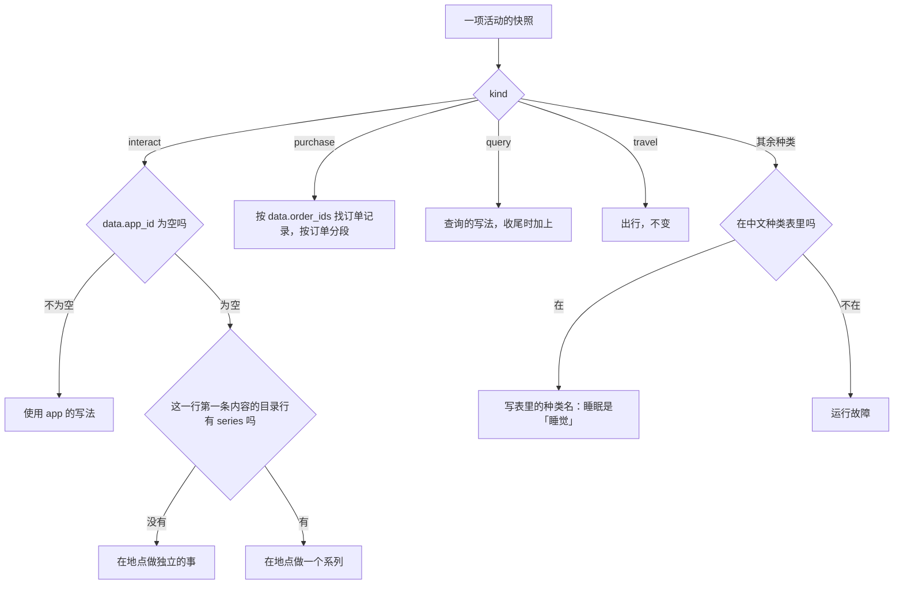
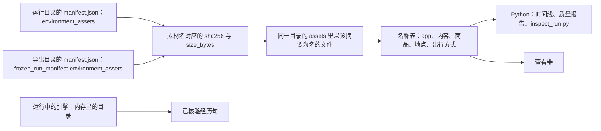
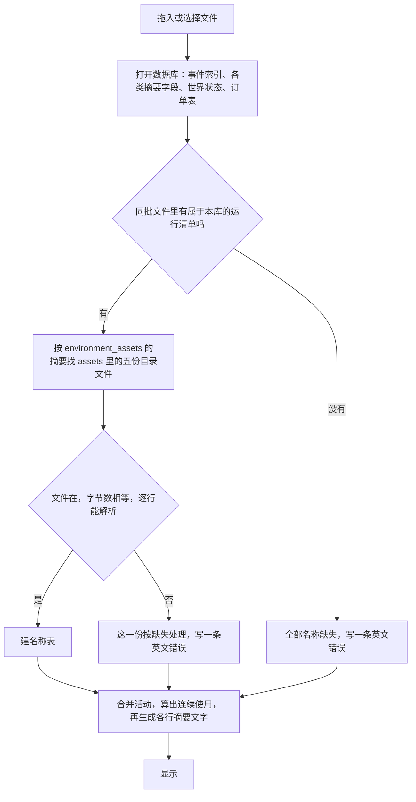

# 统一显示写法

> 本章属于[首次真实模型单日运行：修复与新增规格](../SPEC-first-real-day-run.md)，读法和叫法见那一页。

## 目标与依据

9 月 28 日晚上，人物在家打开哔哩哔哩，环境给她放了一条叫《散步装备准备》的短内容，手机上是 19:52 到 19:53 的一段哔哩哔哩前台。查看器把这件事写成「互动 · 散步装备准备」，导出的一天时间线写成「互动《散步装备准备》」，零点做计划时人物读到的是「9月28日 19:52–9月28日 19:53 进行《散步装备准备》」。三处都没有写 app 名，读的人以为她在家里准备散步装备。同一天的购买在时间线上只有「购买」两个字，支付 app 在查看器里显示成「名称缺失」。

今天，导出时间线的渲染器和查看器都从观察记录里攒名称（`scripts/render_day.py:128-138`，`tools/run-viewer.html:471-505`），而观察早已不写 app、内容、商品这三组名称（`src/worldmock/life/observe.py:41-53`），功能 app 更不在任何观察里；所以时间线里「使用<app>」那一支从不生效、购买没有写法（`scripts/render_day.py:167-173`、`:177`），查看器的活动目标只剩内容标题（`tools/run-viewer.html:1164-1173`）。人物读到的内容经历句只读内容身份，不读 app，也不写地点（`src/worldmock/life/settled_text.py:136-138`）。

本章实现提案「裁决结果」里的「显示」一条：「查看器、导出的一天时间线、`inspect_run.py` 和人物零点做计划时读到的句子，统一成正文提议的统一写法那张表的写法，名称从运行冻结的环境目录取。」也就是裁决清单「统一写法改到哪几处」一行选定的最宽做法。连带实现提案正文的三句话：名称「从这次运行冻结的环境目录里取……功能 app 的名称也取得到；购买行另经订单记录取到商品和下单的 app」；查看器「要一并读运行目录里的这几份目录文件」；查看器「上下文」画面里的 `interact` 换成中文。已同意修复的缺陷里「导出的一天时间线里有些行只写「互动」「购买」」那一条，提案写的是「并入上面的统一写法」，也在本章完成。

本章不改变世界里发生的任何事，只改变同一件事在四处被写成什么字。

## 行为规格

### 名词

| 名词 | 含义 |
| --- | --- |
| 写法 | 说明一项活动或一条手机事件是什么的那几个字，例如「使用哔哩哔哩《散步装备准备》」。不含时刻、状态和时长，这些由各处照今天的办法另写 |
| 四处 | 查看器、导出的一天时间线、`scripts/inspect_run.py`、人物零点做计划时读到的「已核验经历」句。质量报告 `quality.json` 的 `timeline_labels` 一节检查的就是一天时间线的各行，跟着一天时间线走 |
| 冻结的环境目录 | 新建运行时按原字节存进素材库的那几份目录文件（`src/worldmock/life/world_setup.py:68-81`），运行清单的 `environment_assets` 逐个登记了它们的摘要和字节数 |
| 单元名 | 在地点做的那件事的名称，也就是人物点名时写的名称：独立内容是它的标题，系列是系列名（内容行的 `series.title`） |
| 订单 | 一次购买里下单 app 相同的全部商品履约记录；到店买的记录下单 app 为空，合成一张到店订单。与设计文档《模拟引擎》「购买、付款与收货」的叫法相同 |
| 手机事件 | 环境写下的三种系统可见记录：app 前台区间 `app_foreground`、订单通知 `order_notification`、消费通知 `payment_notification` |

### 写法总表

下表是改后的全部写法。尖括号里是从冻结的环境目录取到的名称；「·」两侧各有一个半角空格；括号、冒号、分号、顿号都是全角；「×」是乘号。「真实运行」一栏的例子取自提案；「样例环境」指 `tests/fixtures/dataset-environment/`。

| 情形 | 格式 | 真实运行的例子 | 样例环境的例子 |
| --- | --- | --- | --- |
| 用 app 看到一条内容 | 使用<app 名>《<标题>》 | 使用哔哩哔哩《散步装备准备》 | 使用哔哩哔哩《测试文章》 |
| 一次使用里连着看了几条 | 使用<app 名>《<标题一>》《<标题二>》…… | —（这次运行每次打开只放了一条；查看器泳道把首尾相接的几次使用并成一行时也用这个格式，例子见[「查看器里的连续使用」](./06-continuous-use.md)一章） | 使用哔哩哔哩《测试剧集第一集》《测试剧集第二集》 |
| 在地点做一件独立的事 | 在<地点显示名>：<单元名> | 在淀山湖大道东渡悦来城公寓：早上洗漱 | 在家：测试休息 |
| 在地点做一个系列 | 在<地点显示名>：<系列名>《<集一>》《<集二>》…… | 在淀山湖大道东渡悦来城公寓：做晚饭《备菜做饭》《吃晚饭》《洗碗收拾厨房》 | 样例环境没有地点系列，测试在副本上加 |
| 购买，一张经 app 下单的订单 | 购买<商品列表>（经<app 名>下单） | 购买冰美式咖啡（经瑞幸咖啡下单） | 购买牛肉面（经美团下单） |
| 购买，到店 | 购买<商品列表>（到店） | 购买冰美式咖啡（到店） | 购买饭团、纸巾（到店） |
| 购买，一次分成几张订单 | 购买<第一张的商品列表>（……）；<第二张的商品列表>（……） | 购买冰美式咖啡（经瑞幸咖啡下单）；薯片（到店）（示意） | 购买牛肉面（经美团下单）；纸巾（到店） |
| 查询，有 app 在前台 | 查询<名称列表>（<app 名>） | 查询冰美式咖啡（瑞幸咖啡） | 查询食品（美团） |
| 查询，没有 app | 查询<名称列表> | — | 查询纸巾 |
| app 前台区间 | app 前台 · <app 名> · <步骤> | app 前台 · 淘宝闪购 · 下单 | app 前台 · 高德地图 · 导航 |
| 订单通知 | 订单通知 · <app 名> · <标题> | 订单通知 · 淘宝闪购 · 订单已送达 | 订单通知 · 美团 · 订单已下单 |
| 消费通知 | 消费通知 · <app 名> · 支付成功 | 消费通知 · 支付宝 · 支付成功 | 消费通知 · 微信 · 支付成功 |
| 出行（不变） | <出行方式名>去<地点显示名> | — | 驾车去公司 |
| 睡眠（不变） | 睡觉 | — | 睡觉 |

选哪一行看活动快照的 `kind` 和 `data.app_id`；在地点做的事再看这一行第一条内容的目录行：

最后一支是一条一般的规则：没有专门写法的种类，写中文种类表 `ACTIVITY_KIND_LABELS`（`src/worldmock/life/readable.py:22`）里的种类名；不在这张表里的种类是运行故障。睡眠没有可写的对象，今天就是这样写出「睡觉」的，改后不变。查询轨道并入之后、收尾之前，查询也走这一支，写「查询」两个字，见「分两次落地」。

### 各情形的细则

**标题怎样列。**

- 标题一律按内容身份 `content_id` 到冻结的环境目录里取，不读快照里随带的 `content_title`。
- 一条事件指向哪条内容：进度事件 `activity_progress` 的正文带着 `data.content`（这一段里哪条内容从哪里推进到哪里）时，取其中的 `content_id`，也就是这一段里真正放过或做过的那一条；事件没有这一项时（受理事件都没有），取活动快照的 `data.content_id`。
- 不能一律读快照。一集做到头的那条进度事件，快照是结算之后的活动，当前内容已经换成下一集（`src/worldmock/life/time_advance.py:280-288`、`src/worldmock/life/interact.py:110-135`）；只读快照会漏掉刚做完的这一集，还会把一秒都没放的下一集写进去。
- 一行覆盖几条事件，就按事件的先后把它们指向的内容依次列出，每条一个书名号，书名号之间不加任何字符。
- 相邻两条是同一条内容（`content_id` 相同）时只写一次；一条内容被结算边界切成几段就是这种情形。
- 没看完、没做完的也照列，不标「未完」，不设条数上限。
- 「一行」覆盖哪些事件，四处各不相同，见下一小节的表。

**在地点做的事。**

- 地点取活动快照的 `location_id`，也就是开始这件事时所在的地点，写它的显示名：`name`，有 `branch_label` 时是「`name`（`branch_label`）」。
- 独立内容的单元名就是标题，不再重复写书名号。
- 是不是系列，看这一行第一条内容的目录行有没有 `series`；一项在地点做的活动里的各条内容同属一个单元。
- 系列先写系列名，再列这一行覆盖的各集。只覆盖一集时是「在家：做晚饭《吃晚饭》」。
- app 里的系列不写系列名，只列各集标题，与「用 app 看到一条内容」同一行规则。

**购买。**

- 商品和渠道都取订单记录：按快照的 `data.order_ids` 找到这次购买的各条商品履约记录，读其中的 `goods_id` 和 `app_id`。不读人物在请求里写的 `prefer`，也不读活动名。
- 按订单分段。带下单 app 的订单按 `app_id` 升序，到店订单排在最后；段与段之间用「；」；「购买」两个字只在最前面写一次。
- 段内的商品按 `goods_id` 升序，同一件商品买了几份合写成「名称×份数」，各项以「、」相连。这就是订单通知正文今天的写法（`src/worldmock/life/order_notices.py:25-34`），两处用同一个函数。
- 渠道：`app_id` 不为空写「（经<app 名>下单）」，为空写「（到店）」。只在 app 里卖的快递商品有下单 app，同样写「经<app 名>下单」。
- 同一个下单 app 上点了两家店仍是一张订单、一段。
- 余额不足而失败、被提前结束的购买照写同一句：那段时间人物确实在下单，状态由各处另写。

**查询。**

- 名称列表取查询活动私有数据的 `targets`：受理时认出的各项，按所写次序、已去重（键集归[「查询」](./02-query.md)一章）。`kind` 为 `goods` 的项按 `goods_id` 写商品名；`kind` 为 `category` 的项按 `category` 写类别的中文名「零食」「食品」「饮料」「商品」（`src/worldmock/exchange/types.py:11-13`）。各项以「、」相连，不再排序。
- 查询活动的 `data.app_id` 不为空时在后面加「（<app 名>）」，为空时不写括号。
- 查询期间的 app 前台不是一条手机事件：它由这项查询活动自己带着，所以没有「app 前台 · …… · 查询」这样的行，app 只出现在查询这一行里。

**手机事件。**

| 记录 | 写法 | 取值 |
| --- | --- | --- |
| `app_foreground` | app 前台 · <app 名> · <步骤> | 步骤的中文名：`navigation`「导航」、`ordering`「下单」、`payment`「付款」，闭集只有这三个 |
| `order_notification` | 订单通知 · <app 名> · <标题> | 标题取事件自带的 `title`：「订单已下单」「订单已发货」「订单已送达」 |
| `payment_notification` | 消费通知 · <app 名> · <标题> | 标题取事件自带的 `title`，恒为「支付成功」 |

- app 名按事件的 `app_id` 取。支付宝、微信、高德地图这样的功能 app 也在冻结的 app 目录里，所以取得到。直付时消费通知由下单的内容 app 发，写的就是它的名称。
- 种类文字统一成「app 前台」，查看器今天的「app 前台区间」随之改掉。
- 引擎只写这三个步骤，导出自查也只认这三个（`src/worldmock/footprints/app_usage.py:34`）。查看器会打开别的版本的运行，遇到这三个之外的步骤照原值显示；Python 一侧不为它另设分支。

**出行和睡眠。** 写法不变。出行按快照的 `travel_method_id` 和 `destination_id` 取名，出行方式名和地点显示名今天来自观察记录，改后与其他名称一样取自冻结的环境目录；引擎自带的步行固定是 `walking`「步行」。睡眠写中文种类表里的「睡觉」。

### 四处各自怎样写

写法规则在 Python 里只有一处实现（`src/worldmock/footprints/display_wording.py`），Python 一侧的四个使用方都调用它：经 `scripts/render_day.py` 生成的一天时间线、质量报告的时间线标签一节、`scripts/inspect_run.py`、零点计划读到的「已核验经历」句。查看器是这处实现的镜像。时间线和质量报告的入口本身不知道运行目录在哪，名称由调用方交给它们：`render_day_markdown`、`timeline_label_report` 和它上面的 `build_quality_report` 各多一个名称入参，没有缺省值；`inspect_run.py` 自己从运行目录读；经历句用引擎内存里的目录。

| 哪里 | 用到写法的行 | 一行覆盖哪些事件 | 写法前后还写什么 |
| --- | --- | --- | --- |
| 导出的一天时间线，以及质量报告 `timeline_labels` 检查的行 | 每行的「活动」一栏 | 同一活动首尾相接的结算段合成一行，覆盖这些段的进度事件。时间线不读受理事件。活动暂停后再恢复是两行，各列各的 | 起止、总时长、段数三栏不变 |
| `scripts/inspect_run.py` 的 `events` | `activity_progress` 行、`action_accepted` 行里的活动；`environment_event` 里的三种手机事件 | 一条事件，只有它指向的那一条内容 | `activity_progress`：「<写法> → <status>」。手机事件见下。`action_accepted` 行的完整格式、时区和其余几种行见[「十条缺陷与思考额度」](./09-defects-and-budget.md)一章 |
| 人物零点做计划时读到的「已核验经历」 | 内容经历句 | 一条内容推进经历，只有那一条内容（经历的 `content_id` 本来就取自进度事件的 `data.content`） | 「<起>–<止> <写法>」，时刻照今天的 `clock_phrase` |
| 查看器 | 活动表的「目标」列、活动泳道的标签；时间线的「已受理」「活动段」行；「世界事件」行里的三种手机事件；「结果」行的订单段 | 活动表和泳道：一项活动的全部受理事件与进度事件，按事件序号；泳道里几次使用并成的一行，覆盖这一行各个执行段的进度事件，见[「查看器里的连续使用」](./06-continuous-use.md)一章。时间线的行：一条事件 | 见「查看器」一小节 |

一段不间断、不跨零点的活动，时间线的行和查看器的活动表写出的是同一句：查看器多读的那条受理事件，指向的就是第一段推进的那一条，相邻重复只写一次。范围不同的情形各照各的范围写：

- 暂停后恢复、或跨过零点的活动，时间线分成几行、各列各的；查看器的活动表按活动只有一行，把各段的内容列全。
- 受理之后一秒都没有推进就结束的活动，时间线没有这一行；查看器的活动表仍写出受理时选中的那一条。

`inspect_run.py` 的补充：

- 出行和睡眠在 `activity_progress` 行和 `action_accepted` 行里写活动名（进度行今天就是这样），不换成「驾车去公司」「睡觉」。[「十条缺陷与思考额度」](./09-defects-and-budget.md)一章受理行里的「活动短语」，对这两种活动就是活动名。
- 手机事件行在写法后面照今天的次序跟上起止或订单身份：「app 前台 · 美团 · 下单 <起> → <止>」「订单通知 · 美团 · 订单已下单 <order_ids，以空格相连>」「消费通知 · 支付宝 · 支付成功 <order_ids>」。
- 停留进出等其余环境事件行不变。

「已核验经历」的补充：

- 用 app 的经历（经历的 `app_id` 不为空）：「9月28日 19:52–9月28日 19:53 使用哔哩哔哩《散步装备准备》」。
- 在地点做事的经历（`app_id` 为空）：地点取 `context.state.activities[fact["activity_id"]].location_id`；独立内容写「9月28日 08:01–9月28日 08:15 在淀山湖大道东渡悦来城公寓：早上洗漱」，系列逐集一句，写「……在淀山湖大道东渡悦来城公寓：做晚饭《吃晚饭》」。
- 句子里的写法由同一个函数给出：交给它的快照只有三项，`kind` 是 `interact`，`location_id` 是上面取到的地点，`data.app_id` 是经历的 `app_id`；内容序列只有经历的 `content_id` 一条。
- 到达句、收货句不变。经历句进的是零点计划请求的用户内容，系统层和 `PLAN_DAY_PROMPT` 不变，提示指纹不因本章变化。

### 名称的唯一来源

名称只有一个来源：这次运行冻结的环境目录。任何一处都不再从观察记录里取名称。

| 素材名（`environment_assets` 的键） | 读哪些字段 | 得到什么 |
| --- | --- | --- |
| `catalog/app-catalog.jsonl` | `app_id`、`name` | 全部 app 的名称，内容 app 和功能 app 都在 |
| `catalog/content-catalog.jsonl` | `content_id`、`title`、`series.title` | 标题；单元名（有 `series` 取 `series.title`，否则等于标题） |
| `catalog/merchant-catalog.jsonl` | `goods_id`、`name` | 商品名 |
| `catalog/location.jsonl` | `location_id`、`name`、`branch_label` | 地点显示名 |
| `catalog/travel-method.jsonl`（可选，环境没有这份文件时清单里没有这个键） | `travel_method_id`、`name` | 出行方式名；步行不在文件里，固定为 `walking`「步行」 |

各处从哪里读：

| 使用方 | 清单 | 素材 |
| --- | --- | --- |
| `scripts/render_day.py` 的命令行、`scripts/inspect_run.py` | 数据库所在运行目录的 `manifest.json` | 同一目录的 `assets/<sha256>` |
| 导出（`export_run`）写时间线和质量报告 | 足迹库持有的运行清单 | 运行目录的 `assets/<sha256>` |
| 导出认证（`validate_export`）重算质量报告 | 导出清单的 `frozen_run_manifest` | 导出目录的 `assets/<sha256>`。导出本来就把全部环境素材复制了一份（`src/worldmock/footprints/export.py:78-81`），所以只凭导出目录就能重算 |
| 零点计划的经历句 | 不回读文件 | 运行中的引擎用内存里的目录。它与冻结的素材是同一份字节：新建时由它冻结，恢复时核对过环境身份 |
| 查看器 | 同一次拖入或选择的文件里、属于本库的运行清单（运行目录的 `manifest.json`，或导出清单里的 `frozen_run_manifest`） | 同一次拖入的 `assets/<sha256>` 文件 |

Python 一侧读冻结素材时沿用导出认证已有的读取（`src/worldmock/footprints/frozen_environment.py:43-65`）：先核对素材名集合，再逐个按摘要定位并复核字节数与摘要；然后用登记环境时的同一套严格行模型解析各行（`src/worldmock/catalog/loader.py:108`）。

名称取不到时，两侧的处理不同：Python 一侧的四个使用方都是要出结论的工具或人物的输入，取不到就是运行损坏，按运行故障处理；查看器是容错的阅读工具，照今天的办法标出缺失。

| 情形 | Python 一侧（都抛 `IntegrityError`；本章新增的三句先写同文的英文错误日志） | 查看器 |
| --- | --- | --- |
| 身份不在冻结的环境目录里 | `Displayed object is not registered in the frozen environment: <kind> <identity>`，`<kind>` 是 `app`、`content`、`goods`、`location`、`travel_method` 之一 | 这个名称显示成「名称缺失（<身份>）」，同一个身份只写一次 `console.error('Missing recorded object name:', <身份>)`（今天的写法，`tools/run-viewer.html:378-385`） |
| 清单登记的素材文件不存在 | `Frozen environment asset is missing`（现有） | `console.error('Frozen catalog file is missing:', <素材名>)`，这一份目录按缺失处理。清单的 `environment_assets` 里没有四份必需目录之一的素材名时，查看器同样写这一句 |
| 素材的字节与清单不符 | `Frozen environment asset identity is invalid`（现有，核对字节数和摘要） | 只核对字节数：`console.error('Frozen catalog file size disagrees with the run manifest:', <素材名>)`，按缺失处理。不在浏览器里重算摘要 |
| 素材名集合与清单不符 | `Frozen environment asset set is invalid`、`Frozen catalog file set is invalid`（现有） | 不检查 |
| 某一行不是合法的 JSON 对象，或不合当前的行模型 | 登记环境时的同一句英文原因，带文件名和行号（现有，`RegistrationError` 是 `IntegrityError` 的子类）：不是 JSON 对象的行是 `ENVIRONMENT_LINE_INVALID: …… app-catalog.jsonl:5 ……`，多出字段的行是 `ENVIRONMENT_KIND_INVALID: …… app-catalog.jsonl:5 ……` | 只要求每行能解析成 JSON 对象：`console.error('Frozen catalog file is unreadable:', <素材名>)`，按缺失处理。多出来的字段不管 |
| 没有属于本库的运行清单 | 不适用：这几个工具都从运行目录或导出目录的清单起步，清单读不到时照各自现有的方式失败 | `console.error('Frozen catalog is unavailable: no run manifest for this database')` 一次，全部名称缺失 |
| 购买活动的 `order_ids` 在订单记录里找不到 | `Purchase activity has no recorded order: <order_id>` | 这张订单的位置显示「名称缺失（<order_id>）」 |
| 活动种类没有专门的写法，也不在中文种类表里 | `Unsupported activity kind for display: <kind>` | 查看器对没有专门写法的种类一律在目标处显示「—」，睡眠今天就是这样；类型列照今天的办法写种类标签，表里没有的写原值 |

Python 一侧取不到名称时各使用方的后果：

- `render_day.py` 的命令行不写出时间线文件。
- 导出不发布，暂存目录照现有流程删除。
- 导出认证失败。
- `inspect_run.py` 以该错误退出。
- 零点计划是运行故障，运行停下并保留已确认的部分。

今天「解析不到名称时只写中文种类名」的降级（`scripts/render_day.py:162`、`:172`、`:186`）整个删除，这正是「互动《……》」的来处。

两条连带后果要让所有者知道：

- 改后的 `render_day.py` 和 `inspect_run.py events` 用严格的行模型解析冻结的目录，所以读不了冻结的 app 目录里还带着 `browse_duration_seconds` 的运行，也就是这次改动之前的每一次真实运行，包括 issue 13 的那一次：当前的行模型不接受这个已删除的字段。读不了的原因只是这个字段，与 `provides_meal` 无关：地点内容行缺 `provides_meal` 是登记环境时才拒绝的，行模型不拒绝，而读冻结的目录只过行模型。这与「旧运行不能恢复」是同一条规则，不为它留读取分支。查看器只要求每行是 JSON 对象，仍然打得开旧运行。
- 只把 `footprints.sqlite` 一个文件拖进查看器时，app、内容、商品、地点、出行方式的名称全部显示为缺失。活动名、事务名、地点会话名是事件和世界状态自己带的文字，不受影响。

### 查看器

**怎样拿到目录文件。**

- 遍历拖入的目录时，把直接位于名为 `assets` 的目录下的文件按文件名记下来，只记句柄，不读内容。真实运行的 `assets/` 有上万个文件，绝大多数是模型请求与响应。
- 顶层选中或拖入的文件，文件名恰为 64 位十六进制摘要的也记下来。
- 同一个文件名记到两次时（例如运行目录和导出目录一起拖入）取先遇到的那个：文件名就是摘要，内容相同。
- 认定本库的运行清单后（办法不变，`tools/run-viewer.html:987-1007`），取 `environment_assets` 里上表五个素材名的 `sha256` 和 `size_bytes`，按文件名找到文件，核对 `File.size` 等于 `size_bytes`，读成文本后逐行 `JSON.parse`。
- 不新增第二个选择控件，也不接受另外拖入的环境数据集目录：那不是这次运行冻结的那一份。
- 文件选择框去掉 `accept` 属性（`:170`）。素材文件没有扩展名，带着它就选不中；数据库仍按文件名后缀认。

**加载次序。** 今天各行的摘要文字在建索引时就算完了（`:638`），目录文件却要等认定清单之后才读得到。改后的次序固定为：

合并活动排在生成摘要之前，两步之间算出连续使用：后续各次使用的受理行摘要要读它。这个先后和连续使用的算法由[「查看器里的连续使用」](./06-continuous-use.md)一章规定。

页面入口和测试走同一个函数完成「建索引、读运行文件、生成摘要」这三步，测试不另设喂名称的旁路。

**删什么。**

- 从观察里攒名称的全部 SQL：`buildNameIndex` 的七条查询，连同 `collectNames`、`supplementNames`（`:462-513`）。地点、商品、app、内容、出行方式五类名称都改读目录文件。
- 把商品、app、内容混在一张表里的 `S.nameIdx.targets` 和按它查名的 `targetLabel`，改成按种类查名。
- 页面里的 `ACTION_LABELS`（`:353`），动作的中文名改用下文那一张表。

**各处写什么。** 种类标签「互动」「购买」「查询」「出行」「睡眠」保留在活动表的「活动类型」列、图例和排序里，观察行的「进行中：互动、互动」不变；写法放在「目标」列、时间线和泳道。

| 位置 | 今天 | 改后 |
| --- | --- | --- |
| 时间线「已受理」行 | 已受理 · 互动 · 散步装备准备 · 计划 1分 | 已受理 · 使用哔哩哔哩《散步装备准备》 · 计划 1分 |
| 时间线「活动段」行 | 活动段 · 互动 散步装备准备 · 已完成 · 已进行 1分 | 活动段 · 使用哔哩哔哩《散步装备准备》 · 已完成 · 已进行 1分 |
| 活动泳道的标签 | 互动 散步装备准备 | 使用哔哩哔哩《散步装备准备》 |
| 活动表 | 活动类型「互动」，目标「散步装备准备」 | 活动类型「互动」，目标「使用哔哩哔哩《散步装备准备》」 |
| 购买的受理行、泳道、活动表 | 已受理 · 购买 · — · 计划 3分；目标「—」 | 已受理 · 购买冰美式咖啡（经瑞幸咖啡下单） · 计划 3分；目标同一句 |
| 「结果」行的订单段，每条商品履约记录一段 | · 订单 冰美式咖啡 ¥27.00 · 支付 名称缺失（alipay） | · 订单 冰美式咖啡 ¥27.00（经瑞幸咖啡下单） · 支付 支付宝；到店写「（到店）」 |
| 「世界事件」行 | 世界事件 · app 前台区间；世界事件 · 订单通知；世界事件 · 消费通知 | 世界事件 · app 前台 · 淘宝闪购 · 下单；世界事件 · 订单通知 · 淘宝闪购 · 订单已送达；世界事件 · 消费通知 · 支付宝 · 支付成功 |
| 出行、睡眠的各行 | 已受理 · 出行 · 驾车 · → 公司 · 计划 …… | 不变，名称改从目录取 |
| 地点会话表的成员 | 进行哔哩哔哩（9月28日 19:52 起） | 不变，写的是活动名 |

- 时间线的受理行和活动段行，互动、购买、查询三种不再写「种类 · 目标」，直接写写法；出行和睡眠照今天的格式。
- 同一项活动的内容按事件的先后累积，每条事件指向哪条内容照上文「标题怎样列」的规则：进度事件的投影加 `$.data.content.content_id`，有它取它，没有才取快照的 `data.content_id`。今天只投影快照，而且后一条覆盖前一条，连播只剩最后一集（`:833`）。
- 受理事件在 `data.data.activities` 里带的活动快照今天也并进活动表（`:808-814`）；它们照受理事件处理，取各自的 `data.content_id`、`location_id` 和 `data.order_ids`。
- app 推送行今天已经写 app 名和标题，不动。

**同一个 app 首尾相接的几次使用。** 人物放完一条内容、同一秒又打开同一个 app 时，手机前台没有断过，库里却是几项活动。查看器把这样的几次使用在泳道里画在同一行、连成一个条块，行的标签是这几次放过的内容依次列出的同一种写法；活动表仍是每项活动一行，末尾多一列「连续使用」，写明这一行在哪一条连续使用里、是第几段；后续各次使用的受理行末尾加半句「接续 <时刻> 起的连续使用」。怎样才算相接、各处的字样和算法都由[「查看器里的连续使用」](./06-continuous-use.md)一章规定，本章不重述。两章的分工：

- 上表里「目标」列、受理行、活动段行的写法，以及不与别的使用相接的泳道行，照本章。
- 并成一行的泳道标签，由那一章把各段的内容身份交给本章的活动写法函数求出；名称表和按事件取内容身份的投影也是本章的。
- 这是查看器独有的显示。导出的一天时间线、`inspect_run.py` 和人物读到的经历句里，每次使用仍各写各的，不合并。

**动作请求行。** 开始副活动的请求写「<动作> · <名称、名称>」，`prefer` 不为 `null` 时在后面加「 · 想用 <人物所写的原文>」，为 `null` 时不加：

| 请求 | 今天 | 改后 |
| --- | --- | --- |
| 用内容 app | 请求 开始槽位 2 的活动 · 进行 · 哔哩哔哩 | 请求 开始槽位 2 的活动 · 使用 · 哔哩哔哩 |
| 购买，写了意向 | 请求 开始槽位 2 的活动 · 购买 · 冰美式咖啡 | 请求 开始槽位 2 的活动 · 购买 · 冰美式咖啡 · 想用 瑞幸咖啡 |
| 查询 | 没有这种请求 | 请求 开始槽位 2 的活动 · 查询 · 食品 · 想用 美团外卖 |
| 在地点做事 | 请求 开始槽位 1 的活动 · 张江公寓 · 进行 · 测试休息 | 请求 开始槽位 1 的活动 · 张江公寓 · 做 · 测试休息 |

`prefer` 显示的是人物写的原文，不代表实际用了它；实际渠道看受理行和结果行。`interact` 在请求行里写哪个词看工具：槽位 1 的开始工具是在地点做事，写「做」；槽位 2 的开始工具是用内容 app，写「使用」。出行和睡觉的请求行与今天逐字相同。`query_world` 的中文名和请求摘要分支随这个工具一起删除。

**「上下文」画面。** 工具层下钻的标签里，动作名整表换成中文；目标类别、下钻正文和「整层原文」保持原始 JSON，进度层下钻的 `tool_call` 和工具名不动。

| 工具层里的动作 | 所在分组的类别 | 中文 | 今天的标签 | 改后的标签 |
| --- | --- | --- | --- | --- |
| `interact` | `app` | 使用 | 哔哩哔哩 · interact · 可用 | 哔哩哔哩 · 使用 · 可用 |
| `interact` | `location` | 做 | 家 · interact · 测试休息 · 可用 | 家 · 做 · 测试休息 · 可用 |
| `travel` | `location` | 出行 | 公司 · travel · 步行 · 可用 | 公司 · 出行 · 步行 · 可用 |
| `sleep` | `location` | 睡觉 | 家 · sleep · 可用 | 家 · 睡觉 · 可用 |
| `purchase` | `product` | 购买 | 柠檬茶 · purchase · 可用 | 柠檬茶 · 购买 · 可用 |
| `query` | 工具层没有查询的行 | 查询 | — | 只用于动作请求行 |

这张表只有一份，定义在 `tools/run-viewer-context.js` 里（这个文件会被测试单独加载），动作请求行也用它。目标一项的标签「公司（location）」不变。

**提示文字。**

- 拖放区说明里「地点名称和活动标题直接读取运行记录。」一句改成：「对象名称取自这次运行冻结的环境目录：拖入整个 run 目录或导出目录才读得到，只拖数据库时显示为「名称缺失」。」
- 总览里，有任何一份必需的目录文件没有读到时，在「运行输入警告」卡片旁显示一张卡片，标题「对象名称」，正文：「未读到这次运行冻结的环境目录（缺 <素材名，以「、」相连>），对象名称显示为「名称缺失（身份）」。请把整个 run 目录或导出目录拖入：其中的 manifest.json 与 assets 目录都要在。」目录文件都读到时不显示这张卡片。
- 换一个数据库时，名称表、订单表和缺失记录一起清空。

**新代码放哪。** `tools/run-viewer.html` 今天 1805 行。读目录文件、名称表、各种写法和手机事件的步骤表放进新的并列文件 `tools/run-viewer-wording.js`，对外是一个全局对象 `ViewerWording`，由页面用 `<script src>` 引入、排在 `run-viewer-context.js` 之后；页面本体只留调用，改后行数不得比今天多。[「查看器里的连续使用」](./06-continuous-use.md)一章的函数也放进这个文件，它给页面本体加的调用一并算在这条行数约束里。

### 两种语言的镜像：共用用例文件

写法规则在 Python 里只有一处实现，查看器里是它的 JavaScript 镜像。两份实现由同一份用例文件 `tests/fixtures/display-wording-cases.json` 约束，Python 的单元测试和查看器的 Node 测试各读一遍、逐条核对：

| 键 | 内容 | 两边各自核对什么 |
| --- | --- | --- |
| `catalog` | 五组完整的目录行：`apps`、`contents`、`goods`、`locations`、`travel_methods`。取自样例环境，另加一个带 `branch_label` 的地点和一个两集的地点系列 | 由这些行建出的名称表等于 `names` |
| `names` | 期望的名称表：`apps`、`goods`、`locations`、`travel_methods` 是身份到名称，`contents` 是身份到 `{title, unit}` | 同上 |
| `activities` | 每条 `{name, snapshot, content_ids, orders, text}`：活动快照、这一行各条事件指向的内容身份（还没有去掉相邻重复）、订单记录、期望的写法 | 活动的写法等于 `text` |
| `events` | 每条 `{name, events, text}`：同一项活动先后的几条事件，每条给出事件类型和正文 `data`（受理事件带 `activity` 快照，进度事件带 `activity` 快照和可有可无的 `content`），以及这些事件合成一行的期望写法 | Python：逐条取事件指向的内容，再求写法，等于 `text`。查看器：把这些事件写进测试用的 SQLite，活动表的「目标」等于 `text` |
| `phone` | 每条 `{name, data, text}`：一条手机事件的 `data` 和期望的写法 | 手机事件的写法等于 `text` |
| `missing` | 每条 `{name, snapshot, content_ids, orders, kind, identity, viewer_text}`：一个目录里没有的身份 | Python 抛出带 `<kind> <identity>` 的那句英文错误；查看器的结果等于 `viewer_text` 并恰好写一次英文错误 |

快照里写法要读的键只有这些：`kind`、`location_id`、`destination_id`、`travel_method_id`、`data.app_id`、`data.order_ids`、`data.targets`。活动名 `name`、`content_title` 和快照的 `data.content_id` 都不参与求写法；后者只在「一条事件指向哪条内容」那一步被读到。

`activities` 至少覆盖写法总表里除手机事件以外的每一行，另有：相邻两段同一条内容、同一件商品两份、两家店同一个下单 app、只在 app 里卖的快递商品、带分店的地点、类别名查询、睡眠。`events` 至少有三条：系列的第一条进度事件就是第一集做到头的那一条（快照已是第二集），其后做完三集，期望三集依次列出；恰在第一集做到头时结束，期望只有第一集；一条不带 `content` 的进度事件，期望取快照的当前内容。`phone` 覆盖三个步骤、三种订单通知标题和支付成功，其中至少一条的 app 是功能 app。

### 算例：真实运行的那个晚上

9 月 28 日晚上人物在家（地点显示名「淀山湖大道东渡悦来城公寓」）。提案钉住的事实：18:30 到 19:40 做了「做晚饭」系列的三集，《备菜做饭》到 19:00，《吃晚饭》到 19:25，《洗碗收拾厨房》到 19:40；19:52 到 19:53 在哔哩哔哩里放了《散步装备准备》；买的食材包 20:10 送到。食材包那次购买的下单 app、支付 app、起止时刻、各行里的秒数和 `hema`、`alipay` 这两个身份，提案没有给出，下面按「19:41 开始、经盒马下单、支付宝付款」写，是示意。

导出的一天时间线（只列起止和活动两栏）：

| 起止 | 今天 | 改后 |
| --- | --- | --- |
| 18:30–19:40 | 互动《备菜做饭》（只写首段快照里的那一集） | 在淀山湖大道东渡悦来城公寓：做晚饭《备菜做饭》《吃晚饭》《洗碗收拾厨房》 |
| 19:41–19:44 | 购买 | 购买食材包（经盒马下单） |
| 19:52–19:53 | 互动《散步装备准备》 | 使用哔哩哔哩《散步装备准备》 |

查看器的活动表：

| 开始 | 活动类型 | 今天的目标 | 改后的目标 |
| --- | --- | --- | --- |
| 18:30 | 互动 | 洗碗收拾厨房 | 在淀山湖大道东渡悦来城公寓：做晚饭《备菜做饭》《吃晚饭》《洗碗收拾厨房》 |
| 19:41 | 购买 | — | 购买食材包（经盒马下单） |
| 19:52 | 互动 | 散步装备准备 | 使用哔哩哔哩《散步装备准备》 |

查看器时间线里这次购买的手机事件：今天每一行都不带 app，只有「世界事件 · app 前台区间」「世界事件 · 订单通知」「世界事件 · 消费通知」三种字样；改后依次是「世界事件 · app 前台 · 盒马 · 下单」「世界事件 · app 前台 · 支付宝 · 付款」「世界事件 · 订单通知 · 盒马 · 订单已下单」「世界事件 · 消费通知 · 支付宝 · 支付成功」「世界事件 · 订单通知 · 盒马 · 订单已发货」，20:10 是「世界事件 · 订单通知 · 盒马 · 订单已送达」。

`scripts/inspect_run.py <运行目录> events`（只列一行里类型之后的部分）：

| 事件 | 今天 | 改后 |
| --- | --- | --- |
| `activity_progress`，19:00 第一集做到头的那一条 | 进行做晚饭（9月28日 18:30 起）《吃晚饭》 → active | 在淀山湖大道东渡悦来城公寓：做晚饭《备菜做饭》 → active |
| `activity_progress`，19:40 最后一条 | 进行做晚饭（9月28日 18:30 起）《洗碗收拾厨房》 → completed | 在淀山湖大道东渡悦来城公寓：做晚饭《洗碗收拾厨房》 → completed |
| `activity_progress` | 进行哔哩哔哩（9月28日 19:52 起）《散步装备准备》 → completed | 使用哔哩哔哩《散步装备准备》 → completed |
| `activity_progress` | 购买食材包（9月28日 19:41 起） → completed | 购买食材包（经盒马下单） → completed |
| `environment_event` | app_foreground hema ordering 09-28 19:41:00 → 09-28 19:43:45 | app 前台 · 盒马 · 下单 09-28 19:41:00 → 09-28 19:43:45 |
| `environment_event` | payment_notification alipay 支付成功 order-…… | 消费通知 · 支付宝 · 支付成功 order-…… |

第一行就是「一条事件指向哪条内容」那条规则管的情形：19:00 那条事件结算的是《备菜做饭》的最后一段，快照里的当前内容却已经换成《吃晚饭》，今天的检查工具把刚做完的一集写成了下一集。

零点做计划时读到的「已核验经历」（每段内容推进一句，这里按每集一段写）：

| 今天 | 改后 |
| --- | --- |
| 9月28日 18:30–9月28日 19:00 进行《备菜做饭》 | 9月28日 18:30–9月28日 19:00 在淀山湖大道东渡悦来城公寓：做晚饭《备菜做饭》 |
| 9月28日 19:00–9月28日 19:25 进行《吃晚饭》 | 9月28日 19:00–9月28日 19:25 在淀山湖大道东渡悦来城公寓：做晚饭《吃晚饭》 |
| 9月28日 19:25–9月28日 19:40 进行《洗碗收拾厨房》 | 9月28日 19:25–9月28日 19:40 在淀山湖大道东渡悦来城公寓：做晚饭《洗碗收拾厨房》 |
| 9月28日 19:52–9月28日 19:53 进行《散步装备准备》 | 9月28日 19:52–9月28日 19:53 使用哔哩哔哩《散步装备准备》 |
| 9月28日 20:10 收到食材包 1 份 | 不变 |

同一份输入里的「动作结果」句（「进行哔哩哔哩（9月28日 19:52 起）：19:52–19:53，按计划结束，《散步装备准备》」）不变。改后两处用词仍不同，但都带 app 名，不会再被读成人物在准备散步装备。

早上的咖啡照提案「改后三种常见情形」走一遍。人物 09:05:00 提交购买「冰美式咖啡」，`prefer` 写「瑞幸咖啡」，订单落在瑞幸咖啡上，付款抽到支付宝 15 秒，购买时长抽到 200 秒：

| 查看器时间线的行 | 改后 |
| --- | --- |
| 动作请求 | 请求 开始槽位 2 的活动 · 购买 · 冰美式咖啡 · 想用 瑞幸咖啡 |
| 已受理 | 已受理 · 购买冰美式咖啡（经瑞幸咖啡下单） · 计划 3分 |
| 世界事件，09:08:05 | 世界事件 · app 前台 · 瑞幸咖啡 · 下单 |
| 世界事件，09:08:20 | 世界事件 · app 前台 · 支付宝 · 付款；世界事件 · 订单通知 · 瑞幸咖啡 · 订单已下单；世界事件 · 消费通知 · 支付宝 · 支付成功 |

午饭那张订单在手机事件里是「app 前台 · 淘宝闪购 · 下单」和 12:43 的「订单通知 · 淘宝闪购 · 订单已送达」，就是提案统一写法表里的那两个例子。

### 分两次落地

显示轨道与购买轨道、结果与结束轨道、缺陷与额度轨道同时进行，那时世界里还没有查询活动，请求里还没有 `prefer`，没有内容的购物 app 也还打得开。所以显示轨道先按今天的四种活动把四处改完，剩下三件事在查询轨道和内容轨道并入之后的收尾里做：

| 收尾里显示轨道还欠的事 | 等谁 | 做什么 |
| --- | --- | --- |
| 查询一行 | 查询轨道 | Python 的查询写法及其在时间线、`inspect_run.py` 里的行；查看器的查询写法，种类表和颜色表各加 `query`（中文「查询」，颜色 `#5b8def`），动作表加 `query`；用例文件加查询的用例；查看器里 `query_world` 的中文名、请求摘要分支和「上下文」画面规则说明里的工具个数随之删改 |
| 删掉没有内容的 app 使用 | 内容轨道 | 今天读这种活动的两处，查看器 `actTargetText` 里「没有内容就显示 app 名」的一支和 `render_day._interact_label` 的无内容一支，在先做的那一步里换成一条过渡写法：带 app 的互动，内容序列里空的身份跳过不写，所以没有内容的 app 使用写成「使用美团」，不带书名号。收尾时删掉 Python 和查看器里各自跳过空身份的那一处，连同共用用例文件里的那条用例和查看器里喂这种形状的测试样本 |
| 显示 `prefer` | 购买轨道 | 查看器动作请求行的「想用 <原文>」 |

[「查看器里的连续使用」](./06-continuous-use.md)一章的查看器改动也在先做的那一步里，排在本章的查看器改动之后。它不等别的轨道，收尾里只随过渡写法删掉它用例里的一句断言，见那一章。

两段中间状态各有确定的写法，不让集成分支上的导出失败：

- 查询轨道并入之后、收尾之前，世界里已经有查询活动，而查询的整句还没有写。这一段里查询照「没有专门写法的种类写中文种类名」那一条写成「查询」两个字：查询轨道给中文种类表加了 `query`，显示一侧不用为它动手。时间线的行、`inspect_run.py` 的活动行都是这两个字；查看器的目标处显示「—」，类型列显示原值 `query`。收尾时换成整句，并给查看器的种类表加上「查询」。
- 显示轨道并入之后、内容轨道并入之前，没有内容的 app 使用仍会产生并进入导出，照上表的过渡写法写。内容轨道并入之后这种活动不再产生。
- 收尾删掉「跳过空身份」之后，空的内容身份与别的身份一样去查名称，查不到：Python 报 `Displayed object is not registered in the frozen environment: content None`，查看器显示「名称缺失（null）」并写一次英文错误。在地点做的事从头到尾没有过渡写法，空的内容身份在先做的那一步里就是这个结果。

`scripts/inspect_run.py` 的 `queries` 子命令整段删除（规格见[「删除 query_world 与第五种活动」](./03-fifth-activity-kind.md)一章），由显示轨道在先做的那一步里完成：它只读已落库的模型交换，不依赖查询轨道，而钉住它的那条测试要用到 `query_world`，查询轨道一并入就会失败。同一个理由，经真实引擎打开没有内容的 app 的用例都要在内容轨道并入之前消失，由显示轨道在先做的那一步里删掉：今天是 `tests/integration/footprints/test_inspect_current_activity.py` 里打开「美团」的那个参数，内容轨道一并入，这个请求就被退回。过渡写法的证据改用手写的快照：共用用例文件里的一条用例和查看器现有的样本。

### 基线与录制样例

- `scripts/render_day.py` 不在代码指纹里，但导出的 `timeline/<人物>-<日期>.md` 由它生成并在导出清单里登记了哈希，质量报告的 `timeline_labels` 也调用它（`src/worldmock/footprints/timeline_labels.py:36-63`）。两份完整日基线的摘要覆盖导出目录的每个文件，所以时间线的字一变基线就变。
- 经历句变了，零点计划的模型请求素材跟着变，这些素材也在基线摘要里。
- 质量报告的结构号、键集都不变，只有 `timeline_labels.findings` 里的标签文字和计数可能变。导出清单、运行清单、世界状态的结构号不因本章变化。
- 两份完整日基线和查看器录制样例 `tests/fixtures/viewer-context.json` 只在最终提交上重做一次，办法见[「版本、身份与基线」](./12-versions.md)一章。重做之前，中间提交的门禁在命令行上排除三个与样例绑定的测试文件，办法见[「实施顺序与验收」](./13-implementation-order.md)一章。被排除的文件里有 `tests/system/viewer/test_run_viewer.py`，查看器的全部 Node 用例都由它执行，所以中间的门禁一条 Node 用例也不跑。显示轨道并入前要直接用 `node --test` 跑 `tests/system/viewer/` 下的三个 `.cjs` 文件（`run_viewer.test.cjs`、`run_viewer_context.test.cjs`、`run_viewer_wording.test.cjs`），只允许读录制样例的那几条用例失败。
- 录制样例重录后，工具层里不再有「美团」的 app 目标行，读这份样例的查看器用例在收尾里一并改。

### 明确不做

- 不改活动名。「进行哔哩哔哩（9月28日 19:52 起）」「进行做晚饭（……起）」「购买……（……起）」是人物在控制工具里要原样照抄的名称，也是「动作结果」和记忆层结束句的开头；改它要动系统层、工具层和名称解析。
- 不改出行和睡眠的行。时间线写「睡觉」而查看器写「睡眠」，今天就不同，这次不动。
- 不改 `inspect_run.py` 的停留事件行（`location_entered home run_start`）和其余环境事件行。
- 不改人物工作区 `MEMORY.md` 的事实行（`src/worldmock/agents/life_memory.py:290`）。它写的是身份和秒数，不进任何提示。
- 不改经历句的分段办法：一条内容被结算边界切成几段仍是几句。不改到达句、收货句。
- 不改记忆层和零点「动作结果」里的活动结束句与购买句；购买句不写下单渠道，人物从购买结果的 `channel` 读到它，见[「购买时写想用的 app」](./01-purchase-prefer.md)一章。
- 不把「互动」拆成「用 app」和「在地点做事」两个显示类别，不给一行里的标题数设上限。
- 不换「上下文」画面的目标类别（`location`、`app`、`product`）、进度层下钻的 `tool_call` 和工具名，也不改盲评材料活动时间线里的英文 `action`、查看器悬停提示里的事件类型原名。起草时提过把类别也一起换成中文，没有采用。
- 不改 app 推送和回调足迹 `app_touch` 的行。起草时提过让 `app_touch` 同式写 app 名与步骤，没有采用。
- 不改时间线标签检查的规则。改后 app 名和商品名出现在书名号之外，名称若全小写且带连字符（例如某个 app 叫 `e-mail`）会被计成内部标识；这一节只报告不放行，属于数据集取名的事。
- 不在浏览器里重算素材摘要，不给查看器加认证。
- 不新增「重新渲染时间线文件再比对」的导出认证，不升任何结构号，不给质量报告增删键。
- 不把 `queries` 子命令改造成查询成本的新报告。
- 不给 `build_quality_report` 的名称入参设缺省值，不保留从观察取名称的任何回退。

### 本章定下的细节

| 事项 | 定下的做法 | 理由 |
| --- | --- | --- |
| Python 实现放在哪 | 新模块 `src/worldmock/footprints/display_wording.py` | 时间线脚本、`inspect_run.py` 和 `life/settled_text.py` 都要用，脚本不能被 `src` 导入；这个位置只依赖目录行模型和基础层，不成环 |
| Python 怎样解析冻结的目录 | 用登记时的严格行模型；冻结的 app 目录还带着 `browse_duration_seconds` 的运行读不了，也就是这次改动之前的每一次真实运行 | 地点显示名直接用行模型的 `display_name`，分店规则不写第二遍；旧运行按版本拒绝是既有规则，不留读取分支 |
| 标题从哪取 | 按 `content_id` 取冻结目录，不读快照的 `content_title` | 名称只有一个来源；系列名本来就只能从目录取 |
| 「相邻重复」按什么判 | 按 `content_id`，不按标题文字 | 两条不同的内容可以同名 |
| 一条事件指向哪条内容 | 事件带 `data.content` 取其中的 `content_id`，否则取快照的 `data.content_id` | 一集做到头的那条进度事件，快照已经是下一集；这样取出来的正是[「做完之后读到什么，提前结束算不算做完」](./05-results-and-ending.md)一章里人物读到的那几条：做完的各条，加确有推进的当前一条 |
| 一行覆盖哪些事件 | 时间线按合并后的行里的进度事件，查看器活动表按活动的受理与进度事件，逐事件的行和经历句只有一条 | 各处「一行」本来就是这个范围，不改分段办法 |
| 地点活动是不是系列 | 看这一行第一条内容的目录行有没有 `series` | 一项地点活动里的内容同属一个单元 |
| 没有专门写法的种类 | 写中文种类表里的种类名；不在表里是故障 | 睡眠今天就这样写；查询轨道并入到收尾之间，带查询的运行仍要能导出，[「删除 query_world 与第五种活动」](./03-fifth-activity-kind.md)一章的时间线用例在这一段里也要通过 |
| `inspect_run.py` 的出行、睡眠行 | 写活动名 | 写规格时定下出行与睡眠的行不改 |
| 查询的名称列表从哪取 | 查询活动私有数据的 `targets`，类别写中文类别名 | 不从活动名里拆字；键集归[「查询」](./02-query.md)一章 |
| 消费通知的种类文字 | 「消费通知」 | 查看器今天的叫法 |
| 找不到订单记录、种类不认识 | 两句新的英文故障，见上表 | 写法要对每个输入都有确定的结果；今天的「活动」兜底是降级 |
| 闭集之外的前台步骤 | 查看器照原值显示，Python 不设分支 | 引擎只写三个步骤；查看器是容错的阅读工具 |
| 经历句交给写法函数的快照 | 只有 `kind`、`location_id`、`data.app_id` 三项，内容序列只有一条 | 经历是一条内容的一段推进，不是一项活动的全部 |
| 查看器「结果」行订单段的格式 | 每条记录「 · 订单 <商品> ¥<金额>（经<app 名>下单）」或「（到店）」，有支付 app 再接「 · 支付 <名称>」 | 在今天的格式上只加渠道 |
| 查看器加载次序 | 读完目录文件再生成摘要，只算一次 | 先算再重算是两条路，测试容易只走到其中一条 |
| 查看器的英文错误 | 上表的四句，缺名沿用今天那一句 | 错误文字一律英文 |
| 文件选择框 | 去掉 `accept` 属性 | 素材文件没有扩展名 |
| 动作的中文表 | 只留一张，放 `tools/run-viewer-context.js`，动作请求行也用；「进行」随之变成「使用」或「做」 | 两个文件各留一张会走样；这个文件要能被单独加载 |
| 请求行里的意向 | 「 · 想用 <原文>」，`null` 不写 | 写原文，不暗示已经兑现 |
| 查看器的新文件 | `tools/run-viewer-wording.js`，全局对象 `ViewerWording` | 页面本体离 2000 行不到 200 行 |
| 查看器泳道里几次使用并成的一行 | 标签仍由本章的活动写法函数给出：交给它这一行各段的内容身份和只带 `kind`、`data.app_id` 的快照。连成哪几段、标记栏和「接续」的字样归[「查看器里的连续使用」](./06-continuous-use.md)一章 | 写法只有一处实现，相邻重复照旧由它去掉；所有者 2026-10-12 的答复把这件事定在查看器里合并或表明，引擎不改 |
| 总览的提示卡片 | 只在缺目录文件时显示，文字见上 | 只拖数据库是常见用法，要告诉读的人怎样补 |
| 查询的颜色 | `#5b8def` | 与现有四色都不同 |
| 共用用例文件 | 路径、六个键和各自的核对办法见上 | 两种语言读同一份输入；「一条事件指向哪条内容」正是今天两边各写各的地方，所以单设 `events` 一组 |
| 商品名列表规则的归宿 | 规则移到 `display_wording.goods_items(goods_ids, name_of)`，`name_of` 是「身份到名称」的函数；`order_notices.goods_names` 改成调用它，通知正文逐字不变 | 订单记录在显示一侧是字典，现有函数吃的是对象；复制一份会被判成克隆。传函数而不传映射，显示一侧查不到商品时走的就是那句故障，通知一侧也不用为每条通知建一张全量的商品名表 |
| 内容轨道并入前的过渡写法 | 没有内容的 app 使用写「使用<app 名>」，收尾时删；删后空的内容身份照查不到名称处理 | 那之前这种活动仍会产生并进入导出，不能让导出失败 |
| 过渡写法怎样证明 | 手写的快照：共用用例文件里的一条用例和查看器现有的样本；不留经真实引擎打开「美团」的用例 | 内容轨道一并入，打开美团的请求就被退回，那样的用例等不到收尾 |
| `queries` 子命令何时删 | 显示轨道先做的那一步 | 文件归显示轨道；等到收尾会让中间提交失败 |
| 同一个摘要的文件拖入两次 | 取先遇到的那个 | 文件名就是摘要，内容相同 |
| 失败或被取消的购买 | 照写同一句 | 时间线没有状态栏，查看器和 `inspect_run.py` 另写状态 |

## 接口、删除面与文件指引

### 生产文件

| 文件 | 改什么 |
| --- | --- |
| `src/worldmock/footprints/display_wording.py`（新） | `DisplayNames`：冻结的数据类，`apps`、`goods`、`locations`、`travel_methods` 是身份到名称的映射，`contents` 是身份到（标题，单元名）。`display_names(apps, contents, locations, goods, travel_methods)`：由目录行模型构造，是唯一的构造处，自带 `walking`「步行」。`display_name(names, kind, identity)`：查名称，查不到写英文错误日志并抛 `IntegrityError`。`goods_items(goods_ids, name_of)`：商品名列表的各项，`name_of` 是「身份到名称」的函数。`event_content_id(data)`：一条受理事件或进度事件的正文 `data` 指向的内容身份，有 `data.content` 取它的 `content_id`，否则取快照的 `data.content_id`；快照没有这个键（购买、出行、睡眠、查询）时为空，这些种类的写法不读内容序列。`activity_phrase(names, snapshot, content_ids, orders)`：一项活动的写法；`content_ids` 是这一行各条事件指向的内容身份，相邻重复由它去掉；`orders` 是订单身份到记录的映射；互动、购买、出行各有专门的一支，其余种类写 `worldmock.life.readable.ACTIVITY_KIND_LABELS` 里的种类名，不在表里的报故障。`phone_phrase(names, data)`：一条手机事件的写法，只为三种手机事件调用。其余函数私有 |
| `src/worldmock/footprints/frozen_environment.py` | 新增 `frozen_display_names(root, frozen)`：`root` 是运行目录或导出目录，`frozen` 是运行清单；复用 `_frozen_inputs`、`_read_input`，用 `catalog.loader.parse_catalog_lines` 把五份目录解析成行模型后交给 `display_names`。本章不动 `_validate_browse`，它归内容轨道 |
| `scripts/render_day.py` | 删除 `NAME_KINDS`、`_UNKNOWN_KIND_LABEL`、`_name_bodies`、`_dict_rows`、`_remember`、`_absorb_observation`、`name_index`、`_travel_label`、`_interact_label`、`_LABELERS`、`_activity_label`。`_segments_for_day` 给每一段记下它那条事件指向的内容身份（调 `event_content_id`）；`_merge_runs` 除首段快照外按先后收集各段的这个身份。`day_rows(progress, orders, names, day, timezone)` 多一个订单入参，标签改调 `activity_phrase`。`render_day_markdown(conn, agent_id, day, timezone, names)` 多一个名称入参，订单记录用 `footprints.purchases.orders_by_id` 从 `action_result` 事件取。`main` 用数据库所在目录和它的 `manifest.json` 调 `frozen_display_names`；写文件统一 LF（见[「十条缺陷与思考额度」](./09-defects-and-budget.md)一章）。文件头说明改成名称取自冻结的环境目录 |
| `src/worldmock/footprints/timeline_labels.py` | `timeline_label_report(events, manifest, names)`；`_TIMELINE_EVENT_TYPES` 去掉 `observation`，留 `activity_progress` 和 `action_result`；订单记录用 `orders_by_id`。`label_findings` 不动 |
| `src/worldmock/footprints/quality.py` | `build_quality_report(events, activities, manifest, names)`，把 `names` 传给时间线标签检查。结构号仍是 8 |
| `src/worldmock/footprints/export.py` | `_write_export` 用运行目录和运行清单取一次名称，传给质量报告和 `_write_timeline_projections`（后者多一个入参） |
| `src/worldmock/footprints/validation.py` | `_validate_quality` 用导出目录和 `frozen_run_manifest` 取名称再重算 |
| `src/worldmock/life/settled_text.py` | 只改 `experience_sentence` 的内容经历一支：用内存里的目录（`context.catalog` 的五张身份表）调 `display_names` 建名称，照「四处各自怎样写」里经历句那几条给的三项快照调 `activity_phrase`。`activity_sentence`、`purchase_sentence`、`_content_sentence` 本章不动 |
| `src/worldmock/life/order_notices.py` | `goods_names` 的函数体改成调 `display_wording.goods_items`，把读目录商品名的函数交给它，输出逐字不变。`shipping_delay_seconds` 不动 |
| `scripts/inspect_run.py` | `cmd_events` 进入前读一次冻结名称和订单记录（订单记录取全库的 `action_result`，不受 `--type`、`--agent`、`--tail` 筛选的影响）；`_brief`、`_environment_brief` 多一个只读的显示上下文入参。活动行里，出行和睡眠写快照的活动名，其余种类调 `event_content_id` 和 `activity_phrase`；三种手机事件行调 `phone_phrase`。`queries` 子命令连同 `:693-828` 的常量与助手、子解析器和派发项、文件头说明里的 `:14` 与 `:21-22` 整段删除。时区、受理行、拒绝行、记忆行、`cmd_summary` 的编码见[「十条缺陷与思考额度」](./09-defects-and-budget.md)一章，由显示轨道同一次改完。四处失效的文档引用里，`:21`、`:693` 随 `queries` 一起删掉，`:16`、`:420` 改指《记录引擎》「显示写法与检查工具」 |
| `tools/run-viewer-wording.js`（新） | 全局对象 `ViewerWording`：按清单定位并读取五份目录文件、建名称表、查名称（缺失时的显示和英文错误）、一条事件指向的内容、活动的写法、手机事件的写法、步骤和类别的中文表。每个函数带中文说明。[「查看器里的连续使用」](./06-continuous-use.md)一章在同一步里往这个对象再加求连续使用、分泳道行、写标签、写标记栏和写受理行半句的函数，签名见那一章 |
| `tools/run-viewer.html` | 删除 `buildNameIndex` 的七条 SQL、`collectNames`、`supplementNames`、`S.nameIdx.targets`、`targetLabel`、`ACTION_LABELS`。`loadDirFiles` 记下 `assets` 目录下的文件句柄；认定清单后读目录文件；摘要文字和活动合并挪到读完之后。`buildIndex` 的投影加活动快照的 `location_id`、`data.order_ids`，进度事件的 `$.data.content.content_id`，环境事件的 `app_id`、`step`。`buildActivities` 按事件序号累积每条事件指向的内容身份。`actTargetText`、`makeSummary` 的受理行、活动段行、结果行、世界事件行、`renderActivityLanes` 的标签改用写法。`ENVK_LABELS.app_foreground` 改成「app 前台」。`readableReq` 改用新的动作表。拖放区说明、总览的提示卡片、换库时的清空。文件选择框去掉 `accept`。新增 `<script src="run-viewer-wording.js">`。[「查看器里的连续使用」](./06-continuous-use.md)一章在同一步里接着改这个文件：`buildActivities`、`renderActivityLanes`、`renderActivities` 和 `makeSummary` 的受理行各加它的记录或调用，合并活动排到生成摘要之前，细目见那一章 |
| `tools/run-viewer-context.js` | 新增动作的中文表和取词函数：入参是动作和类别，`interact` 在类别 `app` 下是「使用」、在 `location` 下是「做」。`toolItems` 的动作标签按分组的 `kind` 取词；页面的 `readableReq` 经 `ViewerContext` 用同一个函数，槽位 1 的开始工具按 `location` 取词，槽位 2 的开始工具按 `app` 取词 |

收尾里再改的文件：

| 文件 | 收尾里改什么 |
| --- | --- |
| `src/worldmock/footprints/display_wording.py` | `activity_phrase` 加查询一支，读快照的 `data.targets` 与 `data.app_id`；删掉跳过空内容身份的那一处 |
| `tools/run-viewer-wording.js` | 查询的写法；删掉跳过空内容身份的那一处 |
| `tools/run-viewer.html` | `KIND_LABELS`、`KIND_COLORS` 加 `query`；投影加查询活动的 `data.targets`；`readableReq` 显示 `prefer`、删 `query_world` 一支；`TOOL_LABELS` 删 `query_world` |
| `tools/run-viewer-context.js` | 动作表加 `query`；规则说明里工具个数与 `query_world` 字样照[「删除 query_world 与第五种活动」](./03-fifth-activity-kind.md)一章改 |

本章不改的生产文件：`footprints/experiences.py`（经历的字段够用，`verified-experiences.jsonl` 不变）、`footprints/purchases.py`、`footprints/app_usage.py`、`life/day_plan_inputs.py`、`life/day_planning.py`、`life/activity_titles.py`、`agents/life_memory.py`、`tools/run-viewer-context-view.js`、`tools/run-viewer-context.css`。`life/readable.py` 的两张中文种类表归查询轨道，显示一侧只读 `ACTIVITY_KIND_LABELS`，不改它。改后这张表里「互动」「出行」「购买」三项的中文不再写进任何一行，只剩质量报告的英文键闭集在用；它的文件头说明里指向 `scripts/render_day.py` 的一句，随查询轨道的改动改成指向写法模块。

### 直接删除，不留兼容

- 从观察记录取名称的全部代码：Python 的 `name_index` 一组，查看器的七条 SQL。
- 「解析不到名称时只写中文种类名」的降级和「活动」兜底。
- 连播只显示一集的两处：时间线只留首段快照，查看器后一条覆盖前一条。两处拿快照的 `content_title` 当标题的读法一并删掉，标题只按内容身份到名称表里取。
- 查看器把商品、app、内容混在一张表里查名的办法。
- 页面里的 `ACTION_LABELS` 和「进行」这个动作词。
- `inspect_run.py` 的 `queries` 子命令；寄放在其中的 `reflection_retries` 这个调试数字随之没有。
- 收尾：没有内容的 app 使用的过渡写法、共用用例文件里的那条用例和查看器的样本；查看器里 `query_world` 的一切。

### 夹具

- 新增 `tests/fixtures/display-wording-cases.json`，六个键见「两种语言的镜像：共用用例文件」。其中的目录行是完整的行，内容轨道在改样例环境的同一次改动里改它们：app 行删 `browse_duration_seconds`，绑定地点的内容行加 `provides_meal`。
- `tests/fixtures/dayrun-activity-baseline.json`、`tests/fixtures/dayrun-callback-baseline.json`、`tests/fixtures/viewer-context.json` 在收尾里重做。
- 样例环境 `tests/fixtures/dataset-environment/` 本章不改；地点系列、分店、只留系列的哔哩哔哩都由测试在副本上构造。

### 先改设计文档与手册

行号级的清单在[「设计文档与手册改动清单」](./11-design-docs.md)一章，这里只列文档和小节：

- 《记录引擎》新增一节「显示写法与检查工具」，放在「数字足迹」之后：写法总表、名称来源、两侧取不到名称时的处理、查看器怎样读目录文件，都只写在这一节。同一个 app 首尾相接的几次使用在查看器里怎样连成一段，也写在这一节，规则见[「查看器里的连续使用」](./06-continuous-use.md)一章。`inspect_run.py` 的时区与各行读哪些字段、`render_day.py` 的换行也写在这一节，规则见[「十条缺陷与思考额度」](./09-defects-and-budget.md)一章。`scripts/inspect_run.py` 里有四处引用指向不存在的「调试工具」一节：`:21`、`:693` 两处属于 `queries` 子命令，随它删掉；`:16`、`:420` 两处（`rerun` 的说明和续接对比的缺省话题）改指这一节。
- 《记录引擎》「数字足迹」：改写「原始显示名由冻结输入与观察证据解析」一句。
- 《记录引擎》「完整导出认证」：改写「查看器与评估同样先认证输入」一句，查看器不做认证。
- 《记录引擎》「权威事实与投影」：流程图下补一句，查看器读的是运行目录或导出目录里的数据库和冻结的目录素材。
- 《人物》「进度、待办与记忆」：补内容经历句的写法，引用《记录引擎》的那张表，不另抄一份。
- 手册《安装、运行与恢复》（`docs/manual/runtime.md`）：要看到名称须把整个运行目录或导出目录拖进查看器，只拖数据库时对象名称都显示为缺失；分发查看器时带上新的脚本文件。

### 归哪条轨道

| 工作 | 轨道 |
| --- | --- |
| 四处按今天四种活动的统一写法、名称来源、查看器读目录文件、「上下文」画面的动作名、共用用例文件、`queries` 子命令删除，以及缺陷里落在 `inspect_run.py` 和 `render_day.py` 的几条 | 显示轨道 |
| [「查看器里的连续使用」](./06-continuous-use.md)一章的查看器改动和它的 Node 用例：泳道的合并、活动表的标记栏、受理行的「接续」 | 显示轨道，在先做的那一步里，排在本章的查看器改动之后 |
| 查询一行、删掉没有内容的 app 使用、显示 `prefer`、查看器里删 `query_world` | 显示轨道，在收尾里做 |
| 两份完整日基线重冻、录制样例重录、`test_complete_day_scripts.py` | 收尾 |
| `life/readable.py` 加 `query`，并把文件头说明里指向 `scripts/render_day.py` 的一句改成指向写法模块 | 查询轨道 |

与别的轨道共用的文件：

- `src/worldmock/life/settled_text.py` 归结果与结束轨道，显示轨道只改 `experience_sentence` 一个函数，对方改的是 `_content_sentence`。
- `src/worldmock/footprints/frozen_environment.py` 之后由内容轨道接着改，显示轨道只新增一个函数。
- `src/worldmock/footprints/export.py` 的结构号一行归版本提交。
- `scripts/inspect_run.py` 的进食指标（「进食次数」和「首次进食前最低能量」）的口径由[「在地点吃的一餐」](./07-meals.md)一章规定，内容轨道在显示轨道并入之后只动三个函数：新增 `_location_meals`，改 `meal_count` 和 `lowest_energy_before_meal`。

显示轨道先于内容轨道并入。内容轨道把没有内容的购物 app 从观察的绑定里拿掉时，查看器已经不靠观察取名称，下单 app 的名称不会因此变成缺失。

### 这里会碰到的约束

- `src/worldmock` 下每个函数至多 50 行、5 个入参，每行至多 120 字符，每个函数有中文的 Doxygen 说明。`day_rows` 和 `render_day_markdown` 改后正好 5 个入参，`build_quality_report` 是 4 个。脚本和查看器不在风格门扫描范围内，新写的行照同样的上限写。
- `tools/run-viewer.html` 不得超过 2000 行，新逻辑不进页面本体。
- 异常分支必须先写英文错误日志再抛出；错误文字一律英文。
- 覆盖率门：`display_wording.py` 和 `frozen_display_names` 的每个公开函数每一行都要被测试执行到，包括三句故障。
- 单一归宿检查会把函数体相同的两个函数判成克隆，所以商品名列表、地点显示名都只能调用现有的那一处。`tests/unit/engineering/test_single_source.py` 的归宿表给 `footprints/display_wording.py` 登记 `DisplayNames`、`display_names`、`goods_items`、`event_content_id`、`activity_phrase`、`phone_phrase`。
- 依赖方向：`display_wording.py` 只导入 `worldmock.catalog.models`、`worldmock.life.readable`、`worldmock.exchange` 的常量和类型、`worldmock.errors`，不导入 `life` 的执行模块，不用函数内导入。
- 源码变异按原文行定位。本章改到的文件里，今天登记着两条变异。一条在 `worldmock.life.order_notices::shipping_delay_seconds`（`tests/dataset_acceptance.py:280`），那个函数不动。另一条在 `worldmock.footprints.validation::validate_export`（`tests/dataset_acceptance.py:284`），锚点是 `if project_location_stays(events) != stays:` 这一行；本章只改同文件的 `_validate_quality`，这一行不得改写。
- 导出用另一个模块名按路径加载 `render_day.py`，对 `scripts.render_day` 的变异影响不到导出里的那一份，所以登记在这个脚本上的变异，杀手必须直接 `from scripts import render_day`。`tests/integration/footprints/test_render_day.py` 今天也是按路径以别的模块名加载两个脚本的（`:23-27` 的 `_load_script`），要先换成按模块名导入，放在这个文件里的杀手才杀得到这样的变异。本章留下的五条变异都登记在 `src/worldmock` 的模块上，不靠这一条；别的章若在 `scripts.render_day`、`scripts.inspect_run` 上登记变异，靠的是它。
- 查看器的 JavaScript 不能登记变异，由 `tests/system/viewer/` 的行为用例守住。

## 测试要求

### 每条规则的行为测试

Python 一侧的用例都经真实请求、引擎和 SQLite：用 `engine_factory` 建运行，`act`、`act_group`、`finish_activity`、`reach` 推进，`events` 读事件，`export_completed` 导出并认证；目录变体用 `tests/life/environment_inputs.py` 的 `copy_environment`、`catalog_rows`、`write_catalog_rows` 和 `tests/life/phone_records.py` 的 `phone_environment` 在副本上构造。查看器的用例用现成的假文件与假目录（`droppedFile`、`fileEntry`、`directoryEntry`）经页面的同一个加载入口喂入；这几个辅助函数和 `viewer` 要跟着加载次序改，见下一小节的表。

| 规则 | 层 | 测试文件 | 验收行为 |
| --- | --- | --- | --- |
| 用 app 看到一条内容 | integration | `tests/integration/footprints/test_render_day.py::test_app_use_row_names_the_app_and_every_item_in_order` | 真实引擎用哔哩哔哩看完一条；`render_day.main` 写出的行是「使用哔哩哔哩《<实际标题>》」；标签检查零发现 |
| 连着几条、相邻同一条只写一次、没看完也照列、暂停后分两行 | integration | 同上 | 副本里哔哩哔哩只留「测试剧集」三集，一次使用放完第一集、第二集放到一半时结束：一行「使用哔哩哔哩《测试剧集第一集》《测试剧集第二集》」，没有系列名，没有「未完」；一集跨两个结算段只出现一次；暂停再恢复得到两行，各列各的 |
| 一行里列的是真正放过的内容，不是快照里的当前内容 | integration、unit | `tests/integration/footprints/test_render_day.py::test_rows_list_what_was_played_not_the_next_item_in_the_snapshot`；`tests/unit/footprints/test_display_wording.py::test_shared_cases_give_the_same_names_and_wording_as_the_viewer` 里 `events` 一组 | 同一个副本，推进到第一集放完的那一秒，就在这一秒用 `conclude_activity` 结束。先断言前提：最后一条进度事件的快照里当前内容已是第二集，`data.content` 里是第一集。再断言：时间线这一行只有《测试剧集第一集》，没有第二集；`inspect_run.cmd_events` 对这条进度事件写的也是第一集。「第一条进度事件就是第一集放完的那一条」由 `events` 一组的用例证明，三条逐条相等 |
| 在地点做独立的事，用地点显示名 | integration | `tests/integration/footprints/test_render_day.py::test_location_rows_name_the_place_the_unit_and_the_series_episodes` | 在家做「测试休息」得到「在家：测试休息」；副本给住处加 `branch_label` 后是「在家（<分店>）：测试休息」 |
| 在地点做一个系列 | integration | 同上 | 副本给住处加两集的系列，做完得到「在家：<系列名>《<集一>》《<集二>》」 |
| 购买按订单分段，渠道取订单记录 | integration | `tests/integration/footprints/test_render_day.py::test_purchase_row_is_split_by_order_with_its_channel` | 在家买牛肉面：行里的 app 名等于订单记录的 `app_id` 对应的名称；在四季便利买纸巾和饭团：「购买饭团、纸巾（到店）」；在便利店一次买纸巾和牛肉面：「购买牛肉面（经美团下单）；纸巾（到店）」；同名两份写「×2」；平台笔记本写「经哔哩哔哩下单」；用 `conclude_activity` 提前结束的购买照写同一句 |
| 内容轨道并入前的过渡写法 | unit、system | `tests/unit/footprints/test_display_wording.py::test_shared_cases_give_the_same_names_and_wording_as_the_viewer` 里没有内容的 app 使用那一条；`tests/system/viewer/run_viewer.test.cjs`：`registered app names describe platform browse while content titles remain authoritative` | 带 app 而内容身份为空的互动写「使用美团」，不带书名号，两边相等。这条用例和查看器的样本在收尾时删除；不留经真实引擎打开「美团」的用例 |
| 渠道不取 `prefer`（收尾） | integration | `tests/integration/footprints/test_render_day.py`，收尾时新增 `test_purchase_row_reports_the_actual_channel_when_prefer_cannot_be_used` | 请求里写一个接不了这一单的 `prefer`，行里是订单记录上的 app，不是所写的名称 |
| 出行、睡眠不变，整天的时间线 | system | `tests/system/lifecycle/test_dayrun_complete_days.py::test_day_timeline_of_a_real_day_names_what_each_start_tool_started` | 完整一天的各行依次是「在家：测试休息」、哔哩哔哩那一行、「购买柠檬茶×2（经<订单记录的 app 名>下单）」、「驾车去公司」、「步行去家」，其后全是「睡觉」 |
| 没有专门写法的种类写中文种类名 | unit、integration | `tests/unit/footprints/test_display_wording.py::test_shared_cases_give_the_same_names_and_wording_as_the_viewer` 里睡眠那一条；查询轨道并入到收尾之间由[「删除 query_world 与第五种活动」](./03-fifth-activity-kind.md)一章的 `tests/integration/footprints/test_query_export.py::test_query_line_of_the_timeline_is_chinese` 证明 | 睡眠的写法是「睡觉」；带查询的真实导出在收尾之前不失败，查询那一行以「查询」开头、不含 `query` |
| `queries` 不再是检查脚本的子命令 | integration | [「删除 query_world 与第五种活动」](./03-fifth-activity-kind.md)一章的 `tests/integration/footprints/test_inspect_current_activity.py::test_queries_is_no_longer_a_subcommand`，由显示轨道在先做的那一步里写 | 子进程运行 `scripts/inspect_run.py <运行目录> queries`：退出码 2，标准错误含 `invalid choice: 'queries'` |
| 名称取自运行目录和导出目录的冻结素材 | integration | `tests/integration/footprints/test_display_names_source.py::test_names_come_from_the_frozen_catalog_of_the_run_directory_and_of_the_export_directory` | 把哔哩哔哩改名的副本建运行：时间线写新名称；`frozen_display_names` 从运行目录和导出目录读出的名称相等，并等于用内存目录建出的名称 |
| 功能 app 的名称读得到；观察里的名称不被读取 | integration | `tests/integration/footprints/test_display_names_source.py::test_function_app_names_are_read_and_observation_names_are_never_used` | 外卖送达后 `inspect_run.cmd_events` 的消费通知行写支付 app 的名称；`timeline_label_report` 的事件里即使混入带 `apps` 名称的观察，结果不变 |
| Python 一侧取不到名称是运行故障 | integration | `tests/integration/footprints/test_display_names_source.py::test_missing_or_altered_frozen_catalog_fails_every_python_reader` | 删掉或改动运行目录里一份冻结的目录素材：`render_day.main` 抛 `IntegrityError` 且不写文件，`export_run` 不发布，`inspect_run.cmd_events` 抛错；改动导出目录里的素材：`validate_export` 失败 |
| 身份不在目录里、种类不认识、订单记录缺失 | unit | `tests/unit/footprints/test_display_wording.py::test_unregistered_identity_is_a_fault_with_an_english_log`、`::test_unsupported_kind_and_missing_order_are_faults` | 三句英文错误各自出现在日志和异常里，不返回任何降级文字 |
| 冻结的目录行不合当前行模型时照行模型的原因失败 | unit | `tests/unit/footprints/test_display_wording.py::test_frozen_rows_outside_the_current_row_models_are_refused` | 手工搭一个摘要与字节数都对得上的素材目录，其中 app 目录的一行多一个字段：`frozen_display_names` 抛出带 `ENVIRONMENT_KIND_INVALID`、文件名和行号的错误 |
| 两种语言同一套写法 | unit、system | `tests/unit/footprints/test_display_wording.py::test_shared_cases_give_the_same_names_and_wording_as_the_viewer`；`tests/system/viewer/run_viewer_wording.test.cjs` | 两边逐条读 `display-wording-cases.json` 的六个键：名称表相等，每条活动和手机事件的写法相等，`events` 一组经各自取内容的那一步后写法相等（查看器一侧把事件写进测试用的 SQLite，读活动表的「目标」），缺名的用例一边是故障、一边是「名称缺失（身份）」加一次英文错误 |
| 质量报告用同一批标签，认证时能重算 | integration | `tests/integration/footprints/test_export.py::test_timeline_and_quality_are_hash_bound_projections_of_actual_run` | 导出的时间线有 app 名和商品名；`quality.json` 的 `timeline_labels.rows_checked` 等于时间线行数、零发现；`validate_export` 通过；结构号仍是 8 |
| `inspect_run.py` 的活动行和手机事件行 | integration | `tests/integration/footprints/test_inspect_current_activity.py::test_inspector_activity_summary_uses_the_shared_wording`、`::test_inspector_event_lines_spell_out_the_phone_records` | 用哔哩哔哩、在家做「测试休息」、买牛肉面各一次：活动行是「<写法> → <status>」；睡眠行和出行行仍是活动名；手机事件行是「app 前台 · 美团 · 下单 <起> → <止>」「订单通知 · 美团 · 订单已下单 <order_id>」「消费通知 · <发通知的 app 的名称> · 支付成功 <order_id>」；带 `--type`、`--tail` 筛选时购买行照样写得出商品和渠道；停留行仍是 `location_entered home run_start` |
| 人物读到的经历句 | integration | `tests/integration/life/test_planning_and_errand_evidence.py::test_plan_inputs_word_app_use_and_location_activities_like_the_timeline`、`::test_midnight_plan_request_carries_the_same_experience_sentences` | 真实引擎用完 app、在地点做完一件事和一个系列后，`plan_inputs` 的经历句是「<起>–<止> 使用哔哩哔哩《……》」「<起>–<止> 在家：测试休息」「<起>–<止> 在家：<系列名>《<集>》」；零点计划落库的 `model_request` 里「已核验经历」正是这些句子；到达句、收货句不变 |
| 查看器按清单读目录文件 | system | `tests/system/viewer/run_viewer.test.cjs`：`catalog names are read from the frozen assets named by the run manifest`、`export directories supply the same names through frozen_run_manifest` | 假的运行目录（清单带 `environment_assets`，`assets/<摘要>` 放目录文件）加载后各处是目录里的名称；导出目录同样；顶层文件名恰为摘要的也被采用；同一个摘要给两次取先遇到的；别的运行的清单不被采用；没有 `travel-method.jsonl` 的清单不算缺失，步行仍写「步行」；页面的文件选择框不带 `accept` 限制 |
| 查看器取不到时标出缺失 | system | 同一文件：`a catalog file that is absent or has the wrong size is treated as missing and logged in English`、`observation names are never used` | 只给数据库：对象名都是「名称缺失（身份）」，每个身份一次英文错误，总览出现提示卡片；字节数不符、某行不是 JSON 各写对应的那句英文错误；观察里带名称时仍显示缺失；换库后名称表清空 |
| 查看器各处的写法，种类标签保留 | system | 同一文件：`activity table lanes and timeline write the shared wording and keep the kind label`、`result rows name the ordering channel and the payment app`、`phone records name their app and what happened` | 活动表的类型列仍是「互动」「购买」，目标列、泳道、受理行、活动段行是写法；连播各集依次列出，一集做到头的那条活动段行写的是刚做完的这一集；结果行写「（经<app 名>下单）」或「（到店）」和支付 app 的名称；世界事件行带 app 名和步骤或标题，闭集之外的步骤照原值显示；出行、睡眠行与今天逐字相同 |
| 同一个 app 首尾相接的几次使用在查看器里连成一段：泳道的条块与标签、活动表的标记栏、受理行的「接续」 | system | `tests/system/viewer/run_viewer.test.cjs`，用例名见[「查看器里的连续使用」](./06-continuous-use.md)一章的「每条规则的行为测试」 | 验收行为写在那一章，本章不重列。那些用例与本章的查看器用例同在一个文件、走同一个加载入口，随显示轨道先做的那一步一起写；本章的 `activity table lanes and timeline write the shared wording and keep the kind label` 若放同一个 app 的两次使用，两次之间留出间隔 |
| 「上下文」画面的动作名 | system | `tests/system/viewer/run_viewer_context.test.cjs`：`tool layer drill-down writes action names in Chinese and keeps categories and raw JSON` | 标签依次是「公司 · 出行 · 步行 · 可用」「家 · 做 · 测试休息 · 可用」「家 · 睡觉 · 可用」「柠檬茶 · 购买 · 可用」「哔哩哔哩 · 使用 · 可用」；「公司（location）」和下钻正文的 JSON 不变 |
| 动作请求行显示 `prefer` 和查询（收尾） | system | `tests/system/viewer/run_viewer.test.cjs`：`start requests show prefer and the query action` | 「购买 · 冰美式咖啡 · 想用 瑞幸咖啡」，`null` 时没有「想用」；「查询 · 食品 · 想用 美团外卖」；没有 `query_world` 的中文名 |
| 查询一行（收尾） | integration、system | `tests/integration/footprints/test_render_day.py::test_query_row_names_what_was_looked_up_and_the_app`；用例文件的查询用例 | 真实引擎做完一次带 app 的查询和一次没有 app 的查询：「查询<名称>（<app 名>）」「查询纸巾」；查看器的活动类型是「查询」 |
| 没有内容的 app 使用不再有写法（收尾） | unit、system | `tests/unit/footprints/test_display_wording.py::test_app_use_without_content_has_no_wording`；`tests/system/viewer/run_viewer_wording.test.cjs`：`app use without content has no wording` | 带 app 而内容身份为空的互动：Python 抛出 `Displayed object is not registered in the frozen environment: content None`；查看器显示「名称缺失（null）」并写一次英文错误 |
| 活动名、工作区事实行、地点会话不变 | integration、system | 现有断言原样保留：`tests/integration/runtime/test_verified_memory.py::test_actual_app_progress_is_written_to_verified_memory_with_source_and_cursor`；查看器的 `activities page lists location sessions from the final world state` | 工作区 `MEMORY.md` 的事实行仍是「使用应用 <身份>，内容 <身份>……」；地点会话表的成员仍是活动名「进行哔哩哔哩（……起）」 |

### 钉住今天行为、要改或删的现有测试

| 测试 | 处理 |
| --- | --- |
| `tests/system/lifecycle/test_dayrun_complete_days.py::test_day_timeline_of_a_real_day_names_what_each_start_tool_started` | 标签的期望（`:67`）改成新写法 |
| `tests/integration/footprints/test_render_day.py::test_resolves_names_instead_of_identifiers`、`::test_resolves_names_from_seven_layer_observation_evidence_keys`、`::test_work_and_chat_rows_use_actual_content_titles_from_snapshot_or_catalog` | 删除，钉的是从观察取名称 |
| `::test_unresolvable_targets_show_only_the_chinese_kind_name` | 删除，由取不到名称是故障的用例取代 |
| `::test_travel_rows_show_the_dataset_name_of_the_travel_method` | 出行方式名改由冻结的 `travel-method.jsonl` 给 |
| `::test_interleaved_activities_keep_separate_rows`、`::test_parallel_interleaved_progress_merges_each_activity_independently`、`::test_merges_consecutive_progress_of_same_activity`、`::test_output_is_byte_identical_for_same_inputs`、`::test_date_filter_and_midnight_clip`、`::test_empty_day_renders_marker`、`::test_cli_writes_timeline_file` 及辅助函数 `_build_store`、`_render` | 跟新签名：名称由样例环境的目录给，手工快照补 `location_id`；标签期望改新写法；命令行那条的运行目录带冻结素材 |
| 同一文件的辅助函数 `_load_script`（`:23-27`） | 删除，改成 `from scripts import render_day, inspect_run`：按路径以别的模块名加载的脚本吃不到登记在 `scripts.render_day`、`scripts.inspect_run` 上的变异 |
| `::test_inspect_run_brief_reads_start_requests_and_result`、`::test_inspect_run_body_reads_values_and_levels` | 跟 `_brief` 的新入参和时区 |
| `tests/unit/footprints/test_quality.py::test_timeline_labels_count_english_kind_names_and_internal_ids_in_the_rendered_timeline`、`::test_timeline_labels_count_hexadecimal_and_hash_identifiers_as_internal_ids` 和 `_timeline_events` | 名称由入参给；用例改成让目录里的名称带英文种类名或内部标识的形状 |
| `build_quality_report` 的六十处调用：`tests/unit/footprints/test_quality.py` 五十处，`tests/unit/footprints/test_branch_coverage.py` 六处，`tests/unit/footprints/test_environment_contract.py`、`tests/footprints/recording.py`、`tests/integration/evaluation/test_errand_metrics.py`、`tests/integration/footprints/test_errand_export.py` 各一处 | 逐处加名称入参，用一个共用助手由样例环境建名称 |
| `tests/unit/engineering/test_shared_primitives.py::test_renderer_and_label_report_use_manifest_timezone_and_real_local_day` | 跟 `day_rows`、`timeline_label_report` 的新签名 |
| `tests/integration/runtime/test_biz_timeline_recording.py::test_real_content_progress_renders_readable_timeline` | 跟签名，名称用 `frozen_display_names` 从运行目录读；行数大于零、两项计数为零的断言不变（这份报告零发现时不带任何一行的文字，行里的字由 `test_render_day.py` 的用例断言） |
| `tests/integration/footprints/test_inspect_current_activity.py::test_inspector_activity_summary_uses_actual_current_content_title` | 改名为 `test_inspector_activity_summary_uses_the_shared_wording` 并改期望；经真实引擎打开「美团」的 `plain-browse` 参数在先做的那一步就删掉，不等收尾 |
| `::test_query_report_counts_the_decision_requests_that_offer_start_main_activity` | 随 `queries` 子命令删除 |
| `::test_inspector_event_lines_spell_out_the_phone_records` | 期望改成新写法，`_t` 的调用跟时区 |
| `tests/unit/life/test_shared_observation_contract.py::test_delivery_and_actual_experience_sentences_retain_goods_times_and_travel_mode` | 手工的内容经历补 `app_id`、`activity_id`，断言整句 |
| `tests/system/viewer/run_viewer.test.cjs` 的辅助函数 `viewer`、`loadedViewer`、`droppedFile`（`:60-108`、`:1308-1352`） | 今天 `viewer` 同步调 `buildIndex`，`loadedViewer` 之后才调 `loadRunFiles`。改后两者都经页面的同一个加载入口，先读运行文件再生成摘要，所以变成异步，文件里的用例跟着等待它。`viewer` 缺省带一个假的运行目录（属于测试库的清单，加共用用例文件 `catalog` 的五份目录文件），不写名称的用例照旧断言错误列表为空；要测缺失的用例显式不给目录。`droppedFile` 带上 `size`（文本的 UTF-8 字节数），`reload` 走同一个入口 |
| 同一文件：`goods actions apps and contents remain named after later sparse observations`、`errand products are named from the errand item bindings when the run lists them nowhere else`、`errand item bindings only fill names the run records nowhere else and never an empty or identity name`、`empty names cannot erase recorded names and missing names remain explicit` | 删除，钉的是从观察攒名称 |
| 同一文件：`locations accumulate across people and replace fixed home office market labels`、`graph travel shows recorded origin destination and every path place`、`travel shows the dataset name of its travel method from the recorded catalog bindings`、`an aggregate acceptance keeps both actual travel and interaction activities`、`errand events show their Chinese wording, the errand name and the recorded product, never the errand identity`、`an errand product without a recorded name is reported as missing and an errand is never named by its identity`、`decision starts show their wake reasons from the frozen vocabulary`、`current reminder wakes list delivered errands and preserve plan-only reminders`、`unknown app and location names are explicit and logged in English`、`reload clears recorded names and missing-name diagnostics`、`raw app identifiers cannot become user-facing names or titles`、`names are escaped in activities timeline and economy without changing stored events` | 名称改由假的目录文件喂入，观察里喂名称的行删掉，断言的显示规则保留 |
| 同一文件：`phone records written by the engine use their own environment labels`、`each activity shows its actual current episode title without mixing another activity`、`progress-only activity titles name both activity rows and request summaries` | 期望改成新写法：带 app 名和步骤，连播各集依次列出，地点活动写「在<地点>：<单元名>」 |
| 同一文件：`the two start tools display their own arguments: place, action and detail, or action and the named objects`、`readableReq reads the two start tools directly and keeps no branch for the deleted start_activity`、`action request summaries show self_note as unverified only when the reply had text`、`a control request that is not in the current shape fails the timeline index instead of being summarised` | 「进行」改成「使用」或「做」；不再断言页面里的 `ACTION_LABELS` |
| 同一文件：`context drills into current tools and real-shaped progress self notes`、`context drills into an inline current tool layer and lists travel methods and location units by detail` | 标签里的动作名改中文；工具个数与 `query_world` 字样在收尾里随录制样例改 |
| 同一文件：`registered app names describe platform browse while content titles remain authoritative`、`SQLite content snapshots without retired title display actual content and pure browse app` | 先改成过渡写法「使用<app 名>」，收尾时删掉 `content_id` 为空的样本 |
| `tests/system/viewer/run_viewer_context.test.cjs`：`the current tool layer contains only the four actual actions with lossless target drills`、`tool layer drill-down names the detail of travel and location rows between the action and the availability` | 标签期望改中文动作名；第二条改名为上表的用例 |
| 同一文件：`genuine current requests have seven layers and eleven offered tools` | 收尾里随录制样例改成十个工具 |
| `tests/system/viewer/test_run_viewer.py::test_run_viewer_recorded_names` | `node --test` 的文件表加 `run_viewer_wording.test.cjs` |
| `tests/system/lifecycle/test_run_viewer_recording.py`、`tests/system/lifecycle/test_complete_day_baseline.py` | 收尾里随样例和基线重做 |

### 登记进 `tests/dataset_acceptance.py` 的源码变异

每条规则都有「每条规则的行为测试」一表里经真实路径的行为测试，没有实现的规则先在那里失败。登记的变异按「每个定下的事项一条」取，只留改坏该事项核心规则的那一种，用来证明它的测试咬得住；缺省的 release 档拒绝跳过和预期失败，覆盖率门照常把关。本章留五条，依次对应：提案「显示」一条所指统一写法表里「用 app 看到一条内容」一行，也是「导出的一天时间线里有些行只写「互动」「购买」」那条缺陷里的「互动」行；表里连着看几条的一行；在地点做一件事的一行；购买的两行，也是那条缺陷里的「购买」行；裁决清单「统一写法改到哪几处」选定的做法里人物读到的句子。查询一行和手机事件一行不另登记，由行为测试守住。

| 把规则改坏的方式 | 被哪条测试杀死 | 层 |
| --- | --- | --- |
| app 使用的写法不写 app 名 | `test_render_day.py::test_app_use_row_names_the_app_and_every_item_in_order`；`test_display_wording.py::test_shared_cases_give_the_same_names_and_wording_as_the_viewer` | integration、unit |
| 一条事件指向的内容一律取快照的当前内容，不取 `data.content`（`worldmock.footprints.display_wording::event_content_id`） | `test_render_day.py::test_rows_list_what_was_played_not_the_next_item_in_the_snapshot`；`test_display_wording.py::test_shared_cases_give_the_same_names_and_wording_as_the_viewer` | integration、unit |
| 在地点做事不写地点 | `test_render_day.py::test_location_rows_name_the_place_the_unit_and_the_series_episodes` | integration |
| 到店订单写成经 app 下单 | `test_render_day.py::test_purchase_row_is_split_by_order_with_its_channel` | integration |
| 经历句不带 app 名，写回「进行《……》」 | `test_planning_and_errand_evidence.py::test_plan_inputs_word_app_use_and_location_activities_like_the_timeline` | integration |

查看器一侧的每条规则没有变异可登，由上表的 Node 用例和共用用例文件守住：两份实现读的是同一份输入和期望，Python 一侧的变异改坏了哪条规则，同一条用例在查看器一侧就是它的行为断言。连续使用只有查看器一处实现，没有 Python 一侧的镜像，也不进共用用例文件，由[「查看器里的连续使用」](./06-continuous-use.md)一章的 Node 用例守住。中间提交的门禁排除了 `tests/system/viewer/test_run_viewer.py`，也就不执行任何一条 Node 用例；显示轨道并入前要直接用 `node --test` 跑三个 `.cjs` 文件，只允许读录制样例的那几条用例失败，见「基线与录制样例」。

### 夹具

本章新增一份两种语言共读的用例文件 `tests/fixtures/display-wording-cases.json`，不改样例环境；用例文件里的目录行之后由内容轨道随样例环境同一次改，改哪些键见上文文件指引里的「夹具」。两份完整日基线和查看器录制样例随整次改动在最终提交上重做一次。
