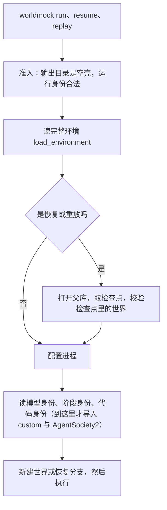
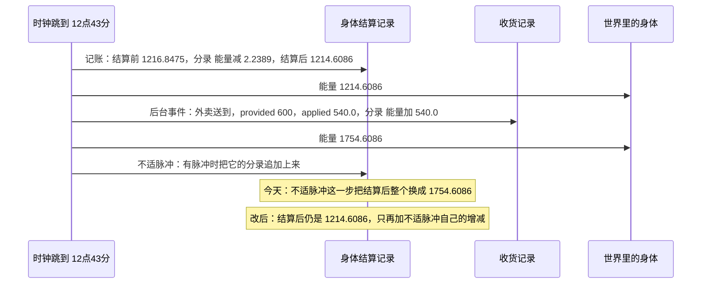
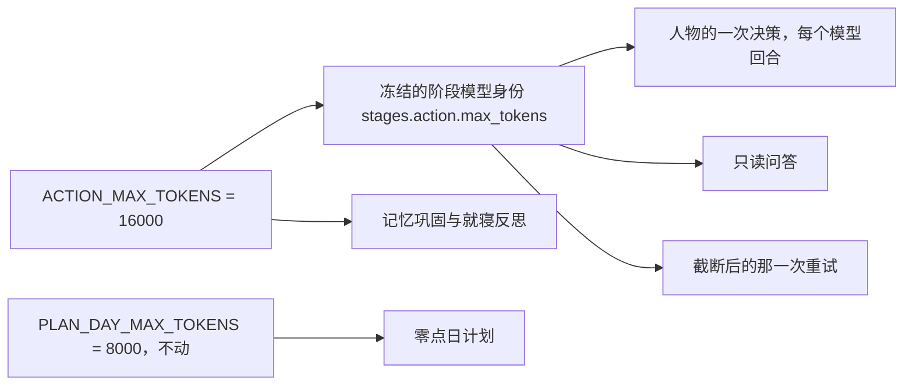

# 十条缺陷与思考额度

> 本章属于[首次真实模型单日运行：修复与新增规格](../SPEC-first-real-day-run.md)，读法和叫法见那一页。

## 目标与依据

这一章不改变人物能做的事，改的是所有者敲命令、读记录时看到的东西，外加人物一次决策最多能想多久。这次真实运行里有两个时刻最能说明问题：12:43 午饭送到的那一秒，身体记录的「结算后」已经含了这顿饭，紧跟着的收货记录又记了一次；22:20 人物想着要不要暂停听歌去打电话，思考把输出上限用完，回答是空的，重试时关了思考，盲选了此刻不能做的睡觉，被拒后多走了一轮。手机记录怎样生成不受本章影响，受影响的是运行目录里的身体与收货记录、`worldmock` 命令行和两个检查脚本。

引擎今天的做法：时钟每推进一段，环境给身体记一笔账，随后 `src/worldmock/life/rhythm.py:71` 把这笔账的「结算后」整个换成那一刻的最终身体，而同一秒送到的那顿饭在它之前已经处理过；每次决策的输出上限是源码常量 `ACTION_MAX_TOKENS = 8000`（`custom/agents/life_agent.py:68`），思考和回答共用。

本章实现提案里两项已裁决的事。一是「已同意修复的缺陷」那张表的十行，提案的原话是「以下十条所有者已答复『修复』」，裁决结果写「照已同意修复的缺陷的方案修」；其中「导出的一天时间线里有些行只写『互动』『购买』」一行提案写的是「并入上面的统一写法」，本章只指路。二是「思考额度」：「每次决策的输出上限从 8,000 提到 16,000。截断后的重试保持现状」。写规格前对照代码把十行逐条核对过，多数已离线复现；有三处与提案的说法不同，都在所属小节里交代：身体记录那一条不只改记录，角落情形下世界里的数也会变；序列化警告那一条涉及的不是两个字段，而是人设表和运行配置里全部的数组字段，改后作者读到的拒绝原因用词会变；命令起不来那一条，提案的原因一栏说设置导入路径「排在它后面」，实际上今天根本没有给本进程设置导入路径的代码，光调顺序修不好，要照提案修复方案里写的新增这一步。

## 行为规格

### 总览

下表的「序号」是提案「已同意修复的缺陷」表里的行号；正文其余地方一律用「本章的叫法」一栏的名称。

| 序号 | 本章的叫法 | 所有者今天看到的 | 改后 | 实施轨道 |
| --- | --- | --- | --- | --- |
| 1 | 命令起不来 | 照手册敲 `worldmock run` 直接报错退出，`resume`、`replay` 同样 | 在任何目录启动、不预设任何 `AGENTSOCIETY_*` 变量都能起 | 缺陷与额度轨道 |
| 2 | 读文件不写编码 | 中文 Windows 上 `worldmock status` 以 `UnicodeDecodeError` 退出 | 六处读取都写明 UTF-8 | `status.py`、`cli.py` 的四处归缺陷与额度轨道；`inspect_run.py` 的两处归显示轨道 |
| 3 | 时间线只写种类名 | 导出的一天时间线里有些行只写「互动」「购买」 | 见[「统一显示写法」](./08-display.md)一章 | 显示轨道 |
| 4 | token 统计漏算 | `result.json` 的 `token_stats` 不含零点日计划的调用 | 从已落盘的模型响应累计，与 `status` 用同一个函数 | 缺陷与额度轨道 |
| 5 | 结算后多记一顿饭 | 外卖送到那一刻，身体记录的「结算后」已含这顿饭，收货记录又记一次 | 「结算后」只反映这一笔自己的增减；导出时自查 | 缺陷与额度轨道 |
| 6 | 收货数额带浮点尾数 | 收货记录写成 `540.0000000000001` | 取这一笔登记的数额 `540.0` | 缺陷与额度轨道 |
| 7 | 启动就打截断日志 | 每个进程启动时打一条「输出被截断」的 ERROR | 只有真的截断时才写 | 缺陷与额度轨道 |
| 8 | 序列化警告 | 新建运行时标准错误里出现一串 Pydantic 序列化警告 | 数组字段的声明与冻结后的实际类型一致，不再告警 | 缺陷与额度轨道 |
| 9 | 检查工具用电脑时区 | `inspect_run.py` 的时刻随电脑时区变 | 按运行清单里的时区 | 显示轨道 |
| 10 | 检查工具读旧字段 | 「动作已受理」显示 `?`，「记忆更新」显示「0 条」 | 按现在的事件字段读；`render_day.py` 写出的换行统一成 LF | 显示轨道 |
| — | 思考额度 | 22:20 那次决策思考到 8,000 被截断 | 上限 16,000 | 缺陷与额度轨道 |

「检查工具用电脑时区」「检查工具读旧字段」和「读文件不写编码」落在 `scripts/inspect_run.py` 的两处，规则写在本章，由显示轨道实施：它们与「统一显示写法」改的是同一批函数（`_t`、`_brief`、`_environment_brief`、`cmd_summary`、`cmd_events`，以及 `render_day.main` 的写文件），由同一个实施者一次改完。

### 命令起不来

**今天看到的。** 在一个干净的终端里（没有任何 `AGENTSOCIETY_*` 变量），照手册敲 `worldmock run --environment <环境> --output <目录>`，命令在读完环境之后立刻失败。按启动方式不同有三种表现，前两种已离线复现：

| 情形 | 结果 |
| --- | --- |
| 用控制台命令 `worldmock`，或在仓库根以外的目录启动（项目根不在本进程的导入路径上） | `ModuleNotFoundError: No module named 'custom'` |
| 在仓库根用 `python -m worldmock.cli` 启动，没有 `AGENTSOCIETY_LLM_API_KEY` | `ValueError: AGENTSOCIETY_LLM_API_KEY is required. Please set this environment variable before running AgentSociety2.` |
| 项目根在导入路径上，终端里恰好有别的 `AGENTSOCIETY_*` 值 | AgentSociety2 按那些值加载，随后 `RuntimeError: AgentSociety2 was imported before the required model configuration` |

**原因。** `run_world` 先准备、后配置进程（`src/worldmock/runtime.py:138-139`），`resume_world`、`replay_world` 同样（`:155-156`、`:172-173`）。而准备阶段读完环境（`:199`）就去读运行身份（`:200`）：`run_setup._model_identity` 的第一句是 `from custom.agents.life_agent import ...`（`src/worldmock/run_setup.py:76`），这个模块又导入 AgentSociety2，后者在导入时读环境变量。恢复走 `_require_runtime_identity`（`runtime.py:247`、`:273-286`），同样先读身份。提案说「配置环境变量、设置导入路径排在它后面」，实际上今天根本没有设置本进程导入路径的代码：`_prepend_pythonpath` 只改给 Ray 工作进程用的 `os.environ["PYTHONPATH"]`（`run_setup.py:56-60`）。离线测试没发现，是因为 `tests/conftest.py:23-24` 预设了两个 `AGENTSOCIETY_*` 变量，`pyproject.toml:51` 把项目根放进了 pytest 进程的导入路径，现有的命令行子进程测试又在仓库根启动并把这些变量带给子进程（`tests/system/cli/test_cli.py:21-24`）。

**改后的次序。**



- 「配置进程」就是今天的 `run_setup._configure_process`，内容不变：核对项目根完整、核对锁定的 AgentSociety2、读凭据、写十二个环境变量、调 `_prepend_pythonpath`、核对 AgentSociety2 已按这组值加载。
- 新建运行：`_prepare_new_run` 在 `load_environment`（`runtime.py:199`）之后、`_run_identity`（`:200`）之前调用 `run_setup._configure_process(request.project_root, inputs.config.model)`。
- 恢复与重放：`_prepare_resume` 在 `_require_runtime_identity`（`:247`）之前、紧挨着它调用同一句，位置在 `try` 里、取到检查点并校验过检查点世界之后。
- `run_world`、`resume_world`、`replay_world` 里各自的那一行 `_configure_process` 删除。
- `_prepend_pythonpath(root)` 除了写 `PYTHONPATH`，再把 `str(root)` 放进本进程的 `sys.path`：不在其中时插到下标 0；已在其中时不动，也不挪位置；重复调用不重复插。`src` 目录不加（`worldmock` 此时已经导入）。
- 调用方只需要设置 `config.toml` 里 `model.api_key_env` 指的那个变量；命令可以在任何目录启动。
- `validate` 不改：它不导入 `custom` 与 AgentSociety2，不读模型身份，也不配置进程（`src/worldmock/validation.py:12-34`；已复现：干净进程从别的目录加载完夹具环境，`sys.modules` 里没有这两个包）。提案要求「`validate` 的顺序一并核对」，核对的结论是没有问题，只补一条回归测试。

**失败时谁先出现。**

| 情形 | 改后先出现的错误 | 与今天比 |
| --- | --- | --- |
| 环境包不合格 | 环境的拒绝原因 | 不变 |
| 恢复时父运行目录没有数据库 | `Footprint database does not exist` | 不变（所以进程配置放在紧挨核对运行身份之前，而不是紧挨读环境之后） |
| 恢复时检查点不存在 | 取检查点的错误 | 不变 |
| `model.api_key_env` 指的变量没设 | 读环境时取不到模型元数据：`RUN_CONFIG_INVALID`，原因 `model context metadata is unavailable` | 不变（读环境这一步就要用它，`src/worldmock/model_endpoint.py:34`） |
| 进程配置自己的三种失败：项目根不完整、锁定的 AgentSociety2 摘要不符、本进程里 AgentSociety2 已按别的端点或模型加载 | 依次是 `WorldMock project root is incomplete`、`AS2 runtime identity differs from the locked source`、`AgentSociety2 was imported before the required model configuration` | 文字不变，时机提前：今天它们出现在准备完成之后，新建运行已经在输出目录写下运维日志、恢复已经建好分支目录；改后出现在这两件事之前，不留下运行目录。第三种在干净进程里不再出现，只剩「同一进程先后启动两次不同配置的运行」这类情形 |
| 检查点的模型身份或代码身份与当前不符 | `Checkpoint model identity differs from the current LifeAgent contract`、`Checkpoint code identity differs from the current runtime` | 不变，仍不留下新运行目录 |

**证明。** 三条子进程测试（`run`、`resume`、`validate` 各一条），不预设任何 `AGENTSOCIETY_*` 变量，从临时目录启动；`run` 与 `resume` 把真正起 Ray 和调模型的那一步换成替身，其余走真实路径。另有进程内测试钉住次序和导入路径。写法见「测试要求」。

### 读文件不写编码

**今天看到的。** 中文 Windows（系统默认编码 `cp936`）上，对一个清单里带中文的运行目录执行 `worldmock status --run-dir <目录>`，得到 `UnicodeDecodeError: 'gbk' codec can't decode byte 0xa9 in position 3041`，退出码 1。这些文件由 `canonical_json` 按 UTF-8 写出（`src/worldmock/footprints/models.py:189-195`），读的时候却没写编码。

**原因与范围。** `src/`、`custom/`、`scripts/` 里不带 `encoding` 的 `read_text()` 恰好六处，提案说的「三处加三处」准确：

| 位置 | 读的文件 | 实施轨道 |
| --- | --- | --- |
| `src/worldmock/status.py:31` | `manifest.json` | 缺陷与额度轨道 |
| `src/worldmock/status.py:45` | `status.json` | 缺陷与额度轨道 |
| `src/worldmock/status.py:47` | `result.json` | 缺陷与额度轨道 |
| `src/worldmock/cli.py:127` | `replay` 的反事实干预文件 | 缺陷与额度轨道 |
| `scripts/inspect_run.py:73` | `manifest.json`（`summary` 子命令） | 显示轨道 |
| `scripts/inspect_run.py:74` | `status.json`（`summary` 子命令） | 显示轨道 |

**改后。** 六处都写 `read_text(encoding="utf-8")`；`inspect_run.py:73` 直接用同文件已有的 `_manifest`（`:651-653`，它本来就是 UTF-8）。规则只有一句：运行目录里的 `manifest.json`、`status.json`、`result.json` 和反事实干预文件一律按 UTF-8 读，不依赖系统默认编码。文件里出现不是 UTF-8 的字节时，照 Python 的 `UnicodeDecodeError` 失败，不换编码重试。

**证明。** 用解释器开关 `-X warn_default_encoding -W error::EncodingWarning` 起子进程执行这三条命令：任何一处没写编码的文本读取都会让命令以 `EncodingWarning` 失败，与测试机的系统语言无关。本机草稿工具 `py.sh` 设了 `PYTHONUTF8=1`，在它下面直接跑看不到这个缺陷，所以必须用这个开关。

### 时间线只写种类名

导出的一天时间线里有些行只写「互动」「购买」。原因已确认：渲染器从观察记录的 `data.apps`、`data.contents`、`data.goods` 取名称（`scripts/render_day.py:128-134`），这几组字段观察里已经没有了；购买根本没有标签函数（`:177`、`:186`）。写法、名称来源和测试都在[「统一显示写法」](./08-display.md)一章，本章不重复。

### token 统计漏算

**今天看到的。** 运行结束后，`<运行目录>/result.json` 的 `token_stats` 和 `worldmock status` 输出里的 `observed_model_usage` 对不上：前者少了零点日计划的调用。

**原因。** `RunResult.token_stats` 取 AgentSociety2 人物一侧的计数 `society.token_stats`（`src/worldmock/runtime.py:468-471`）；零点日计划由环境进程调用（`custom/envs/life_env.py:218`、`:245`，普通恢复时是 `:111`；都进 `runtime.py:617` 的 `settle_pending_day_plans`），请求和响应都落了库，却不在那个计数里。`status` 的实测用量来自另一条路：`_observed_usage` 对库里的模型响应事件按模型分组累计（`src/worldmock/status.py:56-70`）。

**改后。** 全系统只留 `_observed_usage` 这一个来源。

- `status.py` 新增公开函数 `observed_model_usage(run_dir: Path) -> list[dict]`：只读打开 `run_dir/footprints.sqlite`，返回 `_observed_usage(connection)`，关闭连接；库不存在时与 `read_status` 一样抛 `IntegrityError("Run database does not exist")`。`read_status` 继续用自己的连接调 `_observed_usage`。
- `_observed_usage` 的 SQL 加 `ORDER BY json_extract(body,'$.data.response.model')`，行序确定。
- `cli._run_command` 在写 `result.json` 之前给回执加 `token_stats = observed_model_usage(output)`（此时环境进程和 Ray 都已关闭）。`RunResult` 删掉 `token_stats` 字段，`_execute` 不再读 `society.token_stats`。
- `worldmock status` 的两个键都保留：`token_stats` 原样取自 `result.json`（运行没结束或失败时为 `null`），`observed_model_usage` 随时现算。运行正常结束后两者相等。

`result.json` 的新形状。下面是离线测试里一次短运行的样子（运行身份、目录、步数与条数是示意；经命令行新建的运行，身份是命令行生成的 32 位十六进制串）：日计划桩的响应带模型名 `test-model` 和用量 30、9、39，决策替身的响应不带模型名也不带用量；真实运行里通常只有一行，`model` 是服务返回的模型名。

```json
{
  "current_time": "2026-01-05 09:00:00+08:00",
  "run_dir": "D:\\runs\\short",
  "run_id": "5b0c1e7a9d3f4c26a8e1f0b2c4d6e8a0",
  "step_count": 4,
  "token_stats": [
    {"model": null, "responses": 4, "responses_with_usage": 0,
     "input_tokens": null, "output_tokens": null, "total_tokens": null},
    {"model": "test-model", "responses": 1, "responses_with_usage": 1,
     "input_tokens": 30, "output_tokens": 9, "total_tokens": 39}
  ]
}
```

今天的形状是 `"token_stats": {"<模型名>": {"calls": 整数, "input": 整数, "output": 整数}}`，上面这次运行今天得到的是空字典。改后 `token_stats` 是数组，每个模型一行：

| 键 | 类型 | 含义 |
| --- | --- | --- |
| `model` | 字符串或 `null` | 响应里服务返回的模型名（`data.response.model`）；响应没带模型名时为 `null` |
| `responses` | 整数，至少 1 | 这个模型已落盘的响应条数：`event_type` 为 `model_response` 且 `data.phase` 为 `response` 的事件 |
| `responses_with_usage` | 整数，至少 0 | 其中带用量（`usage.prompt_tokens`）的条数 |
| `input_tokens`、`output_tokens`、`total_tokens` | 整数或 `null` | 各响应 `usage.prompt_tokens`、`usage.completion_tokens`、`usage.total_tokens` 之和；这个模型一条带用量的响应都没有时是 `null`，不写成 0 |

- 行按 `model` 升序，`null` 排最前（SQLite 的排序）。库里一条响应都没有时是空数组 `[]`。
- 凡是落了响应证据的调用都在内：决策的每个模型回合、只读问答、截断后的重试、记忆巩固与就寝反思、零点日计划。只落了请求或失败证据的调用不计。
- **恢复与重放报的是分支库整段历史的累计**，包含从父运行继承来的、检查点之前的全部响应（分支建库时把这些事件原样带进来，`src/worldmock/footprints/checkpoint.py:101`、`:133-135`），不只是这一次进程自己的调用。今天 `resume` 的 `token_stats` 只有这一次进程人物一侧的计数。例：父运行到检查点为止落了 40 条响应，分支自己又落了 68 条，分支 `result.json` 里 `responses` 合计是 108。
- `result.json` 没有结构号，这次不升任何号；形状从字典变成数组对下游是静默的，列进[「版本、身份与基线」](./12-versions.md)一章的「交给数据集仓库和下游的事」。

**证明。** 进程内经真实命令行入口跑一次带日计划桩的短运行，断言回执等于 `status` 的实测用量，并且日计划的用量在里面；恢复分支的数字含父运行的响应。

### 结算后多记一顿饭

**一次时钟推进里的三步。** 时钟不是一秒一秒走的，而是从上一个时刻直接跳到下一个有事发生的时刻。每跳一次，引擎按固定次序做三件事（`src/worldmock/life/time_advance.py:105-115`）：

1. **记账。** 给身体记这一段的账：按经过的时间扣能量，困意、想放松、想社交照规则变化，写下一条身体结算记录（`body_settlement`，带「结算前」`before`、「结算后」`after` 和这一笔的分录 `resource_flows`）。同一步里把进行中的活动推到这一刻；到店购买恰在这一刻完成的，就在这一步付款并当场吃掉。
2. **后台事件。** 处理排在这一刻的后台事件。外卖送到就在这一步：身体加上这顿饭，写一条收货记录（`goods_received`）。
3. **不适脉冲。** 清醒着又饿或又困、已经超过两小时的人，按超出的时间加一点「想放松」，叫作不适脉冲；它的分录追加到记账那一步写下的身体结算记录上。

下文用「记账」「后台事件」「不适脉冲」称呼这三步。



**今天看到的。** 不适脉冲这一步为了让「结算后」带上脉冲，直接写 `draft.data["body_settlement"]["after"] = agent.body.model_dump(mode="json")`（`src/worldmock/life/rhythm.py:71`），把此刻的最终身体整个填了进去，于是前两步里收货的效果也被带进「结算后」。已复现的数字（夹具环境，在家买牛肉面外卖，推进到送达那一秒，读已提交的事件）：

| 记录 | 内容 |
| --- | --- |
| 身体结算 | `before.energy_kcal` 1216.8475；分录只有一条 `energy_kcal drain 2.2389`；`after.energy_kcal` 1754.6086 |
| 收货 | `provided` 600，`applied` 540.0；分录 `energy_kcal source 540.0` |

「结算前」加减这条记录自己的分录是 1214.6086，记录的「结算后」多出 540，这 540 在收货记录里又记了一次。提案只说了外卖送达；到店购买在完成那一秒的收货（发生在记账那一步里）同样被带了进去。

**改后的规则。**

- 一条身体结算记录的「结算后」，对能量 `energy_kcal`、睡眠不足 `sleep_deficit_hours`、放松需要 `relaxation_need`、社交需要 `social_need` 这四项，都等于「结算前」加上本记录 `resource_flows` 里该项的全部 `source` 分录、减去全部 `drain` 分录。
- 这条记录上只有两类分录：记账那一步共同结算的分录（`cause` 为 `settle:shared:<资源名>`），和这次推进的不适脉冲（`relaxation_need`、`source`、`cause` 为 `relaxation:event`）。
- 收货不进这条记录。到店购买完成、外卖送达、驿站取件的效果只记在各自的 `goods_received` 上（`applied` 与它自己的 `resource_flows`）；「在地点吃的一餐」进账时同样只记在它自己的事件上，见[「在地点吃的一餐」](./07-meals.md)一章。
- 不适脉冲改成对着记账之后的身体计算。设记账那一步写下的「结算后」里放松需要是 `S`，这次推进新增的计费小时数是 `h`（计时字段 `discomfort_started_at`、`discomfort_pulse_hours` 的算法不变），则脉冲的数额 `amount = min(1.0, S + 0.10 × h) − S`。`amount` 为 0 时不记分录，身体不变。否则：记录的「结算后」放松需要写 `S + amount`，分录追加到这条记录；世界里这位人物此刻的放松需要（已含同一秒收货的缓解）加上分录登记的同一个 `amount`，不用前后两个数相减。
- 睡眠区间不变：不施加脉冲，只清计时。
- 每次推进每位人物恰有一条身体结算记录（`time_advance.py:229-245`）：推进的间隔恒大于 0（`:98`），人物的身体结算时刻不会晚于当前时刻（`src/worldmock/life/models.py:611`），所以 `:232-233` 那句「起点等于终点就跳过」在推进里走不到。脉冲总落在这条记录上：`settle_engine_rhythm` 直接取本次推进里这位人物的那条记录来算，不为「没有记录」另写分支，也不在取不到记录时改成对着世界里的身体算。今天有一条单元测试不带任何记录直接调用这个函数，要改成带上记录，见「测试要求」。
- `sleep_pressure` 照共同结算的公式变化，不走分录；`sleep_need_hours`、`chronotype_midsleep`、`social_need_growth_per_hour` 是人设常量。这四项仍是记账那一步写下的值，不适脉冲不碰。

改后同一个例子：身体结算记录 `after.energy_kcal` 是 1214.6086；收货记录不变；世界里的能量是 1754.6086，等于「结算后」加收货记录的 `applied`。`scripts/inspect_run.py rerun` 的「首次进食前最低能量」读的就是身体结算记录的 `before` 与 `after`（`:292-304`），改后不再把刚吃下去的那顿饭算进「进食前」。

**世界里的结果与今天不同的角落情形。** 这一条不只是改记录。今天不适脉冲是对着收货之后的身体算的（`rhythm.py:88`），改后对着收货之前（记账之后）的身体算。两种算法只在一种情形下结果不同：不适脉冲与一次饮料或商品的收货落在同一秒，而且记账之后的放松需要离上限 1.0 已经不到这次脉冲那么多。例：记账之后放松需要 0.98，同一秒收到一杯柠檬茶（缓解 0.10），这次脉冲是 0.05。

| 哪一种 | 脉冲对着哪个值算 | 脉冲实得 | 世界里的放松需要 | 身体结算记录的「结算后」 |
| --- | --- | --- | --- | --- |
| 今天 | 收货后的 0.88 | 0.05 | 0.93 | 0.93（含了收货的 −0.10） |
| 改后 | 记账之后的 0.98 | 约 0.02（到 1.0 封顶） | 约 0.90 | 1.0 |

食品收货只改能量，不碰放松需要，所以午饭、晚饭这类情形两种算法结果相同。收货只会让放松需要下降，所以改后世界里的值不会越过上限。这一点在规格开头「与提案不同的地方」里交代给所有者；两份完整日基线反正要重冻。

**提案没有发现的连带：拒绝脉冲的分录漏进下一条记录。** 人物的请求被业务拒绝时，放松需要加 0.05（`src/worldmock/life/decision_coordinator.py:512-513`）。身体的每笔增减先放进一个模块级的缓冲（`src/worldmock/life/body.py:23`），由写记录的一方取走；拒绝这条路没有人取。这条分录就留到下一次时钟推进，被记账那一步一并取走（`time_advance.py:242`），写进**下一条**身体结算记录。已复现：

```
拒绝之后缓冲里：relaxation_need source 0.04999999999999999 cause relaxation:event
下一条身体结算：before.relaxation_need 0.25，after.relaxation_need 0.25
              分录：relaxation_need source 0.0499…，energy_kcal drain 16.25
```

「结算前」已经含了这 0.05，分录又列一次，「结算后等于结算前加减自己的分录」在这条记录上不成立。这个缓冲今天还有两个后果：同一秒先被拒、随后取到一份食品时，这条放松分录会被收进食品的收货记录；进程重启后缓冲清空，同一段历史在连续运行和恢复运行里写出的分录不一样。不处理这一条，下面的自检就立不住。

**拒绝脉冲的分录写在哪。**

- 施加之后立刻从缓冲取走，写进这组拒绝的第一条 `action_result` 事件（`decision_coordinator.py:403-404` 里的 `first_result`），键是事件正文顶层的 `resource_flows`，与 `status`、`error_code` 同级，形状与其他事件的分录相同：`[{"resource": "relaxation_need", "owner": "agent:1", "direction": "source", "amount": 0.04999999999999999, "cause": "relaxation:event"}]`。
- 同一次决策的两条开始请求一起被拒时，两条 `action_rejected` 仍然内容相同、都不带分录；两条 `action_result` 里只有第一条带。
- 这次拒绝没有施加脉冲（每人每秒前两次不计数的名称类拒绝；同一秒已经施加过；放松需要已在上限，实得为 0）时不写这个键。
- 分录只写在事件上，不进 `ActionResult`，所以世界状态里保存的动作结果（`processed_actions`）不变；同一请求重放时不施加脉冲，也不写分录（`decision_coordinator.py:547-562`，现状）。
- 人物读不到这个键：提示各层的结果明细按键投影，不认识的键不进提示。
- `scripts/inspect_run.py flows` 按 `data.resource_flows` 列分录（`:185-190`），改后这 0.05 会出现在拒绝那一刻，而不是下一次结算。

**导出时的自检。** 放在导出自查（`src/worldmock/footprints/invariants.py` 的 `validate_footprint_facts`），与手机记录的各项自查同一处，不成立时导出不发布。

- 对导出里每条 `kind` 为 `body_settlement` 的环境事件做一次重放，用现成的 `worldmock.resources.audit.audit_level_flows`，步骤固定：
  - 账本用四项身体资源的固定定义（`worldmock.exchange.body.RESOURCE_METAS` 里的 `energy_kcal`、`sleep_deficit_hours`、`relaxation_need`、`social_need`，上下界照旧是 0 到 2400、0 到 24、0 到 1、0 到 1）。
  - 主体是 `agent:<本事件的 agent_id>`；初值取 `data.body_settlement.before` 的这四项。
  - 流水是本事件 `data.resource_flows` 的全部分录，照记录里的次序整批交给账本，不先按资源筛。
  - 四项各调用一次，期望的期末值取 `data.body_settlement.after` 的同名项。容差沿用它的 1e-9。
- 下面任何一种都算不成立：某一项重放出的期末值与「结算后」不等；重放途中越过上下界；分录的资源不在这四项之内；分录的主体不是这位人物。实现上就是把重放抛出的任何 `ResourceLedgerError` 换成同一句错误。
- 不成立时写一条英文错误日志并抛 `IntegrityError`，日志与异常是同一句：`Body settlement after-state disagrees with its own resource flows`。
- 自检不放在写入时，也不放在读事件时：一条记账错误不应该打断正在进行的长运行。
- 旧代码产出的导出里，凡是有收货落在推进边界上的（issue 那次运行 12:43 的午饭就是）都过不了这条检查；它们本来就会因为导出结构号从 5 升到 6 被先行拒绝，见[「版本、身份与基线」](./12-versions.md)一章。

**证明。** 真实引擎分别走外卖送达、到店购买完成、不适脉冲、拒绝后再推进四种情形，读已提交的事件断言；角落情形单列一条；完整一天的真实导出通过自检，篡改一条「结算后」后导出认证报上面那句英文。

### 收货数额带浮点尾数

**今天看到的。** issue 那次运行里有一条收货记录的 `applied` 写成 `540.0000000000001`。离线复现：初始能量写 987.65 的人物买一份食品外卖，收货记录是 `"applied": 539.9999999999999`，同一事件里的分录却是 `"amount": 540.0`；偏的方向随当时的能量而定。

**原因。** 食品收货的 `applied` 是补能前后两个浮点数相减（`src/worldmock/life/receipt.py:94`），而登记的分录数额才是准确值（`src/worldmock/life/body.py:144-145`）。饮料和商品那一支直接取登记数额（`receipt.py:71-83`），没有这个问题。

**改后。** `_food_effect` 先取走这次补能的分录，`applied` 等于这些分录的数额之和，`resource_flows` 由同一批分录生成；能量已到上限、实得为 0 时没有分录，`applied` 是 `0.0`。质量报告的食品效率用 `applied / provided`（`src/worldmock/footprints/quality.py:236-249`），改后正常收货恰为 0.9。

**证明。** 真实引擎上初始能量 987.65 的那次收货，`applied` 恰等于 540.0 并等于同一事件分录数额之和。

### 启动就打截断日志

**今天看到的。** 任何导入了人物适配器的进程（运行主进程、Ray 工作进程、环境进程）一启动就输出 `ERROR:root:Life tool protocol rejected: OUTPUT_TRUNCATED: model output reached max_tokens while reasoning, before any tool call (finish_reason=length)`，其实没有任何截断发生。

**原因。** `src/worldmock/agents/life_truncation.py:52` 在模块导入时执行 `TRUNCATION_CONTENT = feedback_content(truncation_feedback())`，为的是生成一段固定文字；`truncation_feedback`（`:43-48`）经 `host_feedback` 写错误日志（`src/worldmock/agents/life_feedback.py:41`）。

**改后。**

- `life_feedback.py` 新增 `report_content(report: ErrorReport) -> str`，内容就是今天 `feedback_content` 里把错误结构加固定指示编成 JSON 的那一句；`feedback_content(error)` 改成调用它。
- `life_truncation.py` 把构造错误结构的部分提成私有函数 `_truncation_report()`；`truncation_feedback()` 仍经 `host_feedback` 写日志并返回带结构的字符串；`TRUNCATION_CONTENT = report_content(_truncation_report())`，导入时不再调用会写日志的函数。
- `TRUNCATION_CONTENT` 的内容必须与今天逐字相同：宿主靠它判断消息历史是否以截断纠错结尾（`life_truncation.py:68-69`）。
- 真的截断时仍然恰好写一条同样的日志（`custom/agents/life_agent.py:231-232`），日志原文不变。

**证明。** 重新执行这个模块的导入，期间没有任何错误日志；真实截断回合仍写一条。

### 序列化警告

**今天看到的。** 新建运行时标准错误里出现一串 `UserWarning: Pydantic serializer warnings: PydanticSerializationUnexpectedValue(Expected list[list[int]] - serialized value may not be as expected [field_name='breaks', input_value=((720, 780),), input_type=tuple])`，位置是 `src/worldmock/base_models.py:57`。提案当时没能复现，并说「每次加载环境出现」「来自两个被冻结成元组的列表字段」，两处都要更正：

- 加载环境本身不出警告。生产路径上触发它的是新建运行时把人设表序列化进人物工作区的那一句（`src/worldmock/run_setup.py:199`）；恢复不走这一句。对夹具环境已复现：`inputs.persona.model_dump(mode="json")` 29 条，`inputs.config.model_dump(mode="json")` 3 条，共涉及十六个字段名。
- 涉及的不是两个字段，而是人设表和运行配置里声明成 `list[...]` 的全部数组字段。

**原因。** 输入模型在校验后把字段里的列表递归冻结成元组（`base_models.py:44-52`、`:75-81`），序列化时元组仍是元组（`:84-90`），而字段声明写的是 `list[...]`，序列化器就报「期望列表、得到元组」。序列化出来的 JSON 本身是对的，这是噪音，不是数据错误。目录模型的数组字段本来就声明成元组，不报。

**改后。** 照提案的字面做：让声明类型与冻结后的实际类型一致。`src/worldmock/input_models.py` 新增一个别名，逐处替换；`base_models.py` 不动。

```python
_Item = TypeVar("_Item")
#: 数组：TOML 数组读入后冻结成元组；容器这一层不按严格模式（TOML 解析出来的是 list），元素仍按严格模式校验。
Array = Annotated[tuple[_Item, ...], Field(strict=False)]
```

| 模型 | 字段 | 今天的声明 | 改后的声明 |
| --- | --- | --- | --- |
| `WorkShift` | `breaks` | `list[list[int]]` | `Array[Array[int]]` |
| `WorkSchedule` | `exceptions` 的数组分支 | `dict[str, WorkShift \| list[WorkShift]]` | `dict[str, WorkShift \| Array[WorkShift]]` |
| 别名 `HourWindow` | `wake_window`、`leave_home_window`、`lunch_window`、`dinner_window`、`bedtime_window`、`leave_work_window`、`arrive_home_window`、习惯的 `time_window` | `Annotated[list[float], AfterValidator(_hour_window)]` | `Annotated[tuple[float, ...], Field(strict=False), AfterValidator(_hour_window)]` |
| `Relationship` | `channels` | `list[NonBlankText]` | `Array[NonBlankText]` |
| `Tastes` | `content_genres`、`food_preferences`、`media` | `list[NonBlankText]` | `Array[NonBlankText]` |
| `PersonaConfig` | `relationships`、`habits` | `list[Relationship]`、`list[HabitDeclaration]` | `Array[Relationship]`、`Array[HabitDeclaration]` |
| `CalendarConfig` | `spring_festival_dates`、`makeup_work_dates`、`overtime_opportunity_dates` | `list[str]` | `Array[str]` |

- 一共十九个字段名。复现到警告的是其中十六个；`leave_work_window`、`arrive_home_window` 和 `exceptions` 的数组分支夹具没有写，所以没有出现在警告里，同样要改。
- 条数上限照旧写在 `Field(min_length=…, max_length=…)`；`_hour_window` 的入参与返回注解跟着改成元组，检查的内容不变。
- 作者写法不变：`persona.toml`、`config.toml` 里仍是 TOML 数组。已在内存里把这份声明换上去跑过 `tests/unit/test_environment_inputs.py` 与 `tests/integration/environment/test_input_negative_contract.py` 两个文件：元素仍按严格模式校验（`"1"`、`true`、`1.0` 写进整数数组照旧被拒），嵌套数组和并集分支都能从 TOML 数组读入，两种 `model_dump` 都不再告警，JSON 输出与今天相同；失败的用例恰好是下面这张表钉住旧用词的那几条。

**作者看得见的变化：拒绝原因里 `List` 变 `Tuple`。** 人设表不合格时，原因的英文说明取校验库的原文（`src/worldmock/environment.py:94-111`），声明一改，下面两种说明的用词跟着变，其余原因逐字不变：

| 情形 | 今天 | 改后 |
| --- | --- | --- |
| 数组条数超出或不足，例如联系渠道写了四项 | `relationships.0.channels: List should have at most 3 items after validation, not 4` | `relationships.0.channels: Tuple should have at most 3 items after validation, not 4` |
| 该写数组的地方写了别的类型，例如时段写成字符串 | `leave_home_window: Input should be a valid list` | `leave_home_window: Input should be a valid tuple` |

钉住旧用词、必须同批改的地方：

| 位置 | 钉住什么 |
| --- | --- |
| `tests/unit/test_environment_inputs.py:333`、`:335`、`:339`、`:341`、`:343`（`test_table_format_and_formula_ranges_are_rejected_with_the_field_named` 的五个参数） | `List should have at least 1 item…`、`List should have at most N items…` |
| `tests/unit/test_environment_inputs.py:405`（`test_relationship_and_habit_counts_are_capped_for_the_prompt_budget`） | `List should have at most {limit} items…` |
| `tests/integration/environment/test_input_negative_contract.py:80`（`test_personal_windows_need_two_finite_hours_in_order` 的一个参数） | `Input should be a valid list` |
| `tests/dataset_acceptance.py:91-93` 的变异 `relationship_channel_closed_set_restored` | 原文 `channels: list[NonBlankText]`，替换文 `channels: list[Literal["电话", "微信", "见面"]]` |
| `tests/dataset_acceptance.py:94-97` 的变异 `blank_relationship_channel_accepted` | 原文 `channels: list[NonBlankText]`，替换文 `channels: list[str]` |

两条变异改后的原文都是 `channels: Array[NonBlankText]`，替换文分别是 `channels: Array[Literal["电话", "微信", "见面"]]` 与 `channels: Array[str]`；不跟着改，变异会因为找不到原文而失败。这一条用词变化列进[「版本、身份与基线」](./12-versions.md)一章的「交给数据集仓库和下游的事」。

运行配置的拒绝原因不变：`config.toml` 不合格时不取校验库的原文，除几句规定的原因外一律是 `Run config validation failed`（`src/worldmock/environment.py:114-132`），所以日历的三个数组改了声明，作者也看不到用词变化。

**证明。** 把警告升成错误后，对夹具环境序列化人设表、运行配置并构造人物工作区输入都不抛；数组仍冻结成元组，工作区里仍是 JSON 数组。

### 检查工具用电脑时区

**今天看到的。** `python scripts/inspect_run.py <运行目录> events`（以及 `money`、`body`、`flows`）每行开头的时刻按运行这条命令的电脑的时区显示。这次运行的时区是 `Asia/Shanghai`，19:52 开始的那次哔哩哔哩使用，在一台 UTC 的机器上显示成 `09-28 11:52:00`。

**原因。** `_t` 用 `datetime.fromtimestamp(epoch)`，没带时区（`scripts/inspect_run.py:65-67`）。

**改后。** `_t(epoch, zone)` 按运行清单 `manifest.json` 的 `window.timezone` 显示，格式仍是 `%m-%d %H:%M:%S`；上面那一行在任何机器上都是 `09-28 19:52:00`。`cmd_events`、`cmd_money`、`cmd_body`、`cmd_flows` 各自从 `a.run_dir` 用 `_manifest` 读一次清单，`_environment_brief` 里前台区间的起止用同一个时区。`rerun`、`continuation` 今天读库里世界状态的 `timezone`（`:364`、`:571`），与清单同值，不动。

**证明。** 建两个运行时区不同的真实引擎，同一类事件打印的钟点分别等于各自运行时区的钟点；两个时区总有一个与测试机不同，所以不依赖测试机的时区。

### 检查工具读旧字段

**今天看到的。** `inspect_run.py events` 里，「动作已受理」一行恒显示 `?`，「记忆更新」一行恒显示「0 条」。

**原因。** 一行摘要 `_brief`（`scripts/inspect_run.py:106-127`）读的字段名已经改了：受理行读 `tool_name` 或 `kind`，今天受理事件的正文是动作结果加活动快照（`src/worldmock/life/action_evidence.py:109-115`）；记忆行读 `episode_ids`，今天的键是 `episodes`、`created_episode_ids`、`merged_episode_ids`（`src/worldmock/life/memory_evidence.py:97-105`）。

**改后的各行。** 每行的前半段不变，仍是 `[序号] 时刻 a人物 事件类型`（`:103`）；下表是后半段摘要。「活动短语」取[「统一显示写法」](./08-display.md)一章的写法。

| 事件 | 今天的摘要 | 改后的摘要 | 例 |
| --- | --- | --- | --- |
| `action_accepted`，事件带活动快照 | `?` | `<活动短语> → <status>` | `使用哔哩哔哩《散步装备准备》 → in_progress`；`购买冰美式咖啡（经瑞幸咖啡下单） → in_progress` |
| `action_accepted`，事件不带活动快照（例如修订当日计划） | `?` | `<message> → <status>` | `Day plan revised → completed` |
| `action_rejected` | `? → <error_code>` | `<error_code>: <reason>` | `ACTIVITY_PRECONDITION_UNMET: Place the order after arriving at a location.` |
| `memory_updated` | `0 条` | `<episodes 的条数> 条` | `2 条` |

整行的样子（序号是示意；运行时区 `Asia/Shanghai`，事件类型占 20 个字符宽）：

```
[  212] 09-28 08:46:00 a1 action_accepted      购买冰美式咖啡（经瑞幸咖啡下单） → in_progress
[  640] 09-28 18:05:10 a1 action_rejected      ACTIVITY_PRECONDITION_UNMET: Place the order after arriving at a location.
[  871] 09-28 19:52:00 a1 action_accepted      使用哔哩哔哩《散步装备准备》 → in_progress
[  902] 09-28 19:53:30 a1 memory_updated       2 条
```

- 受理事件带 `activity` 快照时写活动短语，不带时写结果的 `message` 原文；箭头后是结果的 `status`。出行和睡眠的受理行照[「统一显示写法」](./08-display.md)一章写活动名（与它们的活动进度行相同），不换成「驾车去公司」这样的短语。
- 拒绝行的两段取事件正文的 `error_code` 与 `reason`，原样不截断。
- 记忆行数的是事件正文 `episodes` 数组的长度；只刷新摘要、没有新条目的记忆更新如实显示「0 条」。
- 受理、拒绝、记忆、请求四种行都直接取所列的键，不设 `?` 这类回退。键不存在说明事件不是当前格式，照 Python 的 `KeyError` 失败，不显示替代文字；改后的检查工具本来就读不了这次改动之前的运行，见[「统一显示写法」](./08-display.md)一章。

提案点了两处症状，同一类的读取还有四处，一起修：

| 位置 | 今天 | 改后 |
| --- | --- | --- |
| 拒绝行（`:115-116`） | 读不存在的 `tool_name`，显示 `?` | 见上表 `action_rejected` 一行 |
| 请求行的两个回退（`:110-112`） | `request` 读不到时回退 `arguments`，`tool_name` 读不到时回退 `kind`；这两个都是已删格式的读取分支 | 只读 `tool_name` 与 `request`，摘要是 `<tool_name> <request 的 JSON，前 80 个字符>`；只带 `kind`、`arguments` 的旧格式请求事件照 `KeyError` 失败 |
| 兜底分支（`:125-126`） | 在事件正文里找 `resource_changes`；资金变化只在事件信封上，这个分支永远进不去 | 读信封上的 `resource_changes`：非空时摘要是它的 JSON（前 100 个字符），否则是正文 JSON（去掉 `request`、`response` 两个键，前 90 个字符）。走到这一支的是上面没有单列的事件类型。今天信封带资金变化又走到这一支的只有付了车费的出行受理结果（`action_result`），它因此显示资金变化，例如坐公共交通去公司是 `{"account:agent:1": -200, "account:external:scenario": 200}`；购买的付款记在环境事件上，不走这一支 |
| `walking_share` 的 `routes` 查询（`:339-342`） | 查观察的 `data.routes`，观察里已经没有这个键，查询恒为空 | 删掉这条查询；`available` 只看有没有步行秒数。`rerun` 的输出不变 |

**`render_day.py` 的换行。** `scripts/render_day.py:259` 写文件没有指定换行，在 Windows 上写出 CRLF，而导出里的同一份时间线是按字节写的 LF，两份逐字节不同。改后写成 `out_path.write_text(markdown, encoding="utf-8", newline="\n")`，在任何平台上都等于 `render_day_markdown(...)` 的 UTF-8 字节。

**证明。** 真实引擎先被拒一次、再开始一项活动、再经真实宿主写出一条记忆更新，逐行断言；`render_day.main` 写出的文件字节里没有 `\r`。

### 思考额度

**一个常量。** `custom/agents/life_agent.py:68` 的 `ACTION_MAX_TOKENS` 从 `8000` 改成 `16000`。除这一行（和它上面的注释）之外不改任何代码。思考和回答仍共用这个上限；实际发出的值是它与服务输出上限中较小的一个。

**它管哪些调用。**



| 调用 | 从哪里取这个数 | 思考 | 改后（夹具服务上限 32,768；DeepSeek 上限 393,216） |
| --- | --- | --- | --- |
| 人物的一次决策，每个模型回合 | 冻结身份里的值（`src/worldmock/run_setup.py:95`），发请求时取（`life_agent.py:350`） | 开 | 16,000 |
| 只读问答 | 同一个入口 | 开 | 16,000 |
| 截断后的那一次重试 | 同一个入口，只换思考开关与工具选择，`max_tokens` 不变（`life_agent.py:347-353`） | 关 | 16,000 |
| 记忆巩固、就寝反思 | 直接读常量并与服务上限取小（`life_agent.py:388`） | 关 | 16,000 |

服务输出上限小于 16,000 时（例如 8,192），四种调用都取服务上限。

**不变的。**

- 零点日计划用另一个常量 `PLAN_DAY_MAX_TOKENS = 8000`（`src/worldmock/life/day_planning.py:32`），思考关闭，不动。
- 截断后的重试「保持现状」指做法不变：`finish_reason=length`、正文为空、没有工具调用才算截断；下一次请求关闭思考、`tool_choice=required`、只开放世界请求工具，只重试一次。它的上限取同一个阶段值，所以也变成 16,000。
- 不发送思考力度（身份里 `reasoning_effort` 恒为 `null`）。上限仍是源码常量，不进 `config.toml`。
- 不给记忆调用单拆一个常量：它们关着思考，输出远小于上限，放宽没有行为差别。

**对阶段模型身份和旧运行的影响。** 运行清单 `stage_model_identity.stages.action.max_tokens` 的取值从 8000 变成 16000（或服务上限），键集不变，运行清单结构号不升。恢复与重放时这项逐值核对（`run_setup.py:249-255`），清单里还是 8000 的旧运行以 `IntegrityError("Stage model identity is inconsistent")` 被拒；这在预期之内，任何生产改动本来就让旧运行不能恢复。

**对发送前容量的影响。** 容量预检把 `max_tokens` 当作预留输出（`src/worldmock/life/prompt_capacity.py:63`、`:74-77`），预留从 8,000 变成 16,000。窗口最低 262,144、阈值 85%，这天最大的一次提示约 4.6 万，离浓缩阈值很远。

**钉住 8000 的测试和文档。**

| 位置 | 钉住什么 | 怎么办 |
| --- | --- | --- |
| `tests/integration/runtime/test_life_agent_protocol.py:683-685`（助手 `_assert_action_wire`） | 行动请求 `max_tokens == 8000`，说明文字里的「8000 上限」 | 改 16000 |
| `tests/integration/runtime/test_output_truncation.py:105`（助手 `_is_retry`） | 决策与重试两类请求 `max_tokens == 8000` | 改 16000 |
| 同上 `:135`、`:322` | 两处说明文字里的 8000 | 改 16000 |
| `tests/fixtures/viewer-context.json:933`、`:1887` | 录制样本里两个请求的 `max_tokens` | 收尾时随样本重录，不手改 |
| `tests/unit/runtime/test_model_identity.py:28-36` | 读常量 | 自动跟随；另加一个把值改回 8000 的篡改参数 |
| 《人物》「宿主模型协议」（`docs/design/06-agent.md:170-171`） | 只写「输出上限使用冻结实际元数据」，没有写这个数 | 先补一句写准 |
| 《配置》「模型配置与凭据」（`docs/design/08-configuration.md:122`） | 「调用预算……不由不可覆盖源码常量决定」，与这个常量不符 | 先改写 |

不读这个常量、不用改的：`tests/unit/life/test_native_environment_contract.py:157`、`:164`（自带服务上限 8000）；`tests/unit/footprints/test_quality.py:812`、`:841` 与 `tests/integration/life_host_fixtures.py:20`（伪造回复自带的用量）；`tests/integration/runtime/test_daily_reflection.py:391-415` 与 `docs/design/06-agent.md:162`（那是记忆层 8000 字符的窗口，与本项无关）；`tests/fixtures/dayrun_truncations.json`（历史运行记录）。`docs/dev/` 下几份已完成的开发记录也写着 `max_tokens=8000`（`docs/dev/SPEC-life-realism.md:852`、`docs/dev/persona-prompt/SPEC-persona-prompt.md:403`、`docs/dev/persona-prompt/persona-prompt-verification.md:222`、`docs/dev/PROPOSAL-agent-interaction.md:156`）；按 `docs/INDEX.md`，开发记录完成后不随新功能更新，这几处不改。

提案指出 22:20 那一次之外，11:50 那次（6,861 个思考 token）想的是办公室的「吃午饭」和外卖是什么关系，额度提高不解决它；讲清这件事的系统层文字见[「人物读到的规则」](./10-persona-rules.md)一章。

### 明确不做

- 不做真正启动 Ray 的子进程测试；命令起不来由替身执行的子进程测试证明。不把准备函数拆成「读环境、配置进程、读身份」三个公开步骤。
- 不给记忆调用单拆输出上限常量；不动零点日计划的上限；不把上限放进 `config.toml`；不发送思考力度。
- 不改截断后重试的做法。
- 不把身体结算的自检放到写入时或读事件时；不新增「三个人设常量前后相等」「睡眠压力」的检查。
- 拒绝脉冲和不适脉冲的分录数额仍是限幅后的差（`body.py:153`），会出现 `0.04999999999999999` 这样的值；它与「收货数额带浮点尾数」同源，提案没有列，不改。
- 不为这十条升任何结构号；不给 `result.json` 加结构号；不删 `status` 输出里的 `token_stats` 键；不把新形状转回旧的字典形状。
- 序列化警告不用「在序列化时把元组还原成列表」的办法；不保留 `List` 的旧用词。
- `validate` 不改代码。
- `inspect_run.py` 的 `rerun`、`continuation` 取时区的办法不动；停留事件的行不动；`queries` 子命令的删除归[「删除 query_world 与第五种活动」](./03-fifth-activity-kind.md)一章。
- 不加扫描 `read_text()`、`8000` 这类字面的守卫测试。

### 本章定下的细节

| 事项 | 定下的做法 | 理由 |
| --- | --- | --- |
| 「把项目根放进本进程导入路径」写在哪 | 写进现有的 `_prepend_pythonpath`，签名不变 | 它本来就负责「让进程从当前检出导入」，一处管两种进程 |
| 直接调用 `_prepare_new_run`、`_prepare_resume` 的进程内测试怎样过进程配置 | 在 `tests/integration/runtime/current_contract_fixtures.py` 加共用助手 `aligned_process(monkeypatch, frozen)`：把已加载的 AgentSociety2 配置对上这份环境的端点与模型，用 `monkeypatch` 隔离十二个环境变量、`PYTHONPATH` 与 `sys.path` | pytest 进程里 AgentSociety2 早已按 conftest 的值加载；`test_native_dataset_lifecycle.py:58-68` 已有同样一段，提成一处 |
| 子进程测试里替身执行做什么 | 入口脚本把 `worldmock.runtime._execute` 换成替身后调 `worldmock.cli.main()`。替身向标准错误打一行证据（已加载的端点与模型、`custom.agents.life_agent` 是否已导入、项目根在 `sys.path` 里出现几次）；新建运行时照环境自己的建库路径建好世界再关闭（`LifeEnv(**prepared.env_kwargs)` 的 `init` 与 `close`，不调用生成模型）；恢复时不打开分支（打开会触发补当日计划的模型调用，`custom/envs/life_env.py:104-105`）；返回 `RunResult` | 回执要从运行库累计用量，库必须存在；新建运行的库由环境创建，恢复的库在准备阶段已经建好 |
| 读文件编码的变异由谁杀死 | 进程内用例把 `io.text_encoding` 换成会记下「编码为 None」调用的包装，再走真实入口，断言一次也没有记到 | 变异只对主进程生效，子进程用例杀不死它；`pathlib.Path.read_text` 不写编码时必经这个函数，与系统语言和 `PYTHONUTF8` 无关 |
| 用量函数的名字与失败 | `status.observed_model_usage(run_dir)`；库不存在抛 `IntegrityError("Run database does not exist")`；没有响应返回 `[]` | 与 `read_status` 同一句错误；不为空库补默认行 |
| 拒绝脉冲分录的具体位置 | 这组第一条 `action_result` 事件正文顶层的 `resource_flows`；不进 `ActionResult` 与 `processed_actions`；没有脉冲不写键 | 与活动进度、身体结算的分录同一个键、同一层，`inspect_run.py flows` 不用改就能列出 |
| 自检查哪几项、怎么比 | 只查身体账本登记的四项资源；账本取四项的固定定义，整批分录交给它，不先按资源筛；容差 1e-9；越界、四项之外的分录、别的主体的分录都算不成立；放在 `validate_footprint_facts` 的最后一步 | 直接复用 `audit_level_flows`；提案的原话是「逐项加减这一笔的增减」，不走分录的字段没有增减可比；整批交给账本，结果不随实施者怎样筛分录而变 |
| 推进里取不到身体结算记录怎么办 | 不设这种情形：`settle_engine_rhythm` 直接取这条记录，不补记、不改对着世界里的身体算 | 推进里走不到；多写一支就是一条没有测试能走到的路 |
| 不适脉冲在世界里加多少 | 加分录登记的数额 | 与「收货数额带浮点尾数」同一个要求：数额只有一个来源 |
| 没有分录时 `applied` 写什么 | `0.0` | 保持浮点类型，与今天实得为 0 时的值相同 |
| 截断纠错的两个新函数名 | `life_feedback.report_content`、`life_truncation._truncation_report` | `feedback_content` 调 `report_content`，不并排写两份（仓库禁止函数体相同的两个函数） |
| 数组别名的名字 | `Array`，定义见「序列化警告」 | 两条现有变异的原文要写这个名字，必须定死 |
| 受理行的排法 | `<活动短语> → <status>`，没有快照时 `<message> → <status>` | 与活动进度行 `<活动短语> → <status>` 同一个排法，上下两行对得上 |
| 拒绝行的排法 | `<error_code>: <reason>` | 仓库里错误码加说明都写成「码: 说明」 |
| 检查工具的行缺键怎么办 | 受理、拒绝、记忆、请求四种行直接取键，缺键照 `KeyError` 失败，不显示 `?` | 这些键在当前格式的事件里总在；留回退就是留着已删格式的读取分支 |
| 兜底分支 | 改读信封上的 `resource_changes`，不删这一支 | 写规格时定下同一类的读取一起修；付了车费的出行受理结果因此显示资金变化 |
| 检查工具里四处失效的文档引用 | `scripts/inspect_run.py:16`、`:420` 改指《记录引擎》「显示写法与检查工具」；`:21`、`:693` 属于 `queries` 子命令，随它整段删除 | 四处指的都是那份文档里不存在的「调试工具」一节；其中两处所在的代码这次整段删除，没有可改指的地方 |
| 换行测试的判别力 | 断言写出的字节等于 `render_day_markdown(...)` 的 UTF-8 字节 | 只在 Windows 上能判别，改前在 Linux 上也通过；所以这一项不登记源码变异 |
| 思考额度的反例 | 篡改用例加一个 `max_tokens=8000` 的参数；记忆调用与零点计划各补一条断言 | 证明「只改了这一个数，零点计划没有跟着变」 |

## 接口、删除面与文件指引

### 生产文件

「轨道」一栏里的「第一波」「第二波」是并行开工的先后两批轨道，解释见下面的「实施轨道」。

| 文件 | 改什么 | 轨道 |
| --- | --- | --- |
| `src/worldmock/run_setup.py` | `_prepend_pythonpath` 加本进程 `sys.path` 一步，说明改成「本进程与 Ray 工作进程」；文件顶部加 `import sys` | 缺陷与额度 |
| `src/worldmock/runtime.py` | `_prepare_new_run`、`_prepare_resume` 调用 `_configure_process`；`run_world`、`resume_world`、`replay_world` 删掉那一行和随之不用的 `from worldmock import run_setup`；`_prepare_resume` 新增这句函数内导入；`RunResult` 删 `token_stats` 字段与说明行；`_execute` 不再读 `society.token_stats` | 缺陷与额度 |
| `src/worldmock/status.py` | 三处读取写明 UTF-8（`:45`、`:47` 加参数后超过 120 个字符，要拆行）；新增 `observed_model_usage`；`_observed_usage` 的 SQL 加 `ORDER BY` | 缺陷与额度 |
| `src/worldmock/cli.py` | `_run_replay` 读干预文件写明 UTF-8；`_run_command` 写回执前加 `token_stats`；模块顶部已有的 `from worldmock.status import …` 补上 `observed_model_usage` | 缺陷与额度 |
| `src/worldmock/life/rhythm.py` | `settle_engine_rhythm` 不再用最终身体覆盖「结算后」；`_settle_discomfort` 拆成「算计时与新增计费小时」和「把脉冲施加到共同结算后的身体并写回记录」两件事 | 缺陷与额度 |
| `src/worldmock/life/decision_coordinator.py` | `_reject_results` 在 `_after_rejection` 返回后取走缓冲，非空时写进第一条 `action_result` 草稿的 `resource_flows` | 缺陷与额度（第一波只动这一个函数；第二波查询轨道接着改同文件别的函数） |
| `src/worldmock/life/receipt.py` | `_food_effect` 的 `applied` 取分录数额之和 | 缺陷与额度 |
| `src/worldmock/footprints/invariants.py` | 新增身体结算的检查函数并在 `validate_footprint_facts` 里调用 | 缺陷与额度（第二波查询轨道接着改同文件的 app 使用判断） |
| `src/worldmock/agents/life_feedback.py` | 新增 `report_content`，`feedback_content` 改为调用它 | 缺陷与额度 |
| `src/worldmock/agents/life_truncation.py` | 新增 `_truncation_report`；`TRUNCATION_CONTENT` 改由错误结构直接生成 | 缺陷与额度 |
| `src/worldmock/input_models.py` | 新增 `_Item`、`Array`；十九个字段名的声明与 `_hour_window` 的注解改成元组 | 缺陷与额度 |
| `custom/agents/life_agent.py` | `ACTION_MAX_TOKENS = 16000` | 缺陷与额度（第一波只有本轨道动这个文件，只改这一行；购买轨道不在这个文件里加逻辑；第二波查询轨道接着改同文件别的地方） |
| `scripts/inspect_run.py` | `cmd_summary` 两处 UTF-8；`_t` 带时区，各 `cmd_*` 读清单；`_brief` 的受理、拒绝、记忆、请求、兜底五支；`walking_share` 删 `routes` 查询；`:16` 与 `:420` 两处指向《记录引擎》「调试工具」的引用改指「显示写法与检查工具」（另两处 `:21`、`:693` 随 `queries` 子命令删除，见[「删除 query_world 与第五种活动」](./03-fifth-activity-kind.md)一章） | 显示 |
| `scripts/render_day.py` | `main` 写文件加 `newline="\n"` | 显示 |

不改的文件：`src/worldmock/life/body.py`、`src/worldmock/life/time_advance.py`、`src/worldmock/base_models.py`、`src/worldmock/validation.py`、`src/worldmock/life/day_planning.py`。

### 直接删除

不留兼容读取，不迁移旧文件：

- `RunResult.token_stats` 与 `result.json` 里 `{模型: {calls, input, output}}` 的旧形状。旧运行目录里的 `result.json` 不转换；`status` 对它原样输出。
- 三个公开入口里各自的 `_configure_process` 调用。
- 「结算后取最终身体」的写法（`rhythm.py:71`）。
- 食品收货里两数相减的写法（`receipt.py:94`）。
- 导入时调用 `truncation_feedback()` 的写法（`life_truncation.py:52`）。
- 输入模型里全部 `list[...]` 的数组声明。
- `inspect_run.py` 里对 `kind`、`arguments`、`episode_ids`、正文 `resource_changes`、观察 `data.routes` 的读取。

### 夹具与基线

- 本章不改 `tests/fixtures/dataset-environment/` 下的任何文件。
- `tests/fixtures/dayrun-activity-baseline.json`、`dayrun-callback-baseline.json`：身体结算的「结算后」、收货的 `applied`、拒绝分录的去向都改事件字节，随整次改动在收尾时重冻一次。
- `tests/fixtures/viewer-context.json`：两处 `max_tokens` 随样本在收尾时重录一次。

### 先改的设计文档与手册

只列文档与小节，逐行清单见[「设计文档与手册改动清单」](./11-design-docs.md)一章。

| 文档 | 小节 | 写进什么 |
| --- | --- | --- |
| 《运行与框架集成》 | 「实际框架边界」 | 新建、恢复、重放都在读完环境之后、读模型身份之前配置进程；项目根进本进程与工作进程的导入路径；命令可在任何目录启动，只需要 `model.api_key_env` 指的变量；`validate` 不导入 `custom` 与 AgentSociety2 |
| 《运行与框架集成》 | 「运行与恢复」 | `result.json` 的 `token_stats` 由已落盘的模型响应累计，与 `status` 的 `observed_model_usage` 同一个函数；恢复与重放的数字覆盖分支库整段历史 |
| 《状态与序列化》 | 「事件与检查点」 | 运行目录的三份 JSON 文件和反事实干预文件一律按 UTF-8 读写 |
| 《记录引擎》 | 「事件与来源」 | 身体结算记录的「结算后」等于「结算前」逐项加减本事件分录；同一秒的收货不进这条记录；`goods_received.applied` 等于该事件登记的分录数额之和；业务拒绝的放松脉冲分录记在这组第一条 `action_result` 上 |
| 《记录引擎》 | 「完整导出认证」的自查表 | 加一行身体结算，连同英文错误 |
| 《记录引擎》 | 新增的「显示写法与检查工具」 | `inspect_run.py` 的时区与各行读的字段，`render_day.py` 的换行（这一节由[「统一显示写法」](./08-display.md)一章主笔） |
| 《交换引擎》 | 「身体共同结算」「放松与社交需要」 | 规则不改，各加半句指向《记录引擎》 |
| 《人物》 | 「宿主模型协议」 | 行动请求的输出上限是 16,000 与实际服务输出上限中较小的一个，思考与回答共用；只读问答、截断后的重试、记忆调用用同一个数，零点计划用自己的 8,000；截断的错误日志只在真实出现截断回合时写 |
| 《配置》 | 「模型配置与凭据」 | 把「调用预算不由源码常量决定」写准：重试预算在 `[model]` 里，输出上限是引擎固定值 |
| 手册《安装、运行与恢复》 | 命令一段 | 加一句：这些命令可以在任何目录执行，不需要设置 `AGENTSOCIETY_*` 或 `PYTHONPATH` |

《配置》「人物声明」里「数组，0 到 4 项」这类说法不用改：对作者而言仍是 TOML 数组。`scripts/inspect_run.py` 里四处指向《记录引擎》「调试工具」的引用今天是失效的（那份文档没有这一节）：留下来的两处随新增的「显示写法与检查工具」一节改指过去，另两处随 `queries` 子命令删除，做法见上面的生产文件表。

### 实施轨道

- 先说两个词：「第一波」指版本提交之后并行开工的四条轨道（购买、结果与结束、缺陷与额度、显示）；「第二波」指等购买轨道并入后再开工的查询与内容两条轨道。次序见[「实施顺序与验收」](./13-implementation-order.md)一章。
- **缺陷与额度轨道**（第一波）：「命令起不来」「token 统计漏算」「结算后多记一顿饭」「收货数额带浮点尾数」「启动就打截断日志」「序列化警告」，「读文件不写编码」在 `status.py`、`cli.py` 的四处，以及思考额度。
- **显示轨道**实施、但规则写在本章的：「检查工具用电脑时区」「检查工具读旧字段」（含同一类的另外四处读取和 `render_day.py` 的换行），「读文件不写编码」在 `inspect_run.py` 的两处。「时间线只写种类名」的规则和实施都在[「统一显示写法」](./08-display.md)一章。
- 设计文档与手册的改动在动代码之前由一步串行的文档改动一次改完（[「实施顺序与验收」](./13-implementation-order.md)一章里排在版本提交之前的那一步）；两份完整日基线与查看器录制样本归收尾。
- `custom/agents/life_agent.py` 在第一波里只有本章动，只动常量那一行：购买轨道不在这个文件里加逻辑（宿主对 `prefer` 的校验随请求模型自动带上，见[「购买时写想用的 app」](./01-purchase-prefer.md)一章）；第二波由查询轨道接着改同文件别的地方。`life/decision_coordinator.py`、`footprints/invariants.py` 第二波由查询轨道接着改；`life/receipt.py` 第二波由内容轨道接着改（「在地点吃的一餐」进账复用同一个结算函数），那时要保住本章的两条约定：数额取登记值，分录在发生的那条事件里取走。

### 约束

- 风格门没有豁免清单：行不超过 120 个字符，函数不超过 50 行、5 个参数，每个函数有带中文的 Doxygen 说明。本章动的函数里 `_reject_results` 28 行、`read_status` 29 行、`_run_command` 27 行、`settle_engine_rhythm` 21 行，都有余量；`rhythm.py` 拆出的新函数各自成段。
- 一切错误文字是英文；本章新出现的只有 `Body settlement after-state disagrees with its own resource flows`。
- 函数内导入的增删要同步 `tests/unit/engineering/test_import_graph.py` 的 `DELAYED_IMPORTS`，多一条少一条都失败。`cli.py` 用模块顶部已有的导入，不新增函数内导入。
- 仓库把函数体相同的两个函数判为克隆（`tests/unit/engineering/test_single_source.py`）：用量必须调用 `status` 里的那一个函数，不能把 SQL 抄到别处。
- 覆盖率门要求新增的公开函数每一行都被执行：`observed_model_usage`（含库不存在的分支）、`report_content`。
- 身体分录的缓冲是模块级全局量。改后的约定是「每笔身体变化的分录在发生的那条事件里取走」；「在地点吃的一餐」进账时也要照做，否则自检会在导出时报错。
- 不能改写的变异锚点：`input_models._hour_window` 里的 `or not window[0] < window[1]`（只改注解）、`PersonaConfig` 的 `coping` 一行、`Identity` 的 `age: int`、`RunConfig` 的 `schema_version: Literal[2]`、`runtime._validate_persona_card_struct` 的比较那一行、`rhythm._wake_snapshot`、`body.settle_shared_body` 的 `if not sleeping:`、`body._need_changes` 的三处、`decision_coordinator._decision_groups`。`channels` 的声明是唯一有意改写的锚点，两条变异同批跟改。
- 直接调 `_prepare_*` 的测试里有的用假项目根（`tests/integration/as2_fixtures.py::write_project`），它会被插到 `sys.path` 最前；不隔离会污染同一进程里后面的导入。

## 测试要求

### 行为测试

凡是引擎规则，测试经真实请求、引擎和 SQLite：用 `engine_factory` 建引擎，`act`、`act_group` 提交，`reach`、`advance_next` 推进，`events` 读已提交的事件，`tests/footprints/recording.py` 的 `export_completed` 做导出认证。

| 规则 | 层 | 测试文件 | 验收行为 |
| --- | --- | --- | --- |
| 新建运行在读完环境之后、读模型身份之前配置进程 | integration | `tests/integration/runtime/test_runtime_inputs_contract.py` | 给 `run_setup._configure_process` 与 `run_setup._model_identity` 各包一层记录调用先后的包装，调 `_prepare_new_run`：先后恰为「配置、身份」；环境不合格时两者都没有被调用；把配置换成抛错的替身时抛出同一个错，输出目录没有被创建 |
| 恢复与重放同样，且父库不存在先于进程配置 | integration | 同上；`tests/integration/runtime/test_public_runtime_boundaries.py::test_public_runtime_entries_log_real_admission_failures`（不改） | 调 `_prepare_resume`：配置发生在取到检查点之后、核对运行身份之前；父库不存在时报 `Footprint database does not exist` 且没有配置进程；把配置换成抛错的替身时抛出同一个错，分支目录没有被创建 |
| 项目根进本进程导入路径，已在其中不动 | integration | `tests/integration/runtime/test_host_branch_coverage.py::test_prepend_pythonpath_is_idempotent` | 调两次后项目根在 `sys.path` 下标 0 且只出现一次，`PYTHONPATH` 的断言不变；项目根本来就在 `sys.path` 中间时位置不变 |
| 三个公开入口不再各自配置进程 | integration | `tests/integration/runtime/test_native_dataset_lifecycle.py::test_native_dataset_run_resume_and_replay_finish_with_real_frozen_workspaces` | 给 `run_setup._configure_process` 包一层计数的包装：`run_world`、`resume_world`、`replay_world` 各走完一遍，各恰好调用一次 |
| `run` 从别的目录、不带任何 `AGENTSOCIETY_*` 变量能起 | system | `tests/system/cli/test_cli_clean_process.py`（新文件） | 子进程环境从 `os.environ` 复制后删掉全部 `AGENTSOCIETY_` 开头的键以及 `WORKSPACE_PATH`、`LITELLM_LOCAL_MODEL_COST_MAP`、`MEM0_TELEMETRY`、`ANONYMIZED_TELEMETRY`，只加上夹具 `config.toml` 的 `model.api_key_env` 指的 `WORLDMOCK_TEST_API_KEY`；`PYTHONPATH` 只留 `<检出>/src`，`cwd` 是临时目录，复用 `published_environment`。退出码 0；标准错误里有替身的证据行，端点与模型等于 `config.toml` 的声明，`custom.agents.life_agent` 已导入，项目根在 `sys.path` 里恰一次；标准错误里没有 `No module named 'custom'`、`AGENTSOCIETY_LLM_API_KEY is required`、`imported before the required model configuration`、`OUTPUT_TRUNCATED`；`result.json` 的 `token_stats` 是 `[]`，`status.json` 是 `completed` |
| `resume` 同样 | system | 同上 | 父运行在 pytest 进程里用同一份环境建好并存检查点（照 `test_runtime_inputs_contract.py::prepared_parent` 的办法），再起子进程恢复：同样的断言；`result.json` 的 `token_stats` 等于对分支目录调用 `read_status` 得到的 `observed_model_usage` |
| `validate` 不受影响 | system | 同上 | 同样的环境变量和目录下输出 `valid: true`，退出码 0 |
| `status` 的三处读取是 UTF-8 | unit、system | `tests/unit/footprints/test_status.py`；`tests/system/cli/test_cli_clean_process.py` | 进程内：三个文件都存在且清单带中文时，`read_status` 期间没有一次「编码为 None」的文本读取，读回的中文与写入的相同。子进程：`-X warn_default_encoding -W error::EncodingWarning` 下 `status --run-dir <带中文清单的真实运行目录>` 退出码 0，输出能解析 |
| `replay` 的干预文件是 UTF-8 | integration、system | `tests/integration/runtime/test_host_branch_coverage.py`；`tests/system/cli/test_cli_clean_process.py` | 进程内经 `worldmock.cli.main(["replay", …])`（环境必然加载失败）：没有「编码为 None」的读取，日志里是环境的拒绝原因。子进程：同一开关下标准错误里没有 `EncodingWarning` |
| `inspect_run.py summary` 的两处读取是 UTF-8 | integration、system | `tests/integration/footprints/test_inspect_current_activity.py`；`tests/system/cli/test_cli_clean_process.py` | 进程内调 `cmd_summary`：没有「编码为 None」的读取，打印出运行身份与状态。子进程：同一开关下 `scripts/inspect_run.py <目录> summary` 退出码 0 |
| 回执的 `token_stats` 由已落盘的响应累计，含零点日计划 | integration | `tests/integration/runtime/test_native_dataset_lifecycle.py` | 用 `native_runtime` 夹具，同步用例里经 `worldmock.cli.main([...,"run",...])` 跑完：`result.json` 的 `token_stats` 等于 `read_status(输出目录)["observed_model_usage"]`；其中 `model` 为 `test-model` 的一行 `responses` 不为 0，三个 token 数分别等于 30、9、39 乘以 `responses_with_usage`（日计划桩的每次响应带这组用量，`tests/life/conftest.py:142-151`）；`model` 为 `null` 的一行是决策响应，`responses_with_usage` 为 0、三个 token 数为 `null` |
| 恢复与重放的数字含父运行的响应 | integration | 同上 | 接着从检查点 `resume`、`replay` 各一次：分支 `result.json` 各行的 `responses` 之和等于分支库里响应事件的总数，且不小于父运行到该检查点为止的响应条数 |
| 用量的行序、空库、库不存在；`status` 两个键都在 | unit | `tests/unit/footprints/test_status.py` | 写入模型名为 `b`、`a`、无模型名的三类响应后，行序是 `null`、`a`、`b`；没有响应时 `observed_model_usage` 返回 `[]`；目录里没有数据库时抛 `IntegrityError`，原文 `Run database does not exist`；`read_status` 的输出同时有 `token_stats` 与 `observed_model_usage` |
| 外卖送达那一秒的收货不进身体结算记录 | integration | `tests/integration/life/test_body_settlement_records.py`（新文件） | 在家买牛肉面外卖，`reach` 到送达那一秒：那条 `body_settlement` 的 `after.energy_kcal` 等于 `before.energy_kcal` 减去本记录的能量分录；紧随的 `goods_received` 带 540 的分录；人物最终能量等于「结算后」加 `applied` |
| 到店购买完成那一秒同样 | integration | 同上 | 人物从便利店开始（`tests/integration/life/test_constant_table_runtime.py:31-37` 的 `at_store` 变体）买饭团，推进到购买完成：同样的三条断言 |
| 不适脉冲记在自己那条记录上 | integration | 同上 | 用 `mutate` 把初始能量写低，清醒且饥饿超过两小时后再推进一段（这一秒没有收货）：这条 `body_settlement` 的分录里有 `relaxation:event`，`after.relaxation_need` 等于 `before` 加减本记录全部放松分录，世界里的放松需要等于它 |
| 不适脉冲对着记账之后的身体算 | integration | 同上 | 用 `mutate` 把初始放松需要写到接近 1.0，让不适脉冲与一杯饮料外卖的送达落在同一秒：脉冲的数额等于 1.0 减去这条记录记账之后的放松需要（为 0 时这条记录没有 `relaxation:event` 分录）；世界里的放松需要等于收货后的值加这个数额；记录的 `after.relaxation_need` 是 1.0 |
| 拒绝脉冲的分录写在这组第一条 `action_result`，不漏进下一条结算 | integration | 同上 | 先被业务拒绝一次（用非名称类的拒绝，例如人已在家再出行到家；每人每秒前两次名称类拒绝不施加脉冲）再开始活动并推进：拒绝那一刻的第一条 `action_result` 正文顶层有一条 `relaxation:event` 分录，`action_rejected` 没有；下一条 `body_settlement` 的分录里没有 `relaxation:event`，四项都满足「前加减分录等于后」；决策轮提交后身体分录的缓冲是空的（`worldmock.life.body.last_flows()` 返回空）；拒绝后的下一份观察各层里没有 `resource_flows` |
| 两条开始请求一起被拒只写一次 | integration | 同上 | `act_group` 提交一主一副两条开始请求并被拒：两条 `action_rejected` 正文相同；两条 `action_result` 里只有第一条带分录 |
| 没有脉冲的拒绝不写键 | integration | 同上 | 同一秒第二次被拒（脉冲每人每秒一次）：这组的 `action_result` 都没有 `resource_flows` |
| 同一请求重放不施加脉冲、不写分录 | integration | 同上 | 被拒之后用同一个 `action_id` 把同一请求再提交一次（`act(..., action_id=…)`）：重放写出的事件都没有 `resource_flows`，世界里的放松需要与重放前相同，身体分录的缓冲是空的 |
| 导出自检 | integration | `tests/integration/footprints/test_acs_invariants.py` | 真实导出通过；对导出事件里的某条 `body_settlement` 分别做四种篡改：改掉 `after.energy_kcal`；添一条多余的能量分录；添一条四项之外的资源的分录；把一条分录的主体换成别的人物。`validate_footprint_facts` 各抛 `IntegrityError`，原文 `Body settlement after-state disagrees with its own resource flows`，日志里有同一句 |
| 食品收货的 `applied` 取登记数额 | integration | `tests/integration/life/test_constant_table_runtime.py` | 初始能量 987.65 的人物买一份食品外卖：`applied == 540.0`（恰等）且等于同一事件分录数额之和；初始能量 2400 的人物到店一次买饭团和薯片：同一秒里后结算的那一件 `applied == 0.0` 且没有分录 |
| 导入不写截断日志，固定正文不变 | unit | `tests/unit/agents/test_truncation_feedback.py`（新文件） | 在捕获错误日志的情况下用 `importlib.reload` 重新执行 `worldmock.agents.life_truncation`：没有任何记录；`TRUNCATION_CONTENT == feedback_content(truncation_feedback())`；`report_content` 的输出能解析出五个错误字段加 `instruction` |
| 真截断仍写一条日志 | integration | `tests/integration/runtime/test_output_truncation.py::test_a_truncated_turn_is_dropped_and_retried_once_without_thinking` | 一次截断回合期间恰有一条 `Life tool protocol rejected: OUTPUT_TRUNCATED: …` |
| 人设表与运行配置序列化不告警 | unit | `tests/unit/test_environment_inputs.py` | `warnings.simplefilter("error")` 下对夹具环境调用 `inputs.persona.model_dump(mode="json")`、`inputs.config.model_dump(mode="json")`、`run_setup.creation_inputs(inputs)` 都不抛；数组字段读回是元组；工作区输入里的 `profile` 数组是 JSON 数组，逐值等于 TOML 里写的 |
| 嵌套数组与并集分支照常读入 | integration | `tests/integration/environment/test_input_negative_contract.py` | 带 `breaks` 的班次、`exceptions` 里写一个班次或写空数组都能加载；`exceptions` 写字符串的原因仍是 `…: Input should be a valid dictionary or instance of WorkShift`；整数数组里写 `"1"`、`true`、`1.0` 仍被拒 |
| 拒绝原因的新用词 | unit、integration | `tests/unit/test_environment_inputs.py`；`tests/integration/environment/test_input_negative_contract.py` | 七处断言改成 `Tuple should have …`、`Input should be a valid tuple` |
| `inspect_run.py` 按运行时区显示 | integration | `tests/integration/footprints/test_inspect_current_activity.py` | 用 `mutate` 建 `Asia/Shanghai` 与 `America/New_York` 两个引擎（起止时刻的偏移跟着改，都从当地 08:00 开始），各做一次购买并推进：每个引擎上 `cmd_events`、`cmd_body`、`cmd_money`、`cmd_flows` 打印的每个钟点都等于该事件时刻按这个引擎的运行时区换算的结果，两个引擎的 `cmd_events` 第一行都是 `01-05 08:00:00` |
| 受理行、拒绝行 | integration | 同上 | 真实引擎先被拒一次、再打开哔哩哔哩、再买一份外卖：受理行分别是 `使用哔哩哔哩《<实际标题>》 → in_progress` 与购买的短语加 ` → in_progress`，不含 `?`；拒绝行是 `<error_code>: <reason>`，与事件里的两个字段逐字相同 |
| 不带快照的受理行、记忆行 | integration | 同上 | 经真实宿主流程（`tests/integration/runtime/current_contract_fixtures.py` 的 `decide`）修订一次当日计划、结束一项活动并写出记忆：前者一行是 `Day plan revised → completed`；`memory_updated` 一行的条数等于事件 `episodes` 的条数且不为 0 |
| 请求行只读当前的键，缺键不回退 | integration | `tests/integration/footprints/test_inspect_current_activity.py`（它用 `from scripts import inspect_run`，变异对它生效） | 真实引擎提交一次购买：`cmd_events` 的请求行是 `start_side_activity ` 加请求 JSON 的前 80 个字符。把这条事件的正文换成只有 `kind`、`arguments` 的旧格式后调用 `_brief` 抛 `KeyError`；受理、拒绝、记忆三种事件各去掉所读的键后同样抛 `KeyError` |
| 兜底分支读信封上的资金变化 | integration | 同上 | 真实引擎坐公共交通去公司（夹具起步价 200 分）：`cmd_events` 里这次出行的 `action_result` 行摘要恰为 `{"account:agent:1": -200, "account:external:scenario": 200}`；信封没有资金变化的 `action_result` 行仍是正文 JSON 的前 90 个字符 |
| 步行占比不查观察的 `routes` | integration | `tests/integration/footprints/test_inspect_current_activity.py::test_rerun_walking_share_counts_only_the_built_in_walking_among_all_travel`（期望不变） | 只驾过车时 `available` 为假，步行之后为真。删掉的查询今天恒为空，这一条行为不变，靠这条用例继续通过证明没有改坏 |
| `render_day.py` 写出 LF | integration | `tests/integration/footprints/test_render_day.py::test_cli_writes_timeline_file` | 写出的文件字节等于 `render_day_markdown(...)` 的 UTF-8 字节，其中没有 `\r` |
| 决策、只读问答、重试的上限是 16000 | integration | `tests/integration/runtime/test_life_agent_protocol.py`；`tests/integration/runtime/test_output_truncation.py` | 夹具服务上限 32768：三类请求的 `max_tokens` 都是 16000；重试仍关闭思考、`tool_choice=required`、只重试一次 |
| 与服务上限取小；身份里是 8000 的被拒 | unit | `tests/unit/runtime/test_model_identity.py` | 服务输出上限 8192 时冻结的值是 8192；把冻结身份的 `max_tokens` 改成 8000 报 `IntegrityError`，原文 `Stage model identity is inconsistent` |
| 记忆调用用同一个数 | integration | `tests/integration/runtime/test_strict_reflection.py::test_corrected_reflection_is_recorded_once_by_the_real_engine`（断言加在它用的助手 `_assert_reflection_request_events` 里） | 真实引擎、SQLite 和直接导入的 `LifeAgent`：库里留证的每条就寝反思请求 `max_tokens` 是 16000（夹具元数据的输出上限 32768）；同一次运行里脚本模型收到的记忆巩固请求（`run.model.of("consolidation")`，至少一条）同样是 16000。同文件 `::test_reflection_request_uses_the_prompt_and_insight_limit` 用脚本顶替了记忆调用的出口，看不到这个数，不能用来证明这一条 |
| 零点日计划仍是 8000 | unit | `tests/unit/life/test_planning_and_errand_boundaries.py` | `prepare_plan_day(...)` 的请求 `max_tokens` 是 8000 |

「时间线只写种类名」的测试见[「统一显示写法」](./08-display.md)一章。

### 要改或删除的现有测试

| 文件与用例 | 怎么改 |
| --- | --- |
| `tests/unit/engineering/test_import_graph.py` 的 `DELAYED_IMPORTS` | 删 `run_world`、`resume_world`、`replay_world` 三条指向 `worldmock.run_setup` 的登记（`:124-126`），加一条 `('worldmock.runtime', '_prepare_resume', 'worldmock.run_setup')` |
| `tests/integration/runtime/test_host_branch_coverage.py::test_prepend_pythonpath_is_idempotent` | 加 `sys.path` 的断言，并用 `monkeypatch.setattr(sys, "path", list(sys.path))` 隔离 |
| 同文件假 `Society` 的 `token_stats`（`:81`）；`tests/integration/runtime/test_runtime.py::test_execute_applies_counterfactual_before_running` 里的 `token_stats = {}`（`:356`） | 删除，不再被读 |
| `tests/integration/runtime/test_runtime_inputs_contract.py` 的 `prepared_parent` 与四条恢复用例；`tests/integration/life/test_creation_model_identity.py::test_resume_rejects_a_changed_prompt_or_tool_fingerprint_without_writing`、`::test_resume_rejects_a_different_code_identity_without_writing`；`tests/integration/runtime/test_input_warnings.py::test_new_run_writes_each_input_warning_to_the_manifest_options_and_the_operations_log`；`tests/integration/runtime/test_runtime.py::test_run_manifest_records_git_commit_and_dirty_flag` | 先调用共用助手 `aligned_process`；用假项目根的两条必须隔离 `sys.path` |
| `tests/integration/runtime/test_native_dataset_lifecycle.py` 的 `native_runtime` | `:58-68` 那一段改为调用共用助手 |
| `tests/unit/life/test_environment_contract_gaps.py::test_relief_at_interval_end_still_bills_the_preceding_actual_discomfort` | 今天它给 `settle_engine_rhythm` 传的是空的记录表（`RhythmBoundary(…, {}, [])`），却断言世界里的放松需要加了 0.025；改后脉冲对着记录的「结算后」算。改成传入这位人物的身体结算记录，断言记录的 `after.relaxation_need` 与世界里的放松需要各加 0.025、记录多一条 `relaxation:event` 分录，计时字段的两条断言不变 |
| `tests/integration/life/test_constant_table_runtime.py::test_unreplaced_receipts_keep_their_energy_and_relief` | `applied` 的两个 `pytest.approx` 改成恰等 |
| `tests/unit/test_environment_inputs.py::test_table_format_and_formula_ranges_are_rejected_with_the_field_named`（五个参数）、`::test_relationship_and_habit_counts_are_capped_for_the_prompt_budget`；`tests/integration/environment/test_input_negative_contract.py::test_personal_windows_need_two_finite_hours_in_order`（一个参数） | 七处原文由 `List`、`list` 改成 `Tuple`、`tuple` |
| `tests/dataset_acceptance.py` 的 `relationship_channel_closed_set_restored`、`blank_relationship_channel_accepted` | 原文与替换文照「序列化警告」一节跟改 |
| `tests/integration/footprints/test_inspect_current_activity.py::test_inspector_activity_summary_uses_actual_current_content_title`、`::test_inspector_event_lines_spell_out_the_phone_records` | `_t`、`cmd_events` 的调用带上时区与运行目录；行的期望随[「统一显示写法」](./08-display.md)一章改 |
| 同文件 `::test_query_report_counts_the_decision_requests_that_offer_start_main_activity` | 随 `queries` 子命令删除，归[「删除 query_world 与第五种活动」](./03-fifth-activity-kind.md)一章 |
| `tests/integration/footprints/test_render_day.py::test_inspect_run_brief_reads_start_requests_and_result`、`::test_inspect_run_body_reads_values_and_levels` | 前者手捏的两条结果事件补上信封的 `"resource_changes": {}`（与落库的事件同形），调用跟 `_brief` 的新入参，四句期望不变；显示轨道把这个文件改成按模块名导入脚本之后（见[「统一显示写法」](./08-display.md)一章），变异在这里也杀得到，新规则的断言仍放在 `test_inspect_current_activity.py`。后者用的是只有事件表的内存库，改成带清单的运行目录 |
| `tests/integration/runtime/test_life_agent_protocol.py` 的 `_assert_action_wire`；`tests/integration/runtime/test_output_truncation.py` 的 `_is_retry` 与两处说明文字 | 8000 改 16000 |
| `tests/unit/runtime/test_model_identity.py::test_tampered_identity_is_rejected` | 加一个 `max_tokens=8000` 的参数 |

三条显示轨道认领的 `test_inspect_current_activity.py` 用例由显示轨道一次改完；本表只列本章规则带来的改动。

### 要登记的源码变异

每个已定事项登记一条，取改坏它中心规则的那一种：十条缺陷里除并入[「统一显示写法」](./08-display.md)一章的「时间线只写种类名」之外各一条，漏进下一条结算的拒绝脉冲分录一条，思考额度一条，共十一条，下表按总览的先后排列。登记进 `tests/dataset_acceptance.py`，锚点取实现后的真实源码；杀手都在 unit 或 integration 层，并且直接导入被变异的模块（`scripts.inspect_run` 的杀手用 `from scripts import inspect_run`）。本章其余的规则不登记变异，由上面的行为测试保证：规则没有实现，它的行为测试就失败。

| 把规则改坏的方式 | 被哪条测试杀死 | 层 |
| --- | --- | --- |
| `_prepare_new_run` 不在读模型身份之前配置进程 | `tests/integration/runtime/test_runtime_inputs_contract.py` 里钉住新建次序的那一条 | integration |
| `read_status` 读 `manifest.json` 不写编码 | `tests/unit/footprints/test_status.py` 里记录默认编码读取的那一条 | unit |
| 回执的 `token_stats` 不从已落盘的响应累计（写成空数组） | `tests/integration/runtime/test_native_dataset_lifecycle.py` 里经 `cli.main` 跑完并读回执的那一条 | integration |
| 身体结算的「结算后」仍取这一刻的最终身体 | `tests/integration/life/test_body_settlement_records.py` 里外卖送达的那一条 | integration |
| 拒绝脉冲的分录不从缓冲取走 | `tests/integration/life/test_body_settlement_records.py` 里拒绝后再推进的那一条 | integration |
| 食品收货的 `applied` 用补能前后两数相减 | `tests/integration/life/test_constant_table_runtime.py` 里初始能量 987.65 的那一条 | integration |
| `TRUNCATION_CONTENT` 在导入时经会写日志的函数生成 | `tests/unit/agents/test_truncation_feedback.py` 里重新执行导入的那一条 | unit |
| 把 `breaks` 的声明改回 `list[list[int]]` | `tests/unit/test_environment_inputs.py` 里把警告升成错误的那一条 | unit |
| `inspect_run._t` 不带时区 | `tests/integration/footprints/test_inspect_current_activity.py` 里两个运行时区的那一条 | integration |
| 受理行仍读 `tool_name` | `tests/integration/footprints/test_inspect_current_activity.py` 里受理行与拒绝行的那一条 | integration |
| `ACTION_MAX_TOKENS` 改回 8000 | `tests/unit/runtime/test_model_identity.py::test_tampered_identity_is_rejected`；`tests/integration/runtime/test_life_agent_protocol.py::test_reasoning_content_is_persisted_in_model_response_evidence` | unit、integration |

现有的 `relationship_channel_closed_set_restored`、`blank_relationship_channel_accepted` 两条不是新登记，只跟改原文与替换文（见「序列化警告」一节），杀手不变。不登记的规则里有两处本来也登记不了：`render_day.py` 的换行只在 Windows 上能被杀死；`walking_share` 删掉的查询今天恒为空，把它加回去行为不变，是等价变异。「时间线只写种类名」的变异见[「统一显示写法」](./08-display.md)一章。

### 夹具

本章的测试都在基础夹具环境或它的副本上做（`mutate` 改人设与运行配置，`published_environment` 改端点），不给 `tests/fixtures/dataset-environment/` 增删任何行；两份完整日基线和查看器录制样本只在收尾时随整次改动重做一次。
