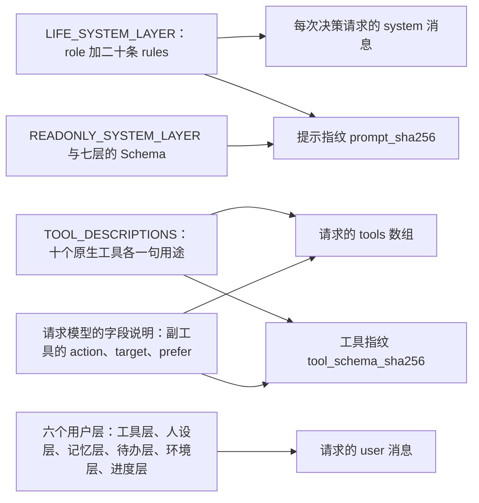

# 人物读到的规则

> 本章属于[首次真实模型单日运行：修复与新增规格](../SPEC-first-real-day-run.md)，读法和叫法见那一页。

## 目标与依据

9 月 28 日 08:46 人物在办公室，想照习惯「用瑞幸咖啡点一杯冰美式」。它读到的规则里只有一句「interact 是用内容 app」，没有哪里说打开 app 不等于下单，于是提交了「打开瑞幸咖啡」：手机时间线上是 3 分钟的瑞幸咖啡前台，没有订单，没有咖啡。11:50 它想不清办公室的「吃午饭」和 12:43 才到的外卖是什么关系，19:40 做完晚饭还在找「吃饭这个动作」。这几处人物都没有做错，是提示里没有讲。
改后人物每次决策读到的规则写明：买东西只有购买，想用哪个 app 写进 `prefer`；打开 app 只是看；不知道买什么先查询；在地点做完一件写着「供一餐」的事就算吃了一餐；结束和暂停各是什么意思。手机时间线上与之对应的，是瑞幸咖啡下单的那几分钟和订单通知、查询那几分钟所在的 app。

今天这些规则是 `LIFE_SYSTEM_LAYER["rules"]` 里的十七条固定文字（`src/worldmock/agents/life_prompt.py:24-61`），整次运行逐字节不变；其中讲副工具的一条写的是「填 action、target 两项」（`:35-36`），没有一条讲打开 app 与下单的区别，也没有一条讲怎样算吃了饭。每个工具一句的用途说明在同文件的 `TOOL_DESCRIPTIONS`（`:77-90`，十二个键），副工具两个参数的说明写在请求模型的字段上（`src/worldmock/life/models.py:869-871`）。十七条由 `tests/unit/start_interfaces/test_system_layer_text.py:11-66` 钉住，其中十三条整条相等，四条只钉开头。

本章落实提案「裁决结果」查询一表的末行：「人物读到的规则：系统层写明打开 app 只是看、买东西只有购买、不知道买什么先查询。草稿见正文，定稿写进规格」。连带落实提案正文里另外几句要求系统层改字的话：购买一节「这句话要加一个例外，说明 `prefer` 只是意向」「工具层列出可以写进 `prefer` 的 app 名称，系统层写明照列出的名称写」；查询代价表「回忆和回看任务仍然当场完成；查商品要花时间。这两句要改写」；思考额度一节「系统层还要写明地点里的吃饭和外卖各自什么时候算吃了饭」；「改动的牵连」里「讲 `start_side_activity` 的那一句今天写的是『填 action、target 两项』，要改成三项」。「在地点做的事结束就算做完」这项裁决需要人物读到的一句话，也收在这里。「打开一次内容 app 只看一条短内容就结束」一项，按所有者 2026-10-12 的答复只在运行查看器里处理（见[「查看器里的连续使用」](./06-continuous-use.md)一章），系统层不为它加字。

本章不定任何行为：每一句话背后的规则归各自的行为章。本章是这些文字的唯一归宿，系统层二十条的全文、工具用途句、副工具三个参数的说明只在这里给出原文，别的章引用时以本章为准。

## 行为规格

### 几个叫法

| 叫法 | 含义 |
| --- | --- |
| 系统层 | 每次决策请求的 system 消息，是一个 JSON 对象，三个键 `layer`、`role`、`rules`。`rules` 是字符串数组，下文说的「一条」就是其中一个字符串，「下标」从 0 起 |
| 用途句 | 原生工具定义里的 `description`，每个工具一句，存在 `TOOL_DESCRIPTIONS` |
| 字段说明 | 工具参数 Schema 里每个参数的 `description`，写在请求模型的字段上 |
| 提示指纹、工具指纹 | 运行清单里的 `prompt_sha256` 与 `tool_schema_sha256`。新建、恢复和重放都拿它们与当前代码比对，不同即拒绝 |
| 放行词表 | 钉住字段说明的那条测试里，允许出现在说明中的拉丁字母单词的集合（`tests/unit/agent_protocol/test_tool_description_references.py:45-46` 的 `_FIELD_WORDS`） |
| 宿主 | 人物一侧替模型把关的程序（`LifeAgent`）：模型的回复先经它核对，不合格的当场让模型重写，合格的才登记成世界请求。与[「打开 app 与 app 目录字段」](./04-app-opening.md)一章的叫法相同 |

下文凡是指某一条规则，都用它讲的事来称呼（「讲副工具的一条」「讲查询的一条」）；名称与下标的对应见「新旧下标对照」。

### 这些文字在请求里的位置



- 世界怎样运转的规则只在系统层写一次。用途句和字段说明只写用途，不复述规则，也不指路任何观察字段。
- 系统层整次运行逐字节不变，不随时刻、地点或环境包变化；随环境和时刻变的东西都在六个用户层里。
- 本章没有随机抽取，不新增拒绝，不新增事件。

### 系统层定稿：二十条

改后 `LIFE_SYSTEM_LAYER["rules"]` 恰好二十条，次序如下；`layer`（「系统层」）与 `role`（「你是模拟世界中的一个人物，依据人设层选择下一步行动；世界的时间、状态与结算由环境负责。」）不变。
每个代码块是一条规则的完整字符串：一行到底，块内没有换行，首尾没有空格。源码里按每行 120 个字符折成相邻的字符串字面量，拼起来必须与块内逐字相同；在哪里折行不属于合同。标「不变」的九条与今天逐字相同。

**下标 0，讲各层写什么的一条（不变）**

```text
工具层写此刻的对象、动作、条件与代价；人设层写你的作息与习惯；记忆层写此前经历；待办层写暂停活动、个人事务和今日计划；环境层写身体感觉、位置、天气和工作安排；进度层写这段停留或路程中已经发生的事。
```

**下标 1，讲天气的一条（不变）**

```text
天气只以环境层给出的事实为准，不用记忆、常识或外部服务猜测天气。
```

**下标 2，讲每次决策怎样结束的一条（改）**

```text
每次决策以世界请求结束：要么提交一个控制请求（report_status、pause_activity、conclude_activity、revise_day_plan 之一），要么开始活动。开始活动时 start_main_activity 与 start_side_activity 各至多调用一次；要同时开始两项，就在同一次回复里各调用一次，两项一起核验，任何一项不成立两项都不开始。提交前可以查询记忆或回看任务，只读查询可以同批；世界请求不与只读查询同批，开始活动也不与控制请求同批，提交即结束本次决策。
```

**下标 3，讲主工具的一条（不变）**

```text
start_main_activity 开始占槽位 1 的活动，填 action、target、detail 三项：travel 是出行，target 写目的地地点名，detail 写出行方式名称，照工具层该目的地下列出的名称写；interact 是在当前地点做一件事，target 写当前地点名，detail 写这件事的名称，照工具层当前地点下列出的名称写；sleep 是睡觉，target 写要睡的分钟数（只写数字），detail 写 null。
```

**下标 4，讲副工具的一条（改）**

```text
start_side_activity 开始占槽位 2 的活动，填 action、target、prefer 三项，target 始终是名称数组：purchase 是购买，逐份写商品名，同一个名称写两次就是两份，全部商品共用一个购买过程，prefer 写想用来下单的 app；interact 是用内容 app，数组里只写一个内容 app 名称，prefer 写 null；query 是查询商品，数组里写商品名或商品类别名，prefer 写想在哪个 app 里查。prefer 照工具层 prefer_apps 列出的名称写，没有想法写 null。
```

**下标 5，讲名称的一条（改）**

```text
名称要写完整。地点、商品和内容 app 可以直接按名称调用，即使此刻没有展示；在地点做的事只能写当前地点下列出的名称。写得不准会返回候选，不会替你更改。prefer 例外：它只是意向，写得不准或那个 app 接不了这一单时环境另选一个，不退回也不给候选。
```

**下标 6，讲点名与内容 app 的一条（改）**

```text
在地点做哪件事由你点名：系列只写系列名称，从第一集做起，做完一集自动接下一集。用内容 app 时看到什么由环境选择，app 里的内容标题不是可写的名称。功能 app 不由你选择。
```

**下标 7，讲打开 app 与购买的一条（新增）**

```text
用内容 app 只是看这个 app 里的内容，不显示商品，也不会下单；看到的内容像菜单或商品介绍，也不等于买了。只列在 prefer_apps 里的 app 用来下单和查询，不能用 interact 打开。买东西只有 purchase：你所在的地点就卖这件商品时直接到店买，否则经 app 下单；一次买几件时每件各自判断，可能分成几张订单。实际是到店买的还是用了哪个 app，写在购买结果的 channel 里。
```

**下标 8，讲查询的一条（新增）**

```text
不知道买什么、在哪买，用 query。查询要 5 到 10 分钟，不能暂停；答案在查询做完时才写进这次请求的结果，写明是在哪个 app 里查的，中途结束就没有答案。查询做完自己结束，不用收尾，可以接着下单。查询不下单，要买再用 purchase 写答案里的商品名。人在路上不能查询，也不能和出行在同一次回复里开始。
```

**下标 9，讲槽位的一条（改）**

```text
同时最多两项活动，槽位 1 和槽位 2 各放一项：出行、睡眠和在地点做事占槽位 1，购买、查询和用内容 app 占槽位 2。在地点做事可以同时购买、查询或用内容 app；睡眠要求槽位 2 空着。进行中和刚结束待收尾的活动都占槽位，暂停让出槽位。
```

**下标 10，讲睡眠的一条（不变）**

```text
sleep 写的分钟数在 10 到 720 之间；就在当前地点睡，地点须能睡。睡着后到你写的时长才会再请你决策，提醒、推送和送达都不会叫醒你；过去一天睡得太少时，可能再多睡二十分钟到一小时。工具层 sleep 一行的 note 写现在睡大约多久能补满欠的觉，只供参考，睡多久由你自己写。
```

**下标 11，讲出发的一条（改）**

```text
出发前先暂停或结束必须在原地的活动，没做完的查询也要先结束；app 互动和快递购买可以随出行继续。地点活动到达别处前不能继续。
```

**下标 12，讲控制工具的一条（改）**

```text
活动自然结束后先用 conclude_activity 收尾，查询除外；report_status 写进展；pause_activity 暂停在地点做的事或内容 app 的使用；conclude_activity 结束活动并写总结、想记住的新情况与看法。在地点做的事用 conclude_activity 结束就算做完，下次点名从头做起，只是先放下、回头接着做用 pause_activity；内容 app 里没看完的内容，结束后仍留着进度。恢复暂停的活动不用开始工具：report_status 点名暂停活动时恢复它，它回到原来的槽位；恢复须回到实际开始地点且该槽位空着，读取最新共享进度；暂停活动在别处也可以结束。
```

**下标 13，讲结算与自述的一条（不变）**

```text
世界请求登记后由环境结算。进度层结果和记忆层 settled 是核验事实；自己写的 summary、self_note、self_notes 与看法只是自己的想法，不能改变身体、资金、内容进度或订单结果。
```

**下标 14，讲收货的一条（不变）**

```text
商品实际收到时自动吃掉或用掉，不保存库存。到店商品在购买完成付款时收到，外卖等实际送达，快递先到驿站；本人到站后在驿站开始一件事（start_main_activity 的 interact）时领取本站全部到站包裹。购买过程结束时统一付款，付不起时整次取消。
```

**下标 15，讲解饿的一条（新增）**

```text
解饿只有两种办法：一是收到买来的食品或零食，收到的那一刻吃掉；二是在地点做完一件工具层 note 写着「供一餐」的事，做完的那一刻算吃了一餐，系列的 note 写的是第几集供一餐，做完那一集时算。中途用 conclude_activity 结束的不算，暂停后恢复做完的照算。note 没写供一餐的事不解饿，名称像吃饭也一样。
```

**下标 16，讲作息与计划的一条（不变）**

```text
作息与习惯照人设层过，当天特别安排照今日计划；没有相应习惯时按身体感觉安排。大致钟点只是大概，不会自动提醒。工作安排由环境给出，今日计划不能改变班次。
```

**下标 17，讲不可用动作的一条（改）**

```text
工具层 available 为 false 的动作仍可提交，会按 reason 拒绝；先照原因处理。查询记忆和回看任务当场完成，不推进时间。
```

**下标 18，讲个人事务的一条（不变）**

```text
个人事务在三个活动控制工具的 errands 中维护，提醒到点只提醒一次且不会叫醒睡眠。办成由真实结算确认，自己说办完不算。
```

**下标 19，讲正文与思考的一条（不变）**

```text
正文可以留空；写了只作为本次调用的自述留到这段停留或路程结束。思考只在同一时刻连续决策之间保留，时间推进后丢弃。
```

二十条互不相同（系统层的 Schema 要求如此），合计约 2,800 个字符，今天十七条合计约 1,900 个。

这二十条还要守住四条今天就被测试钉着的性质，定稿已逐条核对过：

| 性质 | 定稿里的情形 |
| --- | --- |
| 含 `reason` 这个词的只有讲不可用动作的一条 | 新增与改写的各条都不出现这个词。讲打开 app 与购买的一条写的是「写在购买结果的 channel 里」，讲解饿的一条写的是 note |
| 下面八句各只出现在一条里：「世界请求登记后由环境结算」「available 为 false」「同时最多两项活动」「睡着后到你写的时长才会再请你决策」「商品实际收到时自动吃掉或用掉」「不保存库存」「只是自己的想法，不能改变身体、资金、内容进度或订单结果」「工作安排由环境给出」 | 新增与改写的各条都没有重复这八句。讲解饿的一条写的是「收到的那一刻吃掉」，没有重复讲收货那一条的原句 |
| 任何一句工具用途句都不是某一条规则的子串 | 成立 |
| 两张禁词表里的词都不出现：`tests/unit/start_interfaces/test_system_layer_text.py:72-74` 的十个旧说法（旧工具名、四个旧出行动作、「名额」等），`tests/integration/runtime/test_life_agent_protocol.py:433`、`:436-438` 的「名额」「睡够了」「怎样过一天」「评审」「评分」「引擎期望」`budget` 等 | 定稿里都没有 |

### 新旧下标对照

| 今天的下标 | 改后的下标 | 条目 | 状态 | 改了什么 | 规则出自哪一章 |
| --- | --- | --- | --- | --- | --- |
| 0 | 0 | 讲各层写什么 | 不变 | | |
| 1 | 1 | 讲天气 | 不变 | | |
| 2 | 2 | 讲每次决策怎样结束 | 改 | 「提交前可以查询记忆、回看任务或查询世界，」改成「提交前可以查询记忆或回看任务，」 | 「删除 query_world 与第五种活动」 |
| 3 | 3 | 讲主工具 | 不变 | | |
| 4 | 4 | 讲副工具 | 改 | 「两项」改成「三项」并加上 `prefer`；购买一段加「prefer 写想用来下单的 app」；用内容 app 一段加「prefer 写 null」；新增查询一段；末尾新增「prefer 照工具层 prefer_apps 列出的名称写，没有想法写 null。」 | 「购买时写想用的 app」「查询」 |
| 5 | 5 | 讲名称 | 改 | 末尾新增「prefer 例外」一句 | 「购买时写想用的 app」，查询的 `prefer` 同一规则 |
| 6 | 6 | 讲点名与内容 app | 改 | 「做到第几集由环境接着排」改成「从第一集做起」，其余逐字不动 | 「做完之后读到什么，提前结束算不算做完」 |
| 没有 | 7 | 讲打开 app 与购买 | 新增 | 打开 app 只是看；只列在 `prefer_apps` 里的 app 不能打开；买东西只有购买；到店还是经 app；每件各自判断；实际渠道写在 `channel` | 「打开 app 与 app 目录字段」「购买时写想用的 app」 |
| 没有 | 8 | 讲查询 | 新增 | 整条 | 「查询」 |
| 7 | 9 | 讲槽位 | 改 | 占槽位 2 的活动加上查询；可以与在地点做事同时进行的活动加上查询 | 「查询」「删除 query_world 与第五种活动」 |
| 8 | 10 | 讲睡眠 | 不变 | | |
| 9 | 11 | 讲出发 | 改 | 新增「，没做完的查询也要先结束」 | 「查询」 |
| 10 | 12 | 讲控制工具 | 改 | 「收尾」后新增「，查询除外」；新增「在地点做的事用 conclude_activity 结束就算做完……结束后仍留着进度。」一句 | 「查询」「做完之后读到什么，提前结束算不算做完」 |
| 11 | 13 | 讲结算与自述 | 不变 | | |
| 12 | 14 | 讲收货 | 不变 | | |
| 没有 | 15 | 讲解饿 | 新增 | 整条 | 「在地点吃的一餐」 |
| 13 | 16 | 讲作息与计划 | 不变 | | |
| 14 | 17 | 讲不可用动作 | 改 | 「查询只读，不推进时间。」改成「查询记忆和回看任务当场完成，不推进时间。」 | 「删除 query_world 与第五种活动」 |
| 15 | 18 | 讲个人事务 | 不变 | | |
| 16 | 19 | 讲正文与思考 | 不变 | | |

三条新增的位置：讲打开 app 与购买、讲查询的两条紧跟在讲点名与内容 app 的一条之后；讲解饿的一条紧跟在讲收货的一条之后。

提案草稿的每一句落在定稿的哪一条：

| 提案草稿里的话 | 定稿里在哪 |
| --- | --- |
| 「用内容 app（interact）只是看这个 app 里的内容，不显示商品，也不会下单；看到的内容像菜单或商品介绍，也不等于买了。」 | 讲打开 app 与购买的一条，去掉了括号里的 interact |
| 「买东西只有 purchase：逐份写商品名。」 | 「买东西只有 purchase」在讲打开 app 与购买的一条；「逐份写商品名」本来就在讲副工具的一条 |
| 「在 prefer 里写想用来下单的 app，照工具层列出的名称写，没有想法就写 null。」 | 讲副工具的一条，并点出工具层里的键名 `prefer_apps` |
| 「你所在的地点就卖这件商品时直接到店买」 | 讲打开 app 与购买的一条 |
| 「那个 app 接不了这一单时环境另选一个，不会退回。」 | 讲名称的一条末尾的「prefer 例外」 |
| 「实际是到店买的还是用了哪个 app，写在购买结果里。」 | 讲打开 app 与购买的一条，并点出键名 `channel` |
| 「不知道买什么、在哪买，用 query：target 写商品名或类别名，prefer 写想在哪个 app 里查，没有就写 null。」 | 前半在讲查询的一条，参数怎样写在讲副工具的一条 |
| 「查询要 5 到 10 分钟，占槽位 2，不能暂停」 | 时长与不能暂停在讲查询的一条；占槽位 2 写在讲副工具和讲槽位的两条，不重复 |
| 「答案在查询做完时才写进这次请求的结果，中途结束就没有答案。查询不下单，要买再用 purchase 写答案里的商品名。」 | 讲查询的一条，另加「写明是在哪个 app 里查的」 |

草稿之外、由别的裁决带进来的话：查询做完自己结束不用收尾、人在路上不能查询（讲查询的一条）；出发前先结束查询（讲出发的一条）；只列在 `prefer_apps` 里的 app 不能打开、一次买几件每件各自判断（讲打开 app 与购买的一条）；结束就算做完（讲控制工具的一条）和随它改的「从第一集做起」（讲点名与内容 app 的一条）；解饿的两种办法（讲解饿的一条）。

### 只读问答的系统层

`READONLY_SYSTEM_LAYER`（`src/worldmock/agents/life_prompt.py:65-74`）不变。`role` 是「你是模拟世界中的一个人物，依据人设层与记忆层回答外部问题。」，四条规则依次是：

```text
请求由人设层、记忆层与外部问题组成。
记忆层的 settled 是环境核验的事实，self_notes 与人设层的看法、偏好是你自己写下的，未经核验。
只能查询自己的记忆，不能改变世界，也不写入记忆。
回答完成后单独调用 finish。
```

只读问答的工具仍是三个记忆查询加 `finish`。

### 工具用途句

改后 `TOOL_DESCRIPTIONS` 恰十一个键：十个原生工具加只读问答的 `finish`。原生工具为什么是十个，见[「删除 query_world 与第五种活动」](./03-fifth-activity-kind.md)一章。

| 键 | 改后的用途句 | 相对今天 |
| --- | --- | --- |
| `start_main_activity` | 开始一项占槽位 1 的活动：出行、在当前地点做一件事，或睡觉。 | 不变 |
| `start_side_activity` | 开始一项占槽位 2 的活动：购买商品、查询商品，或使用一个内容 app。 | 改。今天是「开始一项占槽位 2 的活动：购买商品，或使用一个内容 app。」 |
| `query_world` | 没有这个键 | 删除。今天是「按对象名称、具体动作或商品品类查询世界，可只看此刻能做的，按返回的偏移量翻页。」 |
| `recall_task_summary` | 按名称回看一项任务、目标或活动的进展，不改变世界。 | 不变 |
| `report_status` | 按活动名写下一两项活动的进展或恢复暂停活动，并写下个人事务的变更。 | 不变 |
| `pause_activity` | 按活动名暂停一两项进行中的活动并写下进展与个人事务的变更。 | 不变 |
| `conclude_activity` | 按活动名结束一两项活动，写下总结、想记住的事、形成的看法与个人事务的变更。 | 不变 |
| `revise_day_plan` | 用完整的新清单替换今日计划中的目标。 | 不变 |
| `memory_recent` | 读取自己最近的记忆。 | 不变 |
| `memory_search` | 按关键词检索自己的记忆。 | 不变 |
| `memory_time_range` | 读取某一时间段内自己的记忆。 | 不变 |
| `finish` | 给出外部问题的回答。 | 不变 |

用途句的写法约束不变：每个工具恰一句、以句号结尾；只写用途；拉丁字母单词只有副工具那一句里的 `app`。

### 副工具三个参数的字段说明

主工具三个参数的说明不变（`src/worldmock/life/models.py:839-845`）。副工具的三条分两步落下：购买轨道加 `prefer` 字段时，`query` 还不是合法动作，说明里不能出现这个词，所以先落一句过渡文字，就是[「购买时写想用的 app」](./01-purchase-prefer.md)一章定下的那一句，同一步给放行词表加 `null`；查询轨道在给 `SIDE_ACTIVITY_ACTIONS` 加 `query` 的同一个提交里把三条一起换成定稿。

| 参数 | 今天 | 购买轨道落下时 | 定稿（查询轨道落下） |
| --- | --- | --- | --- |
| `action` | 做什么：purchase 购买商品，interact 使用内容 app。 | 不动 | 做什么：purchase 购买商品，interact 使用内容 app，query 查询商品。 |
| `target` | 名称数组。purchase 逐份写商品的完整名称，同一个名称写两次就是两份；interact 只写一个内容 app 的完整名称。 | 不动 | 名称数组。purchase 逐份写商品的完整名称，同一个名称写两次就是两份；interact 只写一个内容 app 的完整名称；query 写商品的完整名称或商品类别的名称。 |
| `prefer` | 没有这个参数 | purchase 写想用来下单的内容 app 的完整名称，没有想法写 null；interact 写 null。 | purchase 写想用来下单的内容 app 的完整名称，query 写想在其中查询的内容 app 的完整名称，没有想法写 null；interact 写 null。 |

请求模型 `StartSideActivityRequest` 的类说明同步改成「开始一项占槽位 2 的活动：购买商品、查询商品，或使用一个内容 app。」。它不进参数 Schema（参数对象本身不带说明），模型读不到，只是给读代码的人看的。

这几句要过的门，和定稿怎样满足：

| 门（`tests/unit/agent_protocol/test_tool_description_references.py`） | 要求 | 定稿 |
| --- | --- | --- |
| 句数（`:48`、`:128`） | 每条说明以句号结尾、恰一句；只有副工具的 `target` 是两句 | `action` 一句，`target` 两句（「名称数组。」加后面一句），`prefer` 一句 |
| 放行词表（`:45-46`、`:126-127`） | 说明里三个字母以上的拉丁字母单词，按 `[A-Za-z]{3,}` 切开后都在这个工具的放行词表里 | 三条里出现的词只有 `purchase`、`interact`、`query`、`app`、`null` |
| 放行的词都要用到（`:130-133`） | 这个工具全部字段说明里实际出现的词的集合，恰好等于放行词表 | 五个词都出现：`purchase`、`interact`、`query` 三条里都有，`app` 三条里都有，`null` 在 `prefer` 一条 |
| 只写用途（`:31-36`、`:56-62`） | 不出现「不能」「只能」「拒绝」「必填」「至多」「登记」`available`、`reason` 这些规则与协议的说法，不出现「名称.字段」形状的指路，不出现任何不得进入提示的键名 | 三条都没有 |

说明里不写工具层的键名 `prefer_apps`：它会被切成 `prefer`、`apps` 两个词，两个都不在放行词表里。「照工具层 prefer_apps 列出的名称写」这句话只在系统层讲副工具的一条里。

放行词表在各步之后的样子：

| 集合 | 今天 | 购买轨道并入后 | 查询轨道并入后 |
| --- | --- | --- | --- |
| 副工具用途句 | `app` | `app` | `app` |
| 主工具字段说明 | `travel`、`interact`、`sleep`、`null` | 不变 | 不变 |
| 副工具字段说明 | `purchase`、`interact`、`app` | `purchase`、`interact`、`app`、`null` | `purchase`、`interact`、`query`、`app`、`null` |

- `null` 是购买轨道在测试里加的字面量。
- `query` 不用手加：放行词表读常量 `SIDE_ACTIVITY_ACTIONS`，查询轨道给这个元组加上 `query` 的那一刻它就进了放行词表，同一刻「放行的词都要用到」就要求说明里真的出现这个词。所以元组的改动和三条定稿必须在同一个提交里。

改后模型读到的副工具定义，完整如下（`title` 由请求模型自动生成，不是说明）：

```json
{
  "type": "function",
  "function": {
    "name": "start_side_activity",
    "description": "开始一项占槽位 2 的活动：购买商品、查询商品，或使用一个内容 app。",
    "parameters": {
      "additionalProperties": false,
      "properties": {
        "action": {
          "description": "做什么：purchase 购买商品，interact 使用内容 app，query 查询商品。",
          "enum": ["purchase", "interact", "query"],
          "title": "Action",
          "type": "string"
        },
        "target": {
          "description": "名称数组。purchase 逐份写商品的完整名称，同一个名称写两次就是两份；interact 只写一个内容 app 的完整名称；query 写商品的完整名称或商品类别的名称。",
          "items": {"pattern": "\\S", "type": "string"},
          "title": "Target",
          "type": "array"
        },
        "prefer": {
          "anyOf": [{"pattern": "\\S", "type": "string"}, {"type": "null"}],
          "description": "purchase 写想用来下单的内容 app 的完整名称，query 写想在其中查询的内容 app 的完整名称，没有想法写 null；interact 写 null。",
          "title": "Prefer"
        }
      },
      "required": ["action", "target", "prefer"],
      "title": "StartSideActivityRequest",
      "type": "object"
    },
    "strict": true
  }
}
```

### 各提示层读到的东西变了什么

这张表只指路，不立新规则；每一项的形状、取值和原文都在所指的那一章。

| 层 | 人物读到的变化 | 归哪一章 |
| --- | --- | --- |
| 系统层 | 十七条变二十条 | 本章 |
| 工具层 | 新增 `callable_index.prefer_apps`：可以写进 `prefer` 的 app 全名 | 「购买时写想用的 app」 |
| 工具层 | 删去 `callable_index.query_categories`；四个类别名从 `callable_index.goods` 每行的 `category` 读 | 「删除 query_world 与第五种活动」「查询」 |
| 工具层 | app 目标行只列登记了内容的 app；只用于下单和查询的 app（样例环境里的饿了么、美团）不再有行 | 「打开 app 与 app 目录字段」 |
| 工具层 | 当前地点下每件事的 `note` 多一种说法：「供一餐」，系列写「第 K 集供一餐」 | 「在地点吃的一餐」 |
| 工具层 | 在地点做的事被结束之后，这一行回到全长，可以点名的行上不再出现「上次没做完，接着做」 | 「做完之后读到什么，提前结束算不算做完」 |
| 工具层 | 进行中的查询是一个活动目标，名称是「查询<所查的名称>（M月D日 HH:MM 起）」，它的 `pause_activity` 一行不可用 | 「查询」 |
| 工具层 | 商品行不变，运费与预计到达仍按没有意向的路线写 | 「购买时写想用的 app」 |
| 人设层 | 不变 | |
| 记忆层 | 在地点做的事提前结束，结束句不再写「（《某某》未完）」；用内容 app 照写 | 「做完之后读到什么，提前结束算不算做完」 |
| 记忆层 | 查询有一句结束句，不带答案；购买句不变，不写下单渠道 | 「查询」「购买时写想用的 app」 |
| 待办层 | 不变 | |
| 环境层 | 键和取值不变；在地点吃过一餐后，饥饿分级按进账后的能量算 | 「在地点吃的一餐」 |
| 进度层 | 副工具请求的 `arguments` 多出 `prefer`，是人物所写的原文 | 「购买时写想用的 app」 |
| 进度层 | 结果明细的键：购买行新增 `channel`；新增 `contents`、`query`；`content` 补进 Schema；`goods`、`app`、`duration` 删除 | 全部键见「做完之后读到什么，提前结束算不算做完」；`channel` 见「购买时写想用的 app」，`query` 见「查询」，删掉的三个见「打开 app 与 app 目录字段」 |
| 进度层 | 用内容 app 或在地点做事的记录，跟着人物进入它仍在进行或在其中结束的每一段 | 「做完之后读到什么，提前结束算不算做完」 |
| 零点计划的输入（不在七层之内） | 「已核验经历」句改成统一写法；计划的固定提示 `PLAN_DAY_PROMPT` 不变 | 「统一显示写法」 |
| 拒绝与纠错的原文（宿主当场纠错的回执；进度层里被拒结果的原因和当天被拒的备忘） | 新增或改写的英文原文：`prefer` 的形状、写错的查询名称、路上与同批的查询、把只用于下单和查询的 app 写进 `target`、调用已删除的 `query_world` | 「购买时写想用的 app」「查询」两章的「拒绝一览」；[「打开 app 与 app 目录字段」](./04-app-opening.md)一章的「本章涉及的拒绝与运行故障」；[「删除 query_world 与第五种活动」](./03-fifth-activity-kind.md)一章的「人物仍然调用 query_world 时」 |

### 算例：那一天的几个时刻，人物靠哪一条

| 时刻 | 人物想做的事 | 今天读到的 | 改后读到的 | 改后的请求与手机时间线 |
| --- | --- | --- | --- | --- |
| 08:46:00，办公室 | 照习惯用瑞幸咖啡点冰美式 | 讲副工具的一条只有「interact 是用内容 app」；工具层有「瑞幸咖啡」的 app 行 | 讲副工具的一条：购买时 `prefer` 写想用来下单的 app，照 `prefer_apps` 写；讲打开 app 与购买的一条：只列在 `prefer_apps` 里的 app 不能打开，买东西只有购买。工具层里「瑞幸咖啡」只在 `prefer_apps` | `{"action": "purchase", "target": ["冰美式咖啡"], "prefer": "瑞幸咖啡"}`。设购买时长抽到 180 秒、付款抽到支付宝 15 秒：瑞幸咖啡 08:46:00–08:48:45 在前台，支付宝 08:48:45–08:49:00，08:49:00 扣 27 元，购买结果的 `channel` 是「瑞幸咖啡」 |
| 11:40:00，办公室 | 不知道午饭吃什么，想在美团外卖上看看 | 「提交前可以查询记忆、回看任务或查询世界」，当场问，不花时间，问不到从哪家店来、经哪个 app | 讲查询的一条：用 `query`，5 到 10 分钟，答案做完才有，做完不用收尾可以接着下单 | `{"action": "query", "target": ["食品"], "prefer": "美团外卖"}`，时长抽到 480 秒。美团外卖 11:40:00–11:48:00 在前台；11:48:00 读到答案，同一次决策里购买选中的那件，`prefer` 写「美团外卖」 |
| 11:50，办公室 | 想知道办公室的「吃午饭」和 12:43 才到的外卖是什么关系 | 没有任何一条讲这件事，这次决策用了 6,861 个思考 token | 讲解饿的一条：工具层这件事的 `note` 写着「供一餐」，做完就算吃了；没写就不解饿，午饭靠外卖，送到的那一刻吃掉 | 由数据集怎样写「吃午饭」的 `provides_meal` 决定，见[「在地点吃的一餐」](./07-meals.md)一章 |
| 18:01–18:30，家 | 歇了 29 分钟想停一下 | 「conclude_activity 结束活动」，没有讲结束之后进度怎样 | 讲控制工具的一条：结束就算做完，下次点名从头做起；只是先放下、回头接着做，用 `pause_activity` | 想回头接着歇就暂停；用 `conclude_activity` 结束，19:50 再点名是从头的 30 分钟，不再是剩下的 60 秒 |
| 18:30，家 | 做晚饭 | 「做到第几集由环境接着排」；没有一条讲在地点做的事解不解饿 | 讲点名与内容 app 的一条：从第一集做起，做完一集自动接下一集。数据集把《吃晚饭》写成供一餐时，工具层「做晚饭」一行的 `note` 是「第 1 集，共 3 集；第 2 集供一餐」，配上讲解饿的一条 | 19:25:00《吃晚饭》做完的那一秒算吃了一餐；19:40 第二条结果列出三集，人物读得出自己吃过了 |
| 20:19:33，家 | 看完一条哔哩哔哩，想接着看 | 讲点名与内容 app 的一条「用内容 app 时看到什么由环境选择」；讲控制工具的一条「活动自然结束后先用 conclude_activity 收尾」 | 这两句不变，系统层不为接着看加字：放完一条就收尾，想接着看就再打开一次，和今天一样 | 设仍是那一晚的时刻：20:19:33、20:22:03、20:42:03 三次 `{"action": "interact", "target": ["哔哩哔哩"], "prefer": null}`，后两次都在上一次放完的那一秒。手机时间线上是三次首尾相接的哔哩哔哩前台；查看器把它们连成 20:19:33–20:43:33 的一个条块，见[「查看器里的连续使用」](./06-continuous-use.md)一章 |

样例环境里的同一件事（2026 年 1 月 5 日 08:00:00，人在家）：工具层的 `prefer_apps` 是 `["哔哩哔哩", "饿了么", "美团"]`，app 目标行是哔哩哔哩、抖音、Keep 三行。人物照讲副工具的一条写 `{"action": "purchase", "target": ["柠檬茶"], "prefer": "饿了么"}`，订单从三杯咖啡经饿了么下出，预计 08:25:46 送达，购买结果里是 `"channel": "饿了么"`。它若照今天的习惯写 `{"action": "interact", "target": ["美团"], "prefer": null}`，被宿主当场退回，原文见[「打开 app 与 app 目录字段」](./04-app-opening.md)一章。

### 两个指纹怎样跟着变

| 改了什么 | 提示指纹 | 工具指纹 |
| --- | --- | --- |
| 系统层任何一条的任何一个字 | 变 | 不变 |
| 只读问答的系统层（本次不改） | 会变 | 不变 |
| 七层的 Schema（别的章改工具层与进度层的 Schema） | 变 | 不变 |
| 任何一个原生工具的用途句 | 不变 | 变 |
| 副工具的字段说明、参数个数、`action` 的枚举 | 不变 | 变 |
| 原生工具从十一个变十个 | 不变 | 变 |
| `finish` 的用途句（本次不改） | 不变 | 不变 |

- 两个指纹的算法不变：提示指纹是两份系统层加七层 Schema 的规范 JSON 的摘要（`src/worldmock/agents/life_prompt.py:136-141`）；工具指纹是按固定次序排好的原生工具定义的摘要（`custom/agents/life_agent.py:933-939`）。
- 测试里没有任何指纹的字面值，不用手改。两份完整日基线的摘要包含每次模型请求的素材，系统层和工具定义一变基线就变，在收尾步重冻。
- 改动之前的运行不能恢复或重放，见[「版本、身份与基线」](./12-versions.md)一章。

### 这些文字在哪一步落下


| 步 | 落下的文字 | 这一步之后人物读到的 |
| --- | --- | --- |
| 购买轨道 | `prefer` 的过渡说明 | 系统层仍是今天的十七条，落在引擎后面：讲副工具的一条还写着「两项」，而工具已经要三项；同一波的结果与结束轨道并入后，引擎已经把在地点做的事的「结束」算做完，系统层还没有讲这一点。这是集成分支上的中间状态，整次改动一次并入主干，不会单独发布 |
| 查询轨道 | 系统层二十条；`TOOL_DESCRIPTIONS` 删 `query_world`、改副工具用途句；三条字段说明定稿；类说明 | 全部定稿。查询轨道在第一波四条轨道都并入之后才并入，这时带 `prefer` 的购买、查询、「结束就算做完」都已经实现。系统层讲到而引擎还没有的只剩归内容轨道的两处：「只列在 prefer_apps 里的 app 不能打开」「在地点吃的一餐」。内容轨道并入之前系统层走在引擎前面，同样是集成分支上的中间状态 |
| 内容轨道 | 不改文字 | 文字与查询轨道落下的相同；上面两处引擎都已实现，系统层与引擎一致 |
| 收尾 | 不改文字 | 录制样例和两份基线与最终文字一致 |

查询轨道内部可以分成几个提交，但下面三组各自不可拆开：

- `SIDE_ACTIVITY_ACTIONS` 加 `query`，与副工具三条字段说明的定稿。
- `TOOL_DESCRIPTIONS` 删 `query_world`，与从工具表里删掉这个工具。用途句按工具名取：留着工具而删了用途句，生成工具定义时就是 `KeyError`（`custom/agents/life_agent.py:926`）；删了工具而留着用途句，「用途句的键集等于全部参数模型的键集」这条断言失败。
- 系统层二十条，与钉住它的测试。

### 边界情形

| 情形 | 结果 |
| --- | --- |
| 环境包里没有任何下单 app | 系统层不变，照样提到 `prefer_apps`；工具层这一组是空数组 |
| 环境包里没有任何一件地点内容供一餐 | 系统层不变；工具层没有哪一行的 `note` 写「供一餐」，人物照讲解饿的一条得出吃饭靠买来的食品 |
| 模型凭旧习惯调用 `query_world` | 宿主当场纠错，见[「删除 query_world 与第五种活动」](./03-fifth-activity-kind.md)一章；系统层里已经没有这个词 |
| 只读问答 | 读的是只读那一份系统层，不读这二十条 |

### 明确不做

- 不改 `role`，不改只读问答的系统层，不改主工具的用途句和三条字段说明，不改控制工具、回看和记忆查询的用途句与字段说明。
- 不改另外三份固定提示：零点计划的 `PLAN_DAY_PROMPT`、记忆巩固和就寝反思的提示。
- 不把下面这些写进系统层：四个类别名、查询一次最多 20 件、答案各键的名称、`note` 三种说法的先后、任何一句拒绝的原文、饭点时段里吃过也至少「有点想吃」。人物从工具层、结果和拒绝里读到它们；系统层也因此不承诺吃过就「不饿」。
- 讲名称的一条里「写得不准会返回候选」是概括的说法，本次不为它加例外：商品名找不到今天就是直接拒绝、不给候选；改后近似名称对上的若是只用于下单和查询的 app，也不给候选。
- 副工具的三条字段说明里不写规则、不写上限、不指路工具层，不出现键名 `prefer_apps`。起草时提过的「prefer 的说明写『照工具层 prefer_apps 列出的写』」没有采用：过不了放行词表的门。主工具 `detail` 今天那句「照工具层该目的地下列出的写」不动。
- 放行词表不加 `prefer`、`apps` 这类键名：放行的词必须真的用到，而说明里不写键名。
- 不为接连几次用同一个 app 给系统层、用途句或字段说明加任何字。人物用内容 app 的方式与今天相同，首尾相接的几次使用只在运行查看器里连成一段（见[「查看器里的连续使用」](./06-continuous-use.md)一章）。
- 不给系统层加条目编号、小标题或分组；不合并也不拆分上文以外的条目。
- 不往现有用例的「旧说法不再出现」那张表里加新词，也不新增扫描字样的守卫测试：二十条已经整条钉住，旧话无处可留。
- 不为集成分支上的中间状态另写过渡的系统层：购买轨道并入到查询轨道并入之间，系统层就是今天的十七条。
- 设计文档不逐字抄系统层和字段说明。《人物》只转述讲了哪些事；逐字的原文只在源码和钉住它的测试里，一条规则只维护一处。

### 本章定下的细节

| 事项 | 定下的做法 | 理由 |
| --- | --- | --- |
| 逐句核对的结论 | 逐句核对之后二十条一个字没有改。九章里引用到系统层的句子（讲打开 app 的两句、讲结束就算做完的一句、讲解饿的一条、讲查询改写的两句）与定稿逐字相同，各章的规则与定稿没有相反之处 | 逐条对过「购买时写想用的 app」到「十条缺陷与思考额度」九章的行为规格 |
| 核对中留下不改的四处概括说法 | 「写得不准会返回候选」不为商品名和只用于下单和查询的 app 加例外；「环境另选一个」不为「查询时没有任何 app 卖所查商品，这几分钟手机上没有 app」加例外；「直接到店买」不为「所在的店已打烊，这次购买被拒」加例外；「进度层写这段停留或路程中已经发生的事」不为「带进这一段的记录发生在这一段开始之前」加例外 | 四处都是概括而不是相反。讲候选、讲另选、讲到店买的三句，人物分别从拒绝的原文、答案里为空的 app、`LOCATION_CLOSED` 的原因读到实情。讲进度层的一句照留：带进来的记录发生在这一段开始之前，讲的却是在这一段里仍在进行或在这一段里结束的活动（见[「做完之后读到什么，提前结束算不算做完」](./05-results-and-ending.md)一章「记录跟着人物进入后面的段」）。系统层每多一句例外，每次决策都要多读一遍 |
| 三条字段说明的定稿 | 上文表里的三句 | 原文由本章定；照今天两句的句式续写，`prefer` 的定稿是购买轨道那句过渡文字加上查询的一段 |
| `target` 说明里类别怎样称呼 | 「商品类别的名称」 | 与系统层的「商品类别名」同一个词；今天 `query_world` 用途句里的「品类」随那个工具一起退场 |
| `prefer` 的说明指不指路工具层 | 不指路 | 键名不能出现在说明里；「照 prefer_apps 列出的名称写」已在系统层 |
| 类说明 | 与副工具的用途句同文 | 今天就是这样；它不进 Schema |
| 放行词表怎样改 | `null` 作为字面量加进副工具的集合；`query` 经常量 `SIDE_ACTIVITY_ACTIONS` 自动进入 | 不留第二份动作表 |
| 二十条怎样钉 | 整表相等：二十条全部整条比较，含今天只钉开头的四条 | 本章是原文的唯一归宿；只钉开头的话，「不变」的四条被改了后半句没有测试会失败 |
| 只读问答的系统层要不要钉 | 不新增断言 | 这一层本次不改，不为本次不改的文字新增用例；真实宿主用例里「只读问答的 system 消息等于只读那一份」的现有断言照旧 |
| 「人物真的读到」怎样证 | 在现有的真实宿主用例上加断言，不另起文件 | 这条用例已经断言请求的 system 消息等于生活决策的系统层 |
| 查询轨道内部怎样分提交 | 上文三组各自不可拆，其余不限 | 三组各有一条测试或一次取值把两边绑在一起 |
| 源码里的折行 | 按 120 个字符折成相邻的字面量，折在哪里由实施者定 | 风格门只管行宽；拼接后的字符串才是合同 |

## 接口、删除面与文件指引

### 生产文件

| 文件 | 改动 | 轨道 |
| --- | --- | --- |
| `src/worldmock/agents/life_prompt.py` | `LIFE_SYSTEM_LAYER["rules"]` 换成上文二十条：改八条，在讲点名与内容 app 的一条之后插入两条，在讲收货的一条之后插入一条。`layer`、`role` 和开头两行的写法不动 | 查询轨道 |
| 同上 | `TOOL_DESCRIPTIONS`：删 `query_world` 一项（`:80`），`start_side_activity` 换成新的用途句（`:79`）。`READONLY_SYSTEM_LAYER`、`system_message`、`life_prompt_sha256` 不动 | 查询轨道 |
| `src/worldmock/life/models.py` | `StartSideActivityRequest`：新增的 `prefer` 字段带过渡说明（字段本身、类型与校验见[「购买时写想用的 app」](./01-purchase-prefer.md)一章） | 购买轨道 |
| 同上 | `StartSideActivityRequest`：类说明、`action`、`target`、`prefer` 四处换成定稿 | 查询轨道，与 `SIDE_ACTIVITY_ACTIONS` 加 `query` 同一个提交 |
| `custom/agents/life_agent.py`、`custom/envs/life_env.py` | 本章不改。工具定义由请求模型和 `TOOL_DESCRIPTIONS` 生成，自动带上新文字；工具表里删 `query_world` 见[「删除 query_world 与第五种活动」](./03-fifth-activity-kind.md)一章 | |
| `scripts/`、`tools/` | 本章不改。查看器里人读的「工具定义」说明见[「删除 query_world 与第五种活动」](./03-fifth-activity-kind.md)一章 | |

### 直接删除，不留兼容

- 系统层里的四句旧话：「填 action、target 两项」「提交前可以查询记忆、回看任务或查询世界」「查询只读，不推进时间。」「做到第几集由环境接着排」。
- `TOOL_DESCRIPTIONS["query_world"]`。
- 副工具今天的用途句和两条字段说明；购买轨道那句 `prefer` 的过渡说明在查询轨道并入时被定稿取代，不保留。
- 提示指纹或工具指纹是旧值的运行：新建之外的入口一律按指纹不符拒绝，不迁移、不提供按旧文字继续跑的开关。

### 夹具

- `tests/fixtures/viewer-context.json` 里两个请求各带一份系统层和全部工具定义，在收尾步用真实宿主重录，不手改。
- `tests/fixtures/dayrun-activity-baseline.json`、`tests/fixtures/dayrun-callback-baseline.json` 随模型请求素材的字节改变，在收尾步重冻。
- 样例环境 `tests/fixtures/dataset-environment/` 不因本章改动。

### 先改的设计文档与手册

只列文档和小节，逐行清单见[「设计文档与手册改动清单」](./11-design-docs.md)一章。设计文档只转述，不逐字抄。

- 《人物》「提示与工具」：系统层规则条目讲了哪些事的那一段，补上购买时写想用的 app、打开 app 只是看、查询、解饿的两种办法、结束与暂停的差别；原生工具十个；副工具三个参数；工具层 `callable_index` 的键。
- 《人物》「进度、待办与记忆」：「查询只读，不推进时间或产生新事实」一句改成只讲回忆与回看。
- 《模拟引擎》「动作、名称与并行」：副工具的参数表；「写得不准时返回候选而不替换」的转述加上 `prefer` 的例外。
- 《运行与框架集成》「原生模型与工具」：原生工具十个。
- 手册《理解固定世界规则》：槽位、结束与暂停、查询的叙述，各行为章已列，本章不另加。

### 归哪条实施轨道

| 工作 | 轨道 |
| --- | --- |
| `prefer` 的过渡说明；放行词表加 `null`；`test_start_request_models.py` 里三个字段和过渡说明的断言 | 购买轨道 |
| 系统层二十条、用途句、三条字段说明定稿、类说明，以及下文「钉住今天文字、要改或要删的现有测试」表里除收尾之外的全部 | 查询轨道 |
| 录制样例重录，两份完整日基线重冻 | 收尾 |
| 设计文档与手册 | 动代码之前由一步串行的文档改动一次改完 |

查询轨道之外的轨道不改系统层，也不改 `tests/unit/start_interfaces/test_system_layer_text.py`。

### 在这里咬人的约束

- 生产源码每行至多 120 个字符。二十条都比一行长，要折成相邻的字符串字面量；折行处不得多出或少掉空格，拼接结果以上文代码块为准。讲解饿的一条里的「供一餐」带中文引号，照写。
- 本章不新增函数，函数 50 行、5 个入参的上限和覆盖率门在这里不咬人；`models.py` 今天 1,343 行，离 2,000 行远。类说明照旧是含中文的 Doxygen 写法（`"""@brief …"""`）。
- 本章没有任何错误文字。
- 查看器的 Node 用例用正则从 `src/worldmock/agents/life_prompt.py` 读角色原文（`tests/system/viewer/run_viewer_context.test.cjs:112`、`run_viewer.test.cjs:348`），匹配的是 `LIFE_SYSTEM_LAYER` 开头的 `"layer": "系统层",` 与 `"role": "…"` 两行。这两行的写法和 `role` 的文字都不能动。
- 新增与改写的条目里不得出现 `reason` 这个词（`tests/unit/agent_protocol/test_decision_context_protocol.py:256-257` 要求含它的只有讲不可用动作的一条），也不得重复「同时最多两项活动」「商品实际收到时自动吃掉或用掉」「不保存库存」这几句别的条目的原话（`tests/integration/runtime/test_life_agent_protocol.py:429-434` 要求它们各只出现一次）。
- 源码变异按原文行定位。`life_prompt.py` 今天没有登记的变异，本章也不登记；`models.py` 里 `active_side_activities` 的条件那一行（`if "second" in activity.resource_claims)`）是现有变异的锚点，本章只动 `StartSideActivityRequest`，不碰它。
- 系统层和字段说明一变，提示指纹和工具指纹都变。查询轨道并入之后到收尾之前，`tests/system/lifecycle/test_run_viewer_recording.py` 与录制样例不一致，是[「版本、身份与基线」](./12-versions.md)一章规定的中间状态，中间提交的门不含这个文件。

## 测试要求

### 行为测试

本章的规则是固定文字，不是引擎规则，钉在 unit 层；「人物真的读到」经真实宿主证明。

| 规则 | 层 | 测试文件 | 验收行为 |
| --- | --- | --- | --- |
| 系统层恰二十条，原文与次序如本章 | unit | `tests/unit/start_interfaces/test_system_layer_text.py::test_system_layer_is_the_twenty_rules_verbatim_in_order`（由现有两条用例合并改写） | `LIFE_SYSTEM_LAYER["rules"]` 与测试文件里手写的二十条字面量整表相等；二十条互不相同；`layer` 与 `role` 等于今天的原文；整层通过 `validate_layer` |
| 九条不变的条目逐字不变 | unit | 同一条用例 | 手写的字面量里这九条与今天 `life_prompt.py` 里的原文相同，含今天只钉开头的四条 |
| 人物每次决策收到的就是这二十条；只读问答收到只读那一份 | integration | `tests/integration/runtime/test_seven_layer_request.py::test_current_host_request_has_one_system_layer_and_six_user_layers`（加断言）；`tests/integration/runtime/test_life_agent_protocol.py::test_how_to_live_a_day_is_one_resident_section_of_both_decision_stages` | 经真实宿主的一次决策，请求的 system 消息解析出的 `rules` 恰二十条，且等于 `LIFE_SYSTEM_LAYER["rules"]`；只读问答的 system 消息等于只读那一份 |
| 机制句各只写一次 | integration、unit | `test_life_agent_protocol.py` 的同一条用例；`tests/unit/agent_protocol/test_tool_description_references.py::test_interaction_rules_live_only_in_the_system_layer` | 「同时最多两项活动」等五句各只在一条里出现，其中讲槽位的一句在 `rules[9]`；「世界请求登记后由环境结算」「available 为 false」各只在一条里；任何用途句都不是某一条规则的子串 |
| 含 `reason` 的只有讲不可用动作的一条 | unit | `tests/unit/agent_protocol/test_decision_context_protocol.py::test_start_tool_descriptions_say_purpose_only_and_conditions_stay_in_the_tool_layer` | 真实请求的系统层里含 `reason` 的规则恰一条，原文是改后的那一句；副工具用途句含「槽位 2」「购买商品」「查询商品」「内容 app」 |
| 用途句恰十一个键 | unit | `tests/unit/start_interfaces/test_system_layer_text.py::test_retired_wording_is_gone_from_the_system_layer_and_tool_descriptions`；`test_tool_description_references.py::test_every_native_tool_has_a_purpose_only_description` | `TOOL_DESCRIPTIONS` 的键集恰为本章表里的十一个，并等于全部原生工具参数模型的键集；每句恰一句、以句号结尾；拉丁字母单词只有副工具那一句里的 `app` |
| 两个开始工具的用途句逐字 | unit | `tests/unit/agent_protocol/test_start_request_models.py::test_both_models_generate_closed_strict_schemas_with_verbatim_descriptions` | 主工具的用途句与今天相同；副工具的是「开始一项占槽位 2 的活动：购买商品、查询商品，或使用一个内容 app。」 |
| 副工具三条字段说明逐字 | unit | 同一条用例 | `action`、`target`、`prefer` 三条 `description` 等于本章的定稿；主工具三条与今天相同 |
| 字段说明的句数与放行词表 | unit | `test_tool_description_references.py::test_parameter_descriptions_are_purpose_only` | 全部说明通过只写用途的扫描；`target` 两句，其余一句；副工具说明里实际出现的拉丁字母单词恰为 `purchase`、`interact`、`query`、`app`、`null` |
| 放行只对所在的工具有效 | unit | `test_tool_description_references.py::test_description_scan_has_teeth` | 拿副工具的放行词表扫「sleep 写 null。」，违规只剩 `sleep`；拿主工具的放行词表扫「query 查询商品。」，违规是 `query`；主工具说明里出现 `purchase`、`app` 仍算违规 |
| 购买轨道并入后、查询轨道并入前的文字 | unit | `test_start_request_models.py`、`test_tool_description_references.py`（购买轨道那一版） | `prefer` 的说明等于过渡文字；`action`、`target` 的说明与今天相同；副工具的放行词表是 `purchase`、`interact`、`app`、`null`；`test_system_layer_text.py` 不改而照样通过 |
| 真实宿主请求里副工具的定义 | unit | `tests/unit/agent_protocol/test_activity_schema.py::test_start_tools_declare_the_model_schema_and_take_readable_frozen_names` | 请求里 `start_side_activity` 的 `parameters` 等于请求模型的严格 Schema，属性与必填都是 `action`、`target`、`prefer`，`description` 等于用途句 |
| 系统层改任何一条都改变提示指纹，工具指纹不变 | integration、unit | `test_seven_layer_request.py::test_prompt_identity_changes_when_system_layer_text_changes`；`test_system_layer_text.py::test_prompt_fingerprint_is_recomputable_and_follows_the_sleep_rule` | 逐条给二十条各加一个字，提示指纹每次都变、工具指纹不变；改讲睡眠的一条（`rules[10]`）里的「10 到 720」，提示指纹改变 |
| 用途句与字段说明进工具指纹，不进提示指纹 | integration | `test_seven_layer_request.py::test_tool_identity_covers_each_of_the_ten_native_tool_descriptions`（由 eleven 改名）与同文件第一条用例 | 十个工具逐个改用途句，工具指纹都变、提示指纹不变；工具指纹等于按请求里十个工具定义重算的值，其中副工具带着三条定稿 |
| `finish` 的用途句不进工具指纹 | integration | `test_seven_layer_request.py::test_tool_identity_ignores_tools_outside_the_native_surface`（现有，说明里的「十一个」改成十个） | 改 `finish` 的用途句，工具指纹不变 |
| 查看器读到的角色原文不变 | system | `tests/system/viewer/run_viewer_context.test.cjs`、`run_viewer.test.cjs`（现有，保持通过） | 两处正则仍从 `life_prompt.py` 取到同一句 `role` |
| 各提示层的变化 | | 各行为章的用例 | 本章不另立用例 |

`StartSideActivityRequest` 的类说明不进参数 Schema，不是模型读到的文字，不设用例。

### 钉住今天文字、要改或要删的现有测试

| 文件 | 用例或位置 | 今天钉住什么 | 处理 |
| --- | --- | --- | --- |
| `tests/unit/start_interfaces/test_system_layer_text.py` | `:11-46` 的十个常量；`test_rewritten_rules_are_verbatim_and_in_the_declared_order`；`test_untouched_rules_keep_their_text` | 十七条：十三条整条、四条开头，`len(rules) == 17` | 常量按本章重写并补到二十个，两条用例合成一条整表相等的用例；文件头说明跟着改 |
| 同上 | `test_retired_wording_is_gone_from_the_system_layer_and_tool_descriptions`（`:76-79`） | `TOOL_DESCRIPTIONS` 恰十二个键，含 `query_world` | 十一个键；旧说法那张表不加新词 |
| 同上 | `test_prompt_fingerprint_is_recomputable_and_follows_the_sleep_rule`（`:87`） | 讲睡眠的一条在 `rules[8]` | 改成 `rules[10]`。不改的话替换不到任何字，指纹不变，用例失败 |
| `tests/unit/agent_protocol/test_decision_context_protocol.py` | `test_start_tool_descriptions_say_purpose_only_and_conditions_stay_in_the_tool_layer`（`:250-257`） | 含 `reason` 的那条规则以「查询只读，不推进时间。」结尾 | 期望改成改后的原文；副工具用途句要含的词加「查询商品」 |
| `tests/integration/runtime/test_life_agent_protocol.py` | `test_how_to_live_a_day_is_one_resident_section_of_both_decision_stages`（`:415-439`） | 「同时最多两项活动，槽位 1 和槽位 2 各放一项」在 `rules[7]`；说明里写「第 8 条」 | 改成 `rules[9]`；说明里按新位置写 |
| `tests/unit/agent_protocol/test_start_request_models.py` | `test_both_models_generate_closed_strict_schemas_with_verbatim_descriptions`（`:98-112`） | 副工具两个属性、今天的用途句和两条说明 | 购买轨道：三个属性，`prefer` 的形状和过渡说明。查询轨道：用途句和三条说明换成定稿，`action` 的枚举三项 |
| `tests/unit/agent_protocol/test_tool_description_references.py` | 文件头说明（`:7-9`）；`_FIELD_WORDS`（`:45-46`）；`test_description_scan_has_teeth`（`:97`） | 副工具放行 `purchase`、`interact`、`app`；副工具说明里 `null` 算违规 | 购买轨道：放行词加 `null`，`:97` 的期望改成只剩 `sleep`。查询轨道：加主工具扫出 `query` 的一行；文件头说明里引用的旧规格和放行的词照实改写 |
| 同上 | `_PARAMETER_MODELS`（`:38-40`）与导入（`:26`）；`test_query_world_purpose_describes_filters_and_changes_only_the_tool_fingerprint`（`:164-180`） | 参数模型表含 `query_world`；它的用途句和五键 Schema | 删表项与导入；删这条用例（与[「删除 query_world 与第五种活动」](./03-fifth-activity-kind.md)一章是同一次改动） |
| `tests/integration/runtime/test_seven_layer_request.py` | `:13-16`、`:34-37`、`:43-49`、`:60-62` | 十一个原生工具及其次序 | 十个，见[「删除 query_world 与第五种活动」](./03-fifth-activity-kind.md)一章；第一条用例另加系统层二十条的断言 |
| `tests/system/lifecycle/test_run_viewer_recording.py` 与 `tests/fixtures/viewer-context.json` | `test_viewer_fixture_is_recorded_from_the_current_host` | 样例里的系统层消息和工具定义与真实宿主逐字相同 | 收尾步重录后自然相同；这之前属规定的中间状态 |
| `tests/fixtures/dayrun-activity-baseline.json`、`dayrun-callback-baseline.json` | 整份摘要 | 模型请求素材的字节 | 收尾步重冻 |

不用改的：`tests/unit/agent_protocol/test_decision_context_protocol.py::test_prompt_fingerprint_binds_every_formal_template`、`::test_tool_fingerprint_binds_each_start_tool_description`，`tests/integration/life/test_creation_model_identity.py` 里改指纹的两条，都不依赖条数和下标。没有要删除的系统层用例。

### 要登记的源码变异

本章不登记源码变异。本章的规则都是固定文字，保证来自「行为测试」一表里逐字比较的用例：系统层二十条整表相等，两个开始工具的用途句和副工具三条字段说明逐字相等，用途句的键集恰十一个；哪一句被改、被删或换了位置，对应的用例当场失败。缺省的 release 档拒绝跳过和预期失败，覆盖率门照常把关。只读问答的系统层本次不改，不为它新增断言，也不登记变异。

「各提示层的变化」那张表里的每一项，行为测试和变异都归所指的那一章，登记哪几条照那一章的表。

### 夹具

本章不改样例环境；`tests/fixtures/viewer-context.json` 和两份完整日基线随整次改动在收尾步各重做一次，不手改。
