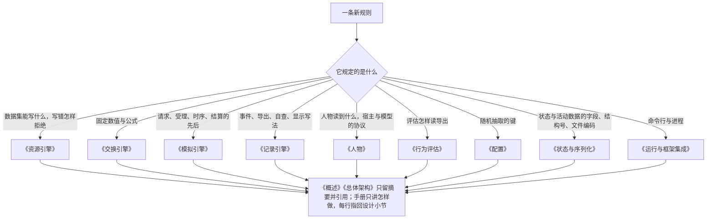

# 设计文档与手册改动清单

> 本章属于[首次真实模型单日运行：修复与新增规格](../SPEC-first-real-day-run.md)，读法和叫法见那一页。

## 目标与依据

9 月 28 日 08:46，人物想照习惯用瑞幸咖啡点一杯冰美式。改后她提交一次购买，`prefer` 写「瑞幸咖啡」；手机上先是瑞幸咖啡在前台，最后十几秒是支付 app，09:11 咖啡送到。这一串规则今天在设计文档里是另一种写法：《概述》写着「下单 app 也由环境抽取，人物不选渠道」（`docs/design/00-overview.md:51`），《人物》写着原生工具十一个、其中一个是 `query_world`（`docs/design/06-agent.md:52-58`），《模拟引擎》有一整段「纯目录浏览」（`docs/design/04-simulation-engine.md:333-336`），紧接着一段讲打开 app 附带商品清单（`:337-338`）。这些话不先改，照文档写代码的人会照旧规则写，几条并行的实施轨道还会各读到一半新、一半旧的文档。

本仓的规矩是每条规则只在所属模块的设计正文里定义一次、别处引用，并且先改设计再改实现（`docs/INDEX.md:17-18`，`AGENTS.md:15-17`）。文档只有两道门：一道查本地链接和显式标识（`scripts/documentation_gate.py:39-44`、`:78-92`），一道把十一份设计正文汇编成一份 HTML（`scripts/build_design_doc.py:20-24`）；没有任何测试读设计文档的句子，`AGENTS.md:23` 写的就是「检查当前文档链接和设计构建即可」。所以「设计文档与实现一致」靠的是一张逐行的改动清单。

本章实现提案「改动的牵连」里的三条：「与现有成文规则相反的四处要改写」；「系统层另有新增……《模拟引擎》的参数表、下单 app 抽取一段和《配置》里登记随机抽取的表也要跟着改」；「顺序。先改所属的设计文档和作者手册，再改代码，再补测试」。还有「裁决结果」里的「作者手册：照作者手册要补的规则补」，所有者已答复「写」。

本章不定任何行为。每一行「改后要写成」都出自别的章；本章只做四件事：把它们落到具体的文档、小节和行，给每条新规则指定唯一的归宿，写出作者手册的定稿文字，定下谁在什么时候改哪份文档。

## 行为规格

### 怎样读这一章的表

- 行号都是提交 `2b10aa9c` 上的行号，已逐行对过原文。实施时前面的行一改，后面的行号会跟着动，所以每行同时给出小节名和一段短引文，按引文定位。
- 「现在写的」只引能认出这一句的一小段。「改后要写成」里用「」括起来的是定稿原文，照抄；没有括起来的是要写进去的要点，措辞由改文档的人照所出的那一章写。
- 定稿原文里指向别的设计文档或手册的链接，在这一页按这一页所在的位置写了路径，点得开；写进文档时按那份文档所在的位置写，同一目录下直接写文件名，例如 `[交换引擎](02-exchange-engine.md)`。
- 「出自哪一章」是这条规则的行为规格所在的章。文档与那一章不一致时，以那一章为准并回头改文档。
- 两个词全章通用：「下单 app」指能接单的内容 app（直接登记了商品，或被实际卖商品的地点登记）；「意向 app」指人物写在 `prefer` 里、被认出的那个下单 app。定义见[「购买时写想用的 app」](./01-purchase-prefer.md)一章。
- 系统层、工具用途句和字段说明的逐字原文不进设计文档，设计文档只转述；逐字原文在 `src/worldmock/agents/life_prompt.py` 和请求模型里，定稿见[「人物读到的规则」](./10-persona-rules.md)一章。
- 拒绝和运行故障的英文原文、人物读到的固定中文说法，凡是设计文档要写的，都与代码一字不差，汇总在下文「设计文档里要逐字写下的文字」。
- 文档之间互相引用新的或改名的小节时，写成「文档链接加书名号里的小节名」，例如 `[记录引擎](05-recording-engine.md)「显示写法与检查工具」`，不带 `#片段`。汇编设计 HTML 时带片段的链接只认显式标识 `<a name>`（`scripts/build_design_doc.py:176-190`），而《交换引擎》《记录引擎》《人物》《状态与序列化》《运行与框架集成》五份正文没有任何显式标识，《模拟引擎》只有「唤醒、日计划与个人事务」一处（`docs/design/04-simulation-engine.md:441`）。

### 一天里的三件事各由哪份文档说了算

用提案的咖啡、午饭和晚饭走一遍，看改后每一步的规则写在哪一处。「归宿」指定义这条规则的那一份模块文档和小节，别的文档提到它时只引用。咖啡的时刻取[「购买时写想用的 app」](./01-purchase-prefer.md)一章的算例（购买时长抽到 180 秒，付款抽到支付宝 15 秒），午饭取[「查询」](./02-query.md)一章的算例，晚饭取[「在地点吃的一餐」](./07-meals.md)一章的算例。

| 时刻 | 人物做的事与手机上看到的 | 归宿 |
| --- | --- | --- |
| 08:46:00 | 提交购买「冰美式咖啡」，`prefer` 写「瑞幸咖啡」 | 《模拟引擎》「动作、名称与并行」：副工具的三个参数，`prefer` 怎样认 |
| 08:46:00 | 环境认出瑞幸咖啡是下单 app，在登记了它的营业店铺里选中 4,500 米外的瑞幸咖啡（金泽古镇店） | 哪些 app 是下单 app：《资源引擎》「app、内容与候选呈现」。选店与下单 app：《模拟引擎》「购买、付款与收货」。抽取的键：《配置》「唯一种子与随机键」 |
| 08:46:00 | 预计送达 09:11:00：600 秒备货，加 4,500 ÷ 5 = 900 秒 | 《交换引擎》「收货与费用」。今天任何设计文档里都没有这条公式 |
| 08:46:00–08:48:45，08:48:45–08:49:00 | 瑞幸咖啡在前台下单，支付宝在前台付款 | 《模拟引擎》「购买、付款与收货」，这一段不改 |
| 08:49:00 | 扣 27 元；购买结果的 `channel` 是「瑞幸咖啡」 | `channel`：《模拟引擎》「购买、付款与收货」。进度层显示哪一条结果、明细有哪些键：《人物》「进度、待办与记忆」 |
| 08:51:12 | 瑞幸咖啡发「订单已发货」：付款到送达 1,320 秒，取十分之一 | 《模拟引擎》「购买、付款与收货」的通知表，不改 |
| 09:11:00 | 送达，当场喝掉 | 《交换引擎》「收货与费用」 |
| 11:40:00–11:48:00 | 查询「食品」，`prefer` 写「美团外卖」，美团外卖在前台 8 分钟；11:48:00 读到答案，同一次决策里下单 | 请求、时长、用哪个 app、答案怎样算、做完自己结束：《模拟引擎》「出行、内容与查询」里新增的「查询」小节。人物读到的 `details.query`：《人物》「进度、待办与记忆」。这 8 分钟的 `app_use` 行：《记录引擎》「数字足迹」。答案的机器形式：《状态与序列化》「世界、人物与活动」 |
| 18:30:00–19:40:00 | 在家做「做晚饭」三集；19:25:00《吃晚饭》做完，进账 600 × 0.90 = 540 千卡 | 字段 `provides_meal`：《资源引擎》「app、内容与候选呈现」。数额、利用率、上限：《交换引擎》「收货与费用」。哪一秒进账：《模拟引擎》「出行、内容与查询」。证据 `data.meal`：《记录引擎》「事件与来源」。人物事先读到的 `note`「第 2 集供一餐」：《人物》「提示与工具」 |
| 19:40:00 | 这次请求的第二条结果列出三集 | `details.contents`：《模拟引擎》「出行、内容与查询」 |
| 导出的一天时间线 | 「购买冰美式咖啡（经瑞幸咖啡下单）」「查询食品（美团外卖）」「在淀山湖大道东渡悦来城公寓：做晚饭《备菜做饭》《吃晚饭》《洗碗收拾厨房》」 | 《记录引擎》新增的「显示写法与检查工具」 |

一条新规则归哪一份文档，按它规定的是什么来定，与 `docs/INDEX.md:20-32` 的模块分工一致：



### 《概述》`docs/design/00-overview.md`

| 位置（行号与小节） | 现在写的 | 改后要写成 | 出自哪一章 |
| --- | --- | --- | --- |
| `:29`「解决方案」 | 「导航、下单和支付这些由引擎代为使用的 app 同样保留有开有关的前台区间」 | 「查询那几分钟所在的 app 保留这项查询的执行区间；导航、下单和支付时在前台的 app 同样保留有开有关的前台区间」。去掉「由引擎代为使用」：下单的 app 可以是人物在 `prefer` 里写的 | 「购买时写想用的 app」「删除 query_world 与第五种活动」 |
| `:51`「地图中的消费行为」 | 从「数字人只写要买的商品名称，一份一项」到「下单 app 按商品与本地日期抽取。」 | 换成下文「《概述》`:51` 的定稿」那一段。本行末尾「同类型地点共享商品集合……运费按配送组合并。」两句不动 | 「购买时写想用的 app」 |
| `:58`「地图中的消费行为」 | 「零食和食品按收货当秒的利用率与能量上限补充能量，饮料和商品减少放松需要。」 | 句后加：「在地点做完一件写明供一餐的事，在做完的那一秒按同一规则补充一餐的能量，不经收货，见[交换引擎](../../../design/02-exchange-engine.md)「收货与费用」。」 | 「在地点吃的一餐」 |
| `:95`「核心术语」app 一行 | 「人物可以点名使用，下单 app 从中抽取」 | 换成下文「《概述》`:95` 的定稿」那一格 | 「购买时写想用的 app」「打开 app 与 app 目录字段」 |
| `:98`「核心术语」动作一行 | 「引擎固定的四种开始活动的方式：`travel`、`interact`、`sleep`、`purchase`」 | 「引擎固定的五种开始活动的方式：`travel`、`interact`、`sleep`、`purchase`、`query`」 | 「删除 query_world 与第五种活动」 |
| `:99`「核心术语」内容一行 | 「带标题、摘要与时长」 | 句末加「；绑定到地点类型的内容另写明做完供不供一餐」 | 「在地点吃的一餐」 |
| `:149`「算法与工程背书总表」能量与体感一行 | 「收货热量、基础代谢与活动消耗决定可用能量」 | 「收货热量、在地点做完供一餐的事得到的热量、基础代谢与活动消耗决定可用能量」 | 「在地点吃的一餐」 |
| `:151` 同表分配的工作内容一行 | 「达到内容时长即完成；模型注记不改变位置或轮数」 | 句末加「；在地点做的事被人物用 `conclude_activity` 结束时，整件事同样记为做完一轮」，背书一栏加上[模拟引擎](../../../design/04-simulation-engine.md)「出行、内容与查询」 | 「做完之后读到什么，提前结束算不算做完」 |
| `:152` 同表内容呈现一行 | 「时长来自内容余量，娱乐完成后在同一活动静默接续」；背书写「出行、内容与目录浏览」 | 「每条内容的时长来自内容余量；系列按集号接续，非系列内容放完活动即结束」；背书改成「出行、内容与查询」。「娱乐完成后在同一活动静默接续」是 10 月 9 日之前的机制，与今天的代码相反：独立内容放完，活动就结束（`src/worldmock/life/interact.py:115-116`）。这一行只改这一次，改成与今天的代码一致；一次打开放什么、放完怎样结束，引擎这次不改 | 「打开 app 与 app 目录字段」「查看器里的连续使用」 |
| `:210`「参考文献」 | 「动作、出行、内容、购买、推送与唤醒的规则」 | 「动作、出行、内容、查询、购买、推送与唤醒的规则」 | 「查询」 |

核对过、不用改的：`:52`「交换引擎提供步行与配送的固定数值」今天在《交换引擎》里找不到配送的数值，改后因《交换引擎》补上公式而成立；`:57`、`:167`、`:194` 与改后的行为不冲突。

《概述》`:51` 的定稿：

> 数字人写要买的商品名称，一份一项，并在 `prefer` 里写想用来下单的 app，没有想法写 `null`；到店、外卖还是快递仍由环境按商品的绑定和人物真实的停留地点派生。人在供给这件商品的店里就是到店购买，不看 `prefer`，店铺须在营业。不在店里时，店铺商品由环境在供给它、绑定了内容 app 且此刻营业的店铺中选一家送外卖：其中有登记了人物所写 app 的店时只在这些店里选、经这个 app 下单，可以因此换到更远的店；没有时在全部这些店里选，下单 app 由环境抽取。绑定在内容 app 上的商品走快递，人物所写的 app 在商品登记的 app 之内就用它，否则抽取。一次买几件时每件各自判断。实际用了哪个 app、还是到店买的，写在购买结果里。选店的排序、抽取的键和每件各判的细则见[模拟引擎](../../../design/04-simulation-engine.md)「购买、付款与收货」与[配置](../../../design/08-configuration.md)「唯一种子与随机键」。

《概述》`:95` 的定稿（术语 app 的定义一格）：

> 数据集登记的渠道，分内容 app 与功能 app。内容 app 承载内容、供应商品或被供应商品的地点绑定：登记了内容的，人物可以点名打开，只看内容；能接单的（直接登记了商品，或被实际卖商品的地点登记）叫下单 app，人物购买和查询时可以把它写进 `prefer`，用不上时由环境抽取；没有登记内容的只用于下单和查询，不能单独打开。功能 app 由引擎代为选用，绑定 `purchase` 的是支付 app 候选，绑定某种出行方式的是这种方式的导航 app 候选

### 《总体架构》`docs/design/01-architecture.md`

| 位置（行号与小节） | 现在写的 | 改后要写成 | 出自哪一章 |
| --- | --- | --- | --- |
| `:108`「地图与门店供给的交接」 | 「记录引擎保存实际路径、结算与来源；查询不修改世界。」 | 「记录引擎保存实际路径、结算与来源；报价与预览不修改世界。人物查商品是一项占槽位、花时间的活动，见[模拟引擎](../../../design/04-simulation-engine.md)「出行、内容与查询」。」 | 「查询」 |
| `:116`「观察、行动与执行」 | 「只读查询返回冻结事实」 | 「只读查询（记忆查询与回看任务）返回冻结事实」 | 「删除 query_world 与第五种活动」 |
| `:125`「事件驱动的时间推进」 | 「非系列内容做完或系列做完时活动结束。」 | 这一句之后加：「查询做完时自己结束，不经人物收尾，做完的那一秒照样请人物决策。」 | 「查询」 |
| `:252-256`「工程验证」 | 「改了生产源码的变更，哪怕只改注释，都要按双候选规程重冻这两份基线」「`tests/` 不计入代码身份」 | `:256` 之后加两句：「`scripts/render_day.py` 不计入代码身份，但导出的一天时间线由它生成并进基线摘要，改它同样要重冻。查看器录制样例 `tests/fixtures/viewer-context.json` 逐字记着系统层与工具定义，改了这两样要用真实宿主重录。」 | 「版本、身份与基线」「统一显示写法」 |

核对过、不用改的：`:168` 表里「只读查询转发」仍成立（`read_query_runtime.py` 继续服务回看任务）；`:214`「查看器、导出与评估读取已保存事实」仍成立，冻结的环境目录也是已保存的素材。

### 《交换引擎》`docs/design/02-exchange-engine.md`

| 位置（行号与小节） | 现在写的 | 改后要写成 | 出自哪一章 |
| --- | --- | --- | --- |
| `:14`「资源与账户」的流程图 | `Receipt[实际收货] --> Effect[食品能量或放松效果]` | 加一个节点和一条边：`Meal[在地点做完供一餐的事] --> Effect`，其余不动 | 「在地点吃的一餐」 |
| `:27`「身体共同结算」 | 「结算证据里的基础代谢和额外消耗不因能量见底而缩小。」 | 句末加「；结算证据的「结算前」「结算后」怎样记见[记录引擎](../../../design/05-recording-engine.md)「事件与来源」」 | 「十条缺陷与思考额度」 |
| `:36` 代谢当量表 | 「购买、纯目录浏览、空闲」一行，1.0 | 「购买、查询、空闲」 | 「删除 query_world 与第五种活动」「打开 app 与 app 目录字段」 |
| `:49-50`「身体共同结算」 | 「真实食品收货才增加能量，上限仍为 2400 千卡。」 | 「能量只有两个进账来源：真实食品收货，和在地点做完一件写明供一餐的事（见「收货与费用」）；上限仍为 2400 千卡。」 | 「在地点吃的一餐」 |
| `:55`「放松与社交需要」 | 「暂停、购买与纯目录浏览没有内容缓解效果」 | 「暂停、购买与查询没有内容缓解效果」 | 「删除 query_world 与第五种活动」「打开 app 与 app 目录字段」 |
| `:60` 同一小节 | 「超出的时间每小时增加 0.10 放松需要。」 | 句末加「；这笔增量的计算基准和分录记在哪见[记录引擎](../../../design/05-recording-engine.md)「事件与来源」」 | 「十条缺陷与思考额度」 |
| `:61` 同一小节 | 「同一人物同一秒的服务拒绝只增加一次 0.05 放松需要」 | 这半句之后加「，分录记在哪见[记录引擎](../../../design/05-recording-engine.md)「事件与来源」」 | 「十条缺陷与思考额度」 |
| `:70-71`「收货与费用」 | 「零食每件提供 200 千卡，食品每件提供 600 千卡……同一条记录重复收货没有新效果。」 | 之后新增一段：「在地点做完一件写明供一餐的事（内容行的 `provides_meal` 为真，见[资源引擎](../../../design/03-resource-engine.md)「app、内容与候选呈现」），等于收到一件食品：数额取食品一格的 600 千卡，乘做完那一秒的食品利用率，进账不超过 2400 千卡的上限。它不花钱，不产生订单、通知、回调状态重置和个人事务累计；什么时候算做完见[模拟引擎](../../../design/04-simulation-engine.md)「出行、内容与查询」。」 | 「在地点吃的一餐」 |
| `:73-74` 同一小节 | 「商品定价与履约来源归[资源引擎]……实际购买与收货生命周期归[模拟引擎]。」 | 之后新增下文「《交换引擎》新增的外卖与快递固定数值」那张表和它前后的两句话 | 提案「作者手册要补的规则」里讲送达时刻的那一行：公式先进设计文档，手册再引用。数值出自 `src/worldmock/exchange/constants.py:12-14`、`src/worldmock/exchange/operators.py:63-71` |

《交换引擎》新增的外卖与快递固定数值，放在出行两条公式之前：

> 外卖和快递的固定数值只有下面三项，数据集不能改。
>
> | 量 | 取值 |
> | --- | --- |
> | 外卖送达用时（秒） | `600 + ceil(distance_meters ÷ 5)`：600 秒备货，再按店铺到收货地点的图上最短距离、每秒 5 米走完，不乘天气系数 |
> | 外卖运费（分） | 每个配送组 500 |
> | 快递运费（分）与到站天数 | 0 或 500，2 至 5 天，随下单 app 抽取，键见[配置](../../../design/08-configuration.md)「唯一种子与随机键」 |
>
> 预计送达从哪一刻起算、到达排程与发货通知见[模拟引擎](../../../design/04-simulation-engine.md)「购买、付款与收货」。

### 《资源引擎》`docs/design/03-resource-engine.md`

| 位置（行号与小节） | 现在写的 | 改后要写成 | 出自哪一章 |
| --- | --- | --- | --- |
| `:31`「环境目录文件」文件表的 `manifest.json` 一行 | 「`format_version: 4`」「`rules_version: 4`」 | 两处都写 5 | 「版本、身份与基线」 |
| `:32` 同表 `app-catalog.jsonl` 一行 | 「以及功能 app 的购买绑定与出行方式绑定或纯目录浏览时长」 | 「以及功能 app 的购买绑定与出行方式绑定」 | 「打开 app 与 app 目录字段」 |
| `:35` 同表 `content-catalog.jsonl` 一行 | 「绑定到 app 的内容可以另写前提 `prerequisite`」 | 句末加「；绑定到地点类型的内容必须写明做完供不供一餐 `provides_meal`」 | 「在地点吃的一餐」 |
| `:40` | 「规则版本 `RULES_VERSION` 是 4，目录格式 `format_version` 是 4」 | 两个号都是 5；「这两个号只在本节维护」不动 | 「版本、身份与基线」 |
| `:80-83`「注册校验与错误」 | 「登记核对在内容逐行校验里进行，排在该行的容器、引用、摘要和来源检查之后、系列检查之前」 | 段末加：「供一餐声明 `provides_meal` 的登记核对排在内容前提的核对之后、系列检查之前；值既不是布尔也不是 `null` 的，由严格行模型在行解析时拒绝，早于全部登记核对。」 | 「在地点吃的一餐」 |
| `:109` 拒绝码表 `ENVIRONMENT_KIND_INVALID` 一行 | 「未知字段、非法闭集值、坏字符串或布尔、未排序列表、非法营业时段」 | 行末加：app 行写了已删除的 `browse_duration_seconds` 按未知字段处理，详情以 `app-catalog.jsonl:<行号>` 开头、含字段名和 `Extra inputs are not permitted`；`provides_meal` 的三种情形（值不是布尔；地点内容没写或写 `null`；app 内容出现这个键），后两种的详情照「设计文档里要逐字写下的文字」 | 「打开 app 与 app 目录字段」「在地点吃的一餐」 |
| `:311-313`「app、内容与候选呈现」 | 「没有显式内容的纯目录 app 必须提供严格整数 `browse_duration_seconds >= 60`；有显式内容的 app 和功能 app 不得声明浏览时长。纯目录浏览不伪造内容身份或标题。」 | `:311` 的第一句保留，后面整段换成：「满足后两条之一的内容 app 能接单，叫下单 app：人物购买和查询时可以把它的名称写进 `prefer`。app 行只有 `app_id`、`name`、`role` 和功能 app 的两个绑定字段，没有任何时长字段。没有登记内容的内容 app 仍是合法登记，它一定是下单 app，只用于下单和查询，不能被单独打开，见[模拟引擎](../../../design/04-simulation-engine.md)「动作、名称与并行」。」 | 「打开 app 与 app 目录字段」「购买时写想用的 app」 |
| `:315` 同一小节 | 「内容必填身份、标题、`exertion`、`pushable`、`relaxation_relief`、`social_relief`、摘要、来源和时长。」 | 句后加：「绑定到地点类型的内容另必填严格布尔 `provides_meal`，写明这条内容做完供不供一餐；绑定到 app 的内容不得出现这个键。引擎不补值，不看标题，全部写 `false` 也照常加载。」 | 「在地点吃的一餐」 |
| `:321-325` 同一小节 | 「系列按标题识别，各集容器必须完全相同，正整数集号不得重复。」 | 句后加：「`provides_meal` 每集各写各的，不要求相同，一个系列可以有几集供一餐。」 | 「在地点吃的一餐」 |
| `:338` 同一小节 | 「前提都不满足它就打不开，登记不拦。」 | 句末加「它卖的商品照常可以查询和购买。」 | 「打开 app 与 app 目录字段」 |
| `:360-361`「固定价格与配送费」 | 「数据集作者不需要为此改任何目录文件。」 | 句后加：「地点行的 `app_ids` 决定哪些店能兑现人物在 `prefer` 里写的下单 app，规则见[模拟引擎](../../../design/04-simulation-engine.md)「购买、付款与收货」。」 | 「购买时写想用的 app」 |
| `:382-383`「声明式回调」 | 「动作触发按受理的开始调用求值，每条调用一次，键是调用的 `action`」 | `:383` 之后加定稿的一句：「动作触发的 `key` 只有 `purchase`、`interact`、`sleep` 三个值，出行另用带 `travel_method_id` 的写法。查询（`query`）不是合法的 `key`，写了报 `ENVIRONMENT_KIND_INVALID`；受理查询不触发任何动作回调。」`:372` 的形状表不动 | 「删除 query_world 与第五种活动」 |
| `:401-404`「验证边界」 | 「内容系列、营业安排、内容前提的登记、回调登记」 | 列举里加「供一餐声明的登记、app 行已删字段的拒绝」 | 「在地点吃的一餐」「打开 app 与 app 目录字段」 |

### 《模拟引擎》`docs/design/04-simulation-engine.md`

「动作、名称与并行」一节：

| 位置（行号） | 现在写的 | 改后要写成 | 出自哪一章 |
| --- | --- | --- | --- |
| `:25-26` | 「每个参数都必须出现，多余字段拒绝。」 | 句后加：「主工具的三个参数是 `action`、`target`、`detail`，副工具的三个参数是 `action`、`target`、`prefer`。」 | 「购买时写想用的 app」 |
| `:28-34` 参数表 | 三列 `action`、`target`、`detail`，副工具两行 | 换成下文「《模拟引擎》参数表的定稿」 | 「购买时写想用的 app」「查询」「打开 app 与 app 目录字段」 |
| `:40` | 「写得不准时返回候选而不替换。」 | 句后加：「`prefer` 例外，它只是意向，见下文。」 | 「购买时写想用的 app」 |
| `:41-42` | 「购买只认商品，副工具的 interact 只认内容 app」 | 「购买只认商品，副工具的 interact 只认登记了内容的内容 app，查询认商品名和四个商品类别名（零食、食品、饮料、商品），类别名优先」；并在 `:44` 之后新增下文「`prefer` 怎样认」一段 | 「查询」「打开 app 与 app 目录字段」「购买时写想用的 app」 |
| `:46-50` 名称解析结果表 | 三行 | 加一行：`target` 里的名称唯一对上一个只用于下单和查询的 app（打开、购买、查询都一样，主工具里一字不差写了也一样），拒绝码 `ACTION_NOT_OFFERED`，定位 `action`，允许值为空，没有候选；`why` 与 `expected` 的原文照「设计文档里要逐字写下的文字」 | 「打开 app 与 app 目录字段」 |
| `:53` | 「购买的候选只替换数组里出错的那一项。」 | 句后加：「副工具的候选恒为 `action`、`target`、`prefer` 三个键：候选的动作是 `purchase` 或 `query` 时 `prefer` 照被退回的请求所写原样带上，是 `interact` 时为 `null`。查询的候选同样只替换出错的那一项，`note` 为 `null`。只用于下单和查询的 app 不会成为近名候选。」 | 「购买时写想用的 app」「查询」「打开 app 与 app 目录字段」 |
| `:58-61` 槽位表 | 槽位 2「购买、用内容 app」 | 「购买、查询、用内容 app」 | 「删除 query_world 与第五种活动」 |
| `:63` | 「进行中和刚结束待收尾的活动占槽位，暂停的活动不占。」 | 句后加：「查询做完自己结束，不经待收尾，做完的那一秒让出槽位 2。」 | 「查询」 |
| `:67-74` 组合表 | 六行 | 加两行：「在地点做事 + 查询」可以，也可以同组开始；「出行 + 查询」不可以：人在路上不能查询，查询不能与出发同组，查询没做完不能出发 | 「查询」 |
| `:90` | 「与出发同组的购买报价、收货地点和在场判断都按出发前的停留地点算。」 | 句后加：「购买的报价按这条调用认出的意向 app 计算，核验与受理是同一条路线。」 | 「购买时写想用的 app」 |
| `:100` 核验表指名商品一行 | 「购买数组里未展示的名称在全量商品中找不到唯一商品」 | 句末加「；查询数组里既不是类别、又找不到唯一商品的名称，原因列出四个类别名，见「出行、内容与查询」」 | 「查询」 |
| `:104` 核验表主调用一行 | 「出行：有进行中的到店购买，或路线检查不通过；在地点做事：见「出行、内容与目录浏览」」 | 「出行：有进行中的到店购买或进行中的查询，或路线检查不通过；在地点做事：见「出行、内容与查询」」 | 「查询」「打开 app 与 app 目录字段」 |
| `:105` 核验表副调用一行 | 「购买：逐份报价的拒绝按数组次序取第一条，到店购买不能与出发同组；用内容 app：登记了内容而此刻没有合格内容，见「出行、内容与目录浏览」」 | 「购买：逐份报价（按带意向的路线）的拒绝按数组次序取第一条，到店购买不能与出发同组；查询：人在路上，或与出发同组；用内容 app：此刻没有合格内容。后两项见「出行、内容与查询」」 | 「购买时写想用的 app」「查询」「打开 app 与 app 目录字段」 |
| `:106` 核验表余额一行 | 「余额少于全部货款、各配送组运费与同组车费之和」 | 句末加「；货款与运费按带意向的路线算，意向让商品分到两家店时多出的运费计入总额，不为余额放弃意向；查询不参加余额核对」 | 「购买时写想用的 app」「查询」 |
| `:114-116` | 「例如占着槽位 2 的是购买，或者是离计划结束不足 180 秒的 app 内容」 | 「例如占着槽位 2 的是购买或查询，或者是离计划结束不足 180 秒的 app 内容」 | 「查询」 |
| `:156` | 「在地点做事和用内容 app 可以暂停，出行、睡眠、购买不能；已结束活动必须由人物收尾。」 | 「在地点做事和用内容 app 可以暂停，出行、睡眠、购买、查询不能；已结束活动必须由人物收尾，查询除外，它做完自己结束。」 | 「查询」 |
| `:160-161` | 「例如一条 60 秒的 app 内容，或上次没做完、只剩一分多钟的内容。」 | 「例如一条 60 秒的 app 内容，或上次没看完、只剩一分多钟的 app 内容。」 | 「做完之后读到什么，提前结束算不算做完」 |
| `:173-174` | 「不到一分钟的余量仍会出现：人物在一件事快做完时用 `conclude_activity` 结束它，没做完的那一点留在共享进度里，下次点名或被挑中照样从那里接着做」 | 「不到一分钟的余量仍会出现在 app 内容上：人物在一条 app 内容快放完时用 `conclude_activity` 结束它，没看完的那一点留在共享进度里，下次被挑中照样从那里接着放，开始时不对余量设下限。在地点做的事用 `conclude_activity` 结束就记为做完，不留余量，见「出行、内容与查询」。」 | 「做完之后读到什么，提前结束算不算做完」 |

《模拟引擎》参数表的定稿（替换 `:28-34`）：

| 工具 | `action` | `target` | `detail` | `prefer` |
| --- | --- | --- | --- | --- |
| `start_main_activity` | `travel` | 目的地的地点名 | 出行方式名称 | 没有这个参数 |
| `start_main_activity` | `interact` | 当前所在地点的地点名 | 要做的那件事的名称 | 没有这个参数 |
| `start_main_activity` | `sleep` | 要睡的分钟数，只写数字，例如 `"470"` | `null` | 没有这个参数 |
| `start_side_activity` | `purchase` | 商品名数组，一份一项 | 没有这个参数 | 想用来下单的 app 名称，没有想法写 `null` |
| `start_side_activity` | `interact` | 恰含一个登记了内容的内容 app 名的数组 | 没有这个参数 | 必须是 `null` |
| `start_side_activity` | `query` | 商品名或商品类别名的数组，至少一项 | 没有这个参数 | 想在哪个 app 里查，没有想法写 `null` |

「`prefer` 怎样认」一段的定稿（新增在 `:44` 之后）：

> `prefer` 不走名称解析。它只在下单 app（定义见[资源引擎](../../../design/03-resource-engine.md)「app、内容与候选呈现」）的名称里用与 `detail` 相同的规整判断，唯一对上的那个就是意向 app。写的是不存在的名称、功能 app、不卖东西的内容 app，或规整后对上多个，都按没有意向处理：不退回，不给候选，不记 `details.resolved`，不算名称类拒绝。`prefer` 每次都要写，没有想法写 `null`，空白字符串按参数错误退回；`action` 是 `interact` 时必须是 `null`，否则按参数错误退回，原因是 `prefer must be null when action is interact`。意向在购买里怎样用见「购买、付款与收货」，在查询里怎样用见「出行、内容与查询」。

「出行、内容与目录浏览」一节，改名「出行、内容与查询」：

| 位置（行号） | 现在写的 | 改后要写成 | 出自哪一章 |
| --- | --- | --- | --- |
| `:176` 小节标题 | 「出行、内容与目录浏览」 | 「出行、内容与查询」。按文字引用旧名的地方同步：本文件 `:104`、`:105`，《概述》`:152`，以及代码说明两处（见「随这次改动更正的代码说明」）。这个小节没有显式标识，改名不会断链 | 「打开 app 与 app 目录字段」「查询」 |
| `:197-198` | 「占槽位 2 的活动，也就是购买或用 app。」 | 句后加：「查询不会与出行同时进行（人在路上不能查询，查询没做完不能出发），所以这里仍只有购买和用 app。」 | 「查询」 |
| `:237-239` | 「它从共享进度的位置接着做，计划时长是剩余时长，剩下不到一分钟也照样开始，工具层的可用性与受理一致；做完过的内容位置已归零，再点名就是新的一轮」 | 「点名总是从头做起，计划时长是这条内容的全长：做到末尾和被人物结束都把位置归零，位置非零的内容只属于一项进行中或暂停中的活动：进行中时槽位 1 被占着，暂停时这个单元被占着，都不能点名。能点名的系列各集轮数总是相同，所以总是从第一集做起。工具层的可用性与受理一致」。前后两句（下一条内容怎样定、点名不抽随机数）不动 | 「做完之后读到什么，提前结束算不算做完」 |
| `:252` | 「用内容 app 时人物只写 app 名，做哪一条由引擎挑，先筛后挑。」 | 句前加：「能打开的只有登记了内容的内容 app；打开只看内容，不显示商品，也不下单。」 | 「打开 app 与 app 目录字段」 |
| `:268-277` 流程图 | 「这个 app 登记了内容吗」的「没有」一支指向节点「纯目录浏览，按声明的浏览时长」 | 「没有」一支改指一个新节点：名称解析时退回 `ACTION_NOT_OFFERED`，这个 app 写进购买或查询的 `prefer` | 「打开 app 与 app 目录字段」 |
| `:282` | 「没有登记内容的 app、恢复暂停的活动、系列接续和推送都不产生这个拒绝。」 | 「恢复暂停的活动、系列接续和推送都不产生这个拒绝；没有登记内容的 app 在名称解析时已被退回，到不了这一步。」 | 「打开 app 与 app 目录字段」 |
| `:324-327` | 「结束后它占着的单元可以再点名，从上次的位置接着做。」 | 这半句删去，段后新增下文「结束与暂停」一段，这是「结束算做完」的归宿 | 「做完之后读到什么，提前结束算不算做完」 |
| `:328` | 「正秒结算产生真实内容证据。」 | 句后新增下文「供一餐的进账」一段 | 「在地点吃的一餐」 |
| `:329-331` | 「开始结果的 `details.content` 只含 `{app, title, summary, duration, pushed}`」 | 这一段保留，段后新增下文「第二条结果的 `details.contents`」一段 | 「做完之后读到什么，提前结束算不算做完」 |
| `:333-336` | 「走纯目录浏览的条件是这个 app 没有登记任何内容……不创建 `details.content`。」 | 整段删除，换成：「每一项用 app 的活动都有内容，活动数据的 `content_id` 不为空；登记了内容而此刻都不合格的 app 不可用。」 | 「打开 app 与 app 目录字段」 |
| `:337-338` | 「平台交互开始均展示该 app 直接商品与所绑定店铺商品的去重并集……不能用回看时的世界重算。」 | 整段删除，换成：「打开 app 的结果不带商品。这个 app 卖的东西用查询看，用购买加 `prefer` 买。」 | 「打开 app 与 app 目录字段」 |
| `:340-341` | 「商品呈现保留实际曝光轮转；query_world 使用确定性分页和过滤交集，不消耗随机数、不占槽位、不推进时钟。商品类别过滤只允许零食、食品、饮料、商品。」 | 「商品呈现保留实际曝光轮转。」其余删除，四个类别名写进「查询」小节 | 「删除 query_world 与第五种活动」 |
| `:341` 之后，本节末尾 | 没有 | 新增三级标题「查询」，内容见下文「《模拟引擎》新增的「查询」小节写什么」 | 「查询」 |

「结束与暂停」一段的定稿（新增在 `:327` 之后）：

> 结束与暂停对在地点做的事含义不同。人物用 `conclude_activity` 结束一项进行中或暂停中的在地点做的事时，这件事所在的单元记为做完一轮：取当前这条内容的完成轮数加一作目标轮数，单元里轮数低于它的各条位置归零、轮数置为目标轮数。独立内容就是位置归零、轮数加一；系列是本轮还没做的各集一并记为做完，下次点名从第一集做起。已经做到末尾、等收尾的活动被收尾，以及运行截止时被截断，都不动进度。活动的状态仍是 `cancelled`，终局说法仍是「提前结束」，不另记事件，也不供餐。想留着进度回头接着做，用 `pause_activity`。用内容 app 不变：结束后正在放的那条保留位置，下次被挑中接着放。

「供一餐的进账」一段的定稿（新增在 `:328` 之后）：

> 绑定到地点类型的内容 `provides_meal` 为真时，这条内容做到末端的那一秒、在同一次提交里进账一餐，取的是这一秒共同身体结算之后的身体，数额与上限见[交换引擎](../../../design/02-exchange-engine.md)「收货与费用」。系列读刚做完的那一集。暂停后恢复做完照算；提前结束（含被结束而记为做完一轮）和运行截止时没做完都不算；同一件事再做一遍再算一次，不设每天次数限制。这一餐不是唤醒原因，不发通知；证据见[记录引擎](../../../design/05-recording-engine.md)「事件与来源」。

「第二条结果的 `details.contents`」一段的定稿（新增在 `:331` 之后）：

> 活动终结时写下的结果（自然做完、被人物结束、运行截止时截断，或失败）另带 `details.contents`：按做的先后列出这项活动放过或做过的每一条内容，每行恰为 `{title, summary, duration, finished}`，`duration` 是这条内容登记的全长。行取活动快照 `data.played` 的各项，`finished` 为真；快照状态不是 `completed` 且当前这条确有推进时再加一行，`finished` 为假，排在最后。一行都没有时不写这个键，不设行数上限。只对 interact 活动写；开始结果仍只带 `details.content`。

《模拟引擎》新增的「查询」小节写什么。逐项照[「查询」](./02-query.md)一章的行为规格转述，那一章有的表在这里用同样的表：

| 要写的内容 | 要点 |
| --- | --- |
| 请求 | `action` 为 `query`；`target` 至少一项，每项是商品的完整名称或四个类别名之一，可以混写，重复只算一次；`prefer` 写想在哪个 app 里查 |
| 名称怎样认 | 类别名优先；其余的名称在本轮展示的商品与只用于下单和查询的 app 里做同一次匹配，不另起一步：唯一对上一件商品就是这件商品，唯一对上一个这类 app 退回 `ACTION_NOT_OFFERED`（见「动作、名称与并行」），对上多个（几件商品，或一件商品与一个这类 app）给 `NAME_AMBIGUOUS` 和查询候选，候选只出商品；都对不上的在全量商品里找，找不到给 `SUPPLY_NOT_FOUND`，原因、改法、下一步的英文原文和四个允许值；这条拒绝不花时间，数组里几项写错只报第一项 |
| 时长 | 受理时抽一次，300 到 600 的整数秒，两端都能取到；不能暂停 |
| 这几分钟用哪个 app | 三种情形：`prefer` 用得上（它卖所查商品至少一件，按目录登记算、不看此刻营业）；用不上而有下单 app 卖所查商品，按 `app_id` 升序等概率抽一个；没有任何 app 卖，手机上没有 app。答案是否只列经这个 app 能买的，受理时一并定下 |
| 四种结局 | 进行中、做完、提前结束、被截断各自的状态、`concluded_at`、槽位和有没有答案 |
| 做完的那一刻 | 同一次提交里算答案、把 `concluded_at` 写成结束时刻、让出槽位 2、写第二条结果；不写 `activity_concluded` |
| 答案怎样算 | 「此刻」是做完那一秒。每件商品，每家此刻营业、卖它的店一行：所在这家店是到店行，总是列出；别处登记了 app 的店是外卖行；别处没登记 app 的店是到店行、不可下单。只在 app 里卖的商品一行快递。答案只列经意向 app 能买的时怎样筛；一行都没有的商品留一行。「此刻能不能下单」不看余额和槽位。运费与预计送达和同一秒下单的购买出自同一个报价 |
| 次序与上限 | 一次最多 20 件，是固定常数；商品按（有没有可下单的行，最早的可下单送达，`goods_id`）排，行按（可下单在前，送达时刻，`store_id`）排；超出的只计数 |
| 人在路上 | 三条拒绝：路上不能查询；不能与出发同组；查询没做完不能出发。前两条的英文是新定的，第三条沿用今天「进行中的到店购买要先结束才能出发」的那一句；三条的原文都照「设计文档里要逐字写下的文字」 |
| 活动名 | 「查询」加各项名称，再加开始时刻，例如「查询食品、柠檬茶（1月5日 11:40 起）」；名称是商品的完整名称或类别的中文名，按所写次序去重，以「、」相连 |
| 指向别处 | 答案的机器形式见《状态与序列化》；人物读到的形状见《人物》「进度、待办与记忆」；导出里的记录见《记录引擎》「数字足迹」；两个键见《配置》；代谢当量见《交换引擎》 |

「购买、付款与收货」「唤醒、日计划与个人事务」「回调事务」三节：

| 位置（行号与小节） | 现在写的 | 改后要写成 | 出自哪一章 |
| --- | --- | --- | --- |
| `:345-346`「购买、付款与收货」 | 「每一份各解析成商品、各做一次履约报价、各生成一条数量为 1 的商品履约记录。」 | 句后加：「同一个 `prefer` 用于每一份，各判各的。」 | 「购买时写想用的 app」 |
| `:360-361` 同一小节 | 「店铺商品的下单 app 按「店铺、本地日期」等概率抽取……绑定在 app 上的快递类商品仍按商品抽取下单 app。」 | 换成下文「选店与下单 app 的定稿」，这是这条规则的归宿。`:359` 不动 | 「购买时写想用的 app」 |
| `:363-365` 同一小节 | 「购买受理派生到店、外卖或快递履约，冻结目的地、商品、报价……」 | 句后加：「每条记录的下单 app 也在受理时冻结；意向只在受理时用一次，恢复和重放读记录，不重选店、不重抽 app。外卖记录的预计送达是受理时刻加[交换引擎](../../../design/02-exchange-engine.md)「收货与费用」的外卖送达用时。」 | 「购买时写想用的 app」；末一句是为手册里讲送达时刻的那一行补的引用 |
| `:436` 同一小节 | 「人物可见的购买明细和已结算文字只写这条动作自己下的订单。」 | 句后加：「购买明细的每一行带 `channel`：下单 app 的完整名称，或「到店」；取自记录上的下单 app，不取人物写的 `prefer`；这次请求的两条结果都带。已结算的购买句不写渠道。」 | 「购买时写想用的 app」 |
| `:438` 同一小节 | 「真实收货应用[交换效果]、回调状态重置和个人事务累计。」 | 句后加：「在地点做完供一餐的事只增加能量，不重置回调状态，不累计个人事务。」 | 「在地点吃的一餐」 |
| `:461-470`「唤醒、日计划与个人事务」 | 「人物醒着时命中的原因都保留。」这一段 | 段末加：「`planned_end` 所说的活动做完，包括做完自己结束的查询：查询做完那一秒不留待收尾，同样记 `planned_end` 请人物决策。」唤醒表不动 | 「查询」 |
| `:481-485`「回调事务」 | 「回调状态与规则的数据声明归[配置]和[资源引擎]。」 | 句后加：「动作触发能订阅哪些动作只写在[资源引擎](../../../design/03-resource-engine.md)「声明式回调」；查询不在其中，受理查询不触发任何动作回调。」 | 「删除 query_world 与第五种活动」 |

选店与下单 app 的定稿（替换 `:360-361`）：

> 一件商品怎样到手、经哪个 app 下单，按下表的次序定；同一次购买的每一份各判各的，用的是同一个 `prefer`。意向 app 是人物写在 `prefer` 里、被认出的那个下单 app（见「动作、名称与并行」），认不出就是没有意向。
>
> | 次序 | 情形 | 结果 |
> | --- | --- | --- |
> | 先 | 绑定在 app 上的快递类商品 | 意向 app 在商品登记的 app 之内就用它，否则按商品与本地日期抽取；到站天数和运费按最终的 app 取。人在路上也能下单 |
> | 再 | 人停在卖这件商品的地点 | 营业就到店购买，不看 `prefer`，没有下单 app；已打烊以 `LOCATION_CLOSED` 拒绝，不改成外卖 |
> | 再 | 人在路上 | 以 `ACTIVITY_PRECONDITION_UNMET` 拒绝，不看 `prefer` |
> | 最后 | 外卖 | 候选店是卖这件商品、登记了至少一个内容 app、此刻营业的地点；没有候选店时拒绝，并点出最近一家有售的地点。候选店里有登记了意向 app 的，只在这些店里按（价款加运费，距离，店铺身份）取最小，下单 app 就是意向 app，不抽取，可以因此换到更远的店；没有，或没有意向，就在全部候选店里取最小，下单 app 按「店铺、本地日期」等概率抽取 |
>
> 意向从不产生拒绝，也从不消除拒绝；用不上时不退回、不给候选、不写任何提示。一次购买里同一家店仍只有一个下单 app、一个配送组、一份运费；同一家店同一天的两次购买可以落在不同的 app 上。意向让商品分到不同的 app 或店时，订单、配送组、付款段和通知跟着变多，运费按配送组各收一份。工具层商品行的运费与预计到达按没有意向的路线预览，实际以购买结果为准。

核对过、不用改的：`:14` 的流程图，`:38`，`:52`，`:209-217` 的导航情形表，`:240`、`:257`、`:349` 的三种活动名，`:367-371` 的履约与出行表，`:408-432` 的通知与排程，`:447-459` 的唤醒表，`:487-498`。`:170` 能否暂停的判定不改；查询不是 interact，照这条判定自然不能暂停，不用为它加字。

### 《记录引擎》`docs/design/05-recording-engine.md`

| 位置（行号与小节） | 现在写的 | 改后要写成 | 出自哪一章 |
| --- | --- | --- | --- |
| `:15-17`「权威事实与投影」流程图之后 | 图里 `Export --> View[查看器与日时间线]` | 图不动，图后加一句：「查看器读的是运行目录或导出目录里的数据库、运行清单和冻结的目录素材，见「显示写法与检查工具」。」 | 「统一显示写法」 |
| `:23`「事件与来源」 | 「当前活动种类只有 sleep、travel、interact、purchase。」 | 「当前活动种类只有 sleep、travel、interact、purchase、query。」 | 「删除 query_world 与第五种活动」 |
| `:33` 之后，同一小节 | 没有任何一处定义身体结算记录的「结算前」「结算后」 | 新增下文「身体结算记录」「在地点吃的一餐的证据」两段 | 「十条缺陷与思考额度」「在地点吃的一餐」 |
| `:55-56` 同一小节 | 「人物看不到它们：不进任何提示层、记忆、零点计划和就寝反思的输入」 | 这一句保留，句后加：「人物从购买结果的 `channel` 读到实际的下单 app，从查询的答案读到是在哪个 app 里查的；来源是商品履约记录和查询活动，不是这四种事件。」 | 「购买时写想用的 app」「查询」 |
| `:85`「数字足迹」事实表 `app_use` 一行 | 「人物点名使用 app 的活动；引擎代为使用的 app 的 `app_foreground` 事件」 | 「自带 app 的活动（人物点名使用的内容 app，和查询所在的 app）；引擎代为打开的 app 的 `app_foreground` 事件」 | 「删除 query_world 与第五种活动」 |
| `:92-96` 同一小节 | 「分两种来源。人物点名使用的 app，区间是这项 interact 活动的正秒结算。引擎代为使用的 app（导航、下单的内容 app、支付 app）由 `app_foreground` 投影」「`interact` 是人物点名使用，`travel` 是导航，`purchase` 是下单或付款」 | 「分两种来源。自带 app 的活动，活动数据里有 `app_id`：人物点名使用的内容 app，区间是这项 interact 活动的正秒结算；查询所在的 app，区间是这项 query 活动的执行区间，`app_id` 为空的查询没有 `app_use` 行，查询不写 `app_foreground`。引擎代为打开的 app（导航、购买时下单的内容 app、支付 app；下单的内容 app 可以是人物在 `prefer` 里写的那个）由 `app_foreground` 投影」；下游分辨一句改成「`interact` 是人物点名使用，`query` 是查询所在的 app，`travel` 是导航，`purchase` 是下单或付款」 | 「删除 query_world 与第五种活动」「购买时写想用的 app」 |
| `:101` 同一小节 | 「纯目录浏览只有真实 app 使用，未关联内容；使用冻结 app 内容索引与声明时长认证。」 | 整句删除 | 「打开 app 与 app 目录字段」 |
| `:116` 同一小节 | 「购买投影保存实际订单商品、门店、平台、付款 app、数量、价格与履约事实。」 | 句后加：「人物写的 `prefer` 原文只在 `action_requested` 事件的请求里，购买工件不为它加字段。」 | 「购买时写想用的 app」 |
| `:117` 同一小节 | 「收到的经历只能来自已提交的本人真实收货事件。」 | 句后加：「在地点吃的一餐不是收货，不进购买投影，也不是「收到」这种已核验经历。」 | 「在地点吃的一餐」 |
| `:118` 同一小节 | 「原始显示名由冻结输入与观察证据解析，人物日时间线使用实际动作与内容名称。」 | 「对象的显示名一律取自这次运行冻结的环境目录，不从观察记录里取；日时间线的写法见「显示写法与检查工具」。」 | 「统一显示写法」 |
| `:118` 之后、`:120`「冻结输入、检查点与分支」之前 | 没有 | 新增一节「显示写法与检查工具」，内容见下文 | 「统一显示写法」「查看器里的连续使用」「十条缺陷与思考额度」「在地点吃的一餐」 |
| `:135`「完整导出认证」 | 「导出清单的结构号是 5。」 | 「导出清单的结构号是 6。」工件键集那半句不动 | 「版本、身份与基线」 |
| `:160` 自查表导航区间一行 | 「不与同一人物任何购买或用 app 的活动的执行区间重叠」 | 「不与同一人物任何购买、查询或用 app 的活动的执行区间重叠」 | 「删除 query_world 与第五种活动」 |
| `:162` 自查表同一时刻只有一个 app 一行 | 「导航、下单、支付与人物点名使用的 app 一起查」 | 「导航、下单、支付、查询所在的 app 与人物点名使用的 app 一起查」 | 「删除 query_world 与第五种活动」 |
| `:171` 之后，自查表末尾 | 表里没有身体结算 | 加一行：检查「身体结算」；要求「每条 `body_settlement` 的「结算后」等于「结算前」逐项加减本事件的分录，只看能量、睡眠不足、放松需要、社交需要四项，容差 1e-9；越过上下界、四项之外的分录、别的主体的分录都算不成立」；英文错误 `Body settlement after-state disagrees with its own resource flows` | 「十条缺陷与思考额度」 |
| `:175` 同一小节 | 「查看器与评估同样先认证输入。」 | 「评估同样先认证输入。查看器不做认证，它怎样读运行目录和冻结的目录素材见「显示写法与检查工具」。」 | 「统一显示写法」 |

核对过、不用改的：`:65-66` 前台步骤的闭集仍是 `navigation`、`ordering`、`payment`，查询不写前台事件；`:139` 质量报告结构号仍是 8；`:159` 自动 `app_use` 仍只来自出行和购买；`:167` 不为查询的 app 加角色核对。

「身体结算记录」一段的定稿（新增在 `:33` 之后）：

> 共同身体结算写成 `body_settlement`，带「结算前」`before`、「结算后」`after` 和这一笔的分录 `resource_flows`。对能量、睡眠不足、放松需要、社交需要四项，「结算后」等于「结算前」加上本记录该项的全部 `source` 分录、减去全部 `drain` 分录。这条记录上只有两类分录：共同结算的分录，和这次推进的不适脉冲。不适脉冲对着共同结算之后的身体计算，世界里加的是分录登记的同一个数额。同一秒的收货（到店购买完成、外卖送达、驿站取件）和在地点吃的一餐不进这条记录，只记在各自的事件上。`goods_received` 的 `applied` 等于该事件登记的分录数额之和，不用前后两个数相减；没有分录时是 `0.0`。业务拒绝带来的放松脉冲，分录记在这组拒绝的第一条 `action_result` 事件正文顶层的 `resource_flows` 上，`action_rejected` 不带；没有施加脉冲时不写这个键。

「在地点吃的一餐的证据」一段的定稿（紧接上一段）：

> 在地点做完一件供一餐的事，证据记在这条内容做完的那条 `activity_progress` 上，不新增事件种类：`data.meal` 恰为 `{content_id, provided, applied, efficiency}`，同一事件的 `resource_flows` 最前是这笔能量进账，`applied` 为 `0.0` 时没有分录。带 `data.meal` 的事件必须同时带 `data.content`，其 `completed` 为真，两处 `content_id` 相同，`data.content.app_id` 为 null；否则是运行故障 `Activity meal must use the current location meal contract`。

《记录引擎》新增的「显示写法与检查工具」一节写什么。二级标题，不加显式标识；别的文档按文字引用它：

| 要写的内容 | 要点与出处 |
| --- | --- |
| 开头 | 查看器、导出的一天时间线、`scripts/inspect_run.py`、人物零点做计划时读到的「已核验经历」句，四处用同一套写法；质量报告 `timeline_labels` 检查的是一天时间线的各行 |
| 写法总表 | [「统一显示写法」](./08-display.md)一章「写法总表」的十四行，格式与例子原样录入 |
| 细则 | 标题怎样列；在地点做的事；购买按订单分段、渠道取订单记录；查询的名称列表与括号；三种手机事件与三个步骤的中文名「导航」「下单」「付款」 |
| 四处各自怎样写 | 那一章「四处各自怎样写」的四行表：一行覆盖哪些事件，写法前后还写什么 |
| 名称的唯一来源 | 这次运行冻结的环境目录的五份素材；各使用方从运行目录还是导出目录读 |
| 取不到名称 | Python 一侧是运行故障，三句新的英文原文照「设计文档里要逐字写下的文字」；查看器显示「名称缺失（身份）」并写一次英文 `console.error` |
| 查看器怎样读运行目录 | 按运行清单 `environment_assets` 的摘要找同一次拖入的 `assets/<sha256>`，核对字节数，不在浏览器里重算摘要，不做认证；只拖数据库一个文件时对象名称全部缺失 |
| 查看器里的连续使用 | 紧接上一行的那一段写，照[「查看器里的连续使用」](./06-continuous-use.md)一章。定义：同一个人物、同一个 app 的几次使用（种类是 `interact`、`data.app_id` 不为空的活动），执行段一个接一个，后一段开始的那一秒正是前一段结束的那一秒，取尽可能长的一串；两个整数秒原样比较，没有容差，隔一秒、两段重叠、换了 app 都不连；在地点做的事、购买、查询和引擎代为打开的 app 前台不参加。两段及以上的连续使用在查看器三处各写什么：活动泳道把相连的几次使用画在同一行、每条连续使用一个条块，标签把各段放过的内容按先后接在 app 名之后，相邻的同一条只写一次；活动表仍是每项活动一行，末尾多一列「连续使用」，写整条的起止和这一行是第几段、共几段；时间线里后续各段的受理行写明它接续的是哪一刻开始的连续使用。三处的固定文字照那一章原样录入。末尾写明只在查看器里合并：连续使用在显示时算出，不写进数据库和导出；导出里每次使用仍是自己的一行 `app_use`，同一个 app 首尾相接的行不合并，导出的一天时间线和 `inspect_run.py` 不因它变化 |
| `inspect_run.py` 的子命令 | 九个子命令各一句：`summary`、`events`、`event`、`money`、`body`、`flows`、`rerun`、`continuation`、`workday`。时刻一律按运行清单的 `window.timezone` 显示；`events` 各行的摘要照[「十条缺陷与思考额度」](./09-defects-and-budget.md)一章「检查工具读旧字段」的表；`rerun` 的「进食次数」「首次进食前最低能量」把在地点吃的一餐算进去，口径照[「在地点吃的一餐」](./07-meals.md)一章「连带口径」 |
| `render_day.py` | 写出的文件是 UTF-8、LF，与导出里同名时间线逐字节相同 |
| 旧运行 | `render_day.py` 和 `inspect_run.py events` 用严格的行模型解析冻结的目录，读不了冻结的 app 目录里还带着 `browse_duration_seconds` 的运行，也就是这次改动之前的每一次真实运行；查看器只要求目录文件每行是 JSON 对象，仍打得开 |

### 《人物》`docs/design/06-agent.md`

| 位置（行号与小节） | 现在写的 | 改后要写成 | 出自哪一章 |
| --- | --- | --- | --- |
| `:50`「提示与工具」 | 「功能 app 不成为人物可选择对象，引擎代为使用 app 的记录不进入本人记忆。」 | 「功能 app 不成为人物可选择对象；没有登记内容的内容 app 不是可打开的目标，只出现在 `callable_index.prefer_apps` 里。导航、下单与支付 app 的前台区间和通知不进入本人记忆；下单用的 app 写在购买结果的 `channel` 里，查询所在的 app 写在查询的答案里。」 | 「购买时写想用的 app」「打开 app 与 app 目录字段」「查询」 |
| `:52` | 「生活决策的原生工具共十一个」 | 「生活决策的原生工具共十个」 | 「删除 query_world 与第五种活动」 |
| `:54-58` 工具表 | 「环境查询」一行：一个，query_world | 删去这一行，表剩「请求工具」七个、「记忆查询」三个两行 | 「删除 query_world 与第五种活动」 |
| `:60` | 「recall_task_summary、记忆查询和 query_world 只读。」 | 「recall_task_summary 和记忆查询只读。」 | 「删除 query_world 与第五种活动」 |
| `:72` | 「最后回合和截断后的那次纠正沿用已有去查询规则，只开放世界请求」 | 「去查询规则」改成「去只读查询规则」，其余不动。改后「查询」也是副工具的一个动作，它属于世界请求，最后回合照常可以提交 | 「删除 query_world 与第五种活动」 |
| `:75-79` | 「系统层用规则条目写明每次决策怎样结束、两个开始工具各填什么……以及暂停的活动怎样恢复」 | 换成下文「系统层讲什么的转述」 | 「人物读到的规则」 |
| `:87` | 「query_world 按动作筛选 `travel` 时返回各方式的行，不新增按出行方式的筛选键。」 | 整句删除 | 「删除 query_world 与第五种活动」 |
| `:91-92` | 「其他地点只列出行，query_world 查到的也是如此；没有单元的地点没有 interact 行。」 | 「其他地点只列出行；没有单元的地点没有 interact 行。」 | 「删除 query_world 与第五种活动」 |
| `:92` 之后 | 设计文档今天没有任何一处写 `callable_index` | 新增下文「`callable_index` 一段」，这是它第一次成文 | 「购买时写想用的 app」「查询」「打开 app 与 app 目录字段」 |
| `:96` 动作行表的地点 interact 一行 | `duration`「没做完的内容是剩余时长，系列是下一集的时长」；`note`「系列写「第 N 集，共 M 集」，没做完写「上次没做完，接着做」，两者都有以「；」相连」 | `duration`：「此刻开始会做多久。能点名的行位置总是零，所以是这条内容的全长，系列是第一集的全长；剩余时长只出现在不可用的行上（正在做，或被本人暂停的活动占着）」。`note`：「三种说法按「第几集、接着做、供一餐」的先后以「；」相连，都没有为 `null`。系列写「第 N 集，共 M 集」；没做完写「上次没做完，接着做」，只出现在不可用的行上；独立的一件事供一餐写「供一餐」，系列写「第 K 集供一餐」，K 是这个系列里全部供一餐的集号，升序，多集以「、」相连，不随做到第几集而变」 | 「做完之后读到什么，提前结束算不算做完」「在地点吃的一餐」 |
| `:104-110`「在地点做的一件事」表 | 「上次没做完且已收尾」一行：可用，`duration` 为剩余时长，`note` 含「上次没做完，接着做」 | 删去这一行；「没做过，或做完过」一行改成「没做过、做完过，或上次被人物结束」，中间一格写「可用，`duration` 为全长」 | 「做完之后读到什么，提前结束算不算做完」 |
| `:118` | 「内容 app 全部列出。」 | 「登记了内容的内容 app 全部列出；没有登记内容的不列，名称只出现在 `prefer_apps` 里。」 | 「打开 app 与 app 目录字段」 |
| `:120-124` 内容 app 情形表 | 「没有登记内容」一行：按其余受理条件，声明的浏览时长，`null` | 删去这一行 | 「打开 app 与 app 目录字段」 |
| `:127` | 「query_world 返回的是同一批行，结论相同；系统层不为前提新增句子」 | 「系统层不为前提新增句子」 | 「删除 query_world 与第五种活动」 |
| `:138-139`「进度、待办与记忆」 | 「跨容器恢复读取共享进度；纯目录浏览不伪装成内容消费或等待经历。」 | 「跨容器恢复读取共享进度。」并在 `:140` 之后新增下文「「进度、待办与记忆」新增的五段」 | 「打开 app 与 app 目录字段」「做完之后读到什么，提前结束算不算做完」「查询」 |
| `:142-143` 同一小节 | 「也不进进度层和其余提示层。查询只读，不推进时间或产生新事实。」 | 「也不进进度层和其余提示层；人物从购买结果的 `channel` 知道下单的 app，记忆层与零点计划的购买句不写渠道。记忆查询与回看任务只读，不推进时间或产生新事实；查商品是一项活动，见[模拟引擎](../../../design/04-simulation-engine.md)「出行、内容与查询」。」并加一句经历句：「零点计划输入里「已核验经历」的内容经历句，先写起止时刻，再写这项活动的写法，例如「9月28日 19:52–9月28日 19:53 使用哔哩哔哩《散步装备准备》」；写法取[记录引擎](../../../design/05-recording-engine.md)「显示写法与检查工具」的表。到达句、收货句不变。」 | 「购买时写想用的 app」「删除 query_world 与第五种活动」「统一显示写法」 |
| `:170-171`「宿主模型协议」 | 「发送前上下文适配及输出上限均使用冻结实际元数据，没有静态模型容量表。」 | 句后加：「人物一次决策每个模型回合的输出上限是引擎固定的 16,000 与实际服务输出上限中较小的一个，思考与回答共用；只读问答、截断后的那次重试、记忆巩固与就寝反思用同一个数，零点计划用自己的 8,000。这个数是引擎固定值，不在 `config.toml` 里。」 | 「十条缺陷与思考额度」 |
| `:173` 同一小节 | 「协议纠错与输出截断纠正均与 dispatcher 重试分别计数。」 | 句后加：「截断的错误日志只在真实出现截断回合时写。」 | 「十条缺陷与思考额度」 |

核对过、不用改的：`:65`、`:69` 的「只读查询」；`:73`；`:81-83` 动作行的八个字段；`:88` 的到达句；`:162`「8000 字符窗口」说的是记忆层的字符数，与输出上限无关。

系统层讲什么的转述（替换 `:75-76` 那一句，`:77-79` 讲睡眠的两句不动）：

> 系统层用规则条目写明：每次决策怎样结束；两个开始工具各填什么，副工具填三项，`prefer` 照工具层 `prefer_apps` 列出的名称写；名称要写完整，`prefer` 只是意向、写得不准不返回候选；在地点做哪件事由人物点名；用内容 app 只是看，买东西只有购买，不知道买什么先查询；两个槽位各放什么；睡眠怎样写；出发前要先结束什么；活动怎样收尾，查询做完自己结束；在地点做的事结束就算做完，只有暂停保留进度；暂停的活动怎样恢复；解饿只有两种办法。规则文字只在系统层写一次，逐字原文只在代码里；工具说明只写用途与参数格式。

`callable_index` 一段的定稿（新增在 `:92` 之后）：

> 工具层另有 `callable_index`，两个键。`goods` 是商品品类行，每行的 `category` 就是查询可以写进 `target` 的类别名；它只数地点侧的商品，按类别查询时还会展开只在 app 里卖的商品。`prefer_apps` 是全部下单 app 的完整名称，按 `app_id` 升序；它只取决于冻结目录，整次运行不变，不按此刻营业与否筛选，不轮转，不截断，不参加目标行分组，不进续接的变化比较，容量浓缩不删它；没有下单 app 的环境里是空数组。工具层没有查询的动作行，查询能不能开始在提交之后得知。

「进度、待办与记忆」新增的五段（新增在 `:140` 之后）：

| 段 | 要点 | 出自哪一章 |
| --- | --- | --- |
| 一次请求的两条结果 | 环境对一条开始请求先后写两条结果，进度层只显示最新一条。用内容 app、在地点做事：第一条带 `planned`、`content`，第二条带 `contents`；购买：两条都带 `purchases`，行里有 `channel`；查询：第一条只有 `planned`，第二条带 `query`；出行：第二条带 `arrival` | 「做完之后读到什么，提前结束算不算做完」 |
| 结果明细的全部键 | 闭合对象，键恰为 `purchases`、`planned`、`content`、`contents`、`query`、`arrival`、`recall`、`reason`、`next_step`、`fix`、`items`、`outcome`、`resolved`、`notes`、`errands`。`content`、`contents`、`channel` 的形状引用《模拟引擎》 | 「做完之后读到什么，提前结束算不算做完」 |
| 人物读到的查询答案 `details.query` | 查完的形状：`app`、`scope`（「只列经这个 app 能买的」或「列出全部途径」）、`rows`、可选的 `omitted`（「还有 N 件没列」）。`rows` 每行九个键 `product`、`route`、`store`、`apps`、`price`、`delivery_fee`、`expected_at`、`now`、`reason`；`route` 是「到店」「外卖」「快递」或 null，`now` 是「可以下单」或「不可下单」，六句原因照[「查询」](./02-query.md)一章的表逐字写入。没有查完的形状：`app` 与 `state`「没有查完」。答案留到这段停留结束 | 「查询」 |
| 段的事件区间与带入的记录 | 出发那次提交整体归出发前的停留，到达那次推进整体归路上那一段。用内容 app 或在地点做事的开始请求，它的记录出现在这项活动仍在进行、或在其中结束的每一段里；带入的记录不带 `self_note`；出行、购买的记录不带入，暂停着的活动不带入 | 「做完之后读到什么，提前结束算不算做完」 |
| 结束句 | 在地点做的事提前结束后，记忆层的结束句不写「（《某某》未完）」那半句；用内容 app 的结束句照旧写 | 「做完之后读到什么，提前结束算不算做完」 |

### 《行为评估》`docs/design/07-evaluation.md`

| 位置（行号与小节） | 现在写的 | 改后要写成 | 出自哪一章 |
| --- | --- | --- | --- |
| `:42`「行为报告」 | 「内容接触只取实际正向播放；纯目录展示、推送和系统应用足迹不算消费。」 | 「内容接触只取实际正向播放；查询、推送和系统应用足迹不算消费。」 | 「删除 query_world 与第五种活动」「打开 app 与 app 目录字段」 |
| `:43` 同一小节 | 「食品样本只取本人实际 `snack`、`meal` 收货；付款和待领取订单不算收货。」 | 句后加：「在地点吃的一餐不是收货，不计入食品样本。」 | 「在地点吃的一餐」 |
| `:106`「认证与适配」 | 「出行、购买、睡眠和 interact 都取请求所写的动作，出行一律是 `travel`。」 | 「出行、购买、睡眠、interact 和查询都取请求所写的动作，出行一律是 `travel`。」句后加：「活动的渠道按有没有自带 app 判断：活动数据带 `app_id` 的 interact 和查询算数字交互，其余活动（含不带 app 的查询）算现实活动。」 | 「删除 query_world 与第五种活动」 |
| `:118`「公开点事实」表 | 「纯目录浏览」一行：「`interact` 与实际应用对象，不伪造内容对象」 | 删去这一行 | 「打开 app 与 app 目录字段」 |
| `:126` 同一小节 | 「睡眠开始、系统足迹、消费推送、回调效果和余额提示不增加公开点事实」 | 「睡眠开始、查询的请求与受理、系统足迹、消费推送、回调效果和余额提示不增加公开点事实」 | 「删除 query_world 与第五种活动」 |
| `:149`「盲评与随机性」 | 「购买与纯目录浏览同样保留真实区间。」 | 「购买与查询同样保留真实区间。」 | 「删除 query_world 与第五种活动」「打开 app 与 app 目录字段」 |

核对过、不用改的：`:40`、`:141`、`:148` 三个评估标识；`:45-48` 外部约束的口径，两种新拒绝用的都是现有的码，码表 `src/worldmock/evaluation/goal_metrics.py:14-17` 不动，它们照旧落在 `other_rejections`。

### 《配置》`docs/design/08-configuration.md`

| 位置（行号与小节） | 现在写的 | 改后要写成 | 出自哪一章 |
| --- | --- | --- | --- |
| `:122`「模型配置与凭据」 | 「模型身份与调用预算集中于 `[model]`，不由不可覆盖源码常量决定。」 | 「模型身份、重试预算与回合上限集中于 `[model]`；每次调用的输出上限是引擎固定值，不在 `[model]` 里，见[人物](../../../design/06-agent.md)「宿主模型协议」。」 | 「十条缺陷与思考额度」 |
| `:188`「唯一种子与随机键」下单 app 一行 | 「店铺商品用 `order-app:{store_id}:{local_date}`，先确定店铺，同一家店同一本地日的商品抽到同一个 app；绑定在 app 上的商品用 `order-app:{goods_id}:courier:{local_date}`」 | 「只在人物的意向用不上时取。店铺商品选中的店没有登记意向 app 时用 `order-app:{store_id}:{local_date}`，同一家店同一本地日抽到同一个 app；绑定在 app 上的商品在意向 app 不在商品登记的 app 之内时用 `order-app:{goods_id}:courier:{local_date}`。意向用得上时下单 app 就是意向 app，不抽取」 | 「购买时写想用的 app」 |
| `:189-190` 快递天数、快递费两行 | `courier-days:{goods_id}:{app_id}:{local_date}`、`courier-fee:{goods_id}:{app_id}` | 两行各加「`app_id` 是最终的下单 app，意向用得上时就是意向 app」 | 「购买时写想用的 app」 |
| `:192` 之前，同表 | 没有 | 新增两行。「查询时长：`query-duration:{action_id}`，`action_id` 是开始这次查询的那条动作；三百至六百整数秒，两端都能取到，受理时抽一次，恢复和重放读活动上的值」。「查询所在的 app：`query-app:{action_id}`；只在 `prefer` 用不上、且有下单 app 卖所查商品至少一件时取流，候选按 `app_id` 升序，等概率取一个；`prefer` 用得上或没有候选时不抽」 | 「查询」 |
| `:203` | 「预览只使用已知商品、店铺、app 与日期，不提前分配动作身份；受理冻结同一报价，恢复不得重抽。」 | 「预览按没有意向的路线计算，只使用已知商品、店铺、app 与日期，不提前分配动作身份；受理按请求里的意向报价并冻结，可以与预览不同，恢复不得重抽。」 | 「购买时写想用的 app」 |
| `:204-205` | 「商家选择按 `(总价款和配送费, 店铺到收货地点的最短距离, 店铺身份)` 取最小值，不随机选择远程店铺」 | 句后加：「意向用得上时，取最小值的范围先限定为登记了意向 app 的营业店铺，可以因此换到更远的店；完整的判断次序见[模拟引擎](../../../design/04-simulation-engine.md)「购买、付款与收货」。」 | 「购买时写想用的 app」 |

核对过、不用改的：`:51-52`、`:57`、`:63` 讲数组的几句，对作者而言仍是 TOML 数组；`:82`「其余类型或取值错误」只写「`<字段>: <英文说明>`」，没有引用校验库的用词，输入模型改成元组声明后这里不用动。

### 《状态与序列化》`docs/design/09-io-formats.md`

| 位置（行号与小节） | 现在写的 | 改后要写成 | 出自哪一章 |
| --- | --- | --- | --- |
| `:5`「单一状态归属」 | 「运行状态结构版本为 13，运行清单结构版本为 6」 | 「运行状态结构版本为 14，运行清单结构版本为 6」 | 「版本、身份与基线」 |
| `:33`「世界、人物与活动」 | 「活动种类为 sleep、travel、interact、purchase。」 | 「活动种类为 sleep、travel、interact、purchase、query。」 | 「删除 query_world 与第五种活动」 |
| `:35-36` 同一小节 | 「购买和内容 app 的 interact 占 `second`」 | 「购买、查询和内容 app 的 interact 占 `second`」 | 「删除 query_world 与第五种活动」 |
| `:39` 之后，同一小节 | 没有查询活动的私有数据 | 新增下文「查询活动的私有数据」一段 | 「查询」「打开 app 与 app 目录字段」 |
| `:48` 同一小节 | 「内容共享进度以人物与内容身份保存，报告不新增进度。」 | 句后加：「位置归零、轮数加一有两个来源：内容做到末尾，和在地点做的事被人物结束，规则见[模拟引擎](../../../design/04-simulation-engine.md)「出行、内容与查询」。」 | 「做完之后读到什么，提前结束算不算做完」 |
| `:68`「事件与检查点」 | 「事件编码为确定性 UTF-8 JSON，资金只在信封 resource_changes 中记录。」 | 句后加：「运行目录里的 `manifest.json`、`status.json`、`result.json` 和反事实干预文件一律按 UTF-8 读写，不依赖系统默认编码。」 | 「十条缺陷与思考额度」 |

核对过、不用改的：`:63-64` 模型身份的写法，变的只是 `max_tokens` 的取值；`:9` 的升号规则，本次四个号各升一次都合它。

「查询活动的私有数据」一段的定稿：

> 查询活动的私有数据恰为 `action`（恒为 `query`）、`targets`（认出的各项，按所写次序去重；商品是 `{kind: goods, goods_id}`，类别是 `{kind: category, category}`）、`app_id`（这几分钟所在的 app，可空）、`scoped`（答案是否只列经 `app_id` 能买的）和 `accepted_event_id`；做完的查询另有 `answer`，提前结束和被截断的没有。`answer` 是 `{rows, omitted}`，只有身份、分和纪元秒：`rows` 每行恰为 `{goods_id, route, store_id, app_ids, price_fen, delivery_fee_fen, expected_at, available, reason}`，`route` 取 `pickup`、`delivery`、`station_pickup` 或 null，`reason` 取 `location_closed`、`present_at_seller`、`store_without_app`、`no_open_store`、`no_open_store_on_app`、`not_sold_on_app` 之一或 null；`omitted` 是没列出的商品件数。不存人物所写的 `prefer` 原文。interact 活动的私有数据恒带非空的 `content_id`。

### 《运行与框架集成》`docs/design/10-runtime.md`

| 位置（行号与小节） | 现在写的 | 改后要写成 | 出自哪一章 |
| --- | --- | --- | --- |
| `:6-7`「实际框架边界」 | 「进程配置使用 config.toml 声明的服务与模型，凭据从声明的环境变量读取，不能换到另一个模型或端点。」 | 句后加：「新建、恢复和重放都在读完完整环境之后、读取模型身份与代码身份之前配置进程：写入原生客户端需要的环境变量，并把项目根放进本进程和工作进程的导入路径。命令可以在任何目录启动，不要求预设任何 `AGENTSOCIETY_*` 变量，只需要 `model.api_key_env` 指的那个变量；恢复时父运行的数据库或检查点不存在，仍然先于进程配置报出。`validate` 不导入 `custom` 与 AgentSociety2，也不配置进程。」 | 「十条缺陷与思考额度」 |
| `:26-29`「运行与恢复」 | 「replay 从同一认证检查点构造干预分支……只读历史查询不访问生成服务。」 | 段后加：「run、resume、replay 成功后写 `result.json`，其中 `token_stats` 是数组，每个模型一行 `{model, responses, responses_with_usage, input_tokens, output_tokens, total_tokens}`，由已落盘的模型响应累计，与 `worldmock status` 的 `observed_model_usage` 是同一个函数的结果，含环境一侧的零点日计划；恢复与重放的数字覆盖分支库的整段历史，含继承自父运行的响应。」 | 「十条缺陷与思考额度」 |
| `:40`「原生模型与工具」 | 「十一个原生工具的清单、批次形状、七层提示、最后回合查询控制」 | 「十个原生工具的清单、批次形状、七层提示、最后回合只读查询控制」 | 「删除 query_world 与第五种活动」 |
| `:42` 同一小节 | 「工具定义指纹覆盖全部十一个原生工具。」 | 「工具定义指纹覆盖全部十个原生工具。」 | 「删除 query_world 与第五种活动」 |
| `:49` 同一小节 | 「`read_query` 回答冻结观察上的只读查询」 | 「`read_query` 回答回看任务（`recall_task_summary`）」 | 「删除 query_world 与第五种活动」 |

核对过、不用改的：`:9-17` 的流程图，次序本来就是对的；`:46`、`:57`。

### 作者手册 `docs/manual/resources.md`

| 位置（行号） | 现在写的 | 改后要写成 | 出自哪一章 |
| --- | --- | --- | --- |
| `:9` | 「清单的 format_version 和 rules_version 都写 4。」 | 「清单的 format_version 和 rules_version 都写 5。」 | 「版本、身份与基线」 |
| `:59` | 「功能 app 由引擎选择，内容平台供人物 interact。」 | 「功能 app 由引擎选择。内容平台里登记了内容的供人物打开，打开只看内容；只卖东西、没有内容的不能单独打开，只在下单和查询时出现。登记在商品的 app_ids 上、或登记在卖商品的地点的 app_ids 上的内容平台能接单，人物购买和查询时可以把它写进 prefer。app 行只写 app_id、name、role 和功能 app 的绑定，不写任何时长；写了已删除的 browse_duration_seconds 会加载失败。」 | 「打开 app 与 app 目录字段」「购买时写想用的 app」 |
| `:69` | 「key 为其他动作时不能带 travel_method_id。」 | 句后加：「key 只能写 purchase、interact、sleep 或 travel，查询不能订阅。」 | 「删除 query_world 与第五种活动」 |
| `:76` | 「内容用 app_ids 或 location_kinds 显式绑定，填写实际时长、体力档位、两项心理缓解档位和 pushable。」 | 句后加：「用 location_kinds 绑定的内容每条另写 provides_meal，系列每一集各写各的；用 app_ids 绑定的内容不能写它。」 | 「在地点吃的一餐」 |
| `:80` | 「系列各集的 title 不能点名，做到第几集由引擎接着排。」 | 「系列各集的 title 不能点名；每次点名从第一集做起，一集做完自动接下一集，人物中途结束时整件事算做完一轮。」 | 「做完之后读到什么，提前结束算不算做完」 |
| `:83` 之后 | 没有 | 新增下文「供一餐的写法」一段 | 「在地点吃的一餐」 |
| `:104` | 「否则前提都不满足时它打不开，人物也看不到它的商品列表；按商品名购买不受影响。」 | 「否则前提都不满足时它打不开；它卖的商品仍然可以查询，也可以按商品名购买。」 | 「打开 app 与 app 目录字段」 |
| `:124` | 「把清单的两个版本号改成 4」 | 「把清单的两个版本号改成 5」 | 「版本、身份与基线」 |
| `:125` 之后，文末 | 没有 | 新增一节「固定规则怎样落到手机时间线」，定稿见下文 | 提案「作者手册要补的规则」 |

「供一餐的写法」一段的定稿（新增在 `:83` 之后）：

> 用 location_kinds 绑定的每条内容都要写 provides_meal，值只能是 true 或 false，系列的每一集各写各的。写 true 的那一条做完时，人物得到与一件食品相同的能量，不花钱，也不需要先买食材；人物中途结束不算，暂停后回来做完才算。引擎不看标题：标题是「吃晚饭」而写了 false，人物做完不算吃过。想让吃饭花钱，就让人物买食品。饭点时段之内人物至少「有点想吃」，吃过也一样；时段过了、能量充足时才回到「不饿」。买来的食品也是这样。
>
> ```json
> {"content_id":"dinner-2-eat","title":"吃晚饭","series":{"title":"做晚饭","episode":2},"location_kinds":["home"],"provides_meal":true,"duration_seconds":1500,"exertion":"idle","pushable":false,"relaxation_relief":"none","social_relief":"none","summary":"在家吃晚饭。","summary_source":{"kind":"synthetic","url":null,"notice":"数据集作者编写"}}
> ```

新增一节「固定规则怎样落到手机时间线」的定稿。标题前加显式标识 `resources-固定规则怎样落到手机时间线`，供另外两份手册带片段引用。节首一句：「下面这些规则由引擎固定，数据集改不了。写目录和人设之前先看它们会让手机时间线变成什么样；规则的定义在所列的设计小节，以那里为准。」随后是这张表，「定义在哪」一栏写成指向 `../design/` 下对应文件的链接：

| 规则 | 对手机时间线的影响 | 定义在哪 |
| --- | --- | --- |
| 外卖的预计送达是购买开始的那一秒加送达用时：600 秒备货，再加店铺到收货地点的距离按每秒 5 米走完的时间，不受天气影响。购买拖到预计送达之后才付款的，付款那一秒送达 | 店离得远，外卖就晚：13.2 公里要 54 分钟，11:49 下单 12:43 才到。想让午饭在饭点前到，就让卖午饭的店离公司近，并在 map.jsonl 里声明这段距离 | 《交换引擎》「收货与费用」；《模拟引擎》「购买、付款与收货」 |
| 「订单已发货」通知在付款之后、送达之前发出，时刻取付款到送达这段时间的十分之一处 | 它可能早于 600 秒备货结束，这是规则如此：付款后 22 分钟送达的一单，付款后 2 分 12 秒就显示已发货 | 《模拟引擎》「购买、付款与收货」的通知表 |
| 人物购买时可以在 prefer 里写想用的 app。此刻营业、卖这件商品的店里有登记了这个 app 的，就在这些店里选一家、经它下单，可以因此换到更远的店；没有时照原规则选店，下单 app 按店铺和当地日期抽取。只在 app 里卖的快递商品，prefer 在商品登记的 app 之内就用它，否则按商品和当地日期抽取 | 人设里写「用美团外卖点午餐」时，要让卖午餐的店在 app_ids 里登记美团外卖，否则订单会落到这家店登记的别的 app 上。习惯里 app 名的写法见「编写 persona.toml」 | 《模拟引擎》「购买、付款与收货」；《配置》「唯一种子与随机键」 |
| 人停在卖这件商品的地点时一律到店购买，不看 prefer；这个地点已打烊时这次购买被拒，不会改成外卖 | 这时手机上没有下单 app，至多最后 10 到 20 秒是支付 app；抽到直付时一个 app 都没有 | 《模拟引擎》「购买、付款与收货」 |
| 出发时没有别的 app 在用、也没有正在下的单，导航就从出发那一秒起在前台，不会晚于出发才打开；路上用别的 app 或下单时让出，那项活动停下后有一半机会回到前台。带着正在用的 app 或正在下的单出发时（与出发同一次回复里开始的也算），导航要等它停下才可能出现。到达那一秒导航关闭 | 「出门五分钟后才打开导航」这类行数据集安排不出来。出行方式没有绑定任何导航 app 时，这一趟没有导航记录 | 《模拟引擎》「出行、内容与查询」 |
| 没有登记任何内容的内容平台不能单独打开，只在下单和查询时出现 | 这类 app 在手机上只有下单的那几分钟和查询的 5 到 10 分钟，没有「打开看看」的时段。人设里的写法见「编写 persona.toml」 | 《资源引擎》「app、内容与候选呈现」；《模拟引擎》「动作、名称与并行」 |
| 用 app_ids 绑定的内容，title 要写成这个 app 里会出现的一条内容的标题。引擎不检查标题 | 时间线上这一行写成 app 名加书名号里的标题，例如「使用哔哩哔哩《散步装备准备》」。标题写成一个动作，读的人会以为人物在做这件事；推送的标题和简介同理 | 《记录引擎》「显示写法与检查工具」 |
| 食品和零食在收到的那一刻吃掉，饮料和商品在收到的那一刻用掉，没有库存 | 「买明天的食材」表达不了：食材包一送到就被当成一餐吃掉。想让人物在家吃一顿不花钱的饭，用上文写了 provides_meal 的地点内容 | 《交换引擎》「收货与费用」 |

这张表对提案原表有三处改写，都是写规格时定下的。讲送达时刻的那一行：公式今天不在任何设计文档里，所以先写进《交换引擎》，手册指过去。讲「已发货」的那一行：设计里已有（`docs/design/04-simulation-engine.md:415`），手册只用一句话转述并指过去，不另写算式。讲导航的那一行：提案写的是「前台时段恰好是出发到到达」，与 `docs/design/04-simulation-engine.md:200-217` 不符，照设计改写成「导航从出发那一秒起在前台，不会晚于出发才打开；路上用别的 app 或下单时让出」；本章在这句话前面加了前提「出发时没有别的 app 在用、也没有正在下的单」，因为同一张设计表的 `:210` 写着，出发时已有一项占槽位 2 的活动在进行（用 app 或购买），或与出发同一次回复里开始了一项，导航一开始不在前台。

提案表里另有半句「习惯里的 app 名要和 app 目录里的名称一字不差」和一句「人设里不要写「打开某购物 app 看看」这类习惯」，说的是人设怎样写，挪到 `personas.md`，这张表里只留指路。

### 作者手册 `docs/manual/personas.md`

| 位置（行号） | 现在写的 | 改后要写成 | 出自哪一章 |
| --- | --- | --- | --- |
| `:131`「关系、习惯与口味」 | 「每条习惯写什么情境下（`trigger`）做什么（`response`），以及大致在哪个时段。」 | 句后加下面两条提醒 | 「购买时写想用的 app」「打开 app 与 app 目录字段」 |
| `:144`「体重决定每天吃几顿」 | 「一次买两份时，收货后超过 2400 的部分作废。」 | 句后加：「在地点做完一件写了 provides_meal 为 true 的事，与收到一件食品等量，欠觉不超过 8 小时时实得 540 千卡，估算一天吃几顿时把它算进去。」 | 「在地点吃的一餐」 |

两条提醒的定稿：

> 习惯里提到用哪个 app 下单或查询时，app 名要与环境 app-catalog.jsonl 里的 name 一字不差：只有全角半角、括号写法和空白的差别会被抹平，大小写不同或写简称都对不上。人物会照着把它写进 prefer；写得不对不会被纠正，订单会落到别的 app 上。目录里叫「美团外卖」，习惯里就不要写「美团」。
>
> 不要写「打开某购物 app 看看」这类习惯：没有内容的购物 app 不能单独打开。想让人物买东西，就写买什么、想用哪个 app；想让人物先看看再买，就写先查一查。这两条背后的规则见[设计环境数据集](../../../manual/resources.md#resources-固定规则怎样落到手机时间线)。

### 作者手册八条规则的核对单

提案「作者手册要补的规则」一表有八条。没有任何测试会因为手册少写一条而失败，所以文档先行的执行者写完 `resources.md` 与 `personas.md` 之后，照下面的核对单逐条打勾，勾选结果写进实施回执。每一条要在手册里同时找得到三样东西才能打勾：规则本身，对手机时间线的影响，指向设计小节的链接。「在哪」说的新节是 `resources.md` 的「固定规则怎样落到手机时间线」。

- [ ] 外卖的预计送达。在哪：新节表里讲送达用时的一行，写明 600 秒备货、每秒 5 米、不受天气影响，以及晚于预计送达才付款的在付款那一秒送达。指向《交换引擎》「收货与费用」和《模拟引擎》「购买、付款与收货」；《交换引擎》里已经有那张固定数值的表。
- [ ] 「订单已发货」通知。在哪：新节表里讲这条通知的一行，一句话转述「付款到送达的十分之一处」，不另写算式。指向《模拟引擎》「购买、付款与收货」的通知表。
- [ ] 下单 app。在哪：新节表里讲 `prefer` 的一行，店铺商品和只在 app 里卖的快递商品两种情形都写到；「app 名要一字不差」在 `personas.md`「关系、习惯与口味」讲 app 名写法的那条提醒里，表里有指路。指向《模拟引擎》「购买、付款与收货」和《配置》「唯一种子与随机键」。
- [ ] 人在卖这件商品的地点时一律到店购买，打烊时这次购买被拒、不改成外卖。在哪：新节表里讲到店的一行。指向《模拟引擎》「购买、付款与收货」。
- [ ] 导航 app 的前台。在哪：新节表里讲导航的一行，带前提「出发时没有别的 app 在用、也没有正在下的单」，以及带着正在用的 app 或正在下的单出发时的后半句。指向《模拟引擎》「出行、内容与查询」。
- [ ] 没有内容的购物 app 不能单独打开。在哪：新节表里讲这类 app 的一行；「不要写打开某购物 app 看看这类习惯」在 `personas.md`「关系、习惯与口味」讲购物 app 的那条提醒里，表里有指路。指向《资源引擎》「app、内容与候选呈现」和《模拟引擎》「动作、名称与并行」。
- [ ] app 内容的标题要写成这个 app 里会出现的一条内容的标题。在哪：新节表里讲标题的一行，写明引擎不检查标题。指向《记录引擎》「显示写法与检查工具」。
- [ ] 食品到手即吃，没有库存。在哪：新节表里讲这条规则的一行，并指回 `resources.md` 的「供一餐的写法」一段。指向《交换引擎》「收货与费用」。

### 手册 `docs/manual/rules.md`

这份手册只更新固定规则的叙述；规则对手机时间线的影响只写在 `resources.md` 的新节里，这里指过去。

| 位置（行号） | 现在写的 | 改后要写成 | 出自哪一章 |
| --- | --- | --- | --- |
| `:8` 流程图 | 「出行、在地点做事、睡眠、购买、用内容 app」 | 「出行、在地点做事、睡眠、购买、查询、用内容 app」 | 「删除 query_world 与第五种活动」 |
| `:15` | 「人物选择动作和对象；引擎派生履约、地图路线、功能 app 与实际费用。」 | 「人物选择动作和对象，购买和查询时还可以写想用哪个 app；引擎派生履约、地图路线、功能 app 与实际费用，人物写的 app 用不上时由引擎另选。」 | 「购买时写想用的 app」 |
| `:21-22` | 「购买和用内容 app 占槽位 2。在地点做事时可以同时购买或用内容 app」 | 「购买、查询和用内容 app 占槽位 2。在地点做事时可以同时购买、查询或用内容 app」 | 「查询」 |
| `:23` | 「用内容 app 时看到什么由引擎选择。」 | 句后加：「打开内容 app 只是看内容，不显示商品，也不会下单；没有内容的购物 app 不能单独打开。」 | 「打开 app 与 app 目录字段」 |
| `:24-25` | 「在地点做事和用内容 app 可以暂停，但快做完的不行」 | 这一句前半改成「在地点做事和用内容 app 可以暂停，出行、睡眠、购买和查询不能；快做完的也不行」，其余不动；段末加：「在地点做的事用 conclude_activity 结束就算做完一轮，下次点名从头做起，系列从第一集做起；想留着进度回头接着做，要用暂停。内容 app 里没看完的内容结束后仍留着进度。」 | 「查询」「做完之后读到什么，提前结束算不算做完」 |
| `:25` 之后 | 没有 | 新增下文「查询」一段 | 「查询」 |
| `:42` | 「全部商品共用一个购买过程。」 | 句后新增下文「下单 app」一段 | 「购买时写想用的 app」 |
| `:47` | 「实际收货才产生食品或放松效果。」 | 句后加：「除了收到买来的食品，在地点做完一件数据集写明供一餐的事也算吃了一餐，数额与一件食品相同，不花钱；中途结束不算，暂停后回来做完才算。」 | 「在地点吃的一餐」 |
| `:48` | 「纯目录浏览只记录平台使用，不产生内容消费与心理缓解。」 | 整句删除 | 「打开 app 与 app 目录字段」 |

「查询」一段的定稿：

> 不知道买什么、在哪买时人物可以查询：写商品名或类别名（零食、食品、饮料、商品），还可以写想在哪个 app 里查。查询占槽位 2，要 5 到 10 分钟，不能暂停。答案在查询做完时给出，每件商品每家营业的店一行，一次最多 20 件。查询做完自己结束，不用收尾，人物当次就能接着下单。人在路上不能查询，查询也不能和出发一起开始，没做完的查询要先结束才能出发。

「下单 app」一段的定稿：

> 购买时人物还要写 prefer：想用来下单的 app，没有想法写 null。人在卖这件商品的地点时直接到店买，不看 prefer；否则经 app 下单，写的 app 接得了这一单就用它，接不了由引擎另选，不退回。一次买几件时每件各自判断，可能分成几张订单。实际用了哪个 app、还是到店买的，写在购买结果里。这些规则怎样影响手机时间线，见[设计环境数据集](../../../manual/resources.md#resources-固定规则怎样落到手机时间线)。

### 手册 `docs/manual/runtime.md` 与 `docs/manual/evaluation.md`

| 位置（行号） | 现在写的 | 改后要写成 | 出自哪一章 |
| --- | --- | --- | --- |
| `runtime.md:21-23` | 「完整验证先核对全部输入和实际模型元数据，失败时按所属路径与英文原因修正。」 | 句后加：「这些命令可以在任何目录执行，不需要设置 `AGENTSOCIETY_*` 或 `PYTHONPATH`，只需要 model.api_key_env 指的那个变量。」 | 「十条缺陷与思考额度」 |
| `runtime.md:35` | 「唯一整数 seed 控制地图、天气、内容、功能 app、购买时长与推送。」 | 「唯一整数 seed 控制地图、天气、内容、功能 app、购买时长、查询时长、查询所在的 app 与推送。」 | 「查询」 |
| `runtime.md:50-51` | 「start_side_activity 开始购买或使用一个内容 app」 | 「start_side_activity 开始购买、查询或使用一个内容 app」 | 「查询」 |
| `runtime.md:53-59` 请求示例 | 副工具两行，各两个参数 | 换成下文「请求示例的定稿」 | 「购买时写想用的 app」「查询」 |
| `runtime.md:62` | 「购买逐份写商品名，同一个名称写两次就是两份。」 | 句后加：「购买和查询的 prefer 写想用的 app 的完整名称，照工具层 prefer_apps 列出的写，没有想法写 null；使用内容 app 时 prefer 写 null。查询的 target 写商品名或类别名（零食、食品、饮料、商品）。」 | 「购买时写想用的 app」「查询」 |
| `runtime.md:64` | 「query_world 使用 action 查询当下实际地点、营业时段、路线或商品；查询不推进时间。」 | 「查询占槽位 2，要 5 到 10 分钟，不能暂停，答案在查询做完时写进这次请求的结果。没有当场作答、不花时间的世界查询工具；记忆查询和回看任务仍然当场完成。」 | 「查询」「删除 query_world 与第五种活动」 |
| `runtime.md:67` | 「实际模型请求和事件可在运行查看器中核对」 | 「实际模型请求和事件可在运行查看器（tools/run-viewer.html）中核对：把整个运行目录或导出目录拖进去，对象名称取自其中冻结的环境目录；只拖 footprints.sqlite 一个文件时对象名称显示为「名称缺失」。分发查看器时带上同目录的全部 run-viewer 脚本和样式文件。」后半句「人物可见范围见……」不动 | 「统一显示写法」 |
| `evaluation.md:109` | 「出行、购买、睡眠和 interact 都取请求所写的动作」 | 「出行、购买、睡眠、interact 和查询都取请求所写的动作」 | 「删除 query_world 与第五种活动」 |
| `evaluation.md:117` | 「食品多样性读取本人食品 goods_received。」 | 「食品多样性读取本人食品 goods_received；在地点吃的一餐不是收货，不计入。」 | 「在地点吃的一餐」 |
| `evaluation.md:118` | 「数字交互只来自真实 app 绑定活动；目录浏览、内容消费和系统应用触点分别依据实际证据呈现。」 | 「数字交互只来自真实 app 绑定活动；内容消费和系统应用触点分别依据实际证据呈现。带 app 的查询算数字交互，不带 app 的查询算现实活动。」 | 「删除 query_world 与第五种活动」 |

请求示例的定稿（名称取自样例环境）：

```text
start_main_activity  {"action": "travel",   "target": "公司", "detail": "驾车"}
start_main_activity  {"action": "interact", "target": "家",   "detail": "测试休息"}
start_main_activity  {"action": "sleep",    "target": "470",  "detail": null}
start_side_activity  {"action": "purchase", "target": ["牛肉面", "柠檬茶", "柠檬茶"], "prefer": "美团"}
start_side_activity  {"action": "query",    "target": ["食品"], "prefer": null}
start_side_activity  {"action": "interact", "target": ["哔哩哔哩"], "prefer": null}
```

`docs/manual/README.md` 不改：它只讲环境根的文件集合和阅读次序，这两样都没有变。

### 入口文件 `README.md`、`AGENTS.md`、`docs/INDEX.md`

三份都不需要改。

| 文件 | 结论 | 证据 |
| --- | --- | --- |
| `docs/INDEX.md` | 不改 | 它不逐份登记 `docs/dev` 下的记录（`:57-59`），所以新规格不用登记；模块表里《记录引擎》的阅读内容是「事件、素材、事务、检查点、认证导出与查看器」（`:27`），新增的一节仍在这个范围内；指向手册的三个显式标识（`:44-46`）都保留 |
| `README.md` | 不改 | 全文没有工具个数、活动种类、`query_world`、浏览时长这些说法；`:76`「导出清单列出……六类工件」仍成立，导出的工件键集不变；`:81`「在仓库根目录执行」仍然可行 |
| `AGENTS.md` | 不改 | 没有行为陈述；`:15-17` 的文档规矩正是本章遵循的，`:23`、`:32` 是本章不给文档写内容测试的依据 |

### 设计文档里要逐字写下的文字

下面这些原文在设计文档里与代码一字不差。每一句由所出那一章的行为测试逐字断言，文档不另设测试。「码」一栏是这句话所属的拒绝码；写「运行故障」的是 `IntegrityError`，运行停下并保留已确认的部分。

| 码 | 原文 | 写进哪份文档的哪一节 | 出自哪一章 |
| --- | --- | --- | --- |
| 宿主 `ARGUMENTS_INVALID`，环境 `ACTION_REQUEST_INVALID` | `prefer must be null when action is interact` | 《模拟引擎》「动作、名称与并行」 | 「购买时写想用的 app」 |
| `ACTION_NOT_OFFERED` | 明细的 `why`：`Write <app 全名> in prefer of purchase or query, not in target: this app only takes orders and has no content to open.`；`expected`：`A target that the written action accepts is required; an app that only takes orders is written in prefer.` | 《模拟引擎》「动作、名称与并行」的名称解析结果表 | 「打开 app 与 app 目录字段」 |
| `SUPPLY_NOT_FOUND` | `reason`：`No goods or goods category is named {所写}; the goods categories are 零食, 食品, 饮料, 商品.`；`fix`：`Use an exact known goods name or one of the goods categories.`；`next_step`：`Choose a known product or one of the goods categories.` | 《模拟引擎》「查询」小节 | 「查询」 |
| `ACTIVITY_PRECONDITION_UNMET` | 人在路上：`A query cannot start while travelling.`，下一步 `Start the query after arriving at a location.`。与出发同一次回复：`A query cannot start with departure.`，下一步 `Finish or conclude the query before leaving.`。查询没做完时出发（现有文字，今天用于进行中的到店购买，`src/worldmock/life/admission.py:175-178`）：`Conclude <查询的活动名> before departure.`，下一步 `Conclude <查询的活动名>.` | 《模拟引擎》「查询」小节 | 「查询」 |
| 不是拒绝，是人物读到的答案 | 「只列经这个 app 能买的」「列出全部途径」「还有 N 件没列」「没有查完」「可以下单」「不可下单」「到店」「外卖」「快递」；六句不可下单的原因：「这家店此刻已打烊」「你所在的{地点显示名}就卖这件商品，此刻购买只在所在地点到店完成，不从这家店送」「这家店没有上任何 app，要到店里买」「此刻没有营业的店卖这件商品」「上了这个 app、卖这件商品的店此刻都没有营业」「这个 app 里没有」 | 《人物》「进度、待办与记忆」 | 「查询」 |
| 不是拒绝，是工具层的 `note` | 「供一餐」「第 K 集供一餐」 | 《人物》「提示与工具」 | 「在地点吃的一餐」 |
| `ENVIRONMENT_KIND_INVALID` | `content-catalog.jsonl:<N> <content_id>: provides_meal is required for a location content; allowed values: true, false.`；`content-catalog.jsonl:<N> <content_id>: provides_meal must not be declared on an app content.` | 《资源引擎》「注册校验与错误」 | 「在地点吃的一餐」 |
| 运行故障 | `Activity meal must use the current location meal contract` | 《记录引擎》「事件与来源」 | 「在地点吃的一餐」 |
| 运行故障 | `Body settlement after-state disagrees with its own resource flows` | 《记录引擎》「完整导出认证」 | 「十条缺陷与思考额度」 |
| 运行故障 | `Displayed object is not registered in the frozen environment: <kind> <identity>`；`Purchase activity has no recorded order: <order_id>`；`Unsupported activity kind for display: <kind>` | 《记录引擎》「显示写法与检查工具」 | 「统一显示写法」 |
| 不是拒绝，是显示的写法 | 写法总表的十四种格式，三个步骤的中文名「导航」「下单」「付款」 | 《记录引擎》「显示写法与检查工具」 | 「统一显示写法」 |

### 新规则的归宿

每条新规则只在下表这一处定义。别的设计文档提到它时只写一句并指过去，手册只讲对作者和操作者意味着什么。

| 新规则 | 归宿：文档与小节 |
| --- | --- |
| 副工具的三个参数；`prefer` 必填、可为 `null`、打开 app 时必须是 `null`；`prefer` 怎样认，认不出按没有意向 | 《模拟引擎》「动作、名称与并行」 |
| 哪些内容 app 是下单 app；app 行的字段集；没有登记内容的内容 app 仍是合法登记 | 《资源引擎》「app、内容与候选呈现」 |
| 选店与下单 app：到店、意向用得上、另选、快递、每件各判；购买明细的 `channel` | 《模拟引擎》「购买、付款与收货」 |
| 把只用于下单和查询的 app 写进 `target` 的退回 | 《模拟引擎》「动作、名称与并行」 |
| 打开 app 只看内容、不带商品；每一项用 app 的活动都有内容 | 《模拟引擎》「出行、内容与查询」 |
| 查询的请求、名称怎样认与拒绝、时长、用哪个 app、做完自己结束、答案怎样算、20 件上限、人在路上、活动名 | 《模拟引擎》「出行、内容与查询」的「查询」小节 |
| 查询占槽位 2、与别的活动能否并行、核验次序、不能暂停 | 《模拟引擎》「动作、名称与并行」 |
| 查询做完记 `planned_end` | 《模拟引擎》「唤醒、日计划与个人事务」 |
| 在地点做的事结束算做完，系列整件事算 | 《模拟引擎》「出行、内容与查询」 |
| 第二条结果的 `details.contents` | 《模拟引擎》「出行、内容与查询」 |
| 在地点吃的一餐哪一秒进账，提前结束不算 | 《模拟引擎》「出行、内容与查询」 |
| 一餐的数额、利用率、上限 | 《交换引擎》「收货与费用」 |
| 外卖送达用时与运费的固定数值 | 《交换引擎》「收货与费用」 |
| 查询的代谢当量；查询没有内容缓解效果 | 《交换引擎》「身体共同结算」；「放松与社交需要」 |
| 字段 `provides_meal`：类型、哪些行必填、哪些行不得写 | 《资源引擎》「app、内容与候选呈现」；拒绝码与两句详情在「注册校验与错误」 |
| 回调不能订阅查询 | 《资源引擎》「声明式回调」 |
| 规则版本 5、目录格式 5 | 《资源引擎》「环境目录文件」 |
| 原生工具十个 | 《人物》「提示与工具」；《运行与框架集成》只引用 |
| `callable_index` 的两个键，`prefer_apps`，人物从哪里读类别名 | 《人物》「提示与工具」 |
| 工具层地点行 `note` 的三种说法与先后 | 《人物》「提示与工具」 |
| 进度层对一次请求显示最新一条结果；结果明细的键集；段的事件区间；带入的记录；结束句 | 《人物》「进度、待办与记忆」 |
| 人物读到的查询答案 `details.query`，留多久 | 《人物》「进度、待办与记忆」 |
| 「已核验经历」的内容经历句 | 《人物》「进度、待办与记忆」，写法引用《记录引擎》 |
| 决策输出上限 16,000；截断日志只在真截断时写 | 《人物》「宿主模型协议」 |
| 系统层讲哪些事 | 《人物》「提示与工具」，只转述；逐字原文在 `src/worldmock/agents/life_prompt.py`，定稿见[「人物读到的规则」](./10-persona-rules.md)一章 |
| 统一写法、名称来源、取不到名称怎样处理、查看器怎样读目录、`inspect_run.py` 的时区与各行、两项进食指标、`render_day.py` 的换行 | 《记录引擎》「显示写法与检查工具」 |
| 查看器里的连续使用：怎样算同一个 app 首尾相接的几次使用，泳道、活动表、时间线三处各写什么，只在查看器里合并、导出不合并 | 《记录引擎》「显示写法与检查工具」 |
| 身体结算记录的「结算后」、收货的 `applied`、拒绝脉冲的分录；`data.meal` 的键与形状检查 | 《记录引擎》「事件与来源」 |
| 查询名下的 `app_use` 行，下游怎样分辨 | 《记录引擎》「数字足迹」 |
| 导出清单结构号 6；身体结算的导出自查 | 《记录引擎》「完整导出认证」 |
| 评估：动作取请求所写含查询；自带 app 的活动算数字交互；查询不产生公开点事实；在地点吃的一餐不计入食品样本 | 《行为评估》「认证与适配」「公开点事实」「行为报告」 |
| 两个查询的随机键；下单 app 的键只在意向用不上时取 | 《配置》「唯一种子与随机键」 |
| 世界状态结构号 14 | 《状态与序列化》「单一状态归属」 |
| 活动种类五种、查询占 `second`、查询活动的私有数据与答案的机器形式 | 《状态与序列化》「世界、人物与活动」。《概述》`:98` 和《记录引擎》`:23` 今天也各列了一遍活动种类，跟着改，不算第二个归宿 |
| 运行目录的文件按 UTF-8 读写 | 《状态与序列化》「事件与检查点」 |
| 进程配置的次序；命令可在任何目录启动 | 《运行与框架集成》「实际框架边界」 |
| `result.json` 的 `token_stats` | 《运行与框架集成》「运行与恢复」 |
| 基线与录制样例什么时候要重做 | 《总体架构》「工程验证」 |

### 冻结的提案与现行设计文档不一致、提案自己没有注意到的地方

| 提案的说法 | 设计文档今天写的 | 规格怎样处理 |
| --- | --- | --- |
| 「《概述》《模拟引擎》《记录引擎》《人物》四份设计文档都写明」人物不知道实际用了哪个 app | 《模拟引擎》没有针对下单 app 的这句话：`04:38` 说的是功能 app，`04:195` 说的是导航 app，`04:408` 说的是通知。真正写明的是《概述》`00:51`、《记录引擎》`05:53-56`、《人物》`06:50` 与 `06:142-143` | 三份文档各改各的句子；《模拟引擎》是新增，不是改写 |
| 十一个工具的清单在《人物》 | 《运行与框架集成》`10:40`、`10:42` 也各写了一次「十一个」 | 两份都改 |
| 打开一次内容 app 只放一条就结束，要处理 | 《概述》`00:152` 写的是「娱乐完成后在同一活动静默接续」，与今天的代码和《模拟引擎》`04:324`「非系列完成即结束」相反 | 改成与代码一致的说法，只改这一次。所有者 2026-10-12 的答复是引擎不改，同一个 app 首尾相接的几次使用只在查看器里合并或标明，见[「查看器里的连续使用」](./06-continuous-use.md)一章 |
| 作者手册规则「送达时刻 = 开始购买的时刻 + 600 秒备货 + 距离 ÷ 每秒 5 米」 | 任何设计文档里都没有这条公式；《概述》`00:52` 却说「交换引擎提供步行与配送的固定数值」，而《交换引擎》`02:68-74` 只有收货效果 | 公式先写进《交换引擎》「收货与费用」，手册指过去 |
| 思考额度「从 8,000 提到 16,000」 | 没有任何设计文档写过 8,000；《配置》`08:122` 写的是调用预算「不由不可覆盖源码常量决定」，与这个源码常量不符 | 《人物》「宿主模型协议」写下 16,000；《配置》那一句写准 |
| 作者手册规则「导航 app 的前台时段恰好是出发到到达」 | 《模拟引擎》`04:200-217`：路上开始槽位 2 的活动时导航关闭，之后一半机会回到前台；带着槽位 2 的活动出发时导航一开始不在前台 | 手册照设计写，见上文手册表里导航那一行 |
| 「商品名找不到时今天是直接拒绝，不给候选」 | 只对一半：对上多件已展示的商品时给候选（`04:48`），全量商品里也找不到才是没有候选的 `SUPPLY_NOT_FOUND`（`04:100`） | 查询沿用同样的两种情形，写在「查询」小节 |
| 第二条结果「带上内容的标题、简介、时长」 | 设计里只定义了开始结果的 `details.content`（`04:329-330`）；「一次请求有两条结果、进度层显示最新一条」没有任何设计文档写过 | 两处都是新增：`details.contents` 进《模拟引擎》，两条结果的规则进《人物》 |
| 提前结束的事「结束就算做完」 | 相反的说法散在五处：`04:173-174`、`04:237-239`、`04:326-327`、`06:96`、`06:104-110` | 五处都改，规则全文只写在《模拟引擎》「出行、内容与查询」 |
| 「查询只读，不推进时间」是系统层原文，《人物》有转述 | 《总体架构》`01:108` 也写着「查询不修改世界」；《人物》`06:72` 写「去查询规则」，《运行与框架集成》`10:40` 写「最后回合查询控制」，说的都是只读工具。改后「查询」是一项活动的名字，这几句会被读错 | 《总体架构》三处措辞跟着改，另两处在「查询」前补「只读」 |
| 显示名称「从观察记录里的几组字段取」，查看器「今天只读一个数据库文件」 | 《记录引擎》`05:118` 写「原始显示名由冻结输入与观察证据解析」，`05:175` 写「查看器与评估同样先认证输入」；查看器今天并不做认证 | 两句都写准：名称只取自冻结的环境目录；查看器不做认证，怎样读目录写在新增的「显示写法与检查工具」 |
| 带 app 的查询算数字交互 | 「哪些活动算数字交互」今天只写在手册 `docs/manual/evaluation.md:118`，设计文档里没有归宿 | 归宿定为《行为评估》「认证与适配」，手册引用 |
| 删除浏览时长字段 | 「纯目录浏览」「目录浏览」「浏览时长」在设计文档和手册里共十八处：`00:152`、`02:36`、`02:55`、`03:32`、`03:312-313`、`04:104`、`04:105`、`04:176`、`04:271`、`04:333-336`、`05:101`、`06:122`、`06:139`、`07:42`、`07:118`、`07:149`、`rules.md:48`、`evaluation.md:118` | 逐处列在上文各表里。回调足迹步骤名 `browse`（`03:377`、`05:173`）与打开 app 无关，不动 |

### 随这次改动更正的代码说明

下面是代码注释和文档字符串里指向设计文档、今天已经失效或改后会失效的引用，以及与实际行为相反的说明。它们随所在文件的轨道一起改，只改注释行，不动相邻的代码行。

| 位置 | 今天写的 | 改成 | 谁改 |
| --- | --- | --- | --- |
| `scripts/inspect_run.py:16` | 「rerun 只读计算 docs/design/05-recording-engine.md 「调试工具」的运行指标」，这份文档没有「调试工具」一节 | 指向「显示写法与检查工具」 | 显示轨道 |
| `scripts/inspect_run.py:420` | 「（docs/design/05-recording-engine.md「调试工具」中的续接对比示例）」 | 「续接对比的缺省话题；continuation 子命令见 docs/design/05-recording-engine.md「显示写法与检查工具」。」 | 显示轨道 |
| `scripts/inspect_run.py:21`、`:693` | `queries` 子命令里两处指向「调试工具」的引用 | 随 `queries` 子命令整段删除，删除的范围见[「删除 query_world 与第五种活动」](./03-fifth-activity-kind.md)一章 | 显示轨道 |
| `scripts/render_day.py:5-10` | 「活动目标按真实内容标题与名称索引解析……解析不到名称时只写中文种类名」 | 名称取自冻结的环境目录，取不到是运行故障；指向「显示写法与检查工具」 | 显示轨道 |
| `src/worldmock/footprints/timeline_labels.py:1-3`、`src/worldmock/life/readable.py:9` | 指向 `docs/design/05-recording-engine.md`，说时间线的说法由 `scripts/render_day.py` 给出 | 指向「显示写法与检查工具」；`readable.py` 那一句改成指写法模块 | 显示轨道；`readable.py` 归查询轨道 |
| `tools/run-viewer.html:163-168` | 「地点名称和活动标题直接读取运行记录。」 | 照[「统一显示写法」](./08-display.md)一章的拖放区说明 | 显示轨道 |
| `tools/run-viewer-context.js:84-85`、`:88` | 「两个世界查询工具（query_world、recall_task_summary）……共十一个」 | 照[「删除 query_world 与第五种活动」](./03-fifth-activity-kind.md)一章的两句定稿 | 显示轨道，收尾时 |
| `src/worldmock/agents/life_prompt.py:20`、`:64` | 「规格第一章「系统层」定稿文案，逐字」「规格第一章「系统层」末段」，指的是一份早已完成的开发规格 | 「docs/design/06-agent.md「提示与工具」转述其要点；逐字原文只在这里，由 tests/unit/start_interfaces/test_system_layer_text.py 钉住」 | 查询轨道 |
| `src/worldmock/life/rotation.py:2`、`src/worldmock/life/tool_groups.py:16` | 小节名「出行、内容与目录浏览」；后一处另有「与世界查询的返回项」 | 小节名改成「出行、内容与查询」；后一处删去「与世界查询的返回项」 | 小节名归内容轨道；删半句归查询轨道 |
| `src/worldmock/life/prompt_schemas.py:96` | 「工具层的可调用索引（docs/design/04-simulation-engine.md）」，那份文档没有写过它 | 指向 docs/design/06-agent.md「提示与工具」 | 购买轨道 |
| `custom/envs/life_env.py:24`、`custom/agents/life_agent.py:160`、`:325` | 「七个请求工具与 query_world」「共十一个」 | 七个请求工具；共十个 | 查询轨道 |
| `src/worldmock/life/action_contract.py:1`、`:5`、`:20`，`src/worldmock/life/activities.py:21`，`src/worldmock/evaluation/public_evidence.py:29` | 「四个生活动作」「query_world 的 action 筛选」「现行四类」 | 五个；删去 `query_world` | 查询轨道 |
| `src/worldmock/life/progress_layer.py:102-103`、`:123`，`src/worldmock/life/session_actions.py:85-86`、`:80-81` | 三句与实际行为相反的说明，`:85-86` 那一处还引用 docs/design/06-agent.md 里并不存在的「未取得浏览结果」；`:80-81` 是写规格时在同一个文档字符串里发现的第四句，提案没有点到 | 照[「做完之后读到什么，提前结束算不算做完」](./05-results-and-ending.md)一章的更正 | 结果与结束轨道 |
| `src/worldmock/life/session_bounds.py:1` | 指向 docs/design/06-agent.md「进度、待办与记忆」，而段的事件区间今天不在那一节里 | 引用不用改，改后那一节有了这段文字；说明里补一句带入的记录 | 结果与结束轨道 |
| `src/worldmock/life/result_projection.py:1`、`:67`，`src/worldmock/life/tool_layer.py:125`、`:176` | 「不公开……自动渠道」「不含应用」「不带……app 路由」「查询只计算稳定报价」 | 下单 app 写明，支付 app 仍不公开；预览按没有意向 | 购买轨道 |
| `src/worldmock/life/result_projection.py:46`，`src/worldmock/life/discovery.py:18`，`src/worldmock/life/interact.py:52-53`，`src/worldmock/life/content_select.py:64-65`，`src/worldmock/catalog/models.py:56`，`src/worldmock/catalog/admission.py:283`，`src/worldmock/footprints/frozen_environment.py:1`、`:19`，`src/worldmock/evaluation/public_evidence.py:301`，`src/worldmock/evaluation/behavior_metrics.py:347` | 讲纯目录浏览、浏览时长、目录浏览的说明 | 照[「打开 app 与 app 目录字段」](./04-app-opening.md)一章 | 内容轨道 |

### 顺序：先文档，再代码，再测试

提案定的顺序是「先改所属的设计文档和作者手册，再改代码，再补测试」。落到实施上是下面这张图。「文档先行」是排在版本提交之前的一步：一个执行者把上文各表的全部行一次改完；各条并行的轨道开工时读到的已经是改后的文档。这一步只动 `docs/design/*.md` 与 `docs/manual/*.md`，不动代码，也不动 `tests/`。六条实施轨道之间谁先谁后不归本章定，见[「实施顺序与验收」](./13-implementation-order.md)一章；本章只定文档由谁改。


规则：

- `docs/design/*.md` 与 `docs/manual/*.md` 由文档先行这一步一次改完，一个执行者，串行。
- 文档先行之后，各条轨道不再成段地改这两个目录。只有一种例外，与[「实施顺序与验收」](./13-implementation-order.md)一章一致：实现中发现正文某一句写得不对时，由发现它的那条轨道先在自己的分支上改正文，再改代码。轨道只改下表自己那一栏所列小节里的句子；问题出在别的栏时，交给那一栏的轨道，它已经并入时交给集成者在集成分支上改。这样两条并行的轨道不会改到同一小节。
- 文档先行这一步写的版本号是改后的 5、5、14、6，比代码早一步；集成分支上有一小段「文档先于代码」，这是有意的，主干只在整次改动并入时看到一次变化。
- 代码注释和文档字符串里的引用随所在文件的轨道改，见上一小节的「谁改」一栏。
- 每条轨道的测试与它的代码同一条轨道、同一次并入；文档不设内容测试。本章不登记源码变异，版本提交里没有出自本章的东西。

各条轨道要核对的小节。轨道开工时逐句核对自己要实现的行为与这些小节一致；上面那种例外里，一条轨道可以改的也只是自己这一栏：

| 文档 | 购买轨道 | 结果与结束轨道 | 缺陷与额度轨道 | 显示轨道 | 查询轨道 | 内容轨道 |
| --- | --- | --- | --- | --- | --- | --- |
| 《交换引擎》 | | | 三处指向《记录引擎》的半句 | | 代谢当量与缓解 | 一餐的数额 |
| 《资源引擎》 | 下单 app 的判据 | | | | 回调一句 | app 行字段、`provides_meal` |
| 《模拟引擎》 | 参数表、`prefer` 怎样认、选店与下单 app、`channel` | 结束与暂停、`details.contents` | | | 槽位与核验、「查询」小节、唤醒一句 | 打开 app、退回、供一餐的进账 |
| 《记录引擎》 | `prefer` 不进购买工件 | | 身体结算记录、自查一行 | 「显示写法与检查工具」，含查看器里的连续使用 | 活动种类、`app_use` 的来源 | `data.meal`、两项进食指标 |
| 《人物》 | `prefer_apps`、`channel` | 「进度、待办与记忆」新增的五段、地点行的 `duration` 与 `note` | 输出上限、截断日志 | 经历句 | 工具十个、类别名、`details.query`、系统层的转述 | 能打开的 app、`note` 的供一餐 |
| 《行为评估》 | | | | | 四处带上查询 | 食品样本、公开点事实删一行 |
| 《配置》 | 下单 app 的键、预览与受理 | | 输出上限一句 | | 两个查询键 | |
| 《状态与序列化》 | | 共享进度的两个来源 | 文件编码 | | 活动种类、查询活动的私有数据 | `content_id` 非空 |
| 《运行与框架集成》 | | | 进程配置、`token_stats` | | 工具十个、`read_query` | |
| 手册 | `rules.md` 下单 app 一段、`runtime.md` 示例 | `rules.md` 结束与暂停 | `runtime.md` 任何目录 | `runtime.md` 查看器 | `rules.md` 查询一段 | `resources.md` 的 app、供一餐与新节 |

### 明确不做

- 不把系统层、工具用途句、字段说明的逐字原文抄进设计文档；设计文档保持转述。
- 不改 `docs/INDEX.md`、`README.md`、`AGENTS.md`、`docs/manual/README.md`；不在 INDEX 登记这份规格。
- 不回写 `docs/dev/` 下已完成的开发记录，包括冻结的提案和几份写着 `max_tokens=8000` 的旧规格。
- 不给文档写内容测试，不加读设计文档句子的测试，也不加扫描 `query_world`、`browse_duration_seconds`、「纯目录浏览」字样的守卫测试。起草前核查代码时提过这样一条守卫，没有采纳：`AGENTS.md:32` 不许把内部实现快照当产品合同，删除面由各章的真实拒绝证明。
- 《记录引擎》前台步骤的闭集不加 `query`，冻结环境里的 app 一行不加查询 app 的角色核对，自查表不加「活动供餐」一行。这几处起草前核查代码时都提过，没有采纳：它们是提案没有要求的检查。
- 《资源引擎》回调动作触发的 `key` 不加 `query`。
- 不为连续使用给《资源引擎》《模拟引擎》《配置》《状态与序列化》《人物》和任何一份手册加字：app 行没有新字段，开始工具没有新参数，随机键、活动数据和系统层的转述都不因它变。它只是查看器的显示规则，只写在《记录引擎》「显示写法与检查工具」；《记录引擎》「数字足迹」也不加合并 `app_use` 行的规则，导出里每次使用各一行。
- 不顺手修《总体架构》`:168` 那一行多出的两格，它与本次改动无关。
- 不给《运行与框架集成》的流程图加格子；不改《人物》里讲记忆层 8000 字符窗口的那一句。
- 不在手册里新增 `inspect_run.py`、`render_day.py` 的操作说明：手册今天没有讲这两个脚本，它们的命令行参数也没有变。
- 同一条规则不在两份手册里各写一遍：对时间线的影响只在 `resources.md` 的新节，`personas.md` 只放两条人设提醒和供一餐的一句，`rules.md` 只讲规则本身并指过去。
- 生成的 `.work/docs/design/worldmock-design.html` 不上库。
- 《行为评估》外部约束的码表不动，两种新拒绝不单列一类。

### 本章定下的细节

| 事项 | 定下的做法 | 理由 |
| --- | --- | --- |
| 谁改文档 | 文档先行一步、一个执行者，只动 `docs/design` 与 `docs/manual`；之后轨道只在一种例外里改：改正自己那一栏里发现写错的句子 | 《模拟引擎》《人物》被每一条轨道的规则碰到，各轨道各写各的必然冲突；`AGENTS.md:15` 要求先改所属模块正文再改实现。这种例外照[「实施顺序与验收」](./13-implementation-order.md)一章，本章只补了「各改各栏」这一条，免得两条并行的轨道改到同一小节 |
| 《概述》`:152` 写成什么 | 与今天的代码一致：「系列按集号接续，非系列内容放完活动即结束」，只改这一次 | 这句旧话今天就是错的，所有者要的是文档之间一致。所有者 2026-10-12 的答复是引擎不改，一次打开放什么、放完怎样结束都照今天，所以这一句改对之后不再有第二次改写 |
| 查看器里的连续使用写进哪 | 《记录引擎》新增的「显示写法与检查工具」一节，紧接讲查看器怎样读运行目录的那一段；别的设计文档和手册都不为它加字 | 所有者 2026-10-12 的答复是不改引擎，只在查看器里合并或标明，所以它只是一条显示规则；查看器归《记录引擎》（`docs/INDEX.md:27`），与统一写法、查看器怎样读目录同一节，读的人在一处看全查看器的规则 |
| 「下单 app」的判据写在哪 | 《资源引擎》「app、内容与候选呈现」，紧接登记规则「供应 app 侧商品，或由实际供应商品的地点绑定」 | 判据就是这条登记规则的后两种情形；选店怎样用它另归《模拟引擎》 |
| 进度层各明细键的归宿怎样拆 | 键集与「显示最新一条」归《人物》；`content`、`contents`、`channel` 怎样得出归《模拟引擎》；`details.query` 人物读到的形状归《人物》，答案怎样算归《模拟引擎》，机器形式归《状态与序列化》 | 沿用今天的分法：`details.content` 今天就定义在《模拟引擎》`:329-330`；一条规则只落一处 |
| 《总体架构》三处「查询」的措辞，以及《人物》`:72`、《运行与框架集成》`:40` 两处「查询」前补「只读」 | 上文各行的定稿 | 各行为章没有列这五处；改后「查询」是一项活动的名字，原句会被读成「查询这项活动不修改世界」「最后回合不许查询」 |
| 「自带 app 的活动算数字交互」写进哪 | 《行为评估》「认证与适配」，手册 `evaluation.md:118` 引用 | 这条口径今天只写在手册里，`docs/INDEX.md:40` 规定规则以模块设计为准 |
| 「查询」小节的形式 | 《模拟引擎》「出行、内容与查询」末尾的三级标题「查询」 | 写规格时定的是把这一节改名「出行、内容与查询」、查询作为其中的小节；这份文档今天没有三级标题，汇编脚本支持到五级 |
| 《记录引擎》新节的位置与标识 | 「数字足迹」之后、「冻结输入、检查点与分支」之前；不加显式标识，别处按文字引用 | 这份文档没有任何显式标识；带片段的链接在汇编时只认显式标识 |
| 新节里列 `inspect_run.py` 的九个子命令 | 每个一句，只对这次定下的三件事（时区、`events` 各行、两项进食指标）写细 | 脚本里留下的两处引用要指得到东西；不借机给 `continuation`、`workday` 写新的规格 |
| `life_prompt.py:20`、`:64` 的注释指向哪 | 《人物》「提示与工具」，并写明逐字原文只在代码里 | 开发规格完成后不再是现行权威（`docs/INDEX.md:53-55`），注释不该指向它 |
| `prompt_schemas.py:96` 的注释指向哪 | 《人物》「提示与工具」 | `callable_index` 第一次成文就在那里 |
| 手册新节的名字、位置与标识 | 「固定规则怎样落到手机时间线」，放在 `resources.md` 文末，带显式标识 `resources-固定规则怎样落到手机时间线` | 这份手册今天只有一个一级标题，放在中间会把后面的发布说明收进新节；另两份手册要带片段指过来，手册里被指的小节都用显式标识 |
| 手册表里讲导航的那一行 | 在写规格时定下的那一句前面加上前提「出发时没有别的 app 在用、也没有正在下的单」，并补「带着正在用的 app 或正在下的单出发时导航要等它停下才可能出现」 | 《模拟引擎》`:209-210` 把两种出发分开写，占槽位 2 的活动既有用 app 也有购买；不加前提，手册与设计仍然不符 |
| 手册表里讲「已发货」的那一行 | 用一句话转述，不写算式，举咖啡的数 | 这条规则设计里已有，手册只引用 |
| `scripts/inspect_run.py` 里四处指向「调试工具」的引用 | `:16`、`:420` 两处改指新增的一节；`:21`、`:693` 两处在 `queries` 子命令里，随它整段删除 | `queries` 子命令整个删除，里面的引用没有可改指的地方 |
| `resources.md:69` 加半句「查询不能订阅」 | 加 | 数据集作者只读手册；不写的话他们要到加载被拒才知道 |
| `runtime.md:35` 种子清单 | 加「查询时长、查询所在的 app」 | 这句话列的是种子控制的全部抽取 |
| 《交换引擎》外卖与快递的固定数值怎样写 | 一张三行的表，快递两项只指向《配置》的键 | 手册要引用的是外卖送达用时；快递的取值今天已在《配置》`:189-190` |
| 《总体架构》`:252-256` 补两句 | 加 | 这次改动同时碰到「改脚本也要重冻」和「改系统层要重录」，现有文字只说了改生产源码 |
| 今天就有、这次不改的手册规则要不要新登记源码变异 | 不登记。送达时刻、导航从出发那一秒起在前台、食品到手即吃由「行为测试」表里的现有用例守住；本章不登记任何源码变异，文档先行这一步不动 `tests/` | 源码变异按这次定下的事项登记，一个事项一条，守的是这次定下的规则；这几条规则这次不改。起草时提过为它们补登记，没有采用 |
| 作者手册的八条规则怎样保证都写到 | 文档先行的执行者照「作者手册八条规则的核对单」逐条打勾，勾选结果写进实施回执 | 没有任何测试会因为手册少写一条而失败，仓库也不许给文档写内容测试；能逐条勾掉的清单加并入前的评审是唯一的保证 |
| 文档改完后怎样复核有没有漏改 | 文档先行的执行者做一次全文检索：`docs/design` 与 `docs/manual` 里「纯目录」「目录浏览」「浏览时长」「query_world」「十一个」「四种开始活动」「出行、内容与目录浏览」都应没有命中；`browse_duration_seconds` 只出现在讲「写了它会被拒」的两句里（《资源引擎》拒绝码表、`resources.md` 讲 app 的一段）；回调足迹的步骤名 `browse` 两处不动。这是人工复核，不是测试 | 小节名是文字引用，两道门查不出漏改；仓库不许用扫描字样的测试 |

## 接口、删除面与文件指引

### 生产文件

本章不拥有任何生产逻辑。生产文件里随本章要改的只有说明文字，逐处列在「随这次改动更正的代码说明」里，归属如下。`src/worldmock` 与 `custom` 下改过说明的函数仍要有带中文的 Doxygen 说明，每行不超过 120 个字符；函数的行数连同文档字符串一起算，说明改长之后函数不得超过 50 行、文件不得超过 2000 行（`tests/unit/engineering/test_style_gate.py:17-21`、`:64-70`）。`scripts/`、`tools/` 不在这道门的扫描范围里，同样照这个写法。

| 文件 | 改什么 | 轨道 |
| --- | --- | --- |
| `scripts/inspect_run.py`、`scripts/render_day.py`、`src/worldmock/footprints/timeline_labels.py`、`tools/run-viewer.html`、`tools/run-viewer-context.js` | 指向《记录引擎》的引用改指「显示写法与检查工具」（`inspect_run.py` 是 `:16`、`:420` 两处）；`inspect_run.py:21`、`:693` 两处随 `queries` 子命令删除；查看器的两处说明 | 显示轨道 |
| `src/worldmock/agents/life_prompt.py`、`custom/envs/life_env.py`、`custom/agents/life_agent.py`、`src/worldmock/life/action_contract.py`、`src/worldmock/life/activities.py`、`src/worldmock/life/readable.py`、`src/worldmock/life/tool_groups.py`、`src/worldmock/evaluation/public_evidence.py` | 工具个数、动作个数、`query_world` 字样、系统层注释指向 | 查询轨道 |
| `src/worldmock/life/prompt_schemas.py`、`src/worldmock/life/result_projection.py`、`src/worldmock/life/tool_layer.py` | `callable_index` 的引用；下单 app 写明 | 购买轨道 |
| `src/worldmock/life/progress_layer.py`、`src/worldmock/life/session_actions.py`、`src/worldmock/life/session_bounds.py` | 三句相反的说明和写规格时发现的第四句；带入的记录 | 结果与结束轨道 |
| `src/worldmock/life/rotation.py`、`src/worldmock/life/tool_groups.py`、`src/worldmock/life/discovery.py`、`src/worldmock/life/interact.py`、`src/worldmock/life/content_select.py`、`src/worldmock/catalog/models.py`、`src/worldmock/catalog/admission.py`、`src/worldmock/footprints/frozen_environment.py`、`src/worldmock/evaluation/behavior_metrics.py` | 小节名改成「出行、内容与查询」；讲纯目录浏览的说明 | 内容轨道 |
| `scripts/documentation_gate.py`、`scripts/build_design_doc.py` | 不改 | — |

### 整段删除的文档文字

不留「旧版本曾经如何」的说明，不留兼容写法：

- 《模拟引擎》讲纯目录浏览的一段（`:333-336`）、讲平台交互展示商品的一段（`:337-338`）、讲 `query_world` 分页的一句半（`:340-341`）。
- 《资源引擎》讲 `browse_duration_seconds` 的两句（`:312-313`）。
- 《记录引擎》讲纯目录浏览认证的一句（`:101`）。
- 《人物》工具表的「环境查询」一行（`:58`）、三处转述 `query_world` 的句子（`:87`、`:92`、`:127`）、「上次没做完且已收尾」一行（`:107`）、内容 app 情形表的「没有登记内容」一行（`:122`）、「纯目录浏览不伪装成……」半句（`:139`）。
- 《行为评估》公开点事实表的「纯目录浏览」一行（`:118`）。
- 手册 `rules.md:48` 讲纯目录浏览的一句，`runtime.md:64` 讲 `query_world` 的一句。
- 《概述》`:51` 的「人物不选渠道」和 `:152` 的「娱乐完成后在同一活动静默接续」。

### 夹具

本章不改任何夹具。请求示例里用到的「美团」「牛肉面」「柠檬茶」「哔哩哔哩」「测试休息」今天就在样例环境 `tests/fixtures/dataset-environment/` 里。

### 文档与门

改的文档：`docs/design/00-overview.md` 到 `docs/design/10-runtime.md` 共十一份；`docs/manual/resources.md`、`rules.md`、`personas.md`、`runtime.md`、`evaluation.md` 五份。不改的：`docs/manual/README.md`、`README.md`、`AGENTS.md`、`docs/INDEX.md`。

文档先行这一步，以及之后任何一次改到 `docs/design` 或 `docs/manual` 的并入（轨道改正写错的句子），改完都要过这两道门：

```sh
python scripts/documentation_gate.py
python scripts/build_design_doc.py
```

- 第一道门输出 `[documentation] PASSED: 0 problems` 才算过；它查 `README.md`、`AGENTS.md`、`docs/INDEX.md`、`docs/design/**`、`docs/manual/**` 的本地链接和重复的显式标识，不查 `docs/dev`。规格自己的相对链接要人工核对。
- 第二道门没有 `--check` 参数，只有 `--output` 与 `--pdf`（`scripts/build_design_doc.py:478-479`）。它把十一章汇编到 `.work/docs/design/worldmock-design.html`，带片段的链接指向不存在的显式标识时中止。生成物不上库。
- 这两道门同时由 `tests/unit/engineering/` 下的两个测试文件在真实仓库上执行，见「测试要求」。

### 先改哪些文档、归哪条轨道

本章就是那张行级清单，这里只归纳归属：

| 工作 | 归属 |
| --- | --- |
| 上文各表的全部行；手册五份的定稿；照「作者手册八条规则的核对单」逐条打勾 | 文档先行，排在版本提交之前，一个执行者，只动文档 |
| 代码说明的更正 | 所在文件的轨道，见「生产文件」表 |
| 最终提交上再过一次两道门 | 收尾 |

### 在这里会咬人的约束

- 五份设计正文没有任何显式标识（《交换引擎》《记录引擎》《人物》《状态与序列化》《运行与框架集成》），《模拟引擎》只有一处。指向它们的小节一律按文字引用；写了 `[…](05-recording-engine.md#显示写法与检查工具)` 这样的链接，链接门能过（它认标题生成的标识），汇编却会中止。
- 已有的显式标识原样留着，改的是它下面的正文。今天被别处带片段引用、而本章又要改其正文的小节有四个：《模拟引擎》「唤醒、日计划与个人事务」（`simulation-engine-唤醒-日计划与个人事务`，《总体架构》`:125` 引用）、《配置》「唯一种子与随机键」（`configuration-随机键`，《模拟引擎》`:129` 引用）、《行为评估》「认证与适配」（`evaluation-适配器职责`，手册 `evaluation.md:134` 引用；标识与标题本来就不同名）、《总体架构》「工程验证」（`architecture-工程验证`，`README.md:103` 引用）。另有两份手册文首的标识被 `docs/INDEX.md:44-46`、`docs/manual/README.md:3-4` 和 `docs/manual/runtime.md:9` 带片段引用：`resources-设计环境数据集`、`personas-编写-persona-toml`，同样原样留着。
- 设计文档表格单元格里的竖线要转义，或放进行内代码。本章的定稿为了与正文分开都写在引用块里，其中两段带表（《交换引擎》的固定数值、《模拟引擎》的选店与下单 app），一段带 JSON 例子（手册「供一餐的写法」）。录入时去掉每行开头的引用符号，表头分隔行照写：汇编脚本把引用块逐行当硬换行处理，留着引用符号表格就不成表（`scripts/build_design_doc.py:238-245`）。
- 汇编脚本只认到五级标题，新增的「查询」是三级，「显示写法与检查工具」是二级。
- 设计文档里的 Mermaid 节点文字带标点时要加引号，照现有图的写法；《模拟引擎》`:268-277` 那张图改「没有」一支时保留其余节点的标识。
- 代码说明的更正只动注释行和文档字符串。这些文件里有登记着源码变异的锚点行，不能改写，汇总表见[「实施顺序与验收」](./13-implementation-order.md)一章。只改注释同样改变代码指纹，两份完整日基线反正在收尾时重冻一次。
- 文档里的英文错误原文与代码逐字相同；中文对象名保持原文。
- 文档写的四个版本号在文档先行时就是改后的数；版本提交之前跑 `tests/unit/catalog/test_manifest_version.py` 之类钉着旧号的测试仍然通过，因为它们读的是代码常量，不读文档。

## 测试要求

### 行为测试

文档没有内容测试，这是仓库的规矩（`AGENTS.md:23`、`:32`）。保证「文档里写的每条规则都实现了」的是两层：两道门守住文档自身能读、能汇编；每条写进文档的规则，由所出那一章的行为测试经真实请求、引擎和 SQLite 守住。下表里讲两道门的两行是本章自己的规则，其余各行把上文「新规则的归宿」和手册定稿逐条对到测试文件，验收行为的细节在所出的章里。

| 规则 | 层 | 测试文件 | 验收行为 |
| --- | --- | --- | --- |
| 文档里的本地链接与显式标识都解析得到 | unit | `tests/unit/engineering/test_documentation_gate.py::test_real_repository_current_links_resolve` | 对真实仓库检查结果为空：改名的小节、《记录引擎》新增的一节、手册新节的两处带片段引用都不断链 |
| 十一份设计正文能汇编成一份 | unit | `tests/unit/engineering/test_design_doc_build.py::test_all_current_modules_are_assembled_deterministically`、`::test_build_writes_only_the_requested_reading_artifact` | 两次汇编逐字节相同，十一章都在；新增的表格、Mermaid 图都能解析，没有指向不存在标识的链接 |
| 设计文档里逐字写下的英文与中文文字就是引擎给出的文字 | unit、integration | 「设计文档里要逐字写下的文字」表里各句所出那一章的用例：`tests/unit/agent_protocol/test_start_request_models.py`、`tests/unit/start_interfaces/test_name_resolution.py`、`tests/integration/life/test_query_activity.py`、`tests/unit/catalog/test_meal_declaration.py`、`tests/unit/footprints/test_app_usage.py`、`tests/integration/footprints/test_acs_invariants.py`、`tests/unit/footprints/test_display_wording.py` | 各用例逐字断言这些原文；文档里的写法与用例里的写法由文档先行的执行者对一遍 |
| 手册：外卖预计送达是购买开始加 600 秒备货加距离除以每秒 5 米，不受天气影响 | unit、integration | `tests/unit/exchange/test_operators.py::test_travel_and_delivery_round_up_with_fare_minimum`、`tests/unit/exchange/test_environment_travel.py::test_delivery_does_not_read_travel_weather`、`tests/integration/life/test_constant_table_runtime.py::test_unreplaced_delivery_quote_shipping_and_arrival_are_unchanged`、`tests/integration/start_interfaces/test_purchase_prefer.py` | 6 米是 602 秒，0 米是 600 秒，1,000 米是 800 秒；真实引擎上报价的预计送达等于开始时刻加 600 加路程用时；样例环境在家买柠檬茶，一心面馆 2,524 米是 08:18:25，三杯咖啡 4,729 米是 08:25:46 |
| 手册：晚于预计送达才付款的在付款那一秒送达 | unit | `tests/unit/life/test_environment_commerce.py::test_trip_whose_expected_arrival_precedes_payment_is_due_at_payment` | 到期时刻取预计送达与付款时刻中较晚的一个 |
| 手册：「订单已发货」在付款到送达的十分之一处 | unit、integration | `tests/unit/life/test_environment_commerce.py::test_shipping_notice_comes_a_tenth_of_the_way_to_arrival_rounded_up_to_the_second`、`tests/integration/life/test_phone_records.py::test_coffee_purchase_records_the_ordering_and_payment_apps_and_all_four_notices` | 相隔 60 秒在付款后 6 秒，相隔 700 秒在 70 秒；真实购买的发货通知时刻照此 |
| 手册：`prefer` 用得上就经它下单、可以换到更远的店，用不上另选 | integration | `tests/integration/start_interfaces/test_purchase_prefer.py` | 见[「购买时写想用的 app」](./01-purchase-prefer.md)一章：写「饿了么」换到三杯咖啡，写认不出的名称与写 null 的记录逐字段相同 |
| 手册：人在卖这件商品的地点一律到店，打烊被拒不改外卖 | unit、integration | `tests/unit/life/test_environment_commerce.py::test_local_goods_choose_present_store_and_no_shipping`、`::test_closed_present_store_does_not_change_to_delivery`、`tests/integration/start_interfaces/test_purchase_prefer.py`、`tests/integration/life/test_phone_records.py::test_buying_in_the_store_records_only_the_payment_app_and_nothing_when_paid_directly` | 到店没有下单 app、没有运费；带着用得上的 `prefer` 也一样；打烊得 `LOCATION_CLOSED`；手机上只有支付 app，直付时什么都没有 |
| 手册：导航从出发那一秒起在前台，路上用别的 app 时让出，带着 app 出发时等它停下 | unit、integration | `tests/unit/life/test_navigation_foreground.py::test_departure_without_a_side_activity_opens_navigation_that_second_and_writes_nothing`、`::test_departure_with_a_side_activity_keeps_navigation_in_the_background_without_a_zero_interval`、`tests/integration/life/test_phone_records.py::test_navigation_is_open_on_the_road_closes_for_a_side_activity_and_returns_by_a_draw`、`::test_departing_while_an_app_is_already_in_use_keeps_navigation_closed_until_the_app_stops` | 出发那一秒导航打开；路上开始用 app 的那一秒关闭，停下后抽一次；带着 app 出发时导航一开始不在前台 |
| 手册与人设提醒：没有内容的购物 app 不能单独打开 | integration、unit | `tests/integration/life/test_app_opening.py::test_environment_refuses_opening_an_order_only_app`、`tests/integration/runtime/test_order_app_refusal.py::test_host_corrects_opening_an_order_only_app_without_registering_a_request`、`tests/unit/catalog/test_dataset_catalog.py::test_content_less_ordering_app_is_registered_without_any_duration` | 打开「美团」被退回，原文里有可照做的半句；这类 app 不写任何时长也能登记 |
| 手册：app 内容的标题原样写进时间线 | integration | `tests/integration/footprints/test_render_day.py::test_app_use_row_names_the_app_and_every_item_in_order` | 时间线那一行是 app 名加书名号里的标题，例如「使用哔哩哔哩《测试文章》」，标题取冻结目录的原文 |
| 手册：食品到手即吃，没有库存 | unit、integration | `tests/unit/life/test_environment_commerce.py::test_normal_completion_pays_the_local_order_and_receives_its_goods_once`、`tests/integration/life/test_constant_table_runtime.py::test_unreplaced_receipts_keep_their_energy_and_relief` | 收货那一秒写下效果，食品 600、零食 200 千卡按九成进账；同一条记录再收一次没有新效果 |
| 人设提醒：app 名要一字不差 | unit、integration | `tests/unit/life/test_order_apps.py`、`tests/integration/start_interfaces/test_purchase_prefer.py` | 「美团外卖」对不上「美团」，小写的「keep」对不上「Keep」，全角与空白的差别被抹平；写错时订单落到别的 app、没有任何提示 |
| 手册：供一餐的写法与效果 | unit、integration | `tests/unit/catalog/test_meal_declaration.py`、`tests/integration/life/test_location_meal.py` | 地点内容没写被拒，app 内容写了被拒；写 true 的做完进账一件食品的数额，中途结束不算，暂停后做完照算 |
| 手册：查询占槽位 2、5 到 10 分钟、不能暂停、自己结束、路上不能 | integration | `tests/integration/life/test_query_activity.py`、`tests/integration/life/test_query_answer.py` | 见[「查询」](./02-query.md)一章 |
| 手册：在地点做的事结束算做完，系列从第一集做起 | integration | `tests/integration/start_interfaces/test_location_activities.py::test_concluded_unit_starts_again_at_full_length`、`::test_concluding_a_series_counts_the_whole_unit_and_the_next_start_is_episode_one` | 见[「做完之后读到什么，提前结束算不算做完」](./05-results-and-ending.md)一章 |
| 手册：命令可在任何目录执行 | system | `tests/system/cli/test_cli_clean_process.py` | 不带任何 `AGENTSOCIETY_*` 变量、从临时目录启动的 `run`、`resume`、`validate` 都成功 |
| 手册：查看器要拖入整个运行目录才有名称 | system | `tests/system/viewer/run_viewer.test.cjs` | 按清单读到冻结的目录文件时显示名称；只有数据库时显示「名称缺失」并写英文错误 |
| 手册：带 app 的查询算数字交互；在地点吃的一餐不计入食品多样性 | integration | `tests/integration/evaluation/test_adapters.py::test_query_with_an_app_is_a_digital_interaction_and_without_one_a_physical_activity`、`tests/integration/footprints/test_location_meal_export.py` | 见「删除 query_world 与第五种活动」「在地点吃的一餐」两章 |
| 归宿表：副工具的三个参数与 `prefer` 怎样认；选店与下单 app；`channel`；`prefer_apps` | unit、integration | `tests/unit/agent_protocol/test_start_request_models.py`、`tests/unit/life/test_order_apps.py`、`tests/integration/start_interfaces/test_purchase_prefer.py` | 见[「购买时写想用的 app」](./01-purchase-prefer.md)一章 |
| 归宿表：查询的请求、时长、用哪个 app、做完自己结束、答案、`details.query`、两个键 | unit、integration | `tests/unit/life/test_query_rules.py`、`tests/integration/life/test_query_activity.py`、`tests/integration/life/test_query_answer.py`、`tests/integration/runtime/test_query_host_flow.py` | 见[「查询」](./02-query.md)一章 |
| 归宿表：工具十个；活动种类五种；查询名下的 `app_use`；回调不能订阅查询；评估四处 | unit、integration | `tests/integration/runtime/test_seven_layer_request.py`、`tests/integration/footprints/test_query_export.py`、`tests/unit/catalog/test_dataset_negative_contract.py`、`tests/integration/life/test_callback_runtime.py::test_accepted_query_fires_no_action_callback`、`tests/integration/evaluation/test_public_evidence.py` | 见[「删除 query_world 与第五种活动」](./03-fifth-activity-kind.md)一章 |
| 归宿表：打开 app 只看内容；对只用于下单和查询的 app 的退回；app 行字段集 | unit、integration | `tests/integration/life/test_app_opening.py`、`tests/unit/start_interfaces/test_name_resolution.py`、`tests/unit/catalog/test_dataset_negative_contract.py` | 见[「打开 app 与 app 目录字段」](./04-app-opening.md)一章 |
| 归宿表：`details.contents`；进度层的键集；带入的记录；结束算做完；结束句 | unit、integration | `tests/integration/life/test_result_contents.py`、`tests/integration/life/test_progress_layer_schema.py`、`tests/integration/life/test_carried_records.py`、`tests/integration/start_interfaces/test_location_activities.py` | 见[「做完之后读到什么，提前结束算不算做完」](./05-results-and-ending.md)一章 |
| 归宿表：`provides_meal`、一餐的数额与进账时刻、`data.meal`、`note` 的三种说法、两项进食指标 | unit、integration | `tests/unit/catalog/test_meal_declaration.py`、`tests/integration/life/test_location_meal.py`、`tests/unit/footprints/test_app_usage.py`、`tests/unit/start_interfaces/test_location_units.py`、`tests/integration/footprints/test_inspect_meal_count.py` | 见[「在地点吃的一餐」](./07-meals.md)一章 |
| 归宿表：统一写法、名称来源、取不到名称、查看器、经历句 | unit、integration、system | `tests/unit/footprints/test_display_wording.py`、`tests/integration/footprints/test_render_day.py`、`tests/integration/footprints/test_display_names_source.py`、`tests/integration/life/test_planning_and_errand_evidence.py`、`tests/system/viewer/run_viewer_wording.test.cjs` | 见[「统一显示写法」](./08-display.md)一章 |
| 归宿表：身体结算记录与自查；收货的 `applied`；拒绝脉冲的分录；文件编码；进程配置；`token_stats`；输出上限；`inspect_run.py` 的时区与各行 | unit、integration、system | `tests/integration/life/test_body_settlement_records.py`、`tests/integration/footprints/test_acs_invariants.py`、`tests/unit/footprints/test_status.py`、`tests/integration/runtime/test_runtime_inputs_contract.py`、`tests/integration/runtime/test_native_dataset_lifecycle.py`、`tests/unit/runtime/test_model_identity.py`、`tests/integration/footprints/test_inspect_current_activity.py` | 见[「十条缺陷与思考额度」](./09-defects-and-budget.md)一章 |
| 归宿表：系统层讲哪些事 | unit | `tests/unit/start_interfaces/test_system_layer_text.py` | 见[「人物读到的规则」](./10-persona-rules.md)一章；设计文档只转述，测试钉的是代码里的原文 |
| 归宿表：四个版本号；基线与录制样例什么时候重做 | unit、system | `tests/unit/catalog/test_manifest_version.py`、`tests/system/lifecycle/test_complete_day_baseline.py`、`tests/system/lifecycle/test_run_viewer_recording.py` | 见[「版本、身份与基线」](./12-versions.md)一章 |
| 归宿表：查看器里的连续使用，泳道、活动表、时间线三处的写法，各处计数不变 | system | `tests/system/viewer/run_viewer.test.cjs` | 见[「查看器里的连续使用」](./06-continuous-use.md)一章；查看器的 JavaScript 登记不了源码变异，这条规则只由 Node 用例守住 |
| 先文档后代码；文档没有漏改 | 人工复核 | 没有测试 | 文档先行的提交排在版本提交之前，只含 `docs/design` 与 `docs/manual` 下的文件；执行者做「本章定下的细节」里那次全文检索，结果写进实施回执 |
| 作者手册的八条规则都写进了手册 | 人工复核 | 没有测试 | 文档先行的执行者照「作者手册八条规则的核对单」逐条打勾，八条全部勾上才并入，勾选结果写进实施回执；手册少写一条不会让任何测试失败 |
| 代码说明的更正 | 人工复核 | 没有测试 | 各轨道的评审对照「随这次改动更正的代码说明」逐处核对；仓库不许用测试扫描注释 |

### 钉住今天的文字、要改或要删的现有测试

读设计文档和手册的测试只有守两道门的那两个文件（`tests/unit/engineering/test_documentation_gate.py`、`tests/unit/engineering/test_design_doc_build.py`），它们不钉任何句子，本章不用改。下面是钉住「设计文档所转述的那份原文」的测试，文档改了、它们也必须跟着变，执行者各在所出的章：

| 文件与用例 | 钉住什么 | 归哪一章 |
| --- | --- | --- |
| `tests/unit/start_interfaces/test_system_layer_text.py::test_rewritten_rules_are_verbatim_and_in_the_declared_order`、`::test_untouched_rules_keep_their_text`、`::test_retired_wording_is_gone_from_the_system_layer_and_tool_descriptions`、`::test_prompt_fingerprint_is_recomputable_and_follows_the_sleep_rule` | 系统层十七条的原文、条数、工具说明的键集 | 「人物读到的规则」 |
| `tests/unit/agent_protocol/test_decision_context_protocol.py`（`:257` 的断言） | 「查询只读，不推进时间。」 | 「人物读到的规则」 |
| `tests/unit/agent_protocol/test_tool_description_references.py::test_parameter_descriptions_are_purpose_only`、`::test_description_scan_has_teeth`、`::test_query_world_purpose_describes_filters_and_changes_only_the_tool_fingerprint` | 字段说明的句数与放行词；`query_world` 的用途句（末一条随工具删除） | 「人物读到的规则」「删除 query_world 与第五种活动」 |
| `tests/system/lifecycle/test_run_viewer_recording.py::test_viewer_fixture_is_recorded_from_the_current_host` | 录制样例里的系统层消息、十一个工具 | 「版本、身份与基线」 |

「行为测试」表里守手册规则的现有用例，本章都不改。其中 `tests/integration/life/test_constant_table_runtime.py::test_unreplaced_receipts_keep_their_energy_and_relief` 在[「十条缺陷与思考额度」](./09-defects-and-budget.md)一章里要把两处近似相等改成恰等，函数名不动。

本章自己没有要删除的测试；上表里随 `query_world` 删除的那一条归[「删除 query_world 与第五种活动」](./03-fifth-activity-kind.md)一章。

### 登记的源码变异

本章不登记源码变异。文档不是源码，登记不了变异；源码变异按这次定下的事项登记，一个事项一条，登记在这条规则所出的那一章，本章不重复列。提案「裁决结果」里归本章的一条是「作者手册照表补」：手册表里每一行说的都是一条引擎规则，由上文「行为测试」表里的用例守住，规则没有实现时它的行为测试本来就不通过。

手册表里有四行说的是今天就有、这次不改的规则：送达时刻、已发货、导航、食品到手即吃。这次不改的规则不新登记变异，由「行为测试」表里列出的现有用例守住。「已发货」和「路上用别的 app 时导航让出」今天已有的两条登记（`shipping_notice_not_a_tenth_of_the_delivery_time`、`app_started_on_the_road_keeps_navigation_open`）照旧，本章不动它们。

两条规则没有可以改坏的源码行：「先文档后代码」是实施的次序；「app 内容的标题要写成一条内容的标题」是对数据集作者的要求，引擎按裁决不检查。

### 夹具

本章的测试不新增、不修改任何夹具；手册里的请求示例和供一餐的例子用的是样例环境已有的名称和[「在地点吃的一餐」](./07-meals.md)一章测试副本里的那一集。
