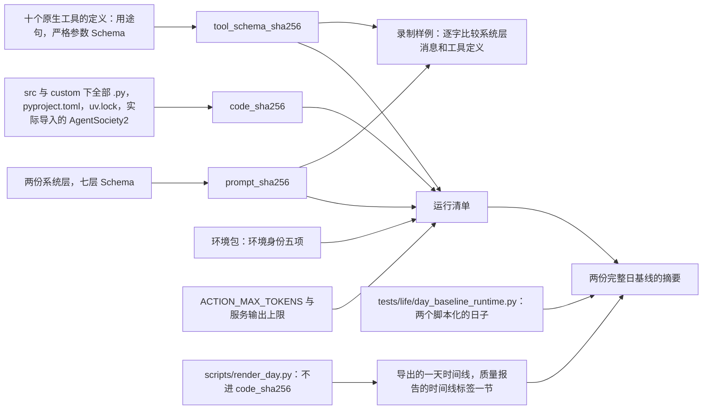
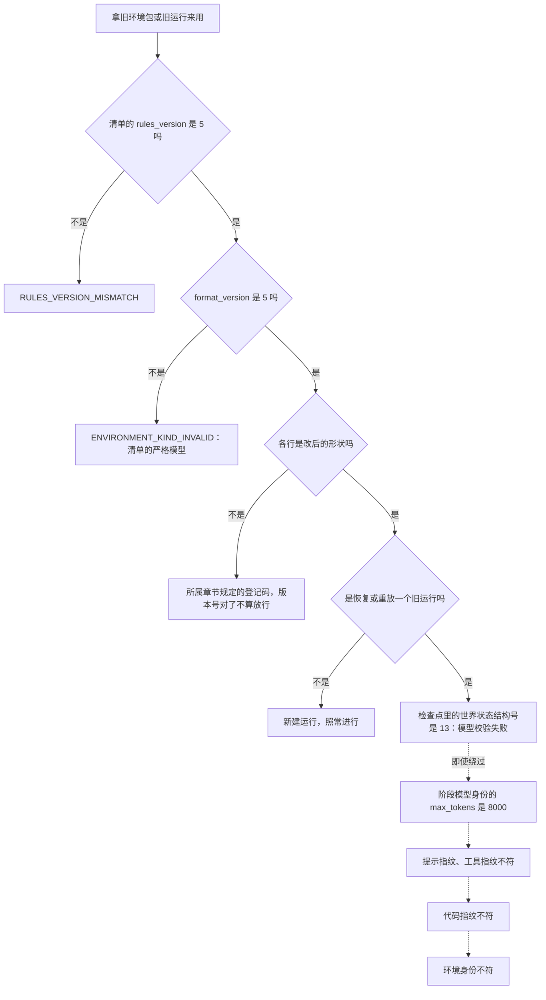
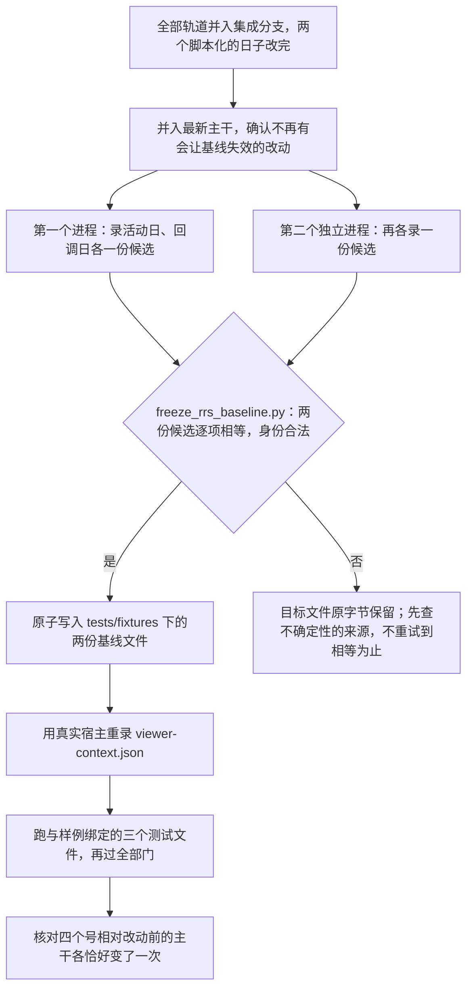

# 版本、身份与基线

> 本章属于[首次真实模型单日运行：修复与新增规格](../SPEC-first-real-day-run.md)，读法和叫法见那一页。

## 目标与依据

改后人物这一天里会出现今天的记录里没有的东西：购买请求多写一项 `prefer`，多出一种占五到十分钟的活动「查询」，在地点做完一件写明供一餐的事算吃了一餐，瑞幸咖啡这样没有内容的购物 app 不能再单独打开。这些都落进持久化的文件：手机时间线的导出里多出 `activity_type` 为 `query` 的活动行和它名下的 app 使用行，环境包的 app 行少一个字段、地点内容行多一个字段。所以改动之前的东西和改后的引擎对不上：issue 13 的那次运行（08:46 的咖啡、11:49 的午饭都在里面）不能再恢复或重放，它的导出通不过认证；数据集仓库今天发布的环境包在加载的第一步被拒，要重新发布。本章规定哪几个号变、变成多少、旧值在哪一步被哪一句话拒绝，仓库里绑定生产字节的三份测试文件怎样重做，以及别的仓库要跟着做什么。

今天四个要动的号是：规则版本 4（`src/worldmock/exchange/constants.py:7`）、目录格式 4（`src/worldmock/catalog/models.py:47`）、世界状态 13（`src/worldmock/life/models.py:29`）、导出清单 5（`src/worldmock/footprints/export.py:29`），各自由严格比较守着，没有迁移和兼容读取。两份完整日基线和查看器录制样例在提交 `2b10aa9c` 上与代码相符：写规格前的核查按本章的办法把它们各重录过一遍，结果与仓库里的文件逐项相等。

本章实现提案「改动的牵连」里的六条：「已有运行不能再恢复」「两份完整日基线要重新冻结」「几个格式版本号会动……具体数字在规格里定」「数据集仓库要跟着改」「下游要跟着认」「证据层级」；以及裁决清单里「导出里多一种活动「查询」」带来的两个结构号、「思考额度」带来的模型身份变化。有一处与提案不同：提案只点了世界状态、导出和目录格式三个号，没有提规则版本；规则版本也要升，因为选店、查询、结束即做完、供一餐都是引擎的固定规则，不升的话按旧规则发布的环境包在改后的引擎上不会在第一步被拒。

## 行为规格

### 用词

| 词 | 含义 |
| --- | --- |
| 结构号 | 写在某一种持久化结构里的版本号 |
| 身份 | 运行开始时冻结、此后逐项比对的摘要或字段组 |
| 指纹 | 由提示文字、层 Schema、工具定义或源码算出的摘要 |
| 基线 | 测试直接读取并逐字比较的冻结期望文件。本章说的两份完整日基线是 `tests/fixtures/dayrun-activity-baseline.json`（活动日）和 `tests/fixtures/dayrun-callback-baseline.json`（回调日） |
| 录制样例 | `tests/fixtures/viewer-context.json`，真实宿主发出的两次模型请求的原样记录，查看器的用例读它 |
| 样例环境 | 测试用的环境包 `tests/fixtures/dataset-environment/`，其余各章也叫它基础夹具环境 |
| 版本提交、收尾 | 实施顺序里的两步：版本提交在各条轨道并行开工之前把四个号一次改完；收尾在全部轨道并入之后重做基线和录制样例。次序见[「实施顺序与验收」](./13-implementation-order.md)一章 |

### 升号原则：每个号在主干上只动一次

- 一个结构号只守一种结构。结构的字段集合、取值闭集或可接受的取值域变了才升；只有取值变了不升。
- 整次改动在一条集成分支上完成，一次并入主干。主干上四个号各变一次：规则版本 4 变 5，目录格式 4 变 5，世界状态 13 变 14，导出清单 5 变 6。
- 四个号不随各条轨道分散去升，由版本提交一次改完：四个常量、样例环境清单的三个版本字段、全部钉住它们的断言（本章登记的四条变异也放在这个提交里，见「归哪条实施轨道」）。此后任何轨道都不再碰这四行。集成分支上因此有一小段「号已经是新值，结构还是旧的」的中间状态，主干看不到它。
- 旧值由严格比较直接拒绝。不写迁移，不保留「4 或 5」这样的读取分支，不提供双格式。
- 仓库里不保存旧格式的夹具。旧值被拒，由测试在新夹具的副本上改出反例来证明。
- 不新增第三方依赖：`pyproject.toml`、`uv.lock`、`requirements/` 不动（它们在代码指纹和基线的 `generation` 里）。AgentSociety2 的补丁不改。

### 版本号、结构号与标识

| 名称 | 今天 | 改后 | 为什么 | 定义处 | 旧值在哪里被拒 | 钉住它的断言 |
| --- | --- | --- | --- | --- | --- | --- |
| 规则版本 `RULES_VERSION` | 4 | 5 | 引擎的固定规则变了，见下一小节 | `src/worldmock/exchange/constants.py:7` | 加载环境时先比清单原始对象里的整数（`src/worldmock/catalog/loader.py:59-60`），登记时再核一次（`src/worldmock/catalog/admission.py:52-53`）；恢复与重放（`src/worldmock/life/run_identity.py:15-25`）；导出认证（`src/worldmock/footprints/validation.py:204-222`）；冻结基线（`scripts/freeze_rrs_baseline.py:50-57`） | `test_constants.py`、`test_manifest_version.py`、`test_identity.py`、`test_environment_identity.py`、`test_acs_export.py`、`test_freeze_rrs_baseline.py` 等，逐行见「测试要求」 |
| 目录格式 `format_version` | 4 | 5 | app 行与内容行的字段集变了，见下一小节 | `src/worldmock/catalog/models.py:47`（`Literal[4]`） | 清单的严格模型，排在规则版本比较之后 | `test_manifest_version.py`、`test_identity.py`、`test_loader.py`、`test_validation.py` |
| 世界状态 `WORLD_SCHEMA_VERSION` | 13 | 14 | 活动种类的闭集多了 `query`，世界里多了查询活动的私有数据 | `src/worldmock/life/models.py:29`，字段在 `:569` | 严格字面量：恢复（`src/worldmock/runtime.py:246`）和打开运行（`src/worldmock/life/engine_context.py:36`）时模型校验失败；导出认证（`src/worldmock/footprints/validation.py:91-93`） | `test_state_serialization.py`、`test_acs_export.py` |
| 导出清单 `EXPORT_SCHEMA_VERSION` | 5 | 6 | 理由只有一条：导出里 `activity_type` 的闭集多了 `query`，它名下可以有 `app_use` 行。工件仍是六份 | `src/worldmock/footprints/export.py:29`，工件键集在 `:31-32` | 导出认证（`src/worldmock/footprints/validation.py:85-86`）；评估读入（`src/worldmock/evaluation/validation.py:257-259`） | `test_acs_export.py`、`test_phone_record_export.py`、`test_complete_day_scripts.py`、`test_branch_coverage.py` |
| 运行清单 `RUN_MANIFEST_SCHEMA_VERSION` | 6 | 6，不变 | 顶层字段集和 `stage_model_identity` 的键集都不变；`max_tokens`、`rules_version` 只是取值变 | `src/worldmock/life/models.py:32`，写入在 `src/worldmock/life/world_setup.py:88` | 不适用。旧运行由世界状态、模型身份、代码身份和环境身份拒绝 | `tests/dayrun_baseline.py:109`、`test_run_manifest.py:35`、`test_environment_identity.py:38`、`:54` |
| 质量报告 `quality.json` 的 `schema_version` | 8 | 8，不变 | 本次不增删它的任何键；时间线标签一节只有文字和计数变 | `src/worldmock/footprints/quality.py:71` | 不适用 | `test_acs_export.py:107-108`、`test_phone_record_export.py:162`、`tests/unit/footprints/test_quality.py:616`、`:646` |
| `persona.toml`、`config.toml` 的 `schema_version` | 2、2 | 不变 | 人设和运行配置的字段不变。「序列化警告」那条缺陷只改声明类型，作者照旧写 TOML 数组 | `src/worldmock/input_models.py:153`、`:226` | 不适用 | 现有断言不动 |
| 行为报告、长期比较、盲评包的标识 | `behavior-metrics-4`、`evaluation-metrics-2`、`blind-review-packet-2` | 不变 | 评估能读带查询的导出，但报告的键集不变，查询不产生新的公开点事实 | `src/worldmock/evaluation/behavior_metrics.py:126`、`metrics.py:150`、`review.py:485` | 不适用 | `tests/unit/evaluation/test_behavior_metrics.py:677` |
| 检查点记录、人物工作区 `AGENT.json`、生活参与者回执的结构号 | 1 | 不变 | 形状不变 | `src/worldmock/footprints/store.py:308`、`src/worldmock/runtime.py:401`、`src/worldmock/life/engine.py:202` | 不适用 | 现有断言不动 |
| AgentSociety2 锁定源码摘要 `AS2_LOCKED_SOURCE_SHA256` | `bf716c7b982ea1aa057207b4ad06e1758b598bccef90834e18da2ca4253db3c6` | 不变 | 十条缺陷和全部新行为都在 WorldMock 一侧实现 | `src/worldmock/run_setup.py:25` | 不适用 | `tests/unit/engineering/test_shared_rules_spec.py` |
| 样例环境的 `environment_version` | `"3"` | `"4"` | 样例环境的行变了。内容变化就是新发布的一版，环境版本跟着改 | `tests/fixtures/dataset-environment/catalog/manifest.json` | 不适用（它是环境身份五项之一，换了就是另一个环境） | `test_identity.py`、`test_run_manifest.py`、`test_cli.py`、`test_validation.py`、`test_environment_inputs.py`、`test_complete_day_baseline.py` |
| `result.json` | 没有结构号 | 仍没有 | 「token 统计漏算」那条缺陷把其中 `token_stats` 的形状从字典改成数组（见[「十条缺陷与思考额度」](./09-defects-and-budget.md)一章）。它没有结构号可升，所以这个变化对读它的人是静默的，列进本章「交给数据集仓库和下游的事」 | `src/worldmock/cli.py` 写出 | 不转换旧文件 | 见那一章 |

各个号只在所属的设计文档里维护一处：规则版本与目录格式在《资源引擎》「环境目录文件」，世界状态与运行清单在《状态与序列化》「单一状态归属」，导出清单与质量报告在《记录引擎》「完整导出认证」。

### 搭同一次升号的结构变化

四个号各升一次，下面这些变化都算在这一次里，不另升：

| 号 | 落在这一次里的变化 | 出处 |
| --- | --- | --- |
| 规则版本 5 | 外卖选店先看 `prefer`，快递商品的下单 app 先看 `prefer` | 见[「购买时写想用的 app」](./01-purchase-prefer.md)一章 |
| | 新增查询：时长 300 到 600 秒，这几分钟所在的 app 怎样定，答案怎样算，做完自己结束 | 见[「查询」](./02-query.md)一章 |
| | 没有登记内容的内容 app 不能用 `interact` 打开；打开 app 不再附带商品清单 | 见[「打开 app 与 app 目录字段」](./04-app-opening.md)一章 |
| | 在地点做的事「结束」算做完一轮 | 见[「做完之后读到什么，提前结束算不算做完」](./05-results-and-ending.md)一章 |
| | 写明供一餐的地点内容做到头时进账一餐 | 见[「在地点吃的一餐」](./07-meals.md)一章 |
| | 不适脉冲改成对着共同结算后的身体计算 | 见[「十条缺陷与思考额度」](./09-defects-and-budget.md)一章 |
| 目录格式 5 | app 行删除 `browse_duration_seconds` | 见[「打开 app 与 app 目录字段」](./04-app-opening.md)一章 |
| | 绑定地点的内容行新增必填的 `provides_meal` | 见[「在地点吃的一餐」](./07-meals.md)一章 |
| 世界状态 14 | 活动种类多 `query`；查询活动的私有数据（键集 `action`、`targets`、`app_id`、`scoped`、`accepted_event_id`，做完的另有 `answer`） | 见「查询」「删除 query_world 与第五种活动」两章 |
| | `interact` 活动不再有 `content_id` 为空的七键形状 | 见[「打开 app 与 app 目录字段」](./04-app-opening.md)一章 |
| 导出清单 6 | `activities.jsonl` 的 `activity_type` 多 `query`；`app-usage.jsonl` 里出现属于查询活动的 `app_use` 行 | 见[「删除 query_world 与第五种活动」](./03-fifth-activity-kind.md)一章 |
| | 事件正文里新增的键：做完一条供一餐内容的 `activity_progress` 带 `data.meal`；一组业务拒绝的第一条 `action_result` 可以带 `data.resource_flows`（与 `status`、`error_code` 同级） | 见「在地点吃的一餐」「十条缺陷与思考额度」两章 |
| | 一天时间线的写法 | 见[「统一显示写法」](./08-display.md)一章 |

- 导出清单升号的理由只写 `activity_type` 的闭集这一条。事件正文里新增的键和时间线的写法是同一次改动里导出字节的其他变化，它们本身不构成升号的理由，也不带来第二次升号。
- `interact` 活动的 `content_id` 不再可空，不是世界状态或导出清单升号的理由；这两个号各自只因查询升一次。
- 导出与评估里今天把四种活动写成字面集合的三处（`src/worldmock/footprints/app_usage.py:103`、`:173`，`src/worldmock/evaluation/public_evidence.py:494`）改读常量 `ACTIVITY_ACTIONS`，改后不再留第三份字面集合。这件事归查询轨道，见[「删除 query_world 与第五种活动」](./03-fifth-activity-kind.md)一章；写在这里是因为它决定了导出的闭集从哪里来。
- 同一个 app 首尾相接的几次使用只在查看器里连成一段，不改任何持久化的结构，所以上表里没有它的行：app 行只少 `browse_duration_seconds` 一个字段，`interact` 活动的私有数据不为它加键（见[「查看器里的连续使用」](./06-continuous-use.md)一章）。

### 对其余各章的约束

运行清单、质量报告不升号，同时就是对其余各章的约束。任何一章的实现违反下表任一行，都要回到本章重新定号，不能自行处理。

| 约束 | 今天由什么决定 | 各章怎样守住 |
| --- | --- | --- |
| 不给 `quality.json` 增删键 | `build_quality_report` 的返回值（`src/worldmock/footprints/quality.py:69-72` 起） | 查询不计入内容接触；在地点吃的一餐不进食品效率；「显示」只改 `timeline_labels` 一节里的文字和计数 |
| 不给运行清单增删顶层字段，不动 `stage_model_identity` 的键集 | `_run_manifest` 的十七个键（`src/worldmock/life/world_setup.py:84-100`） | 人物写的 `prefer` 留在请求事件里；思考额度只改 `max_tokens` 的取值 |
| 不新增宿主拒绝码 | `HOST_NAME_CODES`（`src/worldmock/life/error_contract.py:38`）；质量报告 `host_codes` 的键集取它（`src/worldmock/footprints/quality.py:789`） | 把只用于下单和查询的 app 写进 `target` 的退回沿用 `ACTION_NOT_OFFERED`；查询里写错的名称用环境一侧已有的 `SUPPLY_NOT_FOUND` |
| 不新增事件类型 | `EventType` 的十四个值（`src/worldmock/footprints/models.py:103-107`） | 查询做完不写收尾事件；在地点吃的一餐记在 `activity_progress` 上；「结束算做完」不另记事件 |
| 不新增 `app_foreground` 的步骤 | `_FOREGROUND_STEPS` 的三个值 `navigation`、`ordering`、`payment`（`src/worldmock/footprints/app_usage.py:34`） | 查询那几分钟的 app 记在查询活动自己的私有数据上，导出的 `app_use` 行取这项活动的执行区间 |

### 三个指纹与派生身份



| 身份 | 计算处 | 覆盖什么 | 今天的值（离线算出，只用来确认改后确实变了） | 改后 |
| --- | --- | --- | --- | --- |
| `prompt_sha256` | `src/worldmock/agents/life_prompt.py:136-141` | 生活系统层 `LIFE_SYSTEM_LAYER`、只读系统层 `READONLY_SYSTEM_LAYER`、七层 Schema `LAYER_SCHEMAS` 的规范 JSON。不含工具用途句 `TOOL_DESCRIPTIONS` | `2c7bb0039722080eabd8cd6eb5cbee63ef8f4e835c36cf95371279665b9f838d` | 按最终字节重算。变的原因：系统层从十七条改成二十条；工具层 Schema 的 `callable_index` 多 `prefer_apps`、少 `query_categories`，动作枚举多 `query`；进度层结果明细的 Schema 补上 `content`、`contents`、`query`，购买行加 `channel` |
| `tool_schema_sha256` | `custom/agents/life_agent.py:933-939` | `_TOOL_MODELS` 里全部原生工具的定义，含用途句和严格参数 Schema；不含只读问答的 `finish` 和就寝反思的 `submit_reflection` | `49416d2850734bb67ed6197d757bac394e27238b58f6e7e91c6a0540e440b49c`，十一个工具 | 按最终字节重算，十个工具：少了 `query_world`；`start_side_activity` 多一个参数 `prefer`，`action` 的枚举多 `query`，用途句和字段说明改写 |
| `code_sha256` | `src/worldmock/run_setup.py:100-110` | `src/`、`custom/` 下全部 `.py`，根目录的 `pyproject.toml`、`uv.lock`，实际导入的 AgentSociety2 包。不含 `scripts/`、`tools/`、`tests/`、`docs/` | `9cf31a685f354b0e54014e4dc85fc7862338fc1362b5820d16df72117b4a22e7` | 任何生产改动都让它变，哪怕只改注释 |
| 阶段模型身份里的 `stages.action.max_tokens` | `src/worldmock/run_setup.py:85-97`，核对在 `:230-259` | `min(ACTION_MAX_TOKENS, 服务输出上限)` | 样例环境的服务上限是 32,768，所以是 8000 | 16000，见下一小节 |
| 环境身份五项 | `src/worldmock/environment.py:186-195` | `environment_id`、`environment_version`、`rules_version`、`catalog_content_sha256`、`map_sha256` | 样例环境：`artificial-test`、`"3"`、4、`317fe5be…9d697`、种子 7 的地图 `017bbcfe…3afedf5` | 样例环境：`artificial-test`、`"4"`、5、新的目录摘要、地图摘要不变 |
| `catalog_content_sha256` | `src/worldmock/catalog/identity.py:72-88` | 在场的目录文件逐个分帧，再加去掉摘要字段的清单本身 | 见「样例环境」小节 | 清单的版本字段也在摘要里，所以只改版本字段摘要就变 |
| `persona_sha256`、`config_sha256` | 两份 TOML 的原字节摘要 | 原字节 | 样例环境的人设 `6a5f1edc…2d7e1d` | 不变：样例环境的两份 TOML 不动 |

- 测试里没有任何指纹字面量，只断言能重算、改了文字或工具定义就变。规格也不给出改后的数值。
- 集成分支上每并入一条轨道，三个指纹都按当时的字节重算；不要求它们在整次改动里只变一次。只有四个结构号要求只变一次。
- `scripts/render_day.py` 不在代码指纹里，但导出的 `timeline/<人物>-<日期>.md` 由它生成并在导出清单里登记了摘要（`src/worldmock/footprints/timeline_labels.py:107-115` 按路径加载它，`src/worldmock/footprints/export.py:113-131` 写入并登记），质量报告的时间线标签一节也调它。所以改这个脚本不改 `code_sha256`，不会让旧运行不能恢复，却会改导出字节，并经导出工件的摘要让两份基线失效。提案说「导出时间线的写法变了也要重冻」，原因就是这一条。
- 只改查看器（`tools/`）不动任何指纹，也不让基线失效；但录制样例里录下的系统层和工具定义变了，查看器的用例就要跟着重录的样例改。
- 指纹与当前不符时的拒绝位置和文字不变：新建运行报 `Run model identity disagrees with environment inputs`（`src/worldmock/life/world_setup.py:138-146`）；恢复与重放时提示指纹或工具指纹不符报 `Checkpoint model identity differs from the current LifeAgent contract`，代码指纹不符报 `Checkpoint code identity differs from the current runtime`（`src/worldmock/runtime.py:273-286`）。

### 思考额度改变阶段模型身份

每次决策的输出上限从 8,000 提到 16,000，只改一个常量 `ACTION_MAX_TOKENS`（`custom/agents/life_agent.py:68`），规则见[「十条缺陷与思考额度」](./09-defects-and-budget.md)一章。它对身份的后果在本章交代：

| 服务的输出上限 | 运行清单里 `stage_model_identity.stages.action.max_tokens` 今天 | 改后 |
| --- | --- | --- |
| 样例环境的 32,768 | 8000 | 16000 |
| DeepSeek 的 393,216 | 8000 | 16000 |
| 小于 16,000 的服务，例如 8,192 | 8000 | 8192 |

- 这是取值变化，键集不变，运行清单结构号不升。
- 人物的一次决策、只读问答、截断后的那一次重试都从这个阶段值取上限，记忆巩固与就寝反思直接读同一个常量，所以四种调用一起变。上限仍是源码常量，不进 `config.toml`。
- 恢复与重放时这一项逐值核对：清单里还是 8000 的运行以 `IntegrityError("Stage model identity is inconsistent")` 被拒（`src/worldmock/run_setup.py:249-255`）。它排在世界状态结构号之后，所以改动之前的运行实际先撞上世界状态那一关。
- 录制样例里两个请求的 `max_tokens`（`tests/fixtures/viewer-context.json:933`、`:1887`）重录后是 16000。
- 零点计划的 `PLAN_DAY_MAX_TOKENS`（`src/worldmock/life/day_planning.py:32`）不动，仍是 8000，它不进阶段模型身份。

### 旧输入与旧运行在哪一步被拒



实线是真正会遇到的第一处拒绝；虚线是它后面还排着的几关，任何一关都过不去，列出来是为了说明没有哪一种旧运行能漏过去。

| 旧输入 | 入口 | 第一处拒绝，原文 | 位置 |
| --- | --- | --- | --- |
| 环境包的清单写着 `rules_version: 4`（数据集仓库今天的全部环境包） | `validate`、`run`、`resume`、`replay` 读环境 | 登记码 `RULES_VERSION_MISMATCH`，原因 `The environment was published for a different rules version.`，先于一切形状检查。`worldmock validate` 输出 `[{"path": "catalog", "code": "RULES_VERSION_MISMATCH", "reason": "The environment was published for a different rules version."}]`，非零退出 | `src/worldmock/catalog/loader.py:59-60` |
| `rules_version` 改成了 5，`format_version` 还是 4 | 同上 | 登记码 `ENVIRONMENT_KIND_INVALID`；原因以 `A declared kind is outside the fixed set. ` 开头，后面是清单严格模型的原文，其中有字段名 `format_version` | `src/worldmock/catalog/models.py:47` |
| 两个号都是 5，app 行还写着 `browse_duration_seconds` | 同上 | `ENVIRONMENT_KIND_INVALID`，详情以 `app-catalog.jsonl:<行号>` 开头，含 `Extra inputs are not permitted`。读行的次序是 app 目录在前，所以 app 行和内容行都没改的包先报这一句 | 见[「打开 app 与 app 目录字段」](./04-app-opening.md)一章 |
| 两个号都是 5，地点内容行没写 `provides_meal` | 同上 | `ENVIRONMENT_KIND_INVALID`，详情 `content-catalog.jsonl:<行号> <content_id>: provides_meal is required for a location content; allowed values: true, false.` | 见[「在地点吃的一餐」](./07-meals.md)一章 |
| 用重新发布的环境包恢复或重放改动之前的运行 | `resume`、`replay` | 取到检查点后校验其中的世界状态：Pydantic 的 `ValidationError`，定位 `schema_version`，原文含 `Input should be 14`（测试只认字段名）。命令以 1 退出，错误日志是 `WorldMock resume failed`（重放是 `WorldMock counterfactual replay failed`）和 `WorldMock command failed`，后面带这段校验错误。不创建新运行目录 | `src/worldmock/runtime.py:246` |
| 同上，世界状态之后排着的几关 | 同上 | 依次是 `Stage model identity is inconsistent`、`Checkpoint model identity differs from the current LifeAgent contract`、`Checkpoint code identity differs from the current runtime`、`Runtime environment identity mismatch` | `src/worldmock/runtime.py:247-248`、`:273-286`，`src/worldmock/life/run_identity.py:15-25` |
| 认证改动之前的代码写出的导出 | 直接调用导出认证 `validate_export`（本仓的测试和读导出的工具） | `IntegrityError("Export manifest is not a committed supported version")`。它后面还排着 `Export frozen run manifest or environment identity is invalid`（冻结运行清单里的规则版本是 4）和 `Export checkpoint world schema does not match the current code`（检查点里的世界状态结构号是 13） | `src/worldmock/footprints/validation.py:85-93`、`:204-222` |
| 拿结构号是 5 的导出做评估 | `worldmock evaluate`。评估先做自己的清单校验（`src/worldmock/evaluation/validation.py:217`），再调导出认证（`:223`），所以先出现的是评估这一句 | `EvaluationError("invalid_input", "delivery schema_version must be 6")` | `src/worldmock/evaluation/validation.py:257-259` |
| 对改动之前的运行目录执行 `export`，或用 `scripts/render_day.py`、`scripts/inspect_run.py events` 读它 | 取显示名称时用当前的行模型解析运行冻结的目录 | 冻结的 app 目录里带着 `browse_duration_seconds` 的运行（issue 13 那次就是）：`ENVIRONMENT_KIND_INVALID`，详情以 `app-catalog.jsonl:<行号>` 开头。冻结目录恰好不含这个字段的旧运行，本章不保证导得出来（改后的导出自查和事实投影各有会拦住旧事件的地方，见所属各章）；即使导出来了，写出的导出在认证时仍被拒：冻结运行清单里的规则版本是 4，报 `Export frozen run manifest or environment identity is invalid` | 见[「统一显示写法」](./08-display.md)一章 |
| 把规则版本是 4 的基线候选交给冻结脚本 | `scripts/freeze_rrs_baseline.py` | `ValueError("Complete-day candidate has an invalid current identity or summary")`，脚本以 1 退出，目标文件原字节保留 | `scripts/freeze_rrs_baseline.py:28-57` |
| 用查看器或 `worldmock status` 看改动之前的运行 | 查看器，`status` | 不拒绝。查看器是容错的阅读工具；`status` 只读三份 JSON 和数据库，不校验版本。旧的 `result.json` 不转换，原样输出 | 见「统一显示写法」「十条缺陷与思考额度」两章 |

例：所有者拿数据集仓库提交 `c28268a` 里 issue 13 的那次运行，想从 08:46 之前的一个检查点重放，看改后咖啡能不能买成。

1. 用那次运行自带的环境包：读环境这一步就停下，`RULES_VERSION_MISMATCH`。
2. 数据集仓库按本章「交给数据集仓库和下游的事」重新发布了环境包，再用它重放：环境读得进来，取到检查点后校验世界状态，结构号是 13，停下。输出目录没有被创建。
3. 所以这件事做不成。要看改后那一天的咖啡，只能用重新发布的环境包从头新建一次运行；这正是「证据层级」里记为「未取得」的那次真实模型单日运行。
4. 那次旧运行仍然可以用查看器打开（把整个运行目录拖进去），用 `worldmock status` 看状态。

缺 `prefer` 的副工具请求、模型仍然调用 `query_world`，属于模型的输出而不是持久化的旧输入，各自的退回见「购买时写想用的 app」「删除 query_world 与第五种活动」两章。

### 样例环境

样例环境改后的全部变化如下，表里的目录文件都在 `tests/fixtures/dataset-environment/catalog/` 下：

| 文件 | 变化 | 改成什么 | 谁改 |
| --- | --- | --- | --- |
| `manifest.json` | 三个版本字段 | `format_version` 5，`rules_version` 5，`environment_version` `"4"`；`environment_id` 仍是 `artificial-test` | 版本提交 |
| `manifest.json` | 文件表 `files` 与 `catalog_content_sha256` | 每次改完行或版本字段后由 `refresh_manifest_identity` 重写，五条文件记录的路径不变 | 版本提交刷新一次；内容轨道每改一次行刷新一次 |
| `app-catalog.jsonl` | 第 5 行饿了么、第 7 行美团 | 删除 `browse_duration_seconds` | 内容轨道 |
| `content-catalog.jsonl` | 四条绑定地点的内容：第 2 行 `c-chat`「测试闲聊」、第 10 行 `c-rest`「测试休息」、第 14 行 `parcel-service`「驿站取件」、第 15 行 `topic-sales`「季度销售数据整理」 | 各加 `"provides_meal":false`，键按字母序排在 `location_kinds` 与 `pushable` 之间。十一条 app 内容不写这个键 | 内容轨道 |
| `location.jsonl`、`merchant-catalog.jsonl`、`travel-method.jsonl`，以及上一级的 `persona.toml`、`config.toml` | 不动 | 八个地点、七件商品、三种出行方式、人设和运行配置都与今天逐字节相同 | — |

改后的 `app-catalog.jsonl` 全文（八行，键升序、无空格、每行以 LF 结尾；与今天不同的只有饿了么、美团两行，其余六行逐字节相同）：

```json
{"actions":["purchase"],"app_id":"alipay","name":"支付宝","role":"function"}
{"app_id":"amap","name":"高德地图","role":"function","travel_method_ids":["bus","driving","taxi","walking"]}
{"app_id":"bilibili","name":"哔哩哔哩","role":"content"}
{"app_id":"douyin","name":"抖音","role":"content"}
{"app_id":"eleme","name":"饿了么","role":"content"}
{"app_id":"keep","name":"Keep","role":"content"}
{"app_id":"meituan","name":"美团","role":"content"}
{"actions":["purchase"],"app_id":"wechat","name":"微信","role":"function"}
```

清单怎样刷新：

- 行和清单的版本字段都是手工改的文件；文件表和目录摘要不手写，由生产入口 `worldmock.catalog.identity.refresh_manifest_identity`（`src/worldmock/catalog/identity.py:91-101`）生成。在检出根执行（`$PY` 的含义见下文「两份完整日基线」）：

  ```sh
  $PY -c "from worldmock.catalog.identity import refresh_manifest_identity as r; print(r('tests/fixtures/dataset-environment/catalog').catalog_content_sha256)"
  ```

- 目录摘要覆盖清单本身（去掉摘要字段之后的规范 JSON，`src/worldmock/catalog/identity.py:85-87`）。所以版本提交只改三个版本字段、一行目录都不动，摘要也变，改完同样要刷新。
- 清单在集成分支上遇到合并冲突时，一律取各文件的最终字节后重跑刷新，不手工合并摘要。
- 刷新只重写文件表和摘要，不改版本字段，也不校验行的形状；行对不对由随后加载样例环境的任何一条测试证明。

离线按上面的写法算过各个阶段的结果，供刷新后核对；以刷新的输出为准，测试不写这些字面量：

| 阶段 | `app-catalog.jsonl` 字节数 | `content-catalog.jsonl` 字节数 | `catalog_content_sha256` |
| --- | --- | --- | --- |
| 今天 | 602 | 4,996 | `317fe5be378bd29a2f1cfab5a2ce4625e240a7f38d68585d00b0a7d73839d697` |
| 版本提交之后（只改三个版本字段） | 602 | 4,996 | `aecc0a3d04697afd8d6655f3aa2e8d89b63969874051a791f42453a8d4496376` |
| 行改完（饿了么、美团两行删掉浏览时长，四条地点内容加上 `provides_meal`） | 542 | 5,084 | `1681064c3524c86c278a46a752f2e2af852c8df98a986a0bb04063b889da1649` |

样例环境保持最小：不加瑞幸咖啡，不加供一餐的内容，不加地点系列。这些形状由测试在副本上构造（`tests/life/environment_inputs.py` 的 `copy_environment`、`catalog_rows`、`write_catalog_rows`，写完自动刷新清单）。理由是下文两份基线的不变项要守得住：地点集合不动，地图摘要就不动。测试里手工写了旧字段的环境副本（例如 `tests/life/phone_records.py` 给瑞幸咖啡写的浏览时长）各归所属的章列出，本章不重列。

显示轨道新增的两种语言共读的用例文件 `tests/fixtures/display-wording-cases.json` 里是完整的目录行（见[「统一显示写法」](./08-display.md)一章）。内容轨道改样例环境的行时，这份文件里同样的行一并改。

### 两份完整日基线

**它们绑定什么。** 每份基线是 `{persona_sha256, config_sha256, environment_identity, seed, summary}` 加上冻结时的机器信息 `generation`。`summary` 是一次脚本化完整日的全部产物的规范化摘要：导出目录的每个文件、全部检查点、全部运行素材（`tests/dayrun_baseline.py:131-160`）。规范化只替换机器路径和由它派生的摘要；运行清单里的 `code_sha256`、两个指纹和环境身份都不屏蔽。所以下面任何一样变了，基线就与代码不符：

- `src/` 或 `custom/` 下任何一个字节，哪怕只是注释；
- `scripts/render_day.py`（经时间线文件和质量报告）；
- 样例环境的任何一行，或清单的版本字段；
- 两个脚本化的日子本身（`tests/life/day_baseline_runtime.py`）和录制用到的助手：`tests/life/conftest.py` 的请求助手与 `stage_day_plan`，`tests/life/environment_runtime.py` 的提交与收尾助手，`tests/frozen_inputs.py` 的 `fixture_metadata`（模型元数据进运行清单），`tests/integration/runtime_fixtures.py` 的 `current_run_identity` 与 `write_agent_workspace`（人物工作区进检查点）。

录制不经过的测试文件不计入，提交基线文件本身也不会让它再次失效。这张单子讲的是基线绑定什么；哪些改动算「会让基线失效的改动」，以[「实施顺序与验收」](./13-implementation-order.md)一章的定义为准，那里另外列了根目录的 `pyproject.toml` 和 `uv.lock`（它们在代码指纹里，本次不动）。

**确定性靠什么。** 候选由 `tests/life/day_baseline_runtime.py:90-112` 的 `record_complete_day` 产生，它先调用 `deterministic_day_runtime`（`tests/dayrun_baseline.py:27-40`）：只把 `worldmock.footprints.models`、`checkpoint`、`store` 三个模块里的 `uuid4`、`store` 的墙钟与计时、AgentSociety2 人物模块的墙钟换成固定值。本次新增的代码不得在这三个模块之外用 `uuid4` 或墙钟，不得依赖集合的迭代次序或没有 `ORDER BY` 的查询次序。查询答案的排序、候选 app 的次序都有明确的排序键，原因就在这里。

**什么时候做。** 只做一次：在集成分支已经并入最新主干、此后不再有会让基线失效的改动的那个提交上。中间提交上这两份基线与代码不符是预期内的；与它们绑定的三个测试文件怎样排除，见[「实施顺序与验收」](./13-implementation-order.md)一章。重冻之后又出现会让基线失效的改动时怎样重做、集成分支并入主干时必须已经包含主干的头，也都按那一章的定义办，本章不另写一套。



**规程。** 下面的命令在检出根执行。`$PY` 是通过了环境引导的解释器入口：正式环境里先运行 `python scripts/bootstrap.py --profile release`，`$PY` 就是 `python`；本机的工作树用 `bash <主检出>/.work/tools/envrev/prepare_wt.sh <工作树>` 准备，`$PY` 是 `bash <主检出>/.work/tools/envrev/py.sh`。两种都会留下通过的 `.work/environment-receipt.json`，冻结脚本要读它。参考平台沿用现有基线 `generation` 记载的 Windows、AMD64、CPython 3.12.13。

1. 在 `.work/first-real-day-run/day-baseline/` 放一个不上库的用例 `test_record_candidate.py`：

   ```python
   import json, os
   from pathlib import Path
   import pytest
   from tests.life.day_baseline_runtime import record_complete_day

   PROJECT = Path(os.environ["WORLDMOCK_CHECKOUT"]).resolve()

   @pytest.mark.parametrize("kind", ["activity", "callback"])
   def test_record_candidate(monkeypatch, tmp_path, kind):
       candidate = record_complete_day(monkeypatch, tmp_path / kind, PROJECT, kind)
       out = Path(os.environ["DAY_BASELINE_OUT"])
       out.mkdir(parents=True, exist_ok=True)
       (out / f"{kind}.json").write_text(json.dumps(candidate, ensure_ascii=False), encoding="utf-8")
   ```

2. 用两个独立进程各跑一次，两次用不同的输出目录和不同的 `--basetemp`。`--basetemp` 必须是短路径：写规格前的核查里，把它指到一个很长的路径时，变异杀手里有三十多条 integration 用例在 Windows 上失败，换成短路径全部通过。

   ```sh
   WORLDMOCK_CHECKOUT="$(pwd -W)" DAY_BASELINE_OUT=.work/first-real-day-run/day-baseline/first \
     $PY -m pytest .work/first-real-day-run/day-baseline/test_record_candidate.py -q -p no:cacheprovider \
     --rootdir . --basetemp C:/Users/<用户>/AppData/Local/Temp/frdr-a
   WORLDMOCK_CHECKOUT="$(pwd -W)" DAY_BASELINE_OUT=.work/first-real-day-run/day-baseline/second \
     $PY -m pytest .work/first-real-day-run/day-baseline/test_record_candidate.py -q -p no:cacheprovider \
     --rootdir . --basetemp C:/Users/<用户>/AppData/Local/Temp/frdr-b
   ```

   `pwd -W` 是 Git Bash 给出 Windows 路径的写法。写规格前的核查在提交 `2b10aa9c` 上照这两条命令录过，两种日子合计 31 秒，候选与仓库里的基线逐项相等。

3. 每种日子各冻结一次：

   ```sh
   $PY scripts/freeze_rrs_baseline.py .work/first-real-day-run/day-baseline/first/activity.json \
     .work/first-real-day-run/day-baseline/second/activity.json tests/fixtures/dayrun-activity-baseline.json
   $PY scripts/freeze_rrs_baseline.py .work/first-real-day-run/day-baseline/first/callback.json \
     .work/first-real-day-run/day-baseline/second/callback.json tests/fixtures/dayrun-callback-baseline.json
   ```

   成功时打印 `Complete-day baseline published` 并以 0 退出。两份候选不相等时写 `Complete-day candidates differ in inputs, environment, seed or summary`；身份不合法（包括规则版本不是当前值）时写 `Complete-day candidate has an invalid current identity or summary`；环境回执不符时写 `Complete-day baseline requires a matching successful bootstrap receipt`。三种都以 1 退出，目标文件原字节保留。候选不相等时先找出不确定性的来源，不重试到相等为止。

4. 核对并提交：

   ```sh
   $PY -m pytest tests/system/lifecycle/test_complete_day_baseline.py tests/system/lifecycle/test_complete_day_scripts.py \
     -q -p no:cacheprovider --basetemp C:/Users/<用户>/AppData/Local/Temp/frdr-c
   ```

5. 不为另一个平台另存一份基线。持续集成若在 Ubuntu 上得到不同的摘要，按跨平台不可复现处理；这一层目前取不到，见「证据层级」。

**重冻后必须成立。**

| 字段 | 活动日 | 回调日 | 重冻后 |
| --- | --- | --- | --- |
| `seed` | 20260105 | 20260106 | 不变 |
| `persona_sha256` | `6a5f1edc2df98c7afd20abcaa092e1113a6c66afca76698bdc3f3977c02d7e1d` | 同左 | 不变 |
| `config_sha256` | `c1edd3357f6c817153fd44a54c8eb24f56ba6af3fd7295caecb1dc542916a331` | `2ce58462e5a79a60c086421ef471cf3f81aef8f7efde55acca614d3d89223184` | 不变 |
| `environment_identity.map_sha256` | `04645c19cfa4576bfe988cca8c41182d5fd67c67ceea1f671e247e130882a8c8` | `a54b9d8d1ad1f70b2dbc0500d74392c6c8b120698d2b24c5bbc78fff1e9daa7e` | 不变 |
| `environment_identity.environment_id` | `artificial-test` | 同左 | 不变 |
| `environment_identity.environment_version` | `"3"` | `"3"` | `"4"` |
| `environment_identity.rules_version` | 4 | 4 | 5 |
| `environment_identity.catalog_content_sha256` | `317fe5be…9d697` | `69a07374…35f12` | 改变 |
| `summary` | — | — | 改变 |
| `generation` 里三份锁文件的摘要 | `aa0d6581…`、`ba819933…`、`674ace2a…` | 同左 | 不变 |

种子、人设摘要、配置摘要、地图摘要和环境名这几项不变，是因为样例环境的人设、运行配置和地点集合没有动，样例环境也没有 `map.jsonl`。其中任何一项变了都说明改动越了界：`map_sha256` 变了是地点集合或地图生成被动了，`persona_sha256` 变了是人设文件被动了，锁文件的摘要变了是依赖被动了。回调日的目录摘要与活动日不同，是因为它的副本多放了一份 `callbacks.jsonl`。

**两个脚本化的日子改后至少走到什么。** 两个日子都从 2026 年 1 月 5 日 00:00:00 起、跑满一天，各步的请求标签进入动作身份（单独一条请求是 `action-<标签>`，同一次回复里的两条是 `action-<标签>-1`、`action-<标签>-2`，见 `tests/life/environment_runtime.py:9-32`），时长和抽取都按它定。脚本用的请求助手是 `purchase(…, prefer=…)`、`use_app(…)` 和新增的 `query(…, prefer=…)`（见「购买时写想用的 app」「查询」两章）。

| 日子 | 改后的脚本，按先后 | 请求标签 | 靠它进基线的新行为 |
| --- | --- | --- | --- |
| 活动日 | 同一次回复：在家点名「测试休息」，并购买牛肉面一份、薯片两份，`prefer` 写「饿了么」。两项都做完并收尾 | `home-basket`，不变 | 带 `prefer` 的购买，并且意向真的起了作用：薯片经饿了么从三杯咖啡来，牛肉面只有一心面馆能送、那家店没上饿了么，另选到美团。一次购买两张订单、两个配送组、两份运费、两条「订单已下单」 |
| | 查询「柠檬茶」，`prefer` 为 `null`，用 `finish_activity` 推进到查询做完。助手在查询做完后直接返回，脚本不为它提交收尾 | `home-query` | 第五种活动；查询自己结束；环境代选的 app 在这几分钟的 `app_use` 行里 |
| | 同一次回复：驾车去公司并打开哔哩哔哩（`prefer` 为 `null`）。脚本断言这一组两项都是 `in_progress` | `travel-media`，不变 | 查询做完不用收尾就能接着做下一步：这一组要是被受理，说明没有待收尾的活动挡着、槽位 2 已经让出。路上各次观察的进度层里有带入的记录 |
| | 在公司点名「季度销售数据整理」并做完；在公司睡 60 分钟；之后由收尾助手步行回家、睡到截止 | `office-work`、`office-nap`，不变 | 与今天相同 |
| 回调日 | 驾车去四季便利；在店里购买纸巾和饭团，`prefer` 为 `null`；`driving_days` 回到 3 | `drive`、`reset-purchase`，不变 | 到店购买：没有下单 app，购买结果的 `channel` 是「到店」 |

- 两个测试助手不用改：`settle_decision`（`tests/life/environment_runtime.py:49-62`）和 `finish_activity`（`:79-90`）都按「不在进行、没有暂停、`concluded_at` 为空」判定待收尾。查询做完时 `concluded_at` 已经写上，助手不会对它调用 `conclude_activity`。查询若被实现成「做完仍待收尾」，助手会替它收尾，活动日的请求序列里就会多出一条点到这次查询的 `conclude_activity`，`test_complete_day_scripts.py` 的断言当场失败。
- 样例环境里没有供一餐的内容，两个日子里因此没有在地点吃的一餐；这一幕由副本上的测试覆盖，不进基线。

### 查看器录制样例

**它绑定什么。** `tests/fixtures/viewer-context.json` 有 `action` 和 `continuation` 两个请求。`tests/system/lifecycle/test_run_viewer_recording.py:26-45` 把其中的系统层消息和工具定义与真实宿主当场发出的逐字比较；查看器的两个 Node 用例文件读它来渲染「上下文」画面。改后它里面这些东西都变了：系统层二十条规则，工具十个，工具层的 `prefer_apps` 和 app 目标行，两处 `max_tokens`。

**录制流程改一步。** 录制函数是同一个测试文件里的 `_recorded_viewer_requests`（`:13-23`）：

| 步 | 今天 | 改后 |
| --- | --- | --- |
| 第一步 | 用 `revise_day_plan` 修订计划，目标文字「浏览一下美团」 | 仍用 `revise_day_plan`，目标文字改成「看一会儿哔哩哔哩」 |
| 第二步 | 经同秒续接用 `start_side_activity` 打开「美团」 | 经同秒续接用 `start_side_activity` 打开「哔哩哔哩」，`prefer` 为 `null`（`side_arguments("interact", "哔哩哔哩")`，助手改后输出三个键） |

第二步必须改：美团没有登记内容，改后打开它的请求被退回（见[「打开 app 与 app 目录字段」](./04-app-opening.md)一章），而这条用例断言运行里没有拒绝。样例仍然是「修订计划，再经同秒续接开始一项活动」，查看器的续接用例改动最小；查询在查看器里的显示由查看器自己的用例覆盖，不靠这份样例。

**重录。** 在收尾步、两份基线重冻之后做。把下面的脚本存成 `.work/first-real-day-run/record_viewer_context.py`（不上库）：

```python
import asyncio, json, os, sys, tempfile
os.environ.setdefault("AGENTSOCIETY_LLM_API_KEY", "offline-test-key")
os.environ.setdefault("AGENTSOCIETY_LLM_API_BASE", "https://example.invalid")
os.environ.setdefault("LITELLM_LOCAL_MODEL_COST_MAP", "True")
from pathlib import Path
from tests.engine_fixture import engine_factory_at
from tests.frozen_inputs import FrozenInputs
from tests.system.lifecycle.test_run_viewer_recording import _recorded_viewer_requests

with tempfile.TemporaryDirectory(prefix="vr") as tmp, engine_factory_at(Path(tmp), FrozenInputs()) as factory:
    requests, _ = asyncio.run(_recorded_viewer_requests(factory))
Path(sys.argv[1]).write_text(json.dumps(requests, ensure_ascii=False, indent=2) + "\n", encoding="utf-8", newline="\n")
```

```sh
$PY .work/first-real-day-run/record_viewer_context.py tests/fixtures/viewer-context.json
$PY -m pytest tests/system/lifecycle/test_run_viewer_recording.py tests/system/viewer/test_run_viewer.py \
  -q -p no:cacheprovider --basetemp C:/Users/<用户>/AppData/Local/Temp/frdr-d
```

- 文件沿用现有写法：两格缩进，非 ASCII 原样，LF，末尾一个换行。内容只来自真实宿主的请求，不手改。
- 写规格前的核查在提交 `2b10aa9c` 上用这段脚本重录过，输出与仓库里的文件逐字节相同（93,648 字节）。
- 重录后必须成立：两个请求各十个工具，名单里没有 `query_world`；两处 `max_tokens` 是 16000；运行里没有拒绝；第二步开始的活动种类是 `interact`，`data.app_id` 是 `bilibili`，`data.content_id` 不为空。
- 读这份样例的查看器用例（工具个数与次序、工具层里的 app 目标行、规则说明的文字）由显示轨道在收尾里一并改，见「统一显示写法」「删除 query_world 与第五种活动」两章。

### 交给数据集仓库和下游的事

下面这些都不在本仓，本仓只把合同写清楚。数据集仓库不照做，它的环境包在改后的引擎上加载不了；下游不照做，读不懂带查询的导出。

数据集仓库重新发布环境包时要做的：

| 序号 | 要做的事 | 不做会怎样 | 规则写在哪 |
| --- | --- | --- | --- |
| 1 | 清单的 `format_version` 和 `rules_version` 都写 5 | 加载的第一步被拒：`RULES_VERSION_MISMATCH`，或 `ENVIRONMENT_KIND_INVALID` | 本章 |
| 2 | 每个 app 行删掉 `browse_duration_seconds` | `ENVIRONMENT_KIND_INVALID`，详情带 `app-catalog.jsonl` 的行号 | 见[「打开 app 与 app 目录字段」](./04-app-opening.md)一章 |
| 3 | 每条绑定地点的内容（地点里的每一件事、系列里的每一集）写 `provides_meal`，`true` 或 `false`；app 内容不得写 | `ENVIRONMENT_KIND_INVALID`，详情带 `content-catalog.jsonl` 的行号和内容身份 | 见[「在地点吃的一餐」](./07-meals.md)一章 |
| 4 | 内容标题由数据集自己改：app 里的内容，标题写成这个 app 里会出现的一条内容的标题，不写成一个动作 | 引擎不检查。标题像动作时，显示改了之后读起来仍然别扭 | 提案「晚上在家」一节；作者手册 |
| 5 | 改完文件后照常重新生成清单的文件表和目录摘要。这是发布环境包本来就有的一步，不是新要求；环境版本照数据集仓库自己的发布规则另起一版 | 摘要对不上，加载被拒 | 手册《设计环境数据集》 |

购买请求多一个 `prefer` 不涉及环境包。人设习惯里的 app 名要与 app 目录一字不差、不要写「打开某购物 app 看看」，这两条是给作者的提醒，写在作者手册里，引擎不检查（见[「设计文档与手册改动清单」](./11-design-docs.md)一章）。回调规则能订阅的动作不变：`callbacks.jsonl` 里写 `{"class": "action", "key": "query"}` 的规则照旧被 `ENVIRONMENT_KIND_INVALID` 拒绝，查询不触发数据集的回调（见[「删除 query_world 与第五种活动」](./03-fifth-activity-kind.md)一章）。

读运行产物和导出的人要知道的：

| 序号 | 变化 | 对谁 | 细节 |
| --- | --- | --- | --- |
| 1 | 导出清单的 `schema_version` 是 6 | LabelKit-DataSet 和一切读导出的程序 | 按 5 读的程序要改成认 6。结构号是 5 的旧导出在本仓的认证和评估里都被拒 |
| 2 | `activities.jsonl` 的 `activity_type` 多一个取值 `query` | 同上 | 闭集是 `sleep`、`travel`、`interact`、`purchase`、`query` 五个。查询的行 `resource_claims` 是 `["second"]`，`data` 的键是 `action`、`targets`、`app_id`、`scoped`、`accepted_event_id`，做完的另有 `answer`（各键的含义见[「查询」](./02-query.md)一章） |
| 3 | `app-usage.jsonl` 里出现属于查询活动的 `app_use` 行 | 同上 | 字段与今天内容 app 的行完全相同。拿 `activity_id` 到 `activities.jsonl` 里看 `activity_type` 就能分辨：`interact` 是人物点名使用的内容 app，`query` 是查询那几分钟所在的 app，`travel` 是导航，`purchase` 是下单或付款。没有 app 卖所查商品时，这项查询没有 `app_use` 行 |
| 4 | `result.json` 里 `token_stats` 的形状从字典变成数组 | 读运行回执的脚本 | 今天是 `{"<模型名>": {"calls", "input", "output"}}`；改后每个模型一行 `{"model", "responses", "responses_with_usage", "input_tokens", "output_tokens", "total_tokens"}`。`result.json` 没有结构号，这个变化没有任何标记，只能靠这张表知道 |
| 5 | 人设表不合格时，数组字段的拒绝原因用词由 `List` 变 `Tuple` | 数据集作者，以及按原因文字做匹配的脚本 | 例：`relationships.0.channels: Tuple should have at most 3 items after validation, not 4`；`leave_home_window: Input should be a valid tuple`。作者的写法不变，仍是 TOML 数组 |
| 6 | 改动之前的运行不能恢复、不能重放，导出通不过认证 | 手里留着旧运行的人，包括数据集仓库里 issue 13 的那次 | 不提供迁移。旧运行仍可用查看器和 `worldmock status` 查看 |
| 7 | 同一个 app 首尾相接的几次使用在导出里不合并。这一条不是变化，今天就是这样；列在这里是因为改后的查看器会把它们连成一段来画，导出不会 | LabelKit-DataSet 和一切想把手机前台读成连续区间的程序 | `app-usage.jsonl` 里每次使用仍是自己的一行 `app_use`，各有各的 `activity_id`，`segments` 是这一项活动的执行区间。像 issue 13 那次运行 9 月 28 日晚上那样接连三次打开哔哩哔哩（20:19:33 到 20:22:03、20:22:03 到 20:42:03、20:42:03 到 20:43:33），导出里是三行，不是 20:19:33 到 20:43:33 的一行。要一段连续前台的读者自己把相接的行并起来：`agent_id` 和 `app_id` 相同，一行某个区间的 `started_at` 正是另一行某个区间的 `ended_at`。查看器只连人物点名使用的 app（所属活动是 `interact` 的行），规则见[「查看器里的连续使用」](./06-continuous-use.md)一章 |

例：提案里的咖啡在改后的导出里是什么样。人物 08:46:00 在办公室查询「冰美式咖啡」，`prefer` 写「瑞幸咖啡」，时长抽到 420 秒，08:53:00 做完，同一次决策里下单。下游读到 `activities.jsonl` 多一行 `activity_type` 为 `query` 的活动，区间 08:46:00 到 08:53:00；`app-usage.jsonl` 多一行 `app_use`，app 是瑞幸咖啡，区间相同，`activity_id` 指向那项查询。紧接着购买的下单段是另一行 `app_use`，app 也是瑞幸咖啡，从 08:53:00 起，所属活动是 `purchase`。两行首尾相接但不合并：行按（活动，app）分。

同一次改动里导出字节还有下面几处变化。它们不要求下游改代码，列出来供对照，规则各归所属的章：

- `events.jsonl` 里 `start_side_activity` 的请求参数多 `prefer`；`interact` 活动的 `data.content_id` 不再为空。
- 观察事件、模型请求事件和它们引用的素材里是人物读到的提示，各层随改动变化：系统层二十条规则，十个工具，工具层多 `prefer_apps`、少 `query_categories`，进度层的结果明细多 `contents`、`query` 和购买行的 `channel`（见「人物读到的规则」和所属各章）。
- 做完一条供一餐的地点内容时，那条 `activity_progress` 多一个 `data.meal`；身体结算记录的「结算后」不再含同一秒的收货；食品收货的 `applied` 不再带浮点尾数。
- `timeline/<人物>-<日期>.md` 的每一行按统一写法写出 app 名、商品和下单渠道。
- 工具方面：`scripts/render_day.py` 和 `scripts/inspect_run.py events` 读不了改动之前带浏览时长字段的运行；`scripts/inspect_run.py` 的 `queries` 子命令删除；查看器要把整个运行目录或导出目录拖进去才显示对象名称，分发查看器时要带上新的脚本文件。

### 证据层级

| 层级 | 怎样取得 | 可以据此声称 | 本次 |
| --- | --- | --- | --- |
| 读代码与离线计算 | 读源码，用带键的随机流和生产函数做小型离线计算 | 设计依据和算例。提案和本规格处在这一层 | 已取得 |
| 离线套件 | 最终提交上的全量测试（无失败、无跳过、无预期失败）、覆盖率门、登记的源码变异全部被杀死、文档链接检查和设计汇编、重做后的两份基线和录制样例 | 引擎规则、登记校验、导出认证、提示与工具的形状，以及宿主在脚本化模型回复下的协议行为，都按本规格实现 | 实施完成只要求这一层 |
| 持续集成 | GitHub Actions 的工作流在 Ubuntu 上跑同一套测试 | 离线套件在参考平台之外也通过；Ubuntu 上录出的完整日摘要与参考平台一致 | 未取得，也不是合入的条件。仓库的工作流目前每次都在启动阶段失败，等不到结果；Ubuntu 与参考平台的基线是否一致因此没有证据 |
| 真实模型的单日运行 | 数据集仓库重新发布环境包后，用它运行一次 `worldmock run`，正常结束，导出并通过认证 | 这一次运行里观察到的事实：咖啡有没有买成，人物有没有把 `prefer` 写对、会不会用查询，晚上那几段使用读起来像不像真人 | 未取得。它会产生费用，只在所有者要求时启动，不是合入的条件 |

证据层级只在本章这一张表里维护，[「实施顺序与验收」](./13-implementation-order.md)一章引用它。报告结果时写明层级；没有取得的层级写「未取得」，不用离线结果代替。提案的原话是：「离线测试通过只能证明规则按写的那样执行。咖啡能不能买成、人物会不会用好 `prefer` 和查询，要再跑一次真实模型的单日运行才算数。」

### 明确不做

- 不迁移旧运行、旧导出、旧环境包；不留读取旧值的分支；不在仓库里保存旧格式的夹具。
- 不升运行清单、质量报告、两份 TOML、三个评估标识的号；不改 AgentSociety2 的锁定摘要；不给 `result.json` 加结构号，也不把它的新形状转回旧形状。
- 不为导出里搭车的那些变化（`data.meal`、拒绝结果上的 `resource_flows`、时间线写法）另升一次导出清单的号。
- 导出清单升号的理由里不写「前台步骤的闭集多了查询」：查询不新增前台步骤。这条理由起草时提过，没有采用。
- 不为查询新增公开点事实类型，不升盲评包标识。
- 不逐条轨道重冻基线或重录样例；不为另一个平台另存一份基线；候选不相等时不重试到相等为止。
- 不把重录候选的用例和重录样例的脚本收进仓库：它们放在 `.work/first-real-day-run/` 下，不上库，与今天的做法相同。
- 不给样例环境加瑞幸咖啡、供一餐的内容或地点系列；不为测试给它加新 app。
- 不在测试里写三个指纹或目录摘要的字面量。
- 不加扫描 `query_world`、`browse_duration_seconds`、`8000` 或待办字样的守卫测试。「没有未实现的内容」靠四样东西：每条规则都有一条经真实路径的行为测试；每个定下的事项登记一条源码变异，证明它的测试咬得住；release 档拒绝跳过与预期失败；覆盖率门守住。
- 不为这次不改的行为新增断言或登记变异：不新增运行清单顶层键集的用例，不给代码指纹的用例加 `scripts/`、`tools/`、`tests/` 的断言，不新增只是重述现有拒绝的恢复用例。钉住旧值的现有断言照常从旧值改成新值。
- 数据集仓库重新发布环境包、改内容标题，LabelKit-DataSet 认识第五种活动，都不在本仓做。
- 真实模型的单日运行不是合入条件；本次不启动。

### 本章定下的细节

| 事项 | 定下的做法 | 理由 |
| --- | --- | --- |
| 活动日那次购买的 `prefer` 写什么 | 「饿了么」。起草时提过写「美团」，没有采用 | 样例环境里卖薯片又能外卖的两家店都上了美团，写「美团」时选店与写 `null` 完全相同，基线里看不出意向让订单换了店，而「可以因此换到更远的店」正是裁决的要点。写「饿了么」时薯片一定从三杯咖啡来（只有它上了饿了么），牛肉面一定另选到一心面馆的美团（卖牛肉面又能外卖的只有它），结果不依赖活动日那张按种子生成的地图 |
| 活动日的查询放在哪、查什么 | 在家那一组做完并收尾之后、出发之前；查询「柠檬茶」，`prefer` 为 `null`；请求标签 `home-query` | 柠檬茶有两个下单 app 在卖，环境代选 app 的那一次抽取因此进了基线；放在出发之前，紧接着的开始组正好证明不用收尾 |
| 「不收尾直接下一步」怎样在脚本里体现 | 脚本用 `finish_activity(engine, 查询的受理结果, "home-query")` 把查询推进到做完，随后直接提交「驾车去公司并打开哔哩哔哩」那一组并断言两项都是 `in_progress` | 这一组里有一项占槽位 2 的活动，查询若还待收尾或还占着槽位，整组会被拒 |
| 回调日到店购买的 `prefer` | `null` | 回调日守的是回调；「人在卖这件商品的地点不看 `prefer`」由[「购买时写想用的 app」](./01-purchase-prefer.md)一章的用例证明 |
| 录制样例第一步的计划文字 | 「看一会儿哔哩哔哩」 | 第二步改成打开哔哩哔哩；计划里再写「浏览一下美团」，样例读起来自相矛盾 |
| 录制样例末尾的断言 | 活动是 `interact`、`data.app_id` 是 `bilibili`、`data.content_id` 不为空 | 今天断言的是 `content_id` 为空，那是没有内容的 app 使用，改后不再存在 |
| 版本提交动不动样例环境的行 | 不动。只改清单的三个版本字段并刷新 | 行的字段要等内容轨道把行模型改了才写得进去；版本提交之后、内容轨道之前，样例环境是「号已是 5、行还是旧形状」，那时的行模型正好还接受旧形状 |
| 改测试里的旧值反例时取哪个数 | 「上一版」一律取紧邻的旧值：规则版本和目录格式的反例从 3 换成 4，偏大的例子从 5 换成 6；世界状态从 12 换成 13；导出清单从 4 换成 5；环境版本的「另一个值」从 `"2"` 换成 `"3"` | 反例要证明的正是「刚退役的那个值被拒」 |
| 这次不改的行为要不要新增断言来钉 | 不新增。运行清单顶层键集的用例、代码指纹不含 `scripts/`、`tools/`、`tests/` 的断言、经 `_prepare_resume` 重述世界状态结构号被拒的恢复用例都不写；钉住旧值的现有断言照常改成新值 | 它们钉的是这次不改的行为。升号本身由四条变异和改成新值的现有断言守住 |
| 「规则版本、目录格式、各行」三步的先后怎样证明 | 在 `tests/unit/catalog/test_manifest_version.py` 新增一条用例：样例环境的副本里给一行 app 加上 `browse_duration_seconds`，再依次把两个号改回 4 | 目录格式的拒绝和多余字段的拒绝是同一个码，只在行合法的副本上改版本号分不出先报的是哪一步 |
| 本章的变异和新增用例由谁落下 | 四条变异的登记归版本提交；三步先后的用例和样例环境行形状的用例归内容轨道 | 四条变异锚在四个常量行上，版本提交改完常量就能登记，此后没有轨道再碰这四行；后一组要等行模型改完才写得出 |
| 样例环境各阶段的目录摘要要不要写进规格 | 写，标明是离线算出、以刷新的输出为准；测试不写字面量 | 实施者刷新后有一个可以核对的数；测试只比较清单与加载结果，不因摘要字面量多一处要维护的地方 |
| 持续集成算哪一层 | 单列一层，记「未取得」，不是合入的条件 | 环境合同修订的规格把它并在离线套件里；这次它取不到，并在一起会把离线套件整层拖成未取得 |
| 「交给数据集仓库和下游的事」列到多细 | 必须跟着改的和下游必须知道的列成两张带序号的表；同一次改动里导出字节的其他变化另列一段，注明不要求改代码 | 下游拿新旧两份导出逐字节对比时会看到那些差异，要让他们知道哪些是预期内的 |
| 四个号各登记哪一条变异 | 每个号一条，都是把常量改回旧值，共四条。「同时接受旧值」「不再核对」这一类不登记 | 每个定下的事项只登记一条，取改坏它中心规则的那一条；升号的中心规则就是新值本身。每多一条变异整套多跑约 25 秒 |
| 重录用的两个脚本叫什么、放哪 | `.work/first-real-day-run/day-baseline/test_record_candidate.py` 和 `.work/first-real-day-run/record_viewer_context.py`，不上库 | 与今天「没有专用录制脚本、内容只来自真实入口」的做法一致；写明路径是为了命令能照抄 |

## 接口、删除面与文件指引

### 生产文件

本章自己要改的生产代码只有四行常量；不新增生产模块，不新增函数、类或错误文字。

| 文件 | 改动 | 轨道 |
| --- | --- | --- |
| `src/worldmock/exchange/constants.py` | `:7` 改成 `RULES_VERSION = 5` | 版本提交 |
| `src/worldmock/catalog/models.py` | `:47` 改成 `format_version: Literal[5]`。同一个文件里 `App`、`Content` 两个行模型的字段由内容轨道改，见所属各章 | 版本提交 |
| `src/worldmock/life/models.py` | `:29` 改成 `WORLD_SCHEMA_VERSION = 14`；`:32` 的 `RUN_MANIFEST_SCHEMA_VERSION` 不动；`:569` 的字段声明不动 | 版本提交 |
| `src/worldmock/footprints/export.py` | `:29` 改成 `EXPORT_SCHEMA_VERSION = 6`；`:28` 的注释补上「活动种类含查询」；`:31-32` 的 `EXPORT_ARTIFACTS` 不动 | 版本提交 |
| `custom/agents/life_agent.py` | `:68` 改成 `ACTION_MAX_TOKENS = 16000`。规则在[「十条缺陷与思考额度」](./09-defects-and-budget.md)一章，本章只交代它对身份的后果 | 缺陷与额度轨道 |
| `scripts/freeze_rrs_baseline.py` | 不改。它读当前的 `RULES_VERSION`，升号后自动拒绝规则版本 4 的候选 | — |
| `scripts/render_day.py`、`scripts/inspect_run.py`、`tools/` | 本章不改；它们的改动见「统一显示写法」「十条缺陷与思考额度」两章。脚本和查看器里没有这四个号的字面量 | — |
| `src/worldmock/run_setup.py`、`src/worldmock/footprints/quality.py`、`src/worldmock/input_models.py`、`src/worldmock/evaluation/` 下三个标识所在的文件 | 号与标识所在的行不改：`AS2_LOCKED_SOURCE_SHA256`、质量报告的 8、两份 TOML 的 `Literal[2]`、三个评估标识 | — |

读这四个常量的地方都不用改：加载、恢复、导出认证、评估读入、冻结脚本各自与常量做严格比较，报错文字里出现数字的只有评估的 `delivery schema_version must be {version}`，它随常量自动变成 6。

### 直接删除，不留兼容

- 四个旧值本身：`RULES_VERSION = 4`、清单格式的字面量 4、`WORLD_SCHEMA_VERSION = 13`、`EXPORT_SCHEMA_VERSION = 5`。不留「4 或 5」「13 或 14」之类的读取分支，不留别名，不留开关。
- 三份测试文件的旧内容：两份完整日基线和录制样例被整份覆盖，不保留旧版副本。
- 样例环境清单里的旧版本字段和旧摘要。

### 夹具与测试脚本

| 文件 | 改动 | 谁改 |
| --- | --- | --- |
| `tests/fixtures/dataset-environment/catalog/manifest.json` | 三个版本字段；文件表与摘要在版本提交里刷新一次，此后内容轨道每改一次行刷新一次 | 版本提交、内容轨道 |
| `tests/fixtures/dataset-environment/catalog/app-catalog.jsonl`、`content-catalog.jsonl` | 按「样例环境」小节 | 内容轨道 |
| `tests/fixtures/display-wording-cases.json`（显示轨道新增） | 其中的目录行跟着样例环境的行改 | 内容轨道 |
| `tests/life/day_baseline_runtime.py` | `_activity_day`、`_callback_day` 按「两个脚本化的日子改后至少走到什么」改 | 收尾 |
| `tests/system/lifecycle/test_complete_day_scripts.py` | 请求序列、导出里的新断言。其中结构号一行归版本提交，三处手写参数字典补 `prefer` 归购买轨道 | 收尾 |
| `tests/system/lifecycle/test_run_viewer_recording.py` | 录制流程的两步和末尾的断言 | 收尾 |
| `tests/fixtures/dayrun-activity-baseline.json`、`tests/fixtures/dayrun-callback-baseline.json` | 重冻一次 | 收尾 |
| `tests/fixtures/viewer-context.json` | 重录一次 | 收尾 |
| `tests/fixtures/dayrun_truncations.json` 和其余几份历史记录 | 不动 | — |

### 先改的设计文档与手册

只列文档与小节，逐行清单见[「设计文档与手册改动清单」](./11-design-docs.md)一章。

- 《资源引擎》「环境目录文件」：规则版本与目录格式都是 5。
- 《状态与序列化》「单一状态归属」：世界状态结构版本 14，运行清单仍是 6；「世界、人物与活动」：活动种类五种。
- 《记录引擎》「完整导出认证」：导出清单结构号 6；质量报告仍是 8；「事件与来源」：活动种类五种。
- 《人物》「提示与工具」：原生工具十个；「宿主模型协议」：行动请求的输出上限是 16,000 与服务输出上限中较小的一个。
- 《运行与框架集成》「原生模型与工具」：十个原生工具，工具指纹覆盖这十个。
- 《概述》「核心术语」：开始活动的方式五种。
- 《总体架构》「工程验证」：在讲两份基线怎样重冻的那一段之后补两句：改 `scripts/render_day.py` 同样使基线失效；录制样例逐字比较系统层消息和工具定义，改了这两样要用真实宿主重录。
- 手册《设计环境数据集》：清单的两个版本号写 5（两处）。

### 归哪条实施轨道

| 轨道 | 本章归它的事 |
| --- | --- |
| 版本提交 | 四个常量；样例环境清单的三个版本字段并刷新；「测试要求」里列出的全部钉住这四个号和环境版本的断言；本章「要登记的源码变异」一表里四条变异的登记。由集成者在各条轨道并行开工之前做完，排在串行的文档改动之后 |
| 购买轨道、查询轨道、结果与结束轨道、显示轨道 | 不碰四个版本常量。各自的改动让三个指纹重算，不需要为此做任何事。查询轨道另给前台步骤的用例加 `query` 的反例（见[「删除 query_world 与第五种活动」](./03-fifth-activity-kind.md)一章） |
| 缺陷与额度轨道 | `ACTION_MAX_TOKENS` 和钉住 8000 的断言；阶段模型身份的反例参数 |
| 内容轨道 | 样例环境的行、共读用例文件里的行，改完刷新清单；断言样例环境各行形状的那条用例；证明「规则版本、目录格式、各行」三步先后的那条用例 |
| 收尾 | 两个脚本化的日子；录制流程；并入最新主干；重冻两份基线；重录样例；跑与样例绑定的三个测试文件和全部门；核对四个号相对改动前的主干各恰好变了一次、其余的号与标识没有变 |

核对升号次数的办法：对四个常量所在的文件分别运行 `git log --oneline <改动前的主干>..HEAD -G'<常量名>' -- <文件>`，改动常量那一行的提交应当只有版本提交一个；再看 `git diff <改动前的主干> HEAD` 里这四行各是一处旧值换新值。

### 在这里会咬人的约束

- 版本提交只改常量行和它上面的一行注释。源码变异按原文行定位，下面几行是现有变异的锚点，不能改写：`catalog/loader.py` 里的 `if type(payload.get("rules_version")) is int and payload["rules_version"] != RULES_VERSION:`；`life/run_identity.py` 里的 `manifest.get("schema_version") == RUN_MANIFEST_SCHEMA_VERSION`；`input_models.py` 的 `RunConfig` 里的 `schema_version: Literal[2]`；`footprints/validation.py` 的 `validate_export` 里的 `if project_location_stays(events) != stays:`。本章新登记的四条变异锚在版本提交改完之后的四个常量行上：`RULES_VERSION = 5`、`CatalogManifest` 的 `format_version: Literal[5]`、`WORLD_SCHEMA_VERSION = 14`、`EXPORT_SCHEMA_VERSION = 6`；此后任何轨道都不碰这四行。完整的表见[「实施顺序与验收」](./13-implementation-order.md)一章。
- 本章不新增函数，所以函数不超过 50 行、5 个参数、每个函数有中文 Doxygen 说明、文件不超过 2000 行这几条在这里没有新的负担；改到的注释照旧写中文。错误文字全部英文，本章不新增任何一句。
- `--basetemp` 必须用短路径，重冻、重录和过门的命令都一样。
- 冻结脚本要读 `<检出>/.work/environment-receipt.json`，并把 `.python-version`、`requirements/lock.txt`、`uv.lock` 的摘要写进 `generation`。工作树先跑 `prepare_wt.sh`；本次不动依赖，三份摘要重冻前后相同。
- 新代码里的不确定性会让两份候选不相等：三个已固定的模块之外的 `uuid4` 和墙钟、集合的迭代次序、没有 `ORDER BY` 的查询。冻结脚本拒绝时按这张单子去找。
- `tests/unit/engineering/test_single_source.py` 的归宿表里登记着 `EXPORT_SCHEMA_VERSION`，常量不能搬家。同一个文件 `:227` 的 `'EXPORT_SCHEMA_VERSION = 4\n'` 是 `test_wrong_shared_rule_owner_fails` 的样本：在归宿之外的文件里定义同名常量就算违规，与取值无关，升到 6 之后不用改。
- 清单的版本字段在目录摘要里。任何时候手改了清单或目录的行而没有刷新，加载样例环境的四十多个测试文件会一起失败，报的是目录身份不符；先重跑刷新再查别的。

## 测试要求

### 行为测试

版本比较是引擎规则的地方，测试经真实入口走：加载用样例环境的副本（`catalog_dir`、`published_environment` 两个夹具），导出用真实引擎跑出并认证过的导出（`real_export`、`phone_export`、`tests/footprints/recording.py` 的 `export_completed` 与 `read_export`），恢复用 `engine_factory` 建出的真实运行清单，以及 `tests/integration/runtime/test_runtime_inputs_contract.py` 的 `prepared_parent` 建出的带检查点的真实父运行。各用例的助手见 `tests/life/conftest.py` 与 `tests/life/environment_runtime.py`（`act`、`act_group`、`events`、`finish_activity`、`run_to_end`）。

| 规则 | 层 | 测试文件 | 验收行为 |
| --- | --- | --- | --- |
| 四个号相对改动前的主干各恰好变一次；依赖没有动 | 收尾时的核对，不是 pytest 用例 | 「归哪条实施轨道」里的两条 `git` 命令；`git diff --stat <改动前的主干> HEAD -- pyproject.toml uv.lock requirements .python-version patches` | 改动四个常量所在行的提交只有版本提交一个；下面各行把新值逐个钉住，任何轨道再动这四行，这些断言当场失败。`git diff --stat` 那一条没有输出；重冻后两份基线 `generation` 里的三个锁文件摘要与今天相同（基线的逐字比对不含 `generation`，所以这一项在这里核对） |
| 规则版本是 5 | unit | `tests/unit/exchange/test_constants.py::test_fixed_travel_delivery_map_and_push_constants` | `RULES_VERSION == 5` |
| 清单的规则版本不是 5 时，无论其余形状如何都先报规则版本 | unit | `tests/unit/catalog/test_manifest_version.py::test_manifest_rule_version_priority_precedes_strict_shape`、`::test_otherwise_complete_package_with_an_old_version_number_is_refused` | 其余内容全部合法的样例环境副本，只把 `rules_version` 写成 4、或同时把两个号写成 4、或写成 6：加载和纯校验两个入口都报 `RULES_VERSION_MISMATCH`，原因逐字是 `The environment was published for a different rules version.`；字符串、布尔、浮点或缺失的规则版本报 `ENVIRONMENT_KIND_INVALID` |
| 目录格式是 5；规则版本对而格式是 4 时报清单形状 | unit、system | `tests/unit/catalog/test_manifest_version.py::test_otherwise_complete_package_with_an_old_version_number_is_refused`；`tests/system/environment/test_validation.py::test_previous_manifest_format_is_refused_after_the_rules_version_matches`、`::test_package_published_for_the_previous_rules_version_is_refused` | 只把 `format_version` 写成 4 或 6：`ENVIRONMENT_KIND_INVALID`，原因 `A declared kind is outside the fixed set.`。经命令行 `worldmock validate`：规则版本是 4 的副本输出 `[{"path": "catalog", "code": "RULES_VERSION_MISMATCH", "reason": "The environment was published for a different rules version."}]`、非零退出；规则版本对而格式是 4 的副本，原因以 `A declared kind is outside the fixed set. ` 开头并含 `format_version` |
| 旧环境包按「规则版本、目录格式、各行」的次序被拒 | unit | 新增的 `tests/unit/catalog/test_manifest_version.py::test_package_of_the_previous_contract_is_refused_one_step_at_a_time`；各种旧形状的行各报什么，见「打开 app 与 app 目录字段」「在地点吃的一餐」两章的用例 | 在 `catalog_dir` 夹具的副本里给饿了么一行加上 `"browse_duration_seconds": 600` 并刷新清单（`write_catalog_rows(catalog_dir.parent, "app-catalog.jsonl", 行)`），加载和纯校验两个入口各走三步，断言错误的 `code` 与 `detail`。清单的两个号都改回 4：`RULES_VERSION_MISMATCH`，`detail` 为空。只把 `format_version` 留成 4：`ENVIRONMENT_KIND_INVALID`，`detail` 含 `format_version`、不含 `app-catalog.jsonl`。两个号都是 5：`ENVIRONMENT_KIND_INVALID`，`detail` 以 `app-catalog.jsonl:5` 开头并含 `browse_duration_seconds`。版本号写对不构成放行 |
| 世界状态结构号是 14，13 被严格模型拒绝 | integration | `tests/integration/life/test_state_serialization.py::test_world_state_schema_is_fourteen_and_the_previous_version_is_refused` | `WORLD_SCHEMA_VERSION == 14`；结构号写 13、写字符串 `"14"`、写 `null` 或缺失的世界状态都以定位在 `schema_version` 的校验错误被拒 |
| 导出清单结构号是 6，检查点里的世界状态结构号是 14 | integration | `tests/integration/footprints/test_acs_export.py::test_actual_purchase_content_and_current_artifacts_are_authenticated`、`tests/integration/footprints/test_phone_record_export.py::test_day_with_every_phone_record_exports_six_artifacts_and_certifies` | 真实引擎跑出的导出通过认证，清单 `schema_version` 是 6，`checkpoint.state.schema_version` 是 14，工件键集仍是六个 |
| 旧结构号的导出在读取工件之前被拒，原因各是各的 | integration | `tests/integration/footprints/test_acs_export.py::test_retired_schema_is_rejected_before_consumption`、`tests/integration/footprints/test_phone_record_export.py::test_rewritten_artifacts_and_the_old_manifest_are_refused` | 把真实导出的清单结构号改回 5：`Export manifest is not a committed supported version`；把检查点里的世界状态结构号改成 13：`Export checkpoint world schema does not match the current code`；把冻结运行清单的结构号改成 5（上一版，不变）：`Export frozen run manifest or environment identity is invalid` |
| 冻结运行清单里的规则版本不是 5 的导出被拒 | integration | `tests/integration/footprints/test_acs_export.py::test_export_frozen_under_another_rules_version_is_rejected_before_consumption` | 规则版本改成 4、6、字符串 `"5"`、`true`，各报 `Export frozen run manifest or environment identity is invalid` |
| 评估不读结构号是 5 的导出 | integration | `tests/integration/evaluation/test_branch_coverage.py::test_canonical_manifest_contract_enforcement` | 交付清单的 `schema_version` 写 1 或 5：`delivery schema_version must be 6` |
| 父运行的环境身份里规则版本是 4 时不能恢复 | integration | `tests/integration/runtime/test_environment_identity.py::test_parent_run_published_under_another_environment_identity_cannot_be_opened` | 真实运行清单的五项环境身份任一不同（规则版本 4 或 6、环境版本 `"3"`、两个摘要）都报 `Runtime environment identity mismatch` |
| 运行清单结构号仍是 6 | integration、system | `tests/integration/runtime/test_environment_identity.py::test_retired_or_unknown_run_manifest_versions_are_rejected`；`tests/system/lifecycle/test_run_manifest.py::test_native_environment_manifest_contains_full_declared_service_identity` | 真实新建运行的清单结构号是 6；环境身份是 `artificial-test`、`"4"`、5 加两个摘要 |
| 质量报告结构号仍是 8，键集不变，`host_codes` 的键集不变 | unit、integration | `tests/unit/footprints/test_quality.py::test_report_sections_are_the_documented_grouping_without_a_language_count`、`::test_name_rejections_are_counted_apart_from_other_protocol_errors`；`tests/integration/footprints/test_acs_export.py::test_quality_report_carrying_the_previous_structure_number_is_rejected` | 报告的顶层键恰为今天的那一组、结构号 8；`host_codes` 恰为今天四个宿主名称码各一项。这些断言的期望值一个字不改，作为「没有多升」的证据保留；调用处随[「统一显示写法」](./08-display.md)一章给 `build_quality_report` 加的名称入参跟改 |
| 事件类型仍是十四种，前台步骤仍是三个 | integration、unit | `tests/integration/footprints/test_event_fields.py::test_event_type_vocabulary_is_the_frozen_spec_set`；`tests/unit/footprints/test_phone_records.py::test_foreground_and_order_notice_events_outside_their_contract_are_refused` | 事件类型的闭集逐项等于今天的十四个；步骤写成 `query` 的 `app_foreground` 报 `App foreground step or interval is invalid` |
| 两份 TOML 的结构号、三个评估标识、AgentSociety2 摘要都不变 | unit | `tests/unit/test_environment_inputs.py`、`tests/unit/evaluation/test_behavior_metrics.py`、`tests/unit/engineering/test_shared_rules_spec.py` 的现有断言 | 一个字不改，继续通过 |
| 提示指纹覆盖两份系统层和层 Schema，不含工具用途句；工具指纹恰覆盖十个原生工具 | unit、integration | `tests/unit/agent_protocol/test_decision_context_protocol.py::test_prompt_fingerprint_binds_every_formal_template`、`tests/integration/runtime/test_seven_layer_request.py`、`tests/integration/runtime/test_life_agent_protocol.py::test_life_tool_schema_fingerprint_is_the_person_tool_surface_without_the_reflection_tool` | 改任一系统层或任一层 Schema，提示指纹变；逐个改十个工具的用途句，只有工具指纹变；`submit_reflection` 不进工具指纹。工具个数从十一改成十归查询轨道，见[「删除 query_world 与第五种活动」](./03-fifth-activity-kind.md)一章 |
| 代码指纹随人物实现的源码字节变 | integration | `tests/integration/runtime/test_grounded_evidence.py::test_runtime_code_identity_includes_life_agent_content` | 临时工程里只改 `custom/agents/life_agent.py` 的字节，代码指纹变。现有断言不改 |
| 时间线文件和质量报告在导出清单里登记摘要，所以改时间线的写法就改导出字节 | integration | `tests/integration/footprints/test_export.py::test_timeline_and_quality_are_hash_bound_projections_of_actual_run` | 真实导出里每份 `timeline/<人物>-<日期>.md` 的字节数与摘要等于清单登记的值，质量报告同理。现有断言不改 |
| 指纹与当前不符的运行不能新建、不能恢复，也不留下文件 | integration | `tests/integration/life/test_creation_model_identity.py::test_creation_rejects_foreign_run_model_identity_without_writing`、`::test_resume_rejects_a_changed_prompt_or_tool_fingerprint_without_writing`、`::test_resume_rejects_a_different_code_identity_without_writing` | 三句原文不变：`Run model identity disagrees with environment inputs`、`Checkpoint model identity differs from the current LifeAgent contract`、`Checkpoint code identity differs from the current runtime` |
| 阶段模型身份里的 `max_tokens` 随思考额度变；还是 8000 的运行不能恢复 | unit、system | `tests/unit/runtime/test_model_identity.py::test_stage_identity_freezes_actual_capacity_and_all_validation_budgets`、`::test_tampered_identity_is_rejected`；`tests/system/lifecycle/test_run_manifest.py::test_native_environment_manifest_contains_full_declared_service_identity` | 样例环境的服务上限 32,768 下阶段值是 16000；服务上限 8,192 时是 8192（这一条用例见[「十条缺陷与思考额度」](./09-defects-and-budget.md)一章）；把它改成 8000 或 4000 的身份报 `Stage model identity is inconsistent`；真实新建运行的清单里阶段身份等于按当前常量算出的值 |
| 规则版本是 4 的基线候选被冻结脚本拒绝，目标原字节保留 | unit | `tests/unit/engineering/test_freeze_rrs_baseline.py::test_invalid_current_candidate_is_rejected_before_publication` | 两份候选的规则版本都是 4：`ValueError`，原文含 `invalid current identity or summary`，目标文件仍是原来的字节 |
| 样例环境是改后的形状，清单是它的文件的刷新结果 | unit、system | `tests/unit/catalog/test_identity.py::test_refresh_registers_new_optional_files_and_removes_deleted_ones`；新增的 `tests/unit/catalog/test_loader.py::test_sample_environment_declares_the_current_row_shapes`；`tests/system/cli/test_cli.py::test_validate_real_command_reads_current_inputs_without_writing_assets`；`tests/unit/test_environment_inputs.py::test_valid_environment_result_has_only_public_identity` | 在副本里放入再删掉两份可选文件、各刷新一次之后，清单与仓库里的逐项相等，清单的字节是规范 JSON 加一个换行；四个版本与身份字段是 5、5、`artificial-test`、`"4"`。经生产入口加载样例环境：饿了么和美团没有登记内容、是下单 app；四条绑定地点的内容 `provides_meal` 都是 `False`，十一条 app 内容都没有这个字段。`worldmock validate` 输出 `{"valid": true, "environment_id": "artificial-test", "environment_version": "4"}` |
| 重冻的两份基线与当前代码逐字相等，并满足不变项 | system | `tests/system/lifecycle/test_complete_day_baseline.py::test_complete_day_matches_frozen_current_inputs_and_complete_evidence`、`::test_frozen_baseline_keeps_its_seed_generated_map_and_current_environment_identity` | 两种日子现录的结果除 `generation` 外与基线逐项相等；种子、两个地图摘要与今天相同，环境身份的前三项是 `artificial-test`、`"4"`、5。只在最终提交上核对 |
| 基线的规范化不屏蔽代码指纹等身份 | unit | `tests/unit/engineering/test_dayrun_baseline.py::test_normalization_preserves_unknown_hashes_and_every_other_field` | 现有断言不改 |
| 活动日走到带 `prefer` 的购买、查询后不收尾直接下一步 | system | `tests/system/lifecycle/test_complete_day_scripts.py::test_activity_day_names_units_buys_portions_and_sleeps_at_the_office` | 落库的开始请求按次序恰为：在家点名「测试休息」；购买 `{"action": "purchase", "target": ["牛肉面", "薯片", "薯片"], "prefer": "饿了么"}`；查询 `{"action": "query", "target": ["柠檬茶"], "prefer": null}`；驾车去公司；打开哔哩哔哩 `{"action": "interact", "target": ["哔哩哔哩"], "prefer": null}`；公司点名做事；睡 60 分钟。每条副工具请求恰三个键。导出里：`purchases.jsonl` 中这次购买的 `purchase` 行，`goods_id` 为 `chips` 的各行 `app_id` 是 `eleme`、`store_id` 是 `cafe`，`goods_id` 为 `beef-noodles` 的行 `app_id` 是 `meituan`、`store_id` 是 `noodle-1`；`app-usage.jsonl` 里标题为「订单已下单」的通知恰两条，`app_id` 分别是 `eleme` 和 `meituan`；`activities.jsonl` 恰有一行 `activity_type` 为 `query`、`status` 为 `completed`；运行里没有任何一条 `conclude_activity` 请求点到这项查询；`app_use` 行所属活动的种类恰为 `interact`、`travel`、`purchase`、`query` 四种；导出清单结构号 6；导出通过认证 |
| 回调日走到一次到店购买 | system | `tests/system/lifecycle/test_complete_day_scripts.py::test_callback_day_drives_to_the_store_and_restores_the_state` | 前两条开始请求是驾车去四季便利、购买 `{"action": "purchase", "target": ["纸巾", "饭团"], "prefer": null}`；这次购买的记录下单 app 为空；`driving_days` 回到 3 |
| 两个测试助手不会替已经自己结束的查询收尾 | integration | 见[「查询」](./02-query.md)一章里走 `settle_decision` 与 `finish_activity` 的那条用例；活动日的断言是它在 system 层的复核 | 助手推进到查询做完后直接返回，不提交 `conclude_activity` |
| 录制样例来自当前的真实宿主 | system | `tests/system/lifecycle/test_run_viewer_recording.py::test_viewer_fixture_is_recorded_from_the_current_host`；`tests/system/viewer/test_run_viewer.py` 执行的 Node 用例 | 样例的系统层消息和工具定义与真实宿主当场发出的逐字相等；工具恰十个、不含 `query_world`；两处 `max_tokens` 是 16000；运行里没有拒绝；第二步的活动是 `interact`、`data.app_id` 是 `bilibili`、`data.content_id` 不为空。只在最终提交上核对 |

### 钉住旧值、要改的现有断言

钉住四个号和环境版本的断言全部归版本提交，一次改完。行号是提交 `2b10aa9c` 上的。

| 钉住什么 | 位置 | 改成 |
| --- | --- | --- |
| 规则版本 | `tests/unit/exchange/test_constants.py:9` | `== 5` |
| 规则版本、目录格式 | `tests/unit/catalog/test_manifest_version.py:32-37`（五个参数）、`:41`、`:43` | 旧值例子从 3 换成 4，偏大的例子从 5 换成 6；`RULES_VERSION == 5`；清单的两个号 `== (5, 5)`。`:14-21` 那组参数读常量，不用改 |
| 规则版本、目录格式、环境版本 | `tests/unit/catalog/test_identity.py:110-112` | `{"format_version": 5, "rules_version": 5, "environment_id": "artificial-test", "environment_version": "4"}` |
| 规则版本、目录格式 | `tests/unit/catalog/test_loader.py:83-84`（手写清单的助手） | 两个号都写 5 |
| 规则版本、目录格式 | `tests/unit/catalog/test_dataset_negative_contract.py:204`、`:398`、`:400` | 旧值从 3 换成 4（`:203` 的 0 不动） |
| 规则版本、目录格式、环境版本 | `tests/system/environment/test_validation.py:247`、`:251-252`（连同说明文字）、`:264` | 环境版本 `"4"`；旧值从 3 换成 4 |
| 规则版本 | `tests/integration/footprints/test_acs_export.py:232`、`:236` | 参数 `[4, 6, "5", True]`；`== 5` |
| 规则版本、环境版本 | `tests/integration/runtime/test_environment_identity.py:131`、`:137` | 参数里的规则版本换成 4 和 6，环境版本的「另一个值」换成 `"3"`；`== 5` |
| 规则版本、环境版本 | `tests/system/lifecycle/test_run_manifest.py:42` | `"4"`、5 |
| 规则版本、环境版本 | `tests/system/lifecycle/test_complete_day_baseline.py:36-37` | `("artificial-test", "4", 5)`。这个文件在重冻之前与基线不符，中间提交的门不含它 |
| 规则版本、环境版本 | `tests/unit/engineering/test_freeze_rrs_baseline.py:21-22`、`:106` | 候选的环境版本 `"4"`、规则版本 5；旧规则的反例从 3 换成 4 |
| 世界状态 | `tests/integration/life/test_state_serialization.py:182-191` | 函数名里的 thirteen 改成 fourteen；两处 13 改 14；退役值的元组改成 `(13, "14", None)`；说明文字同步 |
| 世界状态、导出清单 | `tests/integration/footprints/test_acs_export.py:31-32`、`:80-86` | `== 6`、`== 14`；退役值分别改成 5 和 13，说明文字同步。`:92-93` 运行清单的 6 和上一版的 5 不动 |
| 导出清单 | `tests/integration/footprints/test_phone_record_export.py:85`、`:320` | `== 6`；旧清单的值从 4 换成 5 |
| 导出清单 | `tests/system/lifecycle/test_complete_day_scripts.py:54` | `== 6` |
| 导出清单 | `tests/integration/evaluation/test_branch_coverage.py:898-899` | 结构号写 4 的那个参数换成 5（写 1 的不动）；两处期望文字改成 `schema_version must be 6` |
| 环境版本 | `tests/system/cli/test_cli.py:93`、`tests/unit/test_environment_inputs.py:47`、`:384` | `"4"` |

不归版本提交、但同样钉着本章列出的值的：

| 钉住什么 | 位置 | 处理 | 谁改 |
| --- | --- | --- | --- |
| 输出上限 8000 | `tests/integration/runtime/test_life_agent_protocol.py:683-685`、`tests/integration/runtime/test_output_truncation.py:105`、`:135`、`:322` | 改 16000，见[「十条缺陷与思考额度」](./09-defects-and-budget.md)一章 | 缺陷与额度轨道 |
| 阶段身份的反例 | `tests/unit/runtime/test_model_identity.py:49-58` 的参数表 | 加一个把 `max_tokens` 改成 8000 的参数；`:28-36` 读常量，不用改 | 缺陷与额度轨道 |
| 工具个数与次序、`query_world`、四个动作 | 见[「删除 query_world 与第五种活动」](./03-fifth-activity-kind.md)一章的「要改或删的现有测试」 | 那一章 | 查询轨道 |
| 系统层逐字常量、字段说明的词表 | 见[「人物读到的规则」](./10-persona-rules.md)一章 | 那一章 | 查询轨道 |
| 副工具请求的两个键 | 见[「购买时写想用的 app」](./01-purchase-prefer.md)一章 | 那一章 | 购买轨道 |
| 活动日前六条请求的参数字典、三种活动类型的 app 使用 | `tests/system/lifecycle/test_complete_day_scripts.py:27-48`、`:51-76`、`:81-89` | 购买轨道先给三处手写字典补 `"prefer": null`；收尾按上文的新脚本重写请求序列和导出断言 | 购买轨道、收尾 |
| 录制流程打开美团、工具十一个、`content_id` 为空 | `tests/system/lifecycle/test_run_viewer_recording.py:13-23`、`:35-45` | 按「查看器录制样例」小节 | 收尾 |
| 读录制样例的查看器用例：十一个工具的名字与次序、「美团 · interact · 可用」、规则说明里的「共十一个」 | `tests/system/viewer/run_viewer_context.test.cjs:66-80`、`tests/system/viewer/run_viewer.test.cjs:317-318`、`:338-339` | 随重录的样例改：工具十个，app 目标行换成哔哩哔哩的那一行，说明文字照「删除 query_world 与第五种活动」「统一显示写法」两章 | 显示轨道，在收尾里 |
| 时间线标签 `互动《测试休息》`、`购买` 等 | `tests/system/lifecycle/test_dayrun_complete_days.py:67` | 见[「统一显示写法」](./08-display.md)一章 | 显示轨道 |

继续钉着、一个字不改的（证明没有多升）：运行清单 6（`tests/dayrun_baseline.py:109`、`tests/system/lifecycle/test_run_manifest.py:35`、`tests/integration/runtime/test_environment_identity.py:38`、`:54`、`tests/integration/footprints/test_acs_export.py:92-93`、`tests/dataset_acceptance.py:105-108` 的现有变异）；质量报告 8（`tests/integration/footprints/test_acs_export.py:107-108`、`tests/integration/footprints/test_phone_record_export.py:162`、`tests/unit/footprints/test_quality.py:616`、`:646`）；`behavior-metrics-4`（`tests/unit/evaluation/test_behavior_metrics.py:677`）；AgentSociety2 摘要（`tests/unit/engineering/test_shared_rules_spec.py`）；种子 7 的地图摘要（`tests/unit/catalog/test_mapgen.py:58`、`test_admission.py:35`、`test_loader.py:38`）。本章没有要删除的测试。

### 要登记的源码变异

每条规则都有上面「行为测试」一表里一条经真实入口的用例。源码变异只给每个定下的事项登记一条，取改坏它中心规则的那一条，证明它的测试咬得住。本章定下的事项是四个号，每个号一条，都是把常量改回旧值，共四条。登记进现有的 `tests/dataset_acceptance.py`，锚点取版本提交改完四个常量之后的真实源码行；杀手都在 unit 或 integration 层，都是上表里的用例，写成值断言或带原文匹配的 `pytest.raises`，变异后要么断言失败，要么该抛而没抛。

| 把规则改坏的方式 | 被哪条测试杀死 | 层 |
| --- | --- | --- |
| 规则版本的常量退回 4（`worldmock.exchange.constants::RULES_VERSION`） | `tests/unit/exchange/test_constants.py::test_fixed_travel_delivery_map_and_push_constants` | unit |
| 目录格式的字面量退回 4（`worldmock.catalog.models::CatalogManifest` 的 `format_version: Literal[5]`） | `tests/unit/catalog/test_manifest_version.py::test_otherwise_complete_package_with_an_old_version_number_is_refused`（只把格式写成 4 的参数：该拒而没拒） | unit |
| 世界状态结构号的常量退回 13（`worldmock.life.models::WORLD_SCHEMA_VERSION`） | `tests/integration/life/test_state_serialization.py::test_world_state_schema_is_fourteen_and_the_previous_version_is_refused` | integration |
| 导出清单结构号的常量退回 5（`worldmock.footprints.export::EXPORT_SCHEMA_VERSION`） | `tests/integration/footprints/test_acs_export.py::test_actual_purchase_content_and_current_artifacts_are_authenticated`（清单结构号是 6 的断言） | integration |

四条都由版本提交登记：锚点就是它刚改完的四个常量行，杀手是它改成新值的现有用例，单条几秒。「`ACTION_MAX_TOKENS` 改回 8000」登记在[「十条缺陷与思考额度」](./09-defects-and-budget.md)一章，由缺陷与额度轨道落下，不在这张表里。「加载环境先比规则版本」「两份 TOML 的结构号不变」已有现成的变异 `manifest_rules_version_unchecked`、`previous_run_config_version_accepted`，锚点与杀手不变，不算新登记。

其余规则不登记变异，由上面「行为测试」一表的用例守住，规则没有实现时它的行为测试先失败：旧值在加载、恢复、导出认证、评估读入和冻结脚本各处被拒；运行清单、质量报告、事件类型、宿主名称码这些这次不变的号与闭集；三个指纹各覆盖什么；阶段模型身份。两份基线和录制样例是测试文件，不在变异的范围内，由逐字比较的三条 system 用例守住；样例环境的行由加载它的用例和 `test_sample_environment_declares_the_current_row_shapes` 守住；两个脚本化的日子走到的新行为，其规则本身的变异登记在「购买时写想用的 app」「查询」两章（例如「外卖选店不看意向，总在全部候选店里选」「做完不写 `concluded_at`」），活动日的断言是它们在完整一天里的复核。

变异套件未变异的那一趟今天要 99 秒、上限 180 秒，整次改动加完之后是否要调上限，见[「实施顺序与验收」](./13-implementation-order.md)一章。

### 夹具

本章改样例环境清单的三个版本字段（行的改动归所属各章，由内容轨道落下并刷新清单），在收尾步各重做一次两份完整日基线和录制样例；旧值被拒的反例都由测试在样例环境的副本、真实导出的副本或真实运行的库上改出来，仓库里不保存任何旧格式的夹具。
