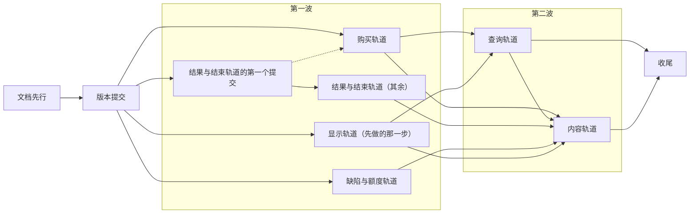
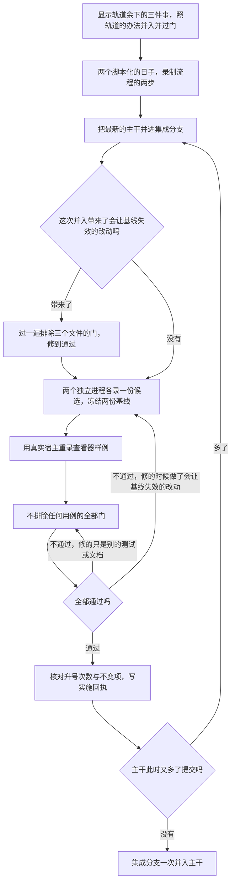

# 实施顺序与验收

> 本章属于[首次真实模型单日运行：修复与新增规格](../SPEC-first-real-day-run.md)，读法和叫法见那一页。

## 目标与依据

人物和数据集作者看不到实施的中间过程，他们面对的只有两种状态：今天，和整次改动一次并入主干之后。并入之后的那一天里，人物照习惯提交「购买冰美式咖啡，`prefer` 写瑞幸咖啡」，手机时间线上是瑞幸咖啡下单的几分钟和订单通知；不知道午饭吃什么就查询，五到十分钟后读到答案接着下单；晚饭那一集做完就算吃了一餐。本章规定其余各章怎样分步落到一条集成分支上、每一步靠什么放行，以及最后凭什么说「定下的事一件没落」。

今天的验收靠三样东西，本次原样沿用。一是登记的源码变异：`tests/dataset_acceptance.py:7-288` 登记了 71 条，每条在新的解释器里只跑它登记的行为测试，上限 180 秒（`tests/system/mutations/test_dataset_acceptance.py:16`、`:24`）。二是缺省的 release 档：任何预期失败标记在收集时被拒，任何一次跳过都让会话失败（`tests/conftest.py:74-80`、`:95-102`）。三是覆盖率门：分支覆盖率不低于 85%，未覆盖的公共接口为零（`scripts/coverage_gate.py:24`、`:218-222`）。两份完整日基线逐字比较整份导出、检查点和运行素材（`tests/system/lifecycle/test_complete_day_baseline.py:19-24`），所以任何生产源码改动都让它们失效。

本章落实提案「改动的牵连」里的三条，以及所有者对验收的要求。「顺序」一条的原话是「先改所属的设计文档和作者手册，再改代码，再补测试」。「两份完整日基线要重新冻结」一条的原话是「建议全部裁决过的改动放进同一个分支，只重冻一次。查看器的录制样本也要重录」。「证据层级」一条的原话是「离线测试通过只能证明规则按写的那样执行。咖啡能不能买成、人物会不会用好 `prefer` 和查询，要再跑一次真实模型的单日运行才算数」。所有者的要求是：定下的行为只要有一条没有实现，就必须有测试失败。

## 行为规格

### 用词

| 词 | 含义 |
| --- | --- |
| 集成分支 | `feat/first-real-day-run`。整次改动在它上面完成，最后一次并入主干 |
| 集成者 | 做版本提交、逐条并入各轨道、做收尾的那一个实施者 |
| 轨道 | 由一个实施者在自己的工作树里完成、作为一个整体并入集成分支的一组改动：代码、测试、夹具。设计正文和手册不在轨道里，由「文档先行」那一步统一改好 |
| 波 | 可以同时开工的一批轨道。第一波是版本提交之后开工的四条；第二波是购买轨道并入之后开工的两条 |
| 并入 | 一条轨道的分支合进集成分支，用合并提交，标题以 `merge:` 开头 |
| 门 | 一步放行之前必须通过的检查，见「每一步都要过的门」 |
| 与样例绑定的三个测试文件 | `tests/system/lifecycle/test_complete_day_baseline.py`、`tests/system/lifecycle/test_run_viewer_recording.py`、`tests/system/viewer/test_run_viewer.py`。它们比较的是两份完整日基线和查看器录制样例 `tests/fixtures/viewer-context.json` |
| 中间提交 | 集成分支上从版本提交起（含版本提交）、到最终提交之前的任何提交 |
| 最终提交 | 集成分支上重冻、重录之后、并入主干之前的那个提交 |
| 过渡物 | 只在中间提交上存在、最终提交上必须已经消失的代码、文字或测试样本 |
| 参考平台 | 现有两份基线 `generation` 字段记载的平台：Windows、AMD64、CPython 3.12.13。重冻在它上面做 |
| 会让基线失效的改动 | 这个词在本章定义，[「版本、身份与基线」](./12-versions.md)一章引用它。指动了下面任何一样的改动：`src/`、`custom/` 下任何 `.py` 文件的任何字节（注释也算），`scripts/render_day.py`，样例环境的任何一行或清单字段，两个脚本化的日子（`tests/life/day_baseline_runtime.py`）和录制它们用到的测试助手，以及根目录的 `pyproject.toml`、`uv.lock`。前四样为什么绑定基线、录制用到哪些助手，见[「版本、身份与基线」](./12-versions.md)一章「它们绑定什么」；两份依赖文件在代码指纹里（`src/worldmock/run_setup.py:98-108`），本次不动它们。`tests/` 下录制不经过的文件和设计文档不在其内 |
| 实施回执 | 各道门的输出和本章要求量的几个数，写在 `.work/first-real-day-run/`，不上库 |

### 怎样落地

- 整次改动只有一条集成分支，只并入主干一次。主干上规则版本、目录格式、世界状态、导出清单四个号各变一次，两份完整日基线和录制样例各重做一次。
- 设计文字先行。动任何代码之前，用一步串行的改动把设计正文和手册照[「设计文档与手册改动清单」](./11-design-docs.md)一章改完。之后各轨道不再另改设计正文。实现中发现正文有一句写错了：这句话在[「设计文档与手册改动清单」](./11-design-docs.md)一章列给本轨道的小节里，就由这条轨道先改正文、再改代码；在别的小节里，交给那个小节所属的轨道或集成者，不自己动手。
- 四个号由集成者用一个版本提交一次改完，排在全部轨道之前。各轨道不碰这四个常量，也不碰钉住它们的断言。
- 轨道并行，各用各的工作树。每条轨道从集成分支当时的头开一条分支。每个工作树都要有自己通过的环境回执 `.work/environment-receipt.json`（由 `python scripts/bootstrap.py --profile release` 写出），因为 `scripts/freeze_rrs_baseline.py:66` 和 `tests/unit/engineering/test_freeze_rrs_baseline.py` 读的是所在检出的这份回执。
- 轨道逐条并入。并入之前，这条轨道先在自己的分支上接上集成分支的最新提交、解完冲突、跑过自己工作树里的检查；并入之后集成者过一次门。门不过时，由这条轨道在自己的分支上修好再并入。集成者直接改集成分支的只有三处：版本提交、收尾里由集成者做的各步、照规则调未变异基线的时限。收尾里显示轨道余下的工作要改生产源码，照轨道的办法并入，见「收尾的次序」。
- 变异跟着规则走。每个定下的事项只留一条登记的源码变异，连同它的杀手，由落下它所守规则的那一步在同一次并入里登记，不攒到收尾。一条变异只列在一章的表里，别的章引用它；引用的一方并入时把自己的用例补进杀手列表。
- 两份基线从版本提交起就与代码不符（常量变了代码指纹，清单的版本字段变了环境身份），录制样例从购买轨道并入起不符（副工具多了一个参数，工具定义变了），都到最终提交才重做。为了只有一条规则，与样例绑定的三个测试文件从版本提交起一律在命令行上排除，不在测试文件里加跳过或预期失败标记。
- 不调用模型服务。全部工作离线完成。



图里的实线是真实的依赖，虚线是「并入之前要先接上」：

| 依赖 | 为什么 |
| --- | --- |
| 版本提交在文档先行之后 | 提案定下的顺序：先文档，再代码 |
| 四条第一波轨道在版本提交之后 | 版本常量、夹具清单的版本字段和钉住它们的二十多处断言只改一次，轨道不再碰 |
| 购买轨道要先接上结果与结束轨道的第一个提交 | 那个提交把进度层结果明细的 Schema 一次补全（`content`、`contents`、`query` 三个键和购买行必有的 `channel`），并写下「真实进度层通过层校验」的参数化用例；购买轨道在它之上只写 `channel` 的投影，往用例里加带购买明细的参数 |
| 查询轨道在购买轨道之后 | 查询要用购买轨道落下的 `prefer` 字段、`order_apps.py` 里认意向的两个函数（`order_app_ids`、`preferred_app_id`）、定下单 app 的 `order_app`、拆好的两个报价函数（`delivery_offer`、`courier_offer`）和工具层的 `prefer_apps` |
| 查询轨道在显示轨道先做的那一步之后 | 这是查询轨道并入的前提，显示轨道要先做完两件事。一是删掉 `scripts/inspect_run.py` 的 `queries` 子命令和钉住它的那条用例（经真实宿主调用 `query_world`）；不先删，查询轨道一并入那条用例就失败。二是把时间线和 `inspect_run.py` 的活动行改成调用显示写法函数，并带着[「统一显示写法」](./08-display.md)一章定义的一般规则：没有专门写法的种类，写中文种类表 `ACTIVITY_KIND_LABELS` 里的种类名，表里没有的种类才是故障。导出每次都要生成时间线；查询轨道给这张表加上 `query` 之后，带查询的运行在收尾之前就靠这条规则导得出来，那一行写成「查询」两个字。显示一侧把没有专门写法的种类一律当成故障的话，查询轨道的导出用例过不了 |
| 内容轨道在购买轨道之后 | 「只用于下单和查询的 app」靠工具层的 `prefer_apps` 认得 |
| 内容轨道在查询轨道之后 | 提案的前提：没有内容的购物 app 不能再打开，以查询已经可用为条件；名称解析里查询那一支随查询轨道落下，内容轨道再给它加一项检查，把只用于下单和查询的 app 并进商品的那一次匹配 |
| 内容轨道在显示轨道先做的那一步之后 | 没有内容的购物 app 从观察里退场之前，查看器必须已经改读冻结的环境目录，否则这些 app 的名称变成缺失；经真实引擎打开没有内容的 app 的用例也必须已经由显示轨道删掉，内容轨道一并入，这样的请求就被退回 |
| 内容轨道在结果与结束轨道之后 | 「被结束的一集不供餐」建立在「结束就算做完」之上 |
| 内容轨道在缺陷与额度轨道之后 | 在地点吃的一餐复用食品收货的结算，要保住那条轨道定下的两条约定：数额取登记值，分录在发生的那条事件里取走 |
| 收尾在全部轨道之后 | 显示还欠三件事，基线只重冻一次 |

除此之外的先后只是并入的次序，定在「本章定下的细节」里。

### 同一天的几件事在集成分支各个时点上的样子

下表用提案里那一天的三个时刻说明中间状态：08:46 的咖啡、11:49 的午饭、18:30 到 19:40 的「做晚饭」。只有最后一行是人物和数据集作者会遇到的。

| 集成分支走到哪 | 早上想用瑞幸咖啡点冰美式 | 写成「打开瑞幸咖啡」 | 午饭前想在美团外卖上看看 | 19:25 做完《吃晚饭》 | 一天时间线上的字 |
| --- | --- | --- | --- | --- | --- |
| 今天（`2b10aa9c`） | 请求里没有 `prefer` 这一项；下单 app 由环境抽，人物读不到是哪个 | 受理，几分钟前台，没有订单 | `query_world` 当场作答，不花时间，不说从哪家店、经哪个 app | 人物读不到做过这一集；不解饿 | 「互动」「购买」 |
| 版本提交之后 | 同今天 | 同今天 | 同今天 | 同今天 | 同今天。改动之前的运行已经不能恢复 |
| 第一波四条轨道并入之后 | 经瑞幸咖啡下单，购买结果写 `channel`；系统层还写着「填 action、target 两项」（过渡物） | 仍受理（过渡物） | 仍是 `query_world` | 19:40 的第二条结果列出三集，人物读得到《吃晚饭》；仍不解饿 | 「购买冰美式咖啡（经瑞幸咖啡下单）」「在淀山湖大道东渡悦来城公寓：做晚饭《备菜做饭》《吃晚饭》《洗碗收拾厨房》」；打开瑞幸咖啡那一段写「使用瑞幸咖啡」（过渡物） |
| 查询轨道并入之后 | 同上；系统层已是二十条定稿 | 仍受理（过渡物），而系统层已经写它不能打开 | 查询「食品」，`prefer` 写「美团外卖」，5 到 10 分钟后读到答案，这次决策里就能下单 | 同上；系统层已经写了「供一餐」，引擎还没有 | 查询那一行只写「查询」两个字（过渡物） |
| 内容轨道并入之后 | 同上 | 被退回，码 `ACTION_NOT_OFFERED`，告诉人物购买时把它写进 `prefer`、想看商品用查询 | 同上 | 数据集给这一集写明供一餐后，做完那一秒进账 | 同上 |
| 收尾之后（最终提交） | 同上 | 同上 | 同上 | 同上 | 「查询食品（美团外卖）」；查看器的请求行写「想用 瑞幸咖啡」；过渡物全部消失，两份基线和录制样例与代码相符 |

### 各步总览

| 步 | 谁做 | 何时开工 | 何时并入 | 交付哪几章 |
| --- | --- | --- | --- | --- |
| 文档先行 | 一个实施者，串行 | 规格经所有者确认之后 | 做完即并入 | 「设计文档与手册改动清单」全部，含作者手册的八条规则 |
| 版本提交 | 集成者，一个提交 | 文档先行并入之后 | 做完即并入 | 「版本、身份与基线」里四个号、夹具清单的三个版本字段、钉住旧值的全部断言，以及那一章的四条版本变异 |
| 购买轨道 | 第一波 | 版本提交之后 | 接上结果与结束轨道的第一个提交之后；第一波里最先并入的整条轨道 | 「购买时写想用的 app」 |
| 结果与结束轨道 | 第一波 | 版本提交之后 | 第一个提交单独先行并入；其余在购买轨道之后 | 「做完之后读到什么，提前结束算不算做完」 |
| 缺陷与额度轨道 | 第一波 | 版本提交之后 | 结果与结束轨道之后 | 「十条缺陷与思考额度」里除检查工具和时间线几条之外的全部，含思考额度 |
| 显示轨道（先做的那一步） | 第一波 | 版本提交之后 | 第一波里最后并入 | 「统一显示写法」里今天四种活动的写法；「查看器里的连续使用」；「十条缺陷与思考额度」里落在 `scripts/inspect_run.py`、`scripts/render_day.py` 的几条；「删除 query_world 与第五种活动」里 `queries` 子命令的删除 |
| 查询轨道 | 第二波 | 购买轨道并入并过门之后 | 第一波四条轨道全部并入之后 | 「查询」「删除 query_world 与第五种活动」「人物读到的规则」 |
| 内容轨道 | 第二波 | 购买轨道并入并过门之后 | 查询轨道并入之后 | 「打开 app 与 app 目录字段」「在地点吃的一餐」，按这个次序 |
| 收尾 | 集成者，加显示轨道的实施者做余下的显示工作 | 两条第二波轨道并入之后 | 最终提交；随后集成分支一次并入主干 | 「统一显示写法」的「分两次落地」里余下的三件事；「版本、身份与基线」的重冻、重录与不变项；本章的完成判据 |

下面每一步各有一张表：它独占哪些文件、在共用的文件里只动什么、允许留下哪些过渡物。收尾的那一张在「收尾的次序」开头。独占只在同一波之内成立；跨波的接力见「合并热点与改动次序」。

### 文档先行

| 项 | 内容 |
| --- | --- |
| 独占的文件 | `docs/design/*.md`、`docs/manual/*.md` |
| 做什么 | 逐条照[「设计文档与手册改动清单」](./11-design-docs.md)一章落笔；每条规则只写在它的归属处，别处引用 |
| 允许的过渡物 | 设计正文写的是改后的规则，代码还是今天的行为，直到对应的轨道并入 |
| 这一步的门 | 文档链接检查、设计汇编；不涉及测试 |

### 版本提交

| 项 | 内容 |
| --- | --- |
| 独占的文件 | `src/worldmock/exchange/constants.py` 的 `RULES_VERSION`（`:7`）、`src/worldmock/catalog/models.py` 的 `format_version`（`:47`）、`src/worldmock/life/models.py` 的 `WORLD_SCHEMA_VERSION`（`:29`）、`src/worldmock/footprints/export.py` 的 `EXPORT_SCHEMA_VERSION`（`:29`）和它上一行的说明；`tests/fixtures/dataset-environment/catalog/manifest.json` 的 `format_version`、`rules_version`、`environment_version` 三个字段；钉住这些值的全部断言，清单见[「版本、身份与基线」](./12-versions.md)一章 |
| 做什么 | 4 改 5、4 改 5、13 改 14、5 改 6；夹具环境版本 `3` 改 `4`；清单的文件表和目录摘要用 `worldmock.catalog.identity.refresh_manifest_identity` 重写，不手写 |
| 同一个提交里还有 | [「版本、身份与基线」](./12-versions.md)一章的四条版本变异：四个常量各一条，把常量退回旧值，杀手见那一章。这个提交带的就是四个常量、样例环境清单的三个版本字段、钉住旧值的全部断言和这四条变异，不带别的新断言；[「设计文档与手册改动清单」](./11-design-docs.md)一章没有任何东西落在这个提交里。不在这个提交里的两样：阶段模型身份里 `max_tokens` 的反例参数和「`ACTION_MAX_TOKENS` 改回 8000」那条变异归缺陷与额度轨道；断言样例环境各行形状的用例归内容轨道 |
| 允许的过渡物 | 号先于结构：目录格式已是 5，app 行还带 `browse_duration_seconds`、地点内容还没有 `provides_meal`；世界状态 14、导出清单 6，而活动仍只有四种；规则版本 5，规则还是今天的 |
| 从这一步起 | 两份基线与代码不符；与样例绑定的三个测试文件一律在命令行上排除，直到最终提交。录制样例到购买轨道并入时才与代码不符，照同一条规则从这一步起就排除 |
| 不做 | 不改 `RUN_MANIFEST_SCHEMA_VERSION`、质量报告的结构号、两份 TOML 的 `schema_version`、三个评估标识、`AS2_LOCKED_SOURCE_SHA256`；不改 `ACTION_MAX_TOKENS`，那一行和守它的变异都归缺陷与额度轨道 |

### 购买轨道

| 项 | 内容 |
| --- | --- |
| 独占的文件 | `src/worldmock/life/` 下新的 `order_apps.py`，以及 `purchase_offers.py`、`basket.py`、`storefront_runtime.py`、`start_group.py`、`admission.py`、`name_resolution.py`、`callable_index.py`、`tool_layer.py`；`tests/life/conftest.py`、`tests/life/request_fixtures.py`；手写副工具请求字典的十四个测试文件里补 `prefer` 的那些行 |
| 共用文件里只动 | `life/models.py` 的 `StartSideActivityRequest`；`life/result_projection.py` 的 `_purchase`；`life/prompt_schemas.py` 的 `_CALLABLE_INDEX`；`evaluation/public_evidence.py` 里副工具请求键集的那一处 |
| 不动的文件 | `custom/agents/life_agent.py`。购买轨道不在这里加逻辑：工具 Schema 由请求模型生成，宿主对 `prefer` 的校验和候选随请求模型与名称解析自动带上 |
| 允许的过渡物 | `prefer` 字段说明是不含 `query` 的过渡句（原文见[「购买时写想用的 app」](./01-purchase-prefer.md)一章），副工具的放行词表只加了 `null` 一个词，不放 `prefer` 这类键名；系统层还是今天的十七条；工具层同时有 `prefer_apps` 和 `query_categories`；没有内容的购物 app 既在 `prefer_apps` 里又仍能打开 |
| 留给别人的 | 系统层、工具用途句、三条字段说明的定稿和放行词表里的 `query` 归查询轨道；`order_apps.py` 里的 `selling_app_ids` 归查询轨道；购买行的 `channel` 在 Schema 里那一处归结果与结束轨道的第一个提交，购买轨道只写投影；查看器请求行显示 `prefer` 归收尾；`tests/system/lifecycle/test_complete_day_scripts.py` 里只给三处手写的参数字典补 `"prefer": null`，脚本内容留给收尾 |

### 结果与结束轨道

| 项 | 内容 |
| --- | --- |
| 第一个提交 | `life/prompt_schemas.py` 的 `_RESULT_DETAILS` 加 `content`、`contents`、`query` 三个键，`_PURCHASE` 加必有的 `channel`，四处一次加全；新文件 `tests/integration/life/test_progress_layer_schema.py` 和其中「在地点做事进行中」这个参数；只看 Schema 的两条单元用例（认上表全部键、不认退役的键）；Schema 的那一条变异「结果明细的 Schema 不认 `query`」，它的杀手就是前一条单元用例，只在这里登记一次。这个提交单独先行并入 |
| 独占的文件 | `life/progress_layer.py`、`life/location_activities.py`、`life/session_actions.py`、`life/session_bounds.py`、`footprints/store.py` |
| 共用文件里只动 | `life/result_projection.py` 的 `_details` 和新的 `_done_contents`；`life/settled_text.py` 里 `_content_sentence` 的「未完」半句 |
| 允许的过渡物 | Schema 先于投影：`channel`、`query` 两个键已经在 Schema 里，写出它们的投影分别等购买轨道、查询轨道。这个提交之后到购买轨道并入之前，真实的购买明细还不带 `channel`；这段时间里没有用例校验这样的进度层，今天也没有。打开 app 的第一条结果还带着 Schema 不认的 `goods`（没有内容的 app 还有 `app`、`duration`），今天就是这样，等内容轨道从投影里删；`content_id` 为空的活动不写 `contents` 的那条判断，等内容轨道删 |
| 留给别人的 | 层校验用例里「带购买明细」一个参数归购买轨道，查询的两个参数归查询轨道，「用内容 app 进行中」两个参数归内容轨道；系统层里讲结束与暂停的句子归查询轨道 |

### 缺陷与额度轨道

| 项 | 内容 |
| --- | --- |
| 独占的文件 | `src/worldmock/runtime.py`、`run_setup.py`、`status.py`、`cli.py`、`input_models.py`、`agents/life_truncation.py`、`agents/life_feedback.py`、`life/rhythm.py`、`life/receipt.py`、`footprints/invariants.py` |
| 共用文件里只动 | `life/decision_coordinator.py` 的 `_reject_results`；`custom/agents/life_agent.py` 的 `ACTION_MAX_TOKENS` 一行 |
| 允许的过渡物 | 食品收货的 `applied` 取登记数额的那一行和登记在它上面的变异暂时在 `receipt._food_effect`，内容轨道把它搬进 `body.food_intake` |
| 留给别人的 | 「检查工具用电脑时区」「检查工具读旧字段」和「读文件不写编码」落在 `scripts/inspect_run.py` 的两处、`scripts/render_day.py` 的换行，规则写在[「十条缺陷与思考额度」](./09-defects-and-budget.md)一章，由显示轨道实施 |

### 显示轨道（先做的那一步）

| 项 | 内容 |
| --- | --- |
| 独占的文件 | 新的 `src/worldmock/footprints/display_wording.py` 和 `tools/run-viewer-wording.js`；`scripts/render_day.py`、`scripts/inspect_run.py`、`tools/run-viewer.html`、`tools/run-viewer-context.js`、`tests/system/viewer/*`；`footprints/timeline_labels.py`、`footprints/quality.py`、`life/order_notices.py`；新的 `tests/fixtures/display-wording-cases.json` |
| 共用文件里只动 | `footprints/frozen_environment.py` 新增 `frozen_display_names`；`footprints/export.py` 的 `_write_export`；`footprints/validation.py` 的 `_validate_quality`；`life/settled_text.py` 的 `experience_sentence` |
| 允许的过渡物 | 没有内容的 app 使用写「使用<app 名>」：今天读这种活动的两处，查看器里没有内容就显示 app 名的一支和时间线写法里没有内容的一支，都换成这条过渡写法，留到收尾删。它的证据是手写的快照：共用用例文件里的一条用例和查看器现有的样本。查询没有专门写法，查询轨道并入后写「查询」两个字；查看器请求行不显示 `prefer`；查看器里还留着 `query_world` 的中文名和请求摘要分支 |
| 必须在这一步做掉 | 删除 `queries` 子命令和它的测试，这件事等不到查询轨道并入。删掉经真实引擎打开没有内容的 app 的用例，今天是 `tests/integration/footprints/test_inspect_current_activity.py` 里打开「美团」的那个参数，这件事等不到内容轨道并入。改写时间线和 `inspect_run.py` 的活动行时带着一般规则：没有专门写法的种类写 `ACTIVITY_KIND_LABELS` 里的种类名，表里没有的种类是故障。查看器里动作的中文表并成一张，放在 `tools/run-viewer-context.js`，别的章说到这张表都指这里 |
| 查看器里的连续使用 | [「查看器里的连续使用」](./06-continuous-use.md)一章的全部改动都在这一步，排在[「统一显示写法」](./08-display.md)一章的查看器改动之后，因为要用那一章的写法函数、名称表和按事件取内容身份的投影：逻辑放进 `tools/run-viewer-wording.js` 新增的五个函数，`tools/run-viewer.html` 只接线，Node 用例写进 `tests/system/viewer/run_viewer.test.cjs`。这一项只改查看器，不动引擎、环境目录、工具接口和导出，不依赖别的轨道，不登记变异。用例里两次没有内容的同 app 使用相接、标签写「使用<app 名>」的那一句断言用的是「允许的过渡物」里的过渡写法，随它留到收尾删 |
| 并入之前另跑 | 中间提交的门排除了 `tests/system/viewer/test_run_viewer.py`，查看器的全部 Node 用例都由它执行，所以 pytest 一条 Node 用例也不跑。显示轨道并入之前直接用 `node --test` 跑 `tests/system/viewer/` 下的三个 `.cjs` 文件（`run_viewer.test.cjs`、`run_viewer_context.test.cjs`、`run_viewer_wording.test.cjs`），只允许读录制样例的那几条用例失败；收尾里它余下的那一段并入之前同样 |

### 查询轨道

| 项 | 内容 |
| --- | --- |
| 独占的文件 | 新的 `life/query_activity.py`、`life/query_answer.py`；`life/action_contract.py`、`life/activity_control.py`、`life/world_query.py`（删除）、`life/models.py`、`life/narration.py`、`life/readable.py`、`life/read_query_runtime.py`、`life/admission.py`、`life/callable_index.py`、`life/prompt_schemas.py`、`life/order_apps.py`、`life/rhythm.py`、`life/decision_coordinator.py`、`exchange/body.py`、`agents/life_prompt.py`、`custom/agents/life_agent.py`、`custom/envs/life_env.py`、`evaluation/adapters.py`、`footprints/invariants.py` |
| 与内容轨道共用、查询先改 | `life/observe.py`、`life/name_resolution.py`、`life/start_group.py`、`life/time_advance.py`、`life/activities.py`、`life/activity_validation.py`、`life/result_projection.py`、`life/tool_groups.py`、`footprints/app_usage.py`、`evaluation/public_evidence.py`，共十个 |
| 并入的前提 | 显示轨道先做的那一步已经并入：`queries` 子命令和钉住它的用例已经删掉；时间线和 `inspect_run.py` 的活动行已经带着「没有专门写法的种类写 `ACTIVITY_KIND_LABELS` 里的种类名，表里没有的种类是故障」这条一般规则（定义在[「统一显示写法」](./08-display.md)一章）。缺了后一样，带查询的运行导不出来 |
| 一次落下 | 系统层整份定稿和逐字钉住它的测试只落这一次；同一次落下的还有 `TOOL_DESCRIPTIONS`、副工具的用途句和三条字段说明的定稿（`prefer` 那一条换掉购买轨道的过渡句），连同逐字钉住它们的测试。`SIDE_ACTIVITY_ACTIONS` 加 `query` 与三条字段说明的定稿必须在同一个提交里：字段说明的放行词表读这个常量，这个提交里多出 `query`，而放行的词必须都在说明里用到。放行词表里始终没有 `prefer`、`apps` 这类键名 |
| 允许的过渡物 | 系统层已经写了引擎还没有的规则：只列在 `prefer_apps` 里的 app 不能打开、供一餐。没有内容的购物 app 仍能打开；把它写进查询的 `target` 得到的是 `SUPPLY_NOT_FOUND`，内容轨道并入后改成 `ACTION_NOT_OFFERED`。时间线和 `inspect_run.py` 里查询只写「查询」两个字，查看器目标处是「—」、类型列是原值 `query` |
| 显示一侧要它做的 | 给 `life/readable.py` 的中文种类表 `ACTIVITY_KIND_LABELS` 加 `query`「查询」，过渡期那两个字就从这里来；把这个文件头里指向 `scripts/render_day.py` 的那一句，改成指向 `footprints/display_wording.py` |

### 内容轨道

| 项 | 内容 |
| --- | --- |
| 独占的文件 | `src/worldmock/catalog/models.py`、`catalog/admission.py`、`catalog/loader.py`；`life/interact.py`、`life/content_select.py`、`life/discovery.py`、`life/rotation.py`、`life/body.py`、`life/receipt.py`、`life/location_activities.py`、`life/purchase_offers.py`、`life/settled_text.py`；`footprints/experiences.py`、`footprints/frozen_environment.py`；`evaluation/behavior_metrics.py`；夹具 `app-catalog.jsonl`、`content-catalog.jsonl` 和清单的文件表 |
| 轨道内的次序 | 先「打开 app 与 app 目录字段」，再「在地点吃的一餐」，后者落在前者的改动之上 |
| 接着别人改 | 与查询轨道共用的十个文件里，只动所属各章点名的函数，其中名称解析里查询那一支加上「只用于下单和查询的 app」的检查；`scripts/inspect_run.py` 只动三个函数：新增 `_location_meals`，改 `meal_count`、`lowest_energy_before_meal`；`tests/fixtures/display-wording-cases.json` 里是完整的目录行，与样例环境在同一次改动里改：app 行删 `browse_duration_seconds`，绑定地点的内容行加 `provides_meal` |
| 允许的过渡物 | 夹具可以分几次改，每次重跑 `refresh_manifest_identity` |
| 删掉别人留下的过渡物 | `content_id` 为空的活动不写 `contents` 的判断；投影里的 `goods`、`app`、`duration`，删掉之后给层校验用例加「用内容 app 进行中」的两个参数；`test_content_start_evidence.py` 那条用例里「美团」的参数和没有内容的一支；`receipt._food_effect` 上的变异搬到 `body.food_intake` |

### 轨道之间的交接

先落的一方留下什么、后落的一方换成什么，逐项定死。表里凡是「过渡」的，都列进「接口、删除面与文件指引」的过渡物清单。

| 交接的东西 | 先落的一方 | 后落的一方 |
| --- | --- | --- |
| 进度层结果明细的 Schema | 结果与结束轨道的第一个提交一次加全四处：`content`、`contents`、`query` 三个键和购买行必有的 `channel`；那一条 Schema 变异也只由它登记一次 | 购买轨道、查询轨道只写各自的投影，不再改 `_RESULT_DETAILS` 和 `_PURCHASE`；内容轨道从投影里删 `goods`、`app`、`duration` |
| 「真实进度层通过层校验」的参数化用例 `tests/integration/life/test_progress_layer_schema.py::test_real_progress_layer_passes_layer_validation` | 结果与结束轨道建文件，写自己的五个参数 | 购买轨道加一个，查询轨道加两个，内容轨道加「用内容 app 进行中」的两个 |
| `prefer` 的字段说明 | 购买轨道落过渡句（原文见[「购买时写想用的 app」](./01-purchase-prefer.md)一章），副工具的放行词表只加 `null` | 查询轨道把三条字段说明都换成[「人物读到的规则」](./10-persona-rules.md)一章的定稿，与 `SIDE_ACTIVITY_ACTIONS` 加 `query` 在同一个提交里，放行词表在这个提交里多出 `query`。放行词表里始终没有 `prefer`、`apps` 这类键名 |
| 请求助手 | 购买轨道给 `side_arguments`、`purchase`、`use_app`、`side_request` 加 `prefer` | 查询轨道加 `query(*targets, prefer=None)` |
| 认下单 app 的函数 | 购买轨道新建 `src/worldmock/life/order_apps.py`，里面是 `order_app_ids`、`preferred_app_id` | 查询轨道在同一个模块里加 `selling_app_ids(catalog, goods_ids)`，并让 `order_app_ids` 调用它；`order_app_ids` 的签名与结果不变 |
| 报价函数 | 购买轨道拆出三个函数，名字和签名照[「购买时写想用的 app」](./01-purchase-prefer.md)一章定死：`order_app(state, source, apps, prefer)`、`delivery_offer(inputs, state, goods, route, here)`、`courier_offer(inputs, state, goods, app)` | 查询轨道和别的章都用这三个名字直接调用，不改签名 |
| 调用上的意向 `Call.prefer` | 购买轨道只为购买调用认一次 | 查询轨道把条件放宽到购买或查询 |
| 种类与动作的中文表 | 查询轨道给 `life/readable.py` 的两张中文种类表加 `query`「查询」，其中 `ACTIVITY_KIND_LABELS` 是显示一侧读的那一张 | 显示轨道在收尾里给查看器的种类表、颜色表加 `query`，给 `tools/run-viewer-context.js` 里那张动作的中文表加 `query` |
| 时间线里的查询 | 显示轨道落下一般规则（定义在[「统一显示写法」](./08-display.md)一章）：没有专门写法的种类写 `ACTIVITY_KIND_LABELS` 里的种类名，表里没有的种类是故障。查询轨道给这张表加了 `query` 之后，查询就写成「查询」两个字 | 收尾换成整句「查询<名称列表>（<app 名>）」 |
| 没有内容的 app 使用 | 显示轨道在先做的那一步里写过渡写法「使用<app 名>」，删掉经真实引擎打开这种 app 的用例，过渡写法的证据改用手写的快照 | 内容轨道让这种活动不再产生。显示轨道在收尾里删掉显示一侧为它留的生产分支（查看器里显示 app 名的一支、时间线写法里没有内容的一支，也就是两侧跳过空内容身份的那一处），连同手写的用例和查看器样本 |
| `tests/integration/life/test_content_start_evidence.py::test_current_started_activity_public_result_and_complete_export` | 结果与结束轨道（第一波）先加 `contents` 的断言，写成「美团」参数还在和去掉之后两种状态下都成立 | 内容轨道（第二波）之后去掉「美团」参数和没有内容的一支 |
| 食品进账 | 缺陷与额度轨道在 `_food_effect` 里把 `applied` 改成登记数额之和，并登记变异 | 内容轨道抽成 `food_intake`，变异的符号和原文同批改，杀手不变 |
| `scripts/inspect_run.py` | 显示轨道改写活动行、手机事件行、时区、受理行等，删 `queries` | 内容轨道只改 `meal_count`、`lowest_energy_before_meal`，新增 `_location_meals` |
| 共用用例文件 `tests/fixtures/display-wording-cases.json` | 显示轨道新建，目录行是完整的行 | 内容轨道在改样例环境的同一次改动里改这些行（删 `browse_duration_seconds`、加 `provides_meal`）；显示轨道在收尾里加查询的用例、删过渡用例 |
| `tests/system/lifecycle/test_complete_day_scripts.py` | 版本提交改导出结构号的断言；购买轨道补 `"prefer": null` | 收尾改脚本内容和请求字典 |
| 引用旧节名的两处说明 | 文档先行把《模拟引擎》的小节改名为「出行、内容与查询」 | 内容轨道改 `life/rotation.py:2`、`life/tool_groups.py:16` 的引用 |

### 合并热点与改动次序

几条轨道都要碰的文件。每条轨道只动表里写给它的符号；箭头是并入的先后，后并入的一方负责解冲突，并且不删对方新增的代码和断言。

| 文件 | 改动次序与各自的范围 |
| --- | --- |
| `src/worldmock/life/models.py`（今天 1,343 行） | 版本提交（`WORLD_SCHEMA_VERSION`）→ 购买（`StartSideActivityRequest` 加 `prefer`，校验器改名）→ 查询（`ActivityKind.QUERY`，三条字段说明定稿，`active_side_activities` 只改说明） |
| `src/worldmock/agents/life_prompt.py`、`tests/unit/start_interfaces/test_system_layer_text.py` | 只有查询轨道改 |
| `tests/unit/agent_protocol/test_tool_description_references.py` | 购买（放行词只加 `null`，过渡句）→ 查询（定稿，放行词随 `SIDE_ACTIVITY_ACTIONS` 多出 `query`；删 `query_world` 的用例）。放行词表里始终没有 `prefer`、`apps` 这类键名 |
| `custom/agents/life_agent.py`（今天 996 行） | 缺陷与额度（`ACTION_MAX_TOKENS` 一行）→ 查询（删 `query_world`）。购买轨道不在这里加逻辑 |
| `src/worldmock/life/prompt_schemas.py` | 结果与结束的第一个提交（`_RESULT_DETAILS`、`_PURCHASE`，四处一次加全）→ 购买（`_CALLABLE_INDEX` 加 `prefer_apps`）→ 查询（`_CALLABLE_INDEX` 去 `query_categories`）。购买、查询两条轨道不碰结果明细的 Schema |
| `src/worldmock/life/result_projection.py` | 结果与结束（`_details` 的 `contents`、`_done_contents`）→ 购买（`_purchase` 的 `channel`）→ 查询（`_details` 的 `query`）→ 内容（删 `goods` 和写 `app`、`duration` 的浏览分支） |
| `src/worldmock/life/callable_index.py`、`tool_layer.py`、`tool_groups.py` | 购买（`prefer_apps`；预览显式带 `null`）→ 查询（删 `query_categories`、`INDEX_KEYS`；`tool_groups` 的说明）→ 内容（只改 `tool_groups` 说明里引用的节名） |
| `src/worldmock/life/start_group.py` | 购买（`_resolved`、`_start` 带意向）→ 查询（`_resolved` 的条件、`_named_goods`、`_start` 的查询一支）→ 内容（`_result` 删 `goods` 两行） |
| `src/worldmock/life/admission.py` | 购买（`Call.prefer`、`_purchase_refusal`、`_funds_refusal`）→ 查询（`_side_refusal`、`_travel_refusal`） |
| `src/worldmock/life/name_resolution.py` | 购买（`StartItem.prefer`、候选三个键）→ 查询（`_resolve_item` 的查询一支、查询候选）→ 内容（`ORDER_APP_KIND`、`name_book`、`_kinds`、`_order_app_failure`；给查询那一支加上同一次匹配里的这项检查） |
| `src/worldmock/life/order_apps.py` | 购买（新建，放 `order_app_ids`、`preferred_app_id`）→ 查询（加 `selling_app_ids(catalog, goods_ids)`，下单 app 判据的函数体搬进它，`order_app_ids` 改成调用它，签名与结果不变）。别的轨道只调用这三个函数，判据只有这一份 |
| `src/worldmock/life/purchase_offers.py` | 购买（拆报价，三个函数的名字和签名就此定死：`order_app(state, source, apps, prefer)`、`delivery_offer(inputs, state, goods, route, here)`、`courier_offer(inputs, state, goods, app)`）→ 查询（只调用，不改签名）→ 内容（删 `app_goods`） |
| `src/worldmock/life/time_advance.py`（`advance` 今天 44 行） | 落点是 `_apply_activity_effect`：查询轨道先加它的一支（活动已完成时调用 `complete_query` 并写回）→ 内容轨道在 `interact` 一支里加供一餐的调用，并把这个函数的返回值从（草稿，内容证据）改成（草稿，要并进这条事件 `data` 的键），`_advance_one_activity` 跟着合并。只加调用，规则放在并列模块 |
| `src/worldmock/life/rhythm.py` | 缺陷与额度（`settle_engine_rhythm`、`_settle_discomfort`）→ 查询（`_wake_snapshot` 改用 `finished_at`） |
| `src/worldmock/life/decision_coordinator.py` | 缺陷与额度（`_reject_results`）→ 查询（只读通道的判定） |
| `src/worldmock/life/settled_text.py` | 三条轨道各改一处。结果与结束改 `_content_sentence` 末尾的「未完」半句，显示改 `experience_sentence`，两者同在第一波、不在同一个函数 → 内容删 `_content_sentence` 开头 `content_id` 为空的提前返回（`:82-83`），与结果与结束轨道改的不是同一行 |
| `src/worldmock/life/receipt.py`、`body.py` | 缺陷与额度（`_food_effect`）→ 内容（`food_intake`） |
| `src/worldmock/life/location_activities.py` | 结果与结束（`unit_done`）→ 内容（`unit_facts` 的 `note`） |
| `src/worldmock/footprints/invariants.py` | 缺陷与额度（身体结算的检查）→ 查询（`app_use` 行所属活动的判断） |
| `src/worldmock/footprints/app_usage.py` | 查询（三处判断）→ 内容（`data.meal` 的形状检查） |
| `src/worldmock/footprints/frozen_environment.py` | 显示（`frozen_display_names`）→ 内容（删 `_validate_browse`） |
| `src/worldmock/footprints/export.py` | 版本提交（结构号）→ 显示（`_write_export`） |
| `src/worldmock/evaluation/public_evidence.py` | 购买（副工具请求的键集）→ 查询（`_start_shape` 的查询一支、闭集改读常量）→ 内容（`_activity_shape` 的对象类型） |
| `src/worldmock/catalog/models.py`、`admission.py`、`loader.py` | 版本提交（`format_version`）→ 内容 |
| `tests/fixtures/dataset-environment/catalog/*` | 版本提交（清单的三个字段）→ 内容（两份 JSONL）。清单冲突一律重跑 `refresh_manifest_identity`，不手工合并摘要 |
| `tests/dataset_acceptance.py` | 各轨道在末尾追加；冲突取并集。有意改写和搬家的登记见「不能改写的变异锚点行」 |
| `tests/unit/engineering/test_single_source.py` 的 `OWNERS`、`test_import_graph.py` 的 `DELAYED_IMPORTS` | 各轨道加减自己的行；冲突取并集后重跑这两个测试 |
| `tests/life/day_baseline_runtime.py`、`tests/fixtures/dayrun-*-baseline.json`、`tests/fixtures/viewer-context.json` | 只有收尾改 |

### 几章都认领的测试各归谁

| 测试 | 认领它的章 | 归谁，怎么分 |
| --- | --- | --- |
| `tests/integration/life/test_content_start_evidence.py::test_current_started_activity_public_result_and_complete_export` | 「打开 app 与 app 目录字段」「做完之后读到什么，提前结束算不算做完」 | 两条轨道先后各改一次。结果与结束轨道在第一波先加 `contents` 的断言，写成「美团」参数还在和去掉之后两种状态下都成立；内容轨道在第二波之后去掉「美团」参数和没有内容的一支 |
| `tests/integration/footprints/test_inspect_current_activity.py` | 「打开 app 与 app 目录字段」「统一显示写法」「删除 query_world 与第五种活动」「十条缺陷与思考额度」 | 显示轨道。活动行与手机事件行的两条改写、经真实引擎打开「美团」的那个参数和 `queries` 那条的删除、时区和各行字段的新用例、`test_queries_is_no_longer_a_subcommand`，都由它在先做的那一步里一次改完 |
| `tests/system/lifecycle/test_run_viewer_recording.py`、`tests/fixtures/viewer-context.json` | 「删除 query_world 与第五种活动」「打开 app 与 app 目录字段」「统一显示写法」「十条缺陷与思考额度」「版本、身份与基线」 | 收尾，一次重录 |
| `tests/integration/start_interfaces/test_location_activities.py` | 「做完之后读到什么，提前结束算不算做完」「删除 query_world 与第五种活动」「在地点吃的一餐」 | 各改各的函数，按结果与结束、查询、内容的并入次序。登记为变异杀手的三条用例不改名、不删除 |
| `tests/integration/evaluation/test_public_evidence.py` | 「购买时写想用的 app」「删除 query_world 与第五种活动」「打开 app 与 app 目录字段」 | 请求形状的那条（`test_public_projection_rejects_start_arguments_outside_the_current_contract`）归购买轨道；动作闭集和查询的几条归查询轨道；对象类型的那条（`test_interaction_reads_actual_object_and_never_infers_category_or_device`）归内容轨道 |
| `tests/system/lifecycle/test_complete_day_scripts.py` | 「购买时写想用的 app」「删除 query_world 与第五种活动」「版本、身份与基线」 | 脚本内容归收尾。之前只有两处机械改动：版本提交改导出结构号，购买轨道补 `"prefer": null`。这个文件不在排除之列，中间提交上必须通过 |
| `tests/integration/life/test_progress_layer_schema.py::test_real_progress_layer_passes_layer_validation` | 「做完之后读到什么，提前结束算不算做完」「购买时写想用的 app」「查询」「打开 app 与 app 目录字段」 | 结果与结束轨道建，其余三条轨道各加参数 |
| `tests/unit/start_interfaces/test_system_layer_text.py` | 写到系统层的每一章 | 查询轨道一次改完 |
| `tests/unit/agent_protocol/test_start_request_models.py`、`tests/unit/start_interfaces/test_name_resolution.py` | 「购买时写想用的 app」「查询」「删除 query_world 与第五种活动」「打开 app 与 app 目录字段」 | 购买轨道（`prefer`、候选三个键）→ 查询轨道（动作闭集、查询候选）→ 内容轨道（只用于下单和查询的 app 的退回） |
| `tests/integration/footprints/test_render_day.py` | 「购买时写想用的 app」「统一显示写法」「十条缺陷与思考额度」 | 购买轨道先并入，只给今天手写的请求字典补 `prefer`；显示轨道后并入，改写这个文件时留着这个键，并把按路径加载脚本的 `_load_script` 换成按模块名导入（见[「统一显示写法」](./08-display.md)一章），登记在两个脚本上的变异在这里才杀得到。查询一行和「渠道不取 `prefer`」两条在收尾加 |
| `tests/integration/life/test_constant_table_runtime.py` | 「购买时写想用的 app」「十条缺陷与思考额度」「打开 app 与 app 目录字段」「在地点吃的一餐」 | 购买（报价调用补 `null`）→ 缺陷与额度（`applied` 恰等）→ 内容（助手改读工具层的 `note`；供一餐的数额） |
| `tests/integration/runtime/test_life_agent_protocol.py`、`test_output_truncation.py` | 「十条缺陷与思考额度」「删除 query_world 与第五种活动」「打开 app 与 app 目录字段」 | 缺陷与额度（8000 改 16000）→ 查询（工具个数与名单）→ 内容（手写观察补 `prefer_apps`） |
| `tests/unit/catalog/test_dataset_negative_contract.py` | 「版本、身份与基线」「删除 query_world 与第五种活动」「打开 app 与 app 目录字段」 | 版本提交（版本号的反例）→ 查询（回调不能订阅查询）→ 内容（app 行的反例） |
| `tests/unit/footprints/test_quality.py` | 「统一显示写法」「删除 query_world 与第五种活动」「打开 app 与 app 目录字段」 | 显示轨道（名称入参的五十处调用、标签用例）→ 查询轨道（英文种类名的计数）→ 收尾（浏览样本） |
| `tests/system/viewer/run_viewer.test.cjs`、`run_viewer_context.test.cjs` | 「统一显示写法」「查看器里的连续使用」「删除 query_world 与第五种活动」「打开 app 与 app 目录字段」 | 显示轨道，先做的那一步和收尾各改一次；每次并入之前直接用 `node --test` 跑。[「查看器里的连续使用」](./06-continuous-use.md)一章的用例都写在 `run_viewer.test.cjs`，在先做的那一步里加；收尾里只删其中随过渡写法走的那一句断言 |

各章留下的源码变异由哪一步登记，数的是各章变异表里的行：

| 步 | 登记哪些 | 条数 |
| --- | --- | --- |
| 版本提交 | [「版本、身份与基线」](./12-versions.md)一章的四条：四个常量各退回旧值 | 4 |
| 购买轨道 | [「购买时写想用的 app」](./01-purchase-prefer.md)一章的十条 | 10 |
| 结果与结束轨道 | [「做完之后读到什么，提前结束算不算做完」](./05-results-and-ending.md)一章的六条，其中「结果明细的 Schema 不认 `query`」随第一个提交 | 6 |
| 缺陷与额度轨道 | [「十条缺陷与思考额度」](./09-defects-and-budget.md)一章十一条里的九条，含「拒绝脉冲的分录不从缓冲取走」和「`ACTION_MAX_TOKENS` 改回 8000」 | 9 |
| 显示轨道（先做的那一步） | [「统一显示写法」](./08-display.md)一章的五条；[「十条缺陷与思考额度」](./09-defects-and-budget.md)一章里规则由它实施的两条：「`inspect_run._t` 不带时区」「受理行仍读 `tool_name`」。[「查看器里的连续使用」](./06-continuous-use.md)一章不登记变异，它的规则由 Node 用例守住 | 7 |
| 查询轨道 | [「查询」](./02-query.md)一章的十四条；[「删除 query_world 与第五种活动」](./03-fifth-activity-kind.md)一章的四条 | 18 |
| 内容轨道 | [「打开 app 与 app 目录字段」](./04-app-opening.md)一章的五条；[「在地点吃的一餐」](./07-meals.md)一章的五条 | 10 |
| 文档先行、收尾 | 没有。「人物读到的规则」「设计文档与手册改动清单」两章和本章都不登记变异 | 0 |

合计新登记约六十四条；登记表从 71 条长到一百三十五条上下。

一条变异守的规则几章都讲到时，只列在一章的表里、只登记一次，别的章引用它，引用的一方并入时把自己的用例补进杀手：

| 变异 | 列在哪一章 | 引用它的章 | 谁登记，谁补杀手 |
| --- | --- | --- | --- |
| 查询占槽位 1；带 app 的查询不形成 `app_use` 行 | 「删除 query_world 与第五种活动」 | 「查询」 | 查询轨道。两章同归这条轨道，[「查询」](./02-query.md)一章的「与在地点做的事并行」「查询名下的 app 使用」两条用例写进杀手 |
| 结果明细的 Schema 不认 `query` | 「做完之后读到什么，提前结束算不算做完」 | 「查询」 | 结果与结束轨道随第一个提交登记；查询轨道并入时把层校验用例里查询的两组参数补进杀手 |
| 食品收货的 `applied` 用补能前后两数相减 | 「十条缺陷与思考额度」 | 「在地点吃的一餐」 | 缺陷与额度轨道登记；内容轨道把这段结算搬进 `body.food_intake` 时同批改登记的符号与原文，杀手不变 |
| 身体结算的「结算后」仍取这一刻的最终身体 | 「十条缺陷与思考额度」 | 「在地点吃的一餐」，它的「同一秒的身体结算记录不含这一餐」靠这一条守 | 缺陷与额度轨道 |
| app 使用的写法不写 app 名；到店订单写成经 app 下单 | 「统一显示写法」 | 「十条缺陷与思考额度」，「时间线只写种类名」那条缺陷并在这里 | 显示轨道 |
| 没做到末端也进账 | 「在地点吃的一餐」 | 「做完之后读到什么，提前结束算不算做完」，它的「被结束的一集不供餐」靠这一条守 | 内容轨道 |

### 不能改写的变异锚点行

源码变异按原文定位：锚点必须在登记的符号里恰好出现一次。下表是今天登记的变异里，落在本次要改的文件上的全部锚点。除标明「有意改写」的一处（`channels` 的声明）之外，改动一律绕开这些行；确实需要改时，在同一次改动里改 `tests/dataset_acceptance.py` 的原文与替换文。

| 位置（今天） | 不能改写的原文 | 锚在它上面的变异 | 谁会改到这个文件 | 怎么绕开 |
| --- | --- | --- | --- | --- |
| `src/worldmock/life/action_contract.py:25` | `return "first" if main else "second"` | `first_slot_removed` | 查询 | 查询的判断加在上一行的条件里，写成 `if main or action in ("purchase", "query"):` |
| `action_contract.py:27` | `return "first" if app_id is None else "second"` | `location_interact_second_slot` | 查询 | 同上 |
| `src/worldmock/life/admission.py:89` | `side = next((call for call in calls if call.tool == START_TOOLS[1]), None)` | `start_group_verifies_one_call` | 购买、查询 | 意向和查询的拒绝加在各自的分支函数里 |
| `admission.py:145` | `step = f"{_release_step(context, occupant)} the second activity first."` | `sleep_refusal_offers_pausing_whatever_holds_slot_two` | 查询 | 查询不能暂停由 `pausable` 决定，这一行不动 |
| `admission.py:208` | `if not location.sleepable:` | `unsleepable_location_sleeps`、`sleep_only_at_the_persona_home` | 购买、查询 | 同文件别的函数，不碰 |
| `src/worldmock/life/start_group.py:195` | `changed = self._start(changed, item, stay_location_id)` | `same_round_departure_judged_on_the_road` | 购买、查询、内容 | 意向与查询一支加在 `_start` 里面 |
| `start_group.py:222` | `slept = sleep_seconds_in_window(state.current_time, ` | `oversleep_window_ends_at_the_wake_up_time`、`oversleep_counts_the_sleep_being_started` | 同上 | `_start_sleep` 不在任何一章的改动里 |
| `start_group.py:225` | `ActivityStartParams("sleep", declared + extra, data=data)` | `oversleep_left_out_of_the_planned_end` | 同上 | 同上 |
| `start_group.py:267` | `orders = start_orders(before, changed, [activity]) if located else activity_orders(changed, [activity])` | `collected_parcels_dropped_from_result` | 查询、内容 | 内容轨道只删同一函数里写 `goods` 的两行，`located` 留着 |
| `src/worldmock/life/storefront_runtime.py:75` | `delivery_events(changed, activity_orders(changed, activity), payments)` | `arrival_caused_by_purchase_acceptance` | 购买 | 购买只给 `prepare_purchase` 加入参 |
| `src/worldmock/life/purchase_phases.py:56`、`:79` | `max(drawn, sum(item.seconds for item in payments))`；`if item.seconds:` | `purchase_duration_adds_payment_time`、`direct_payment_takes_no_time` | 没有轨道改这个文件 | 购买时长与分段的规则不变；意向只改变下单 app 是谁，不要为它动这两个函数 |
| `src/worldmock/life/name_resolution.py:216` | `match = object_labels.resolve_name(item.detail, [option.detail for option in options])` | `episode_title_starts_series` | 购买、查询、内容 | 三条轨道改的是 `_resolve_item`、`name_book`、`_kinds`、`call_candidate` |
| `src/worldmock/life/interact.py:66` | `for key in action["content_ids"]]` | `location_unit_name_ignored` | 内容 | 这一行在 `_unit_plan` 里。内容轨道改的是 `_app_plan`、`advance`、`resume`，删 `_browse_data`，新增 `settle_meal`，`_unit_plan` 不动 |
| `src/worldmock/life/content_select.py:32` | `if not prerequisite_unmet(item, stay, moment)` | `ineligible_content_stays_a_push_candidate` | 内容 | 这一行在 `eligible_contents` 里。内容轨道改的是 `content_duration_range` 和 `_exclude_reserved`，`eligible_contents` 不动 |
| `src/worldmock/life/location_activities.py:80` | `held = set(action["content_ids"])` | `held_unit_starts_again` | 结果与结束、内容 | `unit_done` 和 `unit_facts` 是别的函数 |
| `src/worldmock/life/activity_control.py:87` | `and activity.planned_end_at - state.current_time >= PAUSE_MIN_REMAINING_SECONDS)` | `pause_allowed_in_the_last_three_minutes`、`pause_refused_with_exactly_three_minutes_left` | 查询 | 查询轨道只在同一个文件里新增 `finished_at`。查询不能暂停由 `pausable` 现有的种类条件给出，这个函数不动 |
| `src/worldmock/life/rhythm.py:106` | `session_open=woke, progress_report_due=_progress_report_due(` | `wake_without_session_open` | 缺陷与额度、查询 | 查询改的是同一函数里判断「做完」的那个条件 |
| `src/worldmock/life/models.py:631` | `if "second" in activity.resource_claims)` | `app_started_on_the_road_keeps_navigation_open` | 购买、查询 | 查询只改这个函数的说明 |
| `src/worldmock/life/decision_coordinator.py:582` | `groups.setdefault(pending.decision_id, []).append(pending)` | `start_group_starts_half` | 缺陷与额度、查询 | 两条轨道改的是 `_reject_results` 和只读通道的判定 |
| `custom/agents/life_agent.py:294` 起的三行 | `LifeAgent._observe_environment` 的函数体：先 `due_reflection`、再 `_wake_reflection`、最后 `observe` | `reflection_after_observation` | 缺陷与额度、查询 | 这个函数不在任何一章的改动里 |
| `src/worldmock/life/body.py:89`、`:119`、`:132-134` | `basal_rate = config.mass_kg`；`if not sleeping:`；`_need_changes` 里的 `config.relaxation_need_per_awake_hour - relaxation`、`body.social_need_growth_per_hour - social`、`rate * hours` | `basal_rate_ignores_body_mass`、`sleep_need_growth`、`content_relaxation_ignored`、`content_social_ignored`、`natural_growth_doubled` | 内容 | `food_intake` 是新函数，不动这几个函数 |
| `src/worldmock/input_models.py:93`、`:107`、`:181`、`:226` | `or not window[0] < window[1]`；`age: int`；`coping: str = Field(min_length=1, max_length=60)`；`RunConfig` 的 `schema_version: Literal[2]` | `window_order_unchecked`、`age_plausibility_range_restored`、`missing_card_field_gets_a_default`、`previous_run_config_version_accepted` | 缺陷与额度 | 数组声明改成元组时，`_hour_window` 只改注解，这四行不动 |
| `input_models.py:128` | `channels: list[NonBlankText]` | `relationship_channel_closed_set_restored`、`blank_relationship_channel_accepted` | 缺陷与额度 | **有意改写**：声明改成元组，两条变异的原文与替换文同批跟改，杀手不变 |
| `src/worldmock/runtime.py:438` | `if struct != persona_card_struct(persona_card(persona)):` | `restored_card_not_compared` | 缺陷与额度 | 改的是准备函数和 `RunResult` |
| `src/worldmock/footprints/validation.py:58` | `if project_location_stays(events) != stays:` | `location_stays_artifact_not_compared` | 显示 | 显示只改同文件的 `_validate_quality` |
| `src/worldmock/life/order_notices.py:39` | `return -(-interval_seconds // 10)` | `shipping_notice_not_a_tenth_of_the_delivery_time` | 显示 | 显示只改 `goods_names` 的函数体 |
| `src/worldmock/catalog/loader.py:59` | `if type(payload.get("rules_version")) is int and payload["rules_version"] != RULES_VERSION:` | `manifest_rules_version_unchecked` | 内容 | 升号改的是常量；内容轨道改的是数值字段集合 |
| `src/worldmock/catalog/models.py:101`、`:111` | `if key in self.exceptions:`；`start <= minute < end` | `opening_exception_ignored`、`opening_right_boundary` | 版本提交、内容 | 改的是 `format_version`、`App`、`Content` |
| `src/worldmock/catalog/admission.py:390` | `if meters < edge.length_m:` | `contradicting_declarations_accepted` | 内容 | 改的是 `_check_apps`、`_check_contents` |

登记在本次不改的其余文件上的锚点不用特别留意：`life/schedule.py` 的两条（查询的唤醒改在 `rhythm._wake_snapshot` 和 `activity_control.finished_at`，不改这个文件）、`life/app_push.py`、`life/run_identity.py`、`life/sleep_plan.py`、`life/memory_evidence.py`、`life/felt.py`、`life/travel.py`、`exchange/operators.py`、`footprints/ledger.py`、`profile/`、`evaluation/workload_metrics.py`、`model_endpoint.py`、`environment.py`、`catalog/identity.py`、`catalog/mapgen.py`。`evaluation/behavior_metrics.py` 只改 `_content_contact_minutes` 的说明，两条锚点在 `_sleep_category` 和 `_sleep_summary`。

本次新登记的变异同样受这条约束。先并入的一步登记了变异，它的锚点行对后并入的轨道就是不能改写的行；绕不开时，后并入的一方在同一次改动里改登记的符号、原文与替换文，杀手不变。锚点取实现后的真实源码，事先列不全。照各章现在留下的变异，已经可以预见后来的轨道会碰到的有这几处：

| 先登记的一方 | 留下的变异与它守的规则在哪 | 后来谁动到同一处 | 怎么办 |
| --- | --- | --- | --- |
| 缺陷与额度轨道 | 「食品收货的 `applied` 用补能前后两数相减」，锚在 `worldmock.life.receipt::_food_effect` | 内容轨道把这段结算抽成 `body.food_intake` | 符号改成 `worldmock.life.body::food_intake`，原文改成搬过去之后的那一行，杀手不变 |
| 购买轨道 | 「请求模型给 `prefer` 一个缺省值」，守的规则在 `StartSideActivityRequest` 的 `prefer` 字段声明上 | 查询轨道把这条字段说明从过渡句换成定稿 | 锚点行里带着说明文字时，原文与替换文照换成定稿之后的那一行重写，杀手不变 |
| 购买轨道 | 「副工具候选不带 `prefer`」，守的规则在 `name_resolution.call_candidate` 里 | 查询轨道让这个函数写出查询的候选 | 查询的候选另加一支，不改写带上 `prefer` 的那一行；改写了就同批跟改 |
| 结果与结束轨道、查询轨道 | 「第二条结果不写 `contents`」「终态结果不投影 `query`」，守的规则都在 `result_projection._details` 这个函数里 | 查询轨道在这个函数里加自己的一支；内容轨道删这个文件里 `content_id` 为空的活动不写 `contents` 的那条判断 | 各改各的行，不改写先登记的锚点行；改写了就同批跟改 |

另有两处查询轨道一定会改写：`order_apps.order_app_ids` 的函数体（判据搬进 `selling_app_ids`），和 `start_group` 里给购买调用认意向的那个条件（放宽到购买或查询）。购买轨道留下的十条守的都不是这两处本身的规则，登记时锚点不要取在这两处；取了的，由查询轨道同批改登记的符号、原文与替换文。

[「版本、身份与基线」](./12-versions.md)一章随版本提交登记的四条变异，各锚在一个版本常量的声明行上：`exchange/constants.py` 的 `RULES_VERSION`、`catalog/models.py` 的 `format_version`、`life/models.py` 的 `WORLD_SCHEMA_VERSION`、`footprints/export.py` 的 `EXPORT_SCHEMA_VERSION`。这四行本来就只归版本提交，各轨道改这几个文件时不碰它们。

被登记为杀手的现有用例不改名、不删除；确要改名，同批改登记。`tests/system/mutations/test_source_mutations.py` 十几秒就能查出锚点不唯一或杀手不存在，每条轨道并入之前都跑它。

### 每一步都要过的门

| 门 | 命令或测试 | 要求 | 中间提交 | 最终提交 |
| --- | --- | --- | --- | --- |
| 设计正文先行 | [「设计文档与手册改动清单」](./11-design-docs.md)一章列出的小节 | 正文先于实现改好 | 文档先行那一步一次完成 | 与实现一致 |
| 文档链接 | `python scripts/documentation_gate.py` | 报 0 个问题 | 过 | 过 |
| 设计汇编 | `python scripts/build_design_doc.py` | 生成 `.work/docs/design/worldmock-design.html` 成功。这个脚本没有 `--check` 参数，生成物不上库 | 过 | 过 |
| 三层测试 | `python -m pytest tests`，缺省的 release 档 | 无失败、无跳过、无预期失败 | 命令行上排除与样例绑定的三个测试文件 | 不排除任何用例 |
| 查看器的 Node 用例 | `tests/system/viewer/` 下的三个 `.cjs` 文件 | 全部通过 | 被排除的 `tests/system/viewer/test_run_viewer.py` 正是执行全部 Node 用例的那个文件，所以 pytest 一条 Node 用例也不跑；改成直接用 `node --test` 跑这三个文件，显示轨道每次并入之前先跑，集成者过门时再跑。允许失败的只有读录制样例 `viewer-context.json` 的那几条（工具个数与名单、工具层的 app 目标行、规则说明的文字），别的失败都算门不过 | 由 `tests/system/viewer/test_run_viewer.py` 执行，全部通过 |
| 风格 | `tests/unit/engineering/test_style_gate.py` | 违规为零，没有豁免清单：每行至多 120 字符，每函数至多 50 行、5 个入参，每文件至多 2000 行，每个函数的说明含中文 | 过 | 过 |
| 结构 | `tests/unit/engineering/test_single_source.py`、`test_import_graph.py`、`test_layering_acceptance.py` | 名字只有一个归宿，没有克隆的函数体和规则表；函数内导入与登记表逐条相等；`life/engine.py` 仍是不超过 600 行的门面 | 过 | 过 |
| AS2 摘要 | `tests/unit/engineering/test_shared_rules_spec.py` | `AS2_LOCKED_SOURCE_SHA256` 不变 | 过 | 过 |
| 源码变异 | `tests/system/mutations/` | 每个登记的变异锚点唯一、可编译，杀手存在且未被跳过；每个变异都被真实的断言失败杀死 | 过 | 过 |
| 覆盖率 | 三层各自采集后合并，再跑 `python scripts/coverage_gate.py` | 分支覆盖率不低于 85%，未覆盖的公共接口为零，JUnit 里没有失败、错误或跳过 | 用排除三个文件之后的三层结果判定 | 用完整的三层结果判定 |
| 完整日基线 | `tests/system/lifecycle/test_complete_day_baseline.py` | 两份基线逐字相等，种子、地图摘要和环境身份如[「版本、身份与基线」](./12-versions.md)一章 | 不是中间提交的门 | 过 |
| 录制样例 | `tests/system/lifecycle/test_run_viewer_recording.py` | 系统层消息与工具定义逐字等于真实宿主此刻发出的 | 不是中间提交的门 | 过 |
| 持续集成 | `.github/workflows/tests.yml`、`rebuildable-environment.yml` | 设计、三层测试、合并覆盖率、重建身份通过 | 不要求 | 不是合入条件，不等它的结果。这一层报告为「未取得」，不改变完成判据，见「证据层级」 |

中间提交上排除三个文件的写法（Git Bash；`--basetemp` 指到一个短的绝对路径）。命令里的 `python` 是通过了环境引导的解释器，本机工作树的写法见[「版本、身份与基线」](./12-versions.md)一章的 `$PY`：

```sh
python scripts/documentation_gate.py
python scripts/build_design_doc.py
python -m pytest tests -q --basetemp <短路径> \
  --ignore=tests/system/lifecycle/test_complete_day_baseline.py \
  --ignore=tests/system/lifecycle/test_run_viewer_recording.py \
  --ignore=tests/system/viewer/test_run_viewer.py
node --test tests/system/viewer/run_viewer.test.cjs tests/system/viewer/run_viewer_context.test.cjs \
  tests/system/viewer/run_viewer_wording.test.cjs
```

`run_viewer_wording.test.cjs` 是显示轨道新增的，它并入之前命令里没有这个文件。覆盖率照持续集成工作流的做法分层采集，`<层>` 依次取 `unit`、`integration`、`system`，中间提交上给 system 一层带同样的三个 `--ignore`。分层采集的这三次运行本身就是三层测试，过门时不必再另跑一遍上面那条 `python -m pytest tests`：

```sh
mkdir -p .work/test-results/tests-<层>
python -m coverage run --data-file .work/test-results/tests-<层>/.coverage \
  -m pytest tests/<层> -q --tb=short --basetemp <短路径> --junitxml .work/test-results/tests-<层>/junit.xml
python -m coverage combine --keep --data-file .work/test-results/.coverage \
  .work/test-results/tests-unit/.coverage .work/test-results/tests-integration/.coverage \
  .work/test-results/tests-system/.coverage
python -m coverage json --data-file .work/test-results/.coverage -o .work/test-results/coverage.json
python scripts/coverage_gate.py --from-json .work/test-results/coverage.json \
  --junit .work/test-results/tests-unit/junit.xml .work/test-results/tests-integration/junit.xml \
  .work/test-results/tests-system/junit.xml
```

两处用法要分清：

- 一条轨道并入之前，在自己的工作树里跑三样：改动范围内的用例；`tests/unit/engineering/` 全部；`tests/system/mutations/test_source_mutations.py`。显示轨道先做的那一步和它在收尾里的那一段另加一样：直接用 `node --test` 跑三个 `.cjs` 文件，只允许读录制样例的那几条用例失败。
- 一条轨道并入之后，集成者在集成分支上过上表的全部门（排除三个文件），并记下未变异基线的耗时，见「本章定下的细节」。

排除只能写在命令行上。任何测试文件里都不加跳过或预期失败标记：release 档会以 `xfail cannot satisfy release acceptance` 拒绝收集，或者在会话结束时把退出码改成失败；覆盖率门也不接受 JUnit 里有跳过。

### 收尾的次序

收尾这一步的分工、文件和门：

| 项 | 内容 |
| --- | --- |
| 分两段 | 前一段是显示轨道余下的三件事，要改生产源码：由显示轨道的实施者在自己的工作树里做成一条分支，照轨道的办法并入（并入前自查，并入后过中间提交的门）。后一段从两个脚本化的日子起，由集成者直接在集成分支上提交 |
| 独占的文件 | 前一段：`src/worldmock/footprints/display_wording.py`、`tools/run-viewer.html`、`tools/run-viewer-wording.js`、`tools/run-viewer-context.js`、`tests/system/viewer/*`、`tests/fixtures/display-wording-cases.json`，以及 `tests/unit/footprints/test_quality.py` 里的浏览样本。后一段：`tests/life/day_baseline_runtime.py`、`tests/system/lifecycle/test_complete_day_scripts.py` 的请求序列与导出断言、`tests/system/lifecycle/test_run_viewer_recording.py`、`tests/fixtures/dayrun-activity-baseline.json`、`dayrun-callback-baseline.json`、`viewer-context.json` |
| 允许的过渡物 | 没有。前一段并入之后，「接口、删除面与文件指引」的过渡物表里一行不剩 |
| 开始的前提 | 两条第二波轨道已经并入并过门 |
| 这一步的门 | 前一段并入前直接用 `node --test` 跑三个 `.cjs` 文件，并入后过中间提交的门。这时查看器里读录制样例的几条 Node 用例已经按重录后的样子写好，样例还是旧的，它们失败属于门里允许的那一类。重冻、重录之后过最终提交的门，不排除任何用例 |



1. **显示轨道余下的三件事。** 查询一行：Python 与查看器的查询写法，查看器的种类表、颜色表各加 `query`，`tools/run-viewer-context.js` 里那张动作的中文表加 `query`。删掉没有内容的 app 使用：显示一侧为它留的生产分支（查看器里显示 app 名的一支、时间线写法里没有内容的一支，也就是两侧跳过空内容身份的那一处），连同为过渡写法手写的用例：共用用例文件里的那一条、查看器里 `content_id` 为空的样本、`tests/unit/footprints/test_quality.py` 里的浏览样本，以及[「查看器里的连续使用」](./06-continuous-use.md)一章的用例里两次没有内容的同 app 使用相接的那一句断言。显示 `prefer`：查看器请求行写「想用 <原文>」。查看器里 `query_world` 的中文名、请求摘要分支和「共十一个」的说明随之删改。细则见「统一显示写法」和「删除 query_world 与第五种活动」两章。
2. **两个脚本化的日子。** 改 `tests/life/day_baseline_runtime.py` 的 `_activity_day`、`_callback_day` 和 `tests/system/lifecycle/test_complete_day_scripts.py` 的断言，走到下表的行为。各步的先后、请求标签和请求字典由[「版本、身份与基线」](./12-versions.md)一章定，下表只是它的摘要。

   | 日子（种子） | 走到 |
   | --- | --- |
   | 活动日（20260105） | 同一次回复里在家点名「测试休息」并购买牛肉面一份、薯片两份，`prefer` 写「饿了么」（样例环境里能外卖的店都上了美团，只有写「饿了么」订单才会换店）：薯片经饿了么从三杯咖啡来，牛肉面只有一心面馆能送、那家店没上饿了么，另选到美团，一次购买两张订单。查询「柠檬茶」，`prefer` 为 `null`，推进到做完，不为它收尾，直接进入下一步。同一次回复里驾车去公司并打开哔哩哔哩，两项都被受理。在公司点名「季度销售数据整理」并做完，睡 60 分钟；之后由助手步行回家、睡到截止 |
   | 回调日（20260106） | 驾车去四季便利，在店里购买纸巾和饭团，`prefer` 为 `null`，购买结果的 `channel` 是「到店」；`driving_days` 回到 3 |

3. **录制流程。** `tests/system/lifecycle/test_run_viewer_recording.py` 的 `_recorded_viewer_requests` 两步都改：第一步仍是修订计划，计划文字从「浏览一下美团」改成「看一会儿哔哩哔哩」；第二步改成用 `start_side_activity` 打开「哔哩哔哩」，`prefer` 为 `null`。断言改成工具恰十个、不含 `query_world`，活动是 `interact`、`data.app_id` 是 `bilibili`、`data.content_id` 非空。
4. **并入最新主干。** 先把主干此刻的头并进集成分支，再重冻。这次并入带来会让基线失效的改动时，先过一遍排除三个文件的门。
5. **重冻两份基线。** 照[「版本、身份与基线」](./12-versions.md)一章的规程：两个独立进程各录一份候选，交给 `scripts/freeze_rrs_baseline.py`。脚本以 `Complete-day candidates differ in inputs, environment, seed or summary` 拒绝时，目标文件原字节保留；先查不确定性的来源，不重试到相等为止。
6. **重录查看器样例。** 用真实宿主的请求重写 `tests/fixtures/viewer-context.json`，不手改。重录后两个请求各带十个工具，`max_tokens` 是 16000。
7. **全部门。** 不排除任何用例，不与别的任务抢机器。门不过时看修的是什么：做了会让基线失效的改动，就回到重冻那一步在新的提交上重做，旧的那一次不保留；修的只是别的测试或文档，重过全部门即可。
8. **核对升号次数。** 办法是[「版本、身份与基线」](./12-versions.md)一章「归哪条实施轨道」表后的两条 `git` 命令：改动四个常量所在行的提交只有版本提交一个，四行各是一处旧值换新值。连同各道门的输出、未变异基线的耗时、带一次做完的查询的世界状态体积，写进实施回执。
9. **并入主干。** 集成分支一次并入。并入时集成分支必须已经包含主干此刻的头，这样并入之后主干上的文件树就是过了全部门的那个最终提交。主干在这期间多了任何提交，都回到「并入最新主干」那一步：多出来的若不是会让基线失效的改动，重冻、重录得到的字节与已经提交的相同，三份样例文件没有新的改动，只是把全部门在新的头上重过一遍。

### 边界情形

| 情形 | 怎么办 |
| --- | --- |
| 一条轨道并入之后门不过 | 这条轨道在自己的分支上修好再并入一次；下一条轨道等它过门之后再并入 |
| 一条轨道需要改另一条轨道在同一波里独占的文件 | 不两头同时改：等对方并入之后在它上面改，或者交给对方改 |
| 改动绕不开一行变异锚点 | 在同一次改动里改登记的原文与替换文，杀手不变；并入之前跑变异的静态检查 |
| 两条轨道都改了夹具清单 | 不手工合并摘要，解冲突时重跑 `refresh_manifest_identity` |
| 未变异基线的耗时超过 150 秒，或那一次已经因超时失败 | 照「本章定下的细节」的那一条规则，把未变异基线那一次运行的上限从 180 秒改成 300 秒；不删变异，不把杀手挪到 system 层 |
| 先并入的轨道登记的变异，锚点行被后并入的轨道改写或搬走 | 后并入的一方同批改登记的符号、原文与替换文，杀手不变；见「不能改写的变异锚点行」 |
| 重冻时两份候选不相等 | 冻结脚本拒绝，目标文件原字节保留。查出不确定性的来源并改掉，再从头各录一份；不重试到相等为止 |
| 重冻之后又做了会让基线失效的改动（含只改 `scripts/render_day.py`、样例环境或两个脚本化的日子） | 基线失效，在新的提交上重冻、重录 |
| 并入主干之前主干多了提交 | 回到「并入最新主干」那一步；集成分支包含主干的头之后才并入 |
| 持续集成 | 不是合入条件，不等它的结果；这一层报告为「未取得」，完成判据照本机在参考平台上的结果判定 |

### 完成判据

下面每一项都成立，整次改动才算实施完成。「文档已经改了」不算完成，接受未知字段或保留旧路径也不算。

- [ ] 文档先行、版本提交、六条轨道、收尾全部并入集成分支；集成分支一次并入主干，并入时它已经包含主干的头。
- [ ] 设计正文、手册、实现、夹具一致；`python scripts/documentation_gate.py` 报 0 个问题，`python scripts/build_design_doc.py` 成功。
- [ ] 最终提交上 `python -m pytest tests` 不排除任何用例：无失败、无跳过、无预期失败。
- [ ] 覆盖率门通过：分支覆盖率不低于 85%，未覆盖的公共接口为零。
- [ ] 登记的源码变异全部被杀死；下文对照表每一行所指的章，其「测试要求」里的行为测试都已存在，对照表最后一栏点名的变异都已登记。
- [ ] 两份完整日基线和录制样例在最终提交上重做，满足[「版本、身份与基线」](./12-versions.md)一章列出的不变项。
- [ ] 相对改动之前的主干：`RULES_VERSION` 4 变 5，`format_version` 4 变 5，`WORLD_SCHEMA_VERSION` 13 变 14，`EXPORT_SCHEMA_VERSION` 5 变 6，各恰好一次；夹具环境版本 `3` 变 `4`。
- [ ] 没有变的：`RUN_MANIFEST_SCHEMA_VERSION` 是 6（`src/worldmock/life/models.py:32`），质量报告结构号是 8（`src/worldmock/footprints/quality.py:71`），两份 TOML 的 `schema_version` 是 2，三个评估标识是 `behavior-metrics-4`、`evaluation-metrics-2`、`blind-review-packet-2`，`AS2_LOCKED_SOURCE_SHA256` 不变；`pyproject.toml`、`uv.lock`、`requirements/` 没有改动。
- [ ] 没有多出来的：`quality.json` 的键集、运行清单的顶层字段、事件类型、宿主拒绝码、`app_foreground` 的步骤，都与今天相同。
- [ ] 删除面逐项由真实拒绝证明（见「测试要求」）；生产源码里没有为旧格式留下的读取分支、别名或开关。
- [ ] 「接口、删除面与文件指引」里列的过渡物在最终提交上全部消失；那张表最后一栏的用例都已存在并通过。
- [ ] 实施回执写在 `.work/first-real-day-run/`。
- [ ] 结果按实际取得的证据层级报告；没有取得的层级写「未取得」，持续集成和真实模型的单日运行这两层这次都写「未取得」。

### 测试怎样保证定下的事没有落下

四道保证一起用，缺一不可：每条规则有一条经真实路径的行为测试；每个定下的事项有一条登记的变异，证明它的测试咬得住；release 档拒绝跳过与预期失败；覆盖率门照常把关。

| 保证 | 做法 | 它挡住什么 |
| --- | --- | --- |
| 每条规则一条行为测试 | 各章「行为规格」里的每条规则，都出现在该章「测试要求」的第一张表里。凡是引擎规则，测试经真实请求、引擎和 SQLite：`engine_factory` 建引擎，`act`、`act_group` 提交，`events` 读已落库的事件，需要时导出并认证。只断言助手函数不算数 | 规则根本没有实现；规则只在助手里成立，真实路径上不成立 |
| 每个定下的事项一条登记的变异 | 定下的事项指提案「裁决结果」各表的一行、裁决清单的一行、购买一节末尾六处里的一处、十条缺陷里的一条、思考额度、一个版本号。每项只登记一条，取改坏它中心规则的那一种；登记进现有的 `tests/dataset_acceptance.py`，锚点取实现后的真实源码，杀手在 unit 或 integration 层，是该章行为测试表里的用例，直接导入被变异的模块。变异套件只承认真实的断言失败 | 测试存在但不咬人：把规则改坏了测试照样通过 |
| release 档 | 缺省就是 release 档。预期失败标记在收集时被拒，任何一次跳过让会话失败 | 用跳过或预期失败把没做完的测试挂起来 |
| 覆盖率门 | 新增的每个公开函数，函数体每一行都要被测试执行到；分支覆盖率不低于 85% | 写了接口没有接线；只写日志再抛错的分支从来没走到 |

四道保证各自管不到的地方：

- 一个事项里不是中心的其余规则不另登记变异，由行为测试守住：规则没有实现时，它的行为测试本来就不通过。
- 查看器的 JavaScript 不能登记变异（变异的符号只能在 `worldmock.`、`custom.`、`scripts.` 之下）。它的每条显示规则由 `tests/system/viewer/*.cjs` 的行为用例守住，并由两种语言共读的用例文件与 Python 一侧对齐。裁决清单里「打开一次内容 app 只看一条短内容就结束」一行整项落在查看器里，没有任何 Python 改动，是十八行里唯一不留变异的一行：它由[「查看器里的连续使用」](./06-continuous-use.md)一章的 Node 用例守住，规则没有实现时这些用例不通过；这条规则只有查看器一处实现，不进共读的用例文件。
- 纯删除的东西没有可以改坏的现行规则，由真实拒绝证明，不靠「模块找不到」或扫描字样。
- 不改引擎的纯文字条目（作者手册里的送达时刻公式、导航 app 的前台、内容标题、食品到手即吃）没有行为可测，没有任何一条测试会因为手册少写一条而失败。它们靠文档先行那一步对照[「设计文档与手册改动清单」](./11-design-docs.md)一章逐条落笔，和那一步并入前的评审；文档链接检查和设计汇编只保证链接不断、汇编得出来，不看内容写没写全。
- 「不加东西」的规则（不写某个字段、不记某种事件）没有可以改坏的源码行，由行为测试里「键集与今天相同」「没有这类事件」的断言守住；各章已经逐条说明。

下面的对照表把提案里定下的每一项对到规定它的章、实施它的轨道和为它留下的那一条变异。它只是本规格之内的阅读索引：测试不解析它，也不为它另建台账。每一行的行为测试在所指那一章的「测试要求」里；最后一栏写的是把规则改坏的方式，它的杀手在同一章的变异表里。一行里并着几件事的，各件各留一条，用分号隔开；同一件事在两张表里都有一行的，两行写的是同一条。写「没有」的后面是原因。

「裁决结果」的各张表：

| 出处 | 定下的事项 | 写在哪一章 | 实施轨道 | 留下的变异 |
| --- | --- | --- | --- | --- |
| 购买 | 请求里多一个每次都要写的 `prefer`；打开 app 时必须是 `null` | 「购买时写想用的 app」 | 购买 | 请求模型给 `prefer` 一个缺省值，可以不写 |
| 购买 | 人在卖这件商品的地点：营业就到店买，不看 `prefer`；已打烊照今天的规则拒绝 | 「购买时写想用的 app」 | 购买 | 人在卖这件商品的地点时有意向就改走外卖 |
| 购买 | `prefer` 用得上：在登记了它的店里照今天的规则选一家，可以换到更远的店 | 「购买时写想用的 app」 | 购买 | 外卖选店不看意向，总在全部候选店里选 |
| 购买 | `prefer` 用不上或为空：照今天的规则选店、抽 app，不退回 | 「购买时写想用的 app」 | 购买 | 意向 app 存在但候选店里没有登记它的，就拒绝而不是另选 |
| 购买 | 只在 app 里卖的快递商品：`prefer` 在商品登记的 app 之内就用它 | 「购买时写想用的 app」 | 购买 | 快递商品不看意向，总是抽 |
| 购买 | 一次买多件，每件各自判断，可能多出一张订单 | 「购买时写想用的 app」 | 购买 | 一次买多件时只要商品不止一种就整单不用意向 |
| 购买 | 购买结果写明实际用的 app 或到店；工具层列出可以写进 `prefer` 的全名 | 「购买时写想用的 app」；系统层的句子见「人物读到的规则」 | 购买；系统层归查询 | 购买明细不写 `channel` |
| 查询 | 删除 `query_world`；新增 `query` 动作，第五种活动，占槽位 2，300 到 600 秒，不能暂停 | 「查询」「删除 query_world 与第五种活动」 | 查询 | 只读通道不再核对工具名，`query_world` 配上回看的请求也能得到回答；查询占槽位 1；时长的下限偏一秒；查询可以暂停 |
| 查询 | `target` 写商品名或类别名，写不对当场拒绝、不花时间 | 「查询」 | 查询 | 写错的名称被悄悄略过 |
| 查询 | `prefer` 写想在哪个 app 里查；用不上时环境选一个；答案写明在哪个 app 里查的 | 「查询」 | 查询 | `prefer` 用得上时答案仍列全部途径；`prefer` 用不上时不抽，手机上没有 app |
| 查询 | 答案在做完时给，按那一刻的世界算；每件商品每家店一行；最多 20 件；留到这段停留结束；中途结束没有答案 | 「查询」 | 查询 | 答案在受理时就算好；外卖只列最近的一家店；超过 20 件不截取；终态结果不投影 `query`；中途结束的查询带出答案 |
| 查询 | 查询自己结束，不需要收尾 | 「查询」 | 查询 | 做完不写 `concluded_at`；做完的唤醒不认查询 |
| 查询 | 人在路上不能查询，与出发同一次回复也不行；没做完要出发得先结束 | 「查询」 | 查询 | 人在路上的查询被受理；与出发同批的查询被受理 |
| 查询 | 打开 app 不再附带商品清单；没有内容的购物 app 不能单独打开；app 目录的浏览时长字段删除；数据集仓库重新发布环境包 | 「打开 app 与 app 目录字段」；交给数据集仓库的事见「版本、身份与基线」 | 内容 | 打开 app 的受理结果又带上 `goods` 键；观察仍把没有登记内容的内容 app 列成 app 目标；名称簿不减去已经能打开的 app；对上只用于下单和查询的 app 后不给专门的那一句；app 行模型又接受 `browse_duration_seconds`。重新发布环境包不在本仓，没有 |
| 查询 | 系统层写明打开 app 只是看、买东西只有购买、不知道买什么先查询 | 「人物读到的规则」 | 查询 | 没有：系统层的文字由逐字钉住它的测试守住 |
| 显示 | 查看器、导出的一天时间线、`inspect_run.py` 和零点做计划时读到的句子统一成一套写法，名称取自运行冻结的环境目录 | 「统一显示写法」 | 显示；余下三件在收尾 | 五条，逐行见下一张表和裁决清单里「统一写法改到哪几处」一行 |
| 其余 | 活动做完后，第二条结果带上内容的标题、简介、时长，连播的各集都列出 | 「做完之后读到什么，提前结束算不算做完」 | 结果与结束 | 只列当前一条，不列 `played` 里做到头的各条 |
| 其余 | 与出发同一次回复里开始的 app 使用，记录跟着人物进入路上那一段。规格取了更宽的规则，在规格开头向所有者交代 | 「做完之后读到什么，提前结束算不算做完」 | 结果与结束 | 不带入任何记录 |
| 其余 | 一次打开成为一段连续的使用。做法照所有者 2026-10-12 的答复：不改引擎，查看器把同一个 app 首尾相接的几次使用合并成一段，并在每一次使用上标明 | 「查看器里的连续使用」 | 显示 | 没有：这一项只改查看器的 JavaScript，没有 Python 改动可以登记，由那一章的 Node 用例守住 |
| 其余 | 在地点做的事「结束」就算做完，只有「暂停」才保留进度；app 里的内容不变 | 「做完之后读到什么，提前结束算不算做完」 | 结果与结束 | 在地点做的事被结束后仍保留位置 |
| 其余 | 数据集给地点里的每一件事、系列里的每一集写明供不供一餐，必填，引擎不补值 | 「在地点吃的一餐」 | 内容 | 地点内容没写时不拒绝，等于按「不供」补值；app 内容写了也接受 |
| 其余 | 每次决策的输出上限从 8,000 提到 16,000；截断后的重试保持现状 | 「十条缺陷与思考额度」 | 缺陷与额度 | `ACTION_MAX_TOKENS` 改回 8000 |
| 其余 | issue 的十条缺陷照方案修 | 「十条缺陷与思考额度」「统一显示写法」 | 缺陷与额度；显示 | 逐条见下文十条缺陷的表 |
| 其余 | 作者手册照表补 | 「设计文档与手册改动清单」 | 文档先行 | 没有：手册文字没有行为可测 |
| 其余 | 不改的：导航 app 的前台仍是出发到到达；食品仍然到手即吃，没有库存 | 引擎不动；写进作者手册，见「设计文档与手册改动清单」 | 文档先行 | 没有：规则不变，不为这次不改的行为登记 |

各章留下的变异里只有一条不对应提案的某一行：「结果明细的 Schema 不认 `query`」，守的是结果明细 Schema 的补全，登记在[「做完之后读到什么，提前结束算不算做完」](./05-results-and-ending.md)一章，由结果与结束轨道随第一个提交登记。

「显示」那一行所指的「提议的统一写法」，逐行是：

| 情形 | 改后的写法（提案的例子） | 写在哪一章 | 实施轨道 | 留下的变异 |
| --- | --- | --- | --- | --- |
| 用 app 看到一条内容 | 使用哔哩哔哩《散步装备准备》 | 「统一显示写法」 | 显示 | app 使用的写法不写 app 名 |
| 一次使用里连播了几集 | 同一行依次列出各集标题 | 「统一显示写法」 | 显示 | 一条事件指向的内容一律取快照的当前内容，不取 `data.content` |
| 在地点做一件事 | 在淀山湖大道东渡悦来城公寓：早上洗漱 | 「统一显示写法」 | 显示 | 在地点做事不写地点 |
| 购买，经 app 下单 | 购买冰美式咖啡（经瑞幸咖啡下单） | 「统一显示写法」 | 显示 | 到店订单写成经 app 下单；购买的两行合留这一条 |
| 购买，到店 | 购买冰美式咖啡（到店） | 「统一显示写法」 | 显示 | 同上一行 |
| 查询 | 查询冰美式咖啡（瑞幸咖啡） | 「统一显示写法」 | 收尾 | 没有：这一行不另登记，由行为测试守住 |
| 手机事件 | app 前台 · 淘宝闪购 · 下单；订单通知 · 淘宝闪购 · 订单已送达 | 「统一显示写法」 | 显示 | 没有：这一行不另登记，由行为测试守住 |
| 查看器一并读运行目录里的目录文件 | 功能 app 的名称也取得到 | 「统一显示写法」 | 显示 | 没有：查看器的 JavaScript 不能登记变异，由 Node 用例守住 |
| 查看器「上下文」画面里的 `interact` 换成中文 | 动作名整表换成中文 | 「统一显示写法」 | 显示 | 没有：同上一行 |

「裁决清单」的十八行（序号是提案表里的行号）：

| 序号 | 事项 | 裁决 | 写在哪一章 | 实施轨道 | 留下的变异 |
| --- | --- | --- | --- | --- | --- |
| 1 | 意向 app 能不能让订单换一家店 | 可以，先在上了这个 app 的店里选 | 「购买时写想用的 app」 | 购买 | 外卖选店不看意向，总在全部候选店里选 |
| 2 | 一次买多件时 `prefer` 怎么用 | 每件各自判断 | 「购买时写想用的 app」 | 购买 | 一次买多件时只要商品不止一种就整单不用意向 |
| 3 | 购买结果里写明实际用的 app，或写明到店购买 | 写 | 「购买时写想用的 app」 | 购买 | 购买明细不写 `channel` |
| 4 | 查询的答案什么时候给人物 | 做完时给，按做完那一刻的世界算 | 「查询」 | 查询 | 答案在受理时就算好 |
| 5 | 查询做完要不要先收尾 | 不要，查询自己结束 | 「查询」 | 查询 | 做完不写 `concluded_at` |
| 6 | 查询的 `target` 能写什么 | 商品名和商品类别名 | 「查询」 | 查询 | 写错的名称被悄悄略过 |
| 7 | 查询期间手机上显示什么 | 人物在 `prefer` 里写；用不上时环境选一个并在答案里写明 | 「查询」；导出里的样子见「删除 query_world 与第五种活动」 | 查询 | `prefer` 用不上时不抽，手机上没有 app；导出一侧是带 app 的查询不形成 `app_use` 行 |
| 8 | 答案里写什么 | 每件商品每家店一行，写店名和这家店能用的 app | 「查询」 | 查询 | 外卖只列最近的一家店 |
| 9 | 答案列多少 | 最多 20 件，能买的在前，再按送达先后 | 「查询」 | 查询 | 超过 20 件不截取 |
| 10 | 人在路上能不能查询 | 不能 | 「查询」 | 查询 | 人在路上的查询被受理 |
| 11 | 没有内容的购物 app 还能不能用 `interact` 打开 | 不能，只在下单和查询时出现 | 「打开 app 与 app 目录字段」 | 内容 | 观察仍把没有登记内容的内容 app 列成 app 目标 |
| 12 | 导出里多一种活动「查询」 | 新增第五种，下游跟着认 | 「删除 query_world 与第五种活动」；交给下游的事见「版本、身份与基线」 | 查询 | 带 app 的查询不形成 `app_use` 行；评估一侧是带 app 的查询不算数字交互 |
| 13 | 统一写法改到哪几处 | 查看器、导出时间线、`inspect_run.py`、人物读到的句子 | 「统一显示写法」 | 显示；收尾 | 经历句不带 app 名，写回「进行《……》」 |
| 14 | 活动做完后保留该让人物知道的事 | 修 | 「做完之后读到什么，提前结束算不算做完」 | 结果与结束 | 第二条结果不写 `contents` |
| 15 | 打开一次内容 app 只看一条短内容就结束 | 处理。做法照所有者 2026-10-12 的答复：不改引擎，查看器把同一个 app 首尾相接的几次使用合并成一段，并在每一次使用上标明 | 「查看器里的连续使用」 | 显示 | 没有：登记的变异按 `模块::函数` 定位一段 Python 源码，符号只能在 `worldmock.`、`custom.`、`scripts.` 之下，这一项只改查看器的 JavaScript，没有任何 Python 改动可以登记。规则由 `tests/system/viewer/run_viewer.test.cjs` 里那一章的 Node 行为用例守住，那一晚的几条同时证明连与不连两个方向 |
| 16 | 提前结束的事留不留进度 | 在地点做的事结束就算做完 | 「做完之后读到什么，提前结束算不算做完」 | 结果与结束 | 系列只把当前一集记为做完 |
| 17 | 地点里做的事能不能解饿 | 数据集逐条写明，必填 | 「在地点吃的一餐」 | 内容 | 写明供一餐的内容做完不进账；没做到末端也进账；工具层不写供一餐 |
| 18 | 思考额度 | 提到 16,000 | 「十条缺陷与思考额度」 | 缺陷与额度 | `ACTION_MAX_TOKENS` 改回 8000 |

购买一节末尾按最省事的做法处理的六处：

| 定下的事项 | 写在哪一章 | 实施轨道 | 留下的变异 |
| --- | --- | --- | --- |
| `prefer` 每次调用都要写，没有意向写 `null` | 「购买时写想用的 app」 | 购买 | 请求模型给 `prefer` 一个缺省值，可以不写 |
| 打开 app 时 `prefer` 必须是 `null`，写了别的按参数错误退回 | 「购买时写想用的 app」 | 购买 | 打开 app 时 `prefer` 非空不拒绝 |
| `prefer` 里的名称先做和其他名称相同的规整，再判断存在不存在 | 「购买时写想用的 app」 | 购买 | 认意向时只比原文，不做规整 |
| 另选时沿用今天的抽取：同一家店同一天抽到同一个 app | 「购买时写想用的 app」 | 购买 | 没有：照今天的规则办，这次不改行为；由保留的两条现有抽取用例守住 |
| 人在卖这件商品的地点而它已打烊时，照今天的规则拒绝 | 「购买时写想用的 app」 | 购买 | 没有：照今天的规则办，这次不改行为；由「所在地点打烊照今天的规则拒绝」那条行为测试守住 |
| 纠正写法照人物写的原样带上 `prefer`；纠正写法改成打开 app 时写 `null` | 「购买时写想用的 app」 | 购买 | 副工具候选不带 `prefer` |

已同意修复的十条缺陷（序号是提案表里的行号），以及提案在表后交代的一处：

| 序号 | 现象 | 写在哪一章 | 实施轨道 | 留下的变异 |
| --- | --- | --- | --- | --- |
| 1 | 按手册敲 `worldmock run` 起不来，恢复运行同样 | 「十条缺陷与思考额度」 | 缺陷与额度 | `_prepare_new_run` 不在读模型身份之前配置进程 |
| 2 | 中文 Windows 上 `worldmock status` 崩溃，同类写法另有三处 | 「十条缺陷与思考额度」 | 缺陷与额度；`inspect_run.py` 的两处归显示 | `read_status` 读 `manifest.json` 不写编码 |
| 3 | 导出的一天时间线里有些行只写「互动」「购买」 | 「统一显示写法」 | 显示 | 并在统一写法里，不另登记：互动行是 app 使用的写法不写 app 名，购买行是到店订单写成经 app 下单 |
| 4 | 运行结果里的 token 统计少了零点日计划的调用 | 「十条缺陷与思考额度」 | 缺陷与额度 | 回执的 `token_stats` 不从已落盘的响应累计（写成空数组） |
| 5 | 外卖送到那一刻，身体记录的「结算后」已含这顿饭 | 「十条缺陷与思考额度」 | 缺陷与额度 | 身体结算的「结算后」仍取这一刻的最终身体；修它时发现的漏进下一条结算的拒绝脉冲分录另留一条：拒绝脉冲的分录不从缓冲取走 |
| 6 | 一条收货记录写成 `540.0000000000001` | 「十条缺陷与思考额度」 | 缺陷与额度 | 食品收货的 `applied` 用补能前后两数相减 |
| 7 | 每个进程启动时打一条「输出被截断」的 ERROR | 「十条缺陷与思考额度」 | 缺陷与额度 | `TRUNCATION_CONTENT` 在导入时经会写日志的函数生成 |
| 8 | 每次加载环境出现 Pydantic 序列化警告 | 「十条缺陷与思考额度」 | 缺陷与额度 | 把 `breaks` 的声明改回 `list[list[int]]` |
| 9 | `inspect_run.py` 按电脑时区显示时间 | 「十条缺陷与思考额度」 | 显示 | `inspect_run._t` 不带时区 |
| 10 | `inspect_run.py` 里「动作已受理」显示「?」、「记忆更新」显示「0 条」；`render_day.py` 的换行 | 「十条缺陷与思考额度」 | 显示 | 受理行仍读 `tool_name` |
| — | 代码里三句与实际行为相反的说明，随改动一并更正 | 「做完之后读到什么，提前结束算不算做完」；事实见「打开 app 与 app 目录字段」 | 结果与结束 | 没有：说明文字没有可以改坏的行为 |

作者手册要补的八条规则：

| 规则 | 引擎这次变不变 | 写在哪一章 |
| --- | --- | --- |
| 送达时刻的公式 | 不变。先写进《交换引擎》，手册引用 | 「设计文档与手册改动清单」 |
| 「已发货」通知的时刻 | 不变。设计里已有，手册只引用 | 「设计文档与手册改动清单」 |
| 下单 app 怎样定，习惯里的 app 名要与目录一字不差 | 变，行为见「购买时写想用的 app」 | 「设计文档与手册改动清单」 |
| 人在卖这件商品的地点时一律到店购买，店已打烊时被拒 | 不变 | 「设计文档与手册改动清单」 |
| 导航 app 的前台时段 | 不变。照《模拟引擎》写准：从出发那一秒起在前台，路上用别的 app 或下单时让出 | 「设计文档与手册改动清单」 |
| 没有内容的购物 app 不能单独打开 | 变，行为见「打开 app 与 app 目录字段」 | 「设计文档与手册改动清单」 |
| app 里的内容，标题要写成这个 app 里会出现的一条内容的标题 | 不变，引擎不检查；标题由数据集仓库改 | 「设计文档与手册改动清单」 |
| 食品到手即吃，没有库存 | 不变 | 「设计文档与手册改动清单」 |

这八条是手册的文字，[「设计文档与手册改动清单」](./11-design-docs.md)一章不登记变异；其中引擎行为这次有变的两条，变异在所指的行为章里。

「改动的牵连」各条：

| 牵连 | 写在哪一章 | 留下的变异 |
| --- | --- | --- |
| 已有运行不能再恢复 | 「版本、身份与基线」 | 没有另外的：靠「几个格式版本号会动」一行的四条和钉住旧值被拒的行为测试 |
| 两份完整日基线重新冻结，录制样本重录，只做一次 | 「版本、身份与基线」；次序见本章 | 没有：基线和样例是测试文件，由逐字比较的用例守住 |
| 几个格式版本号会动 | 「版本、身份与基线」 | 四个版本号各一条：`RULES_VERSION`、`format_version`、`WORLD_SCHEMA_VERSION`、`EXPORT_SCHEMA_VERSION` 的常量各退回旧值 |
| 数据集仓库要跟着改，下游要跟着认 | 「版本、身份与基线」的「交给数据集仓库和下游的事」 | 没有：不在本仓 |
| 与现有成文规则相反的四处要改写；系统层另有新增 | 「人物读到的规则」「设计文档与手册改动清单」 | 没有：这两章不登记变异，文字由逐字钉住它的测试和文档先行那一步守住 |
| 顺序 | 本章 | 没有：本章不登记变异 |
| 证据层级 | 「版本、身份与基线」的「证据层级」；本章引用 | 没有 |

### 风险

| 风险 | 怎么出事 | 怎么防 |
| --- | --- | --- |
| `--basetemp` 路径太长 | 在 Windows 上把 `--basetemp` 指到很长的目录时，今天 71 个杀手里有三十多条 integration 用例失败，换成短路径全部通过 | 过门和重冻的命令都把 `--basetemp` 指到盘符之下两三级的短目录；两个重冻进程各用各的短目录 |
| 变异套件的时限 | 每个定下的事项只留一条变异，各章合计新登记约六十四条，登记表从 71 条长到一百三十五条上下。未变异基线今天 99 秒，上限 180 秒；每加一个变异，整套多跑约 25 秒，逐个变异那一半会从半小时左右长到一小时左右 | 新杀手留在 unit 和 integration 层，单条几秒；未变异基线的上限照「本章定下的细节」的那一条规则调；逐个变异的用例彼此独立，可以按节点分片并行跑 |
| 基线的不确定性来源 | 完整日测试只固定了三个模块里的 `uuid4`、`store` 的时钟和 AS2 `person` 模块的时钟（`tests/dayrun_baseline.py:27-40`）。新代码在别处用 `uuid4`、墙钟，或依赖集合迭代序、没有 `ORDER BY` 的查询顺序，两份候选就不相等 | 新模块不用 `uuid4` 和墙钟；查询答案的行、候选 app、`prefer_apps`、显示名的映射都有成文的排序键；新写的 SQL 一律带 `ORDER BY`。冻结脚本拒绝时查来源，不重试 |
| 函数内导入登记表与单一归宿表 | `DELAYED_IMPORTS` 多一条少一条都失败；`OWNERS` 之外出现同名定义、两个函数体相同、两张规则表相同都失败。每条轨道都会碰这两张表 | 新模块用模块顶部导入；共用的判据只写一处（下单 app 的判据、食品进账、商品名列表）；并入时两张表冲突取并集，再重跑这两个测试 |
| 主干同时在变 | 基线绑定的不只是生产源码，还有 `scripts/render_day.py`、样例环境和两个脚本化的日子。集成分支并入之前主干多了会让基线失效的改动，重冻的基线就对不上；多了别的提交，并入后的文件树也不是过了全部门的那一个 | 收尾里先并入最新主干再重冻；并入主干之前再看一次，主干多了任何提交都回到并入最新主干那一步 |
| 离 50 行上限很近的函数 | `life/decision_coordinator.py` 的 `_queue_action` 48 行、`life/session_actions.py` 的 `_conclude_activity` 48 行、`life/time_advance.py` 的 `advance` 44 行、`life/model_evidence.py` 的 `record_model_exchange` 49 行，本次的改动都落在它们附近 | 新逻辑放并列模块或并列函数，这几个函数只加调用；要加就先拆 |
| 有墙钟上限的用例 | 命令行子进程和查看器的 Node 用例各有 60 秒上限，并行过门时会因负载超时 | 只对「子进程超时」这一种失败、只在并行过中间提交的门时适用：把超时的用例在没有别的负载时单独再跑一次，仍失败才算失败。别的失败不重跑。最终提交的门不与别的任务抢机器，不适用这一条 |
| 质量报告的重算 | 导出认证只凭导出目录重算整份质量报告。时间线标签改成从冻结目录取名称后，取不到目录就两边对不上 | 名称从导出目录里的冻结素材取，见[「统一显示写法」](./08-display.md)一章；带冻结素材的导出用例在显示轨道并入时就有 |
| 系统层走在引擎前面 | 查询轨道并入到内容轨道并入之间，系统层写着引擎还没有的规则 | 中间提交不调用模型，不产生真实运行；最终提交上两者一致 |
| 工作树的清理 | 工作树里的虚拟环境若是指向主检出的目录联接，直接删工作树有连主检出的虚拟环境一起删掉的危险 | 删除工作树之前先解除联接 |

### 证据层级

证据分四层：读代码与离线计算、离线套件、持续集成、真实模型的单日运行。每一层怎样取得、可以据此声称什么，表只放在[「版本、身份与基线」](./12-versions.md)一章的「证据层级」，这里不重列，只写与实施有关的三句。实施完成只要求离线套件这一层：最终提交上，在参考平台跑完「每一步都要过的门」的全部。持续集成不是合入条件，这一层报告为「未取得」，不用本机结果代替。真实模型的单日运行会产生费用，只在所有者要求时启动；它也不是合入条件，这次写「未取得」。报告结果时写明层级。

数据集仓库重新发布环境包、改内容标题，LabelKit-DataSet 认识查询这种活动，都不在本仓，不算本仓的一层证据，本仓的任何结果也不能代替它们；要交过去的事见[「版本、身份与基线」](./12-versions.md)一章「交给数据集仓库和下游的事」。

### 明确不做

- 不逐步重冻基线、重录样例；不把改动拆成几次并入主干；主干看不到任何中间状态。
- 不在测试文件里加跳过或预期失败标记来过中间提交的门；排除只写在命令行上。
- 不建进度台账、追溯矩阵、阶段完成表或验收记录文档。上文的对照表是规格里的阅读索引，测试不解析它；回执写在 `.work/`，不上库。
- 不加扫描字样的守卫测试：不扫 `TODO`，不扫 `browse_duration_seconds`、`query_world`、「纯目录浏览」。删除面由真实拒绝证明。
- 不另建变异登记文件，不改变异执行器；不为查看器的 JavaScript 登记变异。
- 不为每条规则都登记变异：一个定下的事项一条，其余规则由行为测试守住；本章自己不登记变异。
- 不为过渡物写兼容层。过渡物只在集成分支的中间提交上存在，不带开关，不留别名。
- 不新增门、持续集成工作流或第三方依赖；`pyproject.toml`、`uv.lock`、`requirements/` 不动；AS2 补丁不改。
- 真实模型运行、数据集仓库重新发布环境包、LabelKit-DataSet 的改动都不是合入条件，也不在本仓做。
- 不把本机的草稿脚本写成门的一部分；门以「每一步都要过的门」里的命令为准。

### 本章定下的细节

| 事项 | 定下的做法 | 理由 |
| --- | --- | --- |
| 第一波里的并入次序 | 结果与结束轨道的第一个提交、购买轨道、结果与结束轨道其余、缺陷与额度轨道、显示轨道 | 排在最前的两项是真实的依赖：Schema 要先有，第二波等着购买轨道。后面三项之间没有依赖，定一个次序是为了冲突落在确定的一方；显示轨道改写的测试文件最多，放最后 |
| 第二波何时开工、何时并入 | 购买轨道并入并过门之后开工；第一波四条轨道全部并入之后才并入；查询先、内容后 | 查询要在显示轨道先做的那一步之后，内容要在其余三条之后；统一成「第一波全部并入」一条规则最简单 |
| 查询轨道并入的前提 | 显示轨道先做的那一步已经并入：`queries` 子命令和它的用例已删；时间线和 `inspect_run.py` 的活动行带着「没有专门写法的种类写 `ACTIVITY_KIND_LABELS` 里的种类名，表里没有的种类是故障」这条一般规则。规则定义在[「统一显示写法」](./08-display.md)一章，查询轨道自己给这张表加 `query` | 导出每次都要生成时间线；显示一侧把没有专门写法的种类当成故障，带查询的运行在收尾之前就导不出来 |
| 结果明细 Schema 的四处由谁加 | 结果与结束轨道的第一个提交一次加全：`content`、`contents`、`query` 三个键和购买行必有的 `channel`；那一条 Schema 变异也只由它登记一次。购买轨道、查询轨道在这个提交之上开发，只写各自的投影，往层校验的参数化用例里加各自的参数；投影里的 `goods`、`app`、`duration` 由内容轨道删，「用内容 app 进行中」的两个参数也由它加 | Schema 的补全排在最前、一次列全，后面的轨道不用在同一处接力改。这个提交之后到购买轨道并入之前，真实的购买明细还不带 `channel`；这段时间里没有用例校验带购买明细的真实进度层，今天也没有 |
| `test_content_start_evidence.py` 那条用例的先后 | 结果与结束轨道（第一波）先加断言，写成「美团」参数还在和去掉之后两种状态下都成立；内容轨道（第二波）之后去掉「美团」参数和没有内容的一支 | 次序照分波，结果与结束轨道先并入；断言在两种状态下都成立，内容轨道并入时不用回头改它 |
| 经真实引擎打开没有内容的 app 的用例 | 显示轨道在先做的那一步里删掉，过渡写法的证据改用手写的快照；显示一侧为这种活动留的生产分支和那些手写的用例，由显示轨道在收尾里删，与查询一行、显示 `prefer` 一起 | 内容轨道一并入，这样的请求就被退回，这类用例等不到收尾；显示一侧的分支只读已经落库的活动，留到收尾不妨碍任何一条轨道 |
| `test_complete_day_scripts.py` 在中间提交上 | 不排除。版本提交改结构号，购买轨道只给三处手写的参数字典补 `"prefer": null`，脚本内容留给收尾 | 排除的文件只有与样例绑定的三个；这个文件不比较样例，补一个键就能一直通过 |
| 系统层走在引擎前面 | 允许，从查询轨道并入到内容轨道并入 | 系统层整份和逐字钉住它的测试由查询轨道一次落下；拆成两次落要改两遍逐字钉住的测试 |
| [「查看器里的连续使用」](./06-continuous-use.md)一章归哪一步 | 显示轨道先做的那一步，排在[「统一显示写法」](./08-display.md)一章的查看器改动之后；收尾里只删一句随过渡写法走的断言 | 它只改查看器的两个文件，要用那一章的写法函数、名称表和按事件取内容身份的投影，不依赖别的轨道；它不动引擎、环境目录、工具接口和导出，不属于会让基线失效的改动，所以不进内容轨道，四个号、两份基线和录制样例都不因它变化 |
| 中间提交排除三个文件的写法 | pytest 的 `--ignore`。被排除的 `test_run_viewer.py` 执行查看器的全部 Node 用例，所以这些用例改成直接用 `node --test` 跑三个 `.cjs` 文件：显示轨道每次并入之前先跑，集成者过门时再跑，只允许读录制样例的那几条失败 | 排除之后会话里没有跳过，release 档和覆盖率门都认；Node 用例不经 pytest 就没有人跑，要写明谁跑、何时跑 |
| 轨道并入前后各跑什么 | 并入前在自己的工作树里跑改动范围内的用例、`tests/unit/engineering/`、变异的静态检查；并入后集成者过全部门 | 静态检查十几秒就能查出锚点问题；全部门要几个小时，每次并入跑一遍 |
| 未变异基线那一次的时限 | 每次并入后记下未变异基线的耗时。耗时超过 150 秒，或者这一次已经因超时失败时，在这次并入里把 `tests/system/mutations/test_dataset_acceptance.py:16` 的上限从 180 秒改成 300 秒。只改未变异基线这一次运行的上限，逐个变异的上限（`:24`）保持 180 秒 | 今天 99 秒对 180 秒；新登记约六十四条之后杀手多了，这一次会变长。规则只有这一条，只改测试文件里的一个数 |
| 未变异基线的耗时怎样量 | 在参考平台上、没有别的负载时跑变异套件，取夹具留下的回执 `.work/environment-dataset/mutation-receipts/baseline.json` 里 pytest 末行报的秒数 | 回执是每次运行都写的（`tests/mutation_runner.py:161-167`），不用另跑一遍；两个实施者读的是同一个数 |
| 变异由谁登记 | 每个定下的事项一条，由落下它所守规则的那一步在同一次并入里连同杀手登记。[「版本、身份与基线」](./12-versions.md)一章的四条随版本提交；「`ACTION_MAX_TOKENS` 改回 8000」随缺陷与额度轨道；[「十条缺陷与思考额度」](./09-defects-and-budget.md)一章里落在 `scripts.inspect_run` 上的两条随实施它们的显示轨道。本章自己不登记。逐步的分配见「几章都认领的测试各归谁」里的表 | 变异不跟着规则走，中间提交上的规则就没有牙 |
| 一条变异守的规则几章都讲到 | 只列在一章的表里、只登记一次，别的章引用；引用的一方并入时把自己的用例补进杀手 | 变异的名字必须唯一 |
| 收尾里显示余下的工作怎样落 | 显示轨道的实施者做成一条分支，照轨道的办法并入并过中间提交的门；其后各步由集成者直接提交 | 这部分要改生产源码，与别的轨道同样对待；集成者直接改的只有脚本、录制流程、基线和样例 |
| 并入主干的条件 | 集成分支已经包含主干此刻的头；主干多了任何提交都先并进来 | 并入之后主干上的文件树必须就是过了全部门的最终提交；只看「有没有生产源码改动」会漏掉 `scripts/render_day.py`、样例环境和别的测试 |
| 被登记为杀手的现有用例 | 不改名、不删除；确要改名，同批改登记 | 静态检查要求每个杀手解析到存在的、未被跳过的测试 |
| 门不过时谁来修 | 并入的那条轨道在自己的分支上修好再并入 | 集成者只在版本提交、收尾的后一段和调时限时直接改集成分支，谁的改动谁负责 |
| 实现中发现设计正文有误 | 这句话在[「设计文档与手册改动清单」](./11-design-docs.md)一章列给本轨道的小节里，就由这条轨道先改正文、再改代码；在别的小节里，交给那个小节所属的轨道或集成者 | 提案定下的顺序对每一处都成立；一个小节只由一条轨道改，两条轨道不会各改一遍 |
| 「只重做一次」怎样算 | 以最终提交为准：主干只看到一次。收尾里重冻之后又做了会让基线失效的改动，就在新的提交上重做，旧的那次不保留 | 基线绑定这些字节，没有办法带着旧基线往前走 |
| 「会让基线失效的改动」在哪定义 | 本章「用词」；[「版本、身份与基线」](./12-versions.md)一章引用这个定义，不另写一句更窄的 | 只看生产源码会漏掉 `scripts/render_day.py`、样例环境、两个脚本化的日子和录制用到的测试助手 |
| 证据层级的表放在哪 | 只放在[「版本、身份与基线」](./12-versions.md)一章，本章引用 | 一张表只维护一处 |
| 持续集成 | 不是合入条件，报告为「未取得」 | 这个仓库的工作流每次都在启动阶段失败，等不到结果；不用本机结果代替它 |
| 实施回执里量什么 | 各道门的输出；每次并入后未变异基线的耗时；带一次做完的查询时世界状态的体积 | 第一样是门的证据，第二样是调时限那条规则要用的；最后一样只量、不作为合入条件 |

## 接口、删除面与文件指引

### 生产文件

本章自己不新增任何生产符号。下表只列带过渡物、或者要跨轨道交接的生产文件；每个文件的完整改动在所属各章。最后一栏是过渡物留到最终提交时会失败的用例，都出自所属各章的「测试要求」，本章不另写；写「没有行为可测」的是合法的世界里走不到的分支，删没删由并入前的评审对照所属那一章的清单核对。

| 文件 | 中间提交上有什么 | 最终提交上是什么 | 谁换掉 | 留着不换时哪条用例失败 |
| --- | --- | --- | --- | --- |
| `src/worldmock/life/models.py` | `StartSideActivityRequest.prefer` 的字段说明是不含 `query` 的过渡句 | [「人物读到的规则」](./10-persona-rules.md)一章的定稿 | 查询轨道 | `tests/unit/agent_protocol/test_start_request_models.py::test_both_models_generate_closed_strict_schemas_with_verbatim_descriptions` |
| `src/worldmock/agents/life_prompt.py` | 购买轨道并入到查询轨道并入之间，系统层还是今天的十七条，`TOOL_DESCRIPTIONS` 还有 `query_world` | 二十条定稿，`TOOL_DESCRIPTIONS` 十一个键 | 查询轨道 | `tests/unit/start_interfaces/test_system_layer_text.py::test_system_layer_is_the_twenty_rules_verbatim_in_order`、`::test_retired_wording_is_gone_from_the_system_layer_and_tool_descriptions` |
| `src/worldmock/life/callable_index.py` | 同时返回 `prefer_apps` 和 `query_categories`；`INDEX_KEYS` 还在 | 只有 `prefer_apps`、`goods` 等现行键；`query_category_index`、`INDEX_KEYS` 删除 | 查询轨道 | `tests/integration/life/test_environment_runtime.py::test_observation_carries_no_world_query_keys`。`INDEX_KEYS` 没有读者，没有行为可测 |
| `src/worldmock/life/prompt_schemas.py` | `_RESULT_DETAILS` 已认 `query`、`_PURCHASE` 已要求 `channel`，而投影还没有写出 | Schema 与投影一致 | 购买轨道、查询轨道各写投影 | `tests/integration/life/test_progress_layer_schema.py::test_real_progress_layer_passes_layer_validation` 里带购买明细的参数和查询的两个参数 |
| `src/worldmock/life/result_projection.py` | `content_id` 为空的活动不写 `contents` 的判断；`_PASSTHROUGH_DETAILS` 里的 `goods` 和 `_interact_details` 里写 `app`、`duration` 的浏览分支 | 都删除 | 内容轨道 | `tests/integration/life/test_app_opening.py::test_opening_an_app_returns_content_only`。`content_id` 为空的那条判断没有行为可测 |
| `src/worldmock/life/receipt.py`、`src/worldmock/life/body.py` | 食品进账的结算在 `receipt._food_effect` | 抽成 `body.food_intake`，收货和在地点吃的一餐都调用它 | 内容轨道 | `tests/unit/life/test_environment_body.py` 里 `food_intake` 的用例；照抄一份而不抽取时 `tests/unit/engineering/test_single_source.py` 的克隆扫描失败 |
| `src/worldmock/life/observe.py`、`name_resolution.py`、`interact.py` 等 | 没有内容的购物 app 仍是 `interact` 的目标，纯目录浏览仍在 | 见[「打开 app 与 app 目录字段」](./04-app-opening.md)一章的删除面 | 内容轨道 | `tests/integration/life/test_app_opening.py::test_environment_refuses_opening_an_order_only_app`、`::test_every_content_app_either_starts_with_content_or_is_refused` |
| `src/worldmock/footprints/display_wording.py` | `activity_phrase` 跳过空的内容身份，没有查询一支 | 不跳过；有查询一支 | 收尾 | `tests/unit/footprints/test_display_wording.py::test_app_use_without_content_has_no_wording`；`tests/integration/footprints/test_render_day.py::test_query_row_names_what_was_looked_up_and_the_app` |
| `scripts/inspect_run.py`、`scripts/render_day.py` | 查询行只写「查询」两个字 | 整句写法 | 收尾 | 同上一行的第二条 |
| `tools/run-viewer-wording.js`、`tools/run-viewer.html`、`tools/run-viewer-context.js` | 跳过空的内容身份；种类表、颜色表、动作表没有 `query`；`TOOL_LABELS.query_world` 与 `readableReq` 的 `query_world` 一支还在；请求行不显示 `prefer`；说明文字写「共十一个」 | 见「统一显示写法」「删除 query_world 与第五种活动」两章 | 收尾 | `tests/system/viewer/run_viewer_wording.test.cjs` 的 `app use without content has no wording`；`tests/system/viewer/run_viewer.test.cjs` 的 `start requests show prefer and the query action`，以及其中断言 `TOOL_LABELS.query_world` 不存在、说明文字是定稿的用例 |
| `custom/agents/life_agent.py` | 缺陷与额度轨道并入到查询轨道并入之间：上限已是 16000，`_TOOL_MODELS` 还有 `query_world` | 十个原生工具 | 查询轨道 | `tests/integration/runtime/test_seven_layer_request.py` 里「原生工具恰十个」的断言 |

### 直接删除，不留兼容

- 上表的过渡物在最终提交上全部消失，不留开关、别名或「两种都认」的分支。
- 旧值没有读取分支：规则版本 4、目录格式 4 的环境包，世界状态 13 的检查点，导出结构 5 的导出，`max_tokens` 是 8000 的阶段模型身份，一律按版本或身份拒绝。不写迁移。
- 仓库里不保存旧格式的夹具；旧值被拒由测试在新夹具的副本上改出反例来证明。

### 夹具

| 文件 | 谁改 | 改什么 |
| --- | --- | --- |
| `tests/fixtures/dataset-environment/catalog/manifest.json` | 版本提交；内容轨道 | 三个版本字段；之后文件表和目录摘要随行的改动重写 |
| `tests/fixtures/dataset-environment/catalog/app-catalog.jsonl` | 内容轨道 | 饿了么、美团两行删 `browse_duration_seconds` |
| `tests/fixtures/dataset-environment/catalog/content-catalog.jsonl` | 内容轨道 | 四条绑定地点的内容各加 `"provides_meal":false` |
| `tests/fixtures/display-wording-cases.json` | 显示轨道新建；内容轨道；显示轨道在收尾里 | 两种语言共读的用例，其中的目录行是完整的行。内容轨道在改样例环境的同一次改动里改这些行：app 行删 `browse_duration_seconds`，绑定地点的内容行加 `provides_meal`。收尾里加查询的用例，删为过渡写法手写的那一条 |
| `tests/fixtures/dayrun-activity-baseline.json`、`dayrun-callback-baseline.json`、`viewer-context.json` | 收尾 | 重冻、重录各一次 |
| `location.jsonl`、`merchant-catalog.jsonl`、`travel-method.jsonl`、`persona.toml`、`config.toml` | 没有人改 | 人设与配置的摘要、种子生成的地图摘要因此不变 |

基础夹具保持最小：不加新 app、不加供一餐的内容、不加地点系列。这些形状由测试在副本上构造。

### 先改的设计文档

逐行清单在[「设计文档与手册改动清单」](./11-design-docs.md)一章。与本章直接有关的只有一处：《总体架构》「工程验证」补两句，写明改 `scripts/render_day.py` 同样使两份基线失效，以及录制样例逐字比较系统层消息和工具定义、改了这两样要用真实宿主重录。这一处由[「版本、身份与基线」](./12-versions.md)一章主笔，文档先行那一步落笔。本章的分步、并入次序和对照表不写进设计正文：设计正文只维护当前的规则，不维护开发过程。

### 归属

| 工作 | 谁做 |
| --- | --- |
| 版本提交，连同四条版本变异；逐条并入与并入后的门；量未变异基线的耗时并照规则调时限；实施回执 | 集成者 |
| 各轨道并入前在自己工作树里的检查；门不过时的修复；登记自己落下的规则的变异 | 各轨道 |
| 收尾里显示余下的三件事，做成一条分支照轨道的办法并入 | 显示轨道的实施者 |
| 两个脚本化的日子、录制流程、并入最新主干、重冻、重录、全部门、升号核对、并入主干 | 集成者 |

### 在这里会咬人的约束

- 风格门没有豁免清单：每行至多 120 字符，每函数至多 50 行、5 个入参，每文件至多 2000 行，每个函数（含私有、嵌套、双下划线的）有带中文的 Doxygen 说明。`tools/run-viewer.html` 今天 1,805 行，不在风格门扫描范围内，照同样的上限办：新逻辑放并列的 `tools/run-viewer-*.js`。
- 一切错误文字和日志是英文；异常分支先写错误日志再抛出。
- `life/engine.py` 是不超过 600 行的门面，新逻辑放 `life/` 下并列的模块。
- 源码变异按原文行定位，「不能改写的变异锚点行」那张表是硬约束。
- 身体分录的缓冲是模块级的，几条轨道共用这一条约定：每笔身体变化的分录，都在发生的那条事件里从缓冲取走。缺陷与额度轨道把它立起来（身体结算、不适脉冲、拒绝脉冲、食品收货各取各的分录），并加了导出时对身体结算记录的自检；内容轨道给在地点吃的一餐加进账时照做，由 `food_intake` 自己取走这一笔，落在做完那条事件上。漏取的分录会被同一秒后面的结算卷走，自检在导出时报错。
- 覆盖率门要求 JUnit 里没有跳过，所以中间提交的排除只能用 `--ignore`。
- 变异只对主进程里按模块名导入的生产代码生效。针对 `custom.` 两个适配器和 `scripts.` 两个脚本的变异，杀手要直接按模块名导入它们；按文件路径以别的模块名加载的测试杀不死。
- 提交标题用英文的约定前缀（`feat:`、`fix(scope):`、`test:`、`docs:`、`refactor:`、`chore:`、`merge:`）。

## 测试要求

### 行为测试

本章的规则是整次改动怎样落地的规则，大多由别的章的用例和门本身守住；表里只写本章负责的和把各章串起来的。脚本化的两天经真实请求、引擎和 SQLite，并导出、认证。

| 规则 | 层 | 测试文件 | 验收行为 |
| --- | --- | --- | --- |
| 四个号各升一次，旧值被拒 | unit、integration、system | [「版本、身份与基线」](./12-versions.md)一章列的各文件，例如 `tests/unit/catalog/test_manifest_version.py`、`tests/integration/life/test_state_serialization.py`、`tests/integration/footprints/test_acs_export.py` | 清单写规则版本 4 报 `RULES_VERSION_MISMATCH`；规则版本对而目录格式写 4 报 `ENVIRONMENT_KIND_INVALID`；世界状态 13 的检查点被严格模型拒绝；导出结构 5 报 `Export manifest is not a committed supported version` |
| 不该变的号没有变 | unit、integration | 现有断言原样保留：`tests/dayrun_baseline.py:109`（运行清单 6）、`tests/unit/footprints/test_quality.py`（质量报告 8）、`tests/unit/evaluation/test_behavior_metrics.py`（`behavior-metrics-4`）、`tests/unit/engineering/test_shared_rules_spec.py`（AS2 摘要） | 这些断言一个字不改而通过 |
| 两份完整日基线只在最终提交上重做，逐字相等 | system | `tests/system/lifecycle/test_complete_day_baseline.py::test_complete_day_matches_frozen_current_inputs_and_complete_evidence` | 活动日、回调日各录一遍，与冻结的基线除 `generation` 外逐项相等 |
| 基线的不变项 | system | 同文件 `::test_frozen_baseline_keeps_its_seed_generated_map_and_current_environment_identity` | 两个种子和两个地图摘要与今天相同；环境身份是 `("artificial-test", "4", 5)` |
| 冻结只接受两份相等、规则版本为当前值的候选 | unit | `tests/unit/engineering/test_freeze_rrs_baseline.py::test_mismatched_complete_day_candidates_preserve_existing_target`、`::test_invalid_current_candidate_is_rejected_before_publication` | 两份候选不等时抛 `Complete-day candidates differ in inputs, environment, seed or summary`；规则版本写 4 的候选抛 `Complete-day candidate has an invalid current identity or summary`；两种情形目标文件原字节保留 |
| 活动日走到新行为 | system | `tests/system/lifecycle/test_complete_day_scripts.py::test_activity_day_names_units_buys_portions_and_sleeps_at_the_office` | 落库的开始请求依次等于[「版本、身份与基线」](./12-versions.md)一章给的字典，每条副工具请求恰三个键；购买的 `prefer` 是「饿了么」，这次购买的记录里薯片两条的下单 app 是 `eleme`、牛肉面一条是 `meituan`；有一条 `action` 为 `query`、`target` 为 `["柠檬茶"]`、`prefer` 为 `null` 的请求，全程没有任何点名这项查询的 `conclude_activity` 请求；其后驾车去公司并打开哔哩哔哩的一组两项都被受理；运行到达截止、没有失败事件、导出通过认证 |
| 活动日的导出 | system | 同文件的 `_assert_six_artifacts_with_phone_records` | 导出结构号是 6，仍是六份工件；`activities.jsonl` 里恰有一行 `activity_type` 为 `query`、`status` 为 `completed`；`app_use` 行所属活动的种类恰为 `interact`、`travel`、`purchase`、`query` 四种；改写任何一份带手机记录的工件后认证拒绝，文字不变 |
| 回调日是一次到店购买 | system | 同文件 `::test_callback_day_drives_to_the_store_and_restores_the_state` | 购买请求的 `prefer` 是 `null`；这次购买落库的结果里，每条商品履约记录的下单 app 为空，也就是到店；`driving_days` 回到 3。人物读到的 `channel` 是「到店」这几个字，由[「购买时写想用的 app」](./01-purchase-prefer.md)一章的用例断言 |
| 测试助手不替查询收尾 | integration、system | [「查询」](./02-query.md)一章的 `tests/integration/life/test_query_activity.py`；上面活动日的用例 | 对查询的受理结果调用 `finish_activity`、再 `run_to_end`，没有点名这项查询的收尾请求，运行正常结束 |
| 一天的时间线用统一写法 | system | `tests/system/lifecycle/test_dayrun_complete_days.py::test_day_timeline_of_a_real_day_names_what_each_start_tool_started` | 各行是[「统一显示写法」](./08-display.md)一章的写法，不含英文种类名和内部标识 |
| 录制样例来自真实宿主 | system | `tests/system/lifecycle/test_run_viewer_recording.py::test_viewer_fixture_is_recorded_from_the_current_host` | 样例的系统层消息和工具定义逐字等于真实宿主此刻发出的；工具恰十个、不含 `query_world`；运行里没有拒绝；第二步开始的活动是 `interact`、`data.app_id` 是 `bilibili`、`data.content_id` 非空 |
| 查看器读得了重录的样例 | system | `tests/system/viewer/test_run_viewer.py::test_run_viewer_recorded_names` | 三个 `.cjs` 文件的全部 Node 用例通过 |
| 登记的变异锚点唯一、可编译，杀手存在且未被跳过 | system | `tests/system/mutations/test_source_mutations.py::test_source_mutations_have_unique_compilable_anchors_and_existing_killers` | 对登记表的每一条成立；一处有意改写和各处搬家的登记同批跟改之后仍成立 |
| 登记的变异全部被杀死 | system | `tests/system/mutations/test_dataset_acceptance.py::test_current_source_mutation_is_killed` | 未变异时全部杀手通过；每个变异下退出码为 1，有真实的断言失败，不是导入或收集错误 |
| release 档拒绝跳过与预期失败 | unit | `tests/unit/engineering/test_environment_profiles.py::test_release_rejects_expected_failure_even_when_it_could_pass` 等现有用例 | 保持通过；整次改动没有新增任何跳过或预期失败标记 |
| 覆盖率门 | unit | `tests/unit/engineering/test_coverage_gate.py::test_failed_or_incomplete_tests_cannot_pass_coverage`、`::test_uncovered_public_interface_detection`、`::test_pure_stub_counted_as_uncovered` | 保持通过；最终提交上门的实际结果是分支覆盖率不低于 85%、未覆盖的公共接口为零 |
| 结构守卫 | unit | `tests/unit/engineering/test_style_gate.py`、`test_single_source.py`、`test_import_graph.py`、`test_layering_acceptance.py` | 每次并入之后通过 |
| 设计正文先行 | 门 | `python scripts/documentation_gate.py`、`python scripts/build_design_doc.py` | 0 个问题；汇编成功 |

删除面由真实拒绝证明，用例都在所属各章，这里列全以便核对一件不漏：

| 被删掉的东西 | 用什么证明 | 在哪一章 |
| --- | --- | --- |
| `query_world` 工具 | 模型调用它时宿主按没有提供的工具纠错；环境的只读通道抛 `Read query tool and request type do not match`；登记成世界请求抛 `Direct tool call request type does not match its tool` | 「删除 query_world 与第五种活动」 |
| `inspect_run.py` 的 `queries` 子命令 | 子进程退出码 2，标准错误含 `invalid choice: 'queries'` | 「删除 query_world 与第五种活动」 |
| 两个键的副工具请求 | 请求模型报 `This required field was omitted.`；评估报 `Start request arguments are outside the current contract` | 「购买时写想用的 app」 |
| app 行的 `browse_duration_seconds` | 加载报 `ENVIRONMENT_KIND_INVALID`，详情带行号和 `Extra inputs are not permitted` | 「打开 app 与 app 目录字段」 |
| 没有内容的 app 使用 | 打开被退回，码 `ACTION_NOT_OFFERED`；恢复时抛 `Persisted activity target is invalid` | 「打开 app 与 app 目录字段」 |
| 没写 `provides_meal` 的环境包 | 加载报 `ENVIRONMENT_KIND_INVALID`，详情带行号和内容身份 | 「在地点吃的一餐」 |
| 在地点做的事结束后留下的零头 | 结束后再点名从头做起、计划全长 | 「做完之后读到什么，提前结束算不算做完」 |
| 从观察取显示名、取不到就只写种类名 | 冻结目录缺失或被改动时 Python 一侧抛 `IntegrityError` | 「统一显示写法」 |
| `result.json` 里旧形状的 `token_stats`、输出上限 8000 | 回执里是按模型排序的列表；身份里 `max_tokens` 是 8000 时抛 `Stage model identity is inconsistent` | 「十条缺陷与思考额度」 |
| 四个号的旧值 | 见本节第一张表的第一行 | 「版本、身份与基线」 |

### 钉住今天行为、要改的现有测试

只列归版本提交和收尾、或者几条轨道接力改的；各章自己的在各章。

| 文件 | 用例或位置 | 今天钉的 | 谁改，改成什么 |
| --- | --- | --- | --- |
| `tests/system/lifecycle/test_complete_day_scripts.py` | `test_activity_day_names_units_buys_portions_and_sleeps_at_the_office`（`:27-48`） | 前六条开始请求的参数字典，副工具请求两个键 | 购买轨道补 `"prefer": null`；收尾改成新脚本的字典，并加查询不被收尾的断言 |
| 同上 | `_assert_six_artifacts_with_phone_records`（`:51-78`） | 导出结构号 5；`app_use` 行所属活动的种类恰为 `interact`、`travel`、`purchase` | 版本提交改成 6；收尾把种类集合改成 `interact`、`travel`、`purchase`、`query` 四种（活动日查的柠檬茶有两个下单 app 在卖，环境一定代选到一个），并加「恰有一行 `query` 活动、状态 `completed`」 |
| 同上 | `test_callback_day_drives_to_the_store_and_restores_the_state`（`:81-89`） | 前两条请求的字典 | 购买轨道补 `"prefer": null`；收尾加下单 app 为空的断言 |
| `tests/life/day_baseline_runtime.py` | `_activity_day`（`:63-77`）、`_callback_day`（`:80-87`） | 今天的两段脚本 | 收尾：活动日的购买 `prefer` 写「饿了么」、加一次对「柠檬茶」的查询。回调日的脚本不用改：购买轨道改过的 `purchase` 助手缺省就输出 `prefer` 为 `null` |
| `tests/system/lifecycle/test_run_viewer_recording.py` | `_recorded_viewer_requests`（`:13-22`）、`test_viewer_fixture_is_recorded_from_the_current_host`（`:26-45`） | 第一步的计划文字「浏览一下美团」，第二步打开「美团」；工具十一个、含 `query_world`；`content_id` 为空 | 收尾：计划文字改成「看一会儿哔哩哔哩」，第二步打开「哔哩哔哩」；十个、不含；`data.app_id` 是 `bilibili`、`data.content_id` 非空 |
| `tests/system/lifecycle/test_complete_day_baseline.py` | `test_frozen_baseline_keeps_its_seed_generated_map_and_current_environment_identity`（`:36-37`） | `("artificial-test", "3", 4)` | 版本提交改成 `("artificial-test", "4", 5)`；这个文件到最终提交才重新通过 |
| `tests/unit/engineering/test_freeze_rrs_baseline.py` | `_candidate`（`:21-22`）；`old_rules` 参数（`:106`） | 候选的环境版本 `3`、规则版本 4；旧值的反例是 3 | 版本提交改成 `4`、5；旧值的反例改成 4 |
| `tests/system/lifecycle/test_dayrun_complete_days.py` | `test_day_timeline_of_a_real_day_names_what_each_start_tool_started`（`:67`） | 标签 `互动《测试休息》`、`购买` | 显示轨道改成新写法 |
| `tests/system/viewer/test_run_viewer.py` | `test_run_viewer_recorded_names`（`:18`） | `node --test` 跑两个 `.cjs` 文件 | 显示轨道加上 `run_viewer_wording.test.cjs` |
| `tests/system/mutations/test_dataset_acceptance.py` | `dataset_mutation_baseline`（`:16`） | 未变异基线的上限 180 秒 | 集成者照「本章定下的细节」的那一条规则：实测耗时超过 150 秒时改成 300 秒；`:24` 不动 |
| `tests/dataset_acceptance.py` | `relationship_channel_closed_set_restored`、`blank_relationship_channel_accepted`（`:91-97`） | 原文是今天 `channels` 声明的那一行 | 缺陷与额度轨道把声明改成元组时同批跟改这两条的原文与替换文，杀手不变 |
| `tests/fixtures/dayrun-activity-baseline.json`、`dayrun-callback-baseline.json`、`viewer-context.json` | 整份文件 | 今天的导出、检查点、运行素材和请求 | 收尾重冻、重录，不手改 |

### 要登记的源码变异

本章自己不登记变异。它的规则是整次改动怎样落地的规则，不属于提案定下的任何一个事项；守它们的是门本身和「行为测试」表里的用例：

- 基线只由两份相等、规则版本为当前值的候选冻结，由 `tests/unit/engineering/test_freeze_rrs_baseline.py` 的两条用例守住。冻结脚本今天就是这样做的，这次只把旧值的反例从 3 换成 4，规则没有变，不为它登记。
- 脚本化的日子里查询不被收尾，由活动日的断言和[「查询」](./02-query.md)一章「测试助手不替查询收尾」「做完自己结束」两条用例守住；为「查询自己结束」留下的变异是那一章的「做完不写 `concluded_at`」。
- 四个号各升一次，变异是[「版本、身份与基线」](./12-versions.md)一章的四条，随版本提交登记。

各章留下的变异由哪一步登记，见「几章都认领的测试各归谁」里的表；提案定下的每一项留的是哪一条，见「测试怎样保证定下的事没有落下」里的对照表。

release 档和覆盖率门这两道保证自己也没有可登记的变异，原因写在这里：release 档的判定在 `tests/conftest.py`，不在可登记的生产根之下；覆盖率门的单元测试按文件路径以别的模块名加载 `scripts/coverage_gate.py`（`tests/unit/engineering/test_coverage_gate.py:18-27`），登记在 `scripts.coverage_gate` 上的变异咬不到它们。这两道保证由「行为测试」表里保留的现有用例守住。

### 夹具

本章不新增夹具：样例环境只由版本提交和内容轨道改，两份完整日基线和查看器录制样例只在最终提交上按[「版本、身份与基线」](./12-versions.md)一章的规程重做一次。
