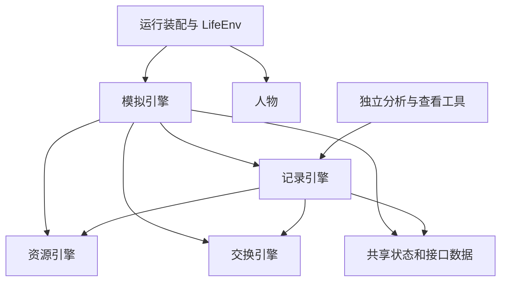

# 四个引擎的目录重构与独立评估裁减

> 实施范围按用户最后约束修订：除 evaluation 的功能裁减外，不改变接口输入输出、系统功能、运行时序、环境集或输出格式。
> 基线提交：`600c50cfb3305f886e20e1c89054a13048245819`。实施分支：`codex/four-engine-layout`。
> 状态：已完成实现和本地验收。机器证据保存在 `.work/four-engine-refactor/`，不作为仓库的长期机器台账。

## 本次实际边界

四个引擎使用独立源码包，包内按登记、计算、活动、调度、观察和记录细分子目录。
共享状态与工具数据从原 `life/models.py` 拆出，原始函数与数据模型的参数、字段、校验和返回值保留。
仅移动定义、调整导入和明确共有函数的唯一位置，不改变算法、金额、随机流、世界推进或模型请求内容。

原草案中的以下变化不进入本次实施：删除 `quality.json`、修改导出结构号、改变身体结算返回值、
替换 `LifeEngine.create/open` 的输入协议、改变下游导出文件闭集。
`quality.json` 及其摘要、重算与全部统计字段继续由记录引擎负责。
世界结构、运行清单、导出与规则版本均保持原值；运行源码身份随真实源码变化更新，不伪造旧指纹。

## 目录与依赖

```text
src/worldmock/
├── resource_engine/             资源引擎
│   ├── registration/            环境准入与登记错误
│   ├── catalog/                 目录数据、加载、身份和出行方式
│   └── map/                     地图生成与路线查询
├── exchange_engine/             交换引擎
│   ├── definitions/             固定类别、常数与身体资源定义
│   ├── conditions/              槽位与拒绝规则
│   ├── ledger/                  分录模型与纯结算
│   └── commerce/                费用、出行与配送算术
├── simulation_engine/           模拟引擎
│   ├── world/                   上下文、世界更新、初始化与干预
│   ├── decisions/               决策轮与同秒续接
│   ├── actions/                 请求、名称与开始组受理
│   ├── activities/
│   │   ├── lifecycle/           活动控制、校验与会话
│   │   ├── content/             内容选择、播放与完成效果
│   │   ├── travel/              行程与导航
│   │   └── query/               查询活动与答案
│   ├── commerce/
│   │   ├── purchase/            下单、报价、购买阶段与付款
│   │   └── fulfillment/         配送、通知、包裹与收货
│   ├── scheduling/
│   │   ├── clock/              时间边界、预排事件与天气
│   │   ├── plans/              日计划、事务与提醒
│   │   └── callbacks/          回调与应用推送
│   ├── observation/
│   │   ├── layers/             观察与各层事实
│   │   ├── targets/            名称、可调用对象与呈现轮换
│   │   └── wording/            上下文中的标题和拒绝说明
│   ├── body/                    身体、睡眠与体感
│   └── evidence/                本次执行的事件草稿
├── recording_engine/            记录引擎
│   ├── events/                  事件、素材和检查点模型及证据格式
│   ├── storage/                 SQLite、素材、观察分件、检查点与日志
│   ├── validation/              导出认证、来源与守恒
│   ├── projections/
│   │   ├── activities/          已发生的活动、经历、应用与停留
│   │   ├── commerce/            订单与事务的事实读取
│   │   └── presentation/        事实显示与认证时间线
│   ├── reports/                 原格式 quality.json 所需统计
│   └── export/                  原格式认证导出与事后读取
├── agents/                      prompt、protocol、memory
├── configuration/               inputs、persona、model
├── runtime/                     lifecycle、framework、monitoring
├── state/                       world、planning、interaction、decisions、observation、model
├── foundation/                  基础模型、错误、原子文件、路径、时间与序列化
└── cli.py
tools/analysis/                  独立行为与工作分析，不被生产包导入
```



生产包不导入 tools、scripts 或测试。资源、交换、记录和共享状态不反向导入模拟执行、人物执行或运行宿主，
基础函数不依赖这些领域包。依赖守卫直接检查包关系并用隔离反例验证，不依赖本表的文件清单。
LifeEngine 的创建与打开仍执行原来的真实身份核验，保持原调用时机；本次不为此引入接口层或更改工厂签名。
世界状态仍只有 EngineContext 中一个已提交版本，记录仍使用原 SQLite 原子提交。

## 实质性的职责整理

| 原来混合的位置 | 本次整理 |
| --- | --- |
| `life/models.py` | 世界、人物、活动、订单、身份、请求、结果、决策数据与 Schema 分开；全部原字段和校验保留 |
| `resources/` | 分录模型和计算归交换；历史资源对账归记录；移除含混的旧包 |
| `life/action_contract.py`、`error_contract.py`、`same_moment.py` | 交换规则与共同请求、错误、标签数据分开；运行同秒处理保留在模拟 |
| `life/memory_evidence.py` | 反思的运行时机留模拟，主观快照格式归共享数据，持久证据核验归记录 |
| `life/action_evidence.py`、`errands.py` | 执行及事件产生留模拟，已保存订单与收货证据读取归记录，消除记录对执行器的导入 |
| `footprints/models.py`、`assets.py`、`corpora/manifest.py` | 通用序列化、原子写和路径边界下沉，资源登记无需加载记录引擎 |
| `scripts/render_day.py` | 共用时间线算法归记录引擎；原查看命令和导出调用同一算法，消除生产代码按文件路径加载脚本 |
| `life/randomness.py`、`readable.py`、`sleep_plan.py` | 随机流、时间与标签、请求解析按实际职责归位；纯格式验证不加载模拟执行 |

## evaluation 的例外裁减

删除独立候选比较、外部对照适配、真人与官方参照、盲评、解盲报告和 `worldmock evaluate`。
原 evaluation 中整文件删除 16 个、5,150 个物理行；此数字仅描述基线处置。
现有行为统计、工作统计及其异常类型移至 `tools/analysis/`；被认证导出使用的约束与事务统计归记录引擎。
两边复用同一统计定义，不复制一份实现，也不让导出反向调用工具。
仅删除比较流程专属测试和变异；保留睡眠、用餐、事务、工作、来源、守恒和导出的实际验证。
分析代码继续计入风格、覆盖率、唯一规则归属和有效源码变异检查。

## 不变性的验证依据

- 重构前保存全部工具请求、世界、事件、检查点、人设与配置 Schema，以及提示指纹；重构后逐值比较。
- 对保留的函数和方法核对参数与返回注解，记录定义移动的位置；独立评估删除单独列出。
- 在基线提交录制活动日和回调日；按现行规程只屏蔽代码身份，比较事实、输出工件、素材与检查点。
- 新代码由两个独立进程各录制两种完整日候选，逐项相等后才通过既有冻结工具更新代码身份绑定的基线。
- 使用统一测试入口完成当前全部行为回归；保持 85% 分支覆盖、公共接口零缺口与有效源码变异要求。
- 环境集和环境输入不作改写；WorldMock-Dataset 只同步旧 Python 导入路径及相应测试，验证原调用结果。
- LabelKit 使用的认证导出格式不变，不需要环境迁移、导出迁移或新格式分支。

## 本地验收结果

按现有 CI 的固定三层运行：单元 3,845 项、集成 1,853 项、系统 421 项，共 6,119 项通过，失败、错误和跳过均为零。
三层源码指纹一致且运行前后未变。合并分支覆盖率为 95.10%，公共接口未覆盖缺口为零；284 项源码变异均由有效断言检出。
原始中途失败回执保留，没有改写成通过；最终门禁只使用完整重跑的三份原生 JUnit 与对应覆盖数据。

保留代码的 1,703 个函数和方法签名与基线一致。全部工具请求、世界、事件、检查点、人设与配置 Schema 及提示指纹逐值相同。
两份完整日的行为签名按现有规则仅屏蔽代码身份后完全一致；最终基线由两个独立进程的相等候选发布。
最终 wheel 含 251 个 Python 文件，与工作区对应源码逐字节相同，不包含旧包目录，能独立认证重构前的两份导出。

WorldMock-Dataset 仅更新九个调用文件的 Python 导入，相关接入与环境包测试为 519 项通过、6 项按数据条件跳过；
没有修改环境集或发布包。主仓库测试零跳过不代表下游这六项已经执行。

详细验收见 `.work/four-engine-refactor/ci/coverage-report.json`、`verification.json` 和三层各自的 JUnit、日志、源码身份回执。

## 源码文件处置

以下是基线 188 个源码文件的一次性处置表。当前文件相对 `src/worldmock/`，目标相对仓库根。
本表用于本次评审，完成后冻结，不作为持续维护的架构机器台账。
此外，工程脚本中的共用时间线定义移入记录引擎，脚本仍保留原命令和输入输出。

| 当前文件 | 实际目标 | 处置 |
| --- | --- | --- |
| `__init__.py` | `src/worldmock/__init__.py` | 保留实现，调整所属目录和调用路径 |
| `agents/__init__.py` | `src/worldmock/agents/__init__.py` | 保留实现，调整所属目录和调用路径 |
| `agents/life_context.py` | `src/worldmock/agents/prompt/life_context.py` | 保留实现，调整所属目录和调用路径 |
| `agents/life_continuation.py` | `src/worldmock/agents/protocol/life_continuation.py` | 保留实现，调整所属目录和调用路径 |
| `agents/life_feedback.py` | `src/worldmock/agents/protocol/life_feedback.py` | 保留实现，调整所属目录和调用路径 |
| `agents/life_memory.py` | `src/worldmock/agents/memory/life_memory.py` | 保留实现，调整所属目录和调用路径 |
| `agents/life_memory_store.py` | `src/worldmock/agents/memory/life_memory_store.py` | 保留实现，调整所属目录和调用路径 |
| `agents/life_persona.py` | `src/worldmock/agents/prompt/life_persona.py` | 保留实现，调整所属目录和调用路径 |
| `agents/life_prompt.py` | `src/worldmock/agents/prompt/life_prompt.py` | 保留实现，调整所属目录和调用路径 |
| `agents/life_reflection.py` | `src/worldmock/agents/memory/life_reflection.py`<br>`src/worldmock/state/model/reflection.py` | 保留实现并按定义职责拆分，原函数参数和结果不变 |
| `agents/life_truncation.py` | `src/worldmock/agents/protocol/life_truncation.py`<br>`src/worldmock/state/model/truncation.py` | 保留实现并按定义职责拆分，原函数参数和结果不变 |
| `base_models.py` | `src/worldmock/foundation/models.py` | 保留实现，调整所属目录和调用路径 |
| `catalog/__init__.py` | `src/worldmock/resource_engine/__init__.py`<br>`src/worldmock/resource_engine/catalog/loader.py`<br>`src/worldmock/resource_engine/catalog/models.py`<br>`src/worldmock/resource_engine/map/graph.py`<br>`src/worldmock/resource_engine/registration/errors.py` | 保留实现并按定义职责拆分，原函数参数和结果不变 |
| `catalog/admission.py` | `src/worldmock/resource_engine/registration/admission.py` | 保留实现，调整所属目录和调用路径 |
| `catalog/callback_models.py` | `src/worldmock/resource_engine/catalog/callback_models.py` | 保留实现，调整所属目录和调用路径 |
| `catalog/errors.py` | `src/worldmock/resource_engine/registration/errors.py` | 保留实现，调整所属目录和调用路径 |
| `catalog/graph.py` | `src/worldmock/resource_engine/map/graph.py` | 保留实现，调整所属目录和调用路径 |
| `catalog/identity.py` | `src/worldmock/resource_engine/catalog/identity.py` | 保留实现，调整所属目录和调用路径 |
| `catalog/loader.py` | `src/worldmock/resource_engine/catalog/loader.py` | 保留实现，调整所属目录和调用路径 |
| `catalog/mapgen.py` | `src/worldmock/resource_engine/map/mapgen.py` | 保留实现，调整所属目录和调用路径 |
| `catalog/models.py` | `src/worldmock/resource_engine/catalog/models.py` | 保留实现，调整所属目录和调用路径 |
| `cli.py` | `src/worldmock/cli.py` | 保留实现，调整所属目录和调用路径 |
| `corpora/__init__.py` | 删除 | 删除旧包入口 |
| `corpora/manifest.py` | `src/worldmock/foundation/filesystem.py` | 保留实现，调整所属目录和调用路径 |
| `environment.py` | `src/worldmock/configuration/inputs/environment.py` | 保留实现，调整所属目录和调用路径 |
| `errors.py` | `src/worldmock/foundation/errors.py` | 保留实现，调整所属目录和调用路径 |
| `evaluation/__init__.py` | 删除 | 删除独立比较或盲评实现 |
| `evaluation/adapters.py` | 删除 | 删除独立比较或盲评实现 |
| `evaluation/aggregate_reference.py` | 删除 | 删除独立比较或盲评实现 |
| `evaluation/behavior_metrics.py` | `tools/analysis/behavior/metrics.py` | 保留实现，调整所属目录和调用路径 |
| `evaluation/causal_checks.py` | 删除 | 删除独立比较或盲评实现 |
| `evaluation/causality.py` | 删除 | 删除独立比较或盲评实现 |
| `evaluation/decision.py` | 删除 | 删除独立比较或盲评实现 |
| `evaluation/errand_metrics.py` | `src/worldmock/recording_engine/reports/errand_metrics.py` | 保留实现，调整所属目录和调用路径 |
| `evaluation/errors.py` | `tools/analysis/errors.py` | 保留实现，调整所属目录和调用路径 |
| `evaluation/goal_metrics.py` | `src/worldmock/recording_engine/reports/goal_metrics.py` | 保留实现，调整所属目录和调用路径 |
| `evaluation/io.py` | 删除 | 删除独立比较或盲评实现 |
| `evaluation/metrics.py` | 删除 | 删除独立比较或盲评实现 |
| `evaluation/models.py` | 删除 | 删除独立比较或盲评实现 |
| `evaluation/public_evidence.py` | 删除 | 删除独立比较或盲评实现 |
| `evaluation/randomness.py` | 删除 | 删除独立比较或盲评实现 |
| `evaluation/reporting.py` | 删除 | 删除独立比较或盲评实现 |
| `evaluation/review.py` | 删除 | 删除独立比较或盲评实现 |
| `evaluation/runner.py` | 删除 | 删除独立比较或盲评实现 |
| `evaluation/scenario.py` | 删除 | 删除独立比较或盲评实现 |
| `evaluation/validation.py` | 删除 | 删除独立比较或盲评实现 |
| `evaluation/workload_metrics.py` | `tools/analysis/behavior/workday.py` | 保留实现，调整所属目录和调用路径 |
| `exchange/__init__.py` | `src/worldmock/exchange_engine/__init__.py`<br>`src/worldmock/exchange_engine/definitions/constants.py` | 保留实现并按定义职责拆分，原函数参数和结果不变 |
| `exchange/body.py` | `src/worldmock/exchange_engine/definitions/body_constants.py` | 保留实现，调整所属目录和调用路径 |
| `exchange/constants.py` | `src/worldmock/exchange_engine/definitions/constants.py` | 保留实现，调整所属目录和调用路径 |
| `exchange/operators.py` | `src/worldmock/exchange_engine/commerce/operators.py` | 保留实现，调整所属目录和调用路径 |
| `exchange/types.py` | `src/worldmock/exchange_engine/definitions/types.py` | 保留实现，调整所属目录和调用路径 |
| `footprints/__init__.py` | `src/worldmock/recording_engine/__init__.py` | 保留实现，调整所属目录和调用路径 |
| `footprints/app_usage.py` | `src/worldmock/recording_engine/projections/activities/app_usage.py` | 保留实现，调整所属目录和调用路径 |
| `footprints/assets.py` | `src/worldmock/foundation/atomic_write.py`<br>`src/worldmock/recording_engine/storage/assets.py` | 保留实现并按定义职责拆分，原函数参数和结果不变 |
| `footprints/callback_contract.py` | `src/worldmock/recording_engine/events/callback_contract.py` | 保留实现，调整所属目录和调用路径 |
| `footprints/checkpoint.py` | `src/worldmock/recording_engine/storage/checkpoint.py` | 保留实现，调整所属目录和调用路径 |
| `footprints/display_wording.py` | `src/worldmock/recording_engine/projections/presentation/display_wording.py` | 保留实现，调整所属目录和调用路径 |
| `footprints/environment_events.py` | `src/worldmock/recording_engine/events/environment_events.py` | 保留实现，调整所属目录和调用路径 |
| `footprints/evidence.py` | `src/worldmock/recording_engine/events/model_evidence.py` | 保留实现，调整所属目录和调用路径 |
| `footprints/experiences.py` | `src/worldmock/recording_engine/projections/activities/experiences.py` | 保留实现，调整所属目录和调用路径 |
| `footprints/export.py` | `src/worldmock/recording_engine/export/export.py` | 保留实现，调整所属目录和调用路径 |
| `footprints/frozen_environment.py` | `src/worldmock/recording_engine/validation/frozen_environment.py` | 保留实现，调整所属目录和调用路径 |
| `footprints/intervals.py` | `src/worldmock/foundation/time/intervals.py` | 保留实现，调整所属目录和调用路径 |
| `footprints/invariants.py` | `src/worldmock/recording_engine/validation/invariants.py` | 保留实现，调整所属目录和调用路径 |
| `footprints/ledger.py` | `src/worldmock/recording_engine/validation/ledger.py` | 保留实现，调整所属目录和调用路径 |
| `footprints/location_stays.py` | `src/worldmock/recording_engine/projections/activities/location_stays.py` | 保留实现，调整所属目录和调用路径 |
| `footprints/models.py` | `src/worldmock/foundation/serialization.py`<br>`src/worldmock/recording_engine/events/models.py` | 保留实现并按定义职责拆分，原函数参数和结果不变 |
| `footprints/observation_parts.py` | `src/worldmock/recording_engine/storage/observation_parts.py` | 保留实现，调整所属目录和调用路径 |
| `footprints/post_run.py` | `src/worldmock/recording_engine/export/post_run.py` | 保留实现，调整所属目录和调用路径 |
| `footprints/purchases.py` | `src/worldmock/recording_engine/projections/commerce/purchases.py` | 保留实现，调整所属目录和调用路径 |
| `footprints/quality.py` | `src/worldmock/recording_engine/reports/quality.py` | 保留实现，调整所属目录和调用路径 |
| `footprints/store.py` | `src/worldmock/recording_engine/storage/store.py` | 保留实现，调整所属目录和调用路径 |
| `footprints/timeline_labels.py` | `src/worldmock/foundation/time/calendar.py`<br>`src/worldmock/recording_engine/projections/presentation/timeline_labels.py` | 保留实现并按定义职责拆分，原函数参数和结果不变 |
| `footprints/validation.py` | `src/worldmock/recording_engine/validation/validation.py` | 保留实现，调整所属目录和调用路径 |
| `input_models.py` | `src/worldmock/configuration/inputs/models.py` | 保留实现，调整所属目录和调用路径 |
| `input_warnings.py` | `src/worldmock/configuration/inputs/warnings.py` | 保留实现，调整所属目录和调用路径 |
| `life/__init__.py` | `src/worldmock/simulation_engine/__init__.py` | 保留实现，调整所属目录和调用路径 |
| `life/action_contract.py` | `src/worldmock/exchange_engine/conditions/activity_rules.py`<br>`src/worldmock/state/interaction/actions.py`<br>`src/worldmock/state/observation/labels.py` | 保留实现并按定义职责拆分，原函数参数和结果不变 |
| `life/action_evidence.py` | `src/worldmock/recording_engine/projections/commerce/action_orders.py`<br>`src/worldmock/simulation_engine/evidence/actions.py` | 保留实现并按定义职责拆分，原函数参数和结果不变 |
| `life/activities.py` | `src/worldmock/simulation_engine/activities/lifecycle/activities.py` | 保留实现，调整所属目录和调用路径 |
| `life/activity_control.py` | `src/worldmock/simulation_engine/activities/lifecycle/activity_control.py` | 保留实现，调整所属目录和调用路径 |
| `life/activity_evidence.py` | `src/worldmock/simulation_engine/evidence/activity.py` | 保留实现，调整所属目录和调用路径 |
| `life/activity_titles.py` | `src/worldmock/simulation_engine/observation/wording/activity_titles.py` | 保留实现，调整所属目录和调用路径 |
| `life/activity_validation.py` | `src/worldmock/simulation_engine/activities/lifecycle/activity_validation.py` | 保留实现，调整所属目录和调用路径 |
| `life/admission.py` | `src/worldmock/simulation_engine/actions/admission.py` | 保留实现，调整所属目录和调用路径 |
| `life/app_push.py` | `src/worldmock/simulation_engine/scheduling/callbacks/app_push.py` | 保留实现，调整所属目录和调用路径 |
| `life/basket.py` | `src/worldmock/simulation_engine/commerce/purchase/basket.py` | 保留实现，调整所属目录和调用路径 |
| `life/body.py` | `src/worldmock/simulation_engine/body/body.py` | 保留实现，调整所属目录和调用路径 |
| `life/body_config.py` | `src/worldmock/simulation_engine/body/body_config.py` | 保留实现，调整所属目录和调用路径 |
| `life/business_feedback.py` | `src/worldmock/simulation_engine/actions/business_feedback.py` | 保留实现，调整所属目录和调用路径 |
| `life/callable_index.py` | `src/worldmock/simulation_engine/observation/targets/callable_index.py` | 保留实现，调整所属目录和调用路径 |
| `life/callbacks.py` | `src/worldmock/simulation_engine/scheduling/callbacks/callbacks.py` | 保留实现，调整所属目录和调用路径 |
| `life/commerce.py` | `src/worldmock/simulation_engine/commerce/fulfillment/commerce.py` | 保留实现，调整所属目录和调用路径 |
| `life/completion_effects.py` | `src/worldmock/simulation_engine/activities/content/completion_effects.py` | 保留实现，调整所属目录和调用路径 |
| `life/content_prerequisite.py` | `src/worldmock/simulation_engine/observation/wording/content_prerequisite.py` | 保留实现，调整所属目录和调用路径 |
| `life/content_select.py` | `src/worldmock/simulation_engine/activities/content/content_select.py` | 保留实现，调整所属目录和调用路径 |
| `life/continuation.py` | `src/worldmock/simulation_engine/decisions/continuation.py` | 保留实现，调整所属目录和调用路径 |
| `life/control_items.py` | `src/worldmock/state/interaction/control_items.py` | 保留实现，调整所属目录和调用路径 |
| `life/counterfactual_runtime.py` | `src/worldmock/simulation_engine/world/counterfactual.py` | 保留实现，调整所属目录和调用路径 |
| `life/day_plan_inputs.py` | `src/worldmock/simulation_engine/scheduling/plans/day_plan_inputs.py` | 保留实现，调整所属目录和调用路径 |
| `life/day_planning.py` | `src/worldmock/simulation_engine/scheduling/plans/day_planning.py` | 保留实现，调整所属目录和调用路径 |
| `life/decision_coordinator.py` | `src/worldmock/simulation_engine/decisions/decision_coordinator.py` | 保留实现，调整所属目录和调用路径 |
| `life/decision_start.py` | `src/worldmock/simulation_engine/decisions/decision_start.py`<br>`src/worldmock/state/model/exchange.py` | 保留实现并按定义职责拆分，原函数参数和结果不变 |
| `life/discovery.py` | `src/worldmock/simulation_engine/observation/targets/discovery.py` | 保留实现，调整所属目录和调用路径 |
| `life/duty_edges.py` | `src/worldmock/simulation_engine/scheduling/clock/duty_edges.py` | 保留实现，调整所属目录和调用路径 |
| `life/engine.py` | `src/worldmock/simulation_engine/engine.py` | 保留实现，调整所属目录和调用路径 |
| `life/engine_context.py` | `src/worldmock/simulation_engine/world/context.py` | 保留实现，调整所属目录和调用路径 |
| `life/environment_layer.py` | `src/worldmock/simulation_engine/observation/layers/environment_layer.py` | 保留实现，调整所属目录和调用路径 |
| `life/errand_state.py` | `src/worldmock/state/planning/errands.py` | 保留实现，调整所属目录和调用路径 |
| `life/errands.py` | `src/worldmock/recording_engine/projections/commerce/errand_evidence.py`<br>`src/worldmock/simulation_engine/scheduling/plans/errands.py` | 保留实现并按定义职责拆分，原函数参数和结果不变 |
| `life/error_contract.py` | `src/worldmock/exchange_engine/conditions/rejection_codes.py`<br>`src/worldmock/state/interaction/errors.py` | 保留实现并按定义职责拆分，原函数参数和结果不变 |
| `life/felt.py` | `src/worldmock/simulation_engine/body/felt.py` | 保留实现，调整所属目录和调用路径 |
| `life/guidance.py` | `src/worldmock/simulation_engine/observation/wording/guidance.py` | 保留实现，调整所属目录和调用路径 |
| `life/interact.py` | `src/worldmock/simulation_engine/activities/content/interact.py` | 保留实现，调整所属目录和调用路径 |
| `life/location_activities.py` | `src/worldmock/simulation_engine/activities/content/location_activities.py` | 保留实现，调整所属目录和调用路径 |
| `life/memory_evidence.py` | `src/worldmock/recording_engine/events/memory_evidence.py`<br>`src/worldmock/simulation_engine/evidence/memory.py`<br>`src/worldmock/state/model/memory.py` | 保留实现并按定义职责拆分，原函数参数和结果不变 |
| `life/memory_layer.py` | `src/worldmock/simulation_engine/observation/layers/memory_layer.py` | 保留实现，调整所属目录和调用路径 |
| `life/model_evidence.py` | `src/worldmock/simulation_engine/evidence/model.py` | 保留实现，调整所属目录和调用路径 |
| `life/models.py` | `src/worldmock/state/decisions/results.py`<br>`src/worldmock/state/decisions/state.py`<br>`src/worldmock/state/identity.py`<br>`src/worldmock/state/interaction/requests.py`<br>`src/worldmock/state/interaction/schema.py`<br>`src/worldmock/state/logging.py`<br>`src/worldmock/state/world/activity.py`<br>`src/worldmock/state/world/agent.py`<br>`src/worldmock/state/world/kinds.py`<br>`src/worldmock/state/world/orders.py`<br>`src/worldmock/state/world/world.py` | 保留实现并按定义职责拆分，原函数参数和结果不变 |
| `life/name_resolution.py` | `src/worldmock/simulation_engine/actions/name_resolution.py` | 保留实现，调整所属目录和调用路径 |
| `life/narration.py` | `src/worldmock/agents/prompt/narration.py` | 保留实现，调整所属目录和调用路径 |
| `life/navigation_foreground.py` | `src/worldmock/simulation_engine/activities/travel/navigation_foreground.py` | 保留实现，调整所属目录和调用路径 |
| `life/object_labels.py` | `src/worldmock/simulation_engine/observation/targets/object_labels.py` | 保留实现，调整所属目录和调用路径 |
| `life/observe.py` | `src/worldmock/simulation_engine/observation/layers/observe.py` | 保留实现，调整所属目录和调用路径 |
| `life/order_apps.py` | `src/worldmock/simulation_engine/commerce/purchase/order_apps.py` | 保留实现，调整所属目录和调用路径 |
| `life/order_notices.py` | `src/worldmock/exchange_engine/commerce/shipping.py`<br>`src/worldmock/simulation_engine/commerce/fulfillment/order_notices.py`<br>`src/worldmock/state/world/order_notices.py` | 保留实现并按定义职责拆分，原函数参数和结果不变 |
| `life/order_routing.py` | `src/worldmock/simulation_engine/commerce/purchase/order_routing.py`<br>`src/worldmock/state/world/order_keys.py` | 保留实现并按定义职责拆分，原函数参数和结果不变 |
| `life/parcel.py` | `src/worldmock/simulation_engine/commerce/fulfillment/parcel.py` | 保留实现，调整所属目录和调用路径 |
| `life/presentation.py` | `src/worldmock/simulation_engine/observation/targets/presentation.py` | 保留实现，调整所属目录和调用路径 |
| `life/progress_layer.py` | `src/worldmock/simulation_engine/observation/layers/progress_layer.py` | 保留实现，调整所属目录和调用路径 |
| `life/projection.py` | `src/worldmock/simulation_engine/observation/layers/projection.py` | 保留实现，调整所属目录和调用路径 |
| `life/prompt_capacity.py` | `src/worldmock/agents/prompt/prompt_capacity.py` | 保留实现，调整所属目录和调用路径 |
| `life/prompt_schemas.py` | `src/worldmock/agents/prompt/prompt_schemas.py` | 保留实现，调整所属目录和调用路径 |
| `life/purchase_offers.py` | `src/worldmock/simulation_engine/commerce/purchase/purchase_offers.py` | 保留实现，调整所属目录和调用路径 |
| `life/purchase_phases.py` | `src/worldmock/simulation_engine/commerce/purchase/purchase_phases.py` | 保留实现，调整所属目录和调用路径 |
| `life/query_activity.py` | `src/worldmock/simulation_engine/activities/query/query_activity.py` | 保留实现，调整所属目录和调用路径 |
| `life/query_answer.py` | `src/worldmock/simulation_engine/activities/query/query_answer.py` | 保留实现，调整所属目录和调用路径 |
| `life/randomness.py` | `src/worldmock/foundation/randomness.py` | 保留实现，调整所属目录和调用路径 |
| `life/read_query_runtime.py` | `src/worldmock/runtime/framework/read_query.py` | 保留实现，调整所属目录和调用路径 |
| `life/readable.py` | `src/worldmock/foundation/time/readable.py`<br>`src/worldmock/state/observation/labels.py` | 保留实现并按定义职责拆分，原函数参数和结果不变 |
| `life/receipt.py` | `src/worldmock/simulation_engine/commerce/fulfillment/receipt.py` | 保留实现，调整所属目录和调用路径 |
| `life/reminders.py` | `src/worldmock/simulation_engine/scheduling/plans/reminders.py` | 保留实现，调整所属目录和调用路径 |
| `life/request_errors.py` | `src/worldmock/state/interaction/request_errors.py` | 保留实现，调整所属目录和调用路径 |
| `life/result_projection.py` | `src/worldmock/simulation_engine/observation/layers/result_projection.py` | 保留实现，调整所属目录和调用路径 |
| `life/rhythm.py` | `src/worldmock/simulation_engine/scheduling/clock/rhythm.py` | 保留实现，调整所属目录和调用路径 |
| `life/rotation.py` | `src/worldmock/simulation_engine/observation/targets/rotation.py` | 保留实现，调整所属目录和调用路径 |
| `life/run_identity.py` | `src/worldmock/simulation_engine/world/run_identity.py` | 保留实现，调整所属目录和调用路径 |
| `life/same_moment.py` | `src/worldmock/exchange_engine/conditions/rejections.py`<br>`src/worldmock/simulation_engine/decisions/same_moment.py` | 保留实现并按定义职责拆分，原函数参数和结果不变 |
| `life/schedule.py` | `src/worldmock/state/planning/schedule.py` | 保留实现，调整所属目录和调用路径 |
| `life/session_actions.py` | `src/worldmock/simulation_engine/actions/dispatcher.py` | 保留实现，调整所属目录和调用路径 |
| `life/session_bounds.py` | `src/worldmock/recording_engine/projections/activities/session_bounds.py` | 保留实现，调整所属目录和调用路径 |
| `life/sessions.py` | `src/worldmock/simulation_engine/activities/lifecycle/sessions.py` | 保留实现，调整所属目录和调用路径 |
| `life/settled_text.py` | `src/worldmock/simulation_engine/observation/wording/settled_text.py` | 保留实现，调整所属目录和调用路径 |
| `life/settlement.py` | `src/worldmock/simulation_engine/commerce/purchase/settlement.py` | 保留实现，调整所属目录和调用路径 |
| `life/sleep.py` | `src/worldmock/simulation_engine/body/sleep.py` | 保留实现，调整所属目录和调用路径 |
| `life/sleep_plan.py` | `src/worldmock/simulation_engine/body/sleep_plan.py`<br>`src/worldmock/state/interaction/sleep.py` | 保留实现并按定义职责拆分，原函数参数和结果不变 |
| `life/start_group.py` | `src/worldmock/simulation_engine/actions/start_group.py` | 保留实现，调整所属目录和调用路径 |
| `life/stay_records.py` | `src/worldmock/simulation_engine/evidence/stays.py` | 保留实现，调整所属目录和调用路径 |
| `life/storefront_runtime.py` | `src/worldmock/simulation_engine/commerce/purchase/storefront_runtime.py` | 保留实现，调整所属目录和调用路径 |
| `life/time_advance.py` | `src/worldmock/simulation_engine/scheduling/clock/time_advance.py` | 保留实现，调整所属目录和调用路径 |
| `life/todo_layer.py` | `src/worldmock/simulation_engine/observation/layers/todo_layer.py` | 保留实现，调整所属目录和调用路径 |
| `life/tool_groups.py` | `src/worldmock/agents/prompt/tool_groups.py` | 保留实现，调整所属目录和调用路径 |
| `life/tool_layer.py` | `src/worldmock/simulation_engine/observation/targets/tool_layer.py` | 保留实现，调整所属目录和调用路径 |
| `life/travel.py` | `src/worldmock/simulation_engine/activities/travel/travel.py` | 保留实现，调整所属目录和调用路径 |
| `life/travel_methods.py` | `src/worldmock/resource_engine/catalog/travel_methods.py` | 保留实现，调整所属目录和调用路径 |
| `life/weather.py` | `src/worldmock/simulation_engine/scheduling/clock/weather.py` | 保留实现，调整所属目录和调用路径 |
| `life/work_schedule.py` | `src/worldmock/configuration/persona/work_schedule.py` | 保留实现，调整所属目录和调用路径 |
| `life/world_ops.py` | `src/worldmock/simulation_engine/world/world_updates.py` | 保留实现，调整所属目录和调用路径 |
| `life/world_setup.py` | `src/worldmock/simulation_engine/world/world_setup.py` | 保留实现，调整所属目录和调用路径 |
| `model_endpoint.py` | `src/worldmock/configuration/model/model_metadata.py` | 保留实现，调整所属目录和调用路径 |
| `model_feedback.py` | `src/worldmock/foundation/model_feedback.py` | 保留实现，调整所属目录和调用路径 |
| `opslog.py` | `src/worldmock/recording_engine/storage/opslog.py` | 保留实现，调整所属目录和调用路径 |
| `profile/__init__.py` | 删除 | 删除旧包入口 |
| `profile/models.py` | `src/worldmock/configuration/persona/persona_card.py` | 保留实现，调整所属目录和调用路径 |
| `profile/textgen.py` | `src/worldmock/configuration/persona/persona_text.py` | 保留实现，调整所属目录和调用路径 |
| `resources/__init__.py` | `src/worldmock/exchange_engine/ledger/ledger.py`<br>`src/worldmock/exchange_engine/ledger/ledger_models.py`<br>`src/worldmock/recording_engine/validation/resource_audit.py` | 保留实现并按定义职责拆分，原函数参数和结果不变 |
| `resources/audit.py` | `src/worldmock/recording_engine/validation/resource_audit.py` | 保留实现，调整所属目录和调用路径 |
| `resources/ledger.py` | `src/worldmock/exchange_engine/ledger/ledger.py` | 保留实现，调整所属目录和调用路径 |
| `resources/models.py` | `src/worldmock/exchange_engine/ledger/ledger_models.py` | 保留实现，调整所属目录和调用路径 |
| `run_setup.py` | `src/worldmock/runtime/framework/setup.py` | 保留实现，调整所属目录和调用路径 |
| `runtime.py` | `src/worldmock/runtime/lifecycle/runner.py` | 保留实现，调整所属目录和调用路径 |
| `scheduling/__init__.py` | `src/worldmock/simulation_engine/scheduling/__init__.py` | 保留实现，调整所属目录和调用路径 |
| `scheduling/compile.py` | `src/worldmock/simulation_engine/scheduling/clock/compile.py` | 保留实现，调整所属目录和调用路径 |
| `scheduling/effects.py` | `src/worldmock/simulation_engine/scheduling/clock/effects.py` | 保留实现，调整所属目录和调用路径 |
| `scheduling/events.py` | `src/worldmock/state/planning/events.py` | 保留实现，调整所属目录和调用路径 |
| `status.py` | `src/worldmock/runtime/monitoring/status.py` | 保留实现，调整所属目录和调用路径 |
| `validation.py` | `src/worldmock/configuration/inputs/validation.py` | 保留实现，调整所属目录和调用路径 |
