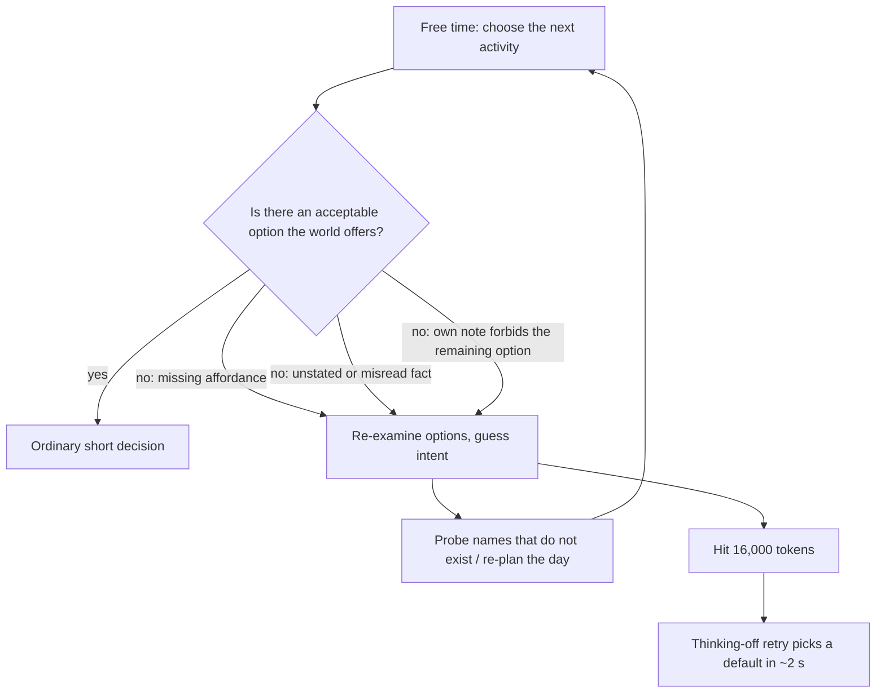
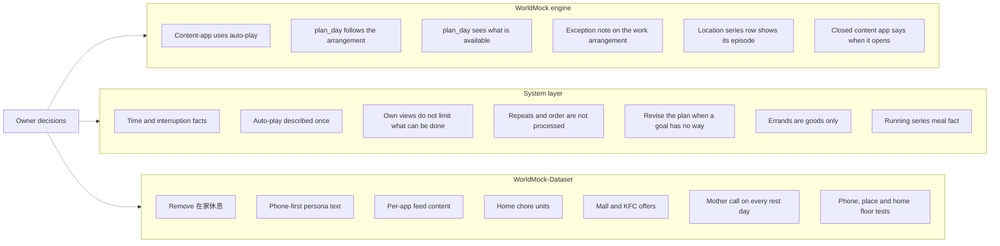

# Phone-first free time and dead ends

Status: frozen with the owner's rulings of 2026-10-15 (see "Rulings"); the WorldMock part is specified in
[SPEC-free-time-dead-ends.md](SPEC-free-time-dead-ends.md). Date: 2026-10-14.

Source baselines: WorldMock `d27f2c5a6c2d4532c2a06a1b63c7ee521abc5864`; WorldMock-Dataset `224cc29a3666fd9a68bb4354726f6113ba6fc6c3`
(the white-collar environment `0001-white-collar-lianqiu`, environment version 6).

This document proposes changes; it does not describe implemented behavior. No production code, dataset, test, configuration
or current design document is changed by it. Model-backed checks listed under acceptance need separate authorization.

## Intended behavior

The persona's trace should look like a modern urban citizen who uses a mobile phone heavily. When she has nothing in
particular to do, she scrolls short video and social feeds, watches series, listens to music and answers messages; she
never "does nothing". A feed runs continuously, item after item, until something in her life interrupts it or she stops.

In discretionary time she always has something the world actually offers, knows the facts needed to choose (what will
interrupt her, when something opens again, what feeds her), and plans a day that matches the day's actual work arrangement.
Choosing the next activity on a free afternoon should be an ordinary choice, not a puzzle.

The goal is not to make the model think less by force, to prescribe which option to take, or to hide gaps behind
truncation retries. Mechanisms are not weakened for speed: the hourly push wake and the 30-minute progress report stay.

## Owner statements this proposal records

| Owner statement (2026-10-14) | Consequence here |
| --- | --- |
| No "doing nothing" activities: no wait, idle or 在家休息; free time is phone use | 在家休息 is removed from every environment; no rest unit is required anywhere |
| A feed should keep playing the next item until something interrupts it; the engine was left unchanged on 2026-10-12 only because simulation data was needed quickly | Content-app uses auto-play. This reopens the 2026-10-12 answer and reverses part of the environment dataset contract sentence 「非系列内容完成后停止，系列耗尽后停止，不跳到其他系列或无关内容；不增加 autoplay 开关」: the first three clauses no longer hold, and 「不增加 autoplay 开关」 still holds. Applying auto-play to every content app, not only feed apps, is this proposal's reading |
| Auto-play order: the next episode of the series she is watching; when that series is finished, another series she started earlier | Defines the series rows of the order below. The row for a standalone item is this proposal's assumption, not yet confirmed by the owner |
| Pushes keep waking an awake person; push targeting is future work | No push change here |
| The 30-minute progress report stays as it is | No report-anchor change |
| The person cannot query the world while planning; either tell her what is available, or have her fix the plan when something turns out to be impossible | The revise rule is adopted; the plan-time list of what is available is recommended as a review decision |

## What the run shows

Evidence comes from `WorldMock-Dataset/execution/20261014T095627Z-white-collar-30day-resume2`, event prefix up to 21100
(simulated 2026-09-28 to 2026-10-10, Asia/Shanghai). September 28–30 and October 8–10 are workdays; October 1–7 is the
national holiday. The run stopped on October 14 when four attempts to reach the DeepSeek API failed to connect; that failure
is not part of this proposal. Minutes are model wait time of action decisions unless stated otherwise.

### Long deliberation

| Observation | Measured value |
| --- | --- |
| What drives model wall time | Per-call latency ≈ 0.09 s + 0.0064 s × completion tokens (R² 0.985); prompt size has no measurable effect |
| Model minutes per day | Rest days 45.0, workdays 24.4; October 8–10 (19–24 min) were cheaper than September 29–30 (30–35 min) despite larger prompts |
| Turns per decision | 1.04–1.18 on every day; extra turns cost about 1.7–1.9 minutes per day |
| Long-thinking tail | 274 calls with at least 4,000 reasoning tokens took 249.5 of about 462 action minutes and explain 89% of the day-to-day variance: 27.0 minutes per day on October 1–7, 10.1 per workday (7.6 on October 8–10) |
| Where the tail occurs | Choosing the next activity in free time, mostly at home on rest days and on workday evenings; office hours stay short |
| What long calls contain | Loops of "Hmm… actually… wait"; "the environment expects" appears somewhere in 63% of calls above 8,000 reasoning tokens against 0% below 1,500 (presence anywhere, which grows with length) |
| Truncations | 23 calls reached the 16,000-token cap (40 minutes; 20 calls and 35 minutes on rest days); 22 returned no action and were retried with thinking off, which answered in about 2 s |
| Decisions per day | Rest days 118, workdays 94; most activities cost a start and a conclusion decision (about 1.7 lifecycle decisions per activity) |

The long calls share one shape: every option the model can see has been ruled out, because the world lacks it, because the
model believes something false about the world, or because one of its own earlier notes forbids it. It then looks for the
"intended" answer.

The dead ends overlap within the same calls, and no single one decides which days spike. October 3 and October 4 had the
same conditions (a chore goal with no home action, the mother call open, light rain, almost all time at home), yet October 3
spent 10 long-thinking minutes and October 4 spent 21. Every saving quoted per item is an upper bound; the combined effect is
known only after the acceptance run.

| Dead end | Evidence | Exposure (upper bound, overlapping) |
| --- | --- | --- |
| Chores in the plan with no home action | Home offers only 早上洗漱, 睡前洗漱, 在家休息 and the 做晚饭 series; 洗衣服 was probed four times, 收拾屋子 and 做家务 once each, all `NAME_NOT_FOUND`; she bought 洗衣液 twice to make the goal feasible | 270 calls reason that the chore has no action: 168 minutes, 132 of them in the tail |
| Meals | The prompt does not say that time stops while nothing runs or that a delivery interrupts an awake person; a cooking series concluded in the last seconds of an episode does not feed (two meals lost); a fed person reads 「有点想吃」 inside meal windows | Meal-dominant tail calls: 86 of the 249.5 tail minutes |
| Contacts | The mother call opens on Saturdays and Sundays only, so it was closed on holiday weekdays; WeChat drew the 王磊 chat once in 31 opens; social need sat at 0.9 or above for 13.7 of about 15.5 waking hours on holiday days | Contact-centred tail calls: 54–131 of the 189 rest-day tail minutes |
| Places with nothing to do | The mall and the KFC offer no activity and sell nothing; rest-day decisions at the mall had median 1,968 and mean 4,456 reasoning tokens against 545–1,032 at parks and the gym | 15 tail minutes at the mall, including both mall truncations |
| Own rules | Learned views such as 在家休息「一天最多两段」, and plan goals such as 「做完就起身，不接着再开一段」, forbid the remaining options | Self-rule wording somewhere in 70% of calls above 8,000 tokens against 8% below 1,500 |
| Plans against the arrangement | `plan_day` followed the weekday name on every day where it disagreed with 上班安排: a work goal on October 1, full workday plans on October 2 and 5–7, a weekend plan on the make-up Saturday October 10 | Six morning revisions (about 24,800 reasoning tokens) plus decision-time guessing about the holiday |

### Phone use

| Observation | Measured value |
| --- | --- |
| On-screen app time | 2.0 h per workday and 4.9 h per rest day, plus 1.7 h and 5.5 h of music and audiobooks (网易云音乐 alone 39% of all app minutes) and about 0.25 h of calls per rest day |
| Short-video and social feeds | 抖音, 快手, 小红书 and 微博 were never opened in 13 days; short clips were watched only through 哔哩哔哩 and 微信, about 10 minutes a day. The model weighed the feed apps 52 times as 「约 2 分钟」 options and called them too trivial |
| What a content-app use is | One item, then the use ends and must be concluded; 242 of 263 uses played one item. In app-only time this cost 8.2–10.1 decisions per hour against 6.4–6.6 for 在家休息 |
| 在家休息 | 406 minutes per rest day (about 14 starts), 162 of them with nothing on the phone; 112 minutes per workday, 97 with nothing on the phone. Time with no activity at all was essentially zero |
| Feed content | The six feed and social apps share one pool of 90 synthetic clips of 90–150 s (about 180 minutes in total); 59 of them were already watched |
| Persona text | 「上午在办公室处理开发和会议，几乎不看手机」 and 「晚间在家休息」; the only listed media taste is 哔哩哔哩视频; the habits name 哔哩哔哩 after lunch and before sleep |
| Pushes | 183 pushes; 171 woke her (the other 12 arrived while she slept); 4 led to opening the pushed app at once and 23 were opened eventually. Real non-message notifications are opened at similar rates, so this is not treated as a defect here |

Projected cost of moving the 6.8 hours per rest day of 在家休息 into phone use:

| Mechanics | Decisions per hour of feed | Rest day |
| --- | --- | --- |
| Today: one item per use, short feeds | About 61 | About 490 decisions and 146–210 minutes |
| Today: one item per use, the run's own app mix | 8.2–10.1 | 130–143 decisions and 52–54 minutes |
| Auto-play: decisions only at existing wakes | 3.3–5.6 | About 96–112 decisions and 38–52 minutes |

These projections use the run's per-decision latencies and an assumed share of wakes at which she switches to something
else; the acceptance run measures them.

### Targets for a modern urban phone user

Recent Chinese sources put internet use on all devices at 4.6 hours a day by self-report
([CNNIC 57th report](https://pdf.dfcfw.com/pdf/H3_AP202603101820433901_1.pdf)), measured app time at about 6.0 hours a day
([QuestMobile, December 2025](https://www.questmobile.com.cn/research/report/2018573146077106178/)) and about 6.3 hours with
about 90 app launches a day ([June 2026](https://m.thepaper.cn/newsDetail_forward_33713625)), and phone-recorded screen
time at 6.9 hours for people born in the 1980s in Guangzhou ([GPS2023](https://news.dayoo.com/guangzhou/202410/15/139995_54732265.htm)).
Short video is the largest category, at least 1.5 hours a day for 抖音 users ([QuestMobile, March 2026](https://news.qq.com/rain/a/20260429A0231E00)).
Usage peaks at lunch and in the evening; holiday usage in QuestMobile's holiday reports is about 30% above its ordinary
baseline (derived across reports). Proposed targets for the white-collar persona, with wide uncertainty:

| Measure | Target | Run |
| --- | --- | --- |
| On-screen phone time, workday (audio counted separately) | 3.5–5 h | 2.0 h |
| On-screen phone time, rest day | 5.5–8 h | 4.9 h |
| Short video on a rest day | 1.5–2.5 h | About 10 min, through 哔哩哔哩 and 微信 |
| Phone sessions of 30 s or more (45 s gaps merged) | 15–30 per workday, 20–40 per rest day | 12–15 on-screen uses |
| Short-video session length | 5–15 min in real use (TikTok about 10 min; about 30 clips derived from about 18 s per view). Under auto-play she can leave a feed only at a wake, so sessions of about 20–70 min are expected | — |
| Awake time at home with no content app in use, and what fills it | Little, and never an idle activity | 162 min per rest day of 在家休息 with nothing on the phone |

A separate engine slowdown (per-decision engine time growing from about 1 s to about 13 s) comes from full-history reads,
now fixed on an unmerged branch, and from an unpruned world state that no current work addresses. Neither is in scope here.

## Established approaches

| Source | What it does | Bearing on this proposal |
| --- | --- | --- |
| [OASIS](https://arxiv.org/abs/2411.11581), [Agent4Rec](https://arxiv.org/abs/2310.10108), RecAgent | Social-media and recommender simulations decide per session or per page, never per item | Auto-play: decisions at session level, items recorded underneath |
| [TikTok data donations](https://pure.mpg.de/rest/items/item_3594318_1/component/file_3594319/content) | Median 27 minutes and about 90 videos a day; sessions separated by breaks of about 105 s | A feed session is many items with one start |
| [Rixen et al. 2023](https://www.uni-ulm.de/fileadmin/website_uni_ulm/iui.inst.100/1-hci/hci-paper/2023/4-TheLoopAndHowToBreakIT.pdf) | Long social-media sessions end most often because of a task, boredom, self-regulation or sleep; old or boring content explains about a fifth | Context ends feeds, which the existing wakes model; exits from boredom or self-regulation wait for the next wake here |
| [SayCan](https://arxiv.org/abs/2204.01691) | Executes only skills that are both useful and currently feasible | Offer only actions the world can carry out; fill missing affordances |
| [ProgPrompt](https://arxiv.org/abs/2209.11302) | Gives the planner the available actions and objects so plans cannot name absent ones | Plan-time grounding of `plan_day` |
| [Generative Agents](https://arxiv.org/abs/2304.03442) | Grounds each action in the agent's known environment tree, with household objects inside each home; reports agents entering closed stores as a known failure | Homes carry household activities; places should state what they offer and when they open |
| [Concordia](https://arxiv.org/abs/2312.03664) | A game master tells the agent when an attempted action is invalid | Matches WorldMock's available/reason rows and refusals |
| [Missing Premise exacerbates Overthinking](https://arxiv.org/abs/2504.06514) | Reasoning models think 2–4 times longer on ill-posed questions and do not stop when they notice | State the missing facts rather than a bare "there is no trick" line |
| [The Danger of Overthinking](https://arxiv.org/abs/2502.08235) | Reasoning models in agent tasks fall into analysis paralysis | Same pattern; already cited in the day-run fidelity record |
| [DeepSeek thinking mode](https://api-docs.deepseek.com/guides/thinking_mode) | Thinking on or off and `reasoning_effort` low/high/max, default high; no separate thinking budget | Existing rulings stay; effort is a separate experiment if needed |

The homemaker environment's own source already models rest as phone use (「休息刷抖音」), so the phone-first direction
matches how the dataset's issues describe these people.

## Changes

### Content-app uses auto-play

Auto-play applies to uses of content apps (activities whose `data.app_id` is set). Location units keep today's behavior,
where a series continues to its next episode and a standalone unit ends.

Auto-play draws only from the items the app could push to her: its pushable content. In every environment the clock rows,
calls, chats with named people, mail and weather are not pushable, so a 钉钉 clock-in cannot chain into a clock-out, a call
cannot chain into anything, and a WeChat feed never draws the 王磊 chat. This reverses the contract clause
「自动接续不由 pushable…决定」, which is listed under review decisions with its alternative.

When the item playing finishes:

| Finished item | Next item |
| --- | --- |
| An episode of a series with a further episode | That next episode, as series continuation does today (prerequisites are not re-checked, as today) |
| The last episode of a series | The most recently watched other series of this app that she started and has not finished |
| A standalone item (proposal's assumption, awaiting the owner) | A random pushable item of this app she has not seen |
| No candidate in the row that applies | The use ends as today and awaits conclusion |

There is no replay fallback inside a session: when the unseen items run out, the session ends, and reopening the app uses
today's opening order, which keeps its fewest-rounds fallback. New draws use only content eligible at the current place.
Draws stay deterministic through the keyed selection stream: the draw index, which series continuation already increments but
no draw reads today, seeds each draw, and `previous_content_id`, which no caller sets today, excludes the item just played.
The auto-play order is a new composition of the existing selection steps (units, reserved-item exclusion, started-series
ranking, unseen draw), not a call to the opening order. A push for the app already playing stays reserved and is served when
she next opens the app, as today; serving a push inside a running feed belongs to the future push work.

Nothing declares, fixes or asks for a duration: each item keeps its own content length, and the session lasts until she
stops or the app has nothing new. She stops only at a decision, and decisions arrive from the existing wakes: a push, a
delivery, a reminder, a felt band change, a duty boundary, a finished main activity, the reconsideration interval and the
30-minute progress report. Item boundaries add no decision. She concludes once per session, and the conclusion covers the
session; a concluded auto-play use gets an ending phrase that does not claim an early end, instead of today's 「提前结束」.

Each item boundary stays a settlement boundary, so every item keeps its own content progress event with times, its own
played fact in the export and its own relief; the trace still lists every clip watched. The activity keeps the full played
list in world state; progress events carry the current item and a count instead of the whole list, so their size does not
grow with the session; the conclusion result keeps the structured list. The readers of the list are `result_projection`,
`settled_text`, `activity_validation`, the export and the dataset's scripted native day.

| Area | Change |
| --- | --- |
| Engine | `interact._complete_content` draws the next item for app uses with the order above; `content_select` gains that order beside the opening order |
| Content-app row | The duration is labelled per item, for example 「每条约 2 分钟」; the auto-play rule itself is stated once in the system layer |
| Activity row | A running app use shows 「已用约 N 分钟，看了 K 条」 instead of the remaining time of one item |
| Titles | Every place that lists the titles of one activity caps the list, for example the first three titles and 「等 K 条」: results, settled sentences, `display_wording` (export timeline, `scripts/inspect_run.py`, quality labels) and the viewer's labels |
| Pause | Today's floor of 180 s left in the current item blocks pausing every feed clip (60–150 s) and its refusal says the activity ends; see review decisions |
| Design | The content section of the simulation engine chapter, the app rows of the agent chapter, and the app-use record and display-wording table of the recording chapter |

Ordering food during a feed needs the feed to be paused or concluded, because purchase and app use share slot 2. Sleep
also needs slot 2 empty, so going to bed from a feed takes a conclusion and then the sleep start.

### Removing 在家休息 and making the persona phone-first

Remove 在家休息 (`home-rest`) from the white-collar and business-sales environments, the only two that have it. The
female-student, homemaker and male-student environments already have no rest unit and describe rest as phone use. No
WorldMock code, design chapter or manual names it, and the WorldMock test fixture's generic unit is unaffected. After removal
there is no true dead end: content apps without prerequisites are always startable, at any place and while travelling, and
the states where the phone cannot be used (asleep, or slot 2 busy with a purchase or query) are each carried by a running
activity. The plan intent kind 休息 stays in the closed list; in the run it already meant phone time and the office nap.

Rewrite the white-collar persona so free time is phone time: replace 「几乎不看手机」 with occasional checks, replace
「晚间在家休息」 with evening phone use, rewrite the lunch and bedtime habits (today 哔哩哔哩 only) to include 抖音 and 小红书,
and add 抖音, 小红书 and 微信 to media tastes. The issue's 19:30–23:30 row 「在家休息」 becomes content-app use. Without this
text, the persona layer still names an action that no longer exists and still tells her not to use the phone.

Give each feed app its own content. Today 抖音, 快手, 小红书, 微博, 微信 and the short half of 哔哩哔哩 share one pool of 90
clips, and only about an hour of it is still unseen after the inspected run; at 1.5–2.5 hours of short video a day a pool of
that size lasts one to two days. Each feed app gets its own, larger set of clips (about 900–1,800 per environment for a 30-day
run at the target volume), or the owner accepts sessions ending more often as pools run out.

Her own self-rules already target continuous phone use (「别再一段接一段把深夜填满」, 「做完就起身，不接着再开一段」), so the
sentence below that her own views do not limit what she can do is required for this change to work.

### Home chores and places that offer nothing

Add chore units to the white-collar home, reusing the names the homemaker environment (`0004-homemaker-wangxiulan`)
already uses: 洗衣服 (`home-laundry`) and 打扫卫生 (`home-cleaning`), and optionally a new 整理衣柜 unit with no homemaker
counterpart. Titles are declared synthetic; summaries cite the lifestyle corpus items the white-collar environment already
declares; durations are synthetic declarations with the corpus's typical 45 minutes as background; exertion maps the corpus
intensity to the nearest tier. Declare no relief unless the owner wants a small one-off relaxation completion effect. Removing
在家休息 also removes the model's makeshift chore outlet (its summary said 「整理一下房间」, and her notes used it that way), so
chores land in the same release. A plan that says 收拾屋子 finds 打扫卫生 in the home's tool-layer rows and in the allowed
names of a `NAME_NOT_FOUND` refusal, not through near-name candidates, which need a shared two-character term.

Rewrite the white-collar summaries that assume a workday, because summaries reach the model through start and end results:
备菜做饭 (「下班回家后」), 吃晚饭 and 公园散步 (「上了一天班」), and 早上洗漱 (「收拾好电脑包和车钥匙准备出门」).

Give the mall one location activity 逛商场 and in-store food (by adding 商场 to the store kinds of an existing restaurant menu,
or a small declared food-court menu), and give the KFC a small walk-in menu (store kind 快餐, no app). The alternative is to
remove both places. Both were left empty on purpose by the dataset author and a dataset test pins that.

Replace the earlier "every home has a rest unit" idea with three cross-environment dataset tests, each landing in the same
dataset change as the gaps it reports:

| Floor | Rule | Gaps today |
| --- | --- | --- |
| Phone | Each environment has at least one content app with unconditioned content of medium or higher relaxation relief | None |
| Place | Every non-home location offers at least one location activity or goods item | White-collar mall and KFC; female-student gymnasium |
| Home | Every home offers at least one chore unit, identified by an explicit list of unit identities | White-collar and business-sales homes; female-student and male-student dormitories |

No catalog category field is introduced. A separate check asserts that no package contains the `home-rest` identity. The
white-collar pins that change are the home unit set, the count of function entries and its provenance note, the weekend-only
phone test, the empty mall and KFC test, the persona story sentences test (it pins 「上午在办公室处理开发和会议，几乎不看手机。」
and 「与母亲关系亲近，周末通电话」 verbatim from the issue), the content-quality counts, the content-behavior counts and identity
fixture, both shared feed-pool tests, and the scripted native day, whose three 在家休息 steps become content-app use and whose
continuous app steps now end only at a wake.

### Meals and waiting

The system layer states the wake rule only for sleep. The owner-approved environment dataset contract required the facts
that time does not pass while nothing runs and that an awake person is offered a decision when something happens; the
implementing change removed the earlier wording without writing the replacement. Restore them by appending to the rule that
ends 「提交即结束本次决策。」:

> 没有进行中的活动时时间不会往前走，同一时刻会接着请你决策；等外卖或等某个钟点时，此刻能做的事都可以做，包括用工具层里可用的内容 app。醒着时，手上的事做完、下单的东西送到、提醒到点、app 推送、身体感觉变了、到了上下班时刻或写明的休息时段开始或结束，都会再请你决策；一件事做得久，中途隔一阵也会请一次；没做完的活动照常进行。

The second sentence renders the awake rows of the wake table in the simulation engine chapter (activity end, delivery
arrival including parcels at a station, reminder, app push, felt band change, duty boundary, and progress report and
reconsideration as 「隔一阵」) and must stay in step with it. The contract's phrase 「确实无事时从工具层选择此刻可做的低消耗活动」
is replaced by the reference to available content apps, because without 在家休息 the low-exertion option at home is the phone.
The sentence adds no rule about prerequisites; availability stays in the tool-layer rows. No waiting activity is introduced.

While a state-gated location series such as 做晚饭 runs, its unit row is hidden by the grocery lock, and the activity row's
`state` shows only 「已做…，还剩…」 for the current episode. Prefix that `state` with the series position and the existing food
wording, for example 「第 2 集，共 3 集；第 2 集供一餐」, produced by the same helper that writes the unit row's food note. The
grocery rule that hides the unit row stays. In the meal rule that begins 「解饿只有两种办法」, 「系列的 note 写的是第几集供一餐
或供一份零食」 becomes 「系列的 note 或进行中活动的 state 写的是第几集供一餐或供一份零食」. This addresses the two meals lost on
September 29 (concluded 14 s before the cooking episode 备菜做饭 ended) and October 2 (concluded 5 s before the meal episode
吃晚饭 completed).

The pause refusal says 「The activity … ends in under three minutes」 for any activity whose current item or episode ends
soon, which is false for a running location series and for an auto-play app use. Reword it to say that the current item or
episode ends and drop 「let it finish」 for activities that continue.

Meal items that need an owner or dataset-author decision are listed under review decisions.

### Contacts and social need

Open the mother call (`phone-mother-catch-up`) on every rest day: keep its weekly Saturday and Sunday window and add dated
exceptions that follow the persona's work schedule, open all day on every holiday weekday; make-up weekend workdays, open all
day today, follow the owner's ruling. Retitle 与母亲的周末通话 to 与母亲的通话, as the female-student environment titles its call.
Add a dataset test that the call's exceptions follow the persona schedule day by day, mirroring the existing test for the
DingTalk clock rows.

When a content app is closed today, its refusal says only 「it is not available today」, and in 52% of weekday observations
even that was replaced by a slot or conclusion-first message; the model concluded the phone was broken and kept re-planning
社交 goals. Two engine changes, using the existing opening evaluation:

| Change | Definition | Where |
| --- | --- | --- |
| Next opening in the clause | Both clause forms (place satisfied, and place unmet) name the first opening within seven local days, for example 「not available today; next available Sat 10-03 00:00–24:00」, or say 「not available in the next seven days」; the refusal and the row keep sharing one function | `content_prerequisite._clause`; the prerequisite clause table in the simulation engine chapter; `test_content_start_evidence.py` and `test_error_contract.py` |
| Time `state` on content-app rows | Null when no content of the app has an opening window or when at least one content is eligible now; otherwise the time part of the same clause | `tool_layer.py` app targets; the content-app row table in the agent chapter |

Choosing the 王磊 chat in WeChat is left to the simulated-conversation proposal, which adds a nullable `detail` selector and
removes conversations from random and push draws. Chats are already outside auto-play here because they are not pushable. A
use opened for a named conversation under that proposal is a conversation, not a feed, and does not auto-play.

Social need grows 0.05 per waking hour, while a workday's office meetings return about 0.45 and one 25-minute call about
0.21; after October 1 the need never fell below 0.71, even on workdays. Feed items declare no social relief. Whether to
recalibrate is an owner decision.

### The day plan

`plan_day` runs with thinking disabled and cannot query anything; its only sentence about the work arrangement forbids
changing the shift. Replace that sentence in `PLAN_DAY_PROMPT` with:

> 上班安排的 day 是今天上不上班的唯一依据，不看星期几：休息日没有通勤、打卡和上班，即使是星期一到星期五；工作日照 hours 与 place 上班，即使是周末。工作安排是固定世界事实，今日目标不能改变班次；不要安排在班次中离开工作地点，已声明休息时段除外。

Add a `note` to the work arrangement that `work_schedule.day_arrangement` returns: a short text when a dated exception
decides the day differently from the weekly declaration, for example 「平常星期一上班，今天按工作安排休息」, and null otherwise.
The key is always present because the duty schema is closed. The same dictionary feeds the plan input 上班安排 and the
environment layer's duty, so both readers see one fact derived only from `persona.toml`.

At decision time, a goal may turn out to have no way to be done, whoever wrote it. Append to the rule that begins
「作息与习惯照人设层过」:

> 今日计划只是自己的打算，环境不判定做没做完；发现计划里的事在工具层和拒绝原因里都找不到做法时，用 revise_day_plan 把它删掉或换成能做的事。

The sentence refers only to what she can see. One revision costs about 3,800 reasoning tokens; leaving the goal cost more,
because the impossible laundry goal stayed in the plan for days and 270 calls reasoned about it. The revised plan and its
reason reach the next day's plan through the previous day's goals.

The second alternative the owner named, telling the person what is available, is recommended as a review decision: give
`plan_day` a new input 能做的事 listing each known place with its location activities and that date's opening hours, and the
about 26 content apps with the windows of any time-gated content (such as the mother call) on that date, plus a template
sentence that goals are written as things these places, activities and apps make possible. Goods are left out; purchases go
through errands and apps. The list is small (13 places, about 17 location activities after the chores) and reuses the
existing opening evaluation. It reverses the day-plan rule that the plan reads no interaction objects
(「不读：身体数值、交互对象…」).

A per-goal availability fact and matching by `intent_kind` are not proposed: goals are free text, `intent_kind` cannot tell
laundry from washing dishes, and the activity-family mapping that matching would need was deleted by the environment dataset
contract.

Errands accept only exact product names, and the model put to-dos such as 「给母亲打个电话」 there seven times. The simulation
engine chapter gains the rule that errands hold only goods to obtain and their quantities, and the system layer states it by
appending to the rule that begins 「个人事务在三个活动控制工具的 errands 中维护」:

> 个人事务只记要买到或取到的商品，item 写商品名；打电话、做家务这类没有商品的打算不记成个人事务。

### Own views and repeated choices

Learned views become persona-layer preferences, and the role line says to choose by the persona layer, so a self-written
「在家休息一天最多两段」 or 「不接着再开一段」 behaves like a rule. Two changes, stating facts rather than telling the model there
is no test:

| Rule | Change |
| --- | --- |
| The rule that begins 「世界请求登记后由环境结算」 | Rewrite its second sentence: 「进度层结果和记忆层 settled 是核验事实；自己写的 summary、self_note、self_notes 与看法（人设层 preferences 和关系里的看法也是）只是自己的想法，不能改变身体、资金、内容进度或订单结果，环境也不按它们限制你此刻能做什么；想法变了，就照现在的想法选，收尾时写下新的看法。」 |
| The rule that begins 「工具层 available 为 false 的动作仍可提交」 | Append: 「available 为 true 的动作单独提交都会受理；同一件事做几次、先做哪件，环境都不另作处理。」 |

The first keeps the pinned phrase 「只是自己的想法，不能改变身体、资金、内容进度或订单结果」 once and leaves the choice with the
person. The second states availability per row (a start pair is still checked together) and the autonomy principle of the
overview chapter; the agent chapter gains that sentence as its design home. No sentence names graders, scores, tests or an
intended answer.

### One system-layer wording pass

All system-layer changes land together:

| Rule, by its opening words | Change |
| --- | --- |
| 「每次决策以世界请求结束」 | The time and interruption sentences above |
| 「在地点做哪件事由你点名」 | After 「用内容 app 时看到什么由环境选择」, add 「打开后放完一条自动接下一条，直到你结束它，没有可接的内容时自己结束」 |
| 「解饿只有两种办法」 | The running-series wording above |
| 「作息与习惯照人设层过」 | The revise sentence above |
| 「个人事务在三个活动控制工具的 errands 中维护」 | The goods-only sentence above |
| 「世界请求登记后由环境结算」 | The rewritten second sentence above |
| 「工具层 available 为 false 的动作仍可提交」 | The availability sentence above |

The system layer is pinned by `test_system_layer_text.py` (all twenty rules verbatim), `test_decision_context_protocol.py`
(the whole availability rule), `test_seven_layer_request.py` (twenty rules) and `test_life_agent_protocol.py` (unique sentences,
banned words); it is fingerprinted in the model identity, copied into the viewer fixture and part of both complete-day
baselines. The rule count stays at twenty, and the agent chapter's list of system-layer topics gains the new items.

## Not proposed

| Alternative | Reason |
| --- | --- |
| A waiting, idle or rest activity | Owner statement: no "doing nothing" activities |
| A duration declared by the dataset, fixed by the engine or chosen by the person, including feed items standing for a whole session | Rejected on 2026-10-12; long items would also lose the individual clips from the trace |
| Concluding and starting in one reply | Breaks one frozen observation per decision and the rule that availability equals admission; auto-play removes most of the need |
| Default `views` to an empty list | The strict schema requires the field; a host default would split one rule into two places |
| Stopping pushes from waking, or resetting the report anchor on any decision | Owner statements: both mechanisms stay |
| Push targeting, message notifications, push presentation, timing, and serving a push inside a running feed | Future push work. The run showed a uniform app draw (102 of 183 pushes from apps she never used), 43 shopping-guide pushes that cannot lead to a purchase, up to ten stale 「有推送」 notes per decision, and no personal-message notifications, which are most real notifications |
| Lowering the 16,000-token cap or sending `reasoning_effort` low | Existing rulings; a lower cap hides dead ends behind thinking-off retries. Effort becomes a separate measured experiment only if the tail persists |
| Free-text errands | Rejected by the errands ruling: nothing could confirm completion |
| A catalog category field, an engine input warning for empty places, or an engine 工作日/休息日 prerequisite selector | New concepts; dataset tests and dated exceptions cover the need |
| Background audio outside slot 2, or treating audio apps differently while driving | Both need an audio category or a change to the two-slot model; a large structural change for later |
| WeChat contact targeting | Belongs to the simulated-conversation proposal |

## Review decisions

| Decision | Options and consequences |
| --- | --- |
| Auto-play after a standalone item | A random unseen item (proposed: a feed stays a feed; adds a second selection order beside the opening order), or today's opening order (unfinished, then started series, then unseen; one order and one rule, but a single clip can pull her into a half-watched drama) |
| Which content auto-plays | Pushable content only (proposed: excludes clock rows, calls, chats, mail and weather in every environment; reverses 「自动接续不由 pushable…决定」), or all content with explicit exclusions of content that has a prerequisite and of conversations (keeps that clause; needs both exclusions spelled out) |
| Pausing a feed | Let an auto-play app use be paused at any time, because it has no planned end (proposed), or keep the 180 s floor, which with 60–150 s clips always blocks pausing, so ordering food mid-feed always needs a conclusion |
| Feeds while driving | Leave as today (app use continues while travelling; 驾车 is the only travel method, so a 30-minute drive becomes a 30-minute feed and the navigation app stays in the background), or stop all content-app uses when driving starts |
| Plan-time list of what is available | Give `plan_day` the 能做的事 input (recommended: plans stop naming impossible goals at the source; reverses the day-plan exclusion of interaction objects; plans may read more like a menu), or rely on the revise rule alone and add the list only if the plan replay still shows impossible goals |
| Feed content volume | Author per-app pools large enough for a 30-day run (about 900–1,800 clips per environment), or accept sessions ending more often as smaller pools run out |
| Feed relief tiers | Align 抖音 and other feeds across environments (low in white-collar and homemaker, medium in business-sales); low relief (0.10/h) barely exceeds growth (0.08/h), so workday relaxation rises if free time goes to low-tier feeds |
| Persona text against the issue | The white-collar issue's own text says 「上午在办公室处理开发和会议，几乎不看手机」, 「晚间在家休息」 and 「周末通电话」, and a dataset test pins the first and the last verbatim. Rewriting them departs from the issue, which the dataset usually keeps verbatim; keeping them keeps telling her not to use the phone |
| The stopped 30-day run | Finish it on its original revision for continuity, or start fresh on the new revision once these changes land |
| Mall and KFC | Give the mall an activity and in-store food and the KFC a walk-in menu (reverses a deliberate author choice and its test), or remove both places; they cannot stay empty under the place floor |
| Mother call | On make-up weekend workdays all day as today, evening only, or closed; or reachable every day at waking hours (the habit moves to persona text; risk of calling several times a day) |
| Social need | Lower growth to about 0.03 per hour (workdays roughly balance; a seven-day holiday still saturates); give the office 吃午饭 low social relief (its summary mentions chatting with colleagues and 「none」 came from a migration default); or keep 0.05 and accept 「有点孤单」 on every day after a long holiday |
| Meal-window appetite bonus | It exists today and also applies right after eating, so a fed person reads 「有点想吃」. Apply it only when energy is below the hunger anchor (removes the false signal and about 28 window-edge wakes; reverses a deferral in the first real day run and needs baselines re-frozen), stop only bonus-only band crossings from waking (keeps the false signal), or keep it |
| Grocery-kit wording | Say in the receipt rule that some goods open a location unit and are used when it starts (removes duplicate kit purchases; partly contradicts the rule that consumable state stays out of prompt layers, although the locked-unit refusal already names the goods), or keep the wording |
| Meals the persona does not cover | Dataset-author choices: a rest-day lunch habit or day-neutral names for the dinner series (cooked at 07:53–09:16 on rest days); whether the office 吃午饭 row feeds, is renamed as a break, or is removed; whether the breakfast habit or the morning energy calibration changes |
| Chore effects | No relief, as in the homemaker environment, or a small one-off relaxation completion effect; limit chores to once a day only if runs show repetition |
| Tomorrow's arrangement | Show tomorrow's work arrangement in the environment layer so holiday-evening notes stop assuming work tomorrow (a new field on every observation), or leave the person aware of today only |

Take the auto-play decisions before the engine work, and all wording-related decisions before the system-layer pass.

### Rulings

The owner answered the eight decisions that change WorldMock on 2026-10-15. The remaining rows are dataset-author
choices and stay open for the WorldMock-Dataset release.

| Decision | Ruling |
| --- | --- |
| Auto-play after a standalone item | A random unseen item, as proposed |
| Which content auto-plays | Pushable content only, as proposed |
| Pausing a feed | An app use can be paused at any time, as proposed |
| Feeds while driving | Leave as today |
| Plan-time list of what is available | Not adopted; the revise rule alone |
| Meal-window appetite bonus | Apply it only when energy is below the hunger anchor |
| Grocery-kit wording | Keep the wording |
| Tomorrow's arrangement | Show it: 「要，日期，周几，明天要不要上班」 (tomorrow's date, weekday and whether she works) |

## Implementation scope and order

| Area | Work | Identity effect |
| --- | --- | --- |
| Auto-play | `interact.py`, `content_select.py`, `activity_control.py` (ending phrase, pause), `tool_layer.py`, `settled_text.py`, `result_projection.py`, `activity_validation.py`, `footprints/display_wording.py`, `tools/run-viewer-wording.js`; design chapters | Code identity changes |
| Auto-play tests | `tests/life/environment_runtime.py` `finish_activity` and `until_ended` wait for an app use to end and must conclude it explicitly; audit the roughly fifty test files that call `use_app(`; rewrite the complete-day `_activity_day` script so it concludes the app before the nap; update `test_environment_content.py` (it pins both the stop after a standalone item and the stop after a last episode) and `test_result_contents.py`; add auto-play tests | Baselines re-frozen |
| System layer | The single wording pass above | `prompt_sha256` changes |
| `plan_day` and work arrangement | Template sentence; `note` on `day_arrangement` and the duty schema (`test_work_schedule_boundaries.py`); the 能做的事 input if chosen | Code and prompt identity change |
| Tool layer for places and contacts | Location series position; pause-refusal wording; content-app time `state`; next-opening clause | Code identity changes |
| White-collar dataset release | Remove 在家休息; phone-first persona; per-app feed content; chores; mall and KFC; mother-call exceptions and title; day-neutral summaries; white-collar floor checks; native-day script and its expectations | Environment identity changes |
| Cross-environment dataset release | The three floor tests with the gaps in every environment, and 在家休息 removed from the business-sales environment | Every environment identity changes |
| Owner-ruled items | Only after each ruling, each with its own chapter update | As per item |

Order. WorldMock lands first with auto-play, the system-layer pass, the plan changes and the tool-layer changes; runs on the
current dataset under that engine are valid. The white-collar dataset release follows, and no run uses it on an engine
without auto-play, because removing 在家休息 under one-item uses would either multiply decisions or push her back to long audio
and video. The cross-environment release follows when the other packages are next published. Each floor test lands together
with the fixes for its gaps, so no interim exemption list is needed.

Update the design chapters before the code: the simulation engine chapter (content auto-play, goods-only errands,
prerequisite clause table), the agent chapter (system-layer topics, the repeats-and-order fact, the arrangement `note`, plan
inputs, activity and app rows), the recording chapter (app-use records under auto-play, display wording) and the exchange
engine chapter if the appetite ruling changes it. Keep or re-anchor the source mutations in `tests/dataset_acceptance.py` on
the food-note line of `location_activities.unit_facts`, the locked-row filter of `tool_layer._binding_target`, the played-list
line of `result_projection._done_contents` and the two on `activity_control.pausable`, with their witness tests. Re-freeze
both complete-day baselines and re-record the viewer fixture once, after all approved WorldMock source changes have landed;
an owner-ruled item that lands later carries its own re-freeze.

Coordination with in-flight work:

- The engine fix for full-history reads (branch `claude/competent-ellis-438bcc`) touches `custom/envs/life_env.py`,
  `store.py`, `model_evidence.py`, `progress_layer.py`, `readable.py` and `session_bounds.py` and changes no prompt. Landing it
  first only shortens the acceptance run; the comparison uses model minutes and decisions, not engine time.
- The simulated-conversation draft also changes `interact.py` and `content_select.py` (no pause and no continuation for
  conversations) and rewrites the rule that begins 「世界请求登记后由环境结算」; the context-compaction draft adds a statement that
  subjective insights are not facts. Whichever lands second merges these. All three edit the `plan_day` inputs.
- Under simulated conversation, app rows are listed per conversation, and a conversation closed by its opening schedule stays
  listed with a reason naming the next opening; 与母亲的通话 becomes its selectable detail.

New runs use the new prompt, code and package. Existing run directories stay readable by their original revision; they are
not resumed under these changes and no compatibility path is added.

## Acceptance

Deterministic checks, run with the existing test tiers:

| Check | Observable condition |
| --- | --- |
| Auto-play order | After an episode the next episode plays; after a series' last episode the most recently watched unfinished series of that app plays; after a standalone item a random unseen pushable item plays (as ruled); with no candidate the use ends; non-pushable content never auto-plays |
| Auto-play trace | Every item of a session has its own progress event, played fact and relief; progress events carry the current item and a count; one conclusion covers the session with a non-early ending phrase; item boundaries offer no decision |
| Auto-play text | The app row labels item length; the activity row reads 「已用约 N 分钟，看了 K 条」; title lists are capped everywhere they are rendered; the pause refusal and pausing follow the ruling |
| Floors and removal | Every environment passes the phone, place and home floors; no package contains `home-rest`; each feed app has its own content |
| Mother call | Open all day on every day without a shift, refused on ordinary workdays, and on make-up weekend workdays as ruled |
| Plan inputs | `PLAN_DAY_PROMPT` contains the arrangement sentence; holiday weekdays and make-up weekend days carry the note in both the plan input and the environment layer; the 能做的事 input lists places, activities, opening hours and app windows for the plan date, if chosen |
| Location series row | A running series row names its episode position and which episode feeds; the unit row stays hidden while it runs |
| Closed content app | The row's `state` and the refusal name the next opening; slot messages no longer hide it |
| System layer | The four pinning tests, the viewer fixture and the baselines reflect the agreed wording and twenty rules |

The WorldMock test fixture's generic home unit is out of scope.

Model-backed checks, each needing explicit authorization:

| Check | Method and comparison |
| --- | --- |
| Plan replay | A script under `.work/` reads the six recorded mismatched `plan_day` requests (event sequences 4349, 6093, 11243, 13324, 15158 and 19414; 11243 and 13324 are first attempts whose accepted plans came from 11245 and 13326), replaces the template, adds the arrangement note and, if chosen, the 能做的事 input, and sends them with the recorded model and request settings. Expect no commute or work goals on October 1–2 and 5–7, work goals on October 10, and, with the input, no goals it does not offer |
| Decision replay | The same script re-sends sampled free-time decision requests across the whole tail (for example the requests at event sequences 3402, 7452, 12127 and 16029), each at least five times unchanged and five times with only the system layer replaced, and compares the two distributions (median reasoning tokens, share reaching 16,000), never against the recorded value |
| Fresh run | Run the same persona from September 28 with a stop at 2026-10-11 00:00, on a revision containing only this proposal's approved changes and the engine fix; if other drafts land first, report the comparison as joint. Each run takes about 8–10 hours of wall time; authorization covers each repeat |

For the fresh run, report per day type:

- **Cost:** action minutes and tail minutes, truncations, decisions, turns per decision, `NAME_NOT_FOUND` responses, plan revisions.
- **Phone realism:** on-screen app hours, and music, audiobook and call hours separately; sessions with 45 s gaps merged; session length by app category; minutes by category (short video, social, messaging, long video, music and audio, reading, shopping); hour-of-day profile; items per feed session; sessions ended because a pool ran out; and awake time at home with no content app in use, with the activities that fill it, against the targets above.
- **Behavior that the changes could distort:** sleep onset against the bedtime window, meal times, calls to mother per day, chore frequency, mall visits, feeds while driving, and pushes opened.

The inspected run's values are the baseline: 27.0 tail minutes per rest day against 10.1 per workday, 23 truncations, 118
versus 94 decisions per day, 18 `NAME_NOT_FOUND` responses, six arrangement-driven revisions, 2.0 and 4.9 on-screen hours per
workday and rest day, about 10 minutes of short clips a day, and 162 minutes per rest day of 在家休息 with nothing on the
phone. One run per side cannot separate the changes from sampling variation; treat a single comparison as directional and
repeat it before claiming a saving. Keep machine reports under `.work/`.

After approval, the dataset changes are recorded in WorldMock-Dataset's own documents, and the WorldMock design chapters
are updated with the code. This proposal remains a dated development record.
