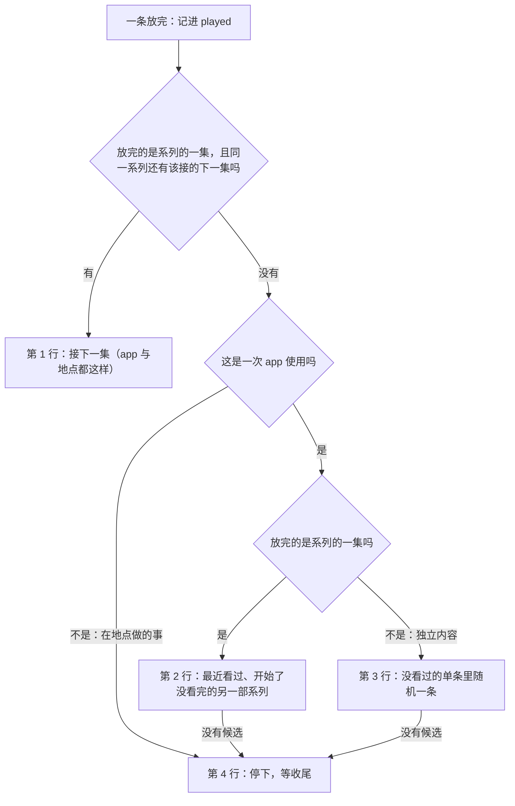

# 内容 app 自动接续

> 本章属于[手机优先的空闲时间与空闲时的死路：开发规格](../SPEC-free-time-dead-ends.md)，读法和叫法见那一页。

## 目标与依据

今天人物在空闲时打开抖音，环境放一条九十秒的短视频，这次 app 使用就停下，要她收尾、再选一次。提案「Phone use」一表量到：263 次 app 使用里 242 次只放了一条；只用手机的时段每小时 8.2–10.1 次决策，在家休息只要 6.4–6.6 次；她 52 次把抖音一类 app 当成「约 2 分钟」的事、嫌它太短，13 天里一次没打开过抖音、快手、小红书和微博。
刷到一半想点外卖，离这一条放完不足三分钟就不能暂停，60–150 秒的短视频整条都暂停不了，拒绝还说这项活动快结束了；收尾之后记忆层写的是「提前结束」，像是她半途放弃。
所有者的话（提案「Owner statements this proposal records」）：信息流应当一条接一条放，直到生活里有事打断它，或者她自己停下。

本章落实：

- 提案「Content-app uses auto-play」一节里属于引擎的部分：接续表四行、只从可推送的内容里接、不回放、只抽此刻合格的、抽取键与 `draw_index`、`previous_content_id`、正在放的 app 的推送留到下次打开、条目边界不加决策、一次收尾覆盖整次使用且不说提前结束、每条各自结算、进度事件只带条数；「Area / Change」表的「Engine」「Pause」两行（暂停拒绝的措辞归[「地点系列、暂停拒绝与关着的 app」](05-places-and-apps.md)一章）；「Acceptance」表的「Auto-play order」一行和「Auto-play trace」一行里属于引擎的部分。显示与记录的部分归[「自动接续的显示与记录」](02-autoplay-display.md)一章。
- 所有者 2026-10-15 的答复：单条之后随机接一条没看过的（「A random unseen item」）；只接可推送的内容（「Pushable content only」，推翻环境数据集合同里「自动接续不由 pushable…决定」一句）；一次 app 使用随时可以暂停；开车时照旧可以用 app（行为不改，本章写明自动接续在路上照旧）。
- 本规格「所有者的答复」里与自动接续有关的四项，以及测试助手与现有用例的迁移。

代码事实（主干 `2ecd868d`）：

- 打开 app：`InteractivityRuntime.start` 为 app 建 `ContentRequest(agent_id, app_id, stay_location_id, f"activity-{action_id}")`（`src/worldmock/life/interact.py:40-42`），`_app_plan` 用随机流 `random_stream(state.random_state, f"{request.activity_id}:0")` 调 `select_content`（`interact.py:58-66`，键在 `:63`）。`select_content` 先取 `eligible_contents`：这个 app 绑定的、此刻满足前提的内容，按内容身份升序（`src/worldmock/life/content_select.py:27-32`），再走打开顺序 `select_from_contents`（`content_select.py:39-61`）：钉住的推送（`:42-45`）、软排除预留（`:47`，`_exclude_reserved` 在 `:112-128`，排除后为空就不排除）、最近没放完的（`:48-50`）、开始了的系列（`:51-56`）、没看过的单元里随机一个（`:57`、`:60-61`）、都没有时轮数最少的单元里随机一个（`:58-59`）。`eligible_contents` 不看 `pushable`。
- 一条放完：时钟不会越过任何进行中活动的计划结束（`src/worldmock/life/time_advance.py:429`），所以每条的末尾都是一个结算边界。`InteractivityRuntime.advance` 写共享进度，放到末尾时先释放指向这条内容的推送（`interact.py:132`），再调 `_complete_content`（`interact.py:161-186`）：把这一条记进 `data.played`（`:163-165`）；独立内容原样返回，活动停在 `completed`（`:166-167`）；系列取集号更大、轮数低于刚放完那一集的第一集（`:168-175`，不看前提、`pushable` 和预留），接上后同一项活动回到 `active`，`draw_index` 加一，`played` 与 `accepted_event_id` 带过去，计划结束是 `last_settled_at` 加余量，计划时长是已做时长加余量，反馈重排（`:176-186`）。接集不抽随机数。
- `draw_index` 只在 `interact.py:179`、`:211` 写，只在 `src/worldmock/life/activity_validation.py:49-50` 核类型，没有哪次抽取读它；`ContentRequest.previous_content_id`（`content_select.py:25`）没有任何调用方传，只在 `content_select.py:43`、`:127` 读。
- 到达那一秒：`_advance_activities` 先逐项结算这个人物的全部活动，循环之后才在 `_switch_session_on_arrival` 把路上会话换成停留会话（`time_advance.py:247-255`）；`admission.present_location` 只看当前会话，路上为 `None`（`src/worldmock/life/admission.py:79-82`）。推送在活动之后处理（`time_advance.py:107`），所以同一秒的推送看到的是新的停留。
- 唤醒：`_wake_snapshot` 的 `planned_end` 只数在这一秒 `finished_at` 的活动（`src/worldmock/life/rhythm.py:114-122`），`finished_at` 要求待收尾（`src/worldmock/life/activity_control.py:60-71`）；系列接上下一集时状态回到 `active`，不唤醒。播报到点按 `report_anchor_at` 算（`rhythm.py:182-203`），接集不动它。
- 暂停：`pausable` 要求进行中、`interact`、离计划结束不少于 `PAUSE_MIN_REMAINING_SECONDS` = 180 秒（`activity_control.py:32`、`:94-101`），计划结束是当前这一条的末尾。读它的有：暂停的受理与工具层、待办层的可用性（经 `control_refusal`，`activity_control.py:259-275`、`:303-309`；`src/worldmock/life/tool_layer.py:96`；`src/worldmock/life/session_actions.py:141`），同槽位占用与睡眠约束的下一步（`admission.py:118-120`，被 `:131`、`:147` 调用），恢复冲突的下一步（`activity_control.py:297`），槽位超限的下一步（`activity_control.py:360-368`）。
- 收尾：进行中或暂停中的活动被 `conclude_activity` 取消，状态 `cancelled`、边界 `cancelled`、中断原因 `agent_cancelled`（`src/worldmock/life/activities.py:102-104`）。settled 句的终局说法 `ending_phrase` 对它写「提前结束」（`activity_control.py:150-158`），收尾结果 `details.outcome` 的 `conclusion_outcome` 也写「提前结束」（`src/worldmock/life/activity_evidence.py:6-13`，由 `session_actions.py:68-75`、`:120-124` 写进结果）。
- 快照：每条 `activity_progress` 的 `data.activity` 是完整的 `activity_snapshot`（`time_advance.py:286`；`src/worldmock/life/activity_titles.py:25-31`），带整份 `data.played`。受理与终态结果（`src/worldmock/life/action_evidence.py:57`、`:114`）、生命周期事件（`session_actions.py:476`）、截断（`time_advance.py:389`）、拒绝（`src/worldmock/life/decision_coordinator.py:422`）、观察证据（`src/worldmock/life/observe.py:132-134`）也都是完整快照。导出的 `activities.jsonl` 每项活动照抄它最后一个快照（`src/worldmock/footprints/export.py:162-182`）。

## 行为规格

本章说的「一次 app 使用」都是 `kind` 为 `interact`、活动数据 `app_id` 不为空的活动。在地点做的事（`app_id` 为空）的行为一个字节不变：系列一集接一集，独立的一件事或最后一集做完就停下。

### 接续顺序

一次 app 使用里一条放完（`advance` 里 `completed` 为真，`_complete_content`），先照今天的写法把这一条记进 `data.played`，再按下表从上往下找下一条，用第一行适用的那一行：

| 行 | 何时适用 | 下一条 | 抽不抽随机数 |
| --- | --- | --- | --- |
| 1 下一集 | 放完的是系列的一集，同一系列里有集号更大、完成轮数低于刚放完那一集（放完之后的轮数）的一集 | 这样的集里集号最小的一集，从它保存的位置接着放。规则与今天相同，app 使用和在地点做的事都用它；不判定前提、`pushable` 和预留 | 不抽 |
| 2 另一部开始了没看完的系列 | 只用于一次 app 使用；放完的是系列的一集，第 1 行没有找到 | 这个 app 的系列单元里，除了刚放完的这部，开始了没看完、代表集可推送、此刻合格、代表集没有被预留的那些里，最近看过的一部的代表集，从它保存的位置接着放 | 不抽：按单元各集 `last_consumed_at` 的最大值从晚到早，相同时按代表集的内容身份升序，取第一个 |
| 3 没看过的单条 | 只用于一次 app 使用；放完的是独立内容 | 这个 app 的独立内容里，没有任何进度记录、可推送、此刻合格、没有被预留的那些里随机一条，从头放 | 候选按内容身份升序，用随机流 `{activity_id}:{draw_index}` 抽一次 `randrange`，`draw_index` 是加一之后的值 |
| 4 没有可接的 | 适用的那一行没有候选 | — | 不抽。这次使用照今天停下：状态 `completed`，边界 `planned_end`，`ended_at` 是这一条的末尾，等她收尾 |



### 各项定义

**此刻合格。** 第 2、3 行的候选取 `eligible_contents`，停留地点取抽取那一秒本人的停留：`admission.present_location(state, agent_id)`，在这一秒结算活动的过程中求值；时段取这一秒（这一条的末尾就是推进到的那一秒）。人在路上时停留为空，带地点前提的内容都不合格。
到达的那一秒要特别说明：到达那一秒的推进先结算这个人物的全部活动，之后才把路上会话换成停留会话（`time_advance.py:247-255`）。所以恰在到达那一秒放完的一条，接续时看到的仍是路上：停留为空，只能在目的地看的内容不合格，即使她这一秒已经到了。同一秒发出的推送在活动之后处理，看到的是新的停留；两者不矛盾，各按自己被处理的时刻。

**开始了没看完的系列（第 2 行）。** 一个系列单元（同一 app 的合格内容里同名系列的各集）满足下面任一条就是开始了没看完：有一集的完成轮数多于这个单元各集的最低轮数；或者有一集保存的位置大于零。各集轮数相同、位置都是零的系列（全部看完过同样的轮数，或者一集都没看过）不算。
要放的那一集是现有的代表集 `representative`：轮数最少的集里集号最小的一集，从它保存的位置接着放。只看过第一集的一半（位置大于零、轮数都是零）的系列算开始了没看完，代表集就是第一集，接着那一半放。

**可推送按将要放的那一条判。** 第 2 行判代表集的 `pushable`，第 3 行判这一条自己的。同一系列各集的 `pushable` 可以不同（目录允许），所以一部系列能不能被第 2 行接上，看的是此刻轮到的那一集。第 1 行照今天不看 `pushable`：一集可推送、下一集不可推送，照样接下一集。
`pushable` 由此多了一层意思：这条内容能不能在同一个 app 里接在别的内容之后自动放。它仍然决定推送的候选（`src/worldmock/life/app_push.py:45-57`），不变。

**预留，硬排除。** 预留的内容是：本人别的进行中或暂停的 `interact` 活动此刻的当前内容（`data.content_id`），以及当前会话（一段停留，或一段路）里所有未释放推送指向的内容，不分是哪个 app 的推送。第 2、3 行按将要放的那一条判预留（第 2 行看代表集，第 3 行看这一条），被预留的候选去掉；去掉之后一个不剩就是第 4 行，没有「全被预留就不排除」的退路。
另外硬排除刚放完的那一条所在的单元：系列按系列名，独立内容按内容身份。第 2 行因此只会接「另一部」系列。
推论：正在放的这个 app 有一条推送还没打开时，这条推送指向的内容被预留，自动接续不会放它；她下次打开这个 app 时，打开顺序照今天钉住它（见「推送」）。

**不回放。** 第 2、3 行找不到候选就停下，不退回「轮数最少的」，不重放看过的单条或看完的系列。一条单条只要有进度记录（哪怕只放过几秒、位置大于零）就不算没看过；它只会在下次打开时由打开顺序的「最近没放完」那一步接着放。

**打开顺序不变。** 打开 app 时挑第一条仍是 `select_content` 和 `select_from_contents` 的全部规则，包括软排除与轮数最少的退路；打开的随机流键仍是 `{activity_id}:0`，在 `interact.py:63` 一个字节不改。推送的选取不变。

**`draw_index` 与随机流。** 接上任何一条（第 1、2、3 行）都把 `draw_index` 加一，与今天的接集相同：打开时是 0，接上的第一条是 1，依此类推。第 2、3 行的随机流按加一之后的值建：`random_stream(state.random_state, f"{activity_id}:{draw_index + 1}")`；第 3 行从它取一次 `randrange`，第 2 行不取数。没有接上（第 4 行）时活动数据不变，`draw_index` 停在最后一条接上时的值。随机流是按键算出来的（`src/worldmock/life/randomness.py:7-10`），抽取不推进世界的随机状态。
自动接续这次抽取的 `ContentRequest` 的 `previous_content_id` 写刚放完的那一条，`activity_id` 写这项活动；`stay_location_id` 按上文「此刻合格」取。

### 接上之后的活动

接上下一条（任何一行）都照今天的系列接集做，不新开活动：

- 同一项活动、同一个槽位（槽位 2），状态回到 `active`，`ended_at` 与 `boundary_type` 清空。
- 活动数据由 `_content_data` 按新的一条重建（`content_id`、`start_position_seconds`、`exertion` 与两项缓解的每小时量都是这一条的），`draw_index` 是加一之后的值，`played` 与 `accepted_event_id` 带过去，`pinned_by_push_id` 为 `null`。
- `media_position_seconds` 是新一条保存的位置；`planned_end_at` = `last_settled_at` + 余量；`planned_duration_seconds` = 已做时长 + 余量；余量是这一条全长减保存的位置，按整秒向上取整。反馈时刻照 `activity_feedback_seconds` 重排。
- `report_anchor_at` 不动：半小时播报照旧从开始、恢复或上一次播报算起。
- 每一条的边界照旧是结算边界：每条有自己的 `activity_progress` 事件，带 `data.content`（结算的那一条）；导出照旧每条各有 `content_consumed` 与 `played` 事实；每条按自己的缓解档位结算放松与社交。

### 推送

- 自动接上的一条不打开推送，也不释放推送；放到末尾时，照今天释放当前会话里指向这条内容的推送（`interact.py:132`）。第 2、3 行不会接到推送指向的内容（预留），第 1 行照今天可能接到，接到了就照今天在它放完时释放。
- 推送到达照旧唤醒醒着的人。正在放的这个 app 的推送，她要看就得结束或暂停这次使用、再打开这个 app，打开顺序钉住它（`content_select.py:42-45`）；推送随会话结束而失效，与今天相同。在运行中的使用里直接放推送不在本次范围（提案「Not proposed」）。

### 条目边界不唤醒

一条放完、接上下一条的那一秒，这项活动不是待收尾，`finished_at` 为假，不提供决策；条目边界不产生任何新的唤醒原因。她只在已有的唤醒时决策：任何一个槽位的活动做完（包括这次使用停下）、推送、送达、提醒、体感变化、上下班边界、重估间隔、半小时播报等（`src/worldmock/life/schedule.py:43-55`）。一次 app 使用因此可以持续到某个唤醒为止，在唤醒时她可以接着放（播报）、暂停、收尾或去做别的事。

### 暂停

`activity_control.pausable` 改为：进行中、`kind` 为 `interact`，并且（`data.app_id` 不为空，或者离计划结束不少于 `PAUSE_MIN_REMAINING_SECONDS` = 180 秒）。

- 一次 app 使用在任何决策时都能暂停，与这一条还剩多久无关；60 秒的短视频放到第 20 秒也能暂停。
- 180 秒的下限和它的拒绝只对在地点做的事成立，不变；那条拒绝的措辞归[「地点系列、暂停拒绝与关着的 app」](05-places-and-apps.md)一章。一次 app 使用不会再走到 `_unpausable_refusal` 的 `interact` 分支（它还没开始或已经结束时照旧走第一个分支，`ACTION_REQUEST_INVALID`）。
- 判定只有 `pausable` 一处，读它的地方全部跟着变，代码不改：工具层和待办层 `pause_activity` 一行的可用性与原因；暂停的受理；同槽位占用的下一步（槽位 2 被一次 app 使用占着时写「Conclude or pause …」）；睡眠约束的下一步（「Conclude or pause the second activity first.」）；槽位超限的下一步；恢复冲突的下一步。
- 在路上暂停照旧：在路上开始或带上路的 app 使用，活动的开始地点是出发地，暂停之后只能在出发地用 `report_status` 恢复，别处只能结束（`activity_control.py:284-289`）。恢复读共享位置、不重抽、`draw_index` 不变，与今天相同（`interact.py:188-202`）。

### 收尾的说法

被人物用 `conclude_activity` 结束的一次 app 使用（进行中或暂停中被取消，状态 `cancelled`），终局说法是「结束使用」：

| 活动 | 怎样结束 | settled 句的终局（`ending_phrase`） | 收尾结果 `details.outcome` 的 `outcome`（`conclusion_outcome`） |
| --- | --- | --- | --- |
| 一次 app 使用 | 进行中或暂停中被收尾结束（`cancelled`） | 结束使用 | 结束使用 |
| 一次 app 使用 | 没有可接的而停下，之后收尾（`completed`） | 按计划结束 | 完成 |
| 一次 app 使用 | 运行截止时截断（`truncated`） | 提前结束 | （不收尾，没有这一项） |
| 在地点做的事 | 进行中或暂停中被收尾结束（`cancelled`） | 提前结束 | 提前结束 |
| 任何活动 | `failed` | 失败 | 失败 |

- 两处读同一个判定 `activity_evidence.app_use_ended(activity)`：状态是 `cancelled`、`kind` 是 `interact`、`data.app_id` 不为空。说法也只有一个常量 `activity_evidence.OUTCOME_APP_USE_ENDED = "结束使用"`。
- 对每一次 app 使用都成立，包括只有一条、不会接续的（Keep、钉钉打卡，以及真实数据集里的电话）：自动接续之下一次 app 使用没有「计划的结束」，被收尾就不是提前。
- 机器字段不变：活动状态 `cancelled`、`boundary_type` `cancelled`、`interruption_reason` `agent_cancelled`，开始请求的第二条结果 `status: cancelled`、`message: Activity cancelled`，导出 `app_use` 行的 `status` `cancelled`。只有人读的说法变了。

### 进度事件的快照

`activity_progress` 事件里的 `data.activity`，对 `kind` 为 `interact` 的活动（app 使用和在地点做的事都是）不带 `data.played`，改带 `data.played_count`：整数，等于这项活动此刻 `len(data["played"])`。快照取的是这一秒结算之后的活动，所以一条放完、接上下一条的那条事件里，`content_id` 已是下一条，`played_count` 已把刚放完的那条算进去；结算的那一条在 `data.content`。

其余一切照旧带完整的 `data.played`：世界状态、受理结果与终态结果、生命周期事件（`activity_concluded`、`activity_paused`、`activity_resumed`、`activity_truncated`）、拒绝事件、观察证据里的进行中活动。别的种类的活动的进度快照不变。

连带：导出的 `activities.jsonl` 照抄每项活动最后一个快照。导出截止时还在进行的 `interact` 活动，最后一个快照是进度事件，行里是 `played_count`；已经终结的活动，最后一个快照是终态结果或生命周期事件，行里是完整的 `played`。行的字段集合因此变了，导出清单结构号随之升到 7，号与理由归[「版本、身份与基线」](08-versions.md)一章，那一章的 `tests/integration/footprints/test_autoplay_export.py` 测导出的行。

### 算例：样例环境里刷抖音

样例环境（`tests/fixtures/dataset-environment/`，种子 7，运行从 2026-01-05 周一 08:00 开始，人在家；播报间隔 1800 秒，反馈 900 秒，重估 5400 秒；周一到周五 09:00–18:00 上班）。抖音绑定四条独立内容，全都可推送：《测试实况》`c-live` 1500 秒、《测试长视频》`c-long` 2400 秒、《测试短视频》`c-short` 120 秒、《测试短视频二》`c-short-2` 90 秒；`c-long` 同时绑定哔哩哔哩。
08:00 她用一次 `start_side_activity` 打开抖音，动作身份 `action-douyin`（测试里 `act(engine, "douyin", use_app("抖音"))`），活动身份 `activity-action-douyin`；之后每次被叫起都只播报。

| 时刻 | 发生的事 | 抽取 | 人物 |
| --- | --- | --- | --- |
| 08:00:00 | 打开顺序：没有推送，没有没放完的，没有开始了的系列，四条都没看过 | 键 `activity-action-douyin:0`，候选 `c-live`、`c-long`、`c-short`、`c-short-2`，`randrange(4)` = 1 → 《测试长视频》，`draw_index` 0 | 提交即结束这次决策 |
| 08:15:00 | 反馈边界，结算 | — | 不叫起 |
| 08:30:00 | 播报到点 | — | 叫起，原因 `progress_report_due`。能做：播报接着放；暂停（随时可以）；收尾（「结束使用」）；在地点做事或出门（槽位 1 空着，出门后这次使用在路上照旧放）。不能做：买东西、查询、睡觉（槽位 2 被占，下一步写「Conclude or pause …」） |
| 08:40:00 | 《测试长视频》放完；第 3 行 | 键 `activity-action-douyin:1`，候选 `c-live`、`c-short`、`c-short-2`，`randrange(3)` = 1 → 《测试短视频》，`draw_index` 1 | 不叫起 |
| 08:42:00 | 《测试短视频》放完；第 3 行 | 键 `activity-action-douyin:2`，候选 `c-live`、`c-short-2`，`randrange(2)` = 0 → 《测试实况》，`draw_index` 2 | 不叫起 |
| 08:57:00 | 反馈边界 | — | 不叫起 |
| 09:00:00 | 整点推送：抖音《测试短视频二》，待打开；同一秒播报到点、上班时刻 | — | 叫起，原因 `progress_report_due`、`duty_boundary`、`app_push`。工具层抖音一行的 `note` 是「有推送：《测试短视频二》」。正在放的这次使用不会去放它 |
| 09:07:00 | 《测试实况》放完；第 3 行 | 键 `activity-action-douyin:3`：没看过的只剩 `c-short-2`，它被推送预留 → 没有候选，不抽 | 第 4 行：这次使用停下，`completed`、`planned_end`，`draw_index` 仍是 2，`played` 三条。叫起，原因 `planned_end`、`no_active_activity`。她要先收尾：`outcome`「完成」，settled 句终局「按计划结束」 |
| 09:07:00 | 收尾之后没有进行中的活动，同一秒再决策；她再打开抖音 | 打开顺序钉住推送 → 《测试短视频二》，`pinned_by_push_id` 是 `push-1-2026-01-05T09:douyin:c-short-2`，推送被打开 | |
| 09:08:30 | 《测试短视频二》放完；第 3 行 | 键 `activity-action-again:1`（第二次打开的动作身份是 `action-again`）：四条都看过，不回放 → 没有候选 | 第二次使用停下，等收尾 |

`randrange` 的结果由种子 7 的 `random_state` 与键唯一给出，写规格时用按本章规则写的临时补丁在样例环境上跑出来，与按键手算的一致。
同一段时间里的进度事件：08:15、08:30（`c-long`，`played_count` 0）；08:40（结算 `c-long` 放完，快照里当前一条已是 `c-short`，`played_count` 1）；08:42（结算 `c-short`，当前 `c-live`，`played_count` 2）；08:57、09:00（`c-live`，2）；09:07（结算 `c-live` 放完，状态 `completed`，`played_count` 3）。09:07 的终态结果和收尾时的 `activity_concluded` 带完整的三条 `played`。

假如她在 09:00 收尾：settled 句和 `outcome` 都是「结束使用」，《测试实况》保留在第 1080 秒；再打开抖音先放推送的《测试短视频二》，放完后没有没看过的单条，这次使用停下；《测试实况》要等再下一次打开时由打开顺序的「最近没放完」接着放。

### 边界情形

| 情形 | 结果 |
| --- | --- |
| 打开时放的是一部系列的一集 | 第 1 行接到这部系列放完；最后一集之后走第 2 行，接不到就停下。系列之后不会接单条 |
| 打开时放的是单条 | 第 3 行一直接没看过的单条；不会接到没看过的系列的第一集，也不会接到开始了的系列 |
| 打开顺序挑中了不可推送的内容（例如哔哩哔哩的《测试课程》） | 照放；放完之后按它是单条还是系列走第 3 或第 2 行，候选里没有不可推送的 |
| 只有一条内容的 app，或内容都不可推送（样例环境的 Keep；钉钉副本的《考勤打卡》） | 放完一条就停下，与今天相同 |
| 同一条内容绑定两个 app（`c-long`） | 进度是共享的：在哔哩哔哩看过，抖音的第 3 行也当它看过 |
| 本人另有一项暂停的 app 使用 | 它停在的那一条被预留，这次使用不会接到它；那项暂停的使用被收尾之后才不再预留 |
| 第 1 行的下一集恰是一条待打开推送指向的内容，或另一项暂停活动停在的那一集 | 照今天接上（第 1 行不看预留）；放完时照今天释放指向它的推送 |
| 一条放到一半时她到了地方，或离开了地方 | 正在放的这一条不受影响（前提只在开始与抽取时判定）；下一次抽取按那一秒的停留 |
| 恰在到达那一秒放完 | 抽取看到的是路上（见「此刻合格」） |
| 时段前提在一条放到一半时过了 | 这一条照放完；下一次抽取按那一秒判定，不合格的不进候选 |
| 运行截止时还在放 | 照今天截断，状态 `truncated`，终局说法「提前结束」；截断写的生命周期事件与终态结果带完整的 `played` |
| 暂停之后恢复 | 从共享位置接着放这一条，不重抽，`draw_index` 不变；之后照接续顺序继续 |
| 恰在一条放完、下一条刚接上的那一秒收尾 | 照今天的规则：状态 `cancelled`，「结束使用」；刚接上的那一条没有推进 |
| 第 2 行的候选有两部最近观看时刻相同的系列 | 代表集内容身份小的那部 |

### 明确不做

- 不加自动接续的开关，不让数据集、引擎或人物声明一次使用的时长；不给一次使用设条数上限。
- 不改打开顺序和推送的选取；打开的随机流键 `{activity_id}:0` 不改。
- 不在运行中的使用里放推送；推送照旧只在打开时钉住。
- 不在条目边界加唤醒，不改任何唤醒条件、播报锚点和重估间隔。
- 不改在地点做的事：系列接续、独立单元停下、180 秒的暂停下限照旧。
- 开车或出行时不停掉 app 使用（所有者答复「Leave as today」）：自动接续在路上照旧，只是带地点前提的内容不合格。
- 不回放，不退回轮数最少的。
- 世界状态里不截短 `played`，不给活动数据加键（`activity_validation._CONTENT_FIELDS` 不变）；`played_count` 只在进度事件的快照里。
- 拒绝事件、观察证据、受理与终态结果、生命周期事件的快照不改成条数。
- 不改机器状态与边界：被收尾的 app 使用仍是 `cancelled`、`agent_cancelled`。
- 导出与认证不读 `played` 或 `played_count`，不为进度快照加形状检查；改动之前的运行目录照样能导出，认证时按冻结运行清单的规则版本被拒（[「版本、身份与基线」](08-versions.md)一章）。
- 显示与记录的文字（app 行时长、活动行进度、标题与结果明细的上限）不在本章，见[「自动接续的显示与记录」](02-autoplay-display.md)。

### 本章定下的细节

| 事项 | 定下的做法 | 理由 |
| --- | --- | --- |
| 预留按哪一条判 | 第 2 行按代表集、第 3 行按这一条自己，与 `pushable` 同一口径；刚放完的那一条按单元整体排除（系列按系列名，单条按身份） | `pushable` 按将要放的那一条判；打开顺序的预留也按代表集判（`content_select.py:124`），同一种预留只有一种判法。刚放完的要按单元排除，否则第 2 行会接回同一部系列 |
| 几道筛选的先后 | 合格的内容分单元，去掉刚放完的单元，取代表集，按代表集筛 `pushable`；再按行筛（第 2 行：系列且开始了没看完；第 3 行：单条且没有进度记录）；最后去掉预留 | 预留放在最后，「硬排除」才有意义：先去预留再按行筛的话，只剩看过的条目时去预留不会把列表筛空，软硬就分不出来 |
| 当前会话 | 预留里的推送取当前会话的，停留和路上都算 | 更正最初「当前停留会话」的写法：推送在路上也会发出（`app_push.py:23-43` 只要求有当前会话），路上会话的推送同样待打开、同样随会话失效，叫法页「预留」一词写的也是「当前会话」 |
| 「没看过」的判法 | 这一条在本人 `content_progress` 里没有记录 | 与打开顺序的「没看过的单元」同一口径（`_last_consumed` 为负就是没有记录） |
| 没接上时的活动数据 | 不变，`draw_index` 不加 | 只有接上的一条才是一次「接续」；活动停下之后不会再抽 |
| 第 2 行的随机流 | 按键建出，不取数 | 两行共用一个入口，入口只读；建流不推进任何状态（`randomness.py:7-10`） |
| 函数的切分 | `content_select` 新增公开函数 `autoplay_content` 与私有函数 `_reserved_ids`、`_same_unit`、`_started`、`_started_series`；`_exclude_reserved` 改为调 `_reserved_ids`，行为不变。`interact` 新增私有方法 `_autoplay`（建请求与随机流）、`_continue`（今天 `:176-186` 的接集几行原样搬入），`_complete_content` 只做组合 | 每个函数不超过 50 行；接续顺序的选择只在 `content_select` 一处，打开顺序与接续顺序共用预留的计算 |
| 共用的判定放在哪 | `activity_evidence.app_use_ended` 与 `activity_evidence.OUTCOME_APP_USE_ENDED`；`activity_control.ending_phrase` 从那里导入 | `activity_evidence` 只依赖 `life.models`，`activity_control` 导入它不成环；终局的值本来就由它定义 |
| 进度快照的函数 | `activity_titles.progress_snapshot(activity, index)`，`time_advance._advance_one_activity` 只把 `:286` 的调用换成它；对在地点做的事同样写条数 | 自动接续只对 app 使用，但进度快照的形状对所有 `interact` 活动相同；只在一处写进度快照的形状。导出按规范 JSON 写，键序不影响字节 |
| 单一归宿 | `tests/unit/engineering/test_single_source.py` 的 `OWNERS`：`life/content_select.py` 加 `autoplay_content`、`next_episode`；新增 `life/activity_evidence.py`：`app_use_ended`、`OUTCOME_APP_USE_ENDED`；新增 `life/activity_titles.py`：`progress_snapshot` | 接续顺序、收尾说法、进度快照的形状各只有一个归宿；`next_episode` 在准备步骤抽出时不改测试，由本轨道登记 |
| 旧形状的进度快照 | 导出、认证都不检查进度快照里有没有 `played` 或 `played_count`，不加检查 | 「版本、身份与基线」一章把这件事交给本章定；今天没有任何导出检查读活动快照的 `data` 键，加一道检查是裁决清单没有的新机制，旧运行已经在认证时按规则版本被拒 |
| 文档字符串的更正 | `content_select` 模块首行、`interact` 模块首行与 `advance`、`_consume` 的说明写明自动接续；`pausable`、`PAUSE_MIN_REMAINING_SECONDS` 的注释、`control_refusal` 与 `_pause_refusal` 的说明写明 app 使用随时可停；`ending_phrase` 的说明删去「工具层刚结束的状态共用」（工具层不调它）；`session_actions._conclude_activity` 的说明写明「结束使用」；`session_actions._pause_activity` 的说明「路上的活动、交谈与通话不能暂停」改为实际规则（只有 `interact` 能暂停，app 使用在路上也能，恢复只在开始地点） | 这些说明今天就与代码不符，或在本章之后不符；不留与代码相反的说明。各处行数不增加，`_conclude_activity` 仍不超过 50 行 |
| 测试助手的名字与参数 | `tests/life/environment_runtime.py::conclude_app_use(engine, activity_id, label, items=1)`，见「接口与文件指引」 | 写规格时定下的签名 |
| 活动日脚本在哪一刻收尾 | 驾车出发并打开哔哩哔哩之后立即调 `conclude_app_use`：这次使用放完第一条之后的第一次决策就收尾，连同那时待收尾的出行；之后若出行还在路上，再用 `_finish_active` 推进到到达并收尾 | 裁决清单要求在公司午睡之前明确收尾。留到午睡之前才收尾不可靠：这次使用在九小时的工作期间会自己停下，被 `settle_decision` 顺手收尾，到午睡前已没有可收尾的；在出行之后马上收尾，脚本的时间线与今天最接近（今天也是等它放完第一条） |
| 迁移用 `conclude_app_use` 还是 Keep | 用例要的是「一个会自己停下的 app 使用」（等待、占槽位后待收尾）时换成 Keep；用例要的是「看一会儿哔哩哔哩或抖音再做下一件事」时用 `conclude_app_use` | Keep 的唯一一条不可推送，放完就停，时刻与今天的写法一致；看具体 app 的用例不能换 app |

## 接口与文件指引

实施归属：轨道 A（自动接续，与[「自动接续的显示与记录」](02-autoplay-display.md)一章同一条轨道）。`content_select.next_episode` 由准备步骤的纯重构抽出（[「实施顺序与验收」](09-implementation.md)），本章只调用它。

| 文件 | 改什么 |
| --- | --- |
| `src/worldmock/life/content_select.py` | 新增 `autoplay_content(catalog, state, request, stream) -> Content | None` 与私有函数 `_reserved_ids`、`_same_unit`、`_started`、`_started_series`；`_exclude_reserved` 改调 `_reserved_ids`；模块首行改为「打开顺序、接续顺序与推送共享的只读内容推荐」 |
| `src/worldmock/life/interact.py` | `_complete_content` 改为组合 `next_episode`、`_autoplay`、`_continue`；新增 `_autoplay`、`_continue`；模块导入 `admission.present_location` 与 `content_select.autoplay_content`；模块首行、`advance`、`_consume`、`_complete_content` 的说明 |
| `src/worldmock/life/activity_control.py` | `pausable` 加 app 使用分支；`PAUSE_MIN_REMAINING_SECONDS` 上一行的注释；`ending_phrase` 在 `"提前结束"` 之前加 `app_use_ended` 分支；从 `activity_evidence` 导入两个名字；`pausable`、`ending_phrase`、`control_refusal`、`_pause_refusal` 的说明。`_unpausable_refusal` 归轨道 C，本章不改；`objective_progress` 归[「自动接续的显示与记录」](02-autoplay-display.md) |
| `src/worldmock/life/activity_evidence.py` | 新增 `OUTCOME_APP_USE_ENDED` 与 `app_use_ended`；`conclusion_outcome` 先判它；导入 `ActivityKind` |
| `src/worldmock/life/activity_titles.py` | 新增 `progress_snapshot`；导入 `ActivityKind` |
| `src/worldmock/life/time_advance.py` | `:64` 的导入加 `progress_snapshot`；`:286` 改调 `progress_snapshot`。`:389` 的截断快照不改 |
| `src/worldmock/life/session_actions.py` | 只改 `_conclude_activity`（`:85-87`）与 `_pause_activity`（`:130`）的说明 |
| `src/worldmock/life/admission.py`、`app_push.py`、`activities.py`、`rhythm.py`、`activity_validation.py`、`footprints/export.py`、`footprints/app_usage.py` | 不改 |

落地后的关键几行（变异锚点以此为准，说明文字从略）：

```python
# content_select.autoplay_content
    agent = state.agents[request.agent_id]
    finished = catalog.contents[request.previous_content_id]
    units = [unit for unit in content_units(eligible_contents(catalog, state, request))
             if not _same_unit(unit, finished)]
    pairs = [(unit, representative(unit, agent)) for unit in units]
    pairs = [(unit, item) for unit, item in pairs if item.pushable]
    reserved = _reserved_ids(state, request)
    if finished.series is not None:
        return _started_series(pairs, agent, reserved)
    unseen = [item for unit, item in pairs if item.series is None and item.content_id not in agent.content_progress]
    unseen = sorted((item for item in unseen if item.content_id not in reserved), key=lambda item: item.content_id)
    return unseen[stream.randrange(len(unseen))] if unseen else None

# content_select._started_series：开始了没看完、可推送、没被预留的系列里最近看过的那部的代表集
    started = [(unit, item) for unit, item in pairs
               if item.series is not None and item.content_id not in reserved and _started(unit, agent)]
    if not started:
        return None
    return min(started, key=lambda pair: (-max(_last_consumed(agent, item) for item in pair[0]),
                                         pair[1].content_id))[1]

# content_select._started
    low = _unit_round(unit, agent)
    return any(_rounds(agent, item) > low or _position(agent, item) > 0 for item in unit)

# interact.InteractivityRuntime._complete_content（played 那三行照旧在前）
        agent = state.agents[activity.agent_id]
        index = activity.data["draw_index"] + 1
        upcoming = next_episode(self.context.catalog, agent, content, rounds)
        if upcoming is None and activity.data["app_id"] is not None:
            upcoming = self._autoplay(state, activity, content, index)
        if upcoming is None:
            return activity
        return self._continue(activity, upcoming, agent, index)

# interact.InteractivityRuntime._autoplay
        stay = present_location(state, activity.agent_id)
        request = ContentRequest(activity.agent_id, activity.data["app_id"], stay, activity.activity_id,
                                 content.content_id)
        stream = random_stream(state.random_state, f"{activity.activity_id}:{index}")
        return autoplay_content(self.context.catalog, state, request, stream)

# activity_control.pausable
    return (activity.status == ActivityStatus.ACTIVE and activity.kind == ActivityKind.INTERACT
            and (activity.data["app_id"] is not None
                 or activity.planned_end_at - state.current_time >= PAUSE_MIN_REMAINING_SECONDS))

# activity_evidence
OUTCOME_APP_USE_ENDED = "结束使用"
    return (activity.status == ActivityStatus.CANCELLED and activity.kind == ActivityKind.INTERACT
            and activity.data["app_id"] is not None)

# activity_titles.progress_snapshot
    payload = activity_snapshot(activity, index)
    if activity.kind == ActivityKind.INTERACT:
        data = {key: value for key, value in payload["data"].items() if key != "played"}
        payload["data"] = {**data, "played_count": len(activity.data["played"])}
    return payload
```

`_continue` 的函数体就是今天 `interact.py:176-186` 那几行，变量名 `next_content` 改为 `upcoming`，`draw_index` 取传入的 `index`，`played` 取已经追加过的 `activity.data["played"]`。

**直接删除，不留兼容。** 删的是「一次 app 使用放完一条就停、系列看完就停」这一行为本身：`_complete_content` 在 `next_episode` 找不到下一集时，对 app 使用不再直接返回（今天这一步在 `interact.py:166-167`、`:173-174`，准备步骤之后在 `next_episode` 返回 `None` 的那一处）。不留「不接续」的开关、按旧行为读取的分支或别名；钉住旧行为的用例按下文的迁移表改写，不保留旧期望。不迁移旧运行：改动之后的代码指纹与规则版本都不同，旧运行不能恢复或重放。

**夹具。** 样例环境 `tests/fixtures/dataset-environment/` 只由[「版本、身份与基线」](08-versions.md)一章的版本提交改（清单的规则版本），本章不改它的任何一行。本章要的两份副本由 `tests/life/environment_inputs.py` 新增的助手写，都照 `meal_environment` 的写法：复制样例环境，追加内容行，全部行按 `content_id` 升序写回，经 `write_catalog_rows` 刷新清单，返回副本根目录。

- `bilibili_series_rows(prefix: str, title: str, relief: str) -> list[dict]`：一部两集的哔哩哔哩系列的两行。第 N 集（N 为 1、2）：`content_id` 为 `f"{prefix}-{N}"`，`app_ids` `["bilibili"]`，`series` `{"title": title, "episode": N}`，`title` 为 `f"{title}第一集"`、`f"{title}第二集"`，`duration_seconds` 600，`exertion` `"light"`，`pushable` `true`，`relaxation_relief` 取参数，`social_relief` `"none"`，`summary` 为 `f"{标题}的测试用合成摘要。"`，`summary_source` `{"kind": "synthetic", "notice": "测试用合成摘要", "url": null}`；不写前提。
- `second_series_environment(destination)`：样例环境加 `bilibili_series_rows("c-anime", "测试番剧", "high")`，即《测试番剧第一集》`c-anime-1`、《测试番剧第二集》`c-anime-2`。哔哩哔哩由此有两部系列：「测试剧集」（三集各 1800 秒，缓解 medium）和「测试番剧」（两集各 600 秒，缓解 high），第 2 行有「另一部」可接，接上时缓解档位看得出换了一条。要第三部系列的用例在这份副本上再追加 `bilibili_series_rows("c-doc", "测试纪录片", "low")`。
- `office_stretch_environment(destination)`：样例环境加一行 `{"app_ids": ["keep"], "content_id": "c-office-stretch", "duration_seconds": 300, "exertion": "light", "prerequisite": {"location_kinds": ["office"]}, "pushable": true, "relaxation_relief": "medium", "social_relief": "none", "summary": "办公室拉伸的测试用合成摘要。", "summary_source": {"kind": "synthetic", "notice": "测试用合成摘要", "url": null}, "title": "办公室拉伸"}`。Keep 由此有一条不可推送的《测试慢跑》（在家能打开、放 1200 秒）和一条只在公司合格、可推送的《办公室拉伸》：《测试慢跑》放完那一秒人在哪，决定接不接《办公室拉伸》，而且候选至多一条，结果不靠随机数。

**测试助手。**

- `tests/life/environment_runtime.py` 新增 `conclude_app_use(engine, activity_id, label, items=1)`：循环直到这项活动的 `data.played` 至少 `items` 项、并且人物就绪；其间人物就绪而条数不够时用 `settle_decision` 处理这次决策（照旧收尾别的待收尾活动、播报进行中的活动，包括这次使用），不就绪时 `advance_next`。条数不够而这项活动已不在进行中（自己停下了），断言失败并点名活动；这项活动已经收尾，同样断言失败。条件满足后在同一次 `conclude_activity` 里点名这项活动和此刻全部别的待收尾活动（同一秒还有活动在进行时不会再有同秒决策，所以要一次点全），返回这次收尾的动作结果。中文说明写明这些。
- `finish_activity`、`until_ended`、`settle_decision`、`run_to_end`、`reach` 的含义不变；`until_ended` 的说明补一句：不要用在会自动接续的 app 使用上，它会把整个可推送的内容放完。
- `tests/life/day_baseline_runtime.py::_activity_day`：`:77` 的 `_finish_active(engine, "trip")` 换成两行，先 `conclude_app_use(engine, paired[1].activity_id, "trip-media")`，再 `_finish_active(engine, "trip")`；说明改写。开始请求的次序不变（收尾不是开始请求）。
- `tests/footprints/recording.py::recorded_engine`：打开哔哩哔哩之后、`run_to_end` 之前加 `conclude_app_use(engine, result.activity_id, "recorded-content")`，理由见「测试要求」的迁移表。

**约束。**

- 每个函数不超过 50 行、5 个入参（`self` 不算），每行不超过 120 字符，每个文件不超过 2000 行，每个函数（含私有的）有带中文的 `@brief` 说明；错误文字与日志用英文。改后 `interact.py` 约 235 行、`content_select.py` 约 230 行（含「自动接续的显示与记录」一章的 `opening_duration`）。
- 新增的导入都在模块顶部，不新增函数内导入，`tests/unit/engineering/test_import_graph.py` 的 `DELAYED_IMPORTS` 不变。`interact` → `admission` 这条边今天已经经 `app_push` 间接存在，`admission` 不导入 `interact`，不成环；`activity_evidence` 只依赖 `life.models`。
- `tests/unit/engineering/test_single_source.py` 拒绝语法树相同的函数体：`_reserved_ids` 是从 `_exclude_reserved` 里搬出的，`_exclude_reserved` 改调它之后不留同样的几行。
- 本章碰到的符号里这些锚点逐字节不变、各在符号里只出现一次：`content_select::eligible_contents` 的 `if not prerequisite_unmet(item, stay, moment)`；`activity_control::pausable` 的 `state.current_time >= PAUSE_MIN_REMAINING_SECONDS` 与 `and activity.kind == ActivityKind.INTERACT`；`activity_control::finished_at` 的 `or (activity.kind == ActivityKind.QUERY`；`interact` 的 `_unit_plan`、`start`、`resume`、`settle_completion` 四个方法本章不改（锚点 `for key in action["content_ids"]]`、`changed, consumed = self._consume(changed, activity)`、`resume` 末行、`if effects is None:`、`if evidence is None or not evidence["completed"]:`）。
- 本章改写的锚点：`pause_allowed_in_the_last_three_minutes`（`worldmock.life.activity_control::pausable`）的原文从 `and activity.planned_end_at - state.current_time >= PAUSE_MIN_REMAINING_SECONDS)` 改为 `or activity.planned_end_at - state.current_time >= PAUSE_MIN_REMAINING_SECONDS))`，替换从 `and True)` 改为 `or True))`，杀手不变（`test_pause_with_179_seconds_left_is_refused_changes_nothing_and_conclude_succeeds` 用的是「测试休息」），与实现同一个提交登记。
- 被登记为变异杀手、本章要改的现有用例不改名：`tests/integration/life/test_pause_limit.py::test_sleep_refusal_offers_pausing_the_app_only_while_it_can_be_paused`、`tests/integration/footprints/test_inspect_current_activity.py::test_inspector_accepted_and_rejected_lines_read_the_current_fields`、`tests/integration/life/test_app_opening.py::test_app_with_content_and_goods_opens_and_still_sells`。第一条改期望之后不再杀得死 `sleep_refusal_offers_pausing_whatever_holds_slot_two`（两个参数都写「Conclude or pause」），这条变异仍由同一登记里的 `test_sleep_refusal_never_offers_pausing_a_running_purchase` 杀死；登记的杀手元组不改，第一级门跑这条变异确认。
- `query_can_be_paused` 的替换让查询也进到新的括号里：查询的活动数据带 `app_id`，被抽到 app 时 `pausable` 为真，杀手 `test_a_query_cannot_be_paused_and_the_tool_layer_says_why` 照样失败；第一级门跑它确认。

设计文档的落点（《模拟引擎》「动作、名称与并行」「出行、内容与查询」，《资源引擎》「app、内容与候选呈现」，《人物》「提示与工具」，《记录引擎》「事件与来源」，《配置》「唯一种子与随机键」，《概述》能力表）见[「设计文档与手册」](07-design-docs.md)一章；本章不改设计文档。

## 测试要求

凡是行为规则，用例都经真实请求、引擎与 SQLite：`engine_factory` 建引擎（副本用本章的三个助手），`act`、`act_group` 提交，`advance_next`、`advance_until_ready`、`until_ended`、`conclude_app_use` 推进，`observe_only` 读观察，`events` 读落库事件。需要固定打开顺序挑中哪一条时，用 `tests/life/phone_records.py::label_where` 挑动作身份：判定是用生产的 `select_content` 和这个身份的键 `activity-action-<身份>:0` 算出的第一条等于想要的那条。
新的集成用例写在新文件 `tests/integration/life/test_autoplay.py`，单元用例写在新文件 `tests/unit/life/test_autoplay_order.py`（`tests/unit/life/test_pause_limit.py` 与轨道 C 共用，只改本章那几行期望，不加函数）。

### 规则与用例

| 规则 | 层 | 测试 | 验收行为 |
| --- | --- | --- | --- |
| 第 3 行：单条之后随机接一条没看过的；随机流键 `{activity_id}:{draw_index}`；推送预留硬排除；没有候选就停下；不回放；条目边界不唤醒；推送留到下次打开 | integration | 「新」`tests/integration/life/test_autoplay.py::test_a_feed_chains_unseen_items_by_keyed_draws_and_stops_when_none_is_left` | 样例环境照「算例」：08:00 打开抖音，每次就绪都播报；08:00 到 09:07 之间人物就绪的时刻恰是 08:30、09:00、09:07；这项活动结算的内容依次是 `c-long`、`c-short`、`c-live`，接上时 `draw_index` 依次是 1、2；09:07 状态 `completed`、`boundary_type` `planned_end`、`ended_at` 09:07:00、`draw_index` 2、`played` 三项；当前会话里抖音的推送指向 `c-short-2`、状态 `pending`；收尾结果 `outcome`「完成」。同一秒再打开抖音：当前内容 `c-short-2`、`pinned_by_push_id` 是那条推送，09:08:30 这次使用停下、`played` 一项 |
| 第 3 行只接可推送的单条，不接没看过的系列和不可推送的单条 | integration | 「新」`tests/integration/life/test_autoplay.py::test_only_pushable_standalone_items_chain_after_a_standalone_item` | 样例环境，用 `label_where` 挑一个让打开顺序挑中可推送单条的身份打开哔哩哔哩，`until_ended`：这次使用 `completed`，`played` 恰是 `c-article`、`c-image`、`c-long` 三项（次序不论），没有 `c-course` 和「测试剧集」的任何一集；停下的时刻是 08:55:00 |
| 第 1 行照旧：下一集不看 `pushable` | integration | 「新」`tests/integration/life/test_autoplay.py::test_the_next_episode_comes_first_even_when_it_is_not_pushable` | 样例环境副本里 `c-drama-2` 的 `pushable` 改为 `false`（`set_content`）；用 `label_where` 让打开挑中 `c-drama-1`；第一集放完的那一秒，同一项活动接上 `c-drama-2`，`draw_index` 1，状态 `active` |
| 第 2 行：最后一集之后接另一部开始了没看完的系列，从保存的位置接着放；被暂停的使用停在的那一集被预留 | integration | 「新」`tests/integration/life/test_autoplay.py::test_the_last_episode_continues_with_another_started_series`（两个参数：`concluded`、`still_paused`） | `second_series_environment`，重估间隔 300 秒：08:00 打开哔哩哔哩（`label_where` 挑中 `c-drama-1`），08:05 暂停；同一秒再打开（`label_where` 挑中 `c-anime-1`；`c-drama-1` 被预留）。`concluded`：08:10 收尾那项暂停的使用；08:25 `c-anime-2` 放完，同一项活动接上 `c-drama-1`，`start_position_seconds` 300，`draw_index` 2，`relaxation_relief_per_hour` 从 0.5 变成 0.3。`still_paused`：不收尾；08:25 这次使用停下，`completed`，`played` 是 `c-anime-1`、`c-anime-2` |
| 第 2 行在几部候选里取最近看过的 | integration | 「新」`tests/integration/life/test_autoplay.py::test_the_most_recently_watched_started_series_comes_first` | `second_series_environment` 再加「测试纪录片」：08:00 打开挑中 `c-drama-1`，08:05 暂停；再打开挑中 `c-doc-1`，08:10 暂停；再打开挑中 `c-anime-1`；08:15 一次收尾两项暂停的使用；08:30 `c-anime-2` 放完，接上的是 `c-doc-1`（最近看过的是 08:10），`start_position_seconds` 300 |
| 此刻合格按抽取那一秒的停留；到达那一秒仍是路上 | integration | 「新」`tests/integration/life/test_autoplay.py::test_a_draw_sees_the_stay_of_its_own_second`（四个参数：`home`、`drive`、`walk`、`arrival_second`） | `office_stretch_environment`。`home`：在家打开 Keep，08:20 停下，`played` 只有 `c-run`。`drive`：同一组驾车去公司并打开 Keep，08:05:29 到达，08:20 接上 `c-office-stretch`，08:25 停下。`walk`：同一组步行去公司（08:31:59 到达）并打开 Keep，08:20 人在路上，停下。`arrival_second`：先在一份副本上读出驾车的计划时长 D，再在另一份副本上把 `c-run` 改成 D 秒，同一组驾车并打开 Keep，《测试慢跑》恰在到达那一秒放完，这次使用停下、没有接《办公室拉伸》，那一秒之后人在公司 |
| 接上之后的活动：同一项活动、同一槽位；计划结束与计划时长的算法；推送字段为空；`accepted_event_id` 带过去；播报锚点不动；每条各有进度事件 | integration | 「新」`tests/integration/life/test_autoplay.py::test_a_chained_item_continues_the_same_activity` | 样例环境，08:00 打开抖音，08:30 播报：08:40 那一秒之后同一个活动身份，`resource_claims` 仍是槽位 2，`status` `active`、`ended_at` 与 `boundary_type` 为空，`planned_end_at` 为 08:42:00，`planned_duration_seconds` 2520，`media_position_seconds` 0，`pinned_by_push_id` 为空，`accepted_event_id` 与打开时相同，`report_anchor_at` 仍是 08:30；08:30–08:40 与 08:40–08:42 各有一条带 `data.content` 的进度事件，分别结算 `c-long`、`c-short`，`completed` 都为真 |
| 一次 app 使用随时可以暂停；读 `pausable` 的各处跟着变；在路上暂停照旧 | integration | 「新」`tests/integration/life/test_autoplay.py::test_an_app_use_can_be_paused_at_any_time`（两个参数：`home`、`road`） | `home`：样例环境副本把 `c-run` 改成 60 秒，重估间隔 20 秒；打开 Keep，第 20 秒：工具层 `pause_activity` 可用、原因为空；去睡觉被拒，下一步「Conclude or pause the second activity first.」；打开抖音被拒，下一步「Conclude or pause <活动名> first.」；暂停成立，待办层列出它；同一秒用 `report_status` 恢复，从第 20 秒接着放、40 秒后停下。`road`：同一组步行去公司并打开 Keep，重估间隔 300 秒，08:05 在路上暂停 Keep 成立（出行还在进行，这一秒不再决策）；08:10 在路上用 `report_status` 恢复被拒，原因「Resume <活动名> at its start location 家; it can be concluded elsewhere.」 |
| 在地点做的事保留 180 秒下限 | integration | `tests/integration/life/test_pause_limit.py::test_pause_with_179_seconds_left_is_refused_changes_nothing_and_conclude_succeeds`、`::test_pause_with_exactly_180_seconds_left_succeeds`、`::test_a_sixty_second_content_is_never_pausable`（后者改用地点单元，见下表） | 照旧 |
| 收尾的说法：一次 app 使用被收尾是「结束使用」，两处同一判定；放完停下照旧；地点单元照旧 | integration | 「新」`tests/integration/life/test_autoplay.py::test_a_concluded_app_use_reads_end_of_use`（三个参数：`running`、`paused`、`clock`）；`tests/integration/start_interfaces/test_location_activities.py::test_memory_sentence_keeps_the_unfinished_half_only_for_app_content`（改）、`::test_concluded_location_activity_stays_cancelled_and_writes_no_extra_event`（不改） | `running`：重估间隔 300 秒，打开 Keep，08:05 收尾：`outcome` 是 `[{"activity": <活动名>, "outcome": "结束使用"}]`；之后驾车出门，记忆层这一段的结束句以「，结束使用，（《测试慢跑》未完）」收尾；活动 `cancelled`、`agent_cancelled`，第二条结果 `cancelled`、`Activity cancelled`。`paused`：08:05 暂停；没有进行中的活动，同一秒再决策时收尾这项暂停的使用，同上。`clock`：`tests/life/prerequisite_inputs.py` 的钉钉副本，人在办公室的打卡时段打开钉钉，重估间隔 20 秒，第 20 秒收尾《考勤打卡》，`outcome`「结束使用」 |
| 进度事件的快照带条数，别的快照带完整清单 | integration | 「新」`tests/integration/life/test_autoplay.py::test_progress_events_carry_the_played_count_and_other_snapshots_the_list` | 照「算例」跑到 09:07 并收尾：这项活动的每条 `activity_progress` 的 `data.activity.data` 没有 `played` 键，`played_count` 依次是 0、0、1、2、2、2、3；受理结果的快照 `played` 为 `[]`；09:07 的终态结果与收尾的 `activity_concluded` 的快照 `played` 恰是世界状态里的三项 |
| 导出：截止时还在进行的行带条数，终结的行带清单 | integration | `tests/integration/footprints/test_autoplay_export.py::test_app_use_running_at_the_cutoff_exports_its_played_count`（「版本、身份与基线」一章定义） | 见那一章 |
| 接续顺序的选取细则：代表集判 `pushable` 与预留；开始了没看完的两种情形；看完的系列不算；同一时刻按代表集身份；刚放完的单元排除；没看过只认没有进度记录；第 3 行恰取一次随机数，没有候选或第 2 行不取 | unit | 「新」`tests/unit/life/test_autoplay_order.py::test_autoplay_content_picks_by_the_rows_on_real_catalog_rows`（参数化） | 用 `second_series_environment` 加「测试纪录片」的副本载入的目录和 `tests/unit/life/test_environment_content.py::world_at` 的世界，手写 `content_progress`、会话推送与一项暂停活动，直接调 `autoplay_content`，逐情形断言返回的内容（或 `None`）与随机流在调用前后的状态。至少这些情形：哔哩哔哩放完 `c-image`，可推送的单条都有进度记录、只剩不可推送的 `c-course` 没看过 → `None`；放完 `c-image`，没看过的可推送单条只剩 `c-article`，而当前会话里有一条指向它的抖音或哔哩哔哩推送 → `None`，同一推送已释放时 → `c-article`；没看过的单条里不出现没看过的系列的第一集，也不出现位置大于零的单条；放完「测试番剧」最后一集，「测试剧集」第一集位置 300、「测试纪录片」第一集轮数 1 而第二集没有记录，两者 `last_consumed_at` 相同 → 代表集身份小的 `c-doc-2`，把「测试剧集」的 `last_consumed_at` 调晚 → `c-drama-1`；「测试纪录片」两集轮数都是 1、位置都是零 → 不算开始了；「测试剧集」第一集位置大于零而它是一项暂停活动的当前内容 → 不选它；代表集不可推送的系列（副本里把那一集改成 `pushable: false`）→ 不选它，代表集可推送而别的集不可推送 → 照选；放完的系列自己开始了没看完 → 不选它；第 3 行恰取一次 `randrange`，第 2 行和没有候选时随机流状态不变 |
| 一次 app 使用随时可暂停的判定 | unit | 「新」`tests/unit/life/test_autoplay_order.py::test_an_app_use_is_pausable_however_little_is_left` | `running(...)` 造的 app 使用离计划结束 1、60、179、180 秒都可暂停；同样秒数的地点单元只有 180 秒那一档可暂停 |
| 说法的唯一判定 | unit | 「新」`tests/unit/life/test_autoplay_order.py::test_one_predicate_words_the_ending_and_the_outcome` | 对 `cancelled`、`completed`、`truncated`、`failed` 各状态的 app 使用与地点单元：`ending_phrase` 与 `conclusion_outcome` 的结果与「收尾的说法」一表逐格相同，`app_use_ended` 只对 `cancelled` 的 app 使用为真 |
| 进度快照只对 `interact` 改形状 | unit | 「新」`tests/unit/life/test_autoplay_order.py::test_progress_snapshot_counts_played_items_only_for_interactions` | `progress_snapshot` 对带两项 `played` 的 `interact` 活动：`data` 没有 `played`、`played_count` 2，其余键与 `activity_snapshot` 相同；对出行活动与 `activity_snapshot` 完全相同 |
| 在地点做的事不变：系列接到最后一集、独立单元做完停下 | integration | `tests/integration/start_interfaces/test_location_activities.py::test_series_starts_at_its_representative_and_continues_to_the_end`、`tests/unit/life/test_environment_content.py::test_series_continues_same_binding_and_stops_after_last_episode`（都不改） | 照旧 |

「`_continue` 搬的是今天那几行」「随机流不推进世界随机状态」是实现约束，由上表接续机制一行和 `test_series_continues_same_binding_and_stops_after_last_episode` 里 `random_state` 不变的断言守住，不另写探测内部调用的用例。

### 钉住今天行为的现有用例

写规格时用一份按本章规则写的临时补丁（不上库，在测试进程里替换 `_complete_content`、`pausable`、两处说法和进度快照），跑过 84 个测试文件：打开内容 app 的、经 `recorded_engine` 录制的、用评估规范运行的全部 82 个，加上 `tests/unit/life/test_environment_content.py` 与 `tests/unit/life/test_pause_limit.py`。失败的恰是下表前十一行的用例函数，其余照样通过（补丁不含「自动接续的显示与记录」一章的标题上限，那一章的迁移另列）。下表其余几行照样通过，但本来就靠「放一条就停」安排时间，按裁决清单一并迁移。

| 用例 | 钉的旧行为 | 处理 |
| --- | --- | --- |
| `tests/unit/life/test_environment_content.py::test_single_content_and_last_series_episode_stop` | 独立内容 `c-course` 放完就停；手造的活动数据没有 `accepted_event_id`，改后接续会因缺这个键出错 | 循环的两项改成 `("c-run", "keep")` 与 `("c-drama-3", "bilibili")`：Keep 唯一的一条不可推送，放完就停；最后一集没有别的开始了的系列，放完就停。名字不改，说明改为「没有可接内容的单条与没有别的开始了的系列的最后一集放完就停」 |
| `tests/unit/life/test_pause_limit.py::test_an_interaction_is_pausable_with_three_minutes_left_and_not_with_one_second_less` | `presence=False`（用内容 app）在 1、60、179 秒时不可暂停 | 期望改为 `expected or not presence`；说明改为在地点做事守 180 秒、用内容 app 随时可停 |
| `tests/unit/life/test_pause_limit.py::test_pause_refusal_names_the_activity_and_says_it_ends_in_under_three_minutes` | `:83` 用内容 app 离结束 179 秒时同样被拒 | `:83` 改为 `is None`；这个函数轨道 C 也改（[「地点系列、暂停拒绝与关着的 app」](05-places-and-apps.md)），轨道 A 先并入，C 在它的基础上改 |
| `tests/unit/life/test_pause_limit.py::test_second_slot_conflict_follows_the_same_limit` | 槽位 2 的 app 使用离结束 179 秒时下一步只写「Conclude」 | 两种秒数都期望「Conclude or pause」；名字不改，说明改写 |
| `tests/unit/life/test_pause_limit.py::test_sleep_constraint_offers_pausing_only_while_the_second_slot_occupant_can_still_be_paused` | 参数 `(1, "Conclude")`、`(179, "Conclude")` | 四个参数的期望都是「Conclude or pause」；名字不改 |
| `tests/integration/life/test_pause_limit.py::test_sleep_refusal_offers_pausing_the_app_only_while_it_can_be_paused` | 参数 `[179-Conclude]`：Keep 离结束 179 秒时去睡觉只能先结束，`pause_activity` 不可用 | 参数化只按 `left`（179、180），两种都期望「Conclude or pause the second activity first.」、`pause_activity` 可用、照着暂停之后能睡；名字不改，说明改写（见「约束」里这条杀手的说明） |
| `tests/integration/life/test_pause_limit.py::test_a_sixty_second_content_is_never_pausable` | 60 秒的 Keep 从开始就不能暂停 | 改用把「测试休息」改成 60 秒的副本：在家做它，第 20 秒工具层不可用、暂停被拒（今天的三句），这时点名「测试闲聊」的同槽位占用下一步写「Conclude <活动名> first.」；做完后照常收尾。60 秒的 app 内容随时可停由新用例 `test_an_app_use_can_be_paused_at_any_time` 守 |
| `tests/integration/start_interfaces/test_location_activities.py::test_memory_sentence_keeps_the_unfinished_half_only_for_app_content[app]` | 「，提前结束，（《测试慢跑》未完）」 | 改为「，结束使用，（《测试慢跑》未完）」；`[location]` 参数不变；说明改写 |
| `tests/integration/runtime/test_query_prompt_contract.py::test_real_full_slots_and_pending_conclusion_use_the_same_tool_refusal` | 抖音放完一条后在第一次唤醒时待收尾 | 开始组里的抖音换成 Keep：《测试慢跑》08:20 放完，早于 08:31:59 的步行到达，第一次唤醒时待收尾的仍是这次 app 使用；其余断言不变 |
| `tests/integration/start_interfaces/test_sleep_request.py::test_closed_location_cannot_start_sleep_but_does_not_wake_a_sleeper` | 用哔哩哔哩一次使用自己停下来等到 08:20 | 等待用的 app 换成 Keep：08:05:29 到公司后放 1200 秒，08:25:29 停下并收尾，早于 09:00；其余不变 |
| `tests/integration/footprints/test_acs_export.py::test_actual_purchase_content_and_current_artifacts_are_authenticated`（经 `tests/footprints/recording.py::recorded_engine`） | 哔哩哔哩放完一条就停，人物步行回家、09:00 截止时已在家 | `recorded_engine` 打开哔哩哔哩之后用 `conclude_app_use` 收尾：08:31:50 收尾，步行 08:50:44 到家，截止时最后一段停留没有离开时刻。不改的话这次使用放到 08:56:50，截止时人在回家的路上。`recorded_engine` 的其余使用者（`test_acs_source_guards.py`、`test_export.py`、`test_goal_export.py`、`test_environment_identity.py`、`tests/unit/footprints/test_purchases.py`）在补丁下随这个改动重跑，84 条全部通过，断言不改 |
| `tests/system/lifecycle/test_dayrun_complete_days.py::test_day_timeline_of_a_real_day_names_what_each_start_tool_started` | `finish_activity` 等哔哩哔哩自己停下 | 改用 `conclude_app_use(engine, watch.activity_id, "watch")`；标签的期望照[「自动接续的显示与记录」](02-autoplay-display.md)一章 |
| `tests/integration/footprints/test_render_day.py::test_app_use_row_names_the_app_and_every_item_in_order` | 同上 | 照「自动接续的显示与记录」一章（第一段改用 `conclude_app_use`） |
| `tests/system/lifecycle/test_complete_day_scripts.py::test_activity_day_names_units_buys_portions_and_sleeps_at_the_office` | 走今天的 `_activity_day` | 随 `_activity_day` 的改动重跑；`starts[:7]` 与其余断言不变；另加两条：运行里有一条 `conclude_activity` 点到这次哔哩哔哩使用的活动名，并且落在午睡那条开始请求之前；导出的 `activities.jsonl` 里这项活动的行带 `played`、至少一项 |
| `tests/integration/footprints/test_inspect_current_activity.py::test_inspector_accepted_and_rejected_lines_read_the_current_fields` | `finish_activity` 等哔哩哔哩放完一条再买 | 改用 `conclude_app_use(engine, watched.activity_id, "watch")`；断言不变（受理行读的是开始的那一条） |
| `tests/integration/life/test_app_opening.py::test_app_with_content_and_goods_opens_and_still_sells` | 同上 | 改用 `conclude_app_use(engine, result.activity_id, "open")`；断言不变 |
| `tests/integration/runtime/test_biz_timeline_recording.py::test_real_content_progress_renders_readable_timeline` | `finish_activity` 等抖音放完一条 | 改用 `conclude_app_use(engine, started.activity_id, "watched")`；断言不变 |

核对过、不改的：

- `tests/integration/life/test_content_start_evidence.py::test_current_started_activity_public_result_and_complete_export[哔哩哔哩]`：这次使用接着放 `c-image`、`c-long`、`c-article`，08:55 在一小时的运行窗口内自己停下，终态仍是 `completed`、`Activity completed`，`contents` 第一行仍是开始的那一条（行数恰为三，在「自动接续的显示与记录」一章的上限之内）。
- `tests/integration/life/test_planning_and_errand_evidence.py` 里经 `_lived_day` 的两条用例：哔哩哔哩放完三条可推送的单条后自己停下；用例按集合比对已核验经历与 `played` 的标题，几条都成立。换成 `conclude_app_use` 反而会让收尾时没放完的那一条只出现在经历里、不在 `played` 里，所以不改。
- `tests/integration/life/test_query_activity.py::test_running_app_with_three_minutes_left_blocks_a_query_and_may_be_paused`：第一次决策在第 60 秒，离这一条结束仍不少于 180 秒，下一步「Conclude or pause」照旧成立。
- `tests/integration/life/test_result_contents.py` 的 app 用例用 Keep 和只有「测试剧集」的副本，都自己停下；`tests/integration/life/test_pause_limit.py` 其余用「测试休息」或购买的用例；`tests/unit/life/test_pause_limit.py::test_slot_limit_next_step_only_names_occupants_that_can_still_be_paused`（快做完的那一项是地点单元）、`::test_resume_conflict_offers_pausing_only_while_the_running_activity_can_still_be_paused`。
- 两份基线和录制样例：活动日脚本改了，代码也改了，都在收尾时按[「版本、身份与基线」](08-versions.md)的规程重做一次，本轨道不动。

### 源码变异

本章登记十条，每个定下的事项一条，取改坏它中心规则的那一种，登记在 `tests/dataset_acceptance.py` 轨道 A 的那一段里，锚点取实现后的源码，原文在符号里只出现一次。杀手都在主进程里执行被改的模块：单元用例直接导入并调用，集成用例经 `engine_factory` 建的真实引擎。

| 定下的事项 | 把规则改坏的方式（原句 → 替换） | 被哪条测试杀死 | 层 |
| --- | --- | --- | --- |
| 单条之后接没看过的单条（`standalone_item_ends_the_use`） | `worldmock.life.content_select::autoplay_content`：`unseen = [item for unit, item in pairs if item.series is None and item.content_id not in agent.content_progress]` → `unseen = []` | `tests/integration/life/test_autoplay.py::test_a_feed_chains_unseen_items_by_keyed_draws_and_stops_when_none_is_left`；`tests/integration/life/test_autoplay.py::test_only_pushable_standalone_items_chain_after_a_standalone_item` | integration |
| 只接可推送的（`autoplay_draws_unpushable_content`） | 同一符号：`pairs = [(unit, item) for unit, item in pairs if item.pushable]` → `pairs = [(unit, item) for unit, item in pairs]` | `tests/integration/life/test_autoplay.py::test_only_pushable_standalone_items_chain_after_a_standalone_item`；`tests/unit/life/test_autoplay_order.py::test_autoplay_content_picks_by_the_rows_on_real_catalog_rows` | integration、unit |
| 最后一集之后接另一部开始了没看完的系列（`last_episode_ends_the_use`） | 同一符号：`return _started_series(pairs, agent, reserved)` → `return None` | `tests/integration/life/test_autoplay.py::test_the_last_episode_continues_with_another_started_series`；`tests/integration/life/test_autoplay.py::test_the_most_recently_watched_started_series_comes_first` | integration |
| 预留硬排除，排空了也不退回（`reserved_item_autoplays_when_nothing_else_is_left`） | 同一符号：`unseen = sorted((item for item in unseen if item.content_id not in reserved), key=lambda item: item.content_id)` → `unseen = sorted((item for item in unseen if item.content_id not in reserved), key=lambda item: item.content_id) or sorted(unseen, key=lambda item: item.content_id)` | `tests/integration/life/test_autoplay.py::test_a_feed_chains_unseen_items_by_keyed_draws_and_stops_when_none_is_left`；`tests/unit/life/test_autoplay_order.py::test_autoplay_content_picks_by_the_rows_on_real_catalog_rows` | integration、unit |
| 接续的抽取用加一后的 `draw_index` 作键（`autoplay_draw_keyed_like_the_opening`） | `worldmock.life.interact::InteractivityRuntime._autoplay`：`stream = random_stream(state.random_state, f"{activity.activity_id}:{index}")` → `stream = random_stream(state.random_state, f"{activity.activity_id}:0")` | `tests/integration/life/test_autoplay.py::test_a_feed_chains_unseen_items_by_keyed_draws_and_stops_when_none_is_left`（键 `:0` 在第一次接续时抽到 `c-live` 而不是 `c-short`） | integration |
| 不回放（`replay_inside_a_use`） | `worldmock.life.content_select::autoplay_content`：`return unseen[stream.randrange(len(unseen))] if unseen else None` → `return unseen[stream.randrange(len(unseen))] if unseen else next((item for unit, item in pairs if item.series is None), None)` | `tests/integration/life/test_autoplay.py::test_a_feed_chains_unseen_items_by_keyed_draws_and_stops_when_none_is_left`；`tests/integration/life/test_autoplay.py::test_only_pushable_standalone_items_chain_after_a_standalone_item` | integration |
| 合格按抽取那一秒的停留（`autoplay_draw_reads_the_start_location`） | `worldmock.life.interact::InteractivityRuntime._autoplay`：`stay = present_location(state, activity.agent_id)` → `stay = activity.location_id` | `tests/integration/life/test_autoplay.py::test_a_draw_sees_the_stay_of_its_own_second`（`drive` 参数） | integration |
| 一次 app 使用随时可暂停（`app_use_paused_only_with_three_minutes_left`） | `worldmock.life.activity_control::pausable`：`and (activity.data["app_id"] is not None` → `and (False` | `tests/integration/life/test_autoplay.py::test_an_app_use_can_be_paused_at_any_time`；`tests/integration/life/test_pause_limit.py::test_sleep_refusal_offers_pausing_the_app_only_while_it_can_be_paused`；`tests/unit/life/test_autoplay_order.py::test_an_app_use_is_pausable_however_little_is_left` | integration、unit |
| 被收尾的 app 使用说「结束使用」（`concluded_app_use_ends_early`） | `worldmock.life.activity_evidence::app_use_ended`：`return (activity.status == ActivityStatus.CANCELLED and activity.kind == ActivityKind.INTERACT` → `return (False and activity.kind == ActivityKind.INTERACT` | `tests/integration/life/test_autoplay.py::test_a_concluded_app_use_reads_end_of_use`；`tests/integration/start_interfaces/test_location_activities.py::test_memory_sentence_keeps_the_unfinished_half_only_for_app_content`；`tests/unit/life/test_autoplay_order.py::test_one_predicate_words_the_ending_and_the_outcome` | integration、unit |
| 进度事件只带条数（`progress_snapshot_keeps_the_played_list`） | `worldmock.life.activity_titles::progress_snapshot`：`data = {key: value for key, value in payload["data"].items() if key != "played"}` → `data = dict(payload["data"])` | `tests/integration/life/test_autoplay.py::test_progress_events_carry_the_played_count_and_other_snapshots_the_list`；`tests/unit/life/test_autoplay_order.py::test_progress_snapshot_counts_played_items_only_for_interactions` | integration、unit |

另在同一次改动里改写现有登记 `pause_allowed_in_the_last_three_minutes` 的原文与替换（见「接口与文件指引」的约束）。十条的杀手单条都在几十秒之内；样例环境里的长用例（`test_the_last_episode_continues_with_another_started_series` 等）每五分钟一次决策，跑到约 08:30 即止。
