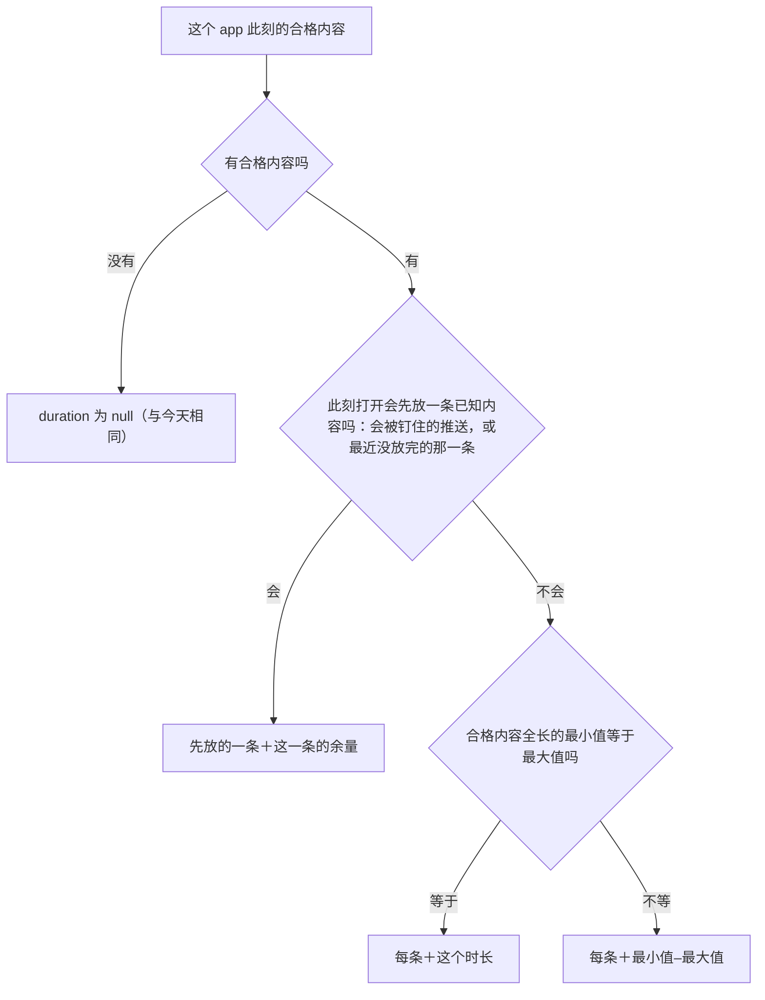

# 自动接续的显示与记录

> 本章属于[手机优先的空闲时间与空闲时的死路：开发规格](../SPEC-free-time-dead-ends.md)，读法和叫法见那一页。

## 目标与依据

[「内容 app 自动接续」](01-autoplay.md)一章让一次 app 使用放完一条接着放下一条，直到人物收尾或没有可接的内容。
提案估计自动接续之下一次刷短视频会持续约二十到七十分钟（提案「Targets for a modern urban phone user」的「Short-video session length」一行），
一条短视频一两分钟，一次使用就是十几到几十条。今天人物和读者看到的几处文字都是按「一次使用只放一条」写的，放到这样的使用上会说错话：

| 看到的地方 | 今天写的 | 自动接续之后的问题 |
| --- | --- | --- |
| 工具层内容 app 行的 `duration` | 一条内容的余量，或几条内容全长的最小值到最大值，不说是什么的时长；样例环境在家 08:00 抖音一行是「约 2 分钟–约 40 分钟」 | 真实运行里模型 52 次把短视频一类 app 当成「约 2 分钟」的事、嫌它太短（提案「Phone use」）；自动接续之后使用不在这个时长停下，没有标注的时长读来就是整次使用的长度 |
| 工具层活动行的 `state`、待办层暂停行的 `progress`、回看任务的客观进度 | 「已做约 30 分钟，还剩约 3 分钟」 | 「还剩」是正在放的这一条的余量，使用并不在那时结束 |
| 记忆层、进度层浓缩与零点计划「动作结果」里的结束句，导出的一天时间线，查看器 | 放过的每条标题依次列出，不设条数上限 | 几十条标题连成一串 |
| 第二条结果的 `details.contents` | 每条一行、每行带至多 200 字的简介，不设行数上限 | 进度层随使用的长短增长 |

代码事实（主干 `2ecd868d`）：

- 内容 app 行由 `tool_layer._app_facts` 写（`src/worldmock/life/tool_layer.py:156-166`），时长取 `content_select.content_duration_range`
  （`src/worldmock/life/content_select.py:63-77`）：此刻打开会钉住推送、或排除预留之后有最近没放完的代表内容时，是那一条的余量 `(r, r)`（`:70-75`）；
  否则是合格内容全长的最小值与最大值（`:76-77`）；没有合格内容时为 `None`（`:66-68`）。两个数相等写一个 `duration_phrase`，不等用「–」相连（`tool_layer.py:163-165`），
  两种情形写出来没有区别。打开顺序的前两步用的是同一对助手：推送钉住 `pinned_push_content`（`content_select.py:42-45`）、最近未完 `_unfinished_content`
  作用在 `_exclude_reserved(content_units(...))` 上（`:47-50`）。`duration_phrase` 写「不到 1 分钟」「约 N 分钟」「约 X 小时」（`src/worldmock/life/readable.py:60-66`）。
- 开始一次 app 使用时计划时长只是第一条的余量（`src/worldmock/life/interact.py:58-66`）；系列接下一集、恢复暂停时计划时长改成已做时长加当前这一条的余量（`interact.py:184-185`、`:200`）。
  `activity_control.objective_progress`（`src/worldmock/life/activity_control.py:138-147`）写「已做…」，进行中或暂停中再接「，还剩…」，所以「还剩」总是当前这一条的余量。
  它有三个读者：工具层活动行的 `state`（`tool_layer.py:195`；活动行只列进行中和待收尾的活动，`tool_layer.py:118-120`）、待办层暂停行的 `progress`
  （`src/worldmock/life/todo_layer.py:48`）、回看任务的 `objective_progress`（`src/worldmock/life/session_actions.py:334`）。
- 结束句由 `settled_text.activity_sentence` 写（`src/worldmock/life/settled_text.py:60-78`），标题部分是 `_content_sentence`（`:81-89`）：`played` 的每条标题各加一个书名号连起来（`:86`），
  用内容 app 而正放着的那一条确有推进时再接「（《当前》未完）」（`:88-89`）。记忆层（`src/worldmock/life/memory_layer.py:241`）、进度层浓缩（`src/worldmock/life/progress_layer.py:74`）
  和零点计划的「动作结果」（`src/worldmock/life/day_plan_inputs.py:185`）都读这一句。
- 显示写法的标题由 `display_wording._titles` 写（`src/worldmock/footprints/display_wording.py:148-150`），之前 `activity_phrase` 已去掉相邻重复（`_distinct`，`:143-145`，在 `:121` 调用）；
  每个身份都去冻结目录取名，取不到是运行故障（`display_name`，`:76-87`）。`activity_phrase` 的读者：一天时间线 `render_day.day_rows`（`scripts/render_day.py:124-136`，
  同一活动首尾相接的结算段并成一行、收集各段的内容身份，`:82-105`），导出的 `timeline/<人物>-<日期>.md` 由它生成（`src/worldmock/footprints/export.py:117-136`），
  质量报告的 `timeline_labels` 用同一函数重算各行（`src/worldmock/footprints/timeline_labels.py:38-64`）；`scripts/inspect_run.py` 的 `_activity_brief`（`:163-168`）
  和已核验经历句 `settled_text.experience_sentence`（`settled_text.py:148`）每次只传一个内容身份。
- 查看器的镜像是 `tools/run-viewer-wording.js` 的 `distinct`、`titles`、`interactPhrase`（`:143-160`），连续使用的标签与条块文字经 `joinedLane`、`continuousUseLabel`（`:355-366`）；
  页面 `tools/run-viewer.html` 的活动表「目标」`actTargetText`（`:1139-1149`）和泳道标签 `laneRow`（`:1157-1165`）都调用它，页面自己不拼标题。
  两种语言由 `tests/fixtures/display-wording-cases.json` 约束，Python 一侧的读者是 `tests/unit/footprints/test_display_wording.py:21`，Node 一侧是 `tests/system/viewer/run_viewer_harness.cjs:19`。
- 第二条结果的 `details.contents` 由 `result_projection._done_contents` 算（`src/worldmock/life/result_projection.py:75-91`）：快照 `played` 每项一行（`:86`），
  状态不是 `completed` 且当前这条有推进时再加一行 `finished: false`（`:87-88`）；只在终态结果里写（`:44-47`）。Schema `_CONTENTS` 只有 `minItems`（`src/worldmock/life/prompt_schemas.py:214-215`），
  结果明细是闭合对象（`:231-243`）；查询答案已有同类的计数键 `omitted`「还有 N 件没列」（`:226`，取值在 `src/worldmock/life/query_answer.py:214-215`）。
- 记录：每条内容做完的那一秒是时钟边界（`src/worldmock/life/time_advance.py:426-433`），每个正区间写一条 `activity_progress`，正文带这一段结算的内容 `data.content`（`time_advance.py:285-294`）。
  导出的 `app_use` 每项活动一行，`status` 取这项活动最后的快照（`src/worldmock/footprints/app_usage.py:82-85`），首尾相接的结算区间并成一段、暂停留下空档（`append_activity_segment`，`:121-133`）；
  每条带 `data.content` 的进度事件一行 `content_consumed`（`app_usage.py:298-304`、`:380-387`），位置有推进的一条 `played` 已核验经历（`src/worldmock/footprints/experiences.py:199-218`）。

本章落实提案「Content-app uses auto-play」一节里属于显示与记录的部分：

- 「Area / Change」表的「Content-app row」「Activity row」「Titles」三行；
- 「Each item boundary stays a settlement boundary…」一段：每条有自己的进度事件与已核验经历，结束结果保留结构化的列表；
- 「Acceptance」表「Auto-play trace」一行里关于记录的部分，「Auto-play text」一行里关于 app 行、活动行与标题的部分（暂停归[「内容 app 自动接续」](01-autoplay.md)与[「地点系列、暂停拒绝与关着的 app」](05-places-and-apps.md)两章）。

所有者 2026-10-15 的八项答复里没有专讲显示的一项。「Auto-play after a standalone item」「Which content auto-plays」两项让一次使用放很多条，「Pausing a feed」让刷到一半的使用出现在待办层，本章的文字是为这几种情形写的。
与提案不同的地方（入口页「与提案不同的地方」也列着）：

- 活动行写「已用约 N 分钟，放到第 K 条」，不是提案的「已用约 N 分钟，看了 K 条」：音频 app 不是「看」；第一条还在放时「看了 0 条」读来像什么都没放。
- 提案一处说结果「caps the list」，另一处说「the conclusion result keeps the structured list」。定稿：`details.contents` 至多三行、多出的写成计数，
  结构化的完整列表留在终态结果事件的活动快照 `data.played` 里，事件本身不变。
- 提案把 `scripts/inspect_run.py` 列为要截断的地方；它每行只写一条事件指向的那一条内容，上限在那里不会生效，代码不改。
- 提案只给了「每条约 2 分钟」一种写法；打开时先放的是一条已知内容（钉住的推送、最近没放完的那条）时，时长是这一条的余量，写「每条」不对，另写「先放的一条…」。

## 行为规格

本章说的「一次 app 使用」照叫法，是 `kind` 为 `interact`、活动数据 `app_id` 不为空的活动；在地点做的事（`app_id` 为空）只受标题上限影响。

### 内容 app 行的时长

工具层内容 app 一行的 `duration` 有三种写法，是哪一种只由 `content_select` 的一个函数判定：



- 判定只有一处：`content_select.opening_duration(catalog, state, request) -> OpeningDuration | None`，取代 `content_duration_range`。
  `OpeningDuration` 是不可变数据类，三个成员依次是 `known_first`（布尔）、`shortest`（整数秒）、`longest`（整数秒）。
  - 没有合格内容时返回 `None`。
  - 有会被钉住的推送（`pinned_push_content`），或者排除预留之后的单元里有最近没放完的代表内容（`_unfinished_content(_exclude_reserved(content_units(...)))`）时，返回
    `OpeningDuration(True, r, r)`，`r` 是这一条的余量，按整秒向上取整，与今天相同。打开顺序排在最前的两步（推送钉住、最近未完）用的是同一对助手，
    所以行上写「先放的一条」的那一条，就是此刻打开这个 app 会开始的那一条。
  - 否则返回 `OpeningDuration(False, 最小值, 最大值)`，取此刻全部合格内容的全长，与今天相同：含不可推送、自动接续不会接到的内容，它们仍可能被打开顺序挑中。
- `tool_layer._app_facts` 只调用这一个函数，把结果交给新的私有函数 `_app_duration` 写成文字，自己不判定：
  - `known_first` 为真：「先放的一条<duration_phrase(余量)>」，例如「先放的一条约 12 分钟」。
  - 否则最小值等于最大值（按秒比较，与今天相同）：「每条<duration_phrase(时长)>」，例如「每条约 2 分钟」；
    不等：「每条<duration_phrase(最小值)>–<duration_phrase(最大值)>」，例如「每条约 5 分钟–约 40 分钟」。
  - 「先放的一条」「每条」与时长短语之间不加空格；不到一分钟时是「每条不到 1 分钟」「先放的一条不到 1 分钟」。
- 这一行的 `note`（「有推送：《标题》」或 `null`）、`available`、`reason` 不变；`state` 归[「地点系列、暂停拒绝与关着的 app」](05-places-and-apps.md)一章。

改前改后（「五集副本」见「接口与文件指引」的夹具；钉钉副本是 `tests/life/prerequisite_inputs.py` 的 `dingtalk_environment`）：

| 情形 | 今天 | 改后 |
| --- | --- | --- |
| 样例环境，在家 08:00，哔哩哔哩 | 约 5 分钟–约 40 分钟 | 每条约 5 分钟–约 40 分钟 |
| 同上，抖音 | 约 2 分钟–约 40 分钟 | 每条约 2 分钟–约 40 分钟 |
| 同上，Keep（只有《测试慢跑》） | 约 20 分钟 | 每条约 20 分钟 |
| 钉钉副本，在办公室打卡时段内，只有《考勤打卡》合格 | 约 1 分钟 | 每条约 1 分钟 |
| 钉钉副本，路上，只有带时段前提的《日报提醒》合格 | 约 1 分钟 | 每条约 1 分钟 |
| 钉钉副本，12:30 只有 120 秒的《午间打卡》合格，没做完的《周报填写》此刻不合格 | 约 2 分钟 | 每条约 2 分钟 |
| 钉钉副本，17:35 没做完的《周报填写》合格 | `duration_phrase(1800 - 已做位置)` | 「先放的一条」接同一个短语 |
| 钉钉副本，09:00 推送了《晨会纪要》、还在推送时段内 | 约 1 分钟 | 先放的一条约 1 分钟 |
| 同一副本，10:00 之后推送不再钉住，只有 300 秒的《公告》合格 | 约 5 分钟 | 每条约 5 分钟 |
| 五集副本，在家 08:00，哔哩哔哩只有五集各 400 秒 | 约 7 分钟 | 每条约 7 分钟 |
| 同一副本，08:30 收尾一次放到第五集第 200 秒的使用之后 | 约 3 分钟 | 先放的一条约 3 分钟；再打开开始的是《测试剧集第五集》，`start_position_seconds` 为 200 |

### 一次 app 使用的客观进度

`activity_control.objective_progress` 对一次 app 使用写：

> 已用<duration_phrase(elapsed_seconds)>，放到第 K 条

- `elapsed_seconds` 是不含暂停的已用时长。K = `len(data["played"])`，状态不是 `completed` 时再加 1。`played` 是这次使用里放完的各条；
  进行中、暂停中、被收尾结束（`cancelled`）、运行截止时截断（`truncated`）的使用都还有一条正放着或停在半截，算进 K；
  放完一条后没有能接的内容而停下、待收尾的使用（`completed`）没有这一条，不加。数字两侧各一个半角空格。
- 这一句替换「已做…，还剩…」，用在读这个函数的每一处：工具层活动行的 `state`（进行中的和刚结束待收尾的）、待办层暂停行的 `progress`、回看任务的 `objective_progress`。
  三处读者的代码不改，跟着函数变。
- 别的活动不变：在地点做的事、出行、睡眠、查询、购买照旧是「已做…」，进行中或暂停中再接「，还剩…」，睡过头的睡眠再接多睡了多久。
  在地点做的系列进行中时，工具层活动行的 `state` 前面另有「第 N 集，共 M 集」等说法，归[「地点系列、暂停拒绝与关着的 app」](05-places-and-apps.md)一章；
  那一章只对 `app_id` 为空的活动写，一次 app 使用的 `state` 就是本节这一句。

五集副本（在家 08:00 打开哔哩哔哩；第一次决策机会是 08:30 的半小时播报，那时放完四集、第五集放到第 200 秒；只播报不收尾时 08:33:20 第五集放完，没有能接的内容）：

| 时刻与情形 | 今天 | 改后 |
| --- | --- | --- |
| 08:30，工具层活动行「进行哔哩哔哩（1月5日 08:00 起）」，`phase`「进行中」 | 已做约 30 分钟，还剩约 3 分钟 | 已用约 30 分钟，放到第 5 条 |
| 08:30，回看这项活动的 `objective_progress` | 已做约 30 分钟，还剩约 3 分钟 | 已用约 30 分钟，放到第 5 条 |
| 08:30 暂停之后，待办层这一行的 `progress` | 已做约 30 分钟，还剩约 3 分钟 | 已用约 30 分钟，放到第 5 条 |
| 08:33:20，活动行 `phase`「刚结束」 | 已做约 33 分钟 | 已用约 33 分钟，放到第 5 条 |
| 样例环境，每五分钟重估，「测试休息」做到 08:05，活动行 | 已做约 5 分钟，还剩约 10 分钟 | 不变 |

边界：

- 第一条还没放完时 K 是 1，例如「已用不到 1 分钟，放到第 1 条」。一小时以上照 `duration_phrase` 按半小时取整，例如「已用约 1.5 小时，放到第 40 条」。
- 收尾恰在一条放完的那一秒、下一条刚接上还没推进：K 把刚接上的那一条算进去（它已是活动的当前内容），结束句和 `contents` 里没有它（它没有推进，见下文）。
- 只放一条就停下的使用（例如 Keep 只有不可推送的《测试慢跑》）待收尾时是「已用约 20 分钟，放到第 1 条」。

### 标题只列三条

一串内容标题多于三条时，只写前三条，后接「等 K 条」，K 是这一串的总条数，数字两侧各一个半角空格：

> 《测试短视频》《测试短视频二》《测试实况》等 4 条

- 上限是 `src/worldmock/footprints/display_wording.py` 的常量 `TITLE_LIST_LIMIT = 3`；写法由同一文件里唯一的公开函数 `title_list(titles: Sequence[str]) -> str` 完成：
  每条标题加一个书名号，书名号之间不加字；条数不多于 `TITLE_LIST_LIMIT` 时全部照列，多于时只写前 `TITLE_LIST_LIMIT` 条再接「等 <总条数> 条」；空串列得空串。
  两个名字登记进 `tests/unit/engineering/test_single_source.py` 的 `OWNERS['footprints/display_wording.py']`。
- K 数的是交给 `title_list` 的那一串。显示写法在交之前去掉相邻重复（`activity_phrase` 里的 `_distinct`，今天就是这样），所以那里的 K 是去重之后的条数；
  隔开的重复照算，例如「使用抖音《测试短视频》《测试短视频二》《测试短视频》等 5 条」。结束句交的是 `played` 的各条，不去重。
- 列表之外的各条照样按身份取名：`display_wording._titles` 先对每个身份调用 `display_name`，再把全部标题交给 `title_list`，
  所以第四条以后有一个冻结目录里没有的身份时，仍是运行故障 `Displayed object is not registered in the frozen environment: content <身份>`，与今天相同。

Python 一侧的调用方：

| 调用 | 经过 | 读者 | 上限会不会生效 |
| --- | --- | --- | --- |
| `display_wording._titles` 调 `title_list`（`_interact_phrase` 的 app 分支与地点系列分支都经它） | `activity_phrase` | `render_day.day_rows`：命令行写的时间线、导出的 `timeline/<人物>-<日期>.md`、质量报告 `timeline_labels` 检查的各行 | 会：时间线一行覆盖一项活动首尾相接的全部结算段，自动接续之下就是一整次使用 |
| 同上 | `activity_phrase` | `scripts/inspect_run.py` 的 `_activity_brief` | 不会：每次只传一个内容身份，代码不改 |
| 同上 | `activity_phrase` | `settled_text.experience_sentence`（零点计划的「已核验经历」） | 不会：每次只传一个内容身份，代码不改 |
| `settled_text._content_sentence` 调 `title_list` | 用引擎内存里的目录取标题 | 记忆层、进度层浓缩、零点计划「动作结果」里的结束句 | 会 |
| `result_projection._done_contents` 读 `TITLE_LIST_LIMIT` | — | 第二条结果的 `details.contents`，见下一节 | 会 |
| `prompt_schemas._CONTENTS` 读 `TITLE_LIST_LIMIT` | — | 进度层 Schema 的 `maxItems` | — |

质量报告的标签检查只看书名号与引号之外的英文、数字片段（`timeline_labels.py:27-32`、`:67-75`）；「等 12 条」只多出数字片段，既不是英文种类名，也不像内部身份，不产生发现。

查看器 `tools/run-viewer-wording.js` 一字不差地镜像：常量 `TITLE_LIST_LIMIT = 3`，函数 `titleList(texts)` 与 `title_list` 同一规则；
`titles(contentIds)` 先对每个身份调用 `name('content', key)`（缺名照旧显示「名称缺失（身份）」并对同一身份只写一次英文错误，列表之外的缺名也写），再交给 `titleList`。
`activityPhrase`、`targetPhrase`、`continuousUseLabel`、`joinedLane` 都经 `titles`，所以活动表的「目标」、泳道标签、并成一行的连续使用标签和条块悬停文字都截断；
页面 `tools/run-viewer.html` 不改。两个新名字只在镜像内部用，不加进 `ViewerWording` 的导出。

五集副本 08:30 收尾那一次，2026-01-05 的时间线里这一行（先今天、后改后）：

```text
| 08:00–08:30 | 使用哔哩哔哩《测试剧集第一集》《测试剧集第二集》《测试剧集第三集》《测试剧集第四集》《测试剧集第五集》 | 30 分钟 | 5 |
| 08:00–08:30 | 使用哔哩哔哩《测试剧集第一集》《测试剧集第二集》《测试剧集第三集》等 5 条 | 30 分钟 | 5 |
```

这里 K 是 5：这一行覆盖的进度事件指向五条内容，没放完的第五集也照列（时间线不标「未完」，今天就是这样）。
`inspect_run` 对这项活动的每条进度事件仍各写一条标题，最后一条是「使用哔哩哔哩《测试剧集第五集》 → active」。

### 结果明细只列三行

第二条结果的 `details.contents` 先照今天的规则算出全部行（快照 `played` 的各条，`finished: true`；状态不是 `completed` 且当前这条有推进时再加一行 `finished: false`），然后：

- 行数不多于 `TITLE_LIST_LIMIT` 时全部写出，不写别的键，与今天相同。
- 多于时只写按先后的前三行，并在 `details` 里另写 `contents_omitted`，值是「还有 N 条没列」，N 是没写出的行数，数字两侧各一个半角空格。
- 行的形状、键序与 `duration`（登记全长）都不变；没写出的行不查目录。一行都没有时两个键都不写。

`contents_omitted` 加进结果明细的闭合键集，可选；写出时在 `details` 里紧跟在 `contents` 之后。Schema 是字符串，`pattern` 为 `^还有 [1-9][0-9]* 条没列$`。`_CONTENTS` 另加 `maxItems`，值取 `TITLE_LIST_LIMIT`。

被省略的是按先后排在第三行之后的行：放完三条以上时，正放着的那一条（`finished: false`）总在被省略的行里，人物从结束句的「（《当前》未完）」半句知道它。
终态结果事件里的活动快照照旧带完整的 `data.played`，事件不变；完整的结构化列表在那里，导出的 `activities.jsonl` 从那里复制终结活动的一行。

五集副本：

| 情形 | 今天的 `details` | 改后的 `details` |
| --- | --- | --- |
| 08:30 收尾（放完四集，第五集到第 200 秒） | `contents` 五行：第一至四集 `finished: true`，第五集 `finished: false`，`duration` 都是「约 7 分钟」 | `contents` 三行：《测试剧集第一集》《测试剧集第二集》《测试剧集第三集》，都是 `finished: true`、`duration`「约 7 分钟」；`contents_omitted`「还有 2 条没列」 |
| 08:33:20 第五集放完、自己停下 | `contents` 五行，都是 `finished: true` | `contents` 同上三行；`contents_omitted`「还有 2 条没列」 |
| 不多于三行（例如 Keep 的一条、样例环境「测试剧集」的三集） | 照列 | 不变，没有 `contents_omitted` |

### 结束句

结束句的形状不变：「<活动名>：<起>–<止>（暂停 …），<终局>」，`interact` 活动再接「，<标题部分>」。改的只是标题部分：

- 放完的各条标题交给 `title_list`：不多于三条照列，多于三条写前三条加「等 K 条」，K 是放完的条数。
- 用内容 app、正放着的那一条确有推进而没放完时，照旧在后面紧接「（《<标题>》未完）」；这半句跟在截断后的列表之后，写法不变，不计入 K。
- 终局的说法归[「内容 app 自动接续」](01-autoplay.md)一章：被人物收尾结束的一次 app 使用是「结束使用」，放完停下的照旧是「按计划结束」。
- 在地点做的事照旧不写「未完」半句；系列做完四集以上同样截断，标题部分形如「《备菜做饭》《吃晚饭》《洗碗收拾厨房》等 4 条」。

五集副本，收尾之后驾车去五里公园，记忆层 `earlier_today` 里这一段的结束句：

| 情形 | 今天 | 改后 |
| --- | --- | --- |
| 08:30 收尾 | 进行哔哩哔哩（1月5日 08:00 起）：08:00–08:30，提前结束，《测试剧集第一集》《测试剧集第二集》《测试剧集第三集》《测试剧集第四集》（《测试剧集第五集》未完） | 进行哔哩哔哩（1月5日 08:00 起）：08:00–08:30，结束使用，《测试剧集第一集》《测试剧集第二集》《测试剧集第三集》等 4 条（《测试剧集第五集》未完） |
| 08:33:20 自己停下后收尾 | 进行哔哩哔哩（1月5日 08:00 起）：08:00–08:33，按计划结束，《测试剧集第一集》《测试剧集第二集》《测试剧集第三集》《测试剧集第四集》《测试剧集第五集》 | 进行哔哩哔哩（1月5日 08:00 起）：08:00–08:33，按计划结束，《测试剧集第一集》《测试剧集第二集》《测试剧集第三集》等 5 条 |
| 样例环境，Keep 做 5 分钟后收尾（一条都没放完） | ……，提前结束，（《测试慢跑》未完） | ……，结束使用，（《测试慢跑》未完）：标题部分不变 |

同一次使用的三处计数各有含义，不必相等：08:30 收尾那一次，结束句是「等 4 条」（放完的）加「未完」半句，时间线是「等 5 条」（放过的），活动行是「放到第 5 条」。

### 自动接续之下的记录

自动接续不改任何记录结构，只是一次使用里有了多条。下面的规则今天的系列接续就成立，本节写明它们对自动接续接上的各条同样成立：

- `app_use`：一次 app 使用一行。条与条之间的边界前后两段首尾相接，并成一段；只有暂停留下空档、分成几段。`status` 是这项活动在导出截止时的状态：
  收尾结束的是 `cancelled`，放完停下再收尾的是 `completed`，导出截止在运行中途而它还在放的是 `active`，运行截止时被截断的是 `truncated`。
  机器字段 `status`、`boundary_type`（`cancelled`）、`interruption_reason`（`agent_cancelled`）、开始请求第二条结果的 `status: cancelled` 与 `message: Activity cancelled` 都不因「结束使用」这个人读说法而改。
- `content_consumed`：每条带 `data.content` 的进度事件一行，所以每一条至少一行；一条被别的结算边界（暂停、别的唤醒、别的活动结束等）切开时是几行，与今天相同。
  `completed` 只在这一条放到末尾的那一行为真。`push_id` 只可能出现在打开时钉住推送的第一条的行上：接上的各条 `pinned_by_push_id` 为空。
- `played` 已核验经历：每条位置有推进的进度事件一条，与 `content_consumed` 逐行同一区间；零点计划的「已核验经历」照旧每条一句（见「明确不做」）。
- 缓解：每一条按自己的档位结算，归[「内容 app 自动接续」](01-autoplay.md)一章。
- 查看器的「连续使用」照旧：同一人物、同一 app 的执行段首尾相接就连成一条。它要处理的情形变成：一次使用停下（放完一条后没有能接的内容，或被人物收尾结束）、
  人物同一秒又打开同一个 app；一次使用里的各条本来就是一项活动，泳道上是一行，标签照上文截断。

五集副本、运行窗口一小时（08:00–09:00）导出后，这次使用的记录：

| 情形 | `app_use` | 这项活动的 `content_consumed` | 这项活动的 `played` 经历 |
| --- | --- | --- | --- |
| 08:30 暂停，做「测试休息」到 08:45，收尾它、恢复这次使用，08:48:20 第五集放完，收尾 | 一行，`status` 为 `completed`，`segments` 两段：08:00–08:30、08:45–08:48:20 | 六行：第一至四集各一行 `completed: true`；第五集两行，08:26:40–08:30 的 `completed: false`，08:45–08:48:20 的 `completed: true` | 六条，与左栏逐行同一区间 |
| 08:30 收尾 | 一行，`status` 为 `cancelled`，一段 08:00–08:30 | 五行：第一至四集 `completed: true`，第五集 `completed: false` | 五条 |

### 明确不做

- 开始结果（第一条结果）的 `planned` 与 `content` 仍只说第一条：五集副本开始时 `planned` 是「约 7 分钟」、`content` 是《测试剧集第一集》，放到第五集时进度层这条记录照旧显示它（直到第二条结果到来）。
  查看器受理行的「计划 <时长>」（`tools/run-viewer.html:703`）同样不改。
- 观察作为证据记下的进行中活动（`src/worldmock/life/observe.py:132-134`）和拒绝事件的活动快照（`src/worldmock/life/decision_coordinator.py:421-422`）照旧带完整的 `data.played`；
  进度事件改带条数归[「内容 app 自动接续」](01-autoplay.md)一章。
- 零点计划的「已核验经历」照旧每个 `played` 经历一句，不截断、不合并；请求达到上下文窗口的 85% 时由 `fit_plan_day` 从最早的一句起裁掉（`src/worldmock/life/day_planning.py:86-102`）。
- `inspect_run` 与已核验经历句只写一条标题，代码不改。
- 查看器活动段行的状态与边界说法（「已取消」「主动结束」，`tools/run-viewer.html:325-328`）不改：它们翻译的是机器字段，机器字段不改。
- 不按媒体种类区分「看」「听」，目录没有这个字段；一律写「放到」。
- 「每条」的范围仍取全部合格内容，不只取可推送的；不为「每条」另算自动接续会接到的那部分。
- 结果的 `contents` 行不去重、不加键；`contents_omitted` 只是一个计数，不列被省略的标题。
- 不为标题上限改导出的结构：时间线只是文字变短；导出清单结构号的变化只因进度快照的条数（[「版本、身份与基线」](08-versions.md)一章）。
- 不给 `title_list` 加开关或参数，不保留「不截断」的写法。

### 本章定下的细节

| 事项 | 定下的做法 | 理由 |
| --- | --- | --- |
| 判定先放哪一条的函数 | `content_select.opening_duration` 返回 `OpeningDuration(known_first, shortest, longest)` 或 `None`，删除 `content_duration_range`；函数体沿用今天那个函数的判定，只多返回 `known_first` | 定稿要求「是哪一种」只在 `content_select` 判定；工具层一次调用同时拿到情形与秒数，用的又是打开顺序前两步的同一对助手，不另写一份挑选逻辑 |
| 写成文字的地方 | `tool_layer` 的私有函数 `_app_duration(duration)`；最小值与最大值按秒比较 | `content_select` 不写人读文字；按秒比较是今天的行为，两条时长不同而短语相同时仍写成范围，例如「每条约 2 分钟–约 2 分钟」 |
| 进度写法放在哪 | `activity_control` 新增私有函数 `_app_use_progress(activity)`，`objective_progress` 开头按 `activity.kind == ActivityKind.INTERACT and activity.data["app_id"] is not None` 分出 | 三处读者都经 `objective_progress`，分支只写一处；判断条件就是叫法里「一次 app 使用」的定义；查询活动的 `data` 也有 `app_id`，种类先判 |
| `title_list` 的参数 | 标题文字的序列，不是内容身份 | 结束句用引擎内存里的目录取名，显示写法用冻结目录的 `DisplayNames`，两边取名方式不同，共用的只是「怎样列」 |
| 结果明细的计算 | `_done_contents` 返回一个字典：`{}`、`{"contents": [...]}`，或再带 `contents_omitted`；N 取「全部行数减去写出的行数」；`_details` 的终态分支改为 `details.update(...)` | 两个键由同一处、同一份行列表算出，N 不会与行数对不上；写法仿照查询答案（`query_answer.py:104-105`、`:214-215`） |
| `_CONTENTS` 的 `maxItems` | 取 `TITLE_LIST_LIMIT`，从 `display_wording` 在模块顶部导入，不写字面量 3 | `prompt_schemas` 的约定是读各领域的常量、不维护副本（模块说明 `prompt_schemas.py:1-6`）；投影多写一行时层校验就会失败 |
| `contents_omitted` 的写法 | 「还有 N 条没列」，仿照查询答案的「还有 N 件没列」 | 同一层里同一种意思用同一个句式；内容论「条」 |
| 单一归宿登记 | `OWNERS` 里 `footprints/display_wording.py` 加 `TITLE_LIST_LIMIT`、`title_list`；`life/content_select.py` 加 `opening_duration`、`OpeningDuration` | 定稿要求标题上限只有一个归宿；「先放哪一条」的判定同样只能有一处 |
| 查看器镜像的名字 | `TITLE_LIST_LIMIT`、`titleList`，不导出 | 与 Python 同名便于对照；页面不直接调用它们 |
| 共享用例的目录 | 用例文件 `catalog.contents` 与 `names.contents` 加「做晚饭」第三、四集（`c-dinner-3`「洗碗收拾厨房」、`c-dinner-4`「倒垃圾」，各 600 秒，与前两集同一写法） | 现有用例里地点系列只有两集，验证不了地点系列分支的截断 |
| 新的缺名用例的身份 | `c-nope-fourth`，不复用 `c-nope` | 查看器对同一身份只写一次英文错误，复用的话 Node 一侧这一条读不到错误 |
| 测试副本 | `tests/life/environment_inputs.py` 新增 `five_episode_environment(destination)`，内容见「接口与文件指引」的夹具 | 样例环境只有三集的系列，放不出时刻确定、多于三条的使用；用系列而不是随机抽取，改前改后的文字都能逐字写出，时刻也相同 |
| 自动接续抽取的那组记录用例 | 样例环境、`one_hour_every_five_minutes`、标签 `clips` 打开抖音，第一条是《测试短视频》（打开顺序的随机键不变，写规格时在基线上跑出），放完两条后收尾；断言只看结构，不写抽到哪几条 | 第二条起由接续顺序随机抽取，实现之前写不出；结构断言照样证明抽取接上的各条也并成一行、各有一行消费与经历；第一条只有 120 秒、每五分钟一次决策，收尾时总有一条正放着，状态必为 `cancelled` |
| 查看器上下文测试里手抄的工具层样本 | `run_viewer_context.test.cjs` 的 `START_TOOL_LAYER` 里哔哩哔哩一行与下钻期望的两处「约 5 分钟–约 40 分钟」改成「每条约 5 分钟–约 40 分钟」 | 它的说明写的是「由真实引擎的观察照抄」，不改就不再是照抄；不改也能通过 |
| 「每条一行记录」的准确说法 | 记录按带 `data.content` 的进度事件计：每条至少一行，被别的结算边界切开时是几行 | 与今天的投影一致（`app_usage.py:298-304`、`experiences.py:199-218`）；定稿说的「每条一行」是没被别的边界切开时的情形 |

## 接口与文件指引

实施归属：轨道 A（自动接续，与[「内容 app 自动接续」](01-autoplay.md)一章同一条轨道）。

| 文件 | 改什么 |
| --- | --- |
| `src/worldmock/life/content_select.py` | 新增 `OpeningDuration`（三个成员各有 `#:` 说明）与 `opening_duration`；删除 `content_duration_range` |
| `src/worldmock/life/tool_layer.py` | 导入改为 `OpeningDuration`、`opening_duration`；`_app_facts` 调它并交给新增的 `_app_duration`；`_app_facts` 的说明改写。`_activity_target`、`_binding_target` 本章不改（[「地点系列、暂停拒绝与关着的 app」](05-places-and-apps.md)一章改） |
| `src/worldmock/life/activity_control.py` | `objective_progress` 加一次 app 使用的分支，说明改写；新增 `_app_use_progress` |
| `src/worldmock/footprints/display_wording.py` | 新增 `TITLE_LIST_LIMIT`、`title_list`；`_titles` 先取全部标题再调 `title_list`；模块说明写明标题上限，并写明结束句与结果明细也用这个上限 |
| `src/worldmock/life/settled_text.py` | `_content_sentence` 的标题改调 `title_list`；说明写明截断与「未完」半句的位置 |
| `src/worldmock/life/result_projection.py` | `_done_contents` 截断并返回键的字典；`_details` 的终态分支改为合并它；模块说明与两处函数说明 |
| `src/worldmock/life/prompt_schemas.py` | `_CONTENTS` 加 `maxItems`；新增 `_CONTENTS_OMITTED`；`_RESULT_DETAILS` 加 `contents_omitted` 一行（单独一行，见下文约束），可选键元组在 `"contents"` 之后加它，按行宽重排 |
| `tools/run-viewer-wording.js` | `TITLE_LIST_LIMIT`、`titleList`，`titles` 改写；文件头说明加一句标题上限 |
| `scripts/render_day.py` | 只改模块说明：内容多于三条时只写前三条再写「等 K 条」 |
| `tools/run-viewer.html`、`scripts/inspect_run.py`、`src/worldmock/life/todo_layer.py`、`src/worldmock/life/session_actions.py`、`src/worldmock/footprints/app_usage.py`、`src/worldmock/footprints/experiences.py`、`src/worldmock/footprints/timeline_labels.py` | 不改 |

落地后的关键几行（变异锚点以此为准，说明文字从略）：

```python
# content_select.opening_duration 的判定（沿用 content_duration_range 的函数体）
    if item is not None:
        remaining = ceil(item.duration_seconds - _position(agent, item))
        return OpeningDuration(True, remaining, remaining)
    durations = tuple(item.duration_seconds for item in contents)
    return OpeningDuration(False, min(durations), max(durations))

# tool_layer._app_duration
    span = duration_phrase(duration.shortest) if duration.shortest == duration.longest else (
        f"{duration_phrase(duration.shortest)}–{duration_phrase(duration.longest)}")
    return f"先放的一条{span}" if duration.known_first else f"每条{span}"

# activity_control._app_use_progress
    count = len(activity.data["played"]) + (0 if activity.status == ActivityStatus.COMPLETED else 1)
    return f"已用{duration_phrase(activity.elapsed_seconds)}，放到第 {count} 条"

# display_wording
TITLE_LIST_LIMIT = 3
    listed = "".join(f"《{title}》" for title in titles[:TITLE_LIST_LIMIT])
    return listed if len(titles) <= TITLE_LIST_LIMIT else f"{listed}等 {len(titles)} 条"

# result_projection._details 的终态分支
    if result["status"] in ("completed", "cancelled", "failed"):
        details.update(_done_contents(_activity_rows(payload), inputs))

# result_projection._done_contents 的行
    rows = [{"title": contents[key].title, "summary": contents[key].summary,
             "duration": duration_phrase(contents[key].duration_seconds), "finished": finished}
            for key, finished in done[:TITLE_LIST_LIMIT]]
    omitted = len(done) - len(rows)
```

直接删除，不留兼容：

- `content_select.content_duration_range`：不留别名，不留只返回二元组的包装；它的单元测试改调 `opening_duration`。
- `tool_layer._app_facts` 里自己拼范围的几行（`tool_layer.py:162-165`）；`settled_text._content_sentence` 与 `display_wording._titles` 里各自拼书名号的那一行；查看器 `titles` 里的拼接。
- `result_projection._details` 里的 `terminal`、`contents` 两个局部变量与 `details["contents"] = contents` 一行。
- 不加「不截断」的选项、开关或回退写法。

夹具：

- 基础夹具 `tests/fixtures/dataset-environment/` 本章不改，只有[「版本、身份与基线」](08-versions.md)一章的版本提交改它。
- `tests/life/environment_inputs.py` 新增 `five_episode_environment(destination)`，即「五集副本」：复制样例环境；只绑定哔哩哔哩的内容行删去（`c-article`、`c-course`、`c-image`、原有的三集），
  `c-long` 的 `app_ids` 只留 `douyin`；再写五行 `c-drama-1`…`c-drama-5`：`app_ids` 为 `["bilibili"]`，`series` 为「测试剧集」第一至第五集，标题「测试剧集第一集」…「测试剧集第五集」，
  `duration_seconds` 400，`exertion` `light`，`pushable` 真，`relaxation_relief` `medium`，`social_relief` `none`，摘要「<标题>的测试用合成摘要。」，
  `summary_source` 为 `{"kind": "synthetic", "notice": "测试用合成摘要", "url": null}`；全部行按内容身份升序经 `write_catalog_rows` 写回并刷新清单，返回副本根目录。
  这份副本里自动接续只走「下一集」一种，第五集放完时没有别的系列，使用停下待收尾，改前改后的时刻相同。
- `tests/fixtures/display-wording-cases.json` 加用例（见「测试要求」）；它不是环境包，不带摘要清单。
- 基线与录制样例在收尾步统一重冻、重录，本章不动（[「版本、身份与基线」](08-versions.md)一章）。

约束：

- 生产函数不超过 50 行、5 个参数，每行不超过 120 字符，每个函数（含私有的）有带中文的 `@brief` 说明，文件不超过 2000 行（本章碰到的生产文件今天最长的是 `activity_control.py`，464 行）。
- 本章碰到的文件里这些变异锚点逐字不变：`display_wording._interact_phrase` 的 `return f"使用{app}{_titles(names, content_ids)}"` 与 `return f"在{place}：{first.unit}"`；
  `display_wording.event_content_id` 的 `if content is not None:`；`display_wording._purchase_phrase` 的 `grouped.setdefault(orders[order_id]["app_id"], [])`；
  `settled_text.experience_sentence` 的 `return f"{span} {activity_phrase(names, snapshot, [fact['content_id']], {})}"`；
  `result_projection._done_contents` 的 `done = [(item["content_id"], True) for item in data["played"]]`（锚点 `for item in data["played"]]`）；
  `result_projection._details` 的 `if snapshot is not None and snapshot["kind"] == "query":`；`result_projection._purchase` 的 `channel` 一行；
  `prompt_schemas._RESULT_DETAILS` 的 `"content": _CONTENT, "contents": _CONTENTS, "query": _QUERY,` 一行（锚点 `"query": _QUERY,`，所以 `contents_omitted` 另起一行）；
  `content_select.eligible_contents` 的 `if not prerequisite_unmet(item, stay, moment)`。
- 本章改写一条锚点：`terminal_result_lists_no_contents`（`worldmock.life.result_projection::_details`）的原文从 `details["contents"] = contents` 改为
  `details.update(_done_contents(_activity_rows(payload), inputs))`，替换仍是 `pass`，杀手不变，与实现同一个提交登记。
- 被登记为变异杀手、本章要改期望的现有用例不改名：`tests/integration/footprints/test_render_day.py::test_app_use_row_names_the_app_and_every_item_in_order`、
  `tests/unit/footprints/test_display_wording.py::test_shared_cases_give_the_same_names_and_wording_as_the_viewer`、
  `tests/unit/life/test_result_contents.py::test_result_details_schema_accepts_every_listed_key`。本章不改期望的杀手同样不动：`tests/integration/life/test_result_contents.py` 的
  `::test_finished_app_use_lists_what_was_watched`、`::test_finished_app_series_lists_every_episode_in_order`，`test_render_day.py` 的
  `::test_rows_list_what_was_played_not_the_next_item_in_the_snapshot`、`::test_location_rows_name_the_place_the_unit_and_the_series_episodes`、`::test_purchase_row_is_split_by_order_with_its_channel`。
- 不新增函数内导入：`tool_layer`、`settled_text`、`result_projection`、`prompt_schemas` 都在模块顶部导入。`prompt_schemas` 与 `result_projection` 新增对 `worldmock.footprints.display_wording` 的依赖；
  它的依赖闭包只有目录模型、错误、交换常量、`life.readable` 与 `life.action_contract`，写规格时用 `tests/unit/engineering/test_import_graph.py` 的 `modules`、`imports` 算过，不成环；
  `DELAYED_IMPORTS` 不变。
- `tests/unit/engineering/test_single_source.py` 拒绝语法树相同的函数体：`_app_duration`、`_app_use_progress`、`title_list` 不照抄现有函数。

设计文档的落点（《人物》「提示与工具」「进度、待办与记忆」，《记录引擎》「数字足迹」「显示写法与检查工具」「查看器里的连续使用」，《模拟引擎》「出行、内容与查询」）见[「设计文档与手册」](07-design-docs.md)一章；本章不改设计文档。

## 测试要求

行为规则的用例都经真实请求、引擎与 SQLite：`engine_factory` 建引擎（五集副本用 `five_episode_environment`），`act`、`act_group` 提交，
`advance_until_ready`、`until_ended` 与[「内容 app 自动接续」](01-autoplay.md)一章的 `conclude_app_use` 推进，`observe_only` 读观察，`engine.read_task_summary` 在冻结观察上回看，
`events` 读落库事件，导出用 `tests/footprints/recording.py` 的 `export_completed` 与 `artifact_rows`。新的集成用例放在新文件 `tests/integration/life/test_autoplay_display.py`。
查看器的 Node 用例在轨道上用 `node --test tests/system/viewer/run_viewer.test.cjs tests/system/viewer/run_viewer_context.test.cjs tests/system/viewer/run_viewer_wording.test.cjs` 直接跑；
收尾步经 `tests/system/viewer/test_run_viewer.py::test_run_viewer_recorded_names` 跑（中途提交排除这个文件，见[「实施顺序与验收」](09-implementation.md)一章）。

### 规则与用例

| 规则 | 层 | 测试 | 验收行为 |
| --- | --- | --- | --- |
| 内容 app 行按条写时长 | integration | `tests/integration/life/test_autoplay_display.py::test_content_app_rows_label_the_length_per_item`（新） | 样例环境在家 08:00 观察：哔哩哔哩、抖音、Keep 三行的 `duration` 依次是「每条约 5 分钟–约 40 分钟」「每条约 2 分钟–约 40 分钟」「每条约 20 分钟」，`note` 都是 `null` |
| 打开先放已知的一条时写这一条的余量，与打开顺序一致 | integration | `tests/integration/life/test_autoplay_display.py::test_content_app_row_names_the_first_item_when_the_opening_knows_it`（新） | 五集副本 08:00 哔哩哔哩行「每条约 7 分钟」；打开，08:30 收尾；同一秒的观察里这一行「先放的一条约 3 分钟」；再打开，开始的是《测试剧集第五集》，`start_position_seconds` 为 200、计划时长 200 秒 |
| 同上，钉住的推送与推送时段内外 | integration | `tests/integration/scheduling/test_environment_schedule.py::test_push_stops_being_offered_after_its_window_and_expires_with_the_stay`（改期望） | 推送时段内「先放的一条约 1 分钟」与「有推送：《晨会纪要》」；10:00 之后「每条约 5 分钟」、`note` 为 `null` |
| 同上，没做完的内容与只有一条合格 | integration | `tests/integration/life/test_content_start_evidence.py::test_unfinished_content_waits_for_its_prerequisite_and_then_continues_from_its_position`、`tests/integration/life/test_content_start_evidence.py::test_clock_in_at_the_office_starts_the_content_and_finishes_past_the_window_end`、`tests/integration/life/test_environment_runtime.py::test_time_only_app_content_follows_the_clock_on_the_road`（都改期望） | 12:30「每条约 2 分钟」；17:35「先放的一条」接 `duration_phrase(1800 - position)`；打卡时段内与路上「每条约 1 分钟」 |
| 没有合格内容时 `duration` 为 `null` | integration | `tests/integration/life/test_content_start_evidence.py::test_clock_in_refusal_repeats_the_tool_layer_reason_and_changes_nothing`（现有，不改） | 钉钉在时段外或别处不可用时，这一行恰为 `duration` 为 `null` 的八个字段 |
| 判定只有一处，`known_first` 正是打开顺序前两步挑中的那一条 | unit | `tests/unit/life/test_environment_content.py::test_recent_shared_partial_content_has_priority_without_query_randomness`、`tests/unit/life/test_environment_content.py::test_current_app_push_pins_start_but_not_other_containers`、`tests/unit/life/test_environment_content.py::test_unfinished_content_that_cannot_start_now_does_not_block_the_rest_of_the_app`、`tests/unit/life/test_environment_content.py::test_pushed_content_is_pinned_only_while_it_is_eligible`（改期望） | 同一状态下 `select_content` 挑中的推送或没做完的那一条，正是 `opening_duration` 判为 `known_first` 的那一条，秒数是它的余量；不合格或推送已不钉住时 `known_first` 为假。逐条期望见下文「钉住今天行为的现有用例」 |
| 范围、没有合格内容 | unit | `tests/unit/life/test_environment_content.py::test_filter_keeps_the_order_and_random_draws_of_an_app_without_prerequisites`、`tests/unit/life/test_environment_content.py::test_duration_range_counts_only_eligible_contents`、`tests/unit/life/test_environment_content.py::test_app_whose_contents_are_all_ineligible_has_no_duration`（改期望） | 同上 |
| 一次 app 使用的进度：工具层活动行与回看 | integration | `tests/integration/life/test_autoplay_display.py::test_running_app_use_row_says_time_used_and_the_item_playing`（新） | 五集副本 08:30：工具层活动行 `phase`「进行中」、`state`「已用约 30 分钟，放到第 5 条」；在同一份冻结观察上 `engine.read_task_summary` 回看这项活动，`recall.objective_progress` 同一句；进度层里开始请求的记录仍是第一条结果，`planned` 是「约 7 分钟」、`content.title` 是「测试剧集第一集」 |
| 一次 app 使用的进度：待办层暂停行 | integration | `tests/integration/life/test_autoplay_display.py::test_paused_app_use_in_the_todo_layer_says_time_used_and_the_item_playing`（新） | 08:30 暂停：待办层 `paused_activities` 这一行的 `progress`「已用约 30 分钟，放到第 5 条」 |
| 一次 app 使用的进度：停下待收尾不再加一 | integration | `tests/integration/life/test_autoplay_display.py::test_finished_app_use_row_counts_only_the_items_played`（新） | 08:30 只播报；08:33:20 第五集放完、没有能接的内容：活动行 `phase`「刚结束」、`state`「已用约 33 分钟，放到第 5 条」 |
| 别的活动的进度不变 | integration | `tests/integration/life/test_autoplay_display.py::test_location_unit_row_keeps_time_done_and_time_left`（新）；`tests/integration/life/test_query_activity.py::test_running_query_shows_only_its_plan_and_the_tool_layer_shows_progress`、`tests/integration/life/test_sleep_runtime.py::test_a_sleep_declared_at_twelve_hours_oversleeps_after_a_day_with_one_hour_of_sleep`（现有，不改） | 样例环境每五分钟重估，「测试休息」做到 08:05：活动行 `state`「已做约 5 分钟，还剩约 10 分钟」；查询与睡眠照旧 |
| 标题多于三条写前三条加「等 K 条」，K 在去重之后，列表外的身份照样查名 | unit | `tests/unit/footprints/test_display_wording.py::test_shared_cases_give_the_same_names_and_wording_as_the_viewer`（共享用例新增，见下表） | 新的活动、事件用例的写法等于期望；新的缺名用例在 Python 一侧是 `content c-nope-fourth` 的运行故障 |
| 时间线截断；`inspect_run` 仍写一条；标签检查零发现 | integration | `tests/integration/life/test_autoplay_display.py::test_timeline_row_of_a_long_app_use_lists_three_titles_and_the_count`（新） | 五集副本 08:30 收尾后经 `render_day.main` 写 2026-01-05 的时间线：这一行恰为上文「改后」那一行；`label_findings` 对它为空；`inspect_run.cmd_events` 对这项活动最后一条进度事件的一行以「 使用哔哩哔哩《测试剧集第五集》 → active」结尾 |
| 时间线截断（现有用例迁移） | integration | `tests/integration/footprints/test_render_day.py::test_app_use_row_names_the_app_and_every_item_in_order`（改） | 见下文「钉住今天行为的现有用例」 |
| 结束句截断，「未完」半句跟在后面 | integration | `tests/integration/life/test_autoplay_display.py::test_settled_sentence_lists_three_titles_the_count_and_the_unfinished_item`（新，两个参数：`concluded`、`finished`） | 收尾后驾车去五里公园，记忆层 `earlier_today` 里以活动名开头的结束句逐字等于上文「结束句」表的两句「改后」 |
| 结果明细至多三行，另写「还有 N 条没列」；终态事件不变 | integration | `tests/integration/life/test_autoplay_display.py::test_ended_app_use_lists_three_contents_and_says_how_many_are_left_out`（新，两个参数同上） | 进度层里开始请求的记录 `details` 恰为三行 `contents`（第一至三集，`finished: true`，「约 7 分钟」）加 `contents_omitted`「还有 2 条没列」；整份进度层通过 `validate_layer`；落库的终态 `action_result` 事件里活动快照的 `data.played` 是四项（`concluded`）或五项（`finished`） |
| 结果明细的投影规则 | unit | `tests/unit/life/test_result_contents.py::test_public_result_contents_follow_the_snapshot`（加参数，期望改成整份 `details`） | 新参数 `more-rows-than-the-limit-say-how-many-are-left-out`：`played` 为第一至三集与 `c-run`、当前 `c-rest` 推进到 300 秒的 `cancelled` 快照，`details` 恰为前三行加「还有 2 条没列」；新参数 `four-played-rows-leave-one-out`：同样四项 `played` 的 `completed` 快照，前三行加「还有 1 条没列」；原有参数（至多三行）没有 `contents_omitted`，没有行的参数两个键都没有 |
| 结果明细 Schema | unit | `tests/unit/life/test_result_contents.py::test_result_details_schema_accepts_every_listed_key`、`tests/unit/life/test_result_contents.py::test_result_details_schema_rejects_retired_keys`（加参数） | 认：三行 `contents` 加「还有 2 条没列」，`_EVERY_KEY` 带 `contents_omitted`；拒：四行 `contents`、「还有 0 条没列」、「还有2条没列」 |
| 记录：一次使用一行 `app_use`，只被暂停分段；每条各有消费与经历；收尾的机器状态是 `cancelled` | integration | `tests/integration/life/test_autoplay_display.py::test_one_app_use_row_spans_every_item_and_splits_only_at_a_pause`（新，三个参数：`paused-and-resumed`、`concluded`、`drawn-feed`） | 前两个参数：五集副本、`one_hour`，`export_completed` 认证通过；`app-usage.jsonl` 与 `verified-experiences.jsonl` 里这项活动的行逐项等于上文「自动接续之下的记录」那张表。`drawn-feed`：样例环境、`one_hour_every_five_minutes`，标签 `clips` 打开抖音（第一条《测试短视频》），`conclude_app_use(..., items=2)` 收尾后导出：这项活动恰一行 `app_use`，`status` 为 `cancelled`，`segments` 恰一段，从开始到收尾那一秒；`content_consumed` 行与这项活动带 `data.content` 的进度事件逐一对应（次序、内容身份、区间相同），至少两行 `completed: true`，内容身份都在抖音的内容里；`played` 经历与位置有推进的那些进度事件逐一对应 |
| 标题上限与判定各只有一个归宿 | unit | `tests/unit/engineering/test_single_source.py::test_production_shared_rules_have_one_owner_and_no_business_clones`（`OWNERS` 加四个名字）、`tests/unit/engineering/test_single_source.py::test_wrong_shared_rule_owner_fails`（加参数 `'TITLE_LIST_LIMIT = 5\n'` 与 `'def opening_duration(catalog, state, request):\n return None\n'`） | 前者通过；后者两个新参数都报 `wrong owner` |
| 查看器镜像：共享用例 | Node | `tests/system/viewer/run_viewer_wording.test.cjs` 的「shared cases give the same names and wording as the Python implementation」（共享用例新增） | 新的活动用例文字与 Python 相同；新的缺名用例显示「使用哔哩哔哩《测试文章》《测试图文》《测试长视频》等 4 条」，英文错误恰为一句 `Missing recorded object name: c-nope-fourth` |
| 查看器镜像：事件写进 SQLite 后活动表的目标 | Node | `tests/system/viewer/run_viewer_wording.test.cjs` 的「the events of one activity written into SQLite give the activity table target the same wording」（共享用例新增） | 新的事件用例的「目标」是「使用抖音《测试短视频》《测试短视频二》《测试实况》等 4 条」 |
| 查看器：活动表、泳道、并成一行的连续使用与悬停文字都截断 | Node | `tests/system/viewer/run_viewer.test.cjs` 的「a feed of more than three items is written with three titles and the count in the activity table, its lane and a joined lane」（新） | 见下文 |
| 查看器上下文的工具层样本 | Node | `tests/system/viewer/run_viewer_context.test.cjs` 的「tool layer drill-down writes action names in Chinese and keeps categories and raw JSON」（改样本） | 下钻正文里哔哩哔哩一行的 `duration` 是「每条约 5 分钟–约 40 分钟」 |

共享用例（`tests/fixtures/display-wording-cases.json`，Python 与 Node 同读）新增：

| 组 | 名称 | 输入 | 期望 |
| --- | --- | --- | --- |
| `activities` | an app use over more than three contents lists the first three and the count | 抖音，`content_ids` 为 `c-short`、`c-short-2`、`c-live`、`c-long` | 使用抖音《测试短视频》《测试短视频二》《测试实况》等 4 条 |
| `activities` | exactly three contents are listed in full | 抖音，`c-short`、`c-short-2`、`c-live` | 使用抖音《测试短视频》《测试短视频二》《测试实况》 |
| `activities` | the count is taken after adjacent repeats are removed | 哔哩哔哩，`c-article`、`c-article`、`c-image`、`c-image`、`c-long`、`c-drama-1`、`c-drama-1` | 使用哔哩哔哩《测试文章》《测试图文》《测试长视频》等 4 条 |
| `activities` | a content seen again after another one counts again | 抖音，`c-short`、`c-short-2`、`c-short`、`c-live`、`c-long` | 使用抖音《测试短视频》《测试短视频二》《测试短视频》等 5 条 |
| `activities` | a place series over more than three episodes lists the first three and the count | 在家、`app_id` 为空，`c-dinner-1`…`c-dinner-4` | 在家：做晚饭《备菜做饭》《吃晚饭》《洗碗收拾厨房》等 4 条 |
| `missing` | an unregistered content past the third title is still looked up | 哔哩哔哩，`c-article`、`c-image`、`c-long`、`c-nope-fourth`；`kind` 为 `content`，`identity` 为 `c-nope-fourth` | Python 抛故障；查看器显示「使用哔哩哔哩《测试文章》《测试图文》《测试长视频》等 4 条」 |
| `events` | a feed over several progress events lists three titles and the count | 活动 `e-5`，抖音：一条受理事件（当前内容 `c-short`），五条首尾相接的进度事件依次结算 `c-short`、`c-short-2`、`c-live`、`c-live`、`c-long`，最后一条快照状态 `cancelled`，事件形状照现有用例 | 使用抖音《测试短视频》《测试短视频二》《测试实况》等 4 条 |

`catalog.contents` 与 `names.contents` 同时加 `c-dinner-3`、`c-dinner-4` 两行（见「本章定下的细节」）；活动用例的快照身份接着现有的 `a-23` 编，缺名用例接着 `m-8` 编。

查看器新用例：照 `run_viewer.test.cjs` 里 `pausedUse` 的写法构造两项抖音使用（默认的用例目录）。第一项 `feed`：20:00:00 受理（当前内容 `c-short`），四条首尾相接的进度事件依次结算
`c-short` 20:00:00–20:02:00、`c-short-2` 20:02:00–20:03:30、`c-live` 20:03:30–20:28:30（这三条 `completed` 为真）、`c-long` 20:28:30–20:30:00（`completed` 为假，快照状态 `cancelled`）；
第二项 `again`：20:30:00 受理，接着放 `c-long`，一条进度事件 20:30:00–21:08:30，快照状态 `completed`。期望：活动表 `feed` 一行的目标「使用抖音《测试短视频》《测试短视频二》《测试实况》等 4 条」，
`again` 一行「使用抖音《测试长视频》」；两项并成一行，泳道标签「使用抖音《测试短视频》《测试短视频二》《测试实况》等 4 条」（`c-long` 跨两项相邻，只算一次）；
唯一的条块悬停文字「2026/09/28 20:00:00–2026/09/28 21:08:30 · 使用抖音《测试短视频》《测试短视频二》《测试实况》等 4 条 · 连续使用，共 2 段」；没有英文错误。

### 钉住今天行为的现有用例

| 用例 | 钉的旧行为 | 处理 |
| --- | --- | --- |
| `tests/unit/life/test_environment_content.py::test_recent_shared_partial_content_has_priority_without_query_randomness` | `content_duration_range` 返回 `(1680, 1680)` | 改调 `opening_duration`，期望 `OpeningDuration(True, 1680, 1680)`；名字不改 |
| `tests/unit/life/test_environment_content.py::test_current_app_push_pins_start_but_not_other_containers` | 哔哩哔哩 `(1800, 1800)`，抖音 `(90, 2400)` | 期望 `OpeningDuration(True, 1800, 1800)`、`OpeningDuration(False, 90, 2400)`；名字不改 |
| `tests/unit/life/test_environment_content.py::test_unfinished_content_that_cannot_start_now_does_not_block_the_rest_of_the_app` | 在家 `(300, 300)`，回办公室 `(40, 40)` | 期望 `OpeningDuration(False, 300, 300)`、`OpeningDuration(True, 40, 40)`；名字不改 |
| `tests/unit/life/test_environment_content.py::test_filter_keeps_the_order_and_random_draws_of_an_app_without_prerequisites` | `(60, 180)` | 期望 `OpeningDuration(False, 60, 180)`；名字不改 |
| `tests/unit/life/test_environment_content.py::test_duration_range_counts_only_eligible_contents` | 办公室 `(60, 300)`，在家 `(300, 300)`，美团 `None` | 期望 `OpeningDuration(False, 60, 300)`、`OpeningDuration(False, 300, 300)`、`None`；名字不改 |
| `tests/unit/life/test_environment_content.py::test_app_whose_contents_are_all_ineligible_has_no_duration` | `None` | 改调 `opening_duration`，期望仍是 `None`；名字不改 |
| `tests/unit/life/test_environment_content.py::test_pushed_content_is_pinned_only_while_it_is_eligible` | 钉住时 `(60, 60)`，时段过后 `(300, 300)` | 期望 `OpeningDuration(True, 60, 60)`、`OpeningDuration(False, 300, 300)`；名字不改 |
| `tests/integration/life/test_content_start_evidence.py::test_clock_in_at_the_office_starts_the_content_and_finishes_past_the_window_end` | 钉钉行「约 1 分钟」（`:227`） | 改「每条约 1 分钟」 |
| `tests/integration/life/test_content_start_evidence.py::test_unfinished_content_waits_for_its_prerequisite_and_then_continues_from_its_position` | 「约 2 分钟」（`:295`）；没做完的那条写 `duration_phrase(1800 - position)`（`:301`） | 改「每条约 2 分钟」；改 `f"先放的一条{duration_phrase(1800 - position)}"` |
| `tests/integration/life/test_environment_runtime.py::test_time_only_app_content_follows_the_clock_on_the_road` | 路上钉钉行「约 1 分钟」（`:486`） | 改「每条约 1 分钟」 |
| `tests/integration/scheduling/test_environment_schedule.py::test_push_stops_being_offered_after_its_window_and_expires_with_the_stay` | 钉住推送时「约 1 分钟」（`:174`），推送不再钉住后「约 5 分钟」（`:183`） | 改「先放的一条约 1 分钟」「每条约 5 分钟」 |
| `tests/integration/footprints/test_render_day.py::test_app_use_row_names_the_app_and_every_item_in_order` | 第一段用 `finish_activity` 等整份样例环境的哔哩哔哩自己停下，期望标签由 `played` 的全部标题拼成（`:128-135`） | 第一段改用 `conclude_app_use`；期望由这项活动各条进度事件的内容身份相邻去重后得出，多于三条时用例自己写成前三条标题加「等 K 条」，不调 `title_list`；`label_findings` 仍为空；名字不改，说明改写。用三集副本的后两段不变 |
| `tests/system/lifecycle/test_dayrun_complete_days.py::test_day_timeline_of_a_real_day_names_what_each_start_tool_started` | 期望 `f"使用哔哩哔哩{titles}"`，`titles` 是 `played` 的全部标题（`:67-71`） | 期望照上一行的办法得出；看哔哩哔哩的那一步怎样收尾同[「内容 app 自动接续」](01-autoplay.md)一章 |
| `tests/unit/life/test_result_contents.py::test_public_result_contents_follow_the_snapshot` | 断言 `details == {"contents": expected}`，没有多于三行的情形 | 参数的期望改成整份 `details`（没有行时断言两个键都不在），加上表两个参数 |
| `tests/unit/life/test_result_contents.py::test_result_details_schema_accepts_every_listed_key`、`tests/unit/life/test_result_contents.py::test_result_details_schema_rejects_retired_keys` | 键表没有 `contents_omitted`，`contents` 没有行数上限 | 加参数，见上表；名字不改 |
| `tests/system/viewer/run_viewer_context.test.cjs`「tool layer drill-down writes action names in Chinese and keeps categories and raw JSON」 | 手抄样本与下钻期望里的「约 5 分钟–约 40 分钟」 | 两处改「每条约 5 分钟–约 40 分钟」 |
| `tests/integration/start_interfaces/test_location_activities.py::test_memory_sentence_keeps_the_unfinished_half_only_for_app_content[app]` | 「，提前结束，（《测试慢跑》未完）」 | 本章的部分不变（一条都没放完、「未完」半句照写）；「提前结束」改「结束使用」归[「内容 app 自动接续」](01-autoplay.md)一章 |
| `tests/integration/life/test_carried_records.py::test_activity_finishing_at_the_arrival_second_is_told_by_the_memory_layer` | 「，按计划结束，《测试慢跑》」 | 不改：一条标题、放完停下 |
| `tests/fixtures/viewer-context.json`、两份基线 | 录制的工具层写「约 5 分钟–约 40 分钟」，基线绑定代码身份 | 收尾时重录、重冻，见[「版本、身份与基线」](08-versions.md)一章；中途不手改 |

`tests/integration/runtime/test_life_agent_protocol.py` 里手拼的活动行与控制行（「已做约 15 分钟」，`:248`、`:262`、`:269`）不经 `objective_progress`，不改。
写规格时在 `tests/`、`tools/`、`docs/design/`、`docs/manual/` 里查过，没有一处钉着四条及以上的标题串，也没有一处钉着一次 app 使用的「已做…，还剩…」。

### 源码变异

本章登记四条，每一项定下的事各一条，取把它的中心规则改坏的那一种，登记在 `tests/dataset_acceptance.py` 轨道 A 的那一段里，锚点取实现后的源码，原文在符号里只出现一次。
杀手都在主进程里执行被改的模块（直接调用，或经 `engine_factory` 的真实引擎），单条在几十秒之内。
查看器镜像不登记变异（变异只注入 Python 模块），由上文的 Node 用例守住；本章另改写 `terminal_result_lists_no_contents` 的锚点（见「接口与文件指引」的约束）。

| 定下的事项 | 把规则改坏的方式（原句 → 替换） | 被哪条测试杀死 | 层 |
| --- | --- | --- | --- |
| 内容 app 行按条标注时长（`app_row_duration_drops_the_per_item_label`） | `worldmock.life.tool_layer::_app_duration`：`else f"每条{span}"` → `else span` | `tests/integration/life/test_autoplay_display.py::test_content_app_rows_label_the_length_per_item`；`tests/integration/life/test_content_start_evidence.py::test_clock_in_at_the_office_starts_the_content_and_finishes_past_the_window_end[morning]` | integration |
| 一次 app 使用的进度「已用…，放到第 K 条」与 K 的定义（`app_use_progress_counts_only_finished_items`） | `worldmock.life.activity_control::_app_use_progress`：`count = len(activity.data["played"]) + (0 if activity.status == ActivityStatus.COMPLETED else 1)` → `count = len(activity.data["played"])` | `tests/integration/life/test_autoplay_display.py::test_running_app_use_row_says_time_used_and_the_item_playing`；`tests/integration/life/test_autoplay_display.py::test_paused_app_use_in_the_todo_layer_says_time_used_and_the_item_playing` | integration |
| 标题只列三条，由唯一的公开函数截断（`title_list_writes_every_title`） | `worldmock.footprints.display_wording::title_list`：`listed = "".join(f"《{title}》" for title in titles[:TITLE_LIST_LIMIT])` → `listed = "".join(f"《{title}》" for title in titles)` | `tests/unit/footprints/test_display_wording.py::test_shared_cases_give_the_same_names_and_wording_as_the_viewer`；`tests/integration/life/test_autoplay_display.py::test_timeline_row_of_a_long_app_use_lists_three_titles_and_the_count`；`tests/integration/life/test_autoplay_display.py::test_settled_sentence_lists_three_titles_the_count_and_the_unfinished_item` | unit、integration |
| 结果明细至多三行、多出的写成计数（`result_contents_list_every_row`） | `worldmock.life.result_projection::_done_contents`：`for key, finished in done[:TITLE_LIST_LIMIT]]` → `for key, finished in done]` | `tests/unit/life/test_result_contents.py::test_public_result_contents_follow_the_snapshot`；`tests/integration/life/test_autoplay_display.py::test_ended_app_use_lists_three_contents_and_says_how_many_are_left_out` | unit、integration |
