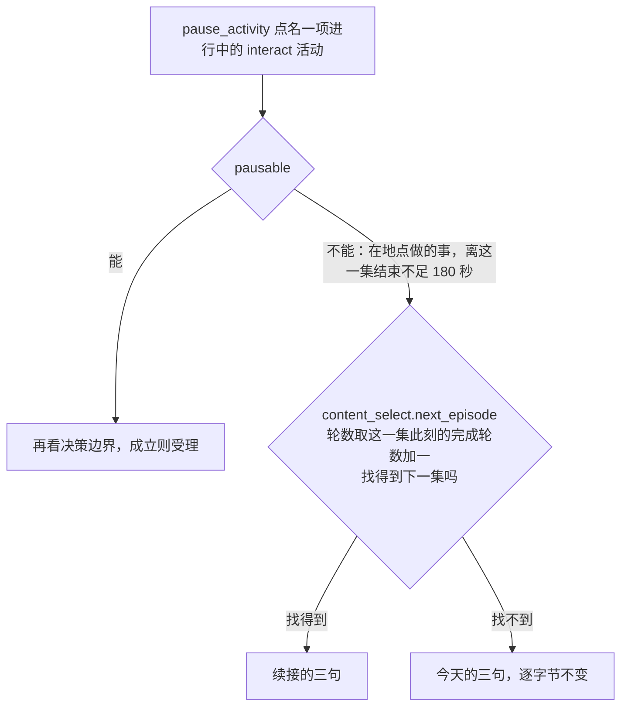
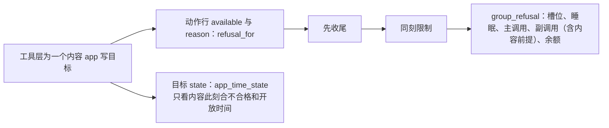

# 地点系列、暂停拒绝与关着的 app

> 本章属于[手机优先的空闲时间与空闲时的死路：开发规格](../SPEC-free-time-dead-ends.md)，读法和叫法见那一页。

## 目标与依据

人物在家做「做晚饭」这类在地点做的系列时，读不到自己正在做第几集、哪一集供一餐；离一集结束不足三分钟想暂停时，读到的拒绝说这件事快做完了，其实做完这一集还会接下一集；打开一个此刻关着的内容 app 时，只读到 `it is not available today`，不知道哪天开，而这句话还常被槽位或先收尾的原因盖住。提案把这三处都算作空闲时的死路。

| 人物今天遇到的 | 原因（基线提交 `2ecd868d`） |
| --- | --- |
| 凭状态的系列（`consumes_state`）做着时，它自己的单元行不在工具层 | 观察给每个单元写 `locked`（`src/worldmock/life/observe.py:75`、`src/worldmock/life/location_activities.py:60-64`），开始时这个状态减 1（`src/worldmock/life/interact.py:85-108`），工具层跳过 `locked` 的行（`src/worldmock/life/tool_layer.py:134`） |
| 活动目标行只写「已做…，还剩…」 | `state` 就是 `activity_control.objective_progress`（`tool_layer.py:190-197`、`src/worldmock/life/activity_control.py:138-147`）；「已做」是整项活动的累计，「还剩」只到这一集的计划结束，因为接下一集时计划时长改成已做加这一集的余量（`interact.py:181-185`） |
| 不知道哪一集供一餐 | 第几集与供餐只写在单元行的 `note` 里（`location_activities.py:97-111`，第几集在 `:106`，供餐在 `:109`，`_food_notes` 在 `:114-126`） |
| 提案记下的后果 | 9 月 29 日在《备菜做饭》结束前 14 秒结束了整件事，10 月 2 日在《吃晚饭》做完前 5 秒结束，两顿饭都没吃到 |
| 暂停拒绝说 `The activity … ends in under three minutes and cannot be paused.`，下一步 `… or let it finish.` | 计划结束取正在做的这一集（`activity_control.py:94-101`）；拒绝文字只有一种（`activity_control.py:312-324`，三句在 `:318-320`），不看这一集之后会不会接下一集。接不接由 `interact._complete_content` 按集号与轮数决定（`interact.py:161-186`，挑下一集在 `:166-175`；传入的轮数是这一集做完之后的完成轮数，`interact.py:118`、`:124`、`:133`） |
| 关着的 app 只说 `it is not available today` | 分句只看当天的时段（`src/worldmock/life/content_prerequisite.py:67-83`，两种「今天没有时段」在 `:81-82`）；`OpeningHours.opening_intervals` 早就能求任一天的时段，特殊日期整日替换（`src/worldmock/catalog/models.py:101-106`） |
| 这句话常被别的原因盖住（提案统计工作日 52% 的观察） | 工具层一行只有一个 `reason`：先查待收尾（`tool_layer.py:86-89`），再查同刻限制（`:91-94`），再走整组准入 `group_refusal`，次序是槽位、睡眠、主调用、副调用、余额（`src/worldmock/life/admission.py:85-96`），内容前提在副调用里（`admission.py:240-245`）。槽位 2 被占或要先收尾时，前提的原因不会出现 |
| app 目标行没有开放时间 | `_binding_target` 只给地点行写 `state`（「全天营业」、当天时段或「今日休息」，`tool_layer.py:127-132`），app 行恒为 `null`；Schema 本来就允许每个目标的 `state` 为可空文字（`src/worldmock/life/prompt_schemas.py:80-82`） |

本章落实的提案内容：「Changes」图里的「Location series row shows its episode」与「Closed content app says when it opens」；「Meals and waiting」一节里进行中系列的 `state` 前缀与暂停拒绝的改写；「Contacts and social need」一节的两项引擎改动（分句里的下次开放、内容 app 行的时间 `state`）；验收表的「Location series row」「Closed content app」两行，以及「Auto-play text」一行里暂停拒绝的那一半。所有者 2026-10-15 对「Pausing a feed」的答复是一次 app 使用任何时候都能暂停（`pausable` 的改动归[内容 app 自动接续](01-autoplay.md)一章），一次 app 使用因此走不到本章改写的拒绝，本章不为它写分支。

系统层「解饿只有两种办法」一条改成「系列的 note 或进行中活动的 state 写的是第几集供一餐」，依赖本章的前缀；句子本身归[系统层措辞](03-system-layer.md)一章。

## 行为规格

### 进行中的地点系列写明第几集

新增公开函数 `location_activities.running_series_note(catalog: Catalog, activity: ActivityState) -> str | None`：

- 同时满足下面四条时不为 `null`：`kind` 是 `interact`；状态是 `active`；活动私有数据 `app_id` 为 `null`（在地点做的事，不是一次 app 使用）；当前内容（`data.content_id`）是系列的一集。凭不凭状态都一样。
- 值是「第 N 集，共 M 集」；系列有集写了 `completion_effects.food` 时，后面接 `_food_notes` 写出的供餐说法；各段以「；」相连。N 是当前这一集的集号，M 是 `catalog.contents_by_series[系列名]` 的集数；供餐说法与单元行 `note` 是同一个函数，所以「第 K 集供一餐」的 K 不随做到第几集而变。
- 工具层 `_activity_target` 的 `state` 写成「<这段说法>；<objective_progress>」；说法为 `null` 时 `state` 照旧就是 `objective_progress`。
- `objective_progress` 本身对在地点做的事不改：待办层暂停活动的 `progress`（`src/worldmock/life/todo_layer.py:48`）和回看任务的客观进度（`src/worldmock/life/session_actions.py:334`）都不带这段说法。
- 凭状态的单元做着时，它自己的单元行照旧不列出（凭状态锁不变）；单元行的 `note`（`unit_facts`）输出不变，其中 `notes.extend(_food_notes(contents))` 这一行逐字节不变。

算例：`meal_environment`（`tests/life/environment_inputs.py:66-85`）的「做晚饭」三集是《备菜做饭》1800 秒、《吃晚饭》1500 秒（供一餐）、《洗碗收拾厨房》900 秒，不凭状态。样例环境从 2026 年 1 月 5 日（周一）08:00 开始，人在家；重估间隔改成 300 秒，08:00:00 点名「做晚饭」，活动名「进行做晚饭（1月5日 08:00 起）」。

| 时刻 | 正在做 | 活动目标行的 `state` | 家下「做晚饭」一行（本章不改） |
| --- | --- | --- | --- |
| 08:05:00 | 《备菜做饭》 | 「第 1 集，共 3 集；第 2 集供一餐；已做约 5 分钟，还剩约 25 分钟」 | 不可用，`note`「第 1 集，共 3 集；上次没做完，接着做；第 2 集供一餐」 |
| 08:35:00 | 《吃晚饭》 | 「第 2 集，共 3 集；第 2 集供一餐；已做约 35 分钟，还剩约 20 分钟」 | 不可用，`reason` `The first activity slot is occupied by 进行做晚饭（1月5日 08:00 起）.`，`duration`「约 20 分钟」，`note`「第 2 集，共 3 集；上次没做完，接着做；第 2 集供一餐」 |
| 09:00:00 | 《洗碗收拾厨房》 | 「第 3 集，共 3 集；第 2 集供一餐；已做约 1 小时，还剩约 10 分钟」 | 不可用，`note`「第 3 集，共 3 集；上次没做完，接着做；第 2 集供一餐」 |
| 09:10:00 | 三集做完，待收尾 | 「已做约 1 小时」（不是进行中，没有这段说法），`phase`「刚结束」 | 不可用，`reason` `Conclude the finished activities 进行做晚饭（1月5日 08:00 起） first.` |

今天这四个时刻的 `state` 依次是「已做约 5 分钟，还剩约 25 分钟」「已做约 35 分钟，还剩约 20 分钟」「已做约 1 小时，还剩约 10 分钟」「已做约 1 小时」（写规格时在基线提交上实测）。

凭状态的同一个系列（`tests/integration/life/test_grocery_cooking.py` 的 `_consumed_dinner`：三集同上，都凭 `groceries`，初值 1）：08:05:00 和 08:35:00 家下只有「测试休息」「测试闲聊」两行，没有「做晚饭」（也没有同样凭 `groceries` 的「做饭」，状态已减到 0）；活动目标行的 `state` 与上表同一时刻的那一格逐字相同。人物从这一行读到正在做第几集、哪一集供一餐。

各种活动的 `state`：

| 活动 | `state` |
| --- | --- |
| 进行中的在地点做的系列，有集供餐 | 「第 N 集，共 M 集；第 K 集供一餐；已做…，还剩…」（有集供一份零食时同样接在后面，次序照单元行） |
| 进行中的在地点做的系列，没有集供餐 | 「第 N 集，共 M 集；已做…，还剩…」，例如去掉《吃晚饭》供餐的副本 08:05:00 是「第 1 集，共 3 集；已做约 5 分钟，还剩约 25 分钟」 |
| 进行中的独立的在地点做的事，供餐的也一样 | 「已做…，还剩…」，例如 `meal_environment` 里供一餐的「测试休息」08:05:00 是「已做约 5 分钟，还剩约 10 分钟」 |
| 一次 app 使用，正在放系列的一集也一样 | `objective_progress` 原样（它对 app 使用的写法归[自动接续的显示与记录](02-autoplay-display.md)一章） |
| 刚结束待收尾的在地点做的系列 | `objective_progress` 原样，只有「已做…」 |
| 暂停的在地点做的系列 | 不在工具层；待办层 `progress` 是 `objective_progress` 原样，例如 08:05 暂停时「已做约 5 分钟，还剩约 25 分钟」 |
| 出行、睡眠、购买、查询 | 不变 |

### 还会接下一集的活动的暂停拒绝

能否暂停仍由 `activity_control.pausable` 一处判定（改动归[内容 app 自动接续](01-autoplay.md)一章）：进行中、`interact`，并且是一次 app 使用或离计划结束不少于 180 秒。所以走到 `_unpausable_refusal` 的 `interact` 分支的，只有离这一集计划结束不足 180 秒的在地点做的事。

判定：取当前内容 `catalog.contents[data.content_id]`，它此刻的完成轮数（`agent.content_progress` 里没有记录按 0 算）加一作为轮数，调用 `content_select.next_episode(catalog, agent, content, rounds)`；结果不为 `None` 就是「会接下一集」。`next_episode` 由准备步骤从 `interact._complete_content` 原样抽出（见[实施顺序与验收](09-implementation.md)一章），系列接续本身也调用它，传的是这一集做完之后的完成轮数，也就是同一个数；两者之间同一单元的其余各集不会被别的活动推进（这件事占着槽位 1，系列各集都只绑定在地点上），所以拒绝说的和之后真实发生的不会不一致。独立内容、系列最后一集、后面各集轮数都不低于这个数的系列，都是找不到。

| 字段 | 会接下一集 | 不再接续（今天的三句，逐字节不变） |
| --- | --- | --- |
| `error_code` | `ACTIVITY_PAUSE_UNAVAILABLE` | `ACTIVITY_PAUSE_UNAVAILABLE` |
| `reason` | `<活动名> cannot be paused while its current episode ends in under three minutes; it then continues with the next episode.` | `The activity <活动名> ends in under three minutes and cannot be paused.` |
| `next_step` | `Conclude <活动名>, or keep it running.` | `Conclude <活动名> or let it finish.` |
| `fix` | `Conclude this activity or keep it running instead.` | `Conclude this activity or let it finish instead.` |

`<活动名>` 是本轮可见的活动名（`context.activity_names`，没有时取活动自己的名称），与今天相同。判定只写一处，在 `_unpausable_refusal` 里：工具层活动目标行的 `pause_activity` 一行经 `tool_layer.refusal_for` → `activity_control.control_refusal`（`tool_layer.py:95-96`），提交经 `session_actions._pause_activity` → `control_refusal`（`session_actions.py:141`）；两处的准入上下文都带环境输入（`tool_layer.py:72-75`、`session_actions.py:415-417`），所以行上的 `reason` 与提交后的拒绝一字不差。拒绝的其余处理与今天相同：世界不变、不写暂停事件、`conclude_activity` 照样可用、人物同一刻再决策。

不写一次 app 使用的分支：并入自动接续之后它走不到这里，写了就是覆盖率门报出的死代码。地点与 app 轨道还没并入自动接续的那段时间里，离一条内容结束不足 180 秒的 app 使用仍会走到这里，它照样按 `next_episode` 判定（app 里系列的一集确实会接下一集，这时续接的说法成立），不需要另写。

算例（`meal_environment`，08:00:00 点名「做晚饭」，活动名「进行做晚饭（1月5日 08:00 起）」）：

| 时刻 | 正在做 | 离这一集结束 | 活动目标行 `state` | `pause_activity` 一行与提交后的拒绝 |
| --- | --- | --- | --- | --- |
| 08:27:01 | 《备菜做饭》（第一集） | 179 秒 | 「第 1 集，共 3 集；第 2 集供一餐；已做约 27 分钟，还剩约 3 分钟」 | `reason` `进行做晚饭（1月5日 08:00 起） cannot be paused while its current episode ends in under three minutes; it then continues with the next episode.`，`next_step` `Conclude 进行做晚饭（1月5日 08:00 起）, or keep it running.`，`fix` `Conclude this activity or keep it running instead.`；不收尾的话 08:30:00 接上《吃晚饭》，活动仍是进行中 |
| 09:07:01 | 《洗碗收拾厨房》（最后一集） | 179 秒 | 「第 3 集，共 3 集；第 2 集供一餐；已做约 1 小时，还剩约 3 分钟」 | `reason` `The activity 进行做晚饭（1月5日 08:00 起） ends in under three minutes and cannot be paused.`，`next_step` `Conclude 进行做晚饭（1月5日 08:00 起） or let it finish.`，`fix` `Conclude this activity or let it finish instead.`；09:10:00 做完，待收尾 |

今天在 08:27:01 读到的是「不再接续」那一列的三句，说这件事快做完了。第二轮也一样：三集各做完一轮（轮数都是 1）之后再点名，第一集做到离结束不足 180 秒时，它此刻的轮数是 1，按 2 去找，第二集轮数 1 小于 2，仍是续接的三句。

### 分句里的下次开放

新增公开函数 `content_prerequisite.time_phrase(opens: OpeningHours, local_date: date) -> str`，是时间部分唯一的写法：

| 情形 | 时间短语 |
| --- | --- |
| `local_date` 当天有时段 | `available <时段> today` |
| 当天没有；之后的七个本地日期（明天到第七天，第七天与今天同一个星期几）里有 | `not available today (next available <Day> <MM-DD> <时段>)`，取最早有时段的一天 |
| 当天和之后七天都没有 | `not available today or in the next seven days` |

- 每一天的时段都用 `opens.opening_intervals(day)` 求，特殊日期整日替换（可以为空）照旧生效；`<时段>` 是那一天的 `", ".join(interval_phrases(...))`，`interval_phrases` 是现有的唯一写法（`src/worldmock/life/readable.py:69-74`）。
- `<Day>` 取常量元组 `Mon` 至 `Sun`，按 `date.weekday()` 取，不读区域设置；`<MM-DD>` 是补零的月和日，不写年。
- 下次开放写在括号里，不用提案写的分号：分句之间以 `; or ` 相连，分号会让一个分句读成两个。七天里都没有时写 `not available today or in the next seven days`，比提案的 `not available in the next seven days` 多说了今天。

`_clause` 的分句（`<地点>` 的写法、`; or ` 连接、去重、`here `、`next_step`、`unmet`、`items` 都不变）：

| 这条内容差什么 | 分句 | 相对今天 |
| --- | --- | --- |
| 只差地点 | `it requires presence at <地点>` | 不变 |
| 只差时间 | `it is <时间短语>` | 当天有时段时与今天逐字相同；当天没有时段时多出下次开放 |
| 两项都差，当天有时段 | `it requires presence at <地点> during <时段> today` | 不变 |
| 两项都差，当天没有时段 | `it requires presence at <地点> and is <时间短语>` | 多出下次开放 |

当天有时段而这些时段都已过去（例如周一 21:00）仍写 `available <时段> today`，与今天相同，见「明确不做」。

### 关着的 app 在目标行写开放时间

新增公开函数 `content_prerequisite.app_time_state(catalog: Catalog, app_id: str, stay: Location | None, local_moment: datetime) -> str | None`，工具层内容 app 目标的 `state` 就是它：

- 这个 app 没有登记内容时为 `null`；
- 至少一条内容此刻合格时为 `null`；
- 内容全都不合格时，取写了 `opens` 的每条内容（按 `content_id` 升序）的 `time_phrase(opens, local_moment.date())`，文字相同的只留第一次出现的，以 `; or ` 相连；没有一条写了 `opens` 时为 `null`。

「全都不合格」与原因用同一个判定：`prerequisite_unmet` 逐条判，全都不合格的那批内容由一个私有函数同时交给 `app_prerequisite_refusal` 和 `app_time_state`。工具层传入的停留地点与本地时刻和副调用准入 `_app_refusal`、`_app_facts` 相同：停留地点取 `admission.present_location`（人在路上时没有），本地时刻是世界当前时刻按运行时区换算的结果。

`state` 写的是写了 `opens` 的内容的开放时间，不只写此刻差时间的内容：周一 08:10 人在家，打卡只差地点，原因叫她去办公室，`state` 写今天的时段 `available 08:00–10:00, 17:00–20:00 today`，她由此知道 10:00 前赶到才打得上卡。地点行也是这样，不论此刻开没开都写今天的营业时段。地点行的中文 `state`（「全天营业」、时段、「今日休息」）不变；app 行写英文，因为它与原因里的分句用同一个函数。

算例：`tests/life/prerequisite_inputs.py` 的钉钉副本，只有打卡一条（`CLOCK`：只在办公室「练秋湖研发中心」、周一至周五 08:00–10:00 与 17:00–20:00 能开始）。2026 年 10 月 12 日是周一，17 日是周六。

| 时刻与地点 | 钉钉一行的 `reason`（与提交后的拒绝一字不差） | 钉钉目标的 `state` |
| --- | --- | --- |
| 周一 08:55 办公室 | 可用，`null` | `null` |
| 周一 08:10 家 | `Nothing in 钉钉 can start here now: it requires presence at 练秋湖研发中心.`（不变） | `available 08:00–10:00, 17:00–20:00 today` |
| 周一 10:00 办公室 | `Nothing in 钉钉 can start now: it is available 08:00–10:00, 17:00–20:00 today.`（不变） | `available 08:00–10:00, 17:00–20:00 today` |
| 周一 12:30 办公室 | 同上一行（不变） | `available 08:00–10:00, 17:00–20:00 today` |
| 周一 12:30 家 | `Nothing in 钉钉 can start here now: it requires presence at 练秋湖研发中心 during 08:00–10:00, 17:00–20:00 today.`（不变） | `available 08:00–10:00, 17:00–20:00 today` |
| 周六 09:00 办公室 | `Nothing in 钉钉 can start now: it is not available today (next available Mon 10-19 08:00–10:00, 17:00–20:00).` | `not available today (next available Mon 10-19 08:00–10:00, 17:00–20:00)` |
| 周六 09:00 家 | `Nothing in 钉钉 can start here now: it requires presence at 练秋湖研发中心 and is not available today (next available Mon 10-19 08:00–10:00, 17:00–20:00).` | `not available today (next available Mon 10-19 08:00–10:00, 17:00–20:00)` |

今天周六两行的原因以 `it is not available today.` 和 `… and is not available today.` 结尾，七行的 `state` 全是 `null`。周一 12:30 人在路上时原因与「周一 12:30 家」相同，`state` 也相同。

再加上 `tests/unit/life/test_error_contract.py` 的午间打卡（`dingtalk-lunch`，不限地点，周一至周五 12:00–13:00）：

| 时刻与地点 | `reason` | `state` |
| --- | --- | --- |
| 周一 08:10 家 | `Nothing in 钉钉 can start here now: it requires presence at 练秋湖研发中心; or it is available 12:00–13:00 today.`（不变） | `available 08:00–10:00, 17:00–20:00 today; or available 12:00–13:00 today` |
| 周一 12:30 在路上 | 可用（午间打卡合格） | `null` |
| 周六 09:00 办公室 | `Nothing in 钉钉 can start now: it is not available today (next available Mon 10-19 08:00–10:00, 17:00–20:00); or it is not available today (next available Mon 10-19 12:00–13:00).` | `not available today (next available Mon 10-19 08:00–10:00, 17:00–20:00); or not available today (next available Mon 10-19 12:00–13:00)` |
| 周六 09:00 家 | `Nothing in 钉钉 can start here now: it requires presence at 练秋湖研发中心 and is not available today (next available Mon 10-19 08:00–10:00, 17:00–20:00); or it is not available today (next available Mon 10-19 12:00–13:00).`，`next_step` `Go to 练秋湖研发中心.` | 同上一行 |

周六办公室这一行今天是 `Nothing in 钉钉 can start now: it is not available today.`：两个分句文字相同，去重后只剩一个。改后两句写的下次开放不同，都留下；去重规则本身不变。

带特殊日期的两个副本（打卡的每周时段与地点不变，只加 `exceptions`，各日写 `[]`）：

| 副本 | 时刻与地点 | `reason` | `state` |
| --- | --- | --- | --- |
| 10 月 19 日至 23 日全天不开 | 周六 17 日 09:00 办公室 | `Nothing in 钉钉 can start now: it is not available today or in the next seven days.` | `not available today or in the next seven days` |
| 同上 | 周六 17 日 09:00 家 | `Nothing in 钉钉 can start here now: it requires presence at 练秋湖研发中心 and is not available today or in the next seven days.` | `not available today or in the next seven days` |
| 10 月 12 日至 16 日全天不开 | 周一 12 日 12:30 办公室 | `Nothing in 钉钉 can start now: it is not available today (next available Mon 10-19 08:00–10:00, 17:00–20:00).`（下次开放恰在第七天） | `not available today (next available Mon 10-19 08:00–10:00, 17:00–20:00)` |

前一个副本从 17 日往后七天是 18 日到 24 日：18 日周日、24 日周六没有每周时段，19 日到 23 日被特殊日期关掉。后一个副本里 19 日是第七天，只往后找六天就会错写成七天里都不开。

`time_phrase` 的其余写法（写规格时按上面的规则逐条算过）：每周时段同打卡、10 月 12 日特殊日期写 `[]` 时，12 日写 `not available today (next available Tue 10-13 08:00–10:00, 17:00–20:00)`；18 日特殊日期写 `[["09:00", "18:00"]]` 时，17 日（周六）写 `not available today (next available Sun 10-18 09:00–18:00)`；只在周六、周日 `00:00–24:00` 开放的内容在 14 日（周三）写 `not available today (next available Sat 10-17 00:00–24:00)`；打卡在 2026 年 1 月 3 日（周六）写 `not available today (next available Mon 01-05 08:00–10:00, 17:00–20:00)`；每周表为空、只有 10 月 30 日特殊日期 `[["08:00", "09:00"]]` 的内容在 23 日写 `not available today (next available Fri 10-30 08:00–09:00)`，在 22 日写 `not available today or in the next seven days`。

### 为什么不改准入次序

提案的验收要求「槽位的原因不再盖住开放时间」。本章不改 `refusal_for` 和 `group_refusal` 的次序：一行的 `reason` 必须与提交后的拒绝一字不差，而提交走的是同一个整组准入（`src/worldmock/life/start_group.py:125-126`），次序由设计文档《模拟引擎》定下（槽位占用先于对象条件，`admission.py:85-96`）；把前提提前会同时改掉所有提交的拒绝，也违背「报第一条不成立的条件」的规则。开放时间改为写在目标的 `state` 上：它在 `_binding_target` 里单独算，不经 `refusal_for`，不看槽位、待收尾和同刻限制，所以原因被别的消息占着时它照样在。

算例：钉钉副本，周六 10 月 17 日 09:00 人在办公室，重估间隔 300 秒，09:00 打开 Keep（唯一一条「测试慢跑」1200 秒，不可推送，放完不接别的）。

| 时刻 | 情形 | 钉钉一行的 `reason` | 钉钉目标的 `state` |
| --- | --- | --- | --- |
| 09:00 | 空闲 | `Nothing in 钉钉 can start now: it is not available today (next available Mon 10-19 08:00–10:00, 17:00–20:00).` | `not available today (next available Mon 10-19 08:00–10:00, 17:00–20:00)` |
| 09:05 | Keep 在放（占着槽位 2） | `The second activity slot is occupied by 进行Keep（10月17日 09:00 起）.` | 同上 |
| 09:20 | Keep 放完，待收尾 | `Conclude the finished activities 进行Keep（10月17日 09:00 起） first.` | 同上 |

后两行的原因写规格时在基线提交上实测；今天三行的 `state` 都是 `null`，后两行人物读不到钉钉为什么开不了。目标行的分组渲染只把各目标逐值相同的字段放进 `shared`（`src/worldmock/life/tool_groups.py:24-43`），每个 app 各自的 `state` 不需要改渲染。

### 明确不做

- 不改 `refusal_for`、`group_refusal` 的次序和任何非前提的拒绝文字。
- 当天有时段而时段已过去时不改写法：周一 21:00 仍写 `available 08:00–10:00, 17:00–20:00 today`，不写下次开放。
- 内容 app 里只要有一条内容合格，`state` 就是 `null`：一个 app 里既有关着的限时内容、也有随时能放的内容时，关着的那条不在这一行露出。按对话列出的行属于模拟对话的提案。
- 下次开放不看运行的截止时刻，也不看人设的上班安排；只读内容自己的 `opens`。
- 不改 `next_step`：周六人在家时打卡和午间打卡都关着，下一步照旧是 `Go to 练秋湖研发中心.`。
- 地点行不加下次开放：「今日休息」和 `LOCATION_CLOSED` 的原因都不变。
- 不改 `prerequisite_unmet`、`eligible_contents`、`OpeningHours` 的求值。
- 不给暂停或待收尾的系列、独立的在地点做的事、一次 app 使用、待办层、回看任务加系列这段说法；不改 `objective_progress`，「已做」仍是整项活动的累计。
- 不改单元行的 `note` 和凭状态锁，不让做着的凭状态单元重新列出。
- 不改在地点做的事的 180 秒下限，不改哪些活动能暂停，不写一次 app 使用的暂停分支。

### 本章定下的细节

| 事项 | 定下的做法 | 理由 |
| --- | --- | --- |
| 说法里的 N 与 M | N 取当前内容的集号，M 取 `catalog.contents_by_series[系列名]` 的长度，供餐取同一批内容的 `_food_notes` | 与单元行 `unit_facts` 同一写法；同一系列各集的绑定、前提与凭的状态相同（`src/worldmock/catalog/admission.py:229-244`），按集号排好的这个索引（`src/worldmock/catalog/loader.py:219-223`）就是这个单元 |
| `running_series_note` 的判定次序 | 先看 `kind`、状态、`app_id`，最后才读 `data.content_id` | 出行、睡眠、购买、查询的活动也会走到 `_activity_target`，它们的私有数据没有 `content_id` |
| 「第 N 集，共 M 集」一处写出 | 抽出私有函数 `_episode_note(content, count)`，`unit_facts` 与 `running_series_note` 共用 | 每条规则只维护一处；`unit_facts` 里供餐那一行不动 |
| 说法与客观进度之间用「；」 | `state` = 说法 +「；」+ 客观进度 | 说法内部各段用「；」、客观进度内部用「，」，这样两层都读得清 |
| 续接判定的位置 | 私有函数 `activity_control._continues_with_next_episode(context, activity) -> bool`，只由 `_unpausable_refusal` 在 `interact` 分支里调用；读 `context.inputs.catalog` 与 `context.state.agents[activity.agent_id]` | 工具层与提交都经 `control_refusal`，两处的准入上下文都带环境输入，判定只写一处 |
| 续接的分支排在今天那一支之前 | `interact` 且续接时返回续接的三句，否则落到今天的 `interact` 分支 | 今天那一支一个字不改 |
| 下次开放的常量 | 公开常量 `NEXT_OPENING_DAYS = 7`；私有常量 `_DAY_ABBREVIATIONS = ("Mon", "Tue", "Wed", "Thu", "Fri", "Sat", "Sun")`；`<MM-DD>` 写作 `f"{day:%m-%d}"` | `%a` 随区域设置变，会破坏可复现；`%m`、`%d` 是补零数字，与区域设置无关 |
| 一天的时段一处写出 | 私有函数 `_hours(opens, day)`，即 `", ".join(interval_phrases(opens.opening_intervals(day)))`，`time_phrase` 与 `_clause` 共用 | 今天 `_clause` 内联这一句（`content_prerequisite.py:79`），拆开后两处写不出不同的时段 |
| 「全都不合格」一处判定 | 私有函数 `_unmet_contents(catalog, app_id, stay, local_moment)`：这个 app 的内容按身份升序，每条配上不满足的成员；全都不合格时返回这些行，否则（含没有登记内容）返回空列表 | `reason` 与 `state` 必须对同一刻、同一批内容下结论；`app_prerequisite_refusal` 里今天的取数与判定（`content_prerequisite.py:47-50`）搬进去 |
| 「写了 `opens`」的判定 | `prerequisite` 不为空且 `prerequisite.opens` 不为空 | 不带前提、只带地点前提的内容没有开放时间可写 |
| `state` 的去重 | 文字相同的只留第一次出现的，次序是内容身份升序 | 与原因里分句的去重同一规则 |
| 工具层的本地时刻 | `_binding_target` 开头算一次，地点行和 app 行共用；只对 `kind` 为 `app` 的行调用 `app_time_state` | 观察里 app 行只列登记了内容的内容 app（`src/worldmock/life/observe.py:83-86`），商品行照旧 `null` |
| 用例怎样落到离最后一集结束 179 秒 | 重估间隔 421 秒，`reach` 到 09:07:01，断言落点、剩余 179 秒、当前内容是 `dinner-3-wash` | 重估间隔从上一次决策算起；样例人设 09:00 上班，09:00 有一次上下班边界唤醒（同一刻还有整点推送），再过 421 秒恰是 09:07:01。写规格时在基线提交上实测，决策依次落在 08:00:00、08:07:01、…、08:56:08、09:00:00、09:07:01；唤醒表一变，落点断言会先失败 |
| 用例怎样落到离第一集结束 179 秒 | 重估间隔 1621 秒，开始后的第一次决策就在 08:27:01 | 08:30 的进度播报与 09:00 的唤醒都在它之后；写规格时实测落得到 |
| 凭状态系列的用例 | 新文件从 `tests/integration/life/test_grocery_cooking.py` 导入 `grocery_engine`、`home_units` 与 `_consumed_dinner` | 新用例放新文件，不复制、不搬动那个文件里的变体；测试模块之间导入助手已有先例（例如 `tests/integration/life/test_result_contents.py:8`） |

## 接口与文件指引

本章的代码与测试归**地点与 app 轨道**，在准备步骤的提交之上开发；准备步骤已把 `content_select.next_episode` 抽出来（见[实施顺序与验收](09-implementation.md)一章），本章只调用它。

| 文件 | 改什么 |
| --- | --- |
| `src/worldmock/life/location_activities.py` | 新增公开函数 `running_series_note(catalog, activity) -> str \| None` 与私有函数 `_episode_note(content, count) -> str`；`unit_facts` 第几集那一句改为调用 `_episode_note`；从 `worldmock.life.models` 多导入 `ActivityState`；模块说明补一句活动目标行的说法 |
| `src/worldmock/life/tool_layer.py` | `_activity_target`：`state` 按「<说法>；<客观进度>」写，说法为 `null` 时是客观进度；`_binding_target`：本地时刻在开头算一次，`kind` 为 `app` 的行 `state = app_time_state(...)`，停留地点取 `admission.present_location`；导入 `app_time_state` 与 `running_series_note`；两个函数的说明同步 |
| `src/worldmock/life/content_prerequisite.py` | 新增常量 `NEXT_OPENING_DAYS`、`_DAY_ABBREVIATIONS`，公开函数 `time_phrase`、`app_time_state`，私有函数 `_hours`、`_unmet_contents`；`_clause` 用 `time_phrase` 与 `_hours`；`app_prerequisite_refusal` 用 `_unmet_contents`；从 `datetime` 多导入 `timedelta`，从 `worldmock.catalog.models` 多导入 `OpeningHours`；模块说明与 `_clause` 的说明补上时间短语与目标行 `state` |
| `src/worldmock/life/activity_control.py` | `_unpausable_refusal` 在今天的 `interact` 分支之前加续接的分支；新增私有函数 `_continues_with_next_episode`；从 `worldmock.life.content_select` 导入 `next_episode`；`_unpausable_refusal` 的说明写明两种文字。`pausable`、`PAUSE_MIN_REMAINING_SECONDS` 的注释、`control_refusal` 与 `_pause_refusal` 的说明归[内容 app 自动接续](01-autoplay.md)一章 |

测试一侧另登记两处：`tests/unit/engineering/test_single_source.py` 的 `OWNERS` 里 `life/location_activities.py` 加 `running_series_note`，`life/content_prerequisite.py` 加 `time_phrase`、`app_time_state`；`tests/dataset_acceptance.py` 里地点与 app 轨道自己的一段登记下文的四条源码变异。

**直接删除，不留兼容。** `_clause` 里 `"it is not available today"` 与 `" and is not available today"` 两种写法（由 `time_phrase` 取代，不留退回旧短句的分支）；`_clause` 里内联的时段拼接；`unit_facts` 里内联的第几集写法；`app_prerequisite_refusal` 里内联的取数与「全都不合格」判定。旧运行按代码指纹被拒，不迁移。

**夹具。** 样例环境（`tests/fixtures/dataset-environment/`）不改，除[版本、身份与基线](08-versions.md)一章的版本提交外。用例要的环境都在副本上构造：`meal_environment`（现有）；去掉《吃晚饭》供餐的副本在新用例文件里用 `catalog_rows` 与 `write_catalog_rows` 删去那一行的 `completion_effects`；凭状态的系列用 `grocery_engine` 与 `_consumed_dinner`；钉钉的各个副本用 `tests/life/prerequisite_inputs.py` 的 `dingtalk_environment`、`app_content`、`CLOCK`、`CLOCK_PREREQUISITE`、`weekday_hours`、`example_window`、`moment`，带特殊日期的打卡行与只限地点的内容行在用例文件里用 `app_content` 写。样例环境没有内容前提，也没有在地点做的系列，所以本章不改变基线与录制样例里的任何提示文字；它们仍随代码指纹在收尾时重做一次（见[版本、身份与基线](08-versions.md)一章）。

**约束。**

- 每个函数不超过 50 行、5 个参数，每行不超过 120 字符，文件不超过 2000 行；每个函数（含私有的）有带中文的 `@brief` 说明；错误文字用英文。续接那一句 `reason` 写在一行会超过 120 字符，要拆成相邻的两段字符串。
- 新导入全部放在模块顶部，本章没有函数内导入，不动 `tests/unit/engineering/test_import_graph.py` 的 `DELAYED_IMPORTS`。新增的依赖边是 `activity_control → content_select` 与 `tool_layer → content_prerequisite`，基线上都不成环；之后 `content_select` 不得导入 `admission` 或 `activity_control`，否则成环（`admission` 导入 `activity_control`，`src/worldmock/life/admission.py:13`）。
- `tests/unit/engineering/test_single_source.py` 拒绝语法树相同的函数体和规则表：`_DAY_ABBREVIATIONS` 与 `catalog/models.py` 的 `WEEKDAYS`、[零点计划、上班安排与明天](04-day-plan.md)一章的 `work_schedule.WEEKDAY_NAMES` 取值不同，不算克隆。
- 这些源码变异锚点逐字节不变，各在自己的符号里恰出现一次：`location_activities::unit_facts` 的 `notes.extend(_food_notes(contents))`；`location_activities::held_refusal` 的 `held = set(action["content_ids"])`；`location_activities::unit_done` 的 `ids = (content_id,) if content.series is None else catalog.contents_by_series[content.series.title]`；`tool_layer::_binding_target` 的 `for action in row["actions"] if not action.get("locked")]`；`activity_control::finished_at` 的 `or (activity.kind == ActivityKind.QUERY`。`activity_control::pausable` 上的三个锚点归[内容 app 自动接续](01-autoplay.md)一章，本章不碰 `pausable`。
- 守这些锚点的杀手不改名：`tests/unit/start_interfaces/test_location_units.py::test_tool_layer_note_names_the_food_each_unit_provides`、`tests/unit/start_interfaces/test_location_units.py::test_unit_done_raises_every_content_behind_to_the_next_round`、`tests/integration/start_interfaces/test_location_activities.py::test_paused_unit_is_held_until_resumed_or_concluded`、`tests/integration/start_interfaces/test_location_activities.py::test_concluding_a_series_counts_the_whole_unit_and_the_next_start_is_episode_one`、`tests/unit/start_interfaces/test_grocery_units.py::test_a_locked_unit_is_left_out_of_the_tool_layer_but_kept_in_the_private_bindings`、`tests/integration/life/test_grocery_cooking.py::test_received_groceries_open_cooking_and_starting_it_uses_them`、`tests/integration/life/test_query_activity.py::test_finishing_query_wakes_the_person_beside_a_long_activity`。本章新用例导入 `test_grocery_cooking.py` 的助手，不改那个文件。
- 三个新公开函数受覆盖率门约束，函数体每一行都要被用例执行到，含 `running_series_note` 的两处提前返回和 `time_phrase` 的三个出口。
- 代码指纹改变；提示指纹不变（本章不改系统层、Schema 和工具说明）。

设计文档里的落点（《模拟引擎》的暂停拒绝表、前提分句表与时间短语，《人物》的活动目标行 `state` 与内容 app 表）见[设计文档与手册](07-design-docs.md)一章，本章不改设计文档。

## 测试要求

凡是引擎规则，用例都经真实请求、引擎与 SQLite：`engine_factory` 建引擎，`act` 提交，`reach`、`advance_until_ready`、`until_ended` 推进，`observe_only` 读观察。钉钉的用例照 `tests/integration/life/test_content_start_evidence.py` 的写法用 `stage_moment` 摆到给定本地时刻与地点。新用例都放新文件，不往别的轨道也会改的测试文件里加函数。

### 规则与用例

| 规则 | 层 | 测试 | 验收行为 |
| --- | --- | --- | --- |
| 进行中的在地点做的系列：`state` 是「第 N 集，共 M 集；<供餐说法>；<客观进度>」 | integration | `tests/integration/life/test_running_series_row.py::test_running_series_row_names_the_episode_and_the_meal_episode`（新） | `meal_environment`，重估间隔 300 秒，08:00 点名「做晚饭」；08:05、08:35、09:00 三次观察里活动目标行 `state` 逐字等于「进行中的地点系列写明第几集」一节算例表的三格，家下「做晚饭」一行的 `note` 同表；三次的工具层都通过 `validate_layer`，紧凑渲染能还原 |
| 同上（说法本身） | unit | `tests/unit/start_interfaces/test_running_series_note.py::test_running_location_series_names_its_episode_then_its_meal_episodes`（新，参数：三集各一，去掉供餐的副本的第一集） | 在 `meal_environment` 的目录上对手工的进行中活动（`app_id` 为 `null`）调用 `running_series_note`：依次是「第 1 集，共 3 集；第 2 集供一餐」「第 2 集，共 3 集；第 2 集供一餐」「第 3 集，共 3 集；第 2 集供一餐」；没有供餐的副本是「第 1 集，共 3 集」 |
| 只对进行中的在地点做的系列有说法 | unit | `tests/unit/start_interfaces/test_running_series_note.py::test_only_a_running_location_series_gets_a_note`（新） | 暂停的、已完成的系列活动，`app_id` 为 `bilibili`、当前内容是 `c-drama-1` 的活动，供一餐的独立内容 `c-rest`，没有 `content_id` 的出行活动：都返回 `None` |
| 没有集供餐的系列只写第几集；独立的在地点做的事（供餐的也算）和一次 app 使用不带说法 | integration | `tests/integration/life/test_running_series_row.py::test_only_a_running_location_series_gets_the_episode_prefix`（新，参数 `series-without-food`、`standalone-unit`、`app-use`） | 开始后 300 秒的观察：没有供餐的副本是「第 1 集，共 3 集；已做约 5 分钟，还剩约 25 分钟」；`meal_environment` 的「测试休息」是「已做约 5 分钟，还剩约 10 分钟」；打开 Keep 的那一行等于 `activity_control.objective_progress(活动)`，不含「集」 |
| 凭状态的系列做着时单元行仍不列出，活动目标行写第几集 | integration | `tests/integration/life/test_running_series_row.py::test_gated_series_row_stays_hidden_while_the_activity_row_names_the_episode`（新） | `grocery_engine(..., mutate=every_five_minutes, change=_consumed_dinner, initial=1)`；08:05 与 08:35 家下的单元只有「测试休息」「测试闲聊」，活动目标行 `state` 与 `meal_environment` 同一时刻的逐字相同 |
| 暂停的、待收尾的系列只有客观进度 | integration | `tests/integration/life/test_running_series_row.py::test_paused_or_finished_series_keeps_only_its_progress`（新） | 08:05 暂停「做晚饭」：它不在工具层的目标里，待办层 `progress` 是「已做约 5 分钟，还剩约 25 分钟」；同一刻恢复后推进到三集做完，待收尾的活动目标行 `state` 是「已做约 1 小时」、`phase` 是「刚结束」 |
| 单元行说明与凭状态锁不变 | unit、integration | `tests/unit/start_interfaces/test_location_units.py::test_tool_layer_note_names_the_food_each_unit_provides`、`tests/integration/start_interfaces/test_location_activities.py::test_tool_layer_notes_say_which_unit_or_episode_provides_a_meal`、`tests/unit/start_interfaces/test_grocery_units.py::test_a_locked_unit_is_left_out_of_the_tool_layer_but_kept_in_the_private_bindings`（现有，不改） | 照旧通过 |
| 会接下一集的在地点做的事离这一集结束不足 180 秒：续接的三句，工具层与提交一字不差，世界不变，之后真的接下一集 | integration | `tests/integration/life/test_series_pause_refusal.py::test_pause_179_seconds_before_a_non_last_episode_ends_says_the_series_continues`（新） | `meal_environment`，重估间隔 1621 秒；断言第一次决策落在 08:27:01、剩 179 秒；观察里 `pause_activity` 一行 `{"available": false, "reason": 续接的 reason}`、`conclude_activity` 与 `report_status` 可用、`state` 为算例那一格；提交 `pause_activity` 被拒，`error_code`、`message`、`reason`、`next_step`、`fix` 为续接的三句；活动快照不变、没有 `activity_paused` 事件、人物同一刻就绪；推进到 08:30:00，活动仍进行中、`content_id` 是 `dinner-2-eat` |
| 同上（判定本身） | unit | `tests/unit/life/test_series_pause_wording.py::test_a_location_series_with_a_next_episode_gets_the_continuing_refusal`（新，参数 `first-episode`、`middle-episode`、`second-round`） | 以 `meal_environment` 副本经 `load_environment` 读出的环境输入作准入上下文的 `inputs`，对离结束 179 秒的手工活动调用 `control_refusal(..., "pause_activity", ...)`：第一集（没有进度记录）、第二集（第一集轮数 1）、第二轮的第一集（三集轮数都是 1）都得到续接的三句 |
| 不再接续的活动三句不变 | integration | `tests/integration/life/test_series_pause_refusal.py::test_pause_179_seconds_before_the_last_episode_ends_keeps_the_ending_wording`（新）；`tests/integration/life/test_pause_limit.py::test_pause_with_179_seconds_left_is_refused_changes_nothing_and_conclude_succeeds`（现有，不改） | 前者：重估间隔 421 秒，`reach` 到 09:07:01，断言剩 179 秒、当前内容是 `dinner-3-wash`；行与提交后的拒绝都是今天的三句，`state` 为算例那一格。后者：独立的「测试休息」照旧 |
| 同上（判定本身） | unit | `tests/unit/life/test_series_pause_wording.py::test_an_activity_that_ends_keeps_the_ending_refusal`（新，参数 `last-episode`、`standalone-unit`） | 第三集（前两集轮数 1）、独立内容 `c-rest`：得到今天的三句 |
| 时间短语的三种写法、星期与补零、特殊日期 | unit | `tests/unit/life/test_next_opening.py::test_time_phrase_names_todays_hours_or_the_next_opening`（新，参数化） | 「分句里的下次开放」一节和算例里列出的每一种：今天有时段；周六到周一；周一被特殊日期关掉到周二；周日被特殊日期打开；只在周末全天开放；1 月 3 日写 `01-05`；七天里都不开 |
| 下次开放找到第七天为止，含第七天 | unit | `tests/unit/life/test_next_opening.py::test_next_opening_is_found_on_the_seventh_day_after_today`（新） | 10 月 12 日至 16 日关掉的打卡在 12 日写 `not available today (next available Mon 10-19 08:00–10:00, 17:00–20:00)`；每周表为空、只有 10 月 30 日特殊日期的内容在 23 日写 `not available today (next available Fri 10-30 08:00–09:00)`、在 22 日写 `not available today or in the next seven days` |
| 分句：只差时间、两项都差且今天没时段时带下次开放；其余形式不变；`; or ` 连接与去重 | unit | `tests/unit/life/test_next_opening.py::test_prerequisite_refusal_names_the_next_opening`（新，参数化）；`tests/unit/life/test_error_contract.py::test_prerequisite_refusal_states_the_place_and_todays_hours`（现有，改两个参数） | 对 `app_prerequisite_refusal` 断言 `reason`、`next_step`、`unmet`：周六办公室、周六家、打卡加午间打卡在周六办公室与家、七天里都不开的副本在办公室与家，都等于算例表；现有用例的 `location`、`time`、`both`、`two-kinds` 四个参数不变 |
| 同上，经真实引擎，行与拒绝一字不差 | integration | `tests/integration/life/test_content_start_evidence.py::test_clock_in_refusal_repeats_the_tool_layer_reason_and_changes_nothing`（现有，改两个参数）；`tests/integration/life/test_closed_app_state.py::test_row_and_refusal_name_an_opening_on_the_seventh_day_or_none_within_seven_days`（新，参数 `seventh-day`、`none-office`、`none-home`）；`tests/integration/life/test_closed_app_state.py::test_clock_and_lunch_rows_join_their_openings_with_or`（新，参数 `monday-home-0810`、`saturday-office`、`saturday-home`） | 第一条周六两行改成带下次开放的原因，其余断言不变；第二条用两个带特殊日期的副本，第三条用打卡加午间打卡的副本：工具层钉钉一行的 `reason`、提交后拒绝的 `reason` 与 `next_step`、目标 `state` 都等于算例表，拒绝不改世界 |
| app 目标行 `state`：内容全都不合格时写各条写了 `opens` 的时间短语，去重，以 `; or ` 相连 | unit | `tests/unit/life/test_next_opening.py::test_app_time_state_names_the_opening_of_every_time_gated_content`（新，参数化） | 周一 08:10 家、10:00 办公室、12:30 办公室、12:30 家、12:30 在路上、周六办公室与家；打卡加午间打卡在周一 08:10 家与周六办公室；七天里都不开的副本：都等于算例。另有打卡加两集前提相同（周一至周五 12:00–13:00）的系列在周六办公室：同一句只出现一次，`state` 是 `not available today (next available Mon 10-19 08:00–10:00, 17:00–20:00); or not available today (next available Mon 10-19 12:00–13:00)` |
| 同上，经真实引擎 | integration | `tests/integration/life/test_closed_app_state.py::test_clock_in_app_state_names_todays_hours_or_the_next_opening`（新，参数为 `CLOCK_REFUSALS` 的六个时刻加 `office-0855`） | 钉钉目标的 `state` 等于算例表；`office-0855` 时钉钉可用、`state` 为 `null`；其余 app 目标（哔哩哔哩、抖音、Keep）`state` 为 `null`；工具层通过 `validate_layer`，紧凑渲染能还原 |
| `state` 为 `null`：至少一条合格、没有登记内容 | unit | `tests/unit/life/test_next_opening.py::test_app_time_state_is_null_while_some_content_can_start`（新；第一种情形排在最前） | 只有打卡时周一 08:55 在办公室；打卡加午间打卡时周一 12:30 在路上；哔哩哔哩（内容都没有前提）；美团（没有登记内容）：都是 `None` |
| `state` 为 `null`：没有内容写 `opens` | unit、integration | `tests/unit/life/test_next_opening.py::test_app_time_state_is_null_when_no_content_declares_opens`（新）；`tests/integration/life/test_closed_app_state.py::test_state_stays_empty_when_no_content_declares_opening_hours`（新） | 钉钉只有一条只限办公室、不限时段的内容（`app_content("dingtalk-badge", "门禁登记", {"location_kinds": ["office"]})`），周一 12:30 人在家：原因是 `Nothing in 钉钉 can start here now: it requires presence at 练秋湖研发中心.`，`state` 为 `null` |
| `state` 不看槽位、待收尾与同刻限制；准入次序不变 | integration | `tests/integration/life/test_closed_app_state.py::test_opening_state_stays_visible_behind_slot_and_conclusion_messages`（新） | 周六 09:00 在办公室，「为什么不改准入次序」一节算例表的三行：`reason` 依次是前提原因、槽位原因、先收尾的原因，`state` 三次都是 `not available today (next available Mon 10-19 08:00–10:00, 17:00–20:00)` |
| 地点行的中文 `state` 不变 | integration | `tests/integration/start_interfaces/test_location_activities.py::test_current_location_lists_every_unit_then_sleep_with_eight_keys`（现有，不改） | 家的 `state` 仍是「全天营业」 |

### 钉住今天行为、要改的现有用例

| 用例 | 钉的旧行为 | 处理 |
| --- | --- | --- |
| `tests/unit/life/test_error_contract.py::test_prerequisite_refusal_states_the_place_and_todays_hours`（参数 `no-hours-today`、`both-no-hours-today`） | 今天没有时段时原因以 `it is not available today.`、`… and is not available today.` 结尾 | 期望改为 `Nothing in 钉钉 can start now: it is not available today (next available Mon 10-19 08:00–10:00, 17:00–20:00).` 与 `Nothing in 钉钉 can start here now: it requires presence at 练秋湖研发中心 and is not available today (next available Mon 10-19 08:00–10:00, 17:00–20:00).`；其余四个参数不变 |
| `tests/integration/life/test_content_start_evidence.py::test_clock_in_refusal_repeats_the_tool_layer_reason_and_changes_nothing`（参数 `saturday-office`、`saturday-home`） | `CLOCK_REFUSALS` 里周六两行的原因 | 改成同上两句；「行与拒绝一字不差、世界不变」的断言不变 |
| `tests/unit/life/test_pause_limit.py::test_pause_refusal_names_the_activity_and_says_it_ends_in_under_three_minutes` | 手工造的 interact 活动没有 `content_id`，准入上下文没有 `inputs`；改后判定要读当前内容和目录，原样会抛错 | `_ending_in` 造的活动数据带上样例环境里真实的独立内容（在地点做事 `c-rest`，用内容 app `c-run`），判定为不再接续；这条用例取 `frozen_inputs` 夹具，`_control` 多一个关键字参数 `inputs`，传 `frozen_inputs.record(ENVIRONMENT_ROOT)["inputs"]`；三句期望不改。用内容 app 那一句（`presence=False`）此后可以暂停，期望由[内容 app 自动接续](01-autoplay.md)一章改；同一个函数两条轨道都改，按[实施顺序与验收](09-implementation.md)一章的规矩，后并入的地点与 app 轨道在已并入的改动上改 |

核对过不受影响的：`tests/integration/life/test_environment_runtime.py:464`、`:491` 与 `tests/integration/life/test_purchase_travel_admission.py:749` 钉的是只差地点和当天有时段的形式，不变；其余用钉钉副本的用例都不读 app 目标的 `state`；`tests/integration/life/test_pause_limit.py` 用独立的「测试休息」和只有一条内容的 Keep，本章的判定对它们得出今天的三句（Keep 那几条随[内容 app 自动接续](01-autoplay.md)一章的暂停裁决改，不归本章）；`tests/integration/life/test_query_activity.py:323` 与 `tests/integration/life/test_sleep_runtime.py` 钉的不是在地点做的系列，不变；`tests/integration/runtime/test_life_agent_protocol.py` 钉的活动行与 app 行在样例环境上，没有系列也没有前提，不变。

### 源码变异

每条规则都有上表里经真实路径的行为用例。本章登记四条源码变异，各对应本章定下的一项，放进 `tests/dataset_acceptance.py` 里地点与 app 轨道的那一段；原句按实现之后的源码写，各在自己的符号里恰出现一次。每条都有一个直接导入被改模块的 unit 杀手，另有一个在 pytest 主进程里建 `LifeEngine` 的 integration 杀手（引擎按模块名导入被改模块，变异照样生效）。

| 定下的事项 | 把规则改坏的方式（原句 → 替换） | 被哪条测试杀死 | 层 |
| --- | --- | --- | --- |
| 进行中的在地点做的系列在活动目标行写第几集与供餐 | `series_prefix_dropped`，`worldmock.life.location_activities::running_series_note`：`return "；".join([_episode_note(content, len(contents)), *_food_notes(contents)])` → `return None` | `tests/unit/start_interfaces/test_running_series_note.py::test_running_location_series_names_its_episode_then_its_meal_episodes`；`tests/integration/life/test_running_series_row.py::test_running_series_row_names_the_episode_and_the_meal_episode` | unit、integration |
| 会接下一集时暂停拒绝说之后接下一集 | `series_pause_refusal_says_it_ends`，`worldmock.life.activity_control::_continues_with_next_episode`：`return next_episode(catalog, agent, content, rounds) is not None` → `return False` | `tests/unit/life/test_series_pause_wording.py::test_a_location_series_with_a_next_episode_gets_the_continuing_refusal`；`tests/integration/life/test_series_pause_refusal.py::test_pause_179_seconds_before_a_non_last_episode_ends_says_the_series_continues` | unit、integration |
| 下次开放在之后七个本地日里找，含第七天 | `next_opening_search_stops_at_six_days`，`worldmock.life.content_prerequisite::time_phrase`：`for offset in range(1, NEXT_OPENING_DAYS + 1):` → `for offset in range(1, NEXT_OPENING_DAYS):` | `tests/unit/life/test_next_opening.py::test_next_opening_is_found_on_the_seventh_day_after_today`；`tests/integration/life/test_closed_app_state.py::test_row_and_refusal_name_an_opening_on_the_seventh_day_or_none_within_seven_days` | unit、integration |
| 关着的 app 的 `state` 只在内容全都不合格时写 | `closed_app_state_ignores_eligible_contents`，`worldmock.life.content_prerequisite::app_time_state`：`rows = _unmet_contents(catalog, app_id, stay, local_moment)` → `rows = [(catalog.contents[key], ()) for key in sorted(catalog.contents_by_app.get(app_id, ()))]` | `tests/unit/life/test_next_opening.py::test_app_time_state_is_null_while_some_content_can_start`；`tests/integration/life/test_closed_app_state.py::test_clock_in_app_state_names_todays_hours_or_the_next_opening` | unit、integration |

四条替换都能编译，改坏之后杀手以断言失败退出：改坏 `app_time_state` 之后，周一 08:55 在办公室时 `state` 写出今天的时段而不是 `null`（unit 杀手把这一种情形放在最前，integration 杀手的 `office-0855` 同理）；因为「写了 `opens`」先判 `prerequisite` 是否为空，没有前提的内容不会让改坏的函数出错而冒充杀死。
