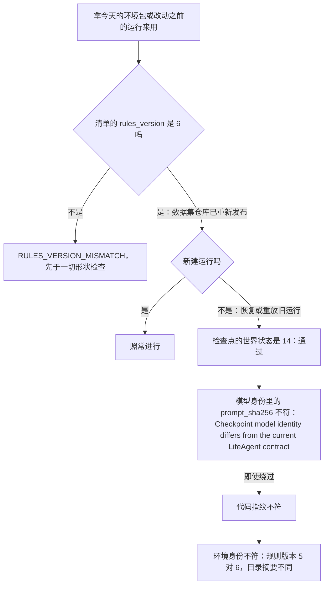

# 版本、身份与基线

> 本章属于[手机优先的空闲时间与空闲时的死路：开发规格](../SPEC-free-time-dead-ends.md)，读法和叫法见那一页。

## 目标与依据

改后人物的手机用法变了：打开一个信息流，放完一条自动接下一条，只从这个 app 可推送的内容里接；一次 app 使用随时可以暂停；吃饱了的人到了饭点不再读到「有点想吃」。这几样都是引擎的固定规则，不是某个环境包里的数据。数据集仓库今天发布的环境包（提案依据的白领环境 `0001-white-collar-lianqiu`，环境版本 6）是按旧规则发布的，清单写着 `rules_version: 5`；10 月 14 日因连不上模型服务而停下的那次 30 天运行（WorldMock-Dataset `execution/20261014T095627Z-white-collar-30day-resume2`）是旧代码、旧提示写下的。本章规定改后哪几个号变、哪几个不变、旧包和旧运行在哪一步被哪一句话拒绝，仓库里绑定生产字节的三份测试文件怎样重做，以及数据集仓库和读导出的下游要跟着做什么。

今天的号与核对处（基线提交 `2ecd868d`）：

- 规则版本 `RULES_VERSION = 5`（`src/worldmock/exchange/constants.py:7`），加载环境时先比清单原始对象里的整数（`src/worldmock/catalog/loader.py:59-60`），登记时再核一次（`src/worldmock/catalog/admission.py:52-53`）。
- 导出清单结构号 `EXPORT_SCHEMA_VERSION = 6`（`src/worldmock/footprints/export.py:31`），导出认证严格比较（`src/worldmock/footprints/validation.py:86-87`），评估读入另比一次（`src/worldmock/evaluation/validation.py:257-259`）。
- 目录格式 `format_version: Literal[5]`（`src/worldmock/catalog/models.py:51`）、世界状态 `WORLD_SCHEMA_VERSION = 14`（`src/worldmock/life/models.py:29`）、运行清单 `RUN_MANIFEST_SCHEMA_VERSION = 6`（`:32`）、质量报告结构号 8（`src/worldmock/footprints/quality.py:73`）。
- 没有任何一处有迁移或「两个值都认」的读取分支。

写规格前在基线提交上做过三项离线核查，结果决定了本章的规程：

| 核查 | 结果 |
| --- | --- |
| 跑 `tests/system/lifecycle/test_complete_day_baseline.py` | `2 failed, 2 passed`：两份完整日基线的逐项比对都失败，不变项那条通过。原因是 `5dc50272`（只改生产源码的性能修复）在最近一次重冻 `08d6d4f7` 之后改了生产字节，代码指纹变了。也就是说，主干上的两份基线今天就已经过期 |
| 照本章的规程在基线提交上录两份候选，冻结到草稿目录 | 两个独立进程各录一份（分别 30 秒、57 秒），候选逐项相等，冻结脚本打印 `Complete-day baseline published`。与仓库里的基线相比只有 `summary` 不同，其中只是导出的 `manifest.json`、`quality.json` 和检查点摘要三项：差的正是代码指纹。`generation` 的三份锁文件摘要相同 |
| 照本章的规程重录查看器样例到草稿目录 | 与 `tests/fixtures/viewer-context.json` 逐字节相同（94,794 字节）：录制样例今天与代码相符 |

本章落实提案里与身份有关的几处：「Implementation scope and order」表的 Identity effect 一列；「Re-freeze both complete-day baselines and re-record the viewer fixture once, after all approved WorldMock source changes have landed」；「New runs use the new prompt, code and package. Existing run directories stay readable by their original revision; they are not resumed under these changes and no compatibility path is added.」。所有者 2026-10-15 的答复里，单条之后随机接一条没看过的内容、只接可推送的内容、app 使用随时可暂停、饭点加成只在饿时才加，这四项是引擎的固定规则，规则版本因此升号。

与提案不同的一处：提案「Order」一段说 WorldMock 先落地后，「runs on the current dataset under that engine are valid」。规则版本升到 6 之后，今天的环境包在加载第一步就被拒；数据集仓库把每个包的清单改写成 `rules_version: 6` 并照常刷新摘要之后才成立。对于打卡、电话、点名联系人的聊天、邮件、天气这些行已经写成不可推送的包（提案「Content-app uses auto-play」一节说每个环境都是这样，本规格照录、没有复核），这只是清单的一处改动。反过来，这次升号也替提案守住了它定下的次序：数据集仓库以后按新规则发布的白领环境写着 `rules_version: 6`，没有自动接续的引擎（规则版本 5）一加载就拒绝它，「删掉在家休息的环境跑在一条只放一条的引擎上」这种组合起不来。

## 行为规格

### 用词

| 词 | 含义 |
| --- | --- |
| 结构号 | 写在某一种持久化结构里的版本号 |
| 身份 | 运行开始时冻结、此后逐项比对的摘要或字段组 |
| 指纹 | 由提示文字、层 Schema、工具定义或源码算出的摘要 |
| 版本提交 | 准备步骤里的一个提交：改两个号、样例环境清单和全部钉住它们的断言。次序见[「实施顺序与验收」](./09-implementation.md) |
| 会让基线失效的改动 | 定义在[「实施顺序与验收」](./09-implementation.md)「用词」，本章引用，不另写一句更窄的 |

### 升号原则

- 一个结构号只守一种结构：字段集合、取值闭集或可接受的取值域变了才升；只有取值变了不升（《状态与序列化》开头一段）。规则版本守的是引擎的固定规则：规则变了就升，让按旧规则发布的环境包在第一步被拒。
- 本次只有两个号变：规则版本 5 变 6，导出清单 6 变 7。各在主干上只变一次，由版本提交一次改完：两个常量、样例环境清单的规则版本、全部钉住它们的断言、本章的两条变异。此后任何轨道都不碰这两行。
- 版本提交排在三条轨道之前，所以集成分支上有一小段「号已经是新值，规则还是旧的」的中间状态；主干看不到它。
- 旧值由严格比较直接拒绝。不写迁移，不保留「5 或 6」「6 或 7」这样的读取分支，不提供双格式，不在仓库里保存旧值的夹具；旧值被拒由测试在当前夹具的副本上改出反例来证明。
- 不新增第三方依赖：`pyproject.toml`、`uv.lock`、`requirements/` 不动（它们在代码指纹和基线的 `generation` 里）。AgentSociety2 的补丁不改。

### 版本号、结构号与标识

| 名称 | 今天 | 改后 | 为什么 | 定义处 | 旧值在哪里被拒 | 钉住它的断言 |
| --- | --- | --- | --- | --- | --- | --- |
| 规则版本 `RULES_VERSION` | 5 | 6 | 自动接续、`pushable` 的含义、app 使用随时可暂停、饭点加成，四项引擎固定规则变了，见下一小节 | `src/worldmock/exchange/constants.py:7` | 加载环境（`src/worldmock/catalog/loader.py:59-60`）与登记（`src/worldmock/catalog/admission.py:52-53`）报 `RULES_VERSION_MISMATCH`；恢复与重放核对环境身份（`src/worldmock/life/run_identity.py:15-25`）；导出认证（`src/worldmock/footprints/validation.py:218-223`）；冻结基线（`scripts/freeze_rrs_baseline.py:50-57`） | 见「测试要求」里「钉住今天的值、要改的现有用例」一表，十一个文件 |
| 导出清单 `EXPORT_SCHEMA_VERSION` | 6 | 7 | 理由只有一条：`activities.jsonl` 的行可以带 `data.played_count`。截止时仍在进行的 `interact` 活动，最后一个快照来自 `activity_progress` 事件，而这种事件的活动快照改成带条数、不带 `played`（规则见[「内容 app 自动接续」](./01-autoplay.md)）；导出照抄最后一个快照（`src/worldmock/footprints/export.py:162-199`），行的字段集合因此变了 | `src/worldmock/footprints/export.py:31`，上一行是它的说明 | 导出认证 `Export manifest is not a committed supported version`（`src/worldmock/footprints/validation.py:86-87`）；评估读入 `delivery schema_version must be 7`（`src/worldmock/evaluation/validation.py:257-259`） | 见同一表，五个文件 |
| 目录格式 `format_version` | 5 | 5，不变 | 环境包的行与字段一个都不变 | `src/worldmock/catalog/models.py:51` | 不适用 | 现有断言不动 |
| 世界状态 `WORLD_SCHEMA_VERSION` | 14 | 14，不变 | 自动接续沿用 `interact` 活动已有的 `draw_index` 与 `played`，世界状态里的活动仍带完整的 `played`；`played_count` 只在 `activity_progress` 事件的快照里；明天与上班安排的说明只在观察里 | `src/worldmock/life/models.py:29` | 不适用 | `tests/integration/life/test_state_serialization.py` 的现有断言不动 |
| 运行清单 `RUN_MANIFEST_SCHEMA_VERSION` | 6 | 6，不变 | 顶层字段集与 `stage_model_identity` 的键集都不变，只有 `prompt_sha256`、`code_sha256` 和环境身份里的规则版本取值变 | `src/worldmock/life/models.py:32`，写入在 `src/worldmock/life/world_setup.py:84-100` | 不适用 | `tests/dayrun_baseline.py:109`、`tests/system/lifecycle/test_run_manifest.py:35`、`tests/integration/runtime/test_environment_identity.py:38`、`:54`、`tests/integration/footprints/test_acs_export.py:92-93` |
| 质量报告 `quality.json` 的 `schema_version` | 8 | 8，不变 | 不增删键；标题只列三条只改时间线标签一节里的文字 | `src/worldmock/footprints/quality.py:73` | 不适用 | `tests/integration/footprints/test_acs_export.py:107-108`、`tests/integration/footprints/test_phone_record_export.py:162` 等现有断言 |
| `persona.toml`、`config.toml` 的 `schema_version` | 2、2 | 不变 | 明天的上班安排和上班安排的说明都由已有的 `work_schedule` 求值，不加字段 | `src/worldmock/input_models.py:158`、`:231` | 不适用 | 现有断言不动 |
| 行为报告、长期比较、盲评包的标识 | `behavior-metrics-4`、`evaluation-metrics-2`、`blind-review-packet-2` | 不变 | 评估读的键不变 | `src/worldmock/evaluation/behavior_metrics.py:126`、`metrics.py:150`、`review.py:485` | 不适用 | 现有断言不动 |
| AgentSociety2 锁定源码摘要 `AS2_LOCKED_SOURCE_SHA256` | `bf716c7b…db3c6` | 不变 | 全部改动在 WorldMock 一侧 | `src/worldmock/run_setup.py:26` | 不适用 | `tests/unit/engineering/test_shared_rules_spec.py::test_frozen_current_as2_identity_agrees_with_installation_and_runtime` |
| 样例环境的 `environment_version` | `"4"` | `"4"`，不变 | 样例环境的行一行不动，只有清单的规则版本变；环境身份照样因规则版本和目录摘要两项与今天不同 | `tests/fixtures/dataset-environment/catalog/manifest.json` | 不适用 | `tests/system/cli/test_cli.py:93`、`tests/unit/test_environment_inputs.py:83`、`:420`、`tests/system/environment/test_validation.py:247` 等，一个字不改 |
| `result.json` | 没有结构号 | 仍没有 | 形状不变 | `src/worldmock/cli.py` 写出 | 不适用 | — |

两个号的设计归宿：规则版本在《资源引擎》「环境目录文件」，导出清单在《记录引擎》「完整导出认证」；手册《设计环境数据集》写清单里的两个版本号和升级时要改的 `pushable`。这几处由[「设计文档与手册」](./07-design-docs.md)一章落笔，随本规格的提交一起改好，现在已经写着新值：`docs/design/03-resource-engine.md:31`、`:40`（规则版本 6）、`docs/design/05-recording-engine.md`「完整导出认证」（导出清单 7 及其理由）、`docs/manual/resources.md:9`、`:169`（基线提交上是 `:159`）。所以版本提交不碰文档。从规格提交到版本提交之间，文档先于代码写着新值；没有测试或门比较文档里的号（文档链接检查只看链接，设计汇编只看能否汇编），这段先后不会让任何门失败。

### 搭同一次升号的变化

| 号 | 落在这一次里的变化 | 出处 |
| --- | --- | --- |
| 规则版本 6 | 内容 app 的一次使用放完一条自动接下一条：先接同一系列的下一集，再接最近看过、开始了没看完的另一部系列，单条之后随机接一条没看过的；没有可接的就停下等收尾 | [「内容 app 自动接续」](./01-autoplay.md) |
| | `pushable` 同时决定能不能在同一个 app 里被自动接上；只接可推送的 | 同上 |
| | app 使用随时可以暂停，不再受「离结束不足 180 秒」限制；地点单元照旧 | 同上 |
| | 饭点加成只在能量低于饥饿锚点时才加 | [「饭点的食欲加成」](./06-appetite.md) |
| 导出清单 7 | `activities.jsonl` 里截止时仍在进行的 `interact` 活动行带 `data.played_count`（整数），不带 `data.played`；已经终结的活动行仍带完整的 `data.played` | [「内容 app 自动接续」](./01-autoplay.md) |
| | 搭车而不构成理由的导出字节变化：`events.jsonl` 里 `interact` 活动的 `activity_progress` 事件快照带条数、不带清单；终态结果的 `details.contents` 最多三行并可带 `contents_omitted`；观察里环境层多 `tomorrow`、上班安排多 `note`；收尾的说法「结束使用」；一天时间线里标题只列三条 | 「内容 app 自动接续」「自动接续的显示与记录」「零点计划、上班安排与明天」 |

- 规则版本升号的理由只写引擎固定规则这四项。系统层措辞、零点计划模板、工具层的说明、拒绝的文字、地点系列的进度说明，都是写给人物看的文字，不是升号的理由。
- 导出清单升号的理由只写 `activities.jsonl` 的字段集合这一条。事件正文里快照的形状和各处文字是同一次改动里导出字节的其他变化，不带来第二次升号。

### 对其余各章的约束

两个号之外的结构号都不升，这同时是对其余各章的约束。任何一章的实现违反下表任一行，都回到本章重新定号，不能自行处理。

| 约束 | 今天由什么决定 | 各章怎样守住 |
| --- | --- | --- |
| 世界状态里 `interact` 活动的私有数据键集不变 | `_CONTENT_FIELDS`（`src/worldmock/life/activity_validation.py:10-11`） | 自动接续沿用 `draw_index`、`played`；`played_count` 只写进 `activity_progress` 事件的快照，不进世界状态 |
| 运行清单不增删顶层字段，`stage_model_identity` 的键集不变 | `_run_manifest`（`src/worldmock/life/world_setup.py:84-100`） | 本次没有新的运行开关、预算或模型参数 |
| `quality.json` 不增删键 | `build_quality_report`（`src/worldmock/footprints/quality.py:56` 起） | 标题上限只改时间线标签的文字 |
| 不新增事件类型 | `EventType` 的十四个值（`src/worldmock/footprints/models.py:103-107`） | 每一条照旧是一条 `activity_progress`；收尾照旧 |
| 工具定义不变 | 原生工具的请求模型与用途句（`custom/agents/life_agent.py:162-165`、`src/worldmock/agents/life_prompt.py` 的 `TOOL_DESCRIPTIONS`） | 新文字只进系统层与各层内容；`tool_schema_sha256` 因此不变 |
| 人设与运行配置不加字段 | `src/worldmock/input_models.py` 的两个严格模型 | 明天与说明都从已有的上班安排求值；社会需要增长率之类的数据集字段不在本仓 |

### 三个指纹与派生身份

| 身份 | 计算处 | 覆盖什么 | 今天的值（离线算出，只用来确认改后确实变了） | 改后 | 为什么 |
| --- | --- | --- | --- | --- | --- |
| `prompt_sha256` | `src/worldmock/agents/life_prompt.py:161-166` | 生活系统层、只读系统层、七层 Schema `LAYER_SCHEMAS` 的规范 JSON | `355644d0dd43b82a355358344328fd64b2ffcd60556795db7fbbf0ec6413aef1` | 按最终字节重算 | 系统层改七条（[「系统层措辞」](./03-system-layer.md)）；环境层 Schema 多 `tomorrow`、上班安排的 `_DUTY` 多必填的 `note`（[「零点计划、上班安排与明天」](./04-day-plan.md)）；结果明细 Schema 多可选的 `contents_omitted`、`_CONTENTS` 加 `maxItems`（[「自动接续的显示与记录」](./02-autoplay-display.md)） |
| `tool_schema_sha256` | `custom/agents/life_agent.py:920-926` | `_TOOL_MODELS` 里十个原生工具的用途句与严格参数 Schema | `4a1e278d10c04991588a77b279e34222826940d823959fac0e247d3c11be44b0` | 不变 | 没有一个请求模型、字段说明或用途句改动 |
| `code_sha256` | `src/worldmock/run_setup.py:107-117` | `src/`、`custom/` 下全部 `.py`，`pyproject.toml`、`uv.lock`，实际导入的 AgentSociety2 | `484ea342f2dbd8049ff8122ff8300cb431fa424387ba42d7cee4e2eb29f83284` | 按最终字节重算 | 任何生产改动都让它变，包括零点计划模板 `PLAN_DAY_PROMPT`：它只由代码指纹覆盖（`src/worldmock/life/day_planning.py:3-4`），不进提示指纹 |
| 阶段模型身份 | `src/worldmock/run_setup.py:92-104` | 行动阶段的思考、工具选择、`max_tokens` 等 | — | 不变 | 本次不动任何模型参数 |
| 环境身份五项 | `src/worldmock/environment.py:186-195` | `environment_id`、`environment_version`、`rules_version`、`catalog_content_sha256`、`map_sha256` | 样例环境：`artificial-test`、`"4"`、5、`45a65b2d6dd8362e2bc154910d6014b7e4131109a292a660f35eb767a82d41d4`、种子决定的地图摘要 | `artificial-test`、`"4"`、6、新的目录摘要、地图摘要不变 | 目录摘要覆盖清单本身（`src/worldmock/catalog/identity.py:72-88`），只改规则版本摘要也变 |

- 测试里没有任何指纹或目录摘要的字面量，只断言能重算、改了就变。上表的今天的值和下文的目录摘要都是离线算出的核对值，以实际重算为准。
- 集成分支上每并入一条轨道，提示指纹和代码指纹都按当时的字节重算；不要求它们只变一次。只有两个结构号要求只变一次。
- 指纹与当前不符时的拒绝文字不变：新建运行报 `Run model identity disagrees with environment inputs`（`src/worldmock/life/world_setup.py:144-146`）；恢复与重放时模型身份不符报 `Checkpoint model identity differs from the current LifeAgent contract`，代码指纹不符报 `Checkpoint code identity differs from the current runtime`（`src/worldmock/runtime.py:281-286`）。

### 版本提交

版本提交在设计文档与手册已经随本规格的提交改好之后、`content_select.next_episode` 的纯重构之前（次序见[「实施顺序与验收」](./09-implementation.md)），由集成者在 `feat/free-time-dead-ends` 上做，一个提交，提交标题 `chore(versions)!: bump rules 6 and export 7 for phone-first free time`。它带的东西逐项如下，不带别的。

**两个常量。**

| 文件 | 改前 | 改后 |
| --- | --- | --- |
| `src/worldmock/exchange/constants.py:7` | `RULES_VERSION = 5` | `RULES_VERSION = 6` |
| `src/worldmock/footprints/export.py:30` | `#: 导出清单的结构号：工件是六份，含地点停留；活动种类含查询；结构号不符的导出直接拒绝，不迁移。` | `#: 导出清单的结构号：工件是六份，含地点停留；活动种类含查询；进行中的 interact 活动行带 played_count；结构号不符的导出直接拒绝，不迁移。` |
| `src/worldmock/footprints/export.py:31` | `EXPORT_SCHEMA_VERSION = 6` | `EXPORT_SCHEMA_VERSION = 7` |

读这两个常量的地方都不用改：加载、登记、恢复、导出认证、评估读入、冻结脚本各自与常量严格比较；报错文字里带数字的只有评估的 `delivery schema_version must be {version}`，随常量自动变成 7。`tests/unit/engineering/test_single_source.py:35`、`:53` 把两个常量登记在各自的文件里，常量不搬家；同一文件 `:231` 的样本 `'EXPORT_SCHEMA_VERSION = 4\n'` 测的是归宿之外的同名定义，与取值无关，不改。

**样例环境清单。** 只改 `rules_version` 一个字段，文件表与目录摘要由生产入口重写，不手写。在集成工作树的根目录（Git Bash）：

```sh
ROOT=C:/Users/56865/OneDrive/Documents/HoldThatThgt/WorldMock
PY="bash $ROOT/.work/tools/envrev/py.sh"
cd "$ROOT/.work/wt/ftde"
sed -i 's/"rules_version":5}$/"rules_version":6}/' tests/fixtures/dataset-environment/catalog/manifest.json
$PY -c "from worldmock.catalog.identity import refresh_manifest_identity as r; print(r('tests/fixtures/dataset-environment/catalog').catalog_content_sha256)"
```

- 写规格时在草稿副本上照这两步算过：打印 `464c6649d6ad99edfd2b109af786cce7a982abbd50dd192aebb9fdcc79b38d88`，文件表的五条记录与今天逐项相同，清单仍是一行规范 JSON 加一个换行。回调日那份副本（多一份 `callbacks.jsonl`）的目录摘要相应从 `19d1f3d3319d8db9c7095ef988fde1cd15b98969efb9cee369c8b6bfa3fe6087` 变成 `4881bac6c615dee047dbcaf05352bb44a207701452aefd8cf6bdc3e8492d57d8`。以刷新的实际输出为准。
- `format_version`、`environment_id`、`environment_version` 和五份目录 JSONL 不动；`persona.toml`、`config.toml` 不动。
- 测试在副本上构造的环境（`tests/life/environment_inputs.py` 的 `copy_environment` 一族、`tests/life/prerequisite_inputs.py`、`tests/life/phone_records.py`、`tests/life/day_baseline_runtime.py` 的 `_environment`）都从样例环境复制再刷新，自动带上规则版本 6，不用改。

**钉住旧值的断言。** 全部在这个提交里一次改完，逐行见「测试要求」里「钉住今天的值、要改的现有用例」一表：规则版本十一个文件、导出清单五个文件（`test_acs_export.py` 两样都有）。反例一律取紧邻的旧值：规则版本的旧值例子从 4 换成 5，偏大的例子从 6 换成 7；导出清单的旧值例子从 5 换成 6。

**两条变异。** `tests/dataset_acceptance.py:288-290` 的 `rules_version_still_four` 与 `:299-302` 的 `export_schema_version_still_five` 锚在旧常量行上，版本提交改完常量之后它们的原文不存在了，`tests/system/mutations/test_source_mutations.py` 当场失败。在原位置换成本章的两条（「测试要求」里「源码变异」一表）：名字随新值改，原文是新常量行，替换文是旧值，杀手不变。

**这个提交的门。** 改动范围内的用例（「测试要求」两张表里点名的文件）、`tests/unit/engineering/` 全部、`tests/system/mutations/test_source_mutations.py`、本章两条变异各自被杀死；命令写法见[「实施顺序与验收」](./09-implementation.md)的第一级门。与样例绑定的三个测试文件从这个提交起在命令行上排除，直到最终提交。

### 旧输入与旧运行在哪一步被拒



实线是真正会遇到的第一处拒绝；虚线是后面还排着的几关，列出来说明没有哪一种旧运行能漏过去。

| 旧输入 | 入口 | 第一处拒绝，原文 | 位置 |
| --- | --- | --- | --- |
| 清单写着 `rules_version: 5` 的环境包（数据集仓库今天的全部环境包） | `validate`、`run`、`resume`、`replay` 读环境 | 登记码 `RULES_VERSION_MISMATCH`，原因 `The environment was published for a different rules version.`。`worldmock validate` 输出 `[{"path": "catalog", "code": "RULES_VERSION_MISMATCH", "reason": "The environment was published for a different rules version."}]`，非零退出 | `src/worldmock/catalog/loader.py:59-60` |
| 用重新发布的环境包恢复或重放改动之前的运行 | `resume`、`replay` | 读环境通过；检查点里的世界状态结构号仍是 14，校验通过；核对运行身份时 `IntegrityError("Checkpoint model identity differs from the current LifeAgent contract")`：运行清单冻结的 `model_identity` 里 `prompt_sha256` 是旧的。命令以 1 退出，日志是 `WorldMock resume failed`（重放是 `WorldMock counterfactual replay failed`）和 `WorldMock command failed`；不建分支目录 | `src/worldmock/runtime.py:239-248`、`:281-283`；日志在 `:151`、`:165`、`src/worldmock/cli.py:74` |
| 同上，后面排着的几关 | 同上 | 依次是 `Checkpoint code identity differs from the current runtime`、`Runtime environment identity mismatch` | `src/worldmock/runtime.py:284-286`，`src/worldmock/life/run_identity.py:15-25` |
| 改动之前的代码写出的导出 | 导出认证 `validate_export` | `IntegrityError("Export manifest is not a committed supported version")`；后面排着 `Export frozen run manifest or environment identity is invalid`（冻结运行清单的规则版本是 5） | `src/worldmock/footprints/validation.py:86-87`、`:205-223` |
| 拿结构号是 6 的导出做评估 | `worldmock evaluate` | 评估先做自己的清单校验（`src/worldmock/evaluation/validation.py:217`），再调导出认证（`:223`），所以先出现 `EvaluationError("invalid_input", "delivery schema_version must be 7")` | `src/worldmock/evaluation/validation.py:257-259` |
| 对改动之前的运行目录执行 `export` | `worldmock export` | 导得出来：[「内容 app 自动接续」](./01-autoplay.md)一章定下不为进度快照加形状检查，`export_run` 也不比规则版本；写出的导出在认证时被拒：冻结运行清单的规则版本是 5，报 `Export frozen run manifest or environment identity is invalid` | `src/worldmock/footprints/validation.py:218-223` |
| 规则版本是 5 的基线候选交给冻结脚本 | `scripts/freeze_rrs_baseline.py` | `ValueError("Complete-day candidate has an invalid current identity or summary")`，脚本以 1 退出，目标文件原字节保留 | `scripts/freeze_rrs_baseline.py:28-57` |
| 用查看器或 `worldmock status` 看改动之前的运行 | 查看器，`status` | 不拒绝。查看器和 `src/worldmock/status.py` 都不读结构号，旧运行照样能打开 | — |

例：所有者想把停下的那次 30 天运行接着跑完，或者从 10 月 3 日的一个检查点重放、看改后她会不会去刷信息流。

1. 用那次运行自带的环境包：读环境这一步就停下，`RULES_VERSION_MISMATCH`。
2. 数据集仓库把清单改成 `rules_version: 6` 重新发布，再用它恢复或重放：环境读得进来，检查点的世界状态也通过，接着因提示指纹停下，输出目录没有被创建。
3. 所以这件事在本仓做不成。要看改后的空闲时间，只能用重新发布的环境包从头新建一次运行，这是提案「Acceptance」里的那次新运行，需要所有者另行授权（见「证据层级」）。那次旧运行是继续在原版本上跑完还是放弃，是数据集仓库的决定，列在「交给数据集仓库和下游的事」。
4. 那次旧运行仍然可以用查看器打开，用 `worldmock status` 看状态。

### 两份完整日基线

**它们绑定什么。** 每份基线是 `{persona_sha256, config_sha256, environment_identity, seed, summary}` 加上冻结时的机器信息 `generation`；`summary` 是一次脚本化完整日的全部产物的规范化摘要：导出目录的每个文件、全部检查点、全部运行素材（`tests/dayrun_baseline.py:131-160`）。规范化只替换机器路径和由它派生的摘要，运行清单里的 `code_sha256`、两个指纹和环境身份都不屏蔽。所以「会让基线失效的改动」（定义在[「实施顺序与验收」](./09-implementation.md)）任何一样发生，基线就与代码不符。本次三条轨道都改生产源码，规则版本又改了样例环境的清单，基线从版本提交起与代码不符；主干上它们今天就已经过期（见「目标与依据」的核查）。

**确定性靠什么。** 候选由 `tests/life/day_baseline_runtime.py:97-119` 的 `record_complete_day` 产生，它先调 `deterministic_day_runtime`（`tests/dayrun_baseline.py:27-40`），只把三个模块里的 `uuid4`、存储的墙钟与计时、AgentSociety2 人物模块的墙钟换成固定值。本次新增的代码不得在那三个模块之外用 `uuid4` 或墙钟，不得依赖集合的迭代次序或没有 `ORDER BY` 的查询次序；自动接续的抽取用带键的随机流，候选按 `content_id` 排序后抽一次（规则见[「内容 app 自动接续」](./01-autoplay.md)），正是为了这一条。

**两个脚本化的日子。** 活动日的 `_activity_day` 今天在出发之后等哔哩哔哩那次使用自己结束（`tests/life/day_baseline_runtime.py:77` 的 `_finish_active(engine, "trip")`），自动接续之后它会把可推送的内容一条接一条放下去；[「内容 app 自动接续」](./01-autoplay.md)一章把它改成在公司午睡之前明确收尾，归自动接续轨道（理由见[「实施顺序与验收」](./09-implementation.md)「本章定下的细节」）。回调日不用 app，不改。基线不另写断言，脚本走到的新行为由 `tests/system/lifecycle/test_complete_day_scripts.py` 断言。

**什么时候做。** 只做一次：三条轨道并入、过了第二级门、集成分支已经并入最新主干之后，在此后不再有会让基线失效的改动的那个提交上。重冻之后又出现会让基线失效的改动时，在新的提交上重做；集成分支并入主干时必须已经包含主干的头。这些都按[「实施顺序与验收」](./09-implementation.md)的定义办。

**录制用的两个脚本。** 都不上库，放在集成工作树的 `.work/free-time-dead-ends/` 下；写规格时已按 `docs/dev/first-real-day-run/spec/12-versions.md` 的原文重建并在基线提交上跑通（结果见「目标与依据」的核查）。不在时照下面的全文重建。

`.work/free-time-dead-ends/day-baseline/test_record_candidate.py`：

```python
import json, os
from pathlib import Path
import pytest
from tests.life.day_baseline_runtime import record_complete_day

PROJECT = Path(os.environ["WORLDMOCK_CHECKOUT"]).resolve()

@pytest.mark.parametrize("kind", ["activity", "callback"])
def test_record_candidate(monkeypatch, tmp_path, kind):
    candidate = record_complete_day(monkeypatch, tmp_path / kind, PROJECT, kind)
    out = Path(os.environ["DAY_BASELINE_OUT"])
    out.mkdir(parents=True, exist_ok=True)
    (out / f"{kind}.json").write_text(json.dumps(candidate, ensure_ascii=False), encoding="utf-8")
```

`.work/free-time-dead-ends/record_viewer_context.py`：

```python
import asyncio, json, os, sys, tempfile
os.environ.setdefault("AGENTSOCIETY_LLM_API_KEY", "offline-test-key")
os.environ.setdefault("AGENTSOCIETY_LLM_API_BASE", "https://example.invalid")
os.environ.setdefault("LITELLM_LOCAL_MODEL_COST_MAP", "True")
from pathlib import Path
from tests.engine_fixture import engine_factory_at
from tests.frozen_inputs import FrozenInputs
from tests.system.lifecycle.test_run_viewer_recording import _recorded_viewer_requests

with tempfile.TemporaryDirectory(prefix="vr") as tmp, engine_factory_at(Path(tmp), FrozenInputs()) as factory:
    requests, _ = asyncio.run(_recorded_viewer_requests(factory))
Path(sys.argv[1]).write_text(json.dumps(requests, ensure_ascii=False, indent=2) + "\n", encoding="utf-8", newline="\n")
```

**规程。** 在集成工作树 `.work/wt/ftde` 的根目录、Git Bash 里执行。这个工作树由 `prepare_wt.sh` 准备过，`.work/environment-receipt.json` 是通过的回执，冻结脚本要读它（`scripts/freeze_rrs_baseline.py:66-72`）；参考平台沿用现有基线 `generation` 记载的 Windows、AMD64、CPython 3.12.13。`--basetemp` 必须是短路径：长路径在 Windows 上会让一批 integration 用例失败（前一个特性实测）。

1. 两个独立进程各录一份候选，输出目录和 `--basetemp` 都不同：

   ```sh
   ROOT=C:/Users/56865/OneDrive/Documents/HoldThatThgt/WorldMock
   PY="bash $ROOT/.work/tools/envrev/py.sh"
   cd "$ROOT/.work/wt/ftde"
   WORLDMOCK_CHECKOUT="$(pwd -W)" DAY_BASELINE_OUT=.work/free-time-dead-ends/day-baseline/first \
     $PY -m pytest .work/free-time-dead-ends/day-baseline/test_record_candidate.py -q -p no:cacheprovider \
     --rootdir . --basetemp C:/Users/56865/AppData/Local/Temp/ftde-a
   WORLDMOCK_CHECKOUT="$(pwd -W)" DAY_BASELINE_OUT=.work/free-time-dead-ends/day-baseline/second \
     $PY -m pytest .work/free-time-dead-ends/day-baseline/test_record_candidate.py -q -p no:cacheprovider \
     --rootdir . --basetemp C:/Users/56865/AppData/Local/Temp/ftde-b
   ```

2. 每种日子各冻结一次：

   ```sh
   $PY scripts/freeze_rrs_baseline.py .work/free-time-dead-ends/day-baseline/first/activity.json \
     .work/free-time-dead-ends/day-baseline/second/activity.json tests/fixtures/dayrun-activity-baseline.json \
     2>&1 | tee .work/free-time-dead-ends/day-baseline/freeze-activity.log
   $PY scripts/freeze_rrs_baseline.py .work/free-time-dead-ends/day-baseline/first/callback.json \
     .work/free-time-dead-ends/day-baseline/second/callback.json tests/fixtures/dayrun-callback-baseline.json \
     2>&1 | tee .work/free-time-dead-ends/day-baseline/freeze-callback.log
   ```

   成功时打印 `Complete-day baseline published`、以 0 退出。候选不相等时写 `Complete-day candidates differ in inputs, environment, seed or summary`；身份不合法（包括规则版本不是 6）时写 `Complete-day candidate has an invalid current identity or summary`；环境回执不符时写 `Complete-day baseline requires a matching successful bootstrap receipt`。三种都以 1 退出，目标文件原字节保留。候选不相等时先找出不确定性的来源，不重试到相等为止。

3. 用真实宿主重录查看器样例（录制流程 `_recorded_viewer_requests` 不改）：

   ```sh
   $PY .work/free-time-dead-ends/record_viewer_context.py tests/fixtures/viewer-context.json
   ```

4. 核对并提交：

   ```sh
   $PY -m pytest tests/system/lifecycle/test_complete_day_baseline.py tests/system/lifecycle/test_complete_day_scripts.py \
     tests/system/lifecycle/test_run_viewer_recording.py tests/system/viewer/test_run_viewer.py \
     -q -p no:cacheprovider --basetemp C:/Users/56865/AppData/Local/Temp/ftde-c
   ```

   两份基线一个提交（`test(dayrun): re-freeze the two complete-day baselines for phone-first free time`），录制样例一个提交（`test(viewer): re-record the viewer context sample from the live host for phone-first free time`）。

5. 不为另一个平台另存一份基线；持续集成这一层取不到，见「证据层级」。

**重冻后必须成立。**

| 字段 | 活动日 | 回调日 | 重冻后 |
| --- | --- | --- | --- |
| `seed` | 20260105 | 20260106 | 不变 |
| `persona_sha256` | `6a5f1edc…2d7e1d` | 同左 | 不变 |
| `config_sha256` | `c1edd335…16a331` | `2ce58462…223184` | 不变 |
| `environment_identity.map_sha256` | `04645c19cfa4576bfe988cca8c41182d5fd67c67ceea1f671e247e130882a8c8` | `a54b9d8d1ad1f70b2dbc0500d74392c6c8b120698d2b24c5bbc78fff1e9daa7e` | 不变 |
| `environment_identity.environment_id`、`environment_version` | `artificial-test`、`"4"` | 同左 | 不变 |
| `environment_identity.rules_version` | 5 | 5 | 6 |
| `environment_identity.catalog_content_sha256` | `45a65b2d…41d4` | `19d1f3d3…6087` | `464c6649…8d88`、`4881bac6…57d8`（离线算出，以刷新为准） |
| `summary` | — | — | 改变 |
| `generation` 里三份锁文件的摘要 | `aa0d6581…`、`ba819933…`、`674ace2a…` | 同左 | 不变 |

种子、人设摘要、配置摘要、地图摘要、环境名与环境版本不变，是因为样例环境的人设、运行配置、地点集合和行都没有动。其中任何一项变了都说明改动越了界：`map_sha256` 变了是地点集合或地图生成被动了，`persona_sha256` 变了是人设文件被动了，锁文件的摘要变了是依赖被动了。

### 查看器录制样例

**它绑定什么。** `tests/fixtures/viewer-context.json` 有 `action` 和 `continuation` 两个请求。`tests/system/lifecycle/test_run_viewer_recording.py:26-45` 把其中的系统层消息和工具定义与真实宿主当场发出的逐字比较；查看器的 Node 用例读整份文件来渲染「上下文」画面（`tests/system/viewer/run_viewer_context.test.cjs:13`、`tests/system/viewer/run_viewer.test.cjs:13`）。改后它里面变的是：系统层改了七条；用户层里工具层 app 行的时长写法、环境层的 `tomorrow` 与上班安排的 `note`。工具定义不变。

**录制流程不改。** 第一步仍是用 `revise_day_plan` 写「看一会儿哔哩哔哩」，第二步仍经同秒续接用 `start_side_activity` 打开哔哩哔哩。这一步只打开、不等放完，自动接续不影响它。

**什么时候重录。** 在收尾步、两份基线重冻之后，照上面规程的第三步做一次。系统层在提示与计划轨道并入时就变了，录制样例从那时起与代码不符；它从版本提交起就和两份基线一起在命令行上排除，规则只有一条。

**重录后必须成立。**

- 文件沿用现有写法：两格缩进，非 ASCII 原样，LF，末尾一个换行。内容只来自真实宿主的请求，不手改。
- 由 `tests/system/lifecycle/test_run_viewer_recording.py` 断言的：两个请求的系统层消息等于真实宿主此刻发出的，工具定义逐字相等，十个工具各出现一次；续接请求的前两条消息等于行动请求的；运行里没有拒绝；第二步开始的活动是 `interact`、`data.app_id` 是 `bilibili`、`data.content_id` 不为空。由 `tests/system/viewer/run_viewer_context.test.cjs:66-83` 断言的：工具名单与次序、六个用户层的层名、解析没有警告。没有断言、但重录前后应当不变的：两处 `max_tokens` 仍是 16000（`tests/fixtures/viewer-context.json:884`、`:1789`）。
- 按各章的规则，重录出的用户层应当看得到：环境层的 `tomorrow` 是 `{"date": "2026-01-06", "weekday": "星期二", "day": "工作日"}`（录制时刻是 2026 年 1 月 5 日星期一 08:00，样例人设周一到周五上班），上班安排多一项 `"note": null`；工具层哔哩哔哩一行的时长写法照[「自动接续的显示与记录」](./02-autoplay-display.md)一章。这几条不另写断言，它们由各章自己的用例守住；读到别的值时先查是哪一章的实现与规格不符。
- 读这份样例的查看器用例（`tests/system/viewer/run_viewer_context.test.cjs` 里经 `layers()`、`request()` 读样例的各条，`tests/system/viewer/run_viewer.test.cjs` 里经 `contextRequest()` 读样例的各条）今天只断言工具名单与次序、层名、工具层的动作集合与出行方式集合、解析没有警告、消息原文往返和改一层后的比较结果，这些重录后都不变，预计不用改。重录后若有一条失败，它属于查看器，由自动接续轨道的实施者在收尾里修（见[「实施顺序与验收」](./09-implementation.md)）。

### 交给数据集仓库和下游的事

下面这些都不在本仓。本仓只把合同写清楚：数据集仓库不照做，它的环境包在改后的引擎上加载不了，或者能加载但自动接续放出不该放的内容；下游不照做，读不懂新的导出。

数据集仓库要做的：

| 序号 | 要做的事 | 不做会怎样 | 规则写在哪 |
| --- | --- | --- | --- |
| 1 | 每个环境包的清单写 `rules_version: 6`，照常重新生成文件表与目录摘要；`format_version` 仍是 5；环境版本照数据集仓库自己的发布规则另起一版 | 加载第一步 `RULES_VERSION_MISMATCH` | 本章；手册《设计环境数据集》 |
| 2 | 逐条核对 app 内容的 `pushable`：它现在也决定这条内容能不能在同一个 app 里接在别的内容之后自动放。打卡、电话、点名联系人的聊天、邮件、天气照旧写 `false` | 引擎不检查。写成 `true` 的打卡或电话会在刷短视频时被自动接上 | [「内容 app 自动接续」](./01-autoplay.md)；《资源引擎》；手册 |
| 3 | 数据集自己的合同里「自动接续不由 pushable…决定」一句改写；「非系列内容完成后停止，系列耗尽后停止，不跳到其他系列或无关内容」对内容 app 不再成立，对地点单元仍成立；「不增加 autoplay 开关」仍成立 | 合同与引擎不一致 | 提案「Content-app uses auto-play」 |
| 4 | 信息流的内容量决定一次使用能放多久：没看过的可推送内容放完，这次使用就停下、等人物收尾 | 引擎不检查；内容少时每次使用很快停下 | 「内容 app 自动接续」；手册 |
| 5 | 删掉白领和商务销售两个环境的「在家休息」（`home-rest`），并加一条检查：任何包里都没有这个身份 | 删掉之前，人物仍有一项什么都不做的活动可选 | 提案「Removing 在家休息」 |
| 6 | 把白领人设改成手机优先：换掉「几乎不看手机」「晚间在家休息」，午饭和睡前的习惯加上抖音、小红书，媒体口味加抖音、小红书、微信 | 人设层仍叫她别用手机 | 同上 |
| 7 | 给每个信息流 app 各自的内容池，不再六个 app 共用一池九十条 | 一两天就放完，使用很快停下 | 同上 |
| 8 | 白领的家加家务单元「洗衣服」（`home-laundry`）、「打扫卫生」（`home-cleaning`），「整理衣柜」可选 | 计划里的家务仍没有做法 | 提案「Home chores and places that offer nothing」 |
| 9 | 改写假定当天上班的几条简介：备菜做饭、吃晚饭、公园散步、早上洗漱 | 休息日读到「下班回家后」 | 同上 |
| 10 | 商场与肯德基：给商场「逛商场」和店内吃的、给肯德基到店菜单，或者删掉这两个地点 | 地点底线检查不过 | 同上 |
| 11 | 三道跨环境底线检查（手机、地点、家），每道与它报出的缺口在同一次改动里落下 | 缺口没有测试守着 | 同上 |
| 12 | 白领环境里随之要改的钉子：家里单元的集合、功能条目数与出处说明、只在周末开放的电话、商场与肯德基为空、人设故事句子、内容质量与内容行为的计数和身份夹具、两条共用信息流池的测试、脚本化的原生一天（三段在家休息改成用内容 app，连续的 app 步骤只在唤醒时结束） | 数据集自己的测试失败 | 同上 |
| 13 | 母亲的电话：每个休息日都开放（按人设的上班安排写日期例外），改名「与母亲的通话」，加一条按人设逐日核对例外的测试 | 节假日的工作日打不了电话 | 提案「Contacts and social need」 |
| 14 | 跨环境的那次发布：其余环境的底线缺口和商务销售的在家休息，等那些包下一次发布时一并做 | — | 提案「Implementation scope and order」 |

只属于数据集作者、本仓不定的决定，每项一行：

- 信息流内容量：每个环境约 900 到 1,800 条，还是接受内容池放完时使用更常停下。
- 信息流的缓解档位：抖音和其他信息流在各环境之间要不要对齐（白领和家庭主妇是低档，商务销售是中档）。
- 人设文字与 issue 原文：改写「几乎不看手机」「晚间在家休息」「周末通电话」会偏离 issue，数据集通常照录 issue。
- 商场和肯德基：给它们东西做，还是删掉这两个地点。
- 母亲的电话在补班的周末怎么开：全天、只在晚上、不开，或者每天醒着的时候都能打。
- 社交需要的增长率（`persona.toml` 的字段）：降到每小时约 0.03、给公司「吃午饭」加低档社交缓解，还是维持 0.05。
- 公司「吃午饭」的社交缓解。
- 人设没有覆盖的饭点：休息日的午饭习惯、晚饭系列的名字、公司「吃午饭」供不供餐、早饭习惯或早上的能量校准。
- 家务的效果：不给缓解，还是一次性的小放松。
- 停下的那次 30 天运行：在原版本上跑完以保持连续，还是在新版本上从头再跑。

读运行产物和导出的人（LabelKit-DataSet 和一切读导出的程序）要知道的：

| 序号 | 变化 | 细节 |
| --- | --- | --- |
| 1 | 导出清单的 `schema_version` 是 7 | 按 6 读的程序要改成认 7。结构号是 6 的旧导出在本仓的认证和评估里都被拒 |
| 2 | `activities.jsonl` 里截止时仍在进行的 `interact` 活动行带 `data.played_count`（整数，已经放完的条数），不带 `data.played` | 已经终结的活动（做完、收尾、被截止截断）仍带完整的 `data.played`。导出的实验做完时，截止那一刻还在进行的活动都已被截断，所以完整导出的行都带 `played`；只有在中途截止导出时才见得到 `played_count` |
| 3 | `events.jsonl` 里 `interact` 活动的 `activity_progress` 事件，活动快照带 `played_count`、不带 `played` | 每放完一条仍有自己的一条进度事件，`data.content` 是那一条；放过哪些条以这些事件或 `verified-experiences.jsonl` 的 `played` 事实为准 |
| 4 | 一次 app 使用可以放很多条 | `app-usage.jsonl` 里仍是一次使用一行 `app_use`，区间跨过条与条的边界、只被暂停切开；每条带 `data.content` 的进度事件各有一条 `content_consumed` 和一条 `played` 事实，所以每一条至少各一条，被暂停或别的结算边界切开的一条有几段就有几条（与今天相同，规则见[「自动接续的显示与记录」](./02-autoplay-display.md)） |
| 5 | 被人物收尾的 app 使用 | 机器状态仍是 `cancelled`；写给人看的文字由「提前结束」改成「结束使用」 |
| 6 | 改动之前的运行不能恢复、不能重放，导出通不过认证 | 不提供迁移；旧运行仍可用查看器和 `worldmock status` 查看 |

### 证据层级

| 层级 | 怎样取得 | 可以据此声称 | 本次 |
| --- | --- | --- | --- |
| 读代码与离线计算 | 读源码，用生产函数做小型离线计算 | 设计依据和算例；本章的指纹与目录摘要核对值、基线已过期的核查、两个录制脚本在基线提交上跑通 | 已取得 |
| 离线套件 | 最终提交上的全量测试（无失败、无跳过、无预期失败）、覆盖率门、登记的源码变异全部被杀死、查看器 Node 用例、文档链接检查和设计汇编、重做后的两份基线和录制样例、独立的变异评审 | 引擎规则、登记与认证、提示与工具的形状、宿主在脚本化回复下的协议行为都按本规格实现 | 实施完成只要求这一层 |
| 持续集成 | GitHub Actions 在 Ubuntu 上跑同一套测试 | 离线套件在参考平台之外也通过 | 未取得，也不是合入的条件：仓库的工作流目前每次都在启动阶段失败 |
| 模型回放 | 提案「Acceptance」的计划回放与决策回放：重发记录下的请求，比较思考长度的分布 | 新的计划模板和系统层措辞是否减少长思考 | 未取得；会产生费用，要所有者另行授权 |
| 真实模型的新运行 | 数据集仓库按新规则发布白领环境之后，从 9 月 28 日跑到 10 月 11 日 | 手机时长、信息流会话长度、空闲时的死路是否消失 | 未取得；要所有者另行授权，并依赖数据集仓库先发布 |

证据层级只在本章这一张表里维护，[「实施顺序与验收」](./09-implementation.md)引用它。报告结果时写明层级；没有取得的层级写「未取得」，不用离线结果代替。

### 明确不做

- 不迁移旧运行、旧导出、旧环境包；不留读取旧值的分支；不在仓库里保存旧值的夹具。
- 不升目录格式、世界状态、运行清单、质量报告、两份 TOML、三个评估标识的号；不改 AgentSociety2 的锁定摘要；不改样例环境的 `environment_version`。
- 不为搭车的那些导出字节变化（事件快照的形状、`contents_omitted`、`tomorrow`、`note`、文字）另升一次导出清单的号。
- 不逐条轨道重冻基线或重录样例；不在三条轨道之前为「主干上的基线已经过期」单独重冻一次；不为另一个平台另存一份基线；候选不相等时不重试到相等为止。
- 不把录制候选的用例和重录样例的脚本收进仓库。
- 不在测试里写指纹或目录摘要的字面量。
- 不为这次不改的行为新增断言：不新增运行清单键集、世界状态结构号或只是重述现有拒绝的恢复用例。钉住旧值的现有断言照常从旧值改成新值。
- 数据集仓库重新发布环境包、改环境内容，LabelKit-DataSet 认导出清单 7，都不在本仓做。
- 模型回放和真实模型的新运行不是合入条件；本次不启动。

### 本章定下的细节

| 事项 | 定下的做法 | 理由 |
| --- | --- | --- |
| 两条变异叫什么、放在哪 | `rules_version_still_five`、`export_schema_version_still_six`，放在 `tests/dataset_acceptance.py` 里被它们顶替的两条原来的位置 | 沿用前一个特性「<号>_still_<旧值>」的叫法；原锚点行被版本提交改掉，旧的两条必须同一个提交里换掉，否则变异的静态检查当场失败 |
| 反例取哪个数 | 规则版本的旧值例子取 5、偏大的取 7；导出清单的旧值例子取 6 | 反例要证明的正是「刚退役的那个值被拒」 |
| 已经在用 0 或更早的值的反例 | `tests/unit/catalog/test_dataset_negative_contract.py:216` 的 0 不动 | 它测的是任意不等的整数，与升号无关 |
| 样例环境清单怎样改 | 只用 `sed` 改 `rules_version` 一个字段，再由 `refresh_manifest_identity` 重写文件表与摘要 | 清单是一行规范 JSON；版本字段手改、摘要不手写，与前一个特性的规程相同 |
| 导出常量上一行的说明 | 补上「进行中的 interact 活动行带 played_count」 | 说明写的是这个号守什么，升号的理由在这里只有一条 |
| 导出行形状的用例放哪、谁写 | 新文件 `tests/integration/footprints/test_autoplay_export.py`，由自动接续轨道写 | `played_count` 要等自动接续落下才写得出；新用例放新文件，免得与别的轨道共用文件 |
| 导出行形状的用例用哪份环境、在哪一刻截止 | 五集副本，08:30 唤醒之后、决策之前以当时最后一条事件截止 | 五集副本的时刻是确定的（第四集 08:26:40 放完，08:30 唤醒时第五集正在放）；整份样例环境的抖音按抽到的次序可能在两次唤醒之间放完剩下的几条，用例就停不在「放完两条以上、仍在放」那一刻。唤醒时刻本身是结算边界，那一刻写的正是这项活动的 `activity_progress`，所以最后一个快照一定是带条数的那种；决策之后的汇报或收尾结果带完整清单，会盖过它 |
| 终结之后的行怎样核对 | 与世界状态里这项活动的 `played` 相等，不与已核验经历的条数比 | 被唤醒切开的第五集也有自己的 `played` 经历，经历条数比 `played` 多一条，两者不相等 |
| 基线在主干上已经过期怎么办 | 不单独先重冻，收尾时一次重冻 | 过期的原因只是代码指纹；中间提交本来就排除这个测试文件；先重冻一次会多出一组只在中间状态成立的基线字节 |
| 录制脚本放哪 | `.work/free-time-dead-ends/day-baseline/test_record_candidate.py`、`.work/free-time-dead-ends/record_viewer_context.py`，写规格时已重建并在基线提交上跑通 | 前一个特性的脚本已不在；写明路径命令才能照抄 |
| 重冻的回执 | 两组候选和两份冻结日志留在 `.work/free-time-dead-ends/day-baseline/` | 完成判据要核对它们，见「实施顺序与验收」 |
| 证据层级里模型回放和新运行分开写 | 两行，都记「未取得」 | 提案的验收把它们分开，授权也是分开的 |

## 接口与文件指引

| 文件 | 改什么 |
| --- | --- |
| `src/worldmock/exchange/constants.py` | `:7` 改成 `RULES_VERSION = 6`。版本提交 |
| `src/worldmock/footprints/export.py` | `:30` 的说明补一句，`:31` 改成 `EXPORT_SCHEMA_VERSION = 7`；`:33-34` 的 `EXPORT_ARTIFACTS` 不动。版本提交 |
| `scripts/freeze_rrs_baseline.py`、`src/worldmock/catalog/loader.py`、`src/worldmock/catalog/admission.py`、`src/worldmock/footprints/validation.py`、`src/worldmock/evaluation/validation.py`、`src/worldmock/life/run_identity.py` | 不改：都与常量严格比较，升号后自动拒绝旧值 |
| `src/worldmock/life/models.py`、`src/worldmock/catalog/models.py`、`src/worldmock/footprints/quality.py`、`src/worldmock/input_models.py`、`src/worldmock/run_setup.py`、`src/worldmock/evaluation/` 下三个标识所在的文件 | 号与标识所在的行不改 |
| `scripts/render_day.py`、`scripts/inspect_run.py`、`tools/` | 本章不改；里面没有这两个号的字面量 |

**直接删除，不留兼容。** 两个旧值本身（`RULES_VERSION = 5`、`EXPORT_SCHEMA_VERSION = 6`），不留读取旧值的分支、别名或开关；`tests/dataset_acceptance.py` 里 `rules_version_still_four`、`export_schema_version_still_five` 两条登记；两份完整日基线和录制样例的旧内容被整份覆盖，不保留副本；样例环境清单的旧规则版本和旧摘要。

**夹具。** 样例环境只由版本提交改：清单的规则版本和由刷新重写的文件表与摘要，别的一个字节不动。各章要的环境形状都在副本上构造：`tests/life/environment_inputs.py`、`tests/life/prerequisite_inputs.py`、`tests/life/phone_records.py` 的助手复制样例环境、写行、刷新清单，副本自动带上规则版本 6。`tests/fixtures/dayrun-activity-baseline.json`、`tests/fixtures/dayrun-callback-baseline.json`、`tests/fixtures/viewer-context.json` 只在收尾步按上文规程重做。

**约束。**

- 本章不新增函数，函数不超过 50 行、5 个入参、每个函数带中文 `@brief` 说明、文件不超过 2000 行这几条在这里没有新负担；改到的说明照旧写中文，错误文字照旧是英文，本章不新增任何一句。
- 版本提交只改两个常量行和导出常量上一行的说明。下面这些现有变异的锚点在同一批文件或相邻的核对处，一个字节不能动：`catalog/loader.py:59` 的 `if type(payload.get("rules_version")) is int and payload["rules_version"] != RULES_VERSION:`（`manifest_rules_version_unchecked`）、`footprints/validation.py:58` 的 `if project_location_stays(events) != stays:`（`location_stays_artifact_not_compared`）、`life/models.py:29` 的 `WORLD_SCHEMA_VERSION = 14`（`world_schema_version_still_thirteen`）、`catalog/models.py:51` 的 `format_version: Literal[5]`（`catalog_format_version_still_four`）、`input_models.py:231` 的 `schema_version: Literal[2]`（`previous_run_config_version_accepted`）、`life/run_identity.py` 里 `manifest.get("schema_version") == RUN_MANIFEST_SCHEMA_VERSION`（`previous_run_manifest_version_accepted`）。
- 登记为杀手的用例不改名：`tests/unit/exchange/test_constants.py::test_fixed_travel_delivery_map_and_push_constants`、`tests/integration/footprints/test_acs_export.py::test_actual_purchase_content_and_current_artifacts_are_authenticated`、`tests/unit/catalog/test_manifest_version.py::test_manifest_rule_version_priority_precedes_strict_shape`、`::test_otherwise_complete_package_with_an_old_version_number_is_refused`。`test_acs_export.py` 的那条在自动接续轨道迁移 `tests/footprints/recording.py` 之后也必须仍然通过。
- 本章没有新的函数内导入，`tests/unit/engineering/test_import_graph.py` 的 `DELAYED_IMPORTS` 不变。
- 设计文档里两个号的归宿和手册的写法由[「设计文档与手册」](./07-design-docs.md)一章落笔，本章不改设计文档。

## 测试要求

### 规则与用例

版本比较是引擎规则，测试经真实入口走：加载用样例环境的副本（`catalog_dir`、`published_environment` 夹具），导出用真实引擎跑出的导出（`real_export`、`phone_export`、`query_export`，以及 `tests/footprints/recording.py`），恢复用 `engine_factory` 建出的真实运行清单。

| 规则 | 层 | 测试 | 验收行为 |
| --- | --- | --- | --- |
| 规则版本是 6 | unit | `tests/unit/exchange/test_constants.py::test_fixed_travel_delivery_map_and_push_constants` | `RULES_VERSION == 6` |
| 清单的规则版本不是 6 时先报规则版本，无论其余形状 | unit | `tests/unit/catalog/test_manifest_version.py::test_manifest_rule_version_priority_precedes_strict_shape`、`::test_otherwise_complete_package_with_an_old_version_number_is_refused` | 其余内容全部合法的样例环境副本，规则版本写 5、写 7、或写 5 同时格式写 4：加载与纯校验两个入口都报 `RULES_VERSION_MISMATCH`，原因逐字是 `The environment was published for a different rules version.`；规则版本对而格式写 4 或 6 报 `ENVIRONMENT_KIND_INVALID` |
| 今天发布的环境包（规则版本 5）经命令行被拒 | system | `tests/system/environment/test_validation.py::test_package_published_for_the_previous_rules_version_is_refused` | `worldmock validate` 输出 `[{"path": "catalog", "code": "RULES_VERSION_MISMATCH", "reason": "The environment was published for a different rules version."}]`，非零退出 |
| 清单检查的先后不变 | unit | `tests/unit/catalog/test_dataset_negative_contract.py::test_manifest_validator_checks_version_and_complete_file_table`、`::test_manifest_checks_report_the_earliest_failing_step` | 规则版本 5 的清单报 `RULES_VERSION_MISMATCH`，排在形状、重复与文件表之前 |
| 样例环境是刷新后的清单，环境版本仍是 `"4"` | unit、system | `tests/unit/catalog/test_identity.py::test_refresh_registers_new_optional_files_and_removes_deleted_ones`；`tests/system/cli/test_cli.py::test_validate_real_command_reads_current_inputs_without_writing_assets` | 刷新后清单的字节是规范 JSON 加一个换行，四个字段是 5、6、`artificial-test`、`"4"`；`worldmock validate` 输出 `{"valid": true, "environment_id": "artificial-test", "environment_version": "4"}` |
| 新建运行的清单记规则版本 6，运行清单结构号仍是 6 | system | `tests/system/lifecycle/test_run_manifest.py::test_native_environment_manifest_contains_full_declared_service_identity` | 真实新建运行的环境身份是 `artificial-test`、`"4"`、6 加两个摘要，`schema_version` 是 6 |
| 父运行的规则版本不是 6 时不能打开 | integration | `tests/integration/runtime/test_environment_identity.py::test_parent_run_published_under_another_environment_identity_cannot_be_opened` | 真实运行清单的五项环境身份任一不同（规则版本 5 或 7、环境版本 `"3"`、两个摘要）都报 `Runtime environment identity mismatch` |
| 冻结运行清单里规则版本不是 6 的导出被拒 | integration | `tests/integration/footprints/test_acs_export.py::test_export_frozen_under_another_rules_version_is_rejected_before_consumption` | 规则版本改成 5、7、字符串 `"6"`、`true`，各报 `Export frozen run manifest or environment identity is invalid` |
| 冻结脚本拒绝规则版本 5 的候选，目标原字节保留 | unit | `tests/unit/engineering/test_freeze_rrs_baseline.py::test_invalid_current_candidate_is_rejected_before_publication` | 两份候选的规则版本都是 5：`ValueError`，原文含 `invalid current identity or summary`，目标文件仍是原来的字节 |
| 导出清单结构号是 7，工件仍是六份，检查点里的世界状态仍是 14 | integration、system | `tests/integration/footprints/test_acs_export.py::test_actual_purchase_content_and_current_artifacts_are_authenticated`；`tests/integration/footprints/test_phone_record_export.py::test_day_with_every_phone_record_exports_six_artifacts_and_certifies`；`tests/integration/footprints/test_query_export.py::test_query_is_exported_as_the_fifth_activity_type`；`tests/system/lifecycle/test_complete_day_scripts.py::test_activity_day_names_units_buys_portions_and_sleeps_at_the_office` | 真实引擎跑出的导出通过认证，清单 `schema_version` 是 7，`checkpoint.state.schema_version` 是 14，工件键集是六个 |
| 截止时仍在放的 app 使用，导出行带条数；终结之后带完整清单 | integration | 「新」`tests/integration/footprints/test_autoplay_export.py::test_app_use_running_at_the_cutoff_exports_its_played_count` | 用[「自动接续的显示与记录」](./02-autoplay-display.md)的 `five_episode_environment` 副本建引擎（`engine_factory(<副本根目录>)`），08:00 打开哔哩哔哩：五集各 400 秒，一集接一集，08:26:40 第五集开始。用 `advance_next` 推进（途中若有别的唤醒，用 `settle_decision` 汇报）到 08:30 的进度播报唤醒，在这次决策之前：用例先断言事件库里最后一条带这项活动快照的事件是 08:30 的 `activity_progress`，再以 `store.last_event_seq` 为截止调用 `export_run`。断言清单 `schema_version` 是 7、`experiment_completed` 为假；`activities.jsonl` 里这项活动的行 `status` 是 `active`，没有 `data.played` 键，`data.played_count` 是 4，等于此刻世界状态里它 `data.played` 的条数。接着在这次决策里收尾这项使用，`run_to_end` 跑到运行截止，再导出一份并 `validate_export` 通过：这项活动的行没有 `data.played_count` 键，`data.played` 与世界状态里它的 `played` 相等（第一至第四集，按放的次序） |
| 旧结构号的导出在读取工件之前被拒 | integration | `tests/integration/footprints/test_acs_export.py::test_retired_schema_is_rejected_before_consumption`；`tests/integration/footprints/test_phone_record_export.py::test_rewritten_artifacts_and_the_old_manifest_are_refused` | 把真实导出的清单结构号改回 6：`Export manifest is not a committed supported version`；世界状态改成 13、冻结运行清单改成 5 的两个参数原样保留 |
| 评估不读结构号是 6 的导出 | integration | `tests/integration/evaluation/test_branch_coverage.py::test_canonical_manifest_contract_enforcement` | 交付清单的 `schema_version` 写 1 或 6：`delivery schema_version must be 7` |
| 没有多升的号 | unit、integration | `tests/integration/life/test_state_serialization.py::test_world_state_schema_is_fourteen_and_the_previous_version_is_refused`；`tests/integration/runtime/test_environment_identity.py::test_retired_or_unknown_run_manifest_versions_are_rejected`；`tests/integration/footprints/test_acs_export.py::test_quality_report_carrying_the_previous_structure_number_is_rejected`；`tests/unit/engineering/test_shared_rules_spec.py` 的现有用例 | 世界状态 14、运行清单 6、质量报告 8、AgentSociety2 摘要，期望值一个字不改而通过 |
| 改系统层或层 Schema 就改提示指纹，工具指纹不随之变 | integration | `tests/integration/runtime/test_seven_layer_request.py::test_prompt_identity_changes_when_system_layer_text_changes`、`::test_prompt_identity_changes_when_actual_layer_schema_changes` | 现有断言不改 |
| 指纹不符的旧运行不能恢复，也不留下文件 | integration | `tests/integration/life/test_creation_model_identity.py::test_resume_rejects_a_changed_prompt_or_tool_fingerprint_without_writing`、`::test_resume_rejects_a_different_code_identity_without_writing` | 现有断言不改：`Checkpoint model identity differs from the current LifeAgent contract`、`Checkpoint code identity differs from the current runtime` |
| 重冻的两份基线与当前代码逐字相等，并满足不变项 | system | `tests/system/lifecycle/test_complete_day_baseline.py::test_complete_day_matches_frozen_current_inputs_and_complete_evidence`、`::test_frozen_baseline_keeps_its_seed_generated_map_and_current_environment_identity` | 两种日子现录的结果除 `generation` 外与基线逐项相等；种子、两个地图摘要不变，环境身份前三项是 `artificial-test`、`"4"`、6。只在最终提交上核对 |
| 录制样例来自当前的真实宿主 | system | `tests/system/lifecycle/test_run_viewer_recording.py::test_viewer_fixture_is_recorded_from_the_current_host`；`tests/system/viewer/test_run_viewer.py::test_run_viewer_recorded_names` | 系统层消息与工具定义逐字等于真实宿主此刻发出的；工具十个；没有拒绝；第二步是 `interact`、`bilibili`、`content_id` 不为空；三个 `.cjs` 文件的 Node 用例全部通过。只在最终提交上核对 |
| 登记的变异锚点唯一、杀手存在 | system | `tests/system/mutations/test_source_mutations.py::test_source_mutations_have_unique_compilable_anchors_and_existing_killers` | 换掉两条旧登记之后仍成立 |

### 钉住今天的值、要改的现有用例

全部归版本提交，一次改完。行号是基线提交 `2ecd868d` 上的。

| 用例 | 钉的旧行为 | 处理 |
| --- | --- | --- |
| `tests/unit/exchange/test_constants.py:9` | `RULES_VERSION == 5` | `== 6` |
| `tests/unit/catalog/test_manifest_version.py:32`、`:33`、`:35`、`:41`、`:43` | 规则版本的旧值例子 4、偏大的例子 6；`RULES_VERSION == 5`；清单两个号 `(5, 5)` | `:32` 改成 5；`:33` 改成 `{"rules_version": 5, "format_version": 4}`；`:35` 改成 7；`:41` 改成 `== 6`；`:43` 改成 `(6, 5)`。`:14-21` 读常量、`:36-37` 的格式反例不改 |
| `tests/unit/catalog/test_identity.py:112` | 四个字段 5、5、`artificial-test`、`"4"` | 规则版本改成 6，其余不变 |
| `tests/unit/catalog/test_loader.py:84` | 手写清单的 `"rules_version": 5` | 6 |
| `tests/unit/catalog/test_dataset_negative_contract.py:217`、`:413` | 旧规则版本 4 | 5；`:216` 的 0 不动 |
| `tests/system/environment/test_validation.py:251`、`:252`、`:256` | 旧规则版本 4；说明文字「规则版本是 4 的夹具副本」 | 5；说明改成「规则版本是 5 的夹具副本」；`:252` 与 `:264` 的格式 4 不动 |
| `tests/integration/footprints/test_acs_export.py:232`、`:236` | 参数 `[4, 6, "5", True]`；`== 5` | `[5, 7, "6", True]`；`== 6` |
| `tests/integration/runtime/test_environment_identity.py:131`、`:137` | 参数里的规则版本 4 和 6；`== 5` | 5 和 7；`== 6`。环境版本的「另一个值」`"3"` 不动 |
| `tests/system/lifecycle/test_run_manifest.py:42` | `"rules_version": 5` | 6 |
| `tests/system/lifecycle/test_complete_day_baseline.py:36-37` | `("artificial-test", "4", 5)` | `("artificial-test", "4", 6)`。这个文件到最终提交才重新通过，中间提交的门不含它 |
| `tests/unit/engineering/test_freeze_rrs_baseline.py:22`、`:106` | 候选的规则版本 5；旧规则的反例 4 | 6；5 |
| `tests/integration/footprints/test_acs_export.py:31`、`:80`、`:84` | 导出清单 `== 6`；说明里「上一版导出清单（5）」；退役值 5 | `== 7`；「上一版导出清单（6）」；6。`:32`、`:86` 的世界状态和 `:92-93` 的运行清单不动 |
| `tests/integration/footprints/test_phone_record_export.py:85`、`:320` | `== 6`；旧清单的值 5 | `== 7`；6 |
| `tests/integration/footprints/test_query_export.py:128` | `== 6` | `== 7` |
| `tests/system/lifecycle/test_complete_day_scripts.py:84` | `== 6` | `== 7` |
| `tests/integration/evaluation/test_branch_coverage.py:898`、`:899` | 期望文字 `schema_version must be 6`；写 5 的那个参数 | 两处期望文字改成 `schema_version must be 7`；写 5 的参数改成 6，写 1 的不动 |
| `tests/dataset_acceptance.py:288-290`、`:299-302` | 锚在旧常量行上的两条变异 | 换成下表两条 |

继续钉着、一个字不改的（证明没有多升）：运行清单 6（`tests/dayrun_baseline.py:109`、`tests/system/lifecycle/test_run_manifest.py:35`、`tests/integration/runtime/test_environment_identity.py:38`、`:54`、`tests/integration/runtime/test_native_dataset_lifecycle.py:112`、`tests/integration/runtime/test_runtime_inputs_contract.py:143`、`tests/unit/engineering/test_dayrun_baseline.py:35`）；质量报告 8；世界状态 14（`tests/integration/footprints/test_acs_export.py:32`）；样例环境的环境版本 `"4"`（`tests/system/cli/test_cli.py:93`、`tests/unit/test_environment_inputs.py:83`、`:420`、`tests/system/environment/test_validation.py:247`、`tests/unit/engineering/test_freeze_rrs_baseline.py:21`）。查看器用例里手写的导出清单（`tests/system/viewer/run_viewer.test.cjs:1416` 的 `schema_version: 6`）不是钉子：查看器不读结构号，不改。

### 源码变异

本章定下的事项是两个号，每个号一条，都是把常量退回旧值，共两条。由版本提交登记，在 `tests/dataset_acceptance.py` 里顶替锚在旧常量行上的两条；杀手都是直接导入被变异模块的现有用例，写成值断言，变异后断言失败。

| 定下的事项 | 把规则改坏的方式（原句 → 替换） | 被哪条测试杀死 | 层 |
| --- | --- | --- | --- |
| 规则版本是 6（`rules_version_still_five`，`worldmock.exchange.constants::RULES_VERSION`） | `RULES_VERSION = 6` → `RULES_VERSION = 5` | `tests/unit/exchange/test_constants.py::test_fixed_travel_delivery_map_and_push_constants` | unit |
| 导出清单结构号是 7（`export_schema_version_still_six`，`worldmock.footprints.export::EXPORT_SCHEMA_VERSION`） | `EXPORT_SCHEMA_VERSION = 7` → `EXPORT_SCHEMA_VERSION = 6` | `tests/integration/footprints/test_acs_export.py::test_actual_purchase_content_and_current_artifacts_are_authenticated`（清单结构号是 7 的断言：变异后导出写 6、认证也认 6，断言失败） | integration |

其余规则不登记变异，由「规则与用例」一表的用例守住：旧值在加载、恢复、导出认证、评估读入和冻结脚本各处被拒，这些核对处今天就有现成的变异（例如 `manifest_rules_version_unchecked`），锚点与杀手不变；不变的号由原样保留的断言守住；两份基线和录制样例是测试文件，由逐字比较的三条 system 用例守住。
