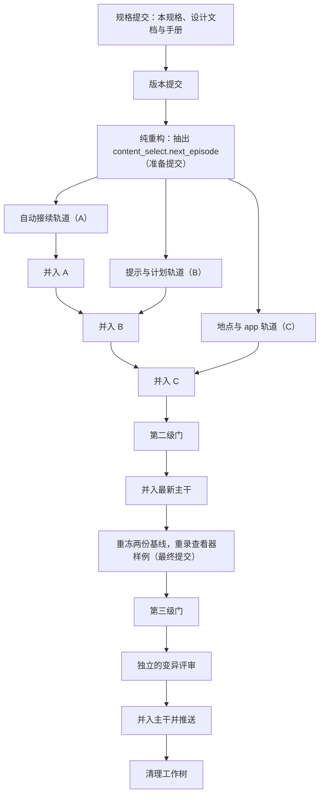

# 实施顺序与验收

> 本章属于[手机优先的空闲时间与空闲时的死路：开发规格](../SPEC-free-time-dead-ends.md)，读法和叫法见那一页。

## 目标与依据

人物和数据集作者看不到实施的中间过程，他们只面对两种状态：今天的主干，和整次改动一次并入主干之后。今天，她在空闲时打开抖音，放完一条九十秒的短视频这次使用就停下，要她收尾、再选一次；离一条放完不足三分钟时她不能暂停去点外卖；零点的计划照星期几排上班；关着的电话 app 只说「not available today」。并入之后，信息流一条接一条放到某个唤醒为止，随时可以暂停，计划照上班安排写，关着的 app 写明下次什么时候开。本章规定其余各章怎样分步落到一条集成分支上、每一步凭哪一级测试门放行、最后凭什么说「定下的事一件没落、没定的事一件没做」。

所有者在本次会话里提的要求（2026-10-15）：「实现spec描述功能，不允许defer任何待实现内容（通过测试用例保证），也不要做spec里没有描述的功能」；「请在自己的worktree上开发, 实现完成后merge to main and push to remote，清理worktree」。提案的相关几处：「Update the design chapters before the code」；「Re-freeze both complete-day baselines and re-record the viewer fixture once, after all approved WorldMock source changes have landed」；「Keep or re-anchor the source mutations in `tests/dataset_acceptance.py`」；「Coordination with in-flight work」。裁决清单的「Tracks」一节和「Tests and acceptance mechanics」一节由本章落实。

今天的验收靠下面这些，本次原样沿用，不新增门：

- 登记的源码变异：`tests/dataset_acceptance.py` 里 142 条 `SourceMutation`。静态检查锚点在符号里唯一、可编译、杀手存在且没被跳过（`tests/system/mutations/test_source_mutations.py:10-23`，杀手解析在 `tests/acceptance_guard.py:43`）；每条变异在新的解释器里只跑它的杀手，未变异的那一趟上限 300 秒、每条变异上限 180 秒（`tests/system/mutations/test_dataset_acceptance.py:16`、`:24`），只承认真实的断言失败。变异按模块名注入，只对按模块名导入的生产代码生效（`tests/mutation_runner.py:7-9`）。
- 缺省的 release 档：预期失败标记在收集时被拒（`tests/conftest.py:74-81`），任何一次跳过都让会话失败（`:87-102`）。
- 覆盖率门：分支覆盖率不低于 85.0、未覆盖的公共接口为零（`scripts/coverage_gate.py:24`、`:218-222`），范围是 `src/worldmock`、`custom/agents`、`custom/envs`（`:25`）。
- 风格门：违规为零，没有豁免清单；每行至多 120 字符、每函数至多 50 行与 5 个入参、每文件至多 2000 行、每个函数有带中文的说明（`tests/unit/engineering/test_style_gate.py:18-21`、`:74`）。
- 两份完整日基线逐字比较整份导出、检查点和运行素材；它们在主干上已经过期（`5dc50272` 之后没有重冻），录制样例与代码相符。核查经过见[「版本、身份与基线」](./08-versions.md)。
- 本机的工具：解释器入口 `.work/tools/envrev/py.sh`、工作树准备 `.work/tools/envrev/prepare_wt.sh`、分片过门 `.work/tools/envrev/gate.py`（都在主检出下，不上库）。

## 行为规格

### 用词

| 词 | 含义 |
| --- | --- |
| 集成分支、集成工作树 | `feat/free-time-dead-ends`，检出在主检出下的 `.work/wt/ftde`。整次改动在它上面完成，最后一次并入主干 |
| 集成者 | 做准备步骤、逐条并入轨道、做收尾的那一个实施者 |
| 准备提交 | 准备步骤的最后一个提交，三条轨道都从它开分支。它的提交号写在 `.work/free-time-dead-ends/prep-commit.txt` |
| 轨道 | 由一个实施者在自己的工作树里完成、作为一个整体并入集成分支的一组改动：代码、测试、夹具。三条：自动接续轨道（下文也写 A）、提示与计划轨道（B）、地点与 app 轨道（C） |
| 并入 | 把一条轨道的分支合进集成分支，用合并提交，标题以 `merge:` 开头 |
| 第一级门、第二级门、第三级门 | 三级测试门，定义见「测试要求」。第一级门每条轨道每次提交前跑；第二级门三条轨道都并入之后跑一次；第三级门在最终提交上跑一次 |
| 与样例绑定的三个测试文件 | `tests/system/lifecycle/test_complete_day_baseline.py`、`tests/system/lifecycle/test_run_viewer_recording.py`、`tests/system/viewer/test_run_viewer.py` |
| 中间提交、最终提交 | 从版本提交起（含）到重冻之前的提交是中间提交；重冻、重录之后、并入主干之前的那个提交是最终提交 |
| 会让基线失效的改动 | 动了下面任何一样的改动：`src/`、`custom/` 下任何 `.py` 文件的任何字节（注释也算）；`scripts/render_day.py`；样例环境的任何一行或清单字段；两个脚本化的日子（`tests/life/day_baseline_runtime.py`）和录制它们用到的助手（`tests/life/conftest.py` 的请求助手与 `stage_day_plan`、`tests/life/environment_runtime.py`、`tests/frozen_inputs.py` 的 `fixture_metadata`、`tests/integration/runtime_fixtures.py` 的 `current_run_identity` 与 `write_agent_workspace`、`tests/dayrun_baseline.py`）；根目录的 `pyproject.toml`、`uv.lock`。录制样例另外绑定系统层、工具定义、录制那一刻各层的内容，以及 `tests/system/lifecycle/test_run_viewer_recording.py` 的 `_recorded_viewer_requests` 和它调用的助手 |
| 回执 | 各道门的输出和本章要求记下的提交号，写在集成工作树的 `.work/free-time-dead-ends/` 下，不上库；最后搬到主检出的同名目录 |

### 总览



- 整次改动只有一条集成分支，只并入主干一次。主干上规则版本与导出清单两个号各变一次，两份基线和录制样例各重做一次。
- 设计文字先行：设计正文与手册的改动随本规格的提交一起落下（[「设计文档与手册」](./07-design-docs.md)），之后各轨道不另改设计正文。实现中发现正文有一句写错了：这句话在那一章列给本轨道所实施各章的小节里，就由这条轨道先改正文、再改代码，并在第一级门加跑文档链接检查和设计汇编；在别的小节里，交给那条轨道或集成者，不自己动手。
- 三条轨道互不依赖，同时开工，各用各的工作树；彼此的先后只是并入的次序。
- 变异跟着规则走：每个定下的事项只登记一条源码变异，由实施它所守规则的那条轨道在同一次并入里连同杀手登记，不攒到收尾。
- 不调用模型服务。全部工作离线完成。

### 准备步骤

由集成者在集成分支上串行做三个提交，三条轨道都从第三个提交开分支。

| 提交 | 改什么 | 提交标题 | 放行 |
| --- | --- | --- | --- |
| 规格提交 | 本规格的入口页与各章；[「设计文档与手册」](./07-design-docs.md)一章列出的设计正文与手册改动；提案里所有者答复的记录 | `docs: specify phone-first free time and fixes for free-time dead ends` | `scripts/documentation_gate.py` 报 0 个问题；`scripts/build_design_doc.py` 成功。不涉及测试 |
| 版本提交 | 两个常量、样例环境清单的规则版本并刷新、全部钉住旧值的断言、换掉两条锚在旧常量上的变异，逐项见[「版本、身份与基线」](./08-versions.md)「版本提交」 | `chore(versions)!: bump rules 6 and export 7 for phone-first free time` | 第一级门，选测的基点是规格提交；另跑那一章的两条变异 |
| 纯重构 | 把 `interact.InteractivityRuntime._complete_content`（`src/worldmock/life/interact.py:161-186`）里挑下一集的几行（`:166-175`）原样搬进 `content_select.next_episode(catalog, agent, content, rounds) -> Content | None`：`content.series` 为空时返回 `None`；否则按目录索引 `contents_by_series` 的次序，在同一系列里取集号更大、且没有进度记录或完成轮数小于 `rounds` 的第一集，没有就返回 `None`。`_complete_content` 改成调用它，行为一个字节不变 | `refactor(life): extract the next-episode choice into content_select.next_episode` | 第一级门，选测的基点是版本提交；另把系列接续的现有用例全部列进清单：`tests/unit/life/test_environment_content.py`、`tests/unit/life/test_content_and_commerce_boundaries.py`、`tests/unit/life/test_result_contents.py`、`tests/integration/life/test_result_contents.py`、`tests/integration/footprints/test_render_day.py`、`tests/integration/life/test_location_meal.py`、`tests/integration/life/test_grocery_cooking.py`。不改任何测试，不登记变异 |

- 纯重构提前做，是因为两条轨道都要用这个函数：自动接续轨道在接续顺序的第一行用它，地点与 app 轨道在暂停拒绝里用它判断「还会接下一集」（[「地点系列、暂停拒绝与关着的 app」](./05-places-and-apps.md)）。之后只有自动接续轨道改 `content_select.py`，地点与 app 轨道只调用 `next_episode`、不改它。
- `next_episode` 是新的公开函数，覆盖率门要求它的函数体每一行都被执行到；系列接续的现有用例已经走到它，不另写用例。它带中文 `@brief` 说明，不超过 50 行；`content_select` 已经导入 `Catalog`、`Content`、`AgentState`，不新增函数内导入。
- 三个提交做完，把准备提交写进回执：`git rev-parse HEAD > .work/free-time-dead-ends/prep-commit.txt`。

### 三条轨道

每条轨道一个分支、一个工作树，都从准备提交开出，都用 `prepare_wt.sh` 准备（每个工作树要有自己通过的 `.work/environment-receipt.json`，`tests/unit/engineering/test_freeze_rrs_baseline.py` 等用例读所在检出的这份回执）：

```sh
ROOT=C:/Users/56865/OneDrive/Documents/HoldThatThgt/WorldMock
R=$ROOT/.work/wt/ftde/.work/free-time-dead-ends
PREP=$(cat "$R/prep-commit.txt")
cd "$ROOT/.work/wt/ftde"
git worktree add -b feat/free-time-dead-ends-autoplay "$ROOT/.work/wt/ftde-a" "$PREP"
git worktree add -b feat/free-time-dead-ends-prompt-plan "$ROOT/.work/wt/ftde-b" "$PREP"
git worktree add -b feat/free-time-dead-ends-places-apps "$ROOT/.work/wt/ftde-c" "$PREP"
for wt in ftde-a ftde-b ftde-c; do bash "$ROOT/.work/tools/envrev/prepare_wt.sh" "$ROOT/.work/wt/$wt"; done
```

各轨道独占的文件（某一章的「接口与文件指引」另列了文件时，以那一章为准，归实施那一章的轨道）：

| 轨道 | 实施的章 | 生产文件 | 测试与夹具 |
| --- | --- | --- | --- |
| 自动接续（A） | [「内容 app 自动接续」](./01-autoplay.md)、[「自动接续的显示与记录」](./02-autoplay-display.md) | `src/worldmock/life/content_select.py`（`autoplay_content`、`OpeningDuration` 与 `opening_duration`，删 `content_duration_range`；`next_episode` 已在准备步骤抽出）、`interact.py`、`activity_control.py` 的 `pausable`、`ending_phrase`、`objective_progress` 与新增的 `_app_use_progress`（连同 `PAUSE_MIN_REMAINING_SECONDS` 的注释、`control_refusal` 与 `_pause_refusal` 的说明）、`activity_evidence.py`、`session_actions.py`（只改 `_conclude_activity`、`_pause_activity` 的说明）、`activity_titles.py` 与 `time_advance.py` 里进度事件的快照、`tool_layer.py` 的 `_app_facts` 与新增的 `_app_duration`、`settled_text.py`、`result_projection.py`、`prompt_schemas.py` 的 `_CONTENTS`、`_CONTENTS_OMITTED`、`_RESULT_DETAILS`；`src/worldmock/footprints/display_wording.py`；`scripts/render_day.py` 的模块说明；`tools/run-viewer-wording.js` | `tests/fixtures/display-wording-cases.json`；`tests/life/environment_runtime.py`（新增 `conclude_app_use`）、`tests/life/environment_inputs.py` 里新增的副本助手（`five_episode_environment` 和「内容 app 自动接续」要的两份）、`tests/life/day_baseline_runtime.py` 的 `_activity_day`、`tests/footprints/recording.py`；用 `use_app` 或 `side_arguments("interact", …)` 打开 app、要跟着迁移的全部现有用例；`tests/system/viewer/run_viewer.test.cjs` 里新增的一条、`run_viewer_context.test.cjs` 的手抄样本、`run_viewer_wording.test.cjs`；两章的新用例文件和[「版本、身份与基线」](./08-versions.md)一章的 `tests/integration/footprints/test_autoplay_export.py`；`tests/dataset_acceptance.py` 里的 A 块 |
| 提示与计划（B） | [「系统层措辞」](./03-system-layer.md)、[「零点计划、上班安排与明天」](./04-day-plan.md)、[「饭点的食欲加成」](./06-appetite.md) | `src/worldmock/agents/life_prompt.py`；`src/worldmock/life/day_planning.py`、`day_plan_inputs.py`、`work_schedule.py`、`environment_layer.py`、`felt.py`；`prompt_schemas.py` 的 `_DUTY`、`_TOMORROW`、`ENVIRONMENT_LAYER_SCHEMA` 与对 `work_schedule` 的导入；`tools/run-viewer-context.js` 环境层的说明 | 逐字钉住系统层的四个文件（`tests/unit/start_interfaces/test_system_layer_text.py`、`tests/unit/agent_protocol/test_decision_context_protocol.py`、`tests/integration/runtime/test_seven_layer_request.py`、`tests/integration/runtime/test_life_agent_protocol.py`）；上班安排、环境层、食欲的现有用例（`tests/unit/life/test_work_schedule_boundaries.py`、`tests/integration/runtime/test_same_second_continuation.py`、`tests/unit/life/test_body_felt_sleep_boundaries.py`、`tests/integration/life/test_location_meal.py` 里各章点名的几条）；`tests/system/viewer/run_viewer.test.cjs:187-191` 那一条的规则列表；三章的新用例文件；`tests/dataset_acceptance.py` 里的 B 块 |
| 地点与 app（C） | [「地点系列、暂停拒绝与关着的 app」](./05-places-and-apps.md) | `src/worldmock/life/location_activities.py`；`tool_layer.py` 的 `_activity_target`、`_binding_target` 与它们要的导入；`content_prerequisite.py`；`activity_control.py` 的 `_unpausable_refusal`、新增的 `_continues_with_next_episode` 与对 `next_episode` 的导入 | 前提子句措辞的现有用例（`tests/unit/life/test_error_contract.py`、`tests/integration/life/test_content_start_evidence.py::test_clock_in_refusal_repeats_the_tool_layer_reason_and_changes_nothing`）；`tests/unit/life/test_pause_limit.py` 的两个造数助手；这一章的六个新用例文件；`tests/dataset_acceptance.py` 里的 C 块 |

几条轨道都要碰的文件，一律按下面的办法分开：

| 文件 | A | B | C |
| --- | --- | --- | --- |
| `src/worldmock/life/activity_control.py` | `pausable`、`ending_phrase`、`objective_progress`、`_app_use_progress` 和上表所列的注释与说明 | — | `_unpausable_refusal`、`_continues_with_next_episode`，导入区加一行 |
| `src/worldmock/life/tool_layer.py` | `_app_facts`、`_app_duration`，`content_select` 那一行导入 | — | `_activity_target`、`_binding_target`，`location_activities` 那一行导入和新的 `content_prerequisite` 导入 |
| `src/worldmock/life/prompt_schemas.py` | `_CONTENTS`、`_CONTENTS_OMITTED`、`_RESULT_DETAILS`（`contents_omitted` 单独一行） | `_DUTY`、`_TOMORROW`、`ENVIRONMENT_LAYER_SCHEMA`，`work_schedule` 那一行导入 | — |
| `src/worldmock/life/content_select.py` | 新增与删除的函数 | — | 只调用 `next_episode`，不改这个文件 |
| `tests/dataset_acceptance.py` | A 块；锚点在 A 改的文件里的现有登记 | B 块；同上 | C 块；同上 |
| `tests/unit/engineering/test_single_source.py` 的 `OWNERS` | `footprints/display_wording.py` 一项及各章新增的归宿 | `life/work_schedule.py` 一项 | `life/location_activities.py`、`life/content_prerequisite.py` 两项 |
| `tests/unit/engineering/test_import_graph.py` 的 `DELAYED_IMPORTS` | 不改 | `environment_layer._tomorrow` 一条 | 不改 |
| `tests/unit/life/test_pause_limit.py` | `test_an_interaction_is_pausable_with_three_minutes_left_and_not_with_one_second_less`、`test_pause_refusal_names_the_activity_and_says_it_ends_in_under_three_minutes`、`test_second_slot_conflict_follows_the_same_limit`、`test_sleep_constraint_offers_pausing_only_while_the_second_slot_occupant_can_still_be_paused` 里内容 app 那一半的期望（随时可暂停） | — | `_ending_in`、`_control` 两个造数助手；同一条用例，后并入的 C 在 A 的改动之上改 |
| `tests/integration/life/test_pause_limit.py` | 改 Keep 那几条（app 使用随时可暂停） | — | 不改；会接下一集的暂停拒绝写在新文件 |
| `tests/integration/life/test_content_start_evidence.py` | 只改 app 行时长的两条断言；依赖 app 只放一条的用例函数这里没有（「内容 app 自动接续」一章核对过） | — | 改模块常量 `CLOCK_REFUSALS` 的周六两行（`:167-170`），新文件 `test_closed_app_state.py` 也导入这个常量 |
| `tests/system/viewer/run_viewer.test.cjs` | 文件末尾新增一条 `test(...)` | 只改 `:187-191` 那条用例的规则列表 | — |

只有一条轨道改的测试文件（例如只归 A 的 `tests/integration/life/test_environment_runtime.py`、`tests/life/environment_inputs.py`，只归 B 的 `tests/integration/life/test_location_meal.py` 里食欲那一条）不进上表。规则只有三条：

- 共用的文件里各改各的函数，不改别人的函数；同一个函数两条轨道都要改时，等先并入的一方并入之后，后一方在它的基础上改。导入区是最常见的冲突处，解法是取并集。
- 新用例写在新文件里，不往别的轨道也要改的测试文件里加函数。查看器的 Node 用例是唯一的例外：`tests/system/viewer/test_run_viewer.py` 只跑点名的三个 `.cjs` 文件，新开一个 `.cjs` 文件就进不了门，所以 A 的新用例追加在 `run_viewer.test.cjs` 末尾，B 只改已有那一条的列表。
- `tests/dataset_acceptance.py` 里每条轨道在 `MUTATIONS` 元组末尾加一个带起止注释的块，块的次序就是并入的次序：

  ```python
      # ---- 自动接续轨道（A）：「内容 app 自动接续」「自动接续的显示与记录」 ----
      SourceMutation(...),
      # ---- 自动接续轨道（A）结束 ----
  ```

  锚点被本轨道改写或搬走的现有登记就地改原文与替换文（或符号），杀手不变；版本提交那两条在原位置。`OWNERS`、`DELAYED_IMPORTS` 冲突时取并集再重跑这两个测试。

### 并入

- 次序：自动接续轨道、提示与计划轨道、地点与 app 轨道。
- 每条轨道并入之前，先在自己的工作树里把集成分支的头并进来（`git merge feat/free-time-dead-ends`），解完冲突，重跑自己的第一级门。这样集成者的合并不会再有冲突，合并结果就是轨道刚测过的那棵树。后并入的一方负责解冲突，不删对方新增的代码和断言。
- 集成者在集成工作树里合并：

  ```sh
  cd "$ROOT/.work/wt/ftde"
  git merge --no-ff feat/free-time-dead-ends-autoplay -m "merge: content-app auto-play, its display and records (track A)"
  ```

  B、C 同样，标题分别是 `merge: system-layer wording, day plan, tomorrow and appetite (track B)`、`merge: running series row, pause refusal and closed-app openings (track C)`。
- 每次合并之后，集成者跑一次几分钟的自查：`tests/unit/engineering/` 全部和 `tests/system/mutations/test_source_mutations.py`，输出写进回执 `gates/merge-<轨道>.log`。不过时由那条轨道在自己的分支上修好再并入一次。
- 三条都并入之后跑第二级门。

集成分支各个时点上的样子（只有最后一行是人物会遇到的）：

| 集成分支走到哪 | 她打开抖音 | 系统层 | 环境层与零点计划 | 地点系列与关着的 app |
| --- | --- | --- | --- | --- |
| 今天（`2ecd868d`） | 放一条就停、等收尾；离一条放完不足三分钟不能暂停 | 今天的二十条 | 没有明天，上班安排没有说明；模板只说不能改班次；吃饱了在饭点仍「有点想吃」 | 系列行只写已做多久、还剩多久；关着的 app 只说今天不开 |
| 准备步骤之后 | 同今天。规则版本已是 6、导出清单已是 7，规则与导出行都还是旧的 | 同今天 | 同今天 | 同今天 |
| 自动接续轨道并入之后 | 一条接一条，只接可推送的；随时可以暂停；收尾说「结束使用」；标题只列三条 | 同今天：还没有一句讲自动接续 | 同今天 | 同今天 |
| 提示与计划轨道并入之后 | 同上 | 七条定稿；其中讲「进行中活动的 state」的那一句，地点系列的进度说明还没有 | 有明天与说明；新模板；饭点加成只在饿时才加 | 同今天 |
| 地点与 app 轨道并入之后，到最终提交 | 同上 | 同上 | 同上 | 系列行写第几集与供餐；还会接下一集时的暂停拒绝；关着的 app 写下次开放 |

中间那几行是集成分支上的过渡，只在中间提交上存在，不带开关、不留别名；中间提交不调用模型，也不产生真实运行。

### 中间提交排除的三个文件

两份基线从版本提交起与代码不符（它们在主干上本来就已过期），录制样例从提示与计划轨道并入起不符。为了只有一条规则，与样例绑定的三个测试文件从版本提交起一律在命令行上排除，直到最终提交：

- `tests/system/lifecycle/test_complete_day_baseline.py`
- `tests/system/lifecycle/test_run_viewer_recording.py`
- `tests/system/viewer/test_run_viewer.py`

`gate.py` 不带 `--final` 时自动排除这三个文件（`INTERMEDIATE_EXCLUDED`）。被排除的 `test_run_viewer.py` 正是执行全部查看器 Node 用例的那个文件，所以 Node 用例改由 `node --test` 直接跑三个 `.cjs` 文件；只允许读录制样例 `viewer-context.json` 的那几条失败。排除只写在命令行上，任何测试文件里都不加跳过或预期失败标记：release 档会拒绝收集或把会话改成失败，覆盖率门也不接受 JUnit 里有跳过。`tests/system/lifecycle/test_complete_day_scripts.py` 不在排除之列，中间提交上必须通过：所以 `_activity_day` 归自动接续轨道，随自动接续一起改。

### 收尾

1. **并入最新主干。** 有界重试地取主干（本机到 GitHub 的连接时常在握手时失败）：

   ```sh
   fetch_main() { for i in 1 2 3 4 5 6 7 8 9 10; do GIT_TERMINAL_PROMPT=0 timeout 170 \
     git -c http.lowSpeedLimit=200 -c http.lowSpeedTime=90 fetch origin main && return 0; sleep 5; done; return 1; }
   cd "$ROOT/.work/wt/ftde" && fetch_main && git merge origin/main
   ```

   主干没有新提交时这一步什么都不做。带来了会让基线失效的改动，或者与本次改动的文件冲突时，解完冲突后先过一遍第二级门再往下走。可能并入的在途工作：模拟对话草案也改 `interact.py`、`content_select.py` 和「世界请求登记后由环境结算」那一条，上下文压缩草案也加一句主观看法不是事实，三份都改零点计划的输入；谁后落谁合并，两边的规则都保留，逐字钉住系统层的用例一起改。
2. **重冻两份基线、重录查看器样例。** 照[「版本、身份与基线」](./08-versions.md)「两份完整日基线」的规程：两个独立进程各录一份候选，冻结两份基线，用真实宿主重录样例，跑与样例绑定的三个测试文件，两个提交。这时的头就是最终提交。
3. **第三级门。** 见「测试要求」。不过时看修的是什么：做了会让基线失效的改动，就回到重冻那一步在新的提交上重做；修的只是别的测试或文档，重过第三级门即可。
4. **独立的变异评审。** 见「测试要求」。评审只做一轮。评审带来任何提交，都在新的头上重过第三级门。
5. **并入主干并推送。** 先再取一次主干：主干在这期间多了提交，就回到「并入最新主干」那一步。没有的话，在分离的主干头上做合并提交并推送，合并提交的树必须与最终提交相同：

   ```sh
   cd "$ROOT/.work/wt/ftde" && fetch_main                     # fetch_main 的定义见「并入最新主干」
   git merge-base --is-ancestor origin/main feat/free-time-dead-ends   # 不成立就回到「并入最新主干」
   git switch --detach origin/main
   git merge --no-ff feat/free-time-dead-ends -m "merge: phone-first free time and fixes for free-time dead ends"
   git diff --exit-code feat/free-time-dead-ends HEAD
   for i in 1 2 3 4 5 6 7 8 9 10; do GIT_TERMINAL_PROMPT=0 timeout 170 git push origin HEAD:main && break; sleep 5; done
   git rev-parse HEAD > "$R/main-merge.txt"
   git switch feat/free-time-dead-ends
   ```

   推送被拒（主干刚好又动了）时同样回到「并入最新主干」。推送成功后，主检出里的本地 `main` 只在没有已跟踪文件的改动时快进：`git -C "$ROOT" status --porcelain --untracked-files=no` 没有输出，才 `git -C "$ROOT" merge --ff-only origin/main`；否则不动它，在回执里写明。
6. **清理工作树。** 先把回执搬到主检出，再拆工作树；每个工作树的 `.venv` 是指向主检出虚拟环境的目录联接，先解除联接再删，否则会连主检出的虚拟环境一起删掉。集成工作树最后拆，从主检出执行：

   ```sh
   cd "$ROOT" && mkdir -p "$ROOT/.work/free-time-dead-ends" && cp -r "$R/." "$ROOT/.work/free-time-dead-ends/"
   for wt in ftde-a ftde-b ftde-c ftde-review ftde; do
     cmd //c rmdir "$(cygpath -w "$ROOT/.work/wt/$wt/.venv")"
     git -C "$ROOT" worktree remove --force "$ROOT/.work/wt/$wt"
   done
   for b in feat/free-time-dead-ends-autoplay feat/free-time-dead-ends-prompt-plan \
            feat/free-time-dead-ends-places-apps feat/free-time-dead-ends; do
     git -C "$ROOT" merge-base --is-ancestor "$b" origin/main && git -C "$ROOT" branch -D "$b"
   done
   git -C "$ROOT" worktree prune && git -C "$ROOT" worktree list
   ```

### 定下的事不落下

所有者要求「不允许 defer 任何待实现内容，通过测试用例保证」。四道保证一起用，缺一不可；不加扫描字样的守卫测试。

| 保证 | 做法 | 它挡住什么 |
| --- | --- | --- |
| 每条规则一条经真实路径的行为测试 | 各章「行为规格」里的每条规则都出现在该章「测试要求」里规则与用例的那张表里；凡是引擎规则，测试经真实请求、引擎和 SQLite：`engine_factory` 建引擎，`act`、`act_group` 提交，读落库的事件，需要时导出并认证。只断言助手函数不算数 | 规则根本没有实现；规则只在助手里成立 |
| 每个定下的事项一条登记的变异 | 各章变异表合计 23 条（逐条见各章「测试要求」的变异表，本章不重列），其中[「版本、身份与基线」](./08-versions.md)的两条顶替现有的两条，登记表从 142 条变成 163 条。锚点取实现后的真实源码，在符号里只出现一次；杀手在 unit 或 integration 层、直接导入被变异的模块；变异套件只承认真实的断言失败 | 测试存在但不咬人：把规则改坏了测试照样通过 |
| release 档 | 缺省就是 release 档：预期失败在收集时被拒，任何一次跳过让会话失败 | 用跳过或预期失败把没做完的测试挂起来 |
| 覆盖率门 | 新增的每个公开函数，函数体每一行都要被测试执行到；分支覆盖率不低于 85% | 写了接口没有接线；从来走不到的分支 |

另外 `tests/unit/engineering/` 的结构守卫每一级门都跑：风格门（违规为零）、单一归宿（一条规则一个归宿、没有克隆的函数体和规则表）、函数内导入登记表、分层。

四道保证各自管不到的地方：

- 一个事项里不是中心的其余规则不另登记变异，由行为测试守住：规则没有实现时，它的行为测试本来就不通过。
- 系统层和零点计划模板是写给模型看的文字，由逐字钉住它们的用例守住，不登记变异（[「系统层措辞」](./03-system-layer.md)、[「零点计划、上班安排与明天」](./04-day-plan.md)）。唤醒句与唤醒表的对应由[「系统层措辞」](./03-system-layer.md)的守卫用例保持。
- 查看器的 JavaScript 不能登记变异（变异的符号只能在 `worldmock.`、`custom.`、`scripts.` 之下），它的显示规则由 `tests/system/viewer/*.cjs` 的用例守住，并经两种语言共读的 `tests/fixtures/display-wording-cases.json` 与 Python 一侧对齐。
- 设计正文和手册没有行为可测；文档链接检查和设计汇编只保证链接不断、汇编得出来，内容写没写全靠规格提交之前对照[「设计文档与手册」](./07-design-docs.md)逐条落笔。
- 「不做的事」（spec 里没有描述的功能）没有测试能证明不存在；靠独立变异评审时通读准备提交到最终提交的差异，核对每一处生产改动都能对到某一章的某条规则。

### 完成判据

下面每一项都成立，整次改动才算实施完成。「文档已经改了」不算完成，接受未知字段或保留旧路径也不算。回执都在 `.work/free-time-dead-ends/` 下。

- [ ] 规格提交、版本提交、纯重构三个提交在集成分支上；`prep-commit.txt` 记着准备提交。
- [ ] 版本提交、纯重构和三条轨道各自的第一级门通过：`gates/l1-version/`、`gates/l1-refactor/`、`gates/l1-a/`、`gates/l1-b/`、`gates/l1-c/` 下的 `gate-summary.json` 里 `results.tests` 为真、JUnit 没有失败、错误和跳过、`still_failing` 为空；各自的 `mutations.log` 里本步登记的每条变异用例都通过；自动接续轨道和提示与计划轨道另有 `viewer-js.log`，里面失败的只有读录制样例的用例。
- [ ] 三条轨道按 A、B、C 的次序并入，各有一份通过的 `gates/merge-<轨道>.log`。
- [ ] 第二级门通过：`gates/l2/gate-summary.json`、`gates/l2/viewer-js.log`（只有读录制样例的用例可以失败）、`gates/l2/documentation_gate.log`、`gates/l2/build_design_doc.log`。
- [ ] 集成分支包含主干此刻的头。
- [ ] 两份基线重冻、录制样例重录：`day-baseline/first/`、`day-baseline/second/` 下的四份候选，两份冻结日志都是 `Complete-day baseline published`；[「版本、身份与基线」](./08-versions.md)列的不变项全部成立。
- [ ] 第三级门通过：`gates/l3/gate-summary.json` 里 `final` 为真、`dirty_worktree` 为假、`documentation_gate`、`build_design_doc`、`tests`、`coverage_gate` 四项全真，JUnit 没有失败、错误和跳过，`still_failing` 为空，单独重跑才通过的只有带墙钟上限的用例；`gates/l3/coverage-report.json` 分支覆盖率不低于 85.0、未覆盖的公共接口为空。
- [ ] 登记的源码变异全部被杀死（第三级门里的 `tests/system/mutations/test_dataset_acceptance.py`），各章变异表的 23 条都已登记。
- [ ] 每章「测试要求」里规则与用例那张表中标「新」的用例都存在：把它们的节点写进 `new-tests.txt`，`$PY -m pytest --collect-only -q $(cat "$R/new-tests.txt")` 一条不缺，输出存成 `new-tests.log`。
- [ ] 独立的变异评审做完：`mutation-review/probes.json`、`mutation-review/receipts/`、`mutation-review/summary.txt`；没有存活的探针，或存活的都已补上测试、并在新的头上重过了第三级门。
- [ ] 升号核对写进 `versions.txt`：

  ```sh
  git log --oneline 2ecd868d..HEAD -G'^RULES_VERSION = ' -- src/worldmock/exchange/constants.py
  git log --oneline 2ecd868d..HEAD -G'^EXPORT_SCHEMA_VERSION = ' -- src/worldmock/footprints/export.py
  git diff --stat 2ecd868d HEAD -- pyproject.toml uv.lock requirements .python-version patches
  ```

  前两条都只列出版本提交，最后一条没有输出。
- [ ] 没有变的号：目录格式 5、世界状态 14、运行清单 6、质量报告 8、两份 TOML 的 2、三个评估标识、AgentSociety2 摘要、样例环境的环境版本 `"4"`。
- [ ] 合并提交已推到主干：`main-merge.txt` 记的提交号等于 `git ls-remote origin main` 的输出。
- [ ] 主检出的本地 `main` 已快进到它，或者回执里写明了没动的原因。
- [ ] 工作树已清理：`git worktree list` 里没有 `ftde` 一族；回执已搬到主检出的 `.work/free-time-dead-ends/`。
- [ ] 结果按[「版本、身份与基线」](./08-versions.md)「证据层级」报告：离线套件已取得；持续集成、模型回放、真实模型的新运行写「未取得」。

### 提案的各项写在哪一章

只是本规格之内的阅读索引：测试不解析它，也不为它另建台账。每一行的行为测试和变异在所指那一章的「测试要求」里。

提案「Changes」一节（总图里的节点写在出处栏）：

| 出处 | 事项 | 写在哪一章 | 轨道 |
| --- | --- | --- | --- |
| 总图 Feed；「Content-app uses auto-play」首段 | 自动接续只用于内容 app 的使用，地点单元照旧 | 「内容 app 自动接续」 | A |
| 同一节 | 只从可推送的内容里接，推翻合同「自动接续不由 pushable…决定」一句 | 「内容 app 自动接续」；设计文字在「设计文档与手册」；数据集要做的在「版本、身份与基线」 | A；规格提交 |
| 接续表·一集之后 | 接同一系列的下一集，前提照旧不再判定 | 「内容 app 自动接续」 | A（`next_episode` 在准备步骤） |
| 接续表·系列最后一集之后 | 接这个 app 最近看过、开始了没看完的另一部系列 | 「内容 app 自动接续」 | A |
| 接续表·单条之后 | 随机接一条没看过的可推送内容（所有者答复采纳） | 「内容 app 自动接续」 | A |
| 接续表·没有候选 | 停下、等收尾 | 「内容 app 自动接续」 | A |
| 同一节 | 不回放；打开顺序不变；只抽此刻合格的；抽取键与 `draw_index`、`previous_content_id`；预留的内容；正在放的 app 的推送留到下次打开 | 「内容 app 自动接续」 | A |
| 同一节 | 不声明时长；只在已有的唤醒时决策，条目边界不加决策；一次收尾覆盖整次使用，说法不说提前结束 | 「内容 app 自动接续」 | A |
| 同一节 | 每条各自结算；进度事件只带当前一条和条数；结束结果保留结构化清单 | 「内容 app 自动接续」（快照）；「自动接续的显示与记录」（结果明细）；「版本、身份与基线」（导出清单 7） | A；版本提交 |
| Area 表·Engine | `_complete_content` 照接续顺序抽下一条；`content_select` 多一个接续顺序 | 「内容 app 自动接续」 | A |
| Area 表·Content-app row | app 行的时长按每条写 | 「自动接续的显示与记录」 | A |
| Area 表·Activity row | 进行中的 app 使用写已用多久、放到第几条（措辞改成「放到第 K 条」，理由在那一章） | 「自动接续的显示与记录」 | A |
| Area 表·Titles | 标题只列三条加「等 K 条」 | 「自动接续的显示与记录」 | A |
| Area 表·Pause | app 使用随时可暂停；地点单元的拒绝改措辞 | 「内容 app 自动接续」；「地点系列、暂停拒绝与关着的 app」 | A；C |
| Area 表·Design | 设计正文的几处 | 「设计文档与手册」 | 规格提交 |
| 同一节末段 | 刷信息流时点外卖、去睡觉要先暂停或收尾 | 不改行为；暂停随时可用见「内容 app 自动接续」 | A |
| 总图 NoRest、Persona、Pools；「Removing 在家休息…」一节 | 删在家休息、手机优先的人设、各 app 的内容池 | 不在本次范围：数据集仓库的事，逐行列在「版本、身份与基线」 | — |
| 同一节末段 | 「自己的看法不限制能做的事」这一句是必需的 | 「系统层措辞」 | B |
| 总图 Chores、Mall、Floor；「Home chores and places that offer nothing」一节 | 家务单元、简介改写、商场与肯德基、三道底线检查与 `home-rest` 检查、白领要改的钉子 | 不在本次范围：数据集仓库的事 | — |
| 总图 Idle；「Meals and waiting」 | 时间不走、什么会打断：补在「每次决策以世界请求结束」之后，并与唤醒表保持一致 | 「系统层措辞」 | B |
| 总图 Series；同一节 | 进行中的地点系列行写第几集与供餐 | 「地点系列、暂停拒绝与关着的 app」 | C |
| 总图 Meal；同一节 | 「解饿只有两种办法」里系列的 note 改为「或进行中活动的 state」 | 「系统层措辞」 | B |
| 同一节 | 暂停拒绝改说当前这一条或这一集结束，会接着放的不说 let it finish | 「地点系列、暂停拒绝与关着的 app」（地点单元）；「内容 app 自动接续」（app 使用不再走到这条拒绝） | C；A |
| 同一节末段 | 需要决定的吃饭事项 | 饭点加成见「饭点的食欲加成」（所有者答复）；买菜包措辞不改（所有者答复）；人设没覆盖的饭点归数据集仓库 | B；— |
| 总图 Phone；「Contacts and social need」 | 母亲的电话每个休息日开放、改名、按人设核对的测试 | 不在本次范围：数据集仓库的事 | — |
| 总图 Opens；同一节表·Next opening in the clause | 前提子句写七天里的下次开放 | 「地点系列、暂停拒绝与关着的 app」 | C |
| 总图 Opens；同一节表·Time state on content-app rows | 内容 app 行的 `state` 写开放时段，不被槽位或先收尾的说明盖住 | 「地点系列、暂停拒绝与关着的 app」 | C |
| 同一节 | 在微信里选王磊的会话 | 不在本次范围：属于模拟对话提案 | — |
| 同一节 | 社交需要的增长率 | 不在本次范围：数据集作者的决定（`persona.toml` 的字段） | — |
| 总图 Template；「The day plan」 | `PLAN_DAY_PROMPT` 换句 | 「零点计划、上班安排与明天」 | B |
| 总图 Note；同一节 | 上班安排的 `note` | 「零点计划、上班安排与明天」 | B |
| 总图 PlanRule；同一节 | 计划里的事找不到做法时用 `revise_day_plan` 改掉 | 「系统层措辞」 | B |
| 总图 Ground；同一节 | 零点计划的「能做的事」输入 | 不在本次范围：所有者答复不采纳，只靠修订规则 | — |
| 同一节 | 每个目标的可行事实、按 `intent_kind` 匹配 | 不在本次范围：提案本身不提 | — |
| 总图 Errands；同一节 | 个人事务只记商品：设计里的规则和系统层的一句 | 「零点计划、上班安排与明天」（规则，代码不变）；「系统层措辞」（措辞） | B |
| 总图 Own；「Own views and repeated choices」 | 「世界请求登记后由环境结算」第二句改写 | 「系统层措辞」 | B |
| 总图 Repeat；同一节 | 「工具层 available 为 false 的动作仍可提交」后补一句，人物一章是它的设计归宿 | 「系统层措辞」；设计文字在「设计文档与手册」 | B；规格提交 |
| 总图 AppRule；「One system-layer wording pass」表第二行 | 自动接续在系统层只说一次（定稿用「没有可接的内容时停下，等你收尾」，不用提案的「自己结束」，理由在那一章） | 「系统层措辞」 | B |
| 「One system-layer wording pass」表的七行 | 七条措辞，各行同上；条数仍是二十 | 「系统层措辞」 | B |

所有者 2026-10-15 的八项答复：

| 答复 | 写在哪一章 | 轨道 |
| --- | --- | --- |
| 单条之后随机接一条没看过的 | 「内容 app 自动接续」 | A |
| 只接可推送的内容 | 「内容 app 自动接续」；数据集要做的在「版本、身份与基线」 | A |
| app 使用随时可暂停 | 「内容 app 自动接续」 | A |
| 开车时照旧可以用 app | 不改行为：app 使用在路上照旧进行，自动接续也照旧；见「内容 app 自动接续」 | — |
| 不加「能做的事」输入 | 不在本次范围 | — |
| 饭点加成只在饿时才加 | 「饭点的食欲加成」 | B |
| 买菜包的措辞不改 | 不在本次范围 | — |
| 写明天的日期、星期几、要不要上班 | 「零点计划、上班安排与明天」 | B |

提案「Acceptance」一节：

| 验收项 | 写在哪一章 | 轨道 |
| --- | --- | --- |
| Auto-play order | 「内容 app 自动接续」 | A |
| Auto-play trace | 「内容 app 自动接续」；导出一侧在「版本、身份与基线」 | A |
| Auto-play text | 「自动接续的显示与记录」；暂停在「内容 app 自动接续」与「地点系列、暂停拒绝与关着的 app」 | A；C |
| Floors and removal | 不在本次范围：数据集仓库的事 | — |
| Mother call | 不在本次范围：数据集仓库的事 | — |
| Plan inputs | 「零点计划、上班安排与明天」；「能做的事」那半句按所有者答复不做 | B |
| Location series row | 「地点系列、暂停拒绝与关着的 app」 | C |
| Closed content app | 「地点系列、暂停拒绝与关着的 app」 | C |
| System layer | 「系统层措辞」；录制样例与基线在「版本、身份与基线」 | B；收尾 |
| 测试夹具里通用的家里单元不在范围 | 不在本次范围：样例环境的「测试休息」不动 | — |
| 模型回放：计划回放、决策回放 | 不在本次范围：要所有者另行授权，证据层级记「未取得」 | — |
| 真实模型的新运行 | 不在本次范围：要授权，并依赖数据集仓库先发布 | — |

### 风险

| 风险 | 怎么出事 | 怎么防 |
| --- | --- | --- |
| 主干上的基线已经过期 | 拿它当中途的信号会误判；有人在主干上先重冻一次，收尾并入主干时这两份文件冲突 | 中间提交本来就排除；冲突时取哪一边都无所谓，收尾一律按规程重冻 |
| 主干同时在变 | 所有者说可能有别的会话并发改主干；并入之前主干多了会让基线失效的改动，重冻的基线就对不上 | 收尾先并入最新主干再重冻；推送前再取一次，主干动了就回到那一步 |
| 在途草案改同样的文件 | 模拟对话草案改 `interact.py`、`content_select.py` 和一条系统层；三份草案都改零点计划的输入 | 谁后落谁合并，两边的规则都保留，逐字用例一起改；合进来的东西照第二级门再过一遍 |
| 条目边界不唤醒 | 用 `finish_activity` 等整份样例环境的哔哩哔哩或抖音自己停下，会把整个可推送的内容池放完（样例环境的哔哩哔哩一次最多约 5,400 秒，抖音 4,110 秒），用例变慢、时间线和标签断言漂移 | 迁移时改用 `conclude_app_use`；`until_ended` 只用于自己会停下的使用（Keep、只有一条的副本） |
| 杀手用例的期望变了 | 例如 `tests/integration/life/test_pause_limit.py::test_sleep_refusal_offers_pausing_the_app_only_while_it_can_be_paused` 是 `sleep_refusal_offers_pausing_whatever_holds_slot_two` 的杀手之一，它钉着「Keep 离结束 179 秒时只能结束」；app 使用改成随时可暂停后这一半的期望要改。改完它可能不再咬得住这条变异 | 名字不改；改完在第一级门里跑这条变异，确认仍被杀死（另一个杀手 `::test_sleep_refusal_never_offers_pausing_a_running_purchase` 不受影响）；参数或名字确要变时同批改登记，第一级门跑 `test_source_mutations.py` |
| 锚点行被改写 | 现有变异按原文定位，原文在符号里必须恰好一次（见下文「约束」的锚点表） | 改写或搬走的同批改登记的原文、替换文或符号，杀手不变 |
| 离 50 行或 5 个入参很近 | `src/worldmock/life/time_advance.py` 的 `advance` 44 行，`_advance_one_activity` 已经 5 个入参，进度快照的改动落在附近 | 新逻辑放并列函数或并列模块，这两个函数只加调用 |
| `gate.py` 中间提交只跑两个 `.cjs` | 它的 `VIEWER_JS` 只有 `run_viewer.test.cjs`、`run_viewer_context.test.cjs`，没有 `run_viewer_wording.test.cjs` | 中间提交的门另用 `node --test` 跑三个文件（命令见「测试要求」） |
| `--basetemp` 路径太长 | Windows 下一批 integration 用例失败 | 一律指到 `C:/Users/56865/AppData/Local/Temp/` 下的短目录，并行的进程各用各的 |
| 变异套件的时长 | 登记表到 163 条；未变异的那一趟要跑全部杀手，上限 300 秒 | 新杀手留在 unit 和 integration 层；`gate.py` 的变异池最多四个进程；未变异那一趟的调整规则见「本章定下的细节」 |
| 基线的不确定性 | 新代码在三个已固定的模块之外用 `uuid4` 或墙钟、依赖集合迭代序或没有 `ORDER BY` 的查询，两份候选不相等 | 自动接续只用带键的随机流、按 `content_id` 排序后抽；冻结脚本拒绝时查来源，不重试 |
| 带墙钟上限的用例 | 查看器 Node 用例 60 秒、变异子进程 180 秒与 300 秒，并行负载下会超时 | `gate.py` 把失败的用例单独重跑一次；只有这类用例的单独重跑通过才算数，别的失败不认重跑 |
| 函数内导入与单一归宿 | `DELAYED_IMPORTS` 多一条少一条都失败；`OWNERS` 之外出现同名定义、两个函数体相同都失败 | 新代码用模块顶部导入；冲突取并集重跑 |
| 工作树的清理 | `.venv` 是目录联接，直接删工作树会删掉主检出的虚拟环境 | 先 `cmd //c rmdir` 解除联接 |
| 回执随工作树一起被删 | 回执在集成工作树的 `.work` 下 | 拆工作树之前先搬到主检出 |
| 网络 | 取主干、推送在 TLS 握手时失败 | 有界重试，每次限时 |
| 推送主干被权限拒绝 | 自动模式下直接推送到 `main` 可能被权限判定拒绝（本仓先前 `gh pr merge` 就被拒过） | 不换别的办法落地；把「并入主干并推送」那几条命令原样交给所有者执行，回执里写明，完成判据里「已推到主干」一项等所有者执行后再勾 |

### 明确不做

- 不逐条轨道重冻基线或重录样例；不把改动拆成几次并入主干；主干看不到任何中间状态。
- 不在测试文件里加跳过或预期失败标记来过中间提交的门；排除只写在命令行上。
- 不建进度台账、追溯矩阵或阶段完成表；上文的对照表是阅读索引，回执写在 `.work/`，不上库。
- 不加扫描字样的守卫测试（不扫 `TODO`、`NotImplementedError`、待实现之类）。
- 不另建变异登记文件，不改变异执行器，不为查看器的 JavaScript 登记变异；本章自己不登记变异。
- 不新增门、持续集成工作流或第三方依赖。
- 不调用模型服务；模型回放、真实运行、数据集仓库的发布都不是合入条件，也不在本仓做。
- 不实现任何一章没有写的功能；评审时发现的这类改动删掉，不补规格。

### 本章定下的细节

| 事项 | 定下的做法 | 理由 |
| --- | --- | --- |
| 轨道分支与工作树的名字 | `feat/free-time-dead-ends-autoplay`、`-prompt-plan`、`-places-apps`；`.work/wt/ftde-a`、`ftde-b`、`ftde-c`；评审用 `.work/wt/ftde-review` | 与集成分支同前缀，清理时一眼认得 |
| 并入次序 | A、B、C | A 改的文件和要迁移的用例最多，先并入让另两条在它之上解冲突；B 与 A 共用 `prompt_schemas.py`、`run_viewer.test.cjs`、`test_single_source.py` 和 `tests/dataset_acceptance.py`，C 与 A 共用 `activity_control.py` 和 `tool_layer.py`，次序不影响正确性，定一个是为了冲突落在确定的一方 |
| 每次合并后跑什么 | `tests/unit/engineering/` 与变异的静态检查，几分钟；第二级门只在三条都并入之后跑一次 | 轨道并入前已经在合并后的树上过了第一级门；结构守卫和锚点最容易在合并时坏 |
| 第一级门怎样选测 | 用 `.work/free-time-dead-ends/select_l1.sh` 从基点到工作区的改动里选：改过或新增的测试文件；导入或点名了改过的生产模块的测试文件；导入了改过的测试助手模块的测试文件；点名了改过的夹具的测试文件；固定加上风格门、单一归宿、函数内导入和变异静态检查。写规格时已在本机跑通（以基线提交为基点选出四个固定文件；以 `49db53cd~2` 为基点选出四十个） | 规则写成脚本，几个实施者选出的清单一致 |
| 查看器的新 Node 用例写在哪 | 追加在已有的 `.cjs` 文件里 | `tests/system/viewer/test_run_viewer.py` 只把三个点名的文件交给 `node --test`，新文件不会被最终门执行 |
| 第二级门的「改到的地方」 | 以准备提交为基点照第一级门选出的文件所在的目录，目录里的测试文件全部跑；另加 `tests/unit/engineering/` 全部和变异静态检查 | 同一目录的用例最可能被同一处改动连带，又不至于跑整个套件 |
| `_activity_day` 归谁 | 自动接续轨道 | `test_complete_day_scripts.py` 在中间提交上必须通过，自动接续一并入它就要求脚本明确收尾 |
| 查看器用例归谁 | 标题上限、时长写法与共读用例归自动接续轨道；上下文页环境层说明的那一条归提示与计划轨道；重录之后若有读录制样例的用例失败，由自动接续轨道修 | 查看器的写法与共读用例文件都在自动接续轨道；环境层的说明随「零点计划、上班安排与明天」一章走 |
| `tests/dataset_acceptance.py` 的块 | 每条轨道一个带起止注释的块，追加在 `MUTATIONS` 末尾，次序同并入 | 三条轨道同时改同一个元组，按块合并不会互相覆盖 |
| 未变异那一趟的时限 | 每次跑完变异套件，从 `.work/environment-dataset/mutation-receipts/baseline.json` 的输出末行读秒数记进回执；在没有别的负载时超过 240 秒，或已因超时失败，集成者把 `tests/system/mutations/test_dataset_acceptance.py:16` 的 300 改成 480，单独一个测试提交；每条变异的 180 秒不动 | 登记表多了约二十条，未变异那一趟会变长；规则只有一条，只改测试文件里的一个数 |
| 独立评审的范围 | 一轮；一个没实施任何轨道的实施者，在干净的最终提交上；每个改了生产源码的章至少三条探针，「饭点的食欲加成」至少一条 | 只做一轮避免无尽的复查；探针数量有下限才有意义 |
| 并入主干的做法 | 在分离的主干头上做合并提交，推到 `main`；合并提交的树必须等于最终提交 | 主检出可能有未提交的改动，不在那里切换分支；与上一次并入主干的做法（合并提交）一致 |
| 主检出的本地 `main` | 只在没有已跟踪文件的改动时快进，否则不动并在回执里写明 | 主检出里未提交的东西归所有者处理 |
| 回执搬到哪 | 主检出的 `.work/free-time-dead-ends/` | 集成工作树拆掉之后回执还在 |

## 接口与文件指引

本章自己不新增任何生产符号。各轨道的生产文件见上文「三条轨道」两张表；准备步骤的纯重构只动 `src/worldmock/life/interact.py` 的 `_complete_content` 和 `src/worldmock/life/content_select.py`（新增 `next_episode`）。

**直接删除，不留兼容。** 本章没有自己的删除面。集成分支上的过渡状态（号先于规则、系统层先于引擎）只在中间提交上存在，不带开关、不留别名，到最终提交上已经消失；各章的删除面在各章。

**夹具。** 样例环境只由版本提交改；各章要的形状在副本上构造（`tests/life/environment_inputs.py` 等助手）。两份完整日基线和录制样例只在收尾按[「版本、身份与基线」](./08-versions.md)的规程重做一次。

**约束。**

- 风格门没有豁免清单：每行至多 120 字符，每函数至多 50 行、5 个入参，每文件至多 2000 行，每个函数（含私有、嵌套、双下划线的）有带中文的 `@brief` 说明。一切错误文字和日志是英文，异常分支先写错误日志再抛出。
- 新的函数内导入登记进 `tests/unit/engineering/test_import_graph.py` 的 `DELAYED_IMPORTS`；新的公开规则名有归宿的，登记进 `tests/unit/engineering/test_single_source.py` 的 `OWNERS`。
- 登记为杀手的现有用例不改名、不删除；参数编号变了的，同批改登记。
- 提交标题用英文的约定前缀（`feat:`、`fix(scope):`、`test:`、`docs:`、`refactor:`、`chore:`、`merge:`）。
- 下表是今天登记在三条轨道要改的文件上的全部锚点。改动一律绕开这些行；绕不开时在同一次改动里改登记的符号、原文与替换文，杀手不变。各章写明了自己要改写哪几条，这里列全供并入时核对：

| 登记里的变异 | 符号 | 会改到它所在文件的轨道 |
| --- | --- | --- |
| `pause_allowed_in_the_last_three_minutes`、`pause_refused_with_exactly_three_minutes_left`、`query_can_be_paused` | `worldmock.life.activity_control::pausable` | A（改 `pausable`） |
| `finished_query_wakes_nobody` | `worldmock.life.activity_control::finished_at` | A、C（都不改这个函数） |
| `contents_list_only_the_current_content` | `worldmock.life.result_projection::_done_contents` | A |
| `terminal_result_lists_no_contents`、`terminal_result_without_query_details` | `worldmock.life.result_projection::_details` | A |
| `purchase_row_without_channel` | `worldmock.life.result_projection::_purchase` | A（不改这个函数） |
| `result_details_schema_refuses_query`（原文 `"query": _QUERY,`） | `worldmock.life.prompt_schemas::_RESULT_DETAILS` | A（`contents_omitted` 另起一行，这一行不动）；B 改同一文件的别处 |
| `concluded_query_carries_an_answer` | `worldmock.life.time_advance::TimeAdvanceCoordinator._apply_activity_effect` | A（改进度快照，不改这个函数） |
| `location_unit_name_ignored` | `worldmock.life.interact::InteractivityRuntime._unit_plan` | A（不改这个函数） |
| `completion_effects_not_settled_when_completed`、`completion_effects_settled_before_the_content_finishes` | `worldmock.life.interact::InteractivityRuntime.settle_completion` | A |
| `start_does_not_consume_the_state`、`resume_consumes_the_state_again` | `worldmock.life.interact::InteractivityRuntime.start`、`.resume` | A |
| `ineligible_content_stays_a_push_candidate` | `worldmock.life.content_select::eligible_contents` | A（不改这个函数） |
| `app_use_wording_drops_the_app_name`、`location_wording_drops_the_place`、`event_content_read_from_the_snapshot_only`、`store_order_written_as_ordered_through_an_app` | `worldmock.footprints.display_wording` 的 `_interact_phrase`、`event_content_id`、`_purchase_phrase` | A |
| `experience_sentence_without_the_app_name` | `worldmock.life.settled_text::experience_sentence` | A |
| `tool_layer_omits_the_meal_note`（原文 `notes.extend(_food_notes(contents))`）、`held_unit_starts_again`、`concluding_a_series_counts_only_the_current_episode` | `worldmock.life.location_activities` 的 `unit_facts`、`held_refusal`、`unit_done` | C（`unit_facts` 那一行一个字节不动） |
| `locked_unit_listed_in_the_tool_layer` | `worldmock.life.tool_layer::_binding_target` | C |
| `meal_window_read_off_the_clock` | `worldmock.life.felt::in_clock_window` | B（改的是 `compute_appetite`） |
| `concluded_location_activity_keeps_its_position` | `worldmock.life.session_actions::ActionHandlers._change` | A（只改同一文件里别的方法的说明，这一行不动） |
| `sleep_refusal_offers_pausing_whatever_holds_slot_two` | `worldmock.life.admission::_sleep_refusal` | 没有轨道改这个文件；它的杀手里有一条随 A 改期望，见「风险」 |
| `rules_version_still_four`、`export_schema_version_still_five` | 两个版本常量 | 版本提交顶替成本规格的两条 |

设计文档的归宿与改动清单见[「设计文档与手册」](./07-design-docs.md)，本章不改设计文档。

## 测试要求

本章的测试要求就是三级门本身的定义，本章没有自己的源码变异；各章变异表合计 23 条。下面的命令都在 Git Bash 里执行，公共的变量：

```sh
ROOT=C:/Users/56865/OneDrive/Documents/HoldThatThgt/WorldMock
PY="bash $ROOT/.work/tools/envrev/py.sh"      # 锁定的 CPython 3.12.13，当前检出的 src 在 PYTHONPATH 最前
GATE="$ROOT/.work/tools/envrev/gate.py"
R=$ROOT/.work/wt/ftde/.work/free-time-dead-ends  # 回执一律写在集成工作树里
PREP=$(cat "$R/prep-commit.txt")
NODE="/c/Program Files/nodejs"
```

### `gate.py` 的用法

`$PY $GATE <检出的绝对路径> <输出目录> [--shards=N] [--final] [--layers=unit,integration,system] [--files-from=<清单>] [--only-tests] [--recheck]`

`gate.py` 在主检出的 `.work/tools/envrev/` 下，不上库。它用主检出 `.venv` 里锁定的解释器，子进程的 `PYTHONPATH` 把所给检出的 `src` 放在最前，`PATH` 前面加 `C:\Program Files\nodejs`，所以三个工作树各跑各的代码。`--shards` 缺省是 8，`--layers` 缺省是三层全部。

- 不带 `--files-from`、`--only-tests` 时依次做四步：
  1. 文档链接检查 `scripts/documentation_gate.py` 和设计汇编 `scripts/build_design_doc.py`，各写一份日志。
  2. 所选各层的 `tests/<层>/**/test_*.py` 分成至多 N 个并行的 `coverage run -m pytest` 进程：按 `durations.json`（同目录，每次运行后更新）估时均衡，比一个分片重得多的文件按节点拆开；`tests/system/mutations/` 下的两个文件放在后一池，最多四个进程。每个进程一份 JUnit 和一份覆盖率数据。
  3. 并行里失败或出错的用例单独、串行地重跑一次，重跑通过的记为通过；失败多于 30 条或认不出节点时不重跑，全部记为失败。
  4. 合并覆盖率，跑 `scripts/coverage_gate.py`（只在三层全选时做）。
- 不带 `--final` 时排除与样例绑定的三个文件（`INTERMEDIATE_EXCLUDED`）；不带 `--final` 也不带 `--files-from`、`--only-tests` 时，另用 `node --test` 直接跑 `run_viewer.test.cjs`、`run_viewer_context.test.cjs` 两个文件（`VIEWER_JS`，没有 `run_viewer_wording.test.cjs`），只列出失败的用例名，不计入判定。`--final` 什么都不排除，Node 用例经 `test_run_viewer.py` 跑全部三个文件、计入判定。
- `--files-from` 只并行跑清单里、属于所选各层的测试文件，跳过第 1、4 步和 Node；排除规则照样适用。`--only-tests` 跑全部测试文件，同样跳过这几样。`--recheck` 复用输出目录里已有的分片结果，只重做第 3、4 步；不带它时先删掉输出目录里旧的 JUnit 与覆盖率数据。
- 输出目录里有每层每个分片的参数、日志与 JUnit，`rerun/`、`coverage-report.json`、`viewer-js.log`（只在跑了 Node 时）和 `gate-summary.json`：`commit`、`dirty_worktree`、`final`、`results`（做了哪几步就有哪几项：`documentation_gate`、`build_design_doc`、`tests`、`coverage_gate`）、`junit` 合计、`still_failing`、`elapsed_seconds`。`results.tests` 为真要求有 JUnit、没有失败、错误和跳过、`still_failing` 为空。退出码只在 `results` 各项都为真时为 0。

### 第一级门：每条轨道，每次提交之前

在轨道自己的工作树根目录执行（版本提交和纯重构在集成工作树里执行，那时还没有准备提交，命令里的 `$PREP` 分别换成规格提交和版本提交的提交号，输出目录用 `l1-version`、`l1-refactor`，清单用 `l1/version.txt`、`l1/refactor.txt`）：

```sh
cd "$ROOT/.work/wt/ftde-a"                                   # B、C 换成各自的工作树和名字
bash "$R/select_l1.sh" "$PREP" "$R/l1/a.txt"
$PY "$GATE" "$(pwd -W)" "$R/gates/l1-a" --shards=8 --files-from="$R/l1/a.txt"
mapfile -t nodes < <(sed 's#.*#tests/system/mutations/test_dataset_acceptance.py::test_current_source_mutation_is_killed[&]#' \
  "$R/l1/a-mutations.txt")
$PY -m pytest "${nodes[@]}" -q -p no:cacheprovider --basetemp C:/Users/56865/AppData/Local/Temp/ftde-ma \
  2>&1 | tee "$R/gates/l1-a/mutations.log"
```

- 选测：`select_l1.sh` 的全文如下，写规格时已存成 `.work/free-time-dead-ends/select_l1.sh` 并在本机跑通。它列出改过或新增的测试文件、导入或点名了改过的生产模块的测试文件（模块名按字面匹配）、导入了改过的测试助手模块的测试文件、点名了改过的 `tests/fixtures/` 下文件或目录的测试文件，再固定加上风格门、单一归宿、函数内导入和变异静态检查四个文件；不列整份变异运行。轨道所实施各章「测试要求」里点名、而清单漏掉的测试文件，手工补进清单。

  ```sh
  #!/bin/bash
  # 从基点到工作区的改动里选出第一级门要跑的测试文件。用法：bash select_l1.sh <基点提交> <输出清单>
  set -e
  BASE="$1"; OUT="$2"; mkdir -p "$(dirname "$OUT")"
  changed=$( { git diff --name-only "$BASE"; git ls-files --others --exclude-standard; } | sort -u )
  {
    printf '%s\n' $changed | grep -E '^tests/.*/test_[^/]*\.py$' || true
    printf '%s\n' $changed | sed -n 's#^src/\(worldmock/.*\)\.py$#\1#p; s#^\(custom/.*\)\.py$#\1#p' | tr / . |
      while read -r m; do git grep -l -P "\Q$m\E\b|from \Q${m%.*}\E import .*\b${m##*.}\b" -- 'tests/**/test_*.py' || true; done
    printf '%s\n' $changed | grep -E '^tests/.*\.py$' | grep -vE '(^|/)test_[^/]*\.py$|^tests/dataset_acceptance\.py$' |
      sed 's#\.py$##; s#/#.#g' | while read -r h; do git grep -l -F "$h" -- 'tests/**/test_*.py' || true; done
    printf '%s\n' $changed | sed -n 's#^tests/fixtures/\([^/]*\).*#\1#p' | sort -u |
      while read -r x; do git grep -l -F "$x" -- 'tests/**/test_*.py' || true; done
    printf '%s\n' tests/unit/engineering/test_style_gate.py tests/unit/engineering/test_single_source.py \
      tests/unit/engineering/test_import_graph.py tests/system/mutations/test_source_mutations.py
  } | grep -vx 'tests/system/mutations/test_dataset_acceptance\.py' | while read -r f; do [ -f "$f" ] && echo "$f"; done | sort -u > "$OUT"
  wc -l < "$OUT"
  ```

- 本轨道的变异：`$R/l1/<轨道>-mutations.txt` 一行一个名字，是这条轨道所实施各章变异表里的名字（版本提交是[「版本、身份与基线」](./08-versions.md)的两条），再加上本轨道改写了原文或符号、或改了杀手期望的现有登记（例如自动接续轨道的 `terminal_result_lists_no_contents`、`pausable` 上的三条和 `sleep_refusal_offers_pausing_whatever_holds_slot_two`）。这些节点共用一次未变异的那一趟（跑登记表里全部杀手），然后每条变异各在新的解释器里跑；每个节点都要通过，也就是每条变异都被它的杀手以断言失败杀死。
- 改了 `tools/`、`tests/system/viewer/` 或 `tests/fixtures/display-wording-cases.json` 的（自动接续轨道和提示与计划轨道），另跑查看器的全部 Node 用例，只允许读录制样例的那几条失败（B 的输出写 `gates/l1-b/viewer-js.log`）：

  ```sh
  PATH="$NODE:$PATH" node --test tests/system/viewer/run_viewer.test.cjs tests/system/viewer/run_viewer_context.test.cjs \
    tests/system/viewer/run_viewer_wording.test.cjs 2>&1 | tee "$R/gates/l1-a/viewer-js.log"
  ```

- 改了 `docs/design/` 或 `docs/manual/` 的，另跑 `$PY scripts/documentation_gate.py` 与 `$PY scripts/build_design_doc.py`。
- 放行：`gate-summary.json` 的 `results.tests` 为真、JUnit 没有失败、错误和跳过、`still_failing` 为空；`mutations.log` 全部通过；上面两项另跑的也通过。不跑整个套件、整个目录或整份变异运行。

### 第二级门：三条轨道都并入之后

在集成工作树里、三条轨道的合并提交之上执行一次：

```sh
cd "$ROOT/.work/wt/ftde"
bash "$R/select_l1.sh" "$PREP" "$R/l2/seed.txt"
{ sed 's#/[^/]*$##' "$R/l2/seed.txt" | sort -u | while read -r d; do ls "$d"/test_*.py; done
  ls tests/unit/engineering/test_*.py; echo tests/system/mutations/test_source_mutations.py
} | grep -vx 'tests/system/mutations/test_dataset_acceptance\.py' | sort -u > "$R/l2/files.txt"
$PY "$GATE" "$(pwd -W)" "$R/gates/l2" --shards=8 --files-from="$R/l2/files.txt"
PATH="$NODE:$PATH" node --test tests/system/viewer/run_viewer.test.cjs tests/system/viewer/run_viewer_context.test.cjs \
  tests/system/viewer/run_viewer_wording.test.cjs 2>&1 | tee "$R/gates/l2/viewer-js.log"
$PY scripts/documentation_gate.py 2>&1 | tee "$R/gates/l2/documentation_gate.log"
$PY scripts/build_design_doc.py 2>&1 | tee "$R/gates/l2/build_design_doc.log"
```

- 范围：三条轨道改到的地方（以准备提交为基点选出的测试文件所在目录的全部测试文件）、`tests/unit/engineering/` 全部、变异静态检查。与样例绑定的三个文件由 `gate.py` 排除。
- 放行：`gate-summary.json` 的 `results.tests` 为真、JUnit 没有失败、错误和跳过、`still_failing` 为空；Node 只有读录制样例的用例可以失败；文档链接检查 0 个问题，设计汇编成功。
- 不过时由出问题的那条轨道在自己的分支上修好，照「并入」的办法再并入，然后重跑第二级门。

### 第三级门：最终提交

重冻、重录提交之后，工作区干净时执行：

```sh
cd "$ROOT/.work/wt/ftde"
test -z "$(git status --porcelain)"
$PY "$GATE" "$(pwd -W)" "$R/gates/l3" --final --shards=8
```

- 它做的是：文档链接检查和设计汇编；三层全部测试在覆盖率下跑，含 `tests/system/mutations/test_dataset_acceptance.py`（登记的全部源码变异，每条被真实的断言失败杀死）、`tests/system/viewer/test_run_viewer.py`（查看器三个 `.cjs` 文件的全部 Node 用例）和与样例绑定的另两个文件；合并覆盖率后跑 `scripts/coverage_gate.py`。
- 放行：`gate-summary.json` 里 `final` 为真、`dirty_worktree` 为假，`documentation_gate`、`build_design_doc`、`tests`、`coverage_gate` 四项全真；JUnit 没有失败、错误和跳过；`still_failing` 为空，单独重跑才通过的只有带墙钟上限的用例（Node 的 60 秒、变异子进程的 180 秒与 300 秒、Ray 节点启动），别的用例重跑才通过算失败、要查；`coverage-report.json` 的分支覆盖率不低于 85.0，未覆盖的公共接口为空。
- 跑这一级门时不与别的任务抢机器。

### 独立的变异评审

在干净的最终提交上，由一个没有实施任何轨道的实施者做一轮：

```sh
git -C "$ROOT/.work/wt/ftde" worktree add --detach "$ROOT/.work/wt/ftde-review" "$(git -C "$ROOT/.work/wt/ftde" rev-parse HEAD)"
bash "$ROOT/.work/tools/envrev/prepare_wt.sh" "$ROOT/.work/wt/ftde-review"
cd "$ROOT/.work/wt/ftde-review"
$PY "$R/review_mutations.py" "$R/mutation-review/probes.json" "$R/mutation-review" 2>&1 | tee "$R/mutation-review/run.log"
```

1. 通读 `git diff "$PREP" HEAD`：每一处生产改动都能对到某一章的某条规则；对不上的是规格没有写的功能，删掉。顺带看一遍差异里有没有只有 `pass`、`...` 或说明的函数体、`NotImplementedError`、跳过与预期失败标记（这是读，不是守卫测试）。
2. 逐条读各章登记的 23 条变异：锚点在实现那条规则的符号里，替换真的改坏了中心规则，杀手断言的是行为而不是顺带的值。
3. 写探针：每个改了生产源码的章至少三条，「饭点的食欲加成」至少一条，挑没有登记变异的规则和各章「边界情形」里的情形（例如去掉一个排除条件、把严格比较改成宽松、调换两个排序键）。探针写成 `probes.json`，每项 `{"name", "symbol", "original", "replacement", "tests"}`，`tests` 是那一章行为测试表里的节点；用下面的脚本跑（写规格时已存成 `.work/free-time-dead-ends/review_mutations.py` 并在本机跑通，一条杀死、一条存活的两种结果都验证过）：

   ```python
   """独立变异评审：逐条运行不登记的探针变异，每条一份回执。用法：<解释器> review_mutations.py <探针.json> <回执目录>"""
   import json, sys
   from pathlib import Path
   from tests.mutation_runner import CHILD_ENTRY, RunSettings, SourceMutation, run_behavior

   probes, out = Path(sys.argv[1]), Path(sys.argv[2])
   for case in json.loads(probes.read_text(encoding="utf-8")):
       mutation = SourceMutation(case["name"], case["symbol"], case["original"], case["replacement"], tuple(case["tests"]))
       folder = out / case["name"]
       folder.mkdir(parents=True, exist_ok=True)
       result = run_behavior((*mutation.tests, "-q"), folder, mutation, RunSettings(CHILD_ENTRY, out / "receipts", 180))
       text = result["stdout"] + result["stderr"]
       killed = result["exit_code"] == 1 and "FAILED " in text and "ERROR collecting" not in text
       print(case["name"], "KILLED" if killed else f"SURVIVED exit={result['exit_code']}", flush=True)
   ```

4. 结果写进 `mutation-review/summary.txt`：每条探针一行，名字、符号、KILLED 或 SURVIVED，存活的写原因。存活的探针，在所属那一章的测试文件里补上咬得住它的断言（测试提交），对补过的文件重跑第一级门和那条探针；存活的原因是规则没有实现的，按缺陷修生产代码，这属于会让基线失效的改动，回到重冻那一步。评审带来任何提交，都在新的头上重过第三级门。评审只做一轮，余下的小问题就地修掉。
5. 评审用的工作树在清理那一步拆掉。
