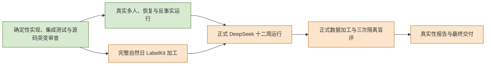

<a name="implementation-status-worldmock-实现状态"></a>
# WorldMock 实现状态

> 状态：个人事务与工作安排特性已在特性分支 `feat/errands-workday` 实现并通过离线验收，并已合入 main（自 `3b4afe5` 起，合并提交 `e54c37b`；阶段 6 配对全天复跑与 strict 端点探针未执行）；工具交互特性已在 main 实现（`3b4afe5`），验收见其验收记录；一日运行保真特性已实现并通过离线验收，经 `938e289` 合入 main（阶段 7 真实复验未执行）；人物 Prompt 七层特性已实现并通过离线验收，经 `4a5b0e6` 合入 main（阶段 7 真实复验未执行）；时间与能量特性已在 main 实现并通过离线验收（阶段 8 真实复验未执行）；一日行为、当日目标独立分支与既有地图/品类主线组合各自通过离线验收；历史证据保留，三项项目级真实验收仍未完成
> 日期：2026-10-05（增量修订；既有验收记录保留各自基线）
> 历史基线：工作树 HEAD `9b7fbc84d4429c2f05ec4b526df53539f0ed5d78`（另含当时未提交的文档重构与候选呈现代码）；除新增特性验收记录外，下文旧测试数字和真实运行描述均为该次实测快照，不代表新版本已重新完成真实运行
> 口径：接口与字段以 `docs/CONTRACTS.md#contracts-worldmock-接口合同` 为准，验收门禁与证据规则以 `docs/VERIFICATION.md#verification-worldmock-验收标准` 为准，覆盖率口径见 `docs/dev/coverage-baseline.md#coverage-baseline-覆盖率门禁口径与基线`；当前特性结论与带身份的历史验收分开记录，变更过程由 Git 承载

<a name="implementation-status-layering-and-test-tiers"></a>
## 分层与测试层次开发状态

[冻结规格](SPEC-layering-and-test-tiers.md#layering-outcome)的生产职责、完整导入图、测试缓存隔离、统一测试入口、
符号作用域变异与文档归属已落盘；当前全量门禁、完整日行为基线对比及独立源码变异验收仍在执行。
不得沿用下文旧提交的 passed 数、覆盖率与真实运行记录作为本次通过结论。

| 可核对内容 | 当前证据与判定边界 |
| --- | --- |
| 全部冻结契约 | `tests/fixtures/layering-acceptance.json` 将十五个主题映射到实际非跳过测试；`tests/test_layering_acceptance.py` 完整性守卫 |
| 完整日行为不变 | `tests/fixtures/dayrun-layering-baseline.json` 保存改造前同输入重复两次的相同签名；改造后完整日必须实际执行并比对 |
| 原有源码变异不丢失 | `tests/fixtures/mutation-symbol-baseline.json` 保存原有 147 项改造前变异字节；新定位后的生成器需逐项相同，基线与杀死结果仍须实际执行 |
| 当前文档唯一归属 | 五项已验收增量并入所属正文与 CONTRACTS；历史规格、实施与执行证据在 `docs/archive/` 保留，当前引用由完整文档门禁失败关闭 |
| 实测工程结果 | 以本次统一全量入口回执、覆盖率、文档与汇编门禁及独立审查为准，当前尚未宣称全部通过 |

当前追溯见 [规格与实际测试](ANALYSIS-spec-coverage.md#analysis-spec-coverage-规格测试用例覆盖率追溯矩阵)。
真实十二周、三次隔离盲评与 LabelKit 完整自然日交付仍为 NOT-COMPLETE；归档不改变真实复验、配对全天复跑与 strict 端点探针的原状态。


<a name="implementation-status-共享规则与可重建环境开发状态"></a>
## 共享规则与可重建环境开发状态

共享特性在主分支分层整合前按[最终规格](SPEC-shared-rules-and-rebuildable-env.md#shared-rules-特性规格共享规则单一归宿与可重建环境)完整实现，没有留待实现功能。
本次与主分支整合保留这些行为及其已归档正文的新归属；合并后的完整测试、覆盖率和文档门禁尚待新测，
以下数字只描述原共享特性源码，不作为合并提交的通过证据。
干净生产提交 `08d61a7` 的完整门禁为 6252 passed、零失败、零错误、零跳过，
分支覆盖率 95.61%，未覆盖公共接口为零；75 个有效独立源码变异全部被测试检出。
macOS 实际新克隆重建为 387 passed；Ubuntu x86_64 为 387 passed，另有 TextWorld 八个冻结种子的真实测试 1 passed，两者 release 收据通过。
完整 x86_64 Linux 虚拟机使用 QEMU CPU 仿真；Windows 的平台完成状态
按[本特性验收记录](shared-rules-and-rebuildable-env-verification.md)分别登记，
Windows 尚未取得成功证据，完整平台放行未完成。
实现文件清单、源码摘要、命令与各次被测提交统一登记于该记录。
下文旧特性的发布版本、AS2 身份、全量数字与跳过计数均保留当时源码身份；
现行目录为 5.4，AS2 来源与摘要按共享规则规格及 SERIES；合并后证据须重新测量。

<a name="implementation-status-个人事务与工作安排开发状态"></a>
## 个人事务与工作安排开发状态

[个人事务与工作安排规格](SPEC-as2-integration.md#errands-workday-运行修复入库)（FROZEN，版本表 1.0）已在特性分支 `feat/errands-workday` 实现并合入 main（自 `3b4afe5` 起，合并提交 `e54c37b`，合并结果与分支头逐文件相同）：实施阶段 1–5 与阶段 7 完成，阶段 6 配对全天复跑未执行（只报告，见下）；
「裁决记录」二十二项全部按推荐定稿（含标 † 的 R1、E1、E4、W1、Q2）。实施基线为冻结提交 `e9c3ce5a88af2eff9572f18b2e92ea14523d2ec1`（`e9c3ce5`，变更集只含文档；其上全量测试 5177 passed、7 skipped、0 failed）；
阶段 1、2、3、4 的最终代码提交分别为 `350587d`、`dca42a3`、`83fab86`、`8ef5aab`，阶段 4 与阶段 3 先后经 `cd33c96`、`59b81a3` 合入特性分支的主线；四个阶段各经一次独立评审，合计 27 项发现（6 项重大、21 项次要），全部在各阶段的修复提交里处理。
`59b81a3` 之后的提交只改测试、登记表与文档，另有两个运行查看器提交（`1346e0d`、`6c81126`，只改 `tools/` 下的查看器、它的测试与夹具和文档，见下）；`src/`、`custom/` 与 `scripts/` 没有再变，`code_sha256` 不变。
最终门禁在分支头 `964de503b71ed9931acbc34f4d853cfe6e4d0dc9`（`964de50`，含这两个查看器提交与全部实现后文档）上运行：隔离的干净检出上带覆盖率的十二个分片合计 5851 passed、7 skipped、0 failed、0 errors；
分支覆盖率 95.15%（8520/8954），未覆盖公共接口为零，门禁报告由这次运行重新生成（`snapshot_id` 为 `64abe7a3-eeaf-4eb6-beba-a35939d02131`），随 `bcbd74a` 提交。
此前在最终代码与测试提交 `a7e2fdc3e07a0c1962cd4312e6b9956ab6ea74a2`（`a7e2fdc`，两个查看器提交之前最后一个改动与生产代码相关的测试的提交）上的全量运行结果相同
（5851 passed、7 skipped、0 failed，跳过均为既有的平台或产物条件跳过；分支覆盖率 95.15%，未覆盖公共接口为零，报告随 `8613139` 提交），留作历史。
两轮独立源码变异审查共 230 个变异，115 个被既有测试杀死，115 个初次存活，
其中 110 个判为真实缺口、全部补测并以原变异复验杀死，4 个判为规格之外，1 个等价，补测过程没有发现生产缺陷。
验收台账 28 行的证据测试登记在 `tests/errands_workday_acceptance.py`（251 个不重复节点，分布在 62 个测试文件；另登记 101 个源码变异），由 `tests/test_errands_workday_acceptance.py` 逐行判定；「复跑指标（只报告）」一行没有节点。
证据层级是离线测试：本特性没有发起任何真实 DeepSeek 调用。源码身份与发布身份、各阶段测试结果、评审与修复、变异审查、门禁、代码与规格的出入和文档一致性见[个人事务与工作安排验收记录](../archive/errands-workday/errands-workday-verification.md)，
阶段见规格「实施计划」，逐文档的文档同步作业、逐阶段的文件修改清单与被钉点见配套[实施计划](../archive/errands-workday/errands-workday-implementation-plan.md)（实施台账）。

| 范围 | 现行实现 |
| --- | --- |
| 运行修复 | 就寝反思经唯一严格工具 `submit_reflection` 提交（`tool_choice=required`，思考由 AS2 记忆调度关闭，不带 `purpose`），一至五条，引用非空、条内不重复且取自本次输入，正文同收尾记忆校验；输出不合合同时附回英文校验错误重试，首次之外至多三次（独立常量 `REFLECTION_VALIDATION_RETRIES`，与零点计划的次数同值），每次尝试是 AS2 记忆调度下的一次独立调用、校验错误随下一次请求的附回消息留证，耗尽即运行故障，不写入洞见、不登记 `memory_updated`；反思请求不产生 `decision_started`，交付窗口的决策提示仍取动作之前最后一份不带 `purpose` 且工具含该动作工具名的请求。回看任务经 `LifeEnvProxy.read_query` 送到环境 actor（`LifeEnvActor`，并发度固定为 1）并等待真实结果，`query_world` 由宿主在冻结观察上求值，环境分支受理时与之逐值相等、拒绝时给出同一份校验报告。零点计划与 `revise_day_plan` 共用校验，重复意图同时定位首次与其后各次出现，超限与重复同批报告。`LifeAgent.step` 在决策失败时写一条带异常链的英文日志后原样上抛，工具分发失败先写日志再按失败阶段码 `TOOL_SERVICE_FAILED` 抛出；四个失败阶段码（`MODEL_SERVICE_FAILED`、`EVIDENCE_WRITE_FAILED`、`MEMORY_QUERY_FAILED`、`TOOL_SERVICE_FAILED`）已补登进接口合同宿主错误码表。四项只改变 `code_sha256` |
| 个人事务 | `AgentState.errands` 只存未完成事务（每人至多 8 条），完成或取消时移出，终态、原因与证据只写事件；`report_status`、`pause_activity`、`conclude_activity` 带请求级必填 `errands`（新增、更新、取消，一次至多四条，每条八键全必填，备注键为 `memo`，请求里没有「完成」），同一请求内按取消、更新、新增求值，与活动状态转换同批校验、同一事务提交，宿主与环境共用同一校验函数，成功结果在 `details.errands` 给回执 `[{errand, change}]`，事务名称与商品名称错误不带候选；完成依据为结果种类 × 商品 × 数量，只认记下之后的送达、到店成交、制作产出、收到的给予与进食的实际食用量，取得不含地点条件，每次提交结算一次；提醒时刻清醒时精确到点提供一次决策机会（唤醒原因 `errand_reminder_due`，不在睡眠允许集合内，睡眠中不形成边界、醒来的边界一并交付，同一边界多条合并为一次机会），该成员已同步进调度枚举、足迹侧词表与写入期校验、质量报告分桶；待办层增 `errands`，进度层增 `errand_reminder` 与 `errand_completed` 两种由事件派生的记录，同秒续接 `changes` 含事务的 `added` 与 `removed`；`environment_event` 下登记六个 `kind`，其中 `errand_completed`、`errand_reminded` 为人物可见，其余四种为 `system`，六种都不带决策与动作身份；零点计划输入增「个人事务」、模板增第七条；意图与 dreaming 窗口裁去 `errands`，缺 `errands` 键的控制请求是完整性故障，查看器对缺键的控制请求报错；查看器的控制请求摘要写各条事务变更的种类与名称，六种事务事件与唤醒原因 `errand_reminder_due` 写事务名称与商品名称（商品名称另从观察的 `errand_item_bindings` 补缺，缺名时显示缺失提示，事务内部身份不进活动表、时间线与请求摘要），内置的进度层规则文字写两种事务记录 |
| 提示信息分工 | 系统层仍为 18 条：第 1 条待办层一句写入个人事务，第 4 条补事务文字是自己记下的、办没办成由环境按实际结算确认，第 6 条改为以后要买到、拿到或吃掉的具体东西记成个人事务，其他延续打算写进 `pause_activity` 或 `conclude_activity` 的 summary，`report_status` 的 summary 只留到本段停留或路程结束，想记住的事只记以后用得上的新情况；三个控制工具的用途句与 `memories`、`errands` 及其八个键的字段说明只写用途、不含「登记」一词；就寝反思文案末尾补两句（反思不登记、不办结、不取消事务；输入是人物自己的记录，不把取得、吃掉或办完说成事实）；提示唯一权威位于接口合同「请求组成」，生产请求与它逐字校验；人物规格只引用语义，`prompt_sha256` 与 `tool_schema_sha256` 随之改变（两个指纹由函数计算，仓库里没有字面钉值，同批更新的是条数、键集与版本数字的断言） |
| 作息与工作安排 | 卡片 `TimeAnchors` 增可空的 `leave_work`、`arrive_home`，抽取载荷以 `work_anchors` 单独取共识，不设缺省；新锚点不满足顺序约束（含窗口越过当日 24 点）时，单次采样与共识后的卡片用同一函数降级为 null、不触发解析重试，降级说明经 `PERSONA_AGREEMENT_LOW`（改为泛指画像编译留下的警告）透传；卡片结构 3、抽取提示 `card-v3`，缺两键的旧结构化卡片被拒；人设层 `rhythm` 增这两个键，画像文本在各自非空时追加分句；场景人物配置增可选的 `leave_work_window`、`arrive_home_window`，场景作息覆盖由五个字段扩为七个，覆盖与冲突规则不变（场景窗口落不下时该槽保留卡片值并记 `CARD_FIELD_CONFLICT`）；人物配置增必填可空的 `work_schedule`（每周班次、日期例外、休息时段），班次形状由模型校验器把关、跨引用在加载检查，只对场景时间窗内的日历日期与场景日历交叉核对，场景结构 5，三份仓库场景的全部人物写 null、`scenario_sha256` 随之改变；环境层在 `location` 之后增 `duty`，只由时钟与班次求值，零点计划、修订与工作提交都不改变它，同秒续接链内不变、不进 `changes`，环境不因班次新增拒绝、不写离岗事件；系统层第 1、14 条改写，零点计划模板增第八条、输入增「上班安排」（场景声明了下班、到家窗口时人物输入另含「下班时段」「到家时段」）；工作安排不参与任务开放与截止 |
| 查询 | `query_world` 请求六键必填（`name`、`way`、`category`、`from`、`available_only`、`offset`），四个筛选至少一个非 null，四键旧请求被拒；来源解析与购买共用同一纯函数（`name_resolution.resolve_source`），冻结观察新增渠道索引 `world_query_channels` 与供给条目的 `location_id` 两项私有事实；可执行筛选取冻结观察里动作的 `available`，在排序与切页之前施加，`total_count` 为筛选后总数；结果只省略 null 与空集合（复用工具层分组的紧凑实现），不再逐项附候选；`from` 无法解析、以及 `from` 为 null 且 `name` 无任何匹配并恰为渠道称呼时按查询参数错误返回完整请求候选，其余无匹配为合法空页；只改用途句，两个新字段不带字段说明；环境侧同名分支（`LifeEnv.read_query`）在阶段 4 没有改动；工具交互规格「行为验收」表的行名未增删改 |
| 度量与下游 | `quality.json` 的 `schema_version` 4，新增 `errand_metrics` 与 `conclusion_memories` 两组，只报告；行为评估 `reports` 增 `workload` 与 `routine_deviation`（输入为一个可选打包对象，结构标识 `behavior-metrics-1` 不变），由 `scripts/inspect_run.py workday --scenario <场景文件>` 给出，查询成本由 `scripts/inspect_run.py queries` 给出；世界结构 9、场景结构 5、卡片结构 3（`card-v3`）；地图 3、目录 5.3、品类与规则绑定 3、导出清单 2、运行清单 2 与 AS2 锁定摘要不变；交付入口按世界结构版本 9 设门禁 |

未完成与出入：

- **阶段 6 配对全天复跑未执行。** 规格「实施计划」阶段 6 只报告、不作门禁；它是计费的真实运行，只在用户明确要求时启动，本轮没有启动：规格计划每臂三次，实际每臂 0 次，未达复跑要求，
  台账「复跑指标（只报告）」各项没有任何结果。阶段 3 之后场景与卡片结构都已升版，基线臂与处理臂不能共用同一份输入，启动时只能做到语义等价并如实登记差异；启动还要等数据集侧登记落地。
  读取入口与未取得的指标见[验收记录「未执行」](../archive/errands-workday/errands-workday-verification.md)。
- **strict 端点探针未运行。** `scripts/probe_deepseek_strict.py` 是计费的真实调用。真实的 strict 端点还没有收到过新的控制工具 Schema（可空整数 `quantity` 是此前没有用过的构造）
  与六键 `query_world` Schema；已有的证据只是本地的 strict Schema 校验用例，这两份 Schema 能否被真实端点接受尚无证据。
- **数据集侧登记不在本仓库的证据之内。** 规格[数据集侧登记](../VERIFICATION.md#verification-incremental-evidence)各项（逐店声明、任务输入、料理、目录发布、预检、重建与运行驱动、场景与卡片、控制请求与 LabelKit、查询）
  在 WorldMock-Dataset 仓库由另一会话处理，不计入本仓库验收台账，只阻塞阶段 6；验收记录没有登记数据集提交号。
- **代码与规格、文档的出入**逐项登记在[验收记录「代码与规格的出入与裁定」](../archive/errands-workday/errands-workday-verification.md)：规格没有定稿之处的六项裁定；实施台账与规格不一致而按规格实现的各项；
  留给后续的一项——宿主 `revise_day_plan` 超限一项的 `written` 写的是所提交目标的条数，接口合同写的是所提交的目标本身（规格把该宿主函数列为不改动）——已在合入 main 之后单独修复：
  `custom/agents/life_agent.py` 的 `_validate_plan_goals` 改为写所提交的各条目标（JSON 值，与环境 `PLAN_GOALS_INVALID` 明细同形），接口合同与规格条款不变；
  `tests/life/test_revise_day_plan_json.py::test_host_corrects_a_revision_that_overflows_with_the_preserved_goals` 断言宿主与环境两侧明细的 `path` 与 `written` 相同。
  这是合并之后唯一的生产代码改动，`code_sha256` 随之改变，不再是验收记录登记的值；验收记录「留给后续的出入」保留合并时的基线。
  该次修复的定向离线证据为上述测试文件、相邻宿主协议与修订合同测试和风格门禁通过；当时全量门禁尚未重跑。后续在主分支整合前的完整测量以共享规则与可重建环境特性的[验收记录](shared-rules-and-rebuildable-env-verification.md)和机器报告为准。
- **运行查看器的事务显示已实现（`1346e0d`、`6c81126`）。** 两份查看器规格在本特性冻结时修订的条款查看器已全部实现：控制请求摘要写事务变更，事务事件与事务提醒写事务名称与商品名称，
  进度层规则文字写事务提醒与办成两种记录，工具定义条目写七个世界请求工具、两个世界查询工具与三个记忆查询工具。其中三处（请求摘要与事务事件的名称、进度层规则文字、工具定义条目）
  是 `a7e2fdc` 上的全量运行之后的实现后文档核对查出、其后补齐的：`1346e0d` 实现这三处，`6c81126` 处理对 `1346e0d` 独立核对查出的七项（查看器另从观察的 `errand_item_bindings` 补商品名称，
  事务变更按 `control_errands` 的规则逐条读取，个人事务缺名与找不到提醒事件时显示缺失提示，查看器夹具改为本特性的层形状），两份查看器规格各增版本表 `2026-10-04-errands-viewer` 行。
  `tests/tools/` 的 Node 用例由 62 个增至 75 个：在 `6c81126` 上执行 `node --test tests/tools/run_viewer.test.cjs tests/tools/run_viewer_context.test.cjs` 为 75 pass、0 fail、0 skipped，
  `tests/tools/test_run_viewer.py` 为 1 passed（离线证据）；这两个提交已包含在分支头 `964de50` 上的最终全量测试与覆盖率门禁之内（见上）。经过见[验收记录「全量门禁之后补齐的查看器事务显示」](../archive/errands-workday/errands-workday-verification.md)。
- 运行目录名标为 2026-10-01 的白领与商务两次全天运行跑在 `3b4afe5` 加未提交修复上，两份数据集预检未通过，只是本规格的设计依据，不是任何冻结规格的验收运行，不登记进「已具备的真实运行证据」。
- 该事务特性发布时 AS2 锁定提交 `8768e14` 与 `AS2_LOCKED_SOURCE_SHA256` 未改动；`LifeEnvActor`、`LifeEnvProxy` 对三个 AS2 私有成员（`DirectEnvActor._router`、`DirectRouter._environment()`、`EnvRouterProxy._actor`）的依赖随锁定提交验证。

被取代的条款：「工具交互开发状态」的「查询与任务回看」行（查询改为六键并带来源与可执行筛选、结果不再逐项附候选，回看任务经环境 actor 取真实结果）与「正式发布」行（现行为场景 5、世界 9；地图 3、目录 5.3、品类和规则绑定 3 不变）；
「一日运行保真开发状态」的「运行输入警告与场景作息」行（场景作息覆盖字段由五项扩为七项，覆盖与冲突规则不变；`PERSONA_AGREEMENT_LOW` 改为泛指画像编译留下的警告）、
「系统层与零点计划」行（第 14 条的计划优先只对习惯成立，对场景声明的工作安排不成立；零点计划模板增第七、第八条）、
「按名调用与指名购买」行（`prefer` 的现行取值是「最快拿到」「到手价最低」，自工具交互特性起不再是英文词）、
「错误合同」行（宿主错误码闭集为十五码：四个失败阶段码此前只在代码里，现已补登进接口合同，不再是十一码）、
「控制工具」行（三个控制工具另带请求级 `errands`；该行所写经 `control_items` 读新旧形状已不成立，`control_items` 只读现行形状，旧记录与缺 `errands` 键的记录直接拒绝）与「下游」行（世界结构 9、质量报告 4）；
「人物 Prompt 七层开发状态」的「同秒续接」行（`changes` 增个人事务的 `added` 与 `removed`，事务提醒与办成两种记录进 `events`）、「记忆层与人设层」行（能由结算确认的延续事项改由待办层的个人事务承载，人设层作息增下班与到家）、
「下游」行（交付入口按世界结构版本 9 设门禁）与「世界结构版本 8」行（现行版本为 9）。旧节的表格原文不回改。
本节只确认本特性离线验收，不改写项目级真实十二周、LabelKit 与盲评的未完成状态：项目整体仍为 NOT-COMPLETE，三项真实验收的状态见下文的验收项表。

<a name="implementation-status-工具交互开发状态"></a>
## 工具交互开发状态

[最终规格](SPEC-life-runtime.md#tool-interaction-工具请求)的生产合同已实现；新验收单独记在[工具交互验收记录](../archive/tool-interaction/tool-interaction-verification.md)。
并发工作合并后，以真实生产入口联合复验，不沿用历史接口的通过数字。

| 工作 | 当前实现与独立证据 |
| --- | --- |
| 人物提交 | 唯一 items 形状，一至两项；方式推导动作，中文购买偏好与本人收货 null；删除旧解析入口 |
| 完整纠错 | 五键共享报告，保留真实工具下标与字段位置；合法枚举不截断；最多三个完整调用候选 |
| 查询与任务回看 | 同批先全量验证再读取冻结公开信息；完整分页，严格整数偏移；最终回合和截断重试移除查询 |
| 普通工作与预约 | 每封通知核验，普通工作从最早本人通知开放；预约已知与真实到点分离；阅读才见正文 |
| 门店与报价 | 每个种子地图 431 条完整独立供给；菜单差异、丰富度、范围与定位公式均经实际行为检查 |
| 真实料理 | 食材购买、配送、输入消耗、产物入库与食用的原生链；任何总结文本不能新增物品 |
| 操作备忘与呈现 | 实际拒绝事件派生当日最近八条；跨会话与恢复相同；紧凑层逐值展开保持完整信息 |
| 正式发布 | 三份场景 4、两份地图 3、目录 5.3、品类和规则绑定 3，世界 8 |
| 验收守卫 | 规格行为表逐行登记可执行节点；独立解释器真实源码变异，不放行存活、未执行或基础失败 |

后续章节保留各特性当时的验收基线与历史接口说明；现行接口以合同和本文件最前面的特性节为准，本节「查询与任务回看」「正式发布」两行已由「个人事务与工作安排开发状态」修订。


<a name="implementation-status-一日运行保真开发状态"></a>
## 一日运行保真开发状态

[一日运行保真特性规格](SPEC-life-runtime.md#dayrun-fidelity-身体与需要)（FROZEN，版本表 0.7）已在集成分支 `dayrun-fidelity-impl` 实现：实施阶段 1–6 与阶段 8 完成，阶段 7 未执行（见下）；
「裁决记录」除 D13（登记，范围外）与 S2（撤回）外全部已定，S10 采纳并按 3.5「收敛」执行。实施基线为 `26d626b59902bccf7b3cdc5ba74037e5feee5f72`（规格与台账的行号取 `4a5b0e6`）；
各实现分支分三批并行合入，合入过程中的集成核查、实现后文档审计与独立语义突变审查发现的缺陷由四个修复分支修复并补测。
最终代码提交 `147843655aa00621488a306e68ecf98c5273b3bf`（`1478436`）：覆盖率下六个分片合计 4,987 passed、7 skipped（均为既有的平台或产物条件跳过，本特性新增用例无跳过）、0 failed、25 warnings；
分支覆盖率 95.05%（7916/8328），未覆盖公共接口为零，门禁报告随 `b7f85f9` 提交；三路独立语义突变共 356 个，除 4 个等价突变外全部被测试杀死（52 个初次存活，补测后杀死）。
验收台账 26 行、31 条已定裁决与十个输入警告码的证据测试登记在 `tests/dayrun_fidelity_acceptance.py`（380 个不重复节点），由 `tests/test_dayrun_fidelity_acceptance.py` 逐行判定。
源码身份、评审修复、突变审查、门禁、strict 端点探针与文档一致性见[一日运行保真验收记录](../archive/dayrun-fidelity/dayrun-fidelity-verification.md)，阶段与文档同步作业见规格「实施计划」「文档同步作业」「文件修改清单」三章。

| 范围 | 现行实现 |
| --- | --- |
| 身体与需要 | 社交账与共同用餐按本区间共同身体结算所用的活动集合（`body_settlement.activity_ids`）判定清醒，在边界结束的睡眠不计清醒；不喜欢的内容也按下限偏好缓解（有效偏好 `f + (1 − f)·w`，`f` 缺省 0.5，放在场景层 `entertainment_relief_preference_floor`），有缓解的活动进行时不累积娱乐需要，游戏与内容同一算法；困意档界改为 0.80、0.93、1.07、1.18（KSS 等价刻度），五档名称不变；不适脉冲的两小时门槛只判一次；睡眠中不读消息，醒后第一个边界再读 |
| 运行输入警告与场景作息 | 创建运行时逐条计算十个警告码（口味与题材对不上、权重全零、没有内容却有观看习惯、游戏没有权重条目、覆盖率不足、卡片作息被覆盖或冲突、画像编译一致性低、配送路线不可用、可疑显示名），冻结进运行清单 `input_warnings`、ops 日志与 `quality.json`，`validate` 打印同一组警告，运行查看器总览列出；运行路径永不因警告失败，手机配置核验失败也不让创建失败；覆盖率不再按 App 名子串计命中；场景显式声明的作息字段覆盖卡片抽取值，身体结算、零点计划与人设层读同一组值 |
| 系统层与零点计划 | 系统层 18 条规则：新第 14 条照作息过日子（今日计划的具体安排优先，身体只在较强一档才改），第 15 条按档位与饭点吃，第 16 条照作息就寝，第 4、12、17 条补句；零点计划只写与平常不同的事和要办的事，每条目标带大致时刻 `around_time`；例行意图（睡眠、晨间例程、通勤、用餐）照常登记，不入推进比例；带大致时刻的目标只被其前后 90 分钟内进行的同家族活动推进 |
| 按名调用与指名购买 | 全部目录类对象可直接写名称，无损归一后唯一即受理，相似度只给可照填的候选、从不替换，宿主与环境共用 `name_resolution` 并逐项报全部名称类失败；名称类拒绝每人每秒前 2 次不计同刻轮数、不施加脉冲；指名购买的 `from` 是可选约束，分段匹配 M0–M3 各报其码；App 名按场景钉定的手机配置解析为渠道的成员门店；`start_activity` 增请求级 `prefer`（`fastest`、`cheapest` 或 `null`），方式「购买」由系统定到店或远程下单、不定交不到收货人手上的方式，多于一处能服务时按 `prefer` 选定；订单与 `purchases.jsonl` 记 `channel_id` |
| 错误合同 | 宿主协议纠错与环境业务拒绝共用 `error_code`、`reason`、`fix`、`items[]`（逐项可照填的候选）、`unmet`，受理时写 `details.resolved`、`notes`；宿主错误码闭集十一码；每个会抛出的业务拒绝码都有具体原因；纠错不带校验转储，拒绝的 `message` 直接取 `reason` |
| 呈现与浏览 | 生活活动窗口施加地点类资格；排序键加相关度（目录时间窗、未推进目标家族、习惯签名）并以 `sha256(场景\|人物\|日期\|对象)` 决胜，`ORDER_KEY_VERSION` 为 2；轮转按每个对象的 `last_presented_at`；工具层另给只列名称的可调用索引 `callable_index`（不计入呈现上限、计入容量）；浏览结果列完整标签，下一步提示只指向可达地点，配送失败分送达地与路线两种原因 |
| 控制工具 | `conclude_activity`、`report_status`、`pause_activity` 改为一项一个对象（`items[{activity_name, summary}]`，结束另带 `memories` 与 `views`），看法与偏好放 `views`（`about` 存储为 `subject`），全部读者经 `control_items` 读新旧形状 |
| 评审、调用与叙述 | 中文逐字摘录按字数核对；输出在思考阶段用尽上限时丢弃截断回合、纠错替换不叠加，关闭思考并 `tool_choice=required` 重试一次（只开放世界请求）；联系人回复只通过消息往来，请求带发件人、此刻、远程与收货地，后验守卫命中重试一次，仍命中用兜底句；时间线只出现中文名称，工作、通话、交谈也有标题；DeepSeek 端点改为 strict 的 `https://api.deepseek.com/beta` |
| 加载校验 | 地点类别不在环境层地点类表内与无法区分的重名标签加载即拒，同名地点由 `branch_label` 消歧（地图文件结构 2）；配送路线不可达与可疑显示名只发输入警告 |
| 下游 | 运行清单 `schema_version` 2（`input_warnings`、`persona_habit_responses`）；`quality.json` 的 `schema_version` 3，新节 `input_warnings`、`truncations`、`timeline_labels`、`contact_reply_guard`、`name_rejections` 只报告；`model_npc_reply` 带 `attempts[]` 与 `guard_applied`；世界结构版本不升，仍为 8，`channel_id` 不进 `DeliveryState` |

未完成与出入：

- **阶段 7 真实复验未执行。** 规格「实施计划」阶段 7 的白领与商务全天复跑只报告、不作门禁，需要用户的模型账号，也要等数据集仓库按数据集方案修复：
  两次运行冻结的数据集输入在现行代码下加载即被拒（地图文件结构为 1，白领另有地点类别越界）。复跑指标与读法见[验收记录「真实复验（阶段 7，只报告）」](../archive/dayrun-fidelity/dayrun-fidelity-verification.md)。
- **数据集仓库的接口改动未做。** `prepare_labelkit_input.py` 与 `simulate_phone.py` 的同步按规格第九章在数据集仓库另行提交，本次不在范围内。
- **规格字面与实现的出入**（方式「购买」都不行时的下一步按规格 0.7 细化、strict 探针改用能区分两端的判据、截断重试只开放世界请求、台账「九个警告码」与十个码的闭集等）
  逐项登记在[验收记录「代码与规格的出入」](../archive/dayrun-fidelity/dayrun-fidelity-verification.md)。
- AS2 锁定提交 `8768e14` 与运行身份摘要未改动；世界结构、场景结构与目录版本都不升。

被取代的条款：「人物 Prompt 七层开发状态」表中「七层请求」「交互语义」「下游」三行的部分表述由本特性修订（截断重试同样去掉记忆查询工具，商品多于一处能服务时按 `prefer` 选定、
不再以重名拒绝，质量报告升到 3；该段已注明）；「已冻结条款与确定性证据」的「能量不阻断」行中系统层规则「饿了趁早弄吃的」改为第 15 条的按档位与饭点吃；
「数据、日志与模型接入」补截断重试的思考与工具选择和 `/beta` 端点；「地图与品类组合的历史结论」记的地图结构 `1` 是那次组合的固定身份，现行地图文件结构为 `2`。
本节只确认本特性离线验收，不改写项目级真实十二周、LabelKit 与盲评的未完成状态。

<a name="implementation-status-人物-prompt-七层开发状态"></a>
## 人物 Prompt 七层开发状态

[人物 Prompt 七层特性规格](SPEC-life-realism.md#persona-prompt-七层请求)（v1.0，FROZEN）已在特性分支 `persona-prompt-seven-layers` 实现：实施阶段 1–6 与阶段 8 完成，阶段 7 未执行（见下）；裁决 #21–#38 按推荐定稿。
实施基线为 `c3b24da3dfeda289c0b9fd7636dd908cd8dae2d2`（规格与台账的行号取 `3ea5b06`）；阶段 1–5 合入后经两路独立只读评审，缺陷由四个修复分支修复并补测，此后两路测试加固与一次规格符合性修复合入。
最终代码提交 `e80404099946187a9def070c9e9ae05c45c14621`（`e804040`）：一次调用 `pytest tests` 为 4,295 passed、8 skipped（均为既有的平台或产物条件跳过，本特性新增用例无跳过）、0 failed、25 warnings（警告数与实施前基线相同）；
实施前基线为 3,983 passed、8 skipped、1 failed，失败的查看器回归用例（工作副本 CRLF 行尾）现已通过。
分支覆盖率 94.88%（7467/7870），未覆盖公共接口为零，门禁报告随 `95a4447` 提交；四组独立语义突变共 46 个，除一个等价突变外全部被测试杀死。
源码身份、验收台账逐行证据、评审修复、突变审查、门禁与文档一致性见[人物 Prompt 验收记录](../archive/persona-prompt/persona-prompt-verification.md)，阶段与文档同步作业见[实施台账](../archive/persona-prompt/persona-prompt-implementation-plan.md)。

| 范围 | 现行实现 |
| --- | --- |
| 七层请求 | system 为系统层 JSON，user 为工具、人设、记忆、待办、环境、进度六层 JSON，各层经 `src/worldmock/life/prompt_schemas.py` 校验；工具定义只经原生 `tools`，整次运行稳定（本次决策剩最后一个回合时只去掉记忆查询工具），description 只写用途；每项信息在整个请求中只出现一次；`scene`、`facts`、身份前言、「怎样过一天」与常驻生活提示删除，世界规则只在系统层写一次；可用性只有一个来源，工具层列出的动作都能提交，此刻不能用的标 `available` 与 `reason` |
| 单一行动阶段 | 删除决策自述阶段：一次决策只有一个行动阶段，决策就是所选的世界请求；`decision_started` 在首个行动请求时同批写入，数据为闭集；回复正文可有可无，有则作为该调用的 `self_note` 保留到本段停留或路程结束，不进入记忆 |
| 同秒续接 | 同一人物、同一 session、同一秒的相邻决策，续接请求以上一决策末次请求逐字节为前缀，追加原生 assistant（含 `reasoning_content`）与一条 tool 消息 `{result, changes, events}`；时间推进、session 切换、反事实分支、缺思考或缺模型证据时断链；发送前自检；预算第 0 步先结束续接；开关 `worldmock run --same-second-continuation on\|off` 冻结进清单与人物配置，恢复与重放继承；两臂对比用只读子命令 `scripts/inspect_run.py continuation` |
| 记忆层与人设层 | session 结束时系统派生一条记忆（`settled` 与 `self_notes`）；零点按场景本地日期把当日条目并入更早日期，就寝反思归入其后睡眠的日期；记忆层 8000 字符窗口；relationship、preference 记忆带 `subject`，在人设层按对象原地更新，阈值巩固保留、摘要不进提示；人设层由人物卡片派生字段、场景联系人与看法偏好构成；恢复前后记忆层逐字节相同；只读问答只用只读系统层、人设层、记忆层与外部问题；零条最近记忆返回空 |
| 交互语义 | `start_activity` 增 `from[]`、`to[]`、`answering`；`consume` 指向他人是给予（瞬时、同处、只转移），新方式「给予」；订单有唯一收货人，送达只入收货人持有，付款人仍是下单人物；场景联系人有收货地点（`Contact.receive_location_id`），回复时看到双方往来；代点请求与订单关联，同一消息、收货人与商品再提交被拒；指名购买不受轮转限制，不存在或重名时拒绝并附候选，不替换；进食按开吃份量结算，暂停保留剩余，结束丢弃且不补算摄入，不足一份也可以吃 |
| 规格第六章的程序错误与缺口 | 直接消息全文进入进度层，「已读」改为全文已呈现；恢复工作不越过合同截止；工时达标、正在工作与能否提交分开说明；逾期任务保留到截止当日结束，迟交以业务拒绝；不足一份的食物可以吃；购买事实按订单去重；零条最近记忆守卫恢复；进食提前结束写已吃、丢弃与剩余；提示菜单与受限工具一致；未完成的浏览不写成采购；联系人回复带双方历史；浏览、尝试下单与成功购买分开统计；删除失败后强制等待（`wait_only`），受限轮用完写 `decision_budget_exhausted` 并技术停顿。每项有改回旧代码即失败的回归用例 |
| 下游 | 观察事件保存层数据与私有证据，进度层只存来源事件引用；清单阶段只剩 `action`、`work_review`，含 `decision_statement` 的清单在新建、打开、恢复、加载与校验五个入口被拒；质量报告与导出清单升 2，删两项决策自述计数；交付不再重渲染 `scene`，dreaming 读 `self_note` 与实际请求的层 JSON，交付入口按世界结构版本 8 设门禁；查看器按层分段并识别续接；导出新增 `purchases.jsonl`；观察重复门禁按同秒续接链计 |
| 世界结构版本 8 | 见「当前世界格式」节；版本 7 的检查点以版本不符拒绝 |

未完成与出入：

- **阶段 7 真实复验未执行。** 规格第七章的续接开关对比与白领全天、双人半日复验只报告、不作门禁，需要用户的模型账号；
  协议与所用只读子命令见[验收记录「真实复验（阶段 7，只报告）」](../archive/persona-prompt/persona-prompt-verification.md)。
- **数据集仓库的 `simulate_phone.py` 未改。** 规格「范围外登记」把 `simulate_phone.py` 改读 `purchases.jsonl` 与 LabelKit 输入脚本的同步划给数据集仓库单独提交，本次不在范围内；
  数据集仓库 `WorldMock-Dataset` 只有本地未推送的分支 `persona-prompt-seven-layers`，内容仅为数据集场景联系人 `receive_location_id` 的同步。
- **一处规格内部缺口。** 规格要求八个人物工具始终都在、此刻不能用的由工具层 `available` 与 `reason` 说明，但工具层 Schema 没有放 `recall_task_summary`、`revise_day_plan` 可用性的位置；
  受限轮、待收尾与没有当日计划时它们以业务拒绝回应，事前没有标注。代码未改，登记在[验收记录「代码与规格的出入」](../archive/persona-prompt/persona-prompt-verification.md)。
- AS2 锁定提交 `8768e14` 与运行身份摘要未改动。

被取代的条款：本页决策上下文段落所述的决策自述阶段、`scene` 与 `facts` 场景信息和每次决策从新快照构造，已由七层请求、单一行动阶段与同秒续接取代（该段已注明）；
「当前世界格式」由版本 7 改为 8，6→7 表中的 `wait_only` 已随版本 8 删去；「能量不阻断」行中饿时场景的吃饭途径句与常驻生活提示由工具层与系统层取代；
「数据、日志与模型接入」补同秒回传思考。上表「七层请求」「交互语义」「下游」三行的部分表述此后由一日运行保真规格修订（截断重试同样去掉记忆查询工具，
商品多于一处能服务时按 `prefer` 选定、不再以重名拒绝，质量报告升到 3），现行行为见「一日运行保真开发状态」。本节只确认本特性离线验收，不改写项目级真实十二周、LabelKit 与盲评的未完成状态。

<a name="implementation-status-时间与能量开发状态"></a>
## 时间与能量开发状态

[时间与能量特性规格](SPEC-life-runtime.md#time-and-energy-决策不耗时时间只在做事时流动)（v1.0，FROZEN，冻结于 `e560cfc`）已在 main 实现：阶段 0–7 与阶段 9 完成，阶段 8 未执行（见下）。
实施基线为 `778becae4271fb29d167dbdd51a811a15ec3ec60`；每个阶段合入后由 2–3 名互相独立的只读评审核对，发现的缺陷在后续提交中修复并补测。
正式覆盖率门禁在最终代码提交 `ef13dc58770af52000a1c2e81883561e85a0c904`（`ef13dc5`）上运行：3978 passed、8 skipped（均为既有的平台或产物条件跳过，本特性新增与改写的用例无跳过）；
分支覆盖率 94.57%（7104/7512），未覆盖公共接口为零；门禁报告随 `82e1698` 提交，此后不改生产代码。
VF4 在干净提交的隔离工作树上覆盖同刻上限、能量截断、唤醒闭集、提醒一次、名额释放、身份不进提示六项，29 个语义突变全部 killed、零存活。
世界结构版本随本特性升为 7，6→7 的字段变化见「当前世界格式」节；能量不再阻断活动，见「已冻结条款与确定性证据」的「能量不阻断」行。
阶段 8 真实复验（只报告、不作门禁）未执行：本机没有模型凭据，r14 的运行数据在另一台机器上；
执行步骤与对照基线见[验收记录](../archive/time-and-energy/time-and-energy-verification.md)「真实复验（阶段 8，只报告）」，结果待执行后补入该记录。
逐行台账登记、评审修复、全量门禁、突变台账与文档一致性核对见[时间与能量验收记录](../archive/time-and-energy/time-and-energy-verification.md)，阶段划分与文档同步作业见[实施台账](../archive/time-and-energy/time-and-energy-implementation-plan.md)。
本节只确认本特性离线验收，不改写项目级真实十二周、LabelKit 与盲评的未完成状态。

<a name="implementation-status-一日行为可信性开发状态"></a>
## 一日行为可信性开发状态

[冻结规格](SPEC-dayrun-behavior.md#spec-dayrun-behavior-一日行为可信性特性开发规格)已在独立分支 `codex/dayrun-behavior` 全部实现并通过离线验收，无特性延期项。
固定被测提交 `9a62963841694cb668cc49a039c59f39caa757a6`：3847 passed、4 个既有历史产物缺失跳过、
24 warnings，651.72 秒；分支覆盖 95.89%（7048/7350），未覆盖公共接口为零，本特性新增用例无跳过。
两种子的完整双人自然日已走通真实人物工具、并行活动、餐馆进食、记忆、共同检查点恢复和导出；
三组独立 Bob 审查的四十四个有效语义变异全部关闭，所有曾存活补丁均原样复验。
完整修改清单、逐条行为测试、设计文档一致性及带身份的原始收据见[实施台账](research/dayrun-behavior/verification.md)。
本节只确认本特性离线验收，不改写项目级真实十二周、LabelKit 与盲评的未完成状态。

<a name="implementation-status-当日目标开发状态"></a>
## 当日目标开发状态

独立分支 `codex/day-plan-goals` 以当前工作区快照 `170e1f0fcd83a745f9989da5dac95eac72ea8647`
为开发基线，保留主目录其他会话的未提交工作。用户已批准家族活动证据与 `plan_day` 名称。
[最终规格](SPEC-day-plan-goals.md#spec-day-plan-goals-当日目标特性开发规格)全部已实现，领域、人物接口、质量报告并发完成并通过独立审查。
固定被测提交 `b53079d`：3638 passed, 4 skipped, 24 warnings in 526.52s (0:08:46)；分支覆盖率 96.51%（6715/6958），未覆盖公共接口为零。
三十五个不同语义突变全部闭合，包含初次三个存活补丁的原样复验。
完整逐要求证据、设计文档和实际修改清单见 [验收记录](research/day-plan-goals-verification.md)。
与 main 新增配置手册的合并保持生产、测试、依赖和锁文件完全相同；组合文档与依赖检查通过，
冲突处理、手册同步及依赖发布见 [主线组合验收](research/day-plan-goals-main-verification.md)。
本节不改变以下项目级真实验收的未完成状态。

<a name="implementation-status-地图与门店供给开发状态"></a>
## 地图与门店供给开发状态

地图独立分支的完整范围由 [开发规格](SPEC-map-and-storefront.md#spec-map-and-storefront-地图数据集合与门店供给开发规格) 冻结，已实现并通过该分支离线验收，无特性延期项。
该分支最终被测提交 `017d49c4a246c0c524e541571220e1a07b16ce87`：3240 passed、4 个缺历史运行产物的旧用例跳过，
分支覆盖率 98.49%，未覆盖公共接口为零；本特性新增用例无跳过。
三组独立变异审查及两组补测复验全部收束，初次两处测试漏检已关闭；完整证据见 [验收记录](research/map-and-storefront-verification.md)。

| 独立地图分支验收范围 | 该快照状态 | 已记录的实际证据 |
| --- | --- | --- |
| 地图、供给与活动环境 | 通过 | 正式场景引用解析、严格准入、实际活动门及全部路线方式核验 |
| 发现、比较与交易 | 通过 | 实际呈现供给、动态工具、跨轮发现结果、原子订单与履约 |
| 时态与恢复 | 通过 | 营业例外、调价补货、世界版本 4、报价库存和可见供给完整恢复、父目录逐文件保护 |
| 工程和独立验收 | 通过 | 逐项行为映射、最终完整门禁、独立源码变异、补测复验和清理证据 |

原始路线基线的二百二十份响应中，一百零四份步行/驾车复用已修复；全部一百一十条步行响应的步骤方式及全部路线哈希已核验。
地点活动环境缺口与其缺字段测试漏检均已闭合，真实到达和跨地点恢复有生产入口断言。
下文各特性的通过数字保留原源码身份；地图分支与 main 品类主线的组合已重新验收，结果单列于下节，不将任一侧旧数字作为本次结果。


<a name="implementation-status-地图与品类组合的历史结论"></a>
## 地图与品类组合的历史结论

当前合并保留品类契约、库存转换和交互菜单，并接入独立地图与门店供给。
购买保留品类配对及闭集算子，但改以当前供给报价、数量与系数计算整行 `total_price_fen`；卖方来自供给。
组合目录为 `4.0`，品类及交换规则绑定版本为 `2`；场景结构 `3`、地图结构 `1`、世界结构 `4`。
本次组合已独立通过离线验收，具体命令、原始输出与审查归档见
[主线组合验收](research/map-and-storefront-main-verification.md)。生产源码在测试加固前后完全相同，证据按提交分别记录。

| 验证范围 | 固定身份与实际结果 |
| --- | --- |
| 完整工程门禁 | `70af9a70f82ebe9b2b33d5f4d7327f59de150002`：3550 passed、4 个既有缺历史产物用例跳过；分支 96.48%（6653/6896），未覆盖公共接口 0 |
| 加固后的相关回归 | `6fe3ab7b1711c5d7bee9d0bf3f4f22d48a53cb82`：仅增加成功提交后的两条缓存断言并保存覆盖率报告，生产源码未变；相关 73 passed，不把它写成另一轮全量统计 |
| 组合购买独立审查 | 七个语义突变全部 killed，覆盖供给独立报价、实际整行计价与配对拒绝等组合边界 |
| 状态提交独立审查 | 初次 4 killed、1 survived 原样保留；在 `6fe3ab7` 上原存活补丁逐字节相同复验及独立供给缓存突变均 killed，成功重试缓存断言缺口已闭合 |
| 正式资料与准入 | `scripts/build_catalog.py --check` 四个输出逐字节一致；正式十二周场景 7384 条素材分布于 142 个分区，全部可达；这不是十二周真实模型运行 |

以下均为带固定源码身份的历史结论，不与本次结果相加。

合并地图前的交互菜单与品类契约主线已整合。该次被测提交 `a651dc5db539d38be113f494eaf3580e387c3cf2`
完整门禁为 **3280 passed、零跳过**，分支覆盖率 **96.69%**，未覆盖公共接口 **0**。
该次组合的源码身份、冲突裁决及完整输出见
[交互菜单主线合并验收](research/interaction-menu-main-verification.md)。下列各特性数字保留原快照边界。

交互菜单以 [冻结规格](SPEC-interaction-menu.md#spec-interaction-menu-特性规格交互菜单) 为本次完整开发范围，覆盖声明、有效菜单、
人物工具与参数、环境拒绝、恢复身份和文档一致性，不设特性延期项。
固定源码的最终门禁、条款到行为断言与 Uncle Bob 审查统一记录在
[交互菜单验收记录](research/interaction-menu-verification.md)，不能以本页历史测试数字代替。
该记录固定的独立快照离线验收为 **2985 passed、零跳过**，分支覆盖率 **98.79%**，
未覆盖公共接口 **0**；环境侧三十二个、宿主侧二十四个有效语义变异最终全部被检出。
声明、模型工具与参数、环境结算和恢复身份在该快照贯通。
两组独立报告保留初次存活项、补强复验和临时工作树清理边界；结果不改变下述全项目真实运行状态。

品类契约与决策上下文已整合，合并复核发现的模型库存使用缺口也已补修。
该次被测源码 `35c1dfa9789010ff2845435900871cda616ded52` 的完整门禁为 **3166 passed、零跳过**，
分支覆盖率 **96.67%**，未覆盖公共接口 **0**；补修的六项独立语义突变全部 killed。
来源、文件范围和原始证据见[合并验证记录](category-contract-main-verification.md)。
下面各特性段落保留各自独立开发时的验收快照，也不能替代当前地图与品类组合门禁。

决策上下文特性以 [冻结规格](SPEC-decision-context.md#spec-decision-context-特性规格决策上下文与工具结果) 为本次完整开发范围；
已完成提案裁决、官方协议核对、分模块实现、独立审查修复与隔离源码突变审查，无特性延期项。
源码 `f8a55e2` 的根测试 **2871 passed、零跳过**，分支覆盖率 **98.82%**，未覆盖公开接口 **0**；
AS2 `e4155095` 的全量测试 **448 passed**。六十种源码反例最终均被检出，临时工作树已恢复并移除。
完整修改清单、条款到测试与独立报告见 [决策上下文验收记录](research/decision-context-verification.md)。
这些结果只证明本次确定性代码层，不改变下述真实运行门禁的状态。
人物 Prompt 七层规格修订了该规格的心智模型、唯一命名、上下文与阶段相互独立、登记确认、场景信息、预算与失败及只读路径（人物 Prompt 规格「冻结条款修订」#2–#7、#27）：决策自述阶段删除，`scene`、`facts` 分入七层，同秒相邻决策改为续接；上面的数字属于 `f8a55e2` 的旧实现，现行行为见「人物 Prompt 七层开发状态」。

品类契约独立特性从 `426af3bfe3d7e507b749f286e08857e697c2ac2f` 在隔离分支
`codex/category-contract` 开发。冻结规格为 [SPEC-category-contract.md](SPEC-category-contract.md#spec-category-contract-品类契约与交换规则开发规格)，
实施、测试、独立 Bob 审查与实际文件清单统一记入
[品类契约验证台账](category-contract-verification.md)。正式目录采用原生增量对象与闭集交换规则，
该次三份生活场景绑定目录 `3.0`，当时 163 个对象的业务含义保持原样；本次组合目录使用新身份 `4.0`。
本次离线确定性验证不等于下面三项项目级真实验收已经完成。

LifeEnv 运行时、数字足迹、画像编译、语料、LabelKit 交付与真实性评估已有实现与确定性测试；
审查基线曾缺少正式地点的 `location_kinds` 能力集合，地图目录已贯通该输入；独立分支和本次主线组合均已有固定源码的生产入口验收。
活动环境与菜单使用的地点单值 `kind` 是两个合同，不能用菜单实现替代活动环境验收。
项目仍不是完成态，三项真实验收也全部未完成。
确定性测试通过、短窗口运行、测试夹具与单条语义通过都不构成这三项的证据。

| 验收项 | 当前状态 | 已有证据 | 缺口 |
| --- | --- | --- | --- |
| 正式 DeepSeek 十二周运行 | 未启动 | 场景 `scenarios/white-collar-12-weeks.json` 已冻结（`Asia/Shanghai`，2026-01-05T00:00:00+08:00 至 2026-03-30T00:00:00+08:00，共 84 天）；`runs/` 下 42 个运行目录中没有任何覆盖 84 天窗口的运行 | 没有十二周真实输出，也没有精确终点数据 |
| LabelKit 完整自然日交付 | 未通过 | 真实小时数字足迹的语义数据、规则测试数据与训练集加载已经过实际消费者验证；多人、恢复与反事实运行通过完整导出认证 | 最近一次完整自然日加工在 action 阶段即中止，未进入 intent、dreaming、规则与训练加载 |
| 三次隔离盲评 | 未执行 | 评估工具已有 49 项测试，覆盖共同字段、匿名对象引用、真实状态变化、可判定性、配对周统计与区间、一致性及不强制优胜者的结论规则 | 现有盲评包只是 smoke 包；三个隔离模型会话尚未产出原始回答 |



链路各段的门禁定义与交付顺序见 `docs/VERIFICATION.md#verification-worldmock-验收标准`。

<a name="implementation-status-候选与呈现本轮新增章的落地状态"></a>
## 候选与呈现：本轮新增章的落地状态

本轮规格新增 `docs/dev/SPEC-life-runtime.md#spec-life-runtime-特性规格lifeenv-运行时行为与结算规则`「候选契约与呈现规则」章与 `docs/dev/SPEC-life-realism.md#spec-life-realism-特性规格人物决策与画像`
的「`location_kinds` 的运行期强制语义」「素材可达性」「素材淘汰与检索机制的禁止项」「候选与呈现」四节
（对应规格的版本表保留原修订记录）。地图特性已把正式地点能力输入接入生产模型，独立分支与主线组合均已验收；下表保留各实现层证据，旧用例计数不作为当前全量统计。
门禁判定对象是 `docs/VERIFICATION.md#verification-worldmock-验收标准`「放行门禁」章「工程门禁」节的「候选与呈现一致性」条（九项判据），
其可执行判定由下表的测试文件与三项门禁命令承载。

| 层 | 现状 | 证据 |
| --- | --- | --- |
| 场景常量声明 | **已落地**：`candidate_presentation_limit`、`candidate_pool_limit`、`rotation_quota_ratio`、`rotation_stale_seconds`、`retrieval_index_threshold` 已在三份生活场景声明并在 `src/worldmock/life/scenario.py` 建模、`semantics.py` 装配 | `tests/life/test_candidate_constants.py`（含缺 `rotation_stale_seconds` 即拒绝、比例与上限的边界与上界）；`scenarios/white-collar-12-weeks.json` 等 |
| 纯函数层 | **已落地**：统一三段式（生成/资格/排序）、排除纪律与闭集原因码、稳定排序键与游标派生、曝光轮转与闭式上界均在 `src/worldmock/life/candidates.py` 与 `src/worldmock/life/rotation.py` 实现，两模块为纯函数、不写世界状态、不做 IO、不调模型 | `tests/life/test_candidates.py`（49 测）、`tests/life/test_rotation.py`（20 测）、`tests/life/test_candidate_constants.py`（32 测），实测全绿 |
| 运行期装配与检索 | **已接入地图输入，独立地图分支已验收**：`LocationConfig.location_kinds` 在冻结地图必填且非空，正式场景引用解析后的地点；`presentation.py`、`retrieval.py` 和 `activities.py` 读取该声明，候选、启动和恢复活动分别验证。分区键与分区可行性仍由目录准入校验 | `tests/life/test_candidate_wiring.py`、`test_retrieval.py`、`test_activity_location_kinds.py`、`tests/catalog/test_reachability_admission.py`；输入边界见 `docs/dev/SPEC-life-realism.md#spec-life-realism-特性规格人物决策与画像` |
| 运行期接线与持久化 | **已落地**：`observe.py` 经 `presentation.py` 产出候选窗口并构造本轮交互对象；`start_activity` 按本轮观察的私有绑定把所选（对象，动词，方式）解析为内部标准动作。同一秒各轮沿用该秒首轮的呈现窗口，留痕按人物暂存于 `WorldState.same_moment_presentation`，时钟推进时 `engine.py` 经 `state_commit.flush_presentation` 逐人并入 `presentation_state` 并清空；当前世界版本为 9（8→9、7→8 见「当前世界格式」节），另保留共同身体结算时刻与威胁交付状态；6→7 新增同刻计数（`same_moment_rounds`、`same_moment_stage`）、本秒呈现暂存（`same_moment_presentation`）、地点会话、活动的收尾与播报锚点及会话归属、当日目标提醒（逐字段见「当前世界格式」节）；供给库存、报价、营业例外、逐供给可见凭据和 `presentation_state` 随世界状态持久化 | `src/worldmock/life/models.py`（`WORLD_SCHEMA_VERSION = 9`、`WorldState.presentation_state`、`WorldState.same_moment_presentation`）、`src/worldmock/life/state_commit.py`（`flush_presentation`）；`tests/life/test_candidate_wiring.py::test_observation_commits_presented_object_stamps` 断言呈现留痕随决策提交写入本秒暂存、时钟推进时才并入 `presentation_state`，`tests/life/test_same_moment_decisions.py::test_presentation_staging_survives_reopen` 断言本秒暂存随检查点恢复 |
| 离线门禁 | **已落地**：三项门禁实测见下节。`docs/VERIFICATION.md#verification-worldmock-验收标准`「候选与呈现一致性」九项判据里，「文档链接可解析」由 `scripts/documentation_gate.py` 守护；其余判据的可执行判定是候选与呈现各测试文件与 `scripts/coverage_gate.py` | `scripts/documentation_gate.py`、`scripts/coverage_gate.py`、`tests/test_documentation_gate.py`（6 测）、`tests/test_style_gate.py` |

<a name="implementation-status-候选特性历史门禁输出原命令与关键行"></a>
### 候选特性历史门禁输出（原命令与关键行）

```
$ uv run python scripts/coverage_gate.py
[coverage-gate] branch coverage: 98.83% (covered=5851, missing=69, threshold=85.00)
[coverage-gate] uncovered public interfaces: 0
[coverage-gate] gate verdict: PASSED
```

```
$ uv run pytest -q tests/test_style_gate.py tests/test_documentation_gate.py
7 passed
$ python3 scripts/documentation_gate.py
[documentation-gate] scanned documents: 25
[documentation-gate] broken references: 0
[documentation-gate] gate verdict: PASSED
```

```
$ uv run pytest -q
全绿（覆盖率门禁内部要求测试退出码为 0，故门禁 PASSED 即蕴含全套件绿）
```

该次候选特性新增实现与测试的历史清单（逐文件测试函数计数取自当时的 `pytest --collect-only -q`）：

| 产物 | 测试 | 计数 |
| --- | --- | --- |
| `src/worldmock/life/candidates.py`（统一候选契约三段式） | `tests/life/test_candidates.py` | 49 |
| `src/worldmock/life/rotation.py`（曝光轮转） | `tests/life/test_rotation.py` | 20 |
| `src/worldmock/life/presentation.py`（运行期装配） | `tests/life/test_candidate_wiring.py` | 9 |
| `src/worldmock/life/retrieval.py`（确定性倒排与 facet） | `tests/life/test_retrieval.py` | 31 |
| 场景常量五个 | `tests/life/test_candidate_constants.py` | 32 |
| 素材可达性准入校验（两个新错误码） | `tests/catalog/test_reachability_admission.py` | 9 |
| `location_kinds` 运行期强制 | `tests/life/test_activity_location_kinds.py` | 9 |
| `scripts/check_reachability.py`、`scripts/documentation_gate.py` | `tests/test_documentation_gate.py` | 6 |

八个文件合并复跑实测 **165 passed**。

<a name="implementation-status-历史静态可达性缺陷记录"></a>
### 历史静态可达性缺陷记录

`scripts/check_reachability.py` 不带 `--scenario` 时通过（实测 `all 7106 entries reachable across 101 partition(s)`、退出码 0），
但带 `--scenario scenarios/white-collar-12-weeks.json` 时**退出码 1**，报 `86 unreachable object(s)`，
全部来自 `scenario:contents`，`missing=['genre','language']`：80 条为 `game_session` 品类
（`game-0001`…`game-0080`），另 6 条为 `jokes-feed`、`movie-reviews-feed`、`news-feed`、
`sintel-en-subtitles`、`weibo-feed`、`zhihu-feed`。即场景 `contents[]` 有 86 条条目自身缺题材与语言声明，
落不进任何检索分区。这是当时独立记录的缺陷；地图分支已另有完整可达性实测，不能把本段旧结果当作当前阻塞。

<a name="implementation-status-历史候选呈现工具面指纹"></a>
### 历史候选呈现工具面指纹

以下指纹只属于历史候选呈现基线，不是当前门店供给版本。该次 `tests/integration/test_life_agent_protocol.py` 的 `_PINNED_TOOL_SCHEMA_SHA256` 因工具面变更而重钉：
`browse_activities` 新增可空 `cursor` 参数、返回体字段由 `count` 改名为 `returned` 并新增 `total` 与 `next_cursor`，
指纹随之改变。新值 `463c496b09848b9634d0f0f11f9f7fc4af7e06d3c7282088151b48625aa92b89`。

这份历史基线当时经 `src/worldmock/life/presentation.py` 接入候选呈现，并验证了旧的下推返回体。
现行观察仍经该模块装配候选，但人物从本轮交互对象选择可读动作，由 `start_activity` 提交；
当前呈现留痕测试见 `tests/life/test_candidate_wiring.py`。规格追溯矩阵
`docs/dev/ANALYSIS-spec-coverage.md#analysis-spec-coverage-规格测试用例覆盖率追溯矩阵` 的旧覆盖计数只保留历史审计身份，不能作为当前工具面的覆盖证明。

<a name="implementation-status-已落地的条款口味权重降级为排序信号"></a>
### 已落地的条款：口味权重降级为排序信号

一条已落地并可指向真实测试：口味权重是排序信号而不是准入条件，零权重不出局。

- 实现：娱乐候选的入选条件改为 `attention_prior[kind] > 0`（`src/worldmock/life/motivation.py`），
  `preference` 只出现在排序键里；`src/worldmock/profile/taste.py` 的权重取值域包含零且语义不是「不可选」。
- 测试：`tests/life/test_motivation.py::TestScorerContract.test_zero_taste_weights_keep_entertainment_ranked_last`
  与 `test_unstated_genre_items_stay_in_candidate_pool`（本文件修订时实测 `2 passed, 76 deselected`）。
- 纯函数层同口径的测试：`tests/life/test_candidates.py::TestSoftPreferenceOnlyReorders` 四测。
- 该行在 `docs/dev/SPEC-life-realism.md#spec-life-realism-特性规格人物决策与画像` 验收矩阵中的状态已由「待落地」改记「代码层已验证」（两处观察均有断言）。

<a name="implementation-status-当前世界格式worldstateschema_version-为-9"></a>
### 当前世界格式：`WorldState.schema_version` 为 9

候选呈现阶段曾以版本 3 引入 `presentation_state`；地图与门店供给以版本 4 加入供给库存、报价、营业例外、人物资格和逐供给可见凭据；活动集合、共同身体时刻和威胁交付状态将版本提升至 5；数字人交互规格以版本 6 引入任务、会话与活动三级结构及 `WorldState.sessions`。时间与能量特性在阶段 0 把版本由 6 升为 7，且只升这一次：其后各阶段新增的世界结构字段与阶段 4 重列的占用名都并入版本 7。人物 Prompt 七层特性在阶段 1 把版本由 7 升为 8，同样只升一次：阶段 3–5 的新字段在发布前并入版本 8。个人事务与工作安排特性在阶段 2 把版本由 8 升为 9，只升一次。生产模型使用严格版本常量，旧格式（含版本 8）由当前代码直接拒绝（`tests/life/test_session_state.py::test_world_state_schema_version_8_is_rejected`、`::test_run_with_version_8_world_state_is_rejected_on_open`），不转换旧检查点，也不保留迁移脚本；交付核对导出最终检查点的 `state.schema_version`，不等于当前版本即拒绝（`tests/delivery/test_publication.py::test_delivery_gate_rejects_version_eight_exports`）。

8→9 的结构变化如下，字段名以 `src/worldmock/life/errand_state.py` 与 `src/worldmock/life/models.py` 为准，合同见 `docs/CONTRACTS.md#contracts-worldmock-接口合同`「领域枚举」节的版本 9 表，逐字段说明见 `docs/design/09-io-formats.md#io-formats-worldmock-产品设计说明书-输入输出格式`「3.2 AgentState（人物状态）」：

| 模型 | 8→9 变化 |
| --- | --- |
| `AgentState` | 新增 `errands`：事务身份到 `ErrandState` 的映射，只存未完成事务 |
| `ErrandState` | `errand_id`、`name`、`outcome`、`product_id`、`quantity`、`progress`、`memo`、`registered_at`、`remind_at`、`reminded_at`、`origin_action_id`、`origin_event_id` |
| 观察事件（不属世界状态） | 待办层增 `errands`，私有绑定增 `errand_bindings`（未完成事务）与 `errand_item_bindings`（全部商品名到商品身份），均列入提示禁键 |

生活场景同一特性升为结构 5：人物配置增必填可空的 `work_schedule` 与可选的 `leave_work_window`、`arrive_home_window`，结构 4 的场景按版本拒绝；`catalog_version` 不变。

7→8 的结构变化如下，字段名以 `src/worldmock/life/models.py` 为准，合同见 `docs/CONTRACTS.md#contracts-worldmock-接口合同`「领域枚举」节的版本 8 表，逐字段说明见 `docs/design/09-io-formats.md#io-formats-worldmock-产品设计说明书-输入输出格式`「3.1 WorldState（世界状态）」「3.2 AgentState（人物状态）」「3.4 ActivityState（活动状态）」：

| 模型 | 7→8 变化 |
| --- | --- |
| `SessionState`（地点会话） | 新增 `opened_by_action_id`：由决策引起的会话切换（出发、途中结束出行）记引起切换的动作，运行开始与到达为空；进度层据此取 session 下界 |
| `ActivityState` | 新增 `paused_at`：暂停时写入、恢复时清空，待办层的暂停活动按它排序；进食活动的 `data` 带开吃份量 `opened`，结束时写 `discarded` |
| `DeliveryState` | 新增唯一收货人 `recipient_id`（`agent:<id>` 或联系人身份，送达只入其持有，付款人仍是下单人物）与 `answering` 关联的直接消息 `request_message_id` |
| `WorldState` | 新增 `contact_holdings`：联系人到商品到持有数量，配送或给予给联系人时记入 |
| `AgentState` | 新增 `outbox`：发给场景联系人的消息，与 `inbox` 同形；`same_moment_stage` 的闭集去掉 `wait_only` |
| 观察事件（不属世界状态） | `data` 改为七层数据：环境构建的各层、看法偏好原文与私有绑定和证据，进度层只存来源事件引用 |

生活场景的 `Contact` 另增可空的 `receive_location_id`，`catalog_version` 不变。

6→7 的结构变化如下，字段名以 `src/worldmock/life/models.py` 与 `src/worldmock/life/schedule.py` 为准，逐字段说明见 `docs/design/09-io-formats.md#io-formats-worldmock-产品设计说明书-输入输出格式`「3.1 WorldState（世界状态）」「3.2 AgentState（人物状态）」「3.4 ActivityState（活动状态）」：

| 模型 | 6→7 变化 |
| --- | --- |
| `AgentState` | 新增 `same_moment_rounds`（本秒已进行的决策轮数）与 `same_moment_stage`（受限轮阶段：`open`、`conclude_pending`、`start_or_resume`、`resume_or_conclude`、`conclude_only`、`wait_only`，其中 `wait_only` 已随版本 8 删去），时钟推进时两者归零 |
| `WorldState` | 新增 `same_moment_presentation`：按人物暂存的本秒呈现留痕（`stamps`、`pinned_supply_ids`），时钟推进时并入 `presentation_state` 并清空；`sessions` 改存地点会话 |
| `SessionState`（地点会话） | 改为一段停留或一段路，由系统随出发与到达开始和结束：`kind`（`stay`、`transit`）、`location_id`（停留时）或 `origin_id` 与 `destination_id`（路上时）、`status`（`active`、`ended`）、`started_at`、`ended_at`、`activity_ids`、`name`；删去原任务会话的 `task_name`、`session_name`、`targets`、`segments`、`invested_seconds`、`effective_seconds`、`remaining_contract_seconds`、`preconditions_unmet` 与会话状态 `paused`、`concluded`、`aborted` |
| `ActivityState` | 新增 `concluded_at`（收尾时刻，终态且为空即待收尾）、`report_anchor_at`（播报锚点）、`session_ids`（先后所属的地点会话）、`name`；从原会话移来任务关联 `task_kind`、`task_ref`、`plan_goal_intent_kind` 与人物自述 `progress_note`、`note_updated_at`、`note_history`；`location_id` 固定为开始地点，结算不再以人物当前地点覆盖 |
| `PlanGoal`（`AgentState.day_plan` 的当日目标） | 新增 `remind_at`（提醒时刻）与 `reminded_at`（提醒实际触发时刻） |

打开、共同检查点恢复与分支必须使用版本 9 的状态以及一致的场景、地图、语料和代码身份；版本 8 及更早的检查点一律拒绝。历史文件仍保留原始字节，旧状态不可被当前代码当作新格式读取；新验收从当前格式建立运行和父检查点。同刻计数与呈现暂存、地点会话与待收尾随检查点恢复由时间与能量特性的完整门禁验证（`tests/life/test_same_moment_decisions.py::test_same_moment_state_survives_reopen`、`::test_presentation_staging_survives_reopen`，`tests/life/test_location_sessions.py::test_sessions_and_pending_conclusion_survive_reopen`）；记忆层与同秒续接随检查点恢复由人物 Prompt 特性的完整门禁验证（`tests/life/test_memory_layer.py::test_memory_layer_is_byte_identical_after_restore_and_the_cache_only_accelerates`、`tests/integration/test_same_second_continuation.py::test_a_plain_resume_from_a_mid_second_checkpoint_sends_the_same_request`）；未完成的个人事务随检查点恢复（待办层逐字节相同，不重复记下、完成与提醒）由个人事务与工作安排特性的完整门禁验证（`tests/integration/test_errand_checkpoint.py::test_a_restored_branch_shows_the_same_todo_layer_and_repeats_nothing`）。独立地图分支已通过实际新建、打开、恢复、分支及父目录保护的门禁与独立审查；组合后的目录与品类身份已在该次完整门禁和独立漏验突变中重验通过，见 [主线组合验收](research/map-and-storefront-main-verification.md)。

<a name="implementation-status-已完成的确定性范围"></a>
## 已完成的确定性范围

<a name="implementation-status-测试基线与覆盖率实测"></a>
### 测试基线与覆盖率实测

| 命令 | 历史快照实测结果 |
| --- | --- |
| `uv run python scripts/coverage_gate.py` | `branch coverage: 98.83% (covered=5851, missing=69, threshold=85.00)`；`uncovered public interfaces: 0`；`gate verdict: PASSED` |
| `uv run pytest -q tests/test_style_gate.py tests/test_documentation_gate.py` | `7 passed` |
| `python3 scripts/documentation_gate.py` | `scanned documents: 25`；`broken references: 0`；`gate verdict: PASSED` |
| `uv run pytest -q` | 全绿（覆盖率门禁要求套件退出码为 0，门禁 `PASSED` 即蕴含全量套件绿） |

上表数值的观察时间为 2026-09-19，「候选与呈现」章代码落地之后。
上一版记录的存量红 `tests/integration/test_life_agent_protocol.py::test_life_tool_schema_fingerprint_pins_registry_digest`
已随本轮工具面变更重钉而消除（新指纹见「工具面指纹重钉」节）：
该测试把人物工具面指纹钉在 `9726733354cac0f75f7f590d8926ebba328dc4123d2806da15b90bff093e5d0d`，
而 `custom/agents/life_agent.py` 的 `life_tool_schema_sha256()` 实算为
`133b61819c7bef77858567b032dac9396a1374777cdee71bdcd4eac58a670d4f`（旧版记录值），
两者不一致曾使套件非零退出、门禁判定 FAILED，即使分支覆盖率与未覆盖公共接口两项数值本身达标。

<a name="implementation-status-覆盖率口径"></a>
### 覆盖率口径

| 覆盖率 | 目标 | 判定方式 |
| --- | --- | --- |
| 功能规格测试用例覆盖率 | 100% | 规格每条可独立验证的条款映射到至少一个真实存在的测试函数；属映射义务，不由脚本机器计算 |
| 接口覆盖率 | 100% | `scripts/coverage_gate.py` 机器判定：公共接口函数体任一行出现在 coverage `missing_lines` 即计未覆盖 |
| 分支覆盖率 | ≥ 85% | 同一脚本机器判定：全部生产文件汇总的 `covered_branches / (covered_branches + missing_branches)`，保留两位小数后与阈值比较 |

- 测量范围：`src/worldmock`、`custom/agents`、`custom/envs`；排除 `tests/`、`scripts/`、`vendor/`。
- 测量启用分支模式；行排除表只保留 `# pragma: no cover` 与 `if TYPE_CHECKING:`，未调用的占位实现会计入
  `missing_lines`，从而被接口覆盖率门禁捕获。
- 失败关闭：文件出现在生产根目录但未被测量时其全部公共接口计为未覆盖；汇总分支总数为 0 时按 0% 判定；
  测试套件本身非零退出时门禁不通过，不论覆盖率数值。
- 门禁报告是生成物 `docs/dev/coverage-report.json`，每次门禁运行覆盖重写；下列为固定主线历史结果：
  `covered_branches = 6300`、`missing_branches = 216`、`total_branches = 6516`、百分比 `96.69`、
  未覆盖公共接口 0、`passed = true`（`generated_at` = `2026-09-20T11:01:47+00:00`，
  `source_identity` = `a651dc5db539d38be113f494eaf3580e387c3cf2`）。

<a name="implementation-status-规格追溯与突变守卫"></a>
### 规格追溯与突变守卫

- 规格追溯矩阵（`docs/dev/ANALYSIS-spec-coverage.md#analysis-spec-coverage-规格测试用例覆盖率追溯矩阵`）的 2026-09-19 历史条款映射终态为
  435 = covered 421 + exempt 14，gap 为 0；候选章早期的 8/9 项缺口计数已经被后续复核取代。
  豁免条款的实际验证入口仍是真实模型调用、真实外部服务或长墙钟真实运行验收，各自附有确定性锚测试。
  该历史映射计数不代表当前项目全部端到端完成，也不能替代地图活动环境的生产入口证据及当前组合验收。
  新增特性的条款与源码证据分别以交互菜单、品类契约和决策上下文的固定验收记录为准；地图与品类组合另外使用本页当前结论所链接的主线验收。
- 增量源码突变审查：规格关键设计断言 12 项（时钟顺序、内容暴露、幂等结算、素材吞错、分支隔离、来源绑定、
  睡眠常数、账本守恒、静默边界、知识截止、提示投影、交通报价）与两轮增量审查（31 项、108 项）均已执行，
  全部存活缺口都补了针对性测试并经独立复验 killed，当前没有已知存活突变。报告与复验记录在
  `.work/verification/bob-target-only/`。
- 规格验证矩阵不是完整测试地图：`test_branch_coverage` 系列测试独家守住两个突变探针位点。

<a name="implementation-status-已冻结条款与确定性证据"></a>
### 已冻结条款与确定性证据

| 条款 | 当前实现与边界 | 收据 |
| --- | --- | --- |
| 能量不阻断 | 能量不拒绝、不停止任何活动：任何能量下活动都能开始、继续与恢复，结算对所有活动集合以 0 为下限截断；原受理闸门、恢复前的能量核验、拒绝码 `INSUFFICIENT_ENERGY` 与可供性及观察中的 `energy_projection` 已从代码删除。进食由饥饿每跨一档唤醒、工具层列出的吃饭途径（手边的食物、在途订单、这里能买的与能送到这里的）与系统层第 15 条引导（按档位与饭点吃：只是「有点想吃」时等平常的饭点，到了「饿」离饭点一小时以内可以提前准备或下单，「很饿」或更饿马上弄吃的；原「饿了趁早弄吃的」已由[一日运行保真规格](SPEC-life-runtime.md#dayrun-fidelity-身体与需要) 2.2 改写）；饿时场景的吃饭途径句与常驻生活提示已被[人物 Prompt 七层特性规格](SPEC-life-realism.md#persona-prompt-七层请求)取代 | [时间与能量验收记录](../archive/time-and-energy/time-and-energy-verification.md)「验收台账逐行登记」的「能量不拦人」行（登记用例以 `tests/time_and_energy_acceptance.py` 为准）；原「能量可行性」闸门的 `.work/verification/energy-feasibility-implementation/implementation-receipt.json` 是能量闸门时期的收据，不证明本条 |
| 工作评审协议 | 最多初次加两次输出纠正，原响应先持久化，语义拒绝与基础设施异常不重评 | `.work/verification/work-review-protocol/receipt.json` |
| 无损模型输入 | 同窗口重复完整字段使用 RFC 6901 单跳字典，最终训练恢复完整输入；逻辑窗口、编码行与实际 trace 分别绑定 | `.work/verification/evidence-encoding/capacity-receipt.json` |
| 语义合同 | 三任务共享证据、分类及聚合要求，保留不同因果主题，32 条是上限；完整真实语义交付另行验收 | `labelkit-projects/` 三份项目配置与实际请求合同测试 |
| trace 关联 | 核对当前配置、完整输入输出、逐轮生成与独立评审、逐记录最终通过及成功结束 | `.work/verification/delivery-integration-cross-review/narrow-recheck.log` |
| 人物隔离 | 认证消费者按实际请求人物拒绝同一不透明标识下的异人来源 | `.work/verification/delivery-integration-cross-review/narrow-recheck.log` |
| 反事实假设证据标准 | dreaming 专属合同段定义：hypothesis claim 的证据只须支持假设条件，可能结果用推测措辞且不得标为 fact，评审不得对假设结果本身索要事件级证据，数值界限只能用所列事件中可见的数值或其近似表述 | `labelkit-projects/dreaming.toml` |

收据里的通过数字属于各自基线的运行结果，本文件不把它们当作当前基线数字引用。

<a name="implementation-status-数据日志与模型接入"></a>
### 数据、日志与模型接入

- 语料扩容：正餐 30 条（能量逐条标注 USDA FNDDS 来源与换算）、POI 路由 220 条（OSRM 冻结响应）、
  工作材料输入 65 份、drama 语料与场景联系人语料；全部进入 `corpora/manifest.json` 哈希冻结清单
  （956 条，逐条记录路径、sha256、media_type 与 purpose）。
- 结构化操作日志：`src/worldmock/opslog.py` 追加写 `logs/ops-<模拟日YYYYMMDD>.jsonl`，是 JSON-lines 定位日志、
  不是审计证据，写入失败只记 stderr。每条含 `at`、`sim_time`、`component`、`level`、`code`、`detail` 及关联键
  `agent_id`、`decision_id`、`round_id`、`action_id`、`event_seq_first/last`、`tokens_in/out`；
  `event_seq_*` 可与 `footprints.sqlite` 的事件序号互相跳转。人物决策失败与工具分发失败另经标准 logging 各写一条带完整异常链的英文 error 日志后上抛
  （决策失败原样上抛，工具分发失败带失败阶段码 `TOOL_SERVICE_FAILED`）；它不是 ops 日志，也不是持久证据。
- 人物模型接入：人物动作调用开启 DeepSeek thinking（`custom/agents/life_agent.py` 覆写
  `extra_body.thinking = enabled`），LabelKit 生成角色关闭 thinking、评审角色开启（`labelkit-projects/config.toml`
  的 `[llm.default]` 与 `[llm.judge]`）。thinking 模式拒绝 `tool_choice=required`，故工具选择用 `auto`，
  模型不产出工具调用时由 ReAct 协议纠错兜底；思考用尽输出上限（截断）后的那一次重试关闭思考并用 `tool_choice=required`，只开放世界请求（一日运行保真规格 7.2）；
  就寝反思是记忆运行时的独立调用：唯一严格工具 `submit_reflection`、`tool_choice=required`，思考由 AS2 记忆调度以 `thinking=disabled` 关闭，所以不触发思考模式对 required 的拒绝；
  输出不合合同时附回英文校验错误重试，首次之外至多三次，传输异常原样上抛、不计入校验重试（个人事务与工作安排规格 1.1）；
  WorldMock 的模型调用走 DeepSeek 的 strict 端点 `https://api.deepseek.com/beta`（7.5，LabelKit 用自己的端点）；推理原文经 `model_response` 数字足迹事件的
  `data.response.choices[0].message.reasoning_content` 落库。思考只在同秒续接中回传：同一人物、同一 session、同一秒的相邻决策，续接请求原样带上此前各 assistant 回合的 `reasoning_content`（思考模式下续接链中任一 assistant 缺该字段会得到 400，`max_retries=0` 不重试），宿主发送前自检，缺失即断链；时间推进、session 切换或反事实分支后请求从新快照构造，此前的思考不再出现；开关 `worldmock run --same-second-continuation on|off`（缺省开）冻结进清单 `stages.action` 与人物配置。模型请求超时为 300 秒
  （`src/worldmock/runtime.py` 设 `AGENTSOCIETY_LLM_REQUEST_TIMEOUT`，AS2 默认 60 秒）。
- 内容品类：`kind` 取 `feature_film`、`drama_series`、`webnovel_excerpt`、`news_feed`、`joke_feed`、
  `subtitle_experience`、`game_session`；`experience_label` 保留为结算与目录的可读标签。
- 路径清理：受版本控制的路径中不再保留任何旧工程代码或经验档案。

<a name="implementation-status-已具备的真实运行证据"></a>
### 已具备的真实运行证据

| 范围 | 实际结果 | 证据位置 |
| --- | --- | --- |
| 多人完整一天 | run `c5b79980a8604d19b3299949d3573c59`：2981 条数字足迹事件、85 个活动、188 次动作请求（149 接受、39 拒绝）、188 次记忆更新、610 对模型请求响应；完整导出认证通过 | `.work/verification/runtime-acceptance/budget-lifecycle/multi-export` |
| 普通恢复 | run `cc9049d5b64946b789bda7a85efe6d1a`：从 07:00 的非初始共同检查点恢复到次日零点，CLI 与导出成功，父目录逐字节不变 | 同目录 `resume-export`、`parent-after-resume.json` |
| 反事实失败 | run `5bc2ccb3c1a5474da9b0c61504505451`：17:16 工作评审漏必填字段，414 对模型记录保留，CLI 退出码 1，无完整导出，父目录不变 | 同目录 `counterfactual-failure/receipt.json` |
| 实际回合预算 | 188 次生活决策共 453 次带预算请求，每次最多 5 轮；610 次响应无回调上限警告；真实运行未触及预算临界值 | 同目录 `actual-budget-and-callback-receipt.json` |
| 实际生活行为 | 能量闸门时期的收据（时间与能量特性删除能量闸门之前的代码）：人物二 34 次零能量拒绝均有正确反馈，23:00 前存在可行配送进食路径；工资 95000 分、食品 1300 分、交通 2110 分逐事件对账。现行代码不以能量拒绝活动（见「能量不阻断」行），零能量拒绝不再出现 | 同目录 `energy-audit/report.md` |
| 完整候选模型对照 | 相同完整输入与候选只更换模型，Flash 与 Pro 都拒绝，且都漏掉一项已确认问题 | `.work/verification/complete-candidate-judge-model-comparison/` |
| 最近一次完整自然日加工 | action 扫描 69 条、68 条通过，256 次调用传输全部成功，语义仍不合格；未执行 intent、dreaming、规则与训练加载，无最终交付清单 | `.work/verification/day-reasoned-citations/failure-receipt.json` |
| 历史真实小时消费 | 真实小时数字足迹的 5 条语义数据、规则 4 分支 11 事件及 DatasetDict 保存重载均经过实际消费者验证 | `.work/verification/deepseek-hour-real-rules.json`、`.work/verification/deepseek-hour-hf-lossless/receipt.json` |

这些运行只覆盖小时到单日尺度，替代不了十二周运行与完整自然日交付。行为观察不是人类真实性证明。

生产容量余量：最大初稿 633215 estimated tokens，最大合法候选及最大实见累计意见的返工 676930，均低于生成
输入预算 768928；评审 675882，低于 867232。每次实际调用仍执行完整预算检查。这些值不是任意未来意见长度的
数学保证，也不证明模型已经正确理解全部单跳引用。

<a name="implementation-status-项目级真实验收边界"></a>
## 项目级真实验收边界

- 正式 DeepSeek 十二周运行：本次未执行，不以确定性工具驱动流程替代八十四天的真实模型产物。
- LabelKit 完整自然日交付：本次未重跑；历史基线在 action 阶段中止，未完成 intent、dreaming、规则和训练加载，原证据仍按其当时身份解释。
- 隔离盲评与真实人群对照：本次未执行三次隔离盲评，也未取得新的匹配人群个体数据，不能声称验证了人类相似度。

地图独立分支关闭的历史候选可达性缺口已在当前组合重验：正式十二周场景的 7384 条素材全部可达，分布于 142 个分区。该守卫检查场景素材准入，不是十二周模型运行收据。
旧“九行无测试”“远程订购待实现”描述已被当前逐项映射及门店特性的真实购买、配送、持有与消费断言取代。
旧工具面指纹仅属于对应历史基线，当前实际动态工具与注册表指纹由完整套件中的钉板测试验证。

<a name="implementation-status-结论边界"></a>
## 结论边界

- 本文件只覆盖代码与确定性测试层。三项真实验收完成与否不由本文件判定，也不能由确定性测试通过推断。
- 短窗口运行、测试夹具和单条语义通过都不能替代十二周运行、隔离盲评与完整自然日交付。
- 行为观察不是人类真实性证明；缺匹配人群真实个体数据时只报告相对合理性。
- 交付参数调整的边界：只增加失败记录可用的修复轮数（三份项目 `[verify].max_repair_rounds = 3`、
  `[output].max_repair_attempts = 4`），不放宽 claims 上限、证据引用或任何合同条款。
- 历史失败原件与收据保留在 `.work/verification/` 与 `runs/`（两者都不在版本控制内），不改写失败输出。
- `docs/dev/research/` 下的审计与根因文档是当时的历史快照，不描述当前实现。
- 运行产物、测试探针与环境目录不进入版本控制。
