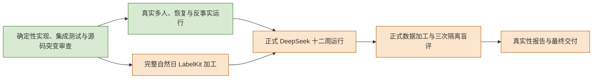

# WorldMock 实现状态

> 状态：NOT-COMPLETE——各特性按独立验收记录判断；候选地点能力输入仍有既有缺口，三项真实验收均未完成
> 日期：2026-09-20（增量修订；既有验收记录保留各自基线）
> 历史基线：工作树 HEAD `9b7fbc84d4429c2f05ec4b526df53539f0ed5d78`（另含当时未提交的文档重构与候选呈现代码）；除新增特性验收记录外，下文旧测试数字和真实运行描述均为该次实测快照，不代表新版本已重新完成真实运行
> 口径：接口与字段以 `docs/CONTRACTS.md` 为准，验收门禁与证据规则以 `docs/VERIFICATION.md` 为准，覆盖率口径见 `docs/dev/coverage-baseline.md`；本文件只写当前状态，变更过程由 Git 承载

## 当前结论

交互菜单提交 `eca965845d8009f1a1f5ac6f07e8e4bc9feab1d1` 与品类契约主线
`2aec476` 合并后的完整门禁尚未产生；下列数字只属于各特性的固定验收快照，不能当作本次合并结果。

交互菜单以 [冻结规格](SPEC-interaction-menu.md) 为本次完整开发范围，覆盖声明、有效菜单、
人物工具与参数、环境拒绝、恢复身份和文档一致性，不设特性延期项。
固定源码的最终门禁、条款到行为断言与 Uncle Bob 审查统一记录在
[交互菜单验收记录](research/interaction-menu-verification.md)，不能以本页历史测试数字代替。
该记录固定的独立快照离线验收为 **2985 passed、零跳过**，分支覆盖率 **98.79%**，
未覆盖公共接口 **0**；环境侧三十二个、宿主侧二十四个有效语义变异最终全部被检出。
声明、模型工具与参数、环境结算和恢复身份在该快照贯通。
两组独立报告保留初次存活项、补强复验和临时工作树清理边界；结果不改变下述全项目真实运行状态。

品类契约与决策上下文已整合，合并复核发现的模型库存使用缺口也已补修。
该次被测源码 `35c1dfa9789010ff2845435900871cda616ded52` 的完整门禁为 **3166 passed、零跳过**，
分支覆盖率 **96.67%**，未覆盖公共接口 **0**；补修的六项独立语义突变全部 killed。
来源、文件范围和原始证据见[合并验证记录](category-contract-main-verification.md)。
下面各特性段落保留各自独立开发时的验收快照，不替代待执行的本次合并门禁。

决策上下文特性以 [冻结规格](SPEC-decision-context.md) 为本次完整开发范围；
已完成提案裁决、官方协议核对、分模块实现、独立审查修复与隔离源码突变审查，无特性延期项。
源码 `f8a55e2` 的根测试 **2871 passed、零跳过**，分支覆盖率 **98.82%**，未覆盖公开接口 **0**；
AS2 `e4155095` 的全量测试 **448 passed**。六十种源码反例最终均被检出，临时工作树已恢复并移除。
完整修改清单、条款到测试与独立报告见 [决策上下文验收记录](research/decision-context-verification.md)。
这些结果只证明本次确定性代码层，不改变下述真实运行门禁的状态。

本次品类契约特性从 `426af3bfe3d7e507b749f286e08857e697c2ac2f` 在隔离分支
`codex/category-contract` 开发。冻结规格为 [SPEC-category-contract.md](SPEC-category-contract.md)，
实施、测试、独立 Bob 审查与实际文件清单统一记入
[品类契约验证台账](category-contract-verification.md)。正式目录采用原生增量对象与闭集交换规则，
三份生活场景绑定目录 `3.0`；现有 163 个对象的业务含义保持原样。
本次离线确定性验证不等于下面三项项目级真实验收已经完成。

LifeEnv 运行时、数字足迹、画像编译、语料、LabelKit 交付与真实性评估已有实现与确定性测试；
但候选资格的 `location_kinds` 能力集合尚未进入 `LocationConfig` 和正式输入，不能声称修订合同全部落地。
它与本次菜单使用的单值 `locations[].kind` 是两个现有合同，不能用菜单实现替代能力集合验收。
项目仍不是完成态，三项真实验收也全部未完成。
确定性测试通过、短窗口运行、测试夹具与单条语义通过都不构成这三项的证据。

| 验收项 | 当前状态 | 已有证据 | 缺口 |
| --- | --- | --- | --- |
| 正式 DeepSeek 十二周运行 | 未启动 | 场景 `scenarios/white-collar-12-weeks.json` 已冻结（`Asia/Shanghai`，2026-01-05T00:00:00+08:00 至 2026-03-30T00:00:00+08:00，共 84 天）；`runs/` 下 42 个运行目录中没有任何覆盖 84 天窗口的运行 | 没有十二周真实输出，也没有精确终点数据 |
| LabelKit 完整自然日交付 | 未通过 | 真实小时数字足迹的语义数据、规则测试数据与训练集加载已经过实际消费者验证；多人、恢复与反事实运行通过完整导出认证 | 最近一次完整自然日加工在 action 阶段即中止，未进入 intent、dreaming、规则与训练加载 |
| 三次隔离盲评 | 未执行 | 评估工具已有 49 项测试，覆盖共同字段、匿名对象引用、真实状态变化、可判定性、配对周统计与区间、一致性及不强制优胜者的结论规则 | 现有盲评包只是 smoke 包；三个隔离模型会话尚未产出原始回答 |



链路各段的门禁定义与交付顺序见 `docs/VERIFICATION.md`。

## 候选与呈现：本轮新增章的落地状态

本轮规格新增 `docs/dev/SPEC-life-runtime.md`「候选契约与呈现规则」章与 `docs/dev/SPEC-life-realism.md`
的「`location_kinds` 的运行期强制语义」「素材可达性」「素材淘汰与检索机制的禁止项」「候选与呈现」四节
（版本表第 7、8 条）。历史算法与夹具测试已经落地，但正式地点能力输入仍未闭合，本文件按层分别记录；
门禁判定对象是 `docs/VERIFICATION.md`「放行门禁」章「工程门禁」节的「候选与呈现一致性」条（九项判据），
其可执行判定由下表的测试文件与三项门禁命令承载。

| 层 | 现状 | 证据 |
| --- | --- | --- |
| 场景常量声明 | **已落地**：`candidate_presentation_limit`、`candidate_pool_limit`、`rotation_quota_ratio`、`rotation_stale_seconds`、`retrieval_index_threshold` 已在三份生活场景声明并在 `src/worldmock/life/scenario.py` 建模、`semantics.py` 装配 | `tests/life/test_candidate_constants.py`（含缺 `rotation_stale_seconds` 即拒绝、比例与上限的边界与上界）；`scenarios/white-collar-12-weeks.json` 等 |
| 纯函数层 | **已落地**：统一三段式（生成/资格/排序）、排除纪律与闭集原因码、稳定排序键与游标派生、曝光轮转与闭式上界均在 `src/worldmock/life/candidates.py` 与 `src/worldmock/life/rotation.py` 实现，两模块为纯函数、不写世界状态、不做 IO、不调模型 | `tests/life/test_candidates.py`（49 测）、`tests/life/test_rotation.py`（20 测）、`tests/life/test_candidate_constants.py`（32 测），实测全绿 |
| 运行期装配与检索 | **算法已落地，正式地点能力输入未闭合**：`presentation.py`、`retrieval.py` 和 `activities.py` 已有候选、检索与 `require_location_kinds`；但 `LocationConfig` 及正式场景未声明 `location_kinds`，不能把夹具中的能力集合校验证明成正式输入端到端已生效。分区键与分区可行性仍由目录准入校验 | `tests/life/test_candidate_wiring.py`、`test_retrieval.py`、`test_activity_location_kinds.py`、`tests/catalog/test_reachability_admission.py`；输入边界见 `docs/dev/SPEC-life-realism.md` |
| 运行期接线与持久化 | **已落地**：`src/worldmock/life/observe.py` 的观察投影与 `browse_activities` 下推经 `presentation.py` 产出；`src/worldmock/life/engine.py` 经 `state_commit.flush_presentation` 把观察边界暂存的留痕并入世界状态；`WorldState.schema_version` 由 2 递增为 3，新增 `presentation_state` 字段承载轮转判据「上次呈现时刻」 | `src/worldmock/life/models.py`（`WORLD_SCHEMA_VERSION = 3`、`WorldState.presentation_state`）、`src/worldmock/life/state_commit.py`（`flush_presentation`）；`tests/life/test_candidate_wiring.py::test_observe_uses_candidate_contract_and_records_presentation` 断言留痕随下一个提交落盘、留痕条目仍在对象层 |
| 离线门禁 | **已落地**：三项门禁实测见下节。`docs/VERIFICATION.md`「候选与呈现一致性」九项判据里，「文档链接可解析」由 `scripts/documentation_gate.py` 守护；其余判据的可执行判定是候选与呈现各测试文件与 `scripts/coverage_gate.py` | `scripts/documentation_gate.py`、`scripts/coverage_gate.py`、`tests/test_documentation_gate.py`（6 测）、`tests/test_style_gate.py` |

### 三项门禁的实测输出（复跑命令与关键行）

```
$ uv run python scripts/coverage_gate.py
[coverage-gate] branch coverage: 98.83% (covered=5851, missing=69, threshold=85.00)
[coverage-gate] uncovered public interfaces: 0
[coverage-gate] gate verdict: PASSED
```

```
$ uv run pytest -q tests/test_style_gate.py tests/test_documentation_gate.py
7 passed
$ python3 scripts/documentation_gate.py
[documentation-gate] scanned documents: 25
[documentation-gate] broken references: 0
[documentation-gate] gate verdict: PASSED
```

```
$ uv run pytest -q
全绿（覆盖率门禁内部要求测试退出码为 0，故门禁 PASSED 即蕴含全套件绿）
```

新增实现与测试的清单（复核实测，逐文件测试函数计数取自 `pytest --collect-only -q`）：

| 产物 | 测试 | 计数 |
| --- | --- | --- |
| `src/worldmock/life/candidates.py`（统一候选契约三段式） | `tests/life/test_candidates.py` | 49 |
| `src/worldmock/life/rotation.py`（曝光轮转） | `tests/life/test_rotation.py` | 20 |
| `src/worldmock/life/presentation.py`（运行期装配） | `tests/life/test_candidate_wiring.py` | 9 |
| `src/worldmock/life/retrieval.py`（确定性倒排与 facet） | `tests/life/test_retrieval.py` | 31 |
| 场景常量五个 | `tests/life/test_candidate_constants.py` | 32 |
| 素材可达性准入校验（两个新错误码） | `tests/catalog/test_reachability_admission.py` | 9 |
| `location_kinds` 运行期强制 | `tests/life/test_activity_location_kinds.py` | 9 |
| `scripts/check_reachability.py`、`scripts/documentation_gate.py` | `tests/test_documentation_gate.py` | 6 |

八个文件合并复跑实测 **165 passed**。

### 未解决的一项独立缺陷：静态可达性守卫对正式场景非零退出

`scripts/check_reachability.py` 不带 `--scenario` 时通过（实测 `all 7106 entries reachable across 101 partition(s)`、退出码 0），
但带 `--scenario scenarios/white-collar-12-weeks.json` 时**退出码 1**，报 `86 unreachable object(s)`，
全部来自 `scenario:contents`，`missing=['genre','language']`：80 条为 `game_session` 品类
（`game-0001`…`game-0080`），另 6 条为 `jokes-feed`、`movie-reviews-feed`、`news-feed`、
`sintel-en-subtitles`、`weibo-feed`、`zhihu-feed`。即场景 `contents[]` 有 86 条条目自身缺题材与语言声明，
落不进任何检索分区。这是规格自己记的另一类独立缺陷，**未解决**，不因本轮落地而消失。

### 工具面指纹重钉

`tests/integration/test_life_agent_protocol.py` 的 `_PINNED_TOOL_SCHEMA_SHA256` 因本轮工具面变更而重钉：
`browse_activities` 新增可空 `cursor` 参数、返回体字段由 `count` 改名为 `returned` 并新增 `total` 与 `next_cursor`，
指纹随之改变。新值 `463c496b09848b9634d0f0f11f9f7fc4af7e06d3c7282088151b48625aa92b89`。

运行期已接线：人物实际看到的候选经 `src/worldmock/life/presentation.py` 装配后产出，
`docs/VERIFICATION.md`「候选与呈现一致性」的九项判据中，凡判据要求「观察投影」「下推返回体」
「轮转前后目录与对象状态不变」「两次投影逐字节相同」的项均已可执行，证据见上节表格与
`tests/life/test_candidate_wiring.py`。规格追溯矩阵 `docs/dev/ANALYSIS-spec-coverage.md`
的「候选契约与呈现规则」章 44 行中，`covered` 已由 27 行增至 35 行、`gap` 由 17 行收窄为 9 行。

### 已落地的条款：口味权重降级为排序信号

一条已落地并可指向真实测试：口味权重是排序信号而不是准入条件，零权重不出局。

- 实现：娱乐候选的入选条件改为 `attention_prior[kind] > 0`（`src/worldmock/life/motivation.py`），
  `preference` 只出现在排序键里；`src/worldmock/profile/taste.py` 的权重取值域包含零且语义不是「不可选」。
- 测试：`tests/life/test_motivation.py::TestScorerContract::test_zero_taste_weights_keep_entertainment_ranked_last`
  与 `test_unstated_genre_items_stay_in_candidate_pool`（本文件修订时实测 `2 passed, 76 deselected`）。
- 纯函数层同口径的测试：`tests/life/test_candidates.py::TestSoftPreferenceOnlyReorders` 四测。
- 该行在 `docs/dev/SPEC-life-realism.md` 验收矩阵中的状态已由「待落地」改记「代码层已验证」（两处观察均有断言）。

### 已实施的不可逆变更：`WorldState.schema_version` 2 → 3

本轮新增章落地时引入了 `presentation_state`（承载轮转判据「上次呈现时刻」）持久化字段，
`WorldState.schema_version` 随之由 2 递增为 3（`src/worldmock/life/models.py:18` 现为 `WORLD_SCHEMA_VERSION = 3`）。

- **影响面**：`schema_version` 是 `Literal` 常量且无缺省，旧值检查点在加载时即拒绝，
  因此 2 → 3 使**已提交的检查点在磁盘上不可读**，不存在向前读取路径，也不补兼容层。
- **可回滚性最差的一项**：本轮其余改动都可回滚，这一项不可——回滚代码不能使已按 3 写入的检查点重新可读。
- **对 `replay --intervention` 的约束**：反事实分支要求父检查点与干预条件匹配，
  `replay --parent` 必须换用按 3 生成的新检查点；旧检查点与其派生分支不能再作为反事实父。
- 现状：**已实施**。`runs/` 内按 2 写入的既有运行目录与检查点不可再读，这是有意为之，不保留兼容读取路径。

## 已完成的确定性范围

### 测试基线与覆盖率实测

| 命令 | 实测结果（本工作树） |
| --- | --- |
| `uv run python scripts/coverage_gate.py` | `branch coverage: 98.83% (covered=5851, missing=69, threshold=85.00)`；`uncovered public interfaces: 0`；`gate verdict: PASSED` |
| `uv run pytest -q tests/test_style_gate.py tests/test_documentation_gate.py` | `7 passed` |
| `python3 scripts/documentation_gate.py` | `scanned documents: 25`；`broken references: 0`；`gate verdict: PASSED` |
| `uv run pytest -q` | 全绿（覆盖率门禁要求套件退出码为 0，门禁 `PASSED` 即蕴含全量套件绿） |

上表数值的观察时间为 2026-09-19，「候选与呈现」章代码落地之后。
上一版记录的存量红 `tests/integration/test_life_agent_protocol.py::test_life_tool_schema_fingerprint_pins_registry_digest`
已随本轮工具面变更重钉而消除（新指纹见「工具面指纹重钉」节）：
该测试把人物工具面指纹钉在 `9726733354cac0f75f7f590d8926ebba328dc4123d2806da15b90bff093e5d0d`，
而 `custom/agents/life_agent.py` 的 `life_tool_schema_sha256()` 实算为
`133b61819c7bef77858567b032dac9396a1374777cdee71bdcd4eac58a670d4f`（旧版记录值），
两者不一致曾使套件非零退出、门禁判定 FAILED，即使分支覆盖率与未覆盖公共接口两项数值本身达标。

### 覆盖率口径

| 覆盖率 | 目标 | 判定方式 |
| --- | --- | --- |
| 功能规格测试用例覆盖率 | 100% | 规格每条可独立验证的条款映射到至少一个真实存在的测试函数；属映射义务，不由脚本机器计算 |
| 接口覆盖率 | 100% | `scripts/coverage_gate.py` 机器判定：公共接口函数体任一行出现在 coverage `missing_lines` 即计未覆盖 |
| 分支覆盖率 | ≥ 85% | 同一脚本机器判定：全部生产文件汇总的 `covered_branches / (covered_branches + missing_branches)`，保留两位小数后与阈值比较 |

- 测量范围：`src/worldmock`、`custom/agents`、`custom/envs`；排除 `tests/`、`scripts/`、`vendor/`。
- 测量启用分支模式；行排除表只保留 `# pragma: no cover` 与 `if TYPE_CHECKING:`，未调用的占位实现会计入
  `missing_lines`，从而被接口覆盖率门禁捕获。
- 失败关闭：文件出现在生产根目录但未被测量时其全部公共接口计为未覆盖；汇总分支总数为 0 时按 0% 判定；
  测试套件本身非零退出时门禁不通过，不论覆盖率数值。
- 门禁报告是生成物 `docs/dev/coverage-report.json`，每次门禁运行覆盖重写；其当前内容与独立复算的分支数字一致：
  `covered_branches = 5851`、`missing_branches = 69`、`total_branches = 5920`、百分比 `98.83`、
  未覆盖公共接口 0、`passed = true`（`generated_at` = `2026-09-18T22:54:21+00:00`）。

### 规格追溯与突变守卫

- 规格追溯矩阵（`docs/dev/ANALYSIS-spec-coverage.md`）：条款总数 435 = covered 413（94.9%）+ gap 8（1.8%）+ exempt 14（3.2%），
  覆盖率（covered+exempt）98.2%。豁免条款的实际验证入口是真实模型调用、真实外部服务或长墙钟真实运行验收，
  各自附有确定性锚测试；原有 5 个唯一缺口已由修复波落地并逐条亲读测试函数核实后改记 covered。
  现行 8 个 gap 全部来自本轮新增的「候选契约与呈现规则」章，逐条原因见该章
  （跨运行分支一致性、动机层截断不作用于呈现、下推层数上限、`D` 取值来源、退役条目「保留可读」一侧、
  `anywhere` 恒可行、禁止向量检索未写成常驻断言、随身持有的地点嵌套），
  不构成既有条款的回归。
- 增量源码突变审查：规格关键设计断言 12 项（时钟顺序、内容暴露、幂等结算、素材吞错、分支隔离、来源绑定、
  睡眠常数、账本守恒、静默边界、知识截止、提示投影、交通报价）与两轮增量审查（31 项、108 项）均已执行，
  全部存活缺口都补了针对性测试并经独立复验 killed，当前没有已知存活突变。报告与复验记录在
  `.work/verification/bob-target-only/`。
- 规格验证矩阵不是完整测试地图：`test_branch_coverage` 系列测试独家守住两个突变探针位点。

### 已冻结条款与确定性证据

| 条款 | 当前实现与边界 | 收据 |
| --- | --- | --- |
| 能量可行性 | 环境公开各类活动时长上限与路线成本，工具按同一观察限制，恢复前重新核验能量；精确足额活动按固定近零精度分段结算，真实不足仍拒绝 | `.work/verification/energy-feasibility-implementation/implementation-receipt.json` |
| 工作评审协议 | 最多初次加两次输出纠正，原响应先持久化，语义拒绝与基础设施异常不重评 | `.work/verification/work-review-protocol/receipt.json` |
| 无损模型输入 | 同窗口重复完整字段使用 RFC 6901 单跳字典，最终训练恢复完整输入；逻辑窗口、编码行与实际 trace 分别绑定 | `.work/verification/evidence-encoding/capacity-receipt.json` |
| 语义合同 | 三任务共享证据、分类及聚合要求，保留不同因果主题，32 条是上限；完整真实语义交付另行验收 | `labelkit-projects/` 三份项目配置与实际请求合同测试 |
| trace 关联 | 核对当前配置、完整输入输出、逐轮生成与独立评审、逐记录最终通过及成功结束 | `.work/verification/delivery-integration-cross-review/narrow-recheck.log` |
| 人物隔离 | 认证消费者按实际请求人物拒绝同一不透明标识下的异人来源 | `.work/verification/delivery-integration-cross-review/narrow-recheck.log` |
| 反事实假设证据标准 | dreaming 专属合同段定义：hypothesis claim 的证据只须支持假设条件，可能结果用推测措辞且不得标为 fact，评审不得对假设结果本身索要事件级证据，数值界限只能用所列事件中可见的数值或其近似表述 | `labelkit-projects/dreaming.toml` |

收据里的通过数字属于各自基线的运行结果，本文件不把它们当作当前基线数字引用。

### 数据、日志与模型接入

- 语料扩容：正餐 30 条（能量逐条标注 USDA FNDDS 来源与换算）、POI 路由 220 条（OSRM 冻结响应）、
  工作材料输入 65 份、drama 语料与场景联系人语料；全部进入 `corpora/manifest.json` 哈希冻结清单
  （956 条，逐条记录路径、sha256、media_type 与 purpose）。
- 结构化操作日志：`src/worldmock/opslog.py` 追加写 `logs/ops-<模拟日YYYYMMDD>.jsonl`，是 JSON-lines 定位日志、
  不是审计证据，写入失败只记 stderr。每条含 `at`、`sim_time`、`component`、`level`、`code`、`detail` 及关联键
  `agent_id`、`decision_id`、`round_id`、`action_id`、`event_seq_first/last`、`tokens_in/out`；
  `event_seq_*` 可与 `footprints.sqlite` 的事件序号互相跳转。
- 人物模型接入：人物动作调用开启 DeepSeek thinking（`custom/agents/life_agent.py` 覆写
  `extra_body.thinking = enabled`），LabelKit 生成角色关闭 thinking、评审角色开启（`labelkit-projects/config.toml`
  的 `[llm.default]` 与 `[llm.judge]`）。thinking 模式拒绝 `tool_choice=required`，故工具选择用 `auto`，
  模型不产出工具调用时由 ReAct 协议纠错兜底；推理原文经 `model_response` 数字足迹事件的
  `data.response.choices[0].message.reasoning_content` 落库。模型请求超时为 300 秒
  （`src/worldmock/runtime.py` 设 `AGENTSOCIETY_LLM_REQUEST_TIMEOUT`，AS2 默认 60 秒）。
- 内容品类：`kind` 取 `feature_film`、`drama_series`、`webnovel_excerpt`、`news_feed`、`joke_feed`、
  `subtitle_experience`、`game_session`；`experience_label` 保留为结算与目录的可读标签。
- 路径清理：受版本控制的路径中不再保留任何旧工程代码或经验档案。

### 已具备的真实运行证据

| 范围 | 实际结果 | 证据位置 |
| --- | --- | --- |
| 多人完整一天 | run `c5b79980a8604d19b3299949d3573c59`：2981 条数字足迹事件、85 个活动、188 次动作请求（149 接受、39 拒绝）、188 次记忆更新、610 对模型请求响应；完整导出认证通过 | `.work/verification/runtime-acceptance/budget-lifecycle/multi-export` |
| 普通恢复 | run `cc9049d5b64946b789bda7a85efe6d1a`：从 07:00 的非初始共同检查点恢复到次日零点，CLI 与导出成功，父目录逐字节不变 | 同目录 `resume-export`、`parent-after-resume.json` |
| 反事实失败 | run `5bc2ccb3c1a5474da9b0c61504505451`：17:16 工作评审漏必填字段，414 对模型记录保留，CLI 退出码 1，无完整导出，父目录不变 | 同目录 `counterfactual-failure/receipt.json` |
| 实际回合预算 | 188 次生活决策共 453 次带预算请求，每次最多 5 轮；610 次响应无回调上限警告；真实运行未触及预算临界值 | 同目录 `actual-budget-and-callback-receipt.json` |
| 实际生活行为 | 人物二 34 次零能量拒绝均有正确反馈，23:00 前存在可行配送进食路径；工资 95000 分、食品 1300 分、交通 2110 分逐事件对账 | 同目录 `energy-audit/report.md` |
| 完整候选模型对照 | 相同完整输入与候选只更换模型，Flash 与 Pro 都拒绝，且都漏掉一项已确认问题 | `.work/verification/complete-candidate-judge-model-comparison/` |
| 最近一次完整自然日加工 | action 扫描 69 条、68 条通过，256 次调用传输全部成功，语义仍不合格；未执行 intent、dreaming、规则与训练加载，无最终交付清单 | `.work/verification/day-reasoned-citations/failure-receipt.json` |
| 历史真实小时消费 | 真实小时数字足迹的 5 条语义数据、规则 4 分支 11 事件及 DatasetDict 保存重载均经过实际消费者验证 | `.work/verification/deepseek-hour-real-rules.json`、`.work/verification/deepseek-hour-hf-lossless/receipt.json` |

这些运行只覆盖小时到单日尺度，替代不了十二周运行与完整自然日交付。行为观察不是人类真实性证明。

生产容量余量：最大初稿 633215 estimated tokens，最大合法候选及最大实见累计意见的返工 676930，均低于生成
输入预算 768928；评审 675882，低于 867232。每次实际调用仍执行完整预算检查。这些值不是任意未来意见长度的
数学保证，也不证明模型已经正确理解全部单跳引用。

## 未完成项与阻塞

1. 正式 DeepSeek 十二周运行未启动。场景已冻结，`runs/` 的 42 个运行目录中没有任何 84 天窗口运行，没有精确终点数据。
2. LabelKit 完整自然日交付未通过。最近一次完整自然日加工在 action 阶段中止（扫描 69 条、68 条通过，语义不合格），
   未进入 intent、dreaming、规则与训练加载，没有最终交付清单。多次尝试的失败集两两零交集，且每条失败记录都曾在
   别的次通过，当前判断是方差主导而不是结构性不可满足。
3. 三次隔离盲评未执行。现有盲评包只是 smoke 包，三个新建隔离模型会话尚未产出并保存原始回答。
4. 缺少匹配人群的真实个体数据，因此只能报告相对合理性，不能声称验证了人类相似度。
5. 候选与呈现合同有一项独立缺陷未解决：`scripts/check_reachability.py --scenario` 对正式场景退出码 1，
   报 `86 unreachable object(s)`，全部来自 `scenario:contents`、`missing=['genre','language']`，
   其中 80 条为 `game_session` 品类。运行期接线与持久化已落地（见「候选与呈现：本轮新增章的落地状态」），
   规格追溯矩阵该章的 `gap` 已由 17 行收窄为 9 行，但余下九行仍无测试证据；
   且该章验收矩阵九行观察项中「随身持有与远程订购」一行仍记「待实现」。
6. 已消除的存量红：`tests/integration/test_life_agent_protocol.py::test_life_tool_schema_fingerprint_pins_registry_digest`
   曾因工具面变更（`browse_activities` 新增可空 `cursor` 参数、返回体字段 `count` 改名为 `returned`
   并新增 `total` 与 `next_cursor`）而失败，本轮已重钉为
   `463c496b09848b9634d0f0f11f9f7fc4af7e06d3c7282088151b48625aa92b89`，套件恢复全绿、覆盖率门禁 PASSED。
   该指纹由工具 Schema 与可供性注册表的字节共同决定：`life_tool_schema_sha256()` 把各工具 Schema
   （`_tool_schema` 由 `worldmock.life.models` 的请求模型生成，模型与字段的 docstring 文本随之进入 Schema
   的 `parameters`）与 `affordance_registry_sha256()` 读出的 `catalog/affordances.toml` 字节摘要合并后取
   SHA-256。请求模型 docstring 或注册表字节任一变化都会改变实算值，钉板常量随之需要重钉。

## 结论边界

- 本文件只覆盖代码与确定性测试层。三项真实验收完成与否不由本文件判定，也不能由确定性测试通过推断。
- 短窗口运行、测试夹具和单条语义通过都不能替代十二周运行、隔离盲评与完整自然日交付。
- 行为观察不是人类真实性证明；缺匹配人群真实个体数据时只报告相对合理性。
- 交付参数调整的边界：只增加失败记录可用的修复轮数（三份项目 `[verify].max_repair_rounds = 3`、
  `[output].max_repair_attempts = 4`），不放宽 claims 上限、证据引用或任何合同条款。
- 历史失败原件与收据保留在 `.work/verification/` 与 `runs/`（两者都不在版本控制内），不改写失败输出。
- `docs/dev/research/` 下的审计与根因文档是当时的历史快照，不描述当前实现。
- 运行产物、测试探针与环境目录不进入版本控制。
