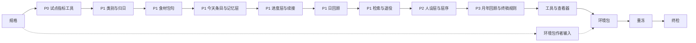

# 10 实施：版本、文件、设计文档、测试与门禁

> 属于[分层记忆开发规格](../SPEC-layered-memory.md)。代码基线 f67c25e5。第四批裁定（2026-10-30）修订。

## 目标与依据

第 01–09 章各写一块。本章把它们合成一次交付：改哪些版本号、指纹怎样变、改哪些代码文件和设计文档、增删改哪些测试、按什么次序实施、每一步过哪些门禁、怎样重冻基线与重录样例、对外要做的事，以及各章之间的冲突怎样裁定。

实现的提案条文（docs/dev/PROPOSAL_2026-10-29_LAYERED_MEMORY.md）：

| 提案位置 | 本章落实的内容 |
| --- | --- |
| 第三章「代码」表 | 「接口与文件」的完整文件表，每个文件写明所属章 |
| 第三章「设计文档」表（「文档、实现和行为测试同一次提交」） | 「设计文档」的完整清单，每处写明改后要陈述什么、所属章 |
| 第三章「测试与门禁」 | 「测试」的完整清单、「行为」四「门禁」与「行为」五「重冻与重录」：两份完整日基线在全部生产改动之后重冻一次（一次交付，提案的「每期」合为一期；第四批裁定的代码定稿之后按同一规程再做一次）、用真实宿主重录查看器样例、分支覆盖率 ≥85% 与公开接口零未覆盖、风格门禁 |
| 第三章「事件、版本与下游」 | 「行为」一「版本与身份」，「行为」六「对外」 |
| 第四章各期 | 「行为」三「实施次序」：P0、P1、P2、P3 一次交付，分期只作实施次序；P4 不做 |

编排方的全局决定，按负责人「一次交付」的指示执行：
- 提案的 P0、P1、P2、P3 一起交付，只建终态。P1、P2 期的临时规则写法、P1 期的现行层序、P1 期留在人设层的看法、P1 期不渲染「看法·」，都不实现；提案的分期只决定本章的实施次序。
- 真实模型试点（提案的试点，约 $14）不在这次无人值守的任务里执行；验收靠确定性测试，试点的规程与指标由第 09 章写定，以后执行。
- 本仓不改 LabelKit-DataSet；它要改的那一处和通知原文在第 08 章，本章只规定交付时附上。WorldMock-Dataset 的五个包与构建工具照第 08 章改。
- 「字」一律是 Python `len()` 的字符数；每条今天条目的 120 字只数「核验」「自述」里的字符串（裁定 19 的读法）。
- 文档、实现与行为测试同一次提交；`docs/design/*.md` 是当前行为的唯一权威；不留兼容、回退与迁移，过时代码直接删除（AGENTS.md）。

本章与其他章不一致时，以本章「跨章裁定」为准；本章写定时已把各章改成与它一致。

## 行为

### 一　版本与身份

| 号 | 位置（f67c25e5） | 之前 | 之后 | 所属章 |
| --- | --- | --- | --- | --- |
| 质量报告 `quality.json` 的 `schema_version` | src/worldmock/recording_engine/reports/quality.py:86 | 9 | 10 | 04（`memory_digest` 调用类） |
| 目录格式 `CatalogManifest.format_version` | src/worldmock/resource_engine/catalog/models.py:51 | `Literal[5]` | `Literal[6]` | 08（字段 `memory_category` 由 03 加） |
| WorldMock-Dataset 构建器 `FORMAT_VERSION` | WorldMock-Dataset/tools/build_environment.py:38 | 5 | 6 | 08 |
| 包 0001 `qingpu-lianqiu-white-collar` 的 `environment_version` | WorldMock-Dataset/environment/0001-white-collar-lianqiu/sources/manifest.json:3 | `"9"` | `"10"` | 08 |
| 包 0002 `shanghai-cbd-business-sales` | environment/0002-business-sales-zhaoming/sources/manifest.json:3 | `"5"` | `"6"` | 08 |
| 包 0003 `songjiang-campus-female-student` | environment/0003-female-student-chensiqi/sources/manifest.json:3 | `"6"` | `"7"` | 08 |
| 包 0004 `jiading-community-homemaker` | environment/0004-homemaker-wangxiulan/sources/manifest.json:3 | `"5"` | `"6"` | 08 |
| 包 0005 `songjiang-campus-male-student` | environment/0005-male-student-lihaoran/sources/manifest.json:3 | `"6"` | `"7"` | 08 |
| environment/0002-social-corpus-texts（采集语料作者输入，没有发布包） | sources/manifest.json:3 | `"1"` | `"1"` | 08（不重建） |
| WorldMock 测试环境 `artificial-test` | tests/fixtures/dataset-environment/catalog/manifest.json | `format_version` 5，`environment_version` `"4"` | `format_version` 6，`environment_version` `"4"` | 08 |
| 世界结构 `WORLD_SCHEMA_VERSION` | src/worldmock/state/world/world.py:21 | 15 | 15 | 不变：不新增 AgentState 字段（回顾的幂等靠事件，04） |
| 运行清单 `RUN_MANIFEST_SCHEMA_VERSION` | src/worldmock/state/identity.py:12 | 7 | 7 | 不变：ModelConfig 键集不变，`reflection_validation_max_retries` 改由回顾使用（04） |
| 导出清单 `EXPORT_SCHEMA_VERSION` | src/worldmock/recording_engine/export/export.py:39 | 8 | 8 | 不变：导出产物集合不变 |
| 检查点 `Checkpoint.schema_version` | src/worldmock/recording_engine/events/models.py:188 | 1 | 1 | 不变：工作区快照格式与内容不变 |
| 事件 `Event.schema_version` | src/worldmock/recording_engine/events/models.py:175 | 1 | 1 | 不变 |
| 事件类型闭集 `EventType` | src/worldmock/recording_engine/events/models.py:110 | 14 种 | 14 种 | 不变：回顾用 `environment_event` 的新 kind `memory_digest_generated`（04） |
| 规则版本 `RULES_VERSION` | src/worldmock/exchange_engine/definitions/constants.py:7 | 6 | 6 | 不变 |
| 环境输入的 `schema_version` | src/worldmock/configuration/inputs/models.py:158、:231 | 2 | 2 | 不变 |
| 行为工具报告标识 | tools/analysis/behavior/metrics.py:127 | `behavior-metrics-4` | `behavior-metrics-4` | 不变：新增两项只报告（09） |
| 试点报告、类别表的标识 | tools/analysis/memory_pilot.py、memory_categories.py（新） | — | `memory-pilot-1`、`memory-categories-1` | 09 |
| LabelKit-DataSet `CATALOG_FORMAT_VERSION` | LabelKit-DataSet/persona/src/labelkit_dataset/datasets/persona/export_source.py:21 | 5 | 6 | 由 LabelKit-DataSet 的会话改（「行为」六） |

没有一个号升两次。没有旧号的读取方：格式 5 的包被新引擎拒收（`ENVIRONMENT_KIND_INVALID`），质量版本 9 的导出通不过认证（认证用当前代码重算质量报告并逐字节比较）。

**指纹与身份的后果。**
- 提示指纹 `life_prompt_sha256()`（src/worldmock/agents/prompt/life_prompt.py:172-177）改变：生活与只读系统层改写（07），`LAYER_SCHEMAS` 里的人设层（07）、记忆层（01、03、07）、待办层与进度层（06）Schema 改变。`USER_LAYER_NAMES` 不进这个指纹。
- 工具指纹 `life_tool_schema_sha256()`（custom/agents/life_agent.py:953-959）改变：工具从十个变成八个，`search_memory` 带新的用途句（05、07）。
- 代码指纹 `runtime_code_sha256`（src/worldmock/runtime/framework/setup.py:107）改变：每次改生产源码都变。提示与工具指纹由 `_model_identity`（setup.py:81-89）写进 `model_identity`，代码指纹写进 `code_sha256`，两者都由 `_run_identity`（src/worldmock/runtime/lifecycle/runner.py:212-223）冻结在运行清单里；f67c25e5 及更早的代码建的运行，在新代码上恢复、重放或分支，都在 `_require_runtime_identity`（src/worldmock/runtime/lifecycle/runner.py:276-290）以 `IntegrityError` 拒绝。这是预期行为，不做迁移。
- 测试环境清单的 `format_version` 进目录摘要（src/worldmock/resource_engine/catalog/identity.py:71-87 把去掉自引用的清单正文一起算进 `catalog_content_sha256`），所以两份完整日基线里的 `environment_identity.catalog_content_sha256` 改变；`map_sha256`、种子与 `environment_version` 不变（tests/system/lifecycle/test_complete_day_baseline.py:13-16 的 `FROZEN_IDENTITY` 与 `"4"` 照旧成立）。
- 五个包的 `catalog_content_sha256` 都变；新试点与 V、B 的环境版本不同，比较时注明（09「试点规程」第 4 步）。
- LabelKit 改成 6 以后不再接收格式 5 的导出，包括 V、B 和它已保存的源快照（08 的通知第 2 条）。

### 二　跨章裁定

下表是整合时查出的冲突与空缺。每一条都已改进所属章，各章的文字以改后为准。

| 问题 | 涉及章 | 裁定 | 改了哪里 |
| --- | --- | --- | --- |
| `MemoryView` 的字段：02 写 `layer`、`note_labels`、`published_bound` 并删 `facts`；06 写 `layer`、`facts`、`note_labels`、`published` 并读 `memory.facts.kits` | 02、06、08 | 恰为 `layer`、`facts`、`note_labels`、`published`，次序如此；`facts` 由 entries.py 公开的 `activity_facts(cached)` 构造。基线已有前三个字段，提案「另返回 P_k」只加一个；进度层要同一次观察的 `ActivityFacts.kits` | 02「memory_layer.py」「entries.py」两节、测试 `test_published_bound_is_the_previous_commit_or_the_midnight_bound`、两行决定 |
| `activity_facts`：02 写成私有 `_activity_facts`，04 的 `count_lines` 与 06 的续接调用公开的 `activity_facts` | 02、04、06 | 公开 `activity_facts(cached: AgentEvents) -> ActivityFacts`，三处共用 | 02 公开函数表与「私有函数」一段 |
| `decision_commits` 的签名：02 是 `(store, cached, cutoff)`，06 按两个参数调用 | 02、06 | 照 02；06 的上一次决策以 `store.last_event_seq` 作截止序号 | 06【P2】与 `_previous_decision` 的代码 |
| `agent_events` 与 `activity_category` 的签名：04 的 `count_lines` 写成 `agent_events(store, agent_id)`、`activity_category(book, context.state, activity)` | 02、03、04、08 | 照 02、03、08：`agent_events(store, agent_id, catalog.kit_states())`；类别按 02【E11】的快照与开始结果读法，`activity_category(book, 快照, purchase_goods(快照, 开始结果))`，不读世界状态 | 04「days.py」一节与决定行 |
| `count_lines` 对 categories.py 的函数内导入与 `DELAYED_IMPORTS` 新键，理由是「03 禁止 days.py 导入 categories.py」 | 03、04 | 03 只禁止 days.py 导入 progress_layer.py、memory_layer.py、day_plan_inputs.py；02 的 `published_today` 已在模块级用 `memory_book`。categories.py 在 days.py 模块级导入，`DELAYED_IMPORTS` 不加键 | 04「days.py」一节、test_import_graph.py 一行、决定行 |
| `month_day_phrase` 没有归属：02 说由 08 新增，08 说由 02 新增 | 02、08 | 02 在 readable.py 新增，函数体在 02；08 的 `kit_phrase` 与改写后的 `clock_phrase` 调用它；测试 `test_month_day_phrase_does_not_pad` 仍在 08 | 02「readable.py」一节与决定行 |
| 「食品状态」写了两份：03 第 2 节自己定义，08 定为 `Catalog.food_states()` 唯一判定 | 03、08、04 | 只由 08 的 `Catalog.food_states()` 判定，03 调用它；04 引用时指向 08 | 03 第 2 节、04「依赖其他章节」与「不在本章」 |
| 第 09 章 memory_pilot.py 另写「食品状态」 | 08、09 | 保留：提案 M11 要求「独立于运行时校验实现」，09 的导入白名单不含目录模型；这是唯一允许的重算，09 的口径表注明与 08 同义 | 09「共用的口径」表 |
| 目录格式 6 写了两份：03 第 9 节与 08 都规定 `Literal[6]`、拒绝次序、样例清单、同一批测试与同一个变异改名，03-resource-engine.md :31、:40 与 docs/manual/resources.md :9、:169 两章各写一种文字 | 03、08 | 格式号、拒绝次序、样例清单、`test_manifest_version.py`、`test_loader.py:84`、`test_identity.py:115`、变异 `catalog_format_version_still_five`、03-resource-engine.md :31 与 :40、resources.md :9 与 :169 都归 08；`memory_category` 字段与文档里写它的各处归 03。08 的拒绝次序照 03 原来的写法：清单原始对象的 `rules_version` 是严格整数且不等于 6 时先报 `RULES_VERSION_MISMATCH`，然后严格清单模型拒绝 `format_version` 不是 6 的清单，报 `ENVIRONMENT_KIND_INVALID`；:40 用 03 原来的整句 | 03 第 9 节、models.py 一节、设计文档两处、测试改动表；08「引擎」一段与 03-resource-engine.md 一行 |
| `_day_entries`（memory_layer.py:225-237）没有一章删除：02 说归 01、08，08 只删其中读反思的循环，01 没写 | 01、02、08 | 02 删除整个函数；08 只删 `_reflections`；`MEMORY_WINDOW_CHARS`、`_fit`、`_layer`、`_render`、`_size` 归 01，08 不重复 | 02 删除清单；08「memory_layer.py」一节与「8000 字窗口与反思读者」一段 |
| `_visible_names` 的文档字符串：02 与 07 各写一种改法 | 01、02、07 | 归 02；07 不改这个函数 | 07 life_agent.py 一节与决定行；01 life_agent.py 一节 |
| 00-overview.md:138 就寝反思 `refs` 的分句：04 改写成回顾 `refs` 的规则，07 写成由 08 改 | 04、07、08 | 归 04；同一格 `subject` 的分句归 07 | 07「设计文档」与「不在本章」 |
| tools/run-viewer-context.js 的 `rules.reflection`：08 与 09 都删 | 08、09 | 这个文件只由 09 改（09 删去并换成 `digest` 键） | 08「tools/run-viewer-context.js」一节与决定行 |
| test_carried_records.py:229、:283：02 改写记忆层一半的断言，06 写「删去记忆层断言」 | 02、06 | 记忆层一半照 02 改写、不删；进度层一半与改名照 06 | 06 改动表两行 |
| tests/integration/reflection_fixtures.py:175-177 的 `memory_layer_of`（按位置取第三层）：01 说随 08 删除，08 的删除清单里没有 | 01、08 | 08 改名为 host_run_fixtures.py 时一并删去（唯一读者 test_daily_reflection.py 由 08 删除） | 08 测试修改表 |
| test_same_second_continuation.py:815 与 :795：01 写成随 07 删除 | 01、06 | 06 删除 :795 的测试，:815 随之消失 | 01「其他要改的现有测试」 |
| test_daily_reflection.py:400-424：01 写成随 04、08 删除 | 01、08 | 08 删除这个文件 | 01 同表 |
| 06 的 `_open_order_rows(..., window: _Window)`，而 03 删除 `_Window` | 03、06 | 形参类型是 03 的 `DayWindow`；03 列出的 `_pending_orders` 就是 06 改名后的这个函数 | 06「day_plan_inputs.py」一节 |
| 05 的 `memory_sources` 调 `past_day_entries` 少了 02【E39】的 `now` | 02、05 | 传冻结观察的 `occurred_at` | 05「search.py」函数表 |
| 记忆投影包的 `__init__.py`：01 建，05 写成归 10 | 01、05 | 归 01 | 05 search.py 一节与「不在本章」 |
| 03 的 `day_bound` 一行与 02、06 的决定行仍写着 02 起草时的旧签名 | 02、03、06 | 删去对已不存在内容的引用 | 03 days.py 函数表、03 与 06 各一行决定 |
| 06-agent.md「进度、待办与记忆」里新小节的位置：01、06 都说紧接「进度层的下界与带入的记录」，04、05 都说在本节末尾，03 没写位置 | 01、02、03、04、05、06 | 次序定为本章「设计文档」里 06-agent.md 一节所列 | 01、03、04、05 的「设计文档」 |
| 变异 `wall_clock_masked_by_key_name` 的杀死测试 `test_nested_recorded_at_is_compared` 被 09 改成比较「今天」的「时刻」，新记忆层没有嵌套的 `recorded_at`，变异再也杀不死 | 09 | 09 新增 `test_a_nested_key_named_like_a_wall_clock_mask_is_compared`（两侧 `activity_progress` 的 `data.recorded_at` 不同），作为这个变异的杀死测试 | 09 test_compare_runs.py 一节 |
| 变异 `concluded_app_use_ends_early` 的杀死测试之一被 02 改名 | 02 | tests/dataset_acceptance.py 里同步改名；改名后的测试另断言 app 的短句不含「提前结束」 | 02 test_location_activities.py 一行 |
| 09 写「不进 `_OUTSTANDING`」 | 09 | tests/unit/engineering/test_style_gate.py 在 f67c25e5 上没有历史违规台账（模块说明「不保留历史违规豁免」），任何违规都失败；CLAUDE.md 的 `_OUTSTANDING` 说法已过时 | 09「风格与覆盖」 |
| 07 写「续接（:488-492）归第 06 章」，01、06 写这几行不改 | 01、06、07 | 这几行不改，`changes` 的内容由 06 规定 | 07 life_agent.py 一节 |
| 提案「设计文档」表把「目录行字段」「回顾事件正文」列在 09-io-formats.md，而 f67c25e5 的 09-io-formats.md 不定义目录行字段（在 03-resource-engine.md「环境目录文件」），事件字段归记录引擎「事件与来源」（09-io-formats.md:88 只作指引） | 03、04 | `memory_category` 只写进 03-resource-engine.md（03）；回顾事件正文只写进 05-recording-engine.md「事件与来源」，09-io-formats.md 只在 :88 的闭合模型清单里加上它（04）；09-io-formats.md 新增的只有「提示层的机器形状」 | 无需改章：03、04 已按此写 |

查过、不算冲突的：01 与 06 对 prompt_capacity.py 模块说明的改写分在不同的行（01 改 :7-8，06 改步骤列表）；04 与 08 对 05-recording-engine.md 调用类表分在不同的行（04 加 `memory_digest` 行与「七类」，08 改 `consolidation`、`reflection` 两行）；04、05、08 对 `test_committed_world_guard.py:118-122` 的公开方法表各加或各删不同的名字；01、05、07 对 test_decision_context_protocol.py 各改不同的行。提案第三章列为要改的 tests/unit/agents/test_life_memory.py 只直接调用 `render_memory_view`，它的渲染机制不变（08），照旧通过、不改；tests/unit/footprints/test_observation_parts.py 与 test_post_run_view.py 只读 `persona_views` 与整层分件的存储，照旧通过、不改（07）。

第四批裁定（2026-10-30，提案第五章）把三级回顾的提示改写成日记，输出只查格式与字数：04 的守卫表只剩正文非空、正文长度、依据非空、依据归属四行，其余九道守卫和只为它们存在的概念与数据（句、目录名称、数字记号、必写名称、当天做饭用的食材包，以及 `DigestRow.text`、`DigestRow.verified`、`DigestInputs.counts`）一并删除；07 的 rules[1] 讲回顾可信度的一句改成日记的说法（「回顾像日记，只记要紧的事和当时的感受，可能记错或漏记」），它的 `len`、SHA-256 与整份 22 条的摘要随之重算，保留 17 条的摘要不变；09 的检查项去掉 `statistics_copied`、`food_coverage_partition`、`cooking_mismatch`，M11 ② 照算、只报告，M10 的守卫分类只认剩下的问题文字，查看器的回顾说明随之改写；本章的测试清单、决定汇总与「五」的再次重冻随之修订。`contains_hex_identity` 仍由 requests.py 公开、名字不变，只有 `validate_memory_text` 使用，回顾不再用它；05 的只读保证随之把「结果里没有十六进制串」限定为检索不加入，回顾正文原样给出。其余各章的行为不变。

### 三　实施次序

一个主线工作树，依次做下面各步。只有「环境包」一步在 WorldMock-Dataset 仓库里另起一条线，它只动那个仓库的文件。每一步在 `feat/layered-memory` 分支（从 f67c25e5 开出）上落成一次或几次提交；中间的提交不是发布，只有整条分支合并后才交付，所以不存在提案分期里的临时行为。



| 步 | 内容（所属章） | 这一步独占改动的文件（按「接口与文件」的行，同一文件后面的步再改时照它此时的样子接着改） |
| --- | --- | --- |
| 规格 | 冻结的提案、研究目录、本规格与总览 | docs/dev/PROPOSAL_2026-10-29_LAYERED_MEMORY.md、docs/dev/research/layered-memory-2026-10-29/、docs/dev/layered-memory/ |
| P0 试点指标工具 | 共享常量：03 的 `MemoryCategory`、`MEMORY_CATEGORIES`，04 的四个回顾常量与 `MEMORY_DIGEST_PURPOSE`；09「行为」一至五的 memory_pilot.py 与行为工具两项报告；04 对 metrics.py 说明的改写 | state/model/memory.py、state/model/exchange.py、tools/analysis/memory_pilot.py、tools/analysis/behavior/metrics.py、tests/unit/evaluation/memory_pilot_fixtures.py、test_memory_pilot.py、test_behavior_metrics.py；07-evaluation.md（09 的「职责与边界」「行为报告」「分层记忆试点指标」）、docs/manual/evaluation.md |
| P1 类别与归日 | 03 全部（`memory_category`、categories.py、days.py 的归日与零点界、`rejected_today` 的界、零点计划的 `DayWindow`、`local_day_start` 删除、近三天的 `day_digests`/`recent_block` 留到「今天条目」一步接上）；08 的目录格式 6、`Catalog.food_states()`/`kit_states()`、测试环境清单；01 建 observation/memory/`__init__.py` | catalog/models.py、registration/admission.py、observation/memory/{__init__,categories,days}.py、day_plan_inputs.py、progress_layer.py（只 `rejected_today`）、readable.py（只删 `local_day_start`）、测试环境清单、tests/unit/catalog/*（含 08 的 test_food_states.py 与格式 6 的三处钉住）、tests/unit/memory/__init__.py、test_categories.py、test_days.py（除 `test_day_digests_read_day_events_up_to_the_cutoff`）、test_memory_progress_contract.py（03 的部分：删 :23 的导入与 :260-265 的测试）、test_day_plan_window.py、test_day_attribution.py（其中依赖回顾的一条在「日回顾」一步加入）；03-resource-engine.md、04-simulation-engine.md「归日」、docs/manual/resources.md（03、08 的部分） |
| P1 食材包句 | 08 的 `KitUse`、`KitTrack`、`track_kits`、`kit_phrase`、`activity_sentence`、`ending_lines`、`public_result` 的 `kits`、零点计划的食材包；02 的 readable.py 四个函数；08 的 `clock_phrase` | settled_text.py、result_projection.py、day_plan_inputs.py（食材包）、readable.py、memory_layer.py（只改 `_build` 里 `ActivityFacts` 的构造：第四个参数传 `{}`，下一步由 02 换成 `activity_facts(cached)`）、progress_layer.py（只改两处：`here = ActivityFacts(...)` 的构造传 `facts.kits`，`_tool_record` 调 `public_result(result.data, context.inputs, {})`；两处都由 06 在「进度层与续接」一步换掉）、tests/unit/life/test_kit_sentence.py、test_shared_observation_contract.py 的 `test_interact_sentence_requires_grocery_kit_evidence`、各 `public_result` 调用点的测试、tests/dataset_acceptance.py 的 `kit_from_the_earliest_reset` 与 `terminal_result_lists_no_contents` 的原文；04-simulation-engine.md「出行、内容与查询」、06-agent.md :121-122 |
| P1 今天条目与记忆层 | 01 的记忆层形状、上限、兜底、`empty_memory_layer` 与 Schema（层序、`user_layer`、`last_progress_layer` 留到 P2）；02 全部；03 的近三天 Schema 与 `day_digests`、`recent_block` 接入；04 的 digests.py（只读回顾事件，这时还没有回顾）；07 的 `_TODAY_ENTRY`；08 的 `_reflections` 删除 | observation/memory/{layout,entries,digests}.py、days.py（02 的部分与 03 的 `day_digests`、`recent_block`）、memory_layer.py、dispatcher.py、prompt_schemas.py（记忆层部分）、life_prompt.py（`empty_memory_layer`）、narration.py、prompt_capacity.py（01 的说明）、life_agent.py（02 的文档字符串）、tests/fixtures/today-entry-rule-b.json、01、02 章的测试（01 的 test_same_second_continuation.py::`test_a_backstop_inside_a_same_second_chain_starts_the_decision_from_a_fresh_snapshot` 在 P2）、03 的 tests/unit/memory/test_days.py::`test_day_digests_read_day_events_up_to_the_cutoff` 与 tests/unit/memory/test_recent_days.py、07 的 tests/unit/start_interfaces/test_persona_and_memory_schemas.py::`test_today_entry_schema_accepts_the_entry_shapes` 与 `test_today_entry_schema_rejects_malformed_entries`、07 对 test_shared_observation_contract.py:225-239 的改名与断言改动；06-agent.md「记忆层的形状、上限与兜底」「今天条目」、09-io-formats.md「提示层的机器形状」的记忆层 |
| P1 进度层与续接 | 06 全部，人设增量的删除留到 P2 | progress_layer.py、session_bounds.py、observe.py、todo_layer.py、day_plan_inputs.py（在途订单）、continuation.py、life_continuation.py、prompt_capacity.py、prompt_schemas.py（待办层与进度层）、control_items.py、settled_text.py（`record_lines`）、06 章的测试、08 的 tests/integration/life/test_grocery_cooking.py 五个新增测试与 :470 的改名、tests/dataset_acceptance.py 的 `kit_sentence_left_out`（这些靠 `progress_view(..., kits)` 与 `tool_call_record(..., kits)` 通过，在这一步的父提交上失败）；06-agent.md 的 06 部分、04-simulation-engine.md「购买、付款与收货」、09-io-formats.md 的待办层、05-recording-engine.md「权威事实与投影」新增的一句 |
| P1 日回顾 | 04 的日级：memory_digest.py、runner.py、time_advance.py、engine.py、life_env.py 的零点次序与恢复、环境事件闭集、质量报告 10、运维码、`contains_hex_identity` | evidence/memory_digest.py、runner.py、time_advance.py、engine.py、life_env.py、requests.py（`contains_hex_identity`）、environment_events.py、quality.py、store.py（文档字符串）、tests/life/conftest.py 与 04 章的测试；04 章的设计文档各行 |
| P1 检索与退役 | 05 的今天、日期、区间（月单元、年单元留到 P3）与工具面；07 的 `TOOL_DESCRIPTIONS`；08 的巩固、睡醒反思、`due_reflection`、写入侧反思登记的退役 | requests.py（`SearchMemoryRequest`、`QUERY_MODELS`）、errors.py、guidance.py、observation/memory/search.py、engine.py、life_env.py、life_agent.py、read_query.py、life_prompt.py（`TOOL_DESCRIPTIONS`）、life_memory.py、life_memory_store.py、life_reflection.py（删）、evidence/memory.py（删）、evidence/model.py、memory_evidence.py、reflection.py、memory.py（08 的注释）、05、08 章的测试与夹具、07 对 tests/unit/agent_protocol/test_tool_description_references.py 的改动（:21-26 删三个 `Memory*Request` 的导入；:45-46 改为 `_PARAMETER_MODELS = {**REQUEST_MODELS, **QUERY_MODELS, "finish": ReadonlyFinishRequest}`）、07 对 tests/unit/start_interfaces/test_system_layer_text.py 的这两处（删基线 `test_retired_wording_is_gone_from_the_system_layer_and_tool_descriptions` 末尾的 `set(TOOL_DESCRIPTIONS)` 断言；新增 `test_tool_descriptions_are_the_nine_purpose_sentences`）；06-agent.md、05-recording-engine.md、01-architecture.md、00-overview.md、07-evaluation.md :71、10-runtime.md 的 05、08 部分，docs/manual/personas.md |
| P2 人设层与层序 | 07 的人设层、人设 Schema、`INTIMACY_LEVELS`、LifeAgent 人设路径；01 的层序、`user_layer`、`last_progress_layer`、`_visible_names`；06 的续接人设增量删除 | life_persona.py、persona_text.py、prompt_schemas.py（`USER_LAYER_NAMES`、人设层）、life_prompt.py（层序、两个取层函数）、life_agent.py、life_continuation.py、memory_layer.py 与 control_items.py 的 07 说明；07 的人设层测试：tests/unit/start_interfaces/test_persona_and_memory_schemas.py 的 `test_card_persona_layer_passes_and_carries_no_views`、`test_persona_schema_rejects_views_and_view_only_rows`、`test_retired_persona_view_paths_are_gone`，tests/integration/runtime/test_persona_layer_card_only.py 全部，test_persona_profile.py:68、:77、:103、:413、:463，test_textgen.py:156-157，test_public_runtime_boundaries.py:40，test_decision_context_protocol.py:197（人设层一行），test_agent_branch_coverage.py:120-121 与 :142；01 的层序测试与 test_same_second_continuation.py::`test_a_backstop_inside_a_same_second_chain_starts_the_decision_from_a_fresh_snapshot`（它断言 06 的断链日志，并用 `user_layer` 取层）；06-agent.md「提示与工具」的层序与人设段落、00-overview.md:138 的 `subject` |
| P3 月年回顾与终稿规则 | 04 的月、年级与 `count_lines`；05 的月单元、年单元；07 的生活系统层 22 条与只读系统层 4 条 | memory_digest.py、days.py（`count_lines`）、search.py、life_prompt.py（两份系统层）、07 对 test_system_layer_text.py 其余的改写（22 条与 4 条规则的钉住与摘要、唤醒句的序号、`test_memory_rules_quote_existing_memory_layer_keys`、改名并加词的退役词测试、指纹测试的序号 12）、07 的 test_seven_layer_request.py:32 与 test_life_agent_protocol.py:411-432、04、05 的相应测试；06-agent.md :74 的规则摘要与只读段落 |
| 工具与查看器 | 09「行为」六至八：memory_categories.py、compare_runs.py、查看器两件；09 的真实导出集成测试 | tools/analysis/memory_categories.py、scripts/compare_runs.py、tools/run-viewer-context.js、tools/run-viewer-context-view.js、tests/system/viewer/*.cjs、test_compare_runs.py、test_memory_categories.py、test_memory_pilot_export.py、test_run_viewer_recording.py；05-recording-engine.md「运行比对」、01-architecture.md:268、07-evaluation.md「记忆类别表」、docs/manual/resources.md「检查内容行的记忆类别」 |
| 环境包 | 08 的 WorldMock-Dataset 改动；03、09 的数据集测试（WorldMock-Dataset 仓库，用「工具与查看器」一步之后的 WorldMock 检出） | 见「接口与文件」WorldMock-Dataset 表 |
| 重冻 | 两份完整日基线与查看器样例（「行为」五） | tests/fixtures/dayrun-activity-baseline.json、dayrun-callback-baseline.json、viewer-context.json |
| 终检 | 「行为」四的全部门禁 | — |

- 「环境包作者输入」可以在规格之后任何时候先做：包 0001 的 life.json、来源账本、五个包的 `sources/manifest.json`、构建器常量、数据集文档与测试。重建 `package/` 与跑数据集测试要等「工具与查看器」一步之后的 WorldMock。
- tests/dataset_acceptance.py 由主线在每一步里改：这一步所属章登记的变异增删改，与这一步改名或删除的杀死测试，在同一步里改。
- 一步里同一个文件改了几章的部分时，各章的改动在这一步一次做完；后面的步再改它时，以它此时的内容为准，按各章引用的原文定位，不按 f67c25e5 的行号。

### 四　门禁

**每一步。**
- 这一步新增与改动的测试，加上这一步改动的文件所在的测试目录：`.venv/bin/python -m pytest <这些路径> -q`。
- 先红后绿：这一步新增的、钉住这一步新增或改变的行为的测试，在这一步的父提交上（保留新测试、去掉这一步的生产改动）运行时必须失败或因导入不到被测名称而收集失败；在父提交上就通过的这类测试不算这一步的证据，要改到它在缺实现时失败为止。为 f67c25e5 已有、本规格保持不变的行为新增的源码变异杀死测试（如 09 的 `test_a_nested_key_named_like_a_wall_clock_mask_is_compared`）不按父提交判定，改为必须在它登记的变异下失败，由 tests/system/mutations 的变异套件证明。
- 风格门禁 `tests/unit/engineering/test_style_gate.py`：扫描 `src/worldmock`、`custom`、`tools/analysis`（:17），行宽 ≤120 字符、函数 ≤50 行且 ≤5 个参数（`self`/`cls` 不计）、文件 ≤2000 行、每个生产函数有含中文的文档字符串。这个门禁在 f67c25e5 上没有违规台账，全部生产源码零违规；CLAUDE.md 里 `_OUTSTANDING` 的说法已过时。
- 结构门禁：tests/unit/engineering/test_import_graph.py（引擎边界 `ENGINE_BOUNDARIES` 与 `DELAYED_IMPORTS` 照 04 的改动）、test_single_source.py（`OWNERS` 照 01 的新增）、test_layering_acceptance.py（engine.py ≤600 行，`LifeEngine` 只有 `__init__`、`_life_snapshot` 两个下划线方法）。
- 改了 `docs/design/*.md` 或 `docs/manual/*.md` 的步：`python scripts/documentation_gate.py`（INDEX、模块设计与手册的本地链接与显式锚点）与 `python scripts/build_design_doc.py`（生成 `.work/docs/design/worldmock-design.html`）都成功；01-architecture.md:172 的新链接指向 04 新建的 memory_digest.py，必须在那个文件存在之后才改链。
- 源码变异的结构：`.venv/bin/python -m pytest tests/system/mutations/test_source_mutations.py -q`（每个变异的原文在所指符号里恰出现一次、变异后可编译、每个杀死测试都解析到存在且未跳过的测试）。
- 两份完整日基线测试（tests/system/lifecycle/test_complete_day_baseline.py）、查看器录制测试（tests/system/lifecycle/test_run_viewer_recording.py）与读 tests/fixtures/viewer-context.json 的查看器测试，在「重冻」一步之前不是门禁，用 `--deselect` 去掉，不加跳过标记。

**终检**（「重冻」之后的分支头，全部层通过、没有跳过）：
1. 文档：`python scripts/documentation_gate.py`、`python scripts/build_design_doc.py`。
2. 三层全量测试，与 CI（.github/workflows/tests.yml:69-77）同一写法，各层独立采集覆盖与 JUnit：
   ```sh
   for layer in unit integration system; do
     mkdir -p ".work/test-results/tests-$layer"
     .venv/bin/python -m coverage run --data-file ".work/test-results/tests-$layer/.coverage" \
       -m pytest "tests/$layer" -q --tb=short --junitxml ".work/test-results/tests-$layer/junit.xml"
   done
   ```
   system 层含源码变异套件（tests/system/mutations/test_dataset_acceptance.py：未变异的杀手全集限时 480 秒，每个变异限时 180 秒）、两份完整日基线、查看器 Node 测试（tests/system/viewer/test_run_viewer.py 执行全部 `.cjs`）。
3. 覆盖门禁，与 CI（tests.yml:117-128）同一写法：
   ```sh
   .venv/bin/python -m coverage combine --keep --data-file .work/test-results/.coverage \
     .work/test-results/tests-unit/.coverage .work/test-results/tests-integration/.coverage \
     .work/test-results/tests-system/.coverage
   .venv/bin/python -m coverage json --data-file .work/test-results/.coverage -o .work/test-results/coverage.json
   .venv/bin/python scripts/coverage_gate.py --from-json .work/test-results/coverage.json \
     --junit .work/test-results/tests-unit/junit.xml .work/test-results/tests-integration/junit.xml \
     .work/test-results/tests-system/junit.xml
   ```
   分支覆盖率至少 85%（`BRANCH_THRESHOLD`，scripts/coverage_gate.py:24），`PRODUCTION_ROOTS`（:25：src/worldmock、custom/agents、custom/envs、tools/analysis）里未覆盖的公开接口为零；报告写到 `.work/test-results/coverage-report.json`。pyproject.toml 的 `exclude_lines` 不豁免只写 `...` 的函数体，占位实现算未覆盖。CLAUDE.md 说这个脚本自己跑测试、报告写到 docs/dev/，已过时。
4. `python -m pytest tests` 一次跑全部测试（AGENTS.md），结果与上面三层之和一致。
5. WorldMock-Dataset：五个包各 `python -m tools.build_environment --environment environment/<包> --check` 逐字节一致、来源问题 0 条、内容质量问题 0 条，`--validate` 为 `valid`；`python -m pytest tests -q` 全部通过（用分支头的 WorldMock）。

**交付完整性。** 各章的每一条行为都由测试钉住，缺了实现至少一个测试失败；公开接口没有被测试调到时覆盖门禁失败；变异套件证明守住关键分支的测试确实会失败。本章不另加列模块清单或开发阶段的测试（AGENTS.md「测试检验当前可观察行为，不将历史文件清单、内部实现快照或开发阶段当作产品合同」）。

### 五　重冻与重录

在「工具与查看器」与「环境包」之后、终检之前做一次，单独一个提交，不改任何生产文件。

**两份完整日基线**，按 docs/design/01-architecture.md「工程验证」的双候选规程：
1. 在 `.work/layered-memory/freeze/` 写一个不入库的脚本 `record_candidate.py`：读命令行的种类（`activity` 或 `callback`）、一个尚不存在的案例目录和输出文件；用 `_pytest.monkeypatch.MonkeyPatch()` 调 `tests.life.day_baseline_runtime.record_complete_day(patch, 案例目录, 仓库根, 种类)`，结束时 `patch.undo()`；把返回的字典按 `json.dumps(value, ensure_ascii=False, indent=2) + "\n"` 写到输出文件。
2. 每种各在两个独立进程里录一份候选：`PYTHONPATH=src:. .venv/bin/python .work/layered-memory/freeze/record_candidate.py <种类> .work/layered-memory/freeze/<种类>-<n> .work/layered-memory/freeze/<种类>-<n>.json`，n 为 1、2。
3. `.venv/bin/python scripts/freeze_rrs_baseline.py .work/layered-memory/freeze/<种类>-1.json .work/layered-memory/freeze/<种类>-2.json tests/fixtures/dayrun-<种类>-baseline.json`；两份候选逐项相等且身份合法才写入。不相等时目标文件保留原字节，查明不确定的来源，不重试到相等为止。
4. 跑 tests/system/lifecycle/test_complete_day_baseline.py，两种都通过；提交说明写明只有代码身份相关的字段和随行为变化的摘要改变。

**查看器样例** tests/fixtures/viewer-context.json，按 09「八　查看器」的「录制样例」：在 `.work/layered-memory/viewer/` 写一个不入库的测试文件，导入 `tests.engine_fixture.engine_factory` 与 `tests.system.lifecycle.test_run_viewer_recording._recorded_viewer_requests`，在测试里跑这个流程，把 `{"action": …, "continuation": …}` 按 `json.dumps(value, ensure_ascii=False, indent=2) + "\n"` 写进 tests/fixtures/viewer-context.json；用 `.venv/bin/python -m pytest .work/layered-memory/viewer/ -q` 跑它。之后 test_run_viewer_recording.py 与 tests/system/viewer/ 的测试都通过；录出的 `action` 首个 user 按最终层序，工具八个，`continuation` 最后一条 tool 消息的 `changes.memory.added` 恰为修订计划那次决策的条目。

**第四批裁定之后再做一次。** 第四批裁定（2026-10-30）改写了 memory_digest.py 的三个提示常量并删去九道守卫，提示常量计入 `code_sha256`，所以此前重冻的两份完整日基线不再成立；查看器样例不含代码指纹，也不含回顾正文，不因提示常量失效；但它逐字含系统层，rules[1] 的一句改写以后样例随之失效，重录后按录出的内容更新。这次修订的生产代码与测试定稿之后、终检之前，按本节同一规程再重冻两份完整日基线、再重录查看器样例一次，同样单独一个提交、不改任何生产文件；提交说明写明只有代码身份相关的字段和随行为变化的摘要改变。之后跑「四」的终检。

### 六　对外

**LabelKit-DataSet。** 本仓不改它。它要在同一次发布里把 export_source.py:21 的 `CATALOG_FORMAT_VERSION` 由 5 改成 6 并验收。通知原文在 08「目录格式 6 与环境包」的「LabelKit-DataSet」一段，交付报告原样附上，不改写。格式 5 的导出从此不被它接收，包括 V、B 和它已保存的源快照。

**WorldMock-Dataset。** 照 08 的表改：构建器 `FORMAT_VERSION = 6`；包 0001 的 `office-eat-lunch` 加 `"memory_category": "饮食"`，`home-dinner-1-cook` 的摘要改为提案示例原文，来源账本照改；五个包的 `environment_version` 各加一并用实现本规格的 WorldMock 重建；文档里陈述当前格式的句子与各包 README 照改，引擎提交〈H〉（08）写重建所用的 WorldMock 检出的 8 位短哈希，即「工具与查看器」一步之后、已含全部生产改动的提交（此后的「重冻」提交不改生产文件）；测试照 03、08、09。environment/0002-social-corpus-texts 不重建。

**交付报告**写明：这一节两项的状态、LabelKit 通知原文、「试点规程」尚未执行（09）、本规格各章「规格阶段的决定」里的选择（按「规格阶段的决定」汇总表）。

## 接口与文件

下表是全部代码文件。「步」指「行为」三的步名。签名与原文在所属章。

### WorldMock 生产代码

| 文件 | 动作 | 所属章 | 步 | 改动 |
| --- | --- | --- | --- | --- |
| src/worldmock/state/model/memory.py | 改 | 03、04、08 | P0、检索与退役 | `MemoryCategory`、`MEMORY_CATEGORIES`（03）；`MEMORY_DIGEST_KIND`、`MEMORY_DIGEST_TIERS`、`MEMORY_DIGEST_KEYS`、`MEMORY_DIGEST_TEXT_LIMITS`（04）；:11 注释（08） |
| src/worldmock/state/model/exchange.py | 改 | 04 | P0 | `MEMORY_DIGEST_PURPOSE`；`is_action_request` 说明 |
| src/worldmock/state/model/reflection.py | 改（注释） | 08 | 检索与退役 | :8 注释 |
| src/worldmock/state/interaction/requests.py | 改 | 04、05 | 日回顾、检索与退役 | `contains_hex_identity`（04）；`MEMORY_KEYWORD_MAX_CHARS`、`MEMORY_KEYWORD_MAX_WORDS`、`SearchMemoryRequest`、`QUERY_MODELS`（05） |
| src/worldmock/state/interaction/errors.py | 改 | 05 | 检索与退役 | 删 `MEMORY_QUERY_FAILED` |
| src/worldmock/state/interaction/control_items.py | 改 | 06、07 | 进度层与续接、P2 | 删 `control_request`、`_MEMORY_KEYS`，文档字符串读取方（06）；:20 注释（07） |
| src/worldmock/resource_engine/catalog/models.py | 改 | 03、08 | 类别与归日 | `Content`/`App.memory_category`、`require_declared_category`（03）；`Literal[6]`、`Catalog.food_states()`、`Catalog.kit_states()`（08） |
| src/worldmock/resource_engine/registration/admission.py | 改 | 03 | 类别与归日 | `_check_series` 比较记忆类别 |
| src/worldmock/foundation/time/readable.py | 改 | 02、03、08 | 类别与归日、食材包句 | `month_day_phrase`、`compact_money_phrase`、`compact_portion_phrase`、`entry_clock`、模块说明（02）；删 `local_day_start`（03）；`clock_phrase` 经 `month_day_phrase`（08） |
| src/worldmock/configuration/persona/persona_text.py | 改 | 07 | P2 | `INTIMACY_LEVELS`，`intimacy_text` 读它 |
| src/worldmock/agents/prompt/prompt_schemas.py | 改 | 01、03、06、07 | 今天条目与记忆层、进度层与续接、P2 | `_CATEGORY_TEXT`、`_AVAILABLE`、`_HOUR_SPANS`、`_COUNT_LINE`、`MEMORY_LAYER_SCHEMA`、删 `_NOTE`、`USER_LAYER_NAMES`（01）；`_recent_cells`、`_RECENT_CELLS`（03）；`_ORDER`、`_MORE_ORDERS`、`TODO_LAYER_SCHEMA.orders`、进度层 `tool_call`（06）；`_ENTRY_LINES`、`_TODAY_ENTRY`、`PERSONA_LAYER_SCHEMA`（07） |
| src/worldmock/agents/prompt/life_prompt.py | 改 | 01、07 | 今天条目与记忆层、检索与退役、P2、P3 | 模块说明、`_OBSERVATION_LAYER_KEYS`、`empty_memory_layer`、`life_user_layers`、`user_layer`、`last_progress_layer`（01）；`TOOL_DESCRIPTIONS`、`LIFE_SYSTEM_LAYER.rules`、`READONLY_SYSTEM_LAYER.rules`（07） |
| src/worldmock/agents/prompt/life_persona.py | 改 | 07 | P2 | 模块说明、`persona_layer(profile, name)`、删 `_relationships`、`readonly_layers` 回退一行 |
| src/worldmock/agents/prompt/prompt_capacity.py | 改 | 01、06 | 今天条目与记忆层、进度层与续接 | 模块说明 :7-8（01）；`_condensation_steps` 删去 `self_note` 一步、步骤列表（06） |
| src/worldmock/agents/prompt/narration.py | 改（说明） | 01 | 今天条目与记忆层 | :22 |
| src/worldmock/agents/protocol/life_continuation.py | 改 | 06 | 进度层与续接、P2 | 模块说明、`layer_changes`、`continuation_messages`、`_view`、`_overlay`、`_orders_unique`；P2 删人设增量 |
| src/worldmock/agents/memory/life_memory.py | 改 | 08 | 检索与退役 | 删巩固与反思，`_refuse_model_call`，`after_step` 三步 |
| src/worldmock/agents/memory/life_memory_store.py | 改 | 08 | 检索与退役 | 删 `unconsolidated_view` |
| src/worldmock/agents/memory/life_reflection.py | 删 | 08 | 检索与退役 | 整个文件 |
| custom/agents/life_agent.py | 改 | 01、02、05、07、08 | 今天条目与记忆层、检索与退役、P2 | `last_progress_layer`、`user_layer`、`_visible_names(data)`（01）；`_visible_names`、`_note_labels` 文档字符串（02）；删三个记忆工具，`search_memory` 派发、检索上限、`life_query_tool_names`、只读只留 finish（05）；人设路径、`_relationship_persons`（07）；删反思、`_dispatch_memory_llm`、`_life_tick` 等（08） |
| custom/envs/life_env.py | 改 | 04、05、08 | 日回顾、检索与退役 | 零点次序、检查点与恢复（04）；`_READ_QUERY_MODELS`、第三项工具面核对、`read_query`（05）；删 `due_reflection`（08） |
| src/worldmock/runtime/framework/read_query.py | 改 | 05、08 | 检索与退役 | 两个 `read_query` 方法说明（05）；删 `due_reflection`、模块与类说明（08） |
| src/worldmock/runtime/lifecycle/runner.py | 改 | 04 | 日回顾、P3 | `MemoryDigestClient`、`settle_pending_memory_digests`、`_generate_memory_digest`、`_call_memory_digest`、`_log_memory_digest_call` |
| src/worldmock/simulation_engine/engine.py | 改 | 04、05、08 | 日回顾、检索与退役 | `register_memory_digest`（04）；`search_memory`（05）；删 `due_reflection`（08） |
| src/worldmock/simulation_engine/evidence/memory_digest.py | 新 | 04 | 日回顾、P3 | 输入、提示、工具、守卫、结果、证据草稿与登记草稿 |
| src/worldmock/simulation_engine/evidence/memory.py | 删 | 08 | 检索与退役 | 整个文件 |
| src/worldmock/simulation_engine/evidence/model.py | 改 | 08 | 检索与退役 | 删 `_reflection_registration`，`record_memory_update` 只走步尾 |
| src/worldmock/simulation_engine/scheduling/plans/day_plan_inputs.py | 改 | 03、06、08 | 类别与归日、食材包句、进度层与续接 | `DayWindow`、`contains`（03）；`track_kits`（08）；`_open_order_rows`（06） |
| src/worldmock/simulation_engine/scheduling/clock/time_advance.py | 改 | 04 | 日回顾 | `register_memory_digest` |
| src/worldmock/simulation_engine/observation/memory/__init__.py | 新 | 01 | 类别与归日 | 包说明 |
| src/worldmock/simulation_engine/observation/memory/layout.py | 新 | 01 | 今天条目与记忆层 | 组装、上限、兜底 |
| src/worldmock/simulation_engine/observation/memory/entries.py | 新 | 02（08 的食材包字段与调用） | 今天条目与记忆层 | 今天条目、缓存、`activity_facts` |
| src/worldmock/simulation_engine/observation/memory/categories.py | 新 | 03 | 类别与归日 | 类别推导 |
| src/worldmock/simulation_engine/observation/memory/days.py | 新 | 03、02、04 | 类别与归日、今天条目与记忆层、P3 | 归日、零点界、近三天（03）；`PublishedToday`、`published_today`、`past_day_entries`（02）；`count_lines`（04） |
| src/worldmock/simulation_engine/observation/memory/digests.py | 新 | 04 | 今天条目与记忆层 | `registered_digests` |
| src/worldmock/simulation_engine/observation/memory/search.py | 新 | 05 | 检索与退役、P3 | 检索 |
| src/worldmock/simulation_engine/observation/layers/memory_layer.py | 改 | 01、02、07、08 | 食材包句、今天条目与记忆层、P2 | 门面、`_TodayCache`、`_FOLDS`、`_today`、删窗口（01）；`MemoryView`、`memory_view`、`noted_label`、`persona_views` 的读取、删旧条目代码与 `_day_entries`（02）；`persona_views` 文档字符串（07）；删 `_reflections`，食材包句一步里 `_build` 的 `ActivityFacts` 第四个参数传 `{}`、由 02 在下一步换成 `activity_facts(cached)`（08） |
| src/worldmock/simulation_engine/observation/layers/progress_layer.py | 改 | 03、06、08 | 类别与归日、食材包句、进度层与续接 | `rejected_today` 的界（03）；食材包句一步里 `here = ActivityFacts(...)` 传 `facts.kits`、`_tool_record` 调 `public_result(result.data, context.inputs, {})`，由 06 在「进度层与续接」换掉（08）；其余全部（06） |
| src/worldmock/simulation_engine/observation/layers/observe.py | 改 | 06 | 进度层与续接 | :57-58 |
| src/worldmock/simulation_engine/observation/layers/todo_layer.py | 改 | 06 | 进度层与续接 | `ORDER_ROW_LIMIT`、`open_orders`、`orders` |
| src/worldmock/simulation_engine/observation/layers/result_projection.py | 改 | 08 | 食材包句 | `public_result` 的 `kits`、`_summary` |
| src/worldmock/simulation_engine/observation/wording/settled_text.py | 改 | 06、08 | 食材包句、进度层与续接 | `KitUse`、`KitTrack`、`EMPTY_KIT_TRACK`、`ActivityFacts.kits`、`track_kits`、`kit_phrase`、`activity_sentence`、`ending_lines`（08）；`record_lines`、`_tool_lines` 去 `facts`（06） |
| src/worldmock/simulation_engine/observation/wording/guidance.py | 改 | 05 | 检索与退役 | 三个码的原因与改法，`query_rejection` |
| src/worldmock/simulation_engine/decisions/continuation.py | 改 | 06 | 进度层与续接 | 模块说明、`same_second_chain`、`_latest_result` |
| src/worldmock/simulation_engine/actions/dispatcher.py | 改 | 02 | 今天条目与记忆层 | `_remembered`、文档字符串 |
| src/worldmock/recording_engine/projections/activities/session_bounds.py | 改（说明） | 06 | 进度层与续接 | 模块说明 |
| src/worldmock/recording_engine/events/environment_events.py | 改 | 04 | 日回顾 | `memory_digest_generated` 闭集分支 |
| src/worldmock/recording_engine/events/memory_evidence.py | 改 | 08 | 检索与退役 | 只收步尾登记 |
| src/worldmock/recording_engine/reports/quality.py | 改 | 04、08 | 日回顾、检索与退役 | `CALL_CLASSES`、`_call_class`、结构 10（04）；四处文档字符串（08） |
| src/worldmock/recording_engine/storage/store.py | 改（文档字符串） | 04 | 日回顾 | `append_evidence` 说明 |

不改、但各章引用的：recording_engine/storage/observation_parts.py（`memory_layer` 仍整层一件）、recording_engine/export/post_run.py、simulation_engine/decisions/decision_coordinator.py、scheduling/plans/reminders.py。

### WorldMock 脚本与工具

| 文件 | 动作 | 所属章 | 步 | 改动 |
| --- | --- | --- | --- | --- |
| scripts/compare_runs.py | 改 | 09 | 工具与查看器 | `EVENT_REFERENCES` 两条路径 |
| tools/analysis/memory_pilot.py | 新 | 09 | P0 | M1–M12、检查项、对照表、命令行 |
| tools/analysis/memory_categories.py | 新 | 09 | 工具与查看器 | 类别表 |
| tools/analysis/behavior/metrics.py | 改 | 04、09 | P0 | `_decision_model_requests` 说明（04）；`digest_repetition`、`digest_identity_residue` 与两项报告（09） |
| tools/run-viewer-context.js | 改 | 09 | 工具与查看器 | `USER_LAYERS`、`rules`（含删 `reflection`、加 `digest`）、`progressItems` |
| tools/run-viewer-context-view.js | 改 | 09 | 工具与查看器 | `content`、`bindLayer` 说明 |

### WorldMock 测试基础设施与夹具

| 文件 | 动作 | 所属章 | 改动 |
| --- | --- | --- | --- |
| tests/dataset_acceptance.py | 改 | 01、02、04、05、06、08、09 | 01 新增十个变异；02 改 `concluded_app_use_ends_early` 的杀死测试名；04 新增 `memory_digest_response_attempts_dropped`（零点计划两个变异不变）；05 改 `read_query_channel_ignores_the_tool_name`；06 以 `carried_records_only_interact` 取代 `no_record_carried_into_a_later_segment`、新增六个、改 `result_details_schema_refuses_query` 的杀死测试；08 删五个反思与巩固变异、改 `step_end_copies_every_memory_again` 的杀死测试、`catalog_format_version_still_four` 改为 `catalog_format_version_still_five`、改 `terminal_result_lists_no_contents` 的原文、新增两个；09 改 `wall_clock_masked_by_key_name` 的杀死测试 |
| tests/life/conftest.py | 改 | 04 | `memory_digest_response`、`StubMemoryDigestClient`、`settle_midnight_tasks` |
| tests/integration/runtime/native_runtime_fixtures.py | 改 | 04 | 换 `MemoryDigestClient` |
| tests/integration/reflection_fixtures.py → tests/integration/host_run_fixtures.py | 改名并改 | 08 | 只答行动请求、删反思部分与 `memory_layer_of`、移入 `_evening`、`waking_decision` |
| tests/footprints/prompt_fixtures.py | 改 | 01 | `LAYER_NAMES` 的次序 |
| tests/unit/evaluation/memory_pilot_fixtures.py | 新 | 09 | `PilotExportBuilder`、`skip_authentication` |
| tests/unit/memory/__init__.py | 新 | 03 | 空 |
| tests/fixtures/today-entry-rule-b.json | 新 | 02 | V 10-12 的 89 行规则 B 夹具 |
| tests/fixtures/dataset-environment/catalog/manifest.json | 改 | 08 | 格式 6，重算摘要 |
| tests/fixtures/dayrun-activity-baseline.json、dayrun-callback-baseline.json | 重冻 | 10 | 「行为」五 |
| tests/fixtures/viewer-context.json | 重录 | 09、10 | 「行为」五 |

### WorldMock-Dataset

| 文件 | 动作 | 所属章 |
| --- | --- | --- |
| tools/build_environment.py | `FORMAT_VERSION = 6`、模块说明、argparse 描述 | 08 |
| tools/environment_sources.py:3、tools/search_map_seed.py:3 | 「格式 5」→「格式 6」 | 08 |
| environment/0001-white-collar-lianqiu/sources/catalog/contents/life.json | `office-eat-lunch` 覆盖、`home-dinner-1-cook` 摘要 | 08 |
| environment/0001-white-collar-lianqiu/sources/provenance/contents-life.json | 事实、来源声明与 `synthetic` | 08 |
| environment/000{1..5}-*/sources/manifest.json | `environment_version` | 08 |
| environment/000{1..5}-*/package/ | 用构建器重建，不手改 | 08 |
| environment/README.md、README.md、tools/README.md、docs/design/filesystem.md、docs/manual/execution.md、各包 README.md | 当前格式与引擎提交的陈述、各包新版本段 | 08 |
| tests/test_environment_packages.py | `FORMAT6_FIRST_VERSIONS` 与两个测试；:219、:335 | 08 |
| tests/test_white_collar_package.py | 03 的两个测试；08 的两个测试；09 的一个测试 | 03、08、09 |
| tests/fixtures/memory-categories-0001.json | 新建，`row_categories` 在格式 6 的包 0001 上生成 | 03 |
| tests/test_white_collar_content_behavior.py | `CHANGED["office-eat-lunch"]` | 08 |
| tests/test_white_collar_native_day.py 与上面两个测试文件的文档和跳过原因 | 「格式 5」→「格式 6」 | 08 |

### LabelKit-DataSet

不改（「行为」六）。

## 设计文档

这是改设计文档与手册的合同。每一行写明改后要陈述的内容的要点；逐字的文字与完整要点在所属章的「设计文档」一节。同一文件由几章改时，后改的按原文定位、不按行号。每一处都与它描述的代码、测试同一次提交。

### docs/design/00-overview.md

| 位置 | 所属章 | 改后写明 |
| --- | --- | --- |
| 「数据质量原则」:138「引用完整性」，`subject` 分句 | 07 | `subject` 指向这次收尾点名的对象，relationship 须是卡片上的人物 |
| 同一格，就寝反思 `refs` 分句 | 04 | 换成：日、月、年回顾每类的 `refs` 非空、全部是这一类输入行的编号，不合的类重试，用完记为 null 并列入 `fallback`；这一格不再出现就寝反思 |
| 「设计假设」:194 | 05 | AS2 可复用清单删去「记忆检索」；只读查询的转发写「回看任务与检索记忆」 |

### docs/design/01-architecture.md

| 位置 | 所属章 | 改后写明 |
| --- | --- | --- |
| 「职责与交接」:63 | 08 | 数字人负责「画像、七层提示组装、行动选择与收尾记忆」 |
| 同节 :73 | 08 | 数字人运行中的收尾记忆由人物模块维护；今天条目与日、月、年回顾由模拟引擎从已提交事件和零点的模型调用生成 |
| 「观察、行动与执行」:122 | 05 | 「只读查询（检索记忆与回看任务）」 |
| 「现有代码与职责的对应关系」:172 | 08 | 数字人一行的就寝反思工具链接原位换成 `[日、月、年回顾](../../src/worldmock/simulation_engine/evidence/memory_digest.py)` |
| 「工程验证」:268 | 09 | 查看器录制样例逐字记着系统层、工具定义、用户层的层序和续接 `changes` 的键，改了其中任何一样都要用真实宿主重录 |

### docs/design/03-resource-engine.md

| 位置 | 所属章 | 改后写明 |
| --- | --- | --- |
| 「环境目录文件」表 `manifest.json` 一行（:31） | 08 | `format_version: 6` |
| 同表 `app-catalog.jsonl`（:32）、`content-catalog.jsonl`（:35） | 03 | 可选的记忆类别覆盖 `memory_category` |
| :40 | 08 | 「规则版本 `RULES_VERSION` 是 6，目录格式 `format_version` 是 6；这两个号只在本节维护。」 |
| :40 之后新增一段 | 03 | `memory_category` 的取值、省略即按推导、只用于记忆的类别（链到人物「记忆的类别」规则 0）、不参与索引准入结算名称解析与提示层、写 null 被拒、系列各集必须相同 |
| 「注册校验与错误」拒绝码表 `ENVIRONMENT_KIND_INVALID`、`CONTENT_SERIES_INVALID` 两行 | 03 | 两种 `memory_category` 错误的详情文字 |
| :47「未知字段不忽略、不翻译；旧格式直接拒绝。」 | — | 不改 |

### docs/design/04-simulation-engine.md

| 位置 | 所属章 | 改后写明 |
| --- | --- | --- |
| 「世界与请求」:9 | 08 | 初始 `session_open` 唤醒那一刻没有一段睡眠结束，不触发唤醒类别回调（删去「不做就寝反思」） |
| 「出行、内容与查询」:286-291 之后新增一段 | 08 | 食品状态与食材包状态（`Catalog.food_states()`、`Catalog.kit_states()`）、所用食材包怎样取、家里原有的食材、后收到的顶掉先收到的、三种写法的表与用处、M、D 不补零、`consumes_state` 与 `consume_on_start` 不进提示层；这是三种写法唯一的规范位置 |
| 同节 :433-442 | 08 | `details.content`、`details.contents` 键集不变；凭食材包状态的行摘要后接结果式食材包句 |
| 「购买、付款与收货」:666 之后 | 06 | 在途订单的定义（已付款、`pending` 或 `ready_for_pickup`；未付款报价不算）；待办层 `orders` 与零点计划共用一个选择函数 |
| 「唤醒、日计划与个人事务」「日计划保存自然语言目标……」一段之前新增一段 | 04 | 零点推进提交之后依次：日回顾、月回顾、年回顾、零点计划、唤醒判定；检查点之后和普通恢复的初始化里同一次序补做；运行到终点不做 |
| 「唤醒、日计划与个人事务」之后、「回调事务」之前新增 `## 归日`（锚点 `simulation-engine-归日`） | 03 | 按发生时刻的本地日期归日、00:00:00 属于新的一天、全系统一条规则及使用者；左闭右开的日窗口与零点界 `day_bound`；一次提交不跨零点；活动在哪天结束记在哪天；零点计划的回顾时段 |
| 「原子性与恢复」:741 | 04 | 「零点计划与回顾失败时的模型证据」 |

### docs/design/05-recording-engine.md

| 位置 | 所属章 | 改后写明 |
| --- | --- | --- |
| 「权威事实与投影」:5-6 之后新增一句 | 06 | 进度层与记忆层「今天」不按 session 的事件序号区间投影，两层按来源事件序号不相交，只有两处写明的重叠；session 的事件序号下界（recording_engine/projections/activities/session_bounds.py）只用来判定这段停留或路程里做完的查询与同秒续接里 session 换没换；已发布界、重叠与带入规则只在 06-agent.md「进度层的下界与带入的记录」定义（链接） |
| 「权威事实与投影」:26-27 | 04 | 「零点计划与回顾失败时的模型证据」 |
| 「事件与来源」:50-52 之后新增一段 | 04 | `memory_digest_generated` 的信封、`data` 五个键与每类三个键、两种身份列表与 `fallback` 的含义、与模型证据同一次版本加一的提交、世界除版本外不变、正文是主观回忆、闭集校验的四类检查与四条消息、同一人物同一级同一期至多一条 |
| 同节 :80-96 | 08 | `memory_updated` 键集照列；环境只接受步尾登记的五项要求表与拒绝方式；每步至多一条；删去「反思登记」一行与「睡醒那一步最多有两个」一句；`consolidated`、`reflection` 两键为历史运行保留，:92-95 的反思来源核对只用于重新认证历史运行；:96 保留 |
| 同节 :100 | 08 | 「零点计划和回顾的输入」 |
| 同节 :130 | 04 | 「零点计划与回顾的证据本就如此」 |
| 「完整导出认证」:624、:628-629 | 04 | 质量报告结构号 10；`memory_digest` 调用类是升到 10 的原因 |
| 同节调用类表（:637-644）加一行、:646 | 04 | `memory_digest` 行；「七类」 |
| 同表 `consolidation`（:642）、`reflection`（:643） | 08 | 两类只出现在历史运行里，新运行恒为 0 |
| 「运行比对」「身份」（:727） | 09 | 回顾事件的两条身份路径映射到所指事件的序号，null 照常比较 |
| 同节「壁钟」（:731） | 09 | data 里的模拟时刻照常比较，例如记忆层「今天」各条的「时刻」 |
| :138 观察分件表 | — | 不改 |

### docs/design/06-agent.md

| 位置 | 所属章 | 改后写明 |
| --- | --- | --- |
| 「人物身份与画像」:35 | 08 | 卡片文本供工作区 `MEMORY.md` 的「身份」段使用；日回顾的「人物卡片」输入由环境一侧构造，与它逐字相同 |
| 「提示与工具」:48 | 01 | 七层提示、user 六层的固定次序（`USER_LAYER_NAMES`）与各层变化时机表；按层名取层；进度层必须是最后一层；只读问答两层与空记忆层；容量浓缩只改进度层 |
| 同节 :52-59 | 05 | 八个原生工具的表；世界请求是六个；recall_task_summary 与 search_memory 是只读查询；search_memory 是唯一的记忆工具；只读问答只开放 finish |
| 同节 :74 | 07 | 规则摘要整句（07 给出全文） |
| 同节 :85 之后新增两段 | 07 | 人设层一段（只由卡片构建、键与关系行、整次运行不变、看法去向、`persona_views` 是私有证据、已知人物）；只读问答系统层一段 |
| 同节 :121-122 | 08 | 凭食材包状态的内容在开始与终结结果的摘要、今天条目的核验行和零点计划输入的结束句里写出所用食材包和收到日期；`consumes_state` 等仍不进提示层，写法链到模拟引擎 |
| 同节 :153-155 | 06 | 同秒续接的 `tool_results`、`changes` 的完整键集与次序、`memory.added`、不能续接的两种情形、`events` 只列非记忆世界记录 |
| 同节 :184 | — | 不改 |
| 「零点计划」:189-190 | 04 | 零点推进之后先做日、月、年回顾，再做零点计划，最后判定唤醒；检查点之后与普通恢复同样先补回顾 |
| 同节 :198「回顾时段」 | 03 | 左闭右开：零点时是前一天 00:00 到这次零点、不含零点那一秒；启动或恢复时是当天 00:00 到生成时刻 |
| 同节 :201「动作结果」 | 02 | 写成 settled 句的完整写法，今天条目的核验另用短句 |
| 同节 :204「在途订单」 | 06 | 与待办层 `orders` 同一个函数选出，含已到驿站待领取的 |
| 「进度、待办与记忆」:218-220 | 06 | 进度层写此刻还没了结的事；待办层写跨决策保留的事；已了结的事实、总结与正文在记忆层「今天」 |
| 同节 :239、:263 | 06 | 进度层里带第二条结果的查询只有查完的（进行中的查询带第一条结果）；「没有查完」的形状只在事件与导出里出现 |
| 同节 :265 | 02 | 答案作为带入记录留到这段停留结束；出发后离开进度层；「今天」只有「查完〈app〉·〈范围〉」一行，答案进全文「当时查到」，当天可用 search_memory 查「今天」 |
| 同节 :267-271 → `### 进度层的下界与带入的记录` | 06 | 已发布界、上一次决策、四种记录及各自的界、带入记录、session 下界的两处用途、不在进度层的东西、排列、两层不相交与两处重叠 |
| 其后新增 `### 待办层` | 06 | 键序、`orders` 的定义、合成规则、排列、至多 6 行与合成行、进出时机，机器形状链到 09-io-formats.md |
| 其后新增 `### 记忆层的形状、上限与兜底` | 01 | 四个键与次序、「可查」、「今天」的递推、14,000 字上限、兜底的触发目标步骤与日志、断链、不参与浓缩、整层一个观察分件 |
| 其后新增 `### 今天条目`，取代 :273-277 | 02 | 02「设计文档」所列【E1】–【E45】的全部要点；:279-283 的段落接在这个小节末尾 |
| 同小节末尾 :279-280 | 02 | 「今天条目与零点计划的购买句不写渠道」 |
| 同小节末尾 :281 | 05 | 检索记忆与回看任务只读：不推进时间、不写事件，只读冻结观察所在序号及以前的事件；查商品是一项活动 |
| :285-304 | 08 | 删除（就寝反思的判定表、归属日期、感想进 `earlier_days`、8000 字符窗口、`Bedtime reflection has no filing date`、反思与自述分开记录） |
| :305 | — | 保留，接在 :283 之后 |
| :305 之后新增 `### 记忆的类别`（锚点 `agent-记忆的类别`） | 03 | 03「设计文档」所列：闭集、冻结输入与定义、规则 0–7 与边界表、商品查询事务与被拒请求的类别、行与项的类别表、主请求与类别串、工作类的启用、`memory_category` 链到资源引擎 |
| 其后新增 `### 近三天`（锚点 `agent-近三天`） | 03 | 取哪几天、「有工作记录的日子」、三种情形与两种格子、键序、星期与安排、整块的键、同一天逐字节不变、头三天 |
| 其后新增 `### 日、月、年回顾`（锚点 `agent-日月年回顾`） | 04 | 04「设计文档」该行所列：时机与次序、哪些期次、输入表、请求与日记式的提示、只查格式与字数的守卫、重试与降级、传输失败、结果事件、回顾不是事实 |
| 其后新增 `### 检索记忆`，本节最后一个小节 | 05 | 05「设计文档」第 2 条所列：参数、时间写法、语义表与日月年单元、匹配、6,400 字上限与次序、标签与提示、结果形状、三个错误码、每次决策三次、只读保证 |
| 「宿主模型协议」:311 | 08 | 输出上限：16,000 与服务上限中较小的一个；只读问答与截断重试同一个数；零点计划与回顾各用自己的 8,000 |
| 同节 :322-347 | 08 | 一步是观察、决策、步尾三段；三个节点的流程图；步尾保存收尾记忆、重写 `MEMORY.md`、登记 `memory_updated`；人物一侧不调用模型；模型入口只会失败；`sleep_boundary` 没有读者；往日整理由零点的回顾承担；删去反思阶段的全部说法 |

### docs/design/07-evaluation.md

| 位置 | 所属章 | 改后写明 |
| --- | --- | --- |
| 「职责与边界」第一段 | 09 | 列出 metrics.py、workday.py、memory_pilot.py、memory_categories.py：前三者只读已记录事实，后者只读一个环境包的冻结输入；都不推进世界、不写人物、不调用模型 |
| 「行为报告」 | 09 | 两项回顾报告的定义，只报告，`behavior-metrics-4` 不变 |
| :71 | 08 | 删去「这个门槛与就寝反思无关，反思只看是不是当天第一次睡醒。」 |
| 新增一节「分层记忆试点指标」 | 09 | 认证输入、单人导出、共用口径、M1–M12、报告结构与检查项表、`digest_review` |
| 新增一节「记忆类别表」 | 09 | memory_categories.py 的输入、两种地点类型、行的写法与输出结构；类别规则指向 03 |

### docs/design/08-configuration.md

| 位置 | 所属章 | 改后写明 |
| --- | --- | --- |
| 「模型配置与凭据」:135 | 04 | `reflection_validation_max_retries`：默认 3，严格整数 0–5，日、月、年回顾输出校验重试；用完时没通过的类记为 null 并列入 `fallback`，运行继续 |
| 同节 :151 | 04 | 「零点计划和回顾的 8,000 时 180 秒」 |

### docs/design/09-io-formats.md

| 位置 | 所属章 | 改后写明 |
| --- | --- | --- |
| 「输入与模型身份」:80 | 04 | 「回顾与日计划两项校验预算」 |
| 「输入与模型身份」与「事件与检查点」之间新增 `## 提示层的机器形状`，`### 记忆层` | 01 | 顶层键表、计数行、类别串、渲染与 Schema、只读问答的空记忆层 |
| 同小节今天条目一行 | 02 | 条目是封闭对象：`时刻`、`类别`、可选 `核验`、`自述` 至少有一；渲染键序；全文另有 `当时查到`、不进提示 |
| 同小节近三天一行 | 03 | 键是启用的类别、次序固定；至多三格、日期升序；三类格子的键与「安排」；未整理格；不写没有记录的格；Schema 是 `_RECENT_CELLS` |
| 同节 `### 待办层` | 06 | 顶层键序；`orders` 至多 7 项；订单行四键；合成行；Schema 是 `TODO_LAYER_SCHEMA` |
| 「事件与检查点」:88 | 04 | 回顾事件与回调、时间、天气、提醒、停留事件一样用闭合模型，写入和读取都校验 |

### docs/design/10-runtime.md

| 位置 | 所属章 | 改后写明 |
| --- | --- | --- |
| 「实际框架边界」:22 | 08 | 生成请求与零点的日计划、回顾共用相同 dispatcher 和冻结身份 |
| 「运行与恢复」:60 | 04 | 零点计划与回顾的请求与响应一起落盘，停放显示为 running |
| 同节 :66-68 | 04 | 运维日志在 `PLAN_DAY_CALL` 之后加 `MEMORY_DIGEST_CALL` |
| 「原生模型与工具」:79-91 | 05 | 八个原生工具；Life 扩展通道只有 `read_query`，回答回看任务与检索记忆，只接受这两个工具名与各自的请求类型，只读冻结观察所在序号及以前的事件；LifeEnv 在 init 时核对只读查询工具集；不再出现 `due_reflection`、「先反思、再做当天第一次决策」 |

### docs/manual/

| 文件与位置 | 所属章 | 改后写明 |
| --- | --- | --- |
| personas.md:105 `situation` 一行的用途 | 08 | 工作区 `MEMORY.md` 身份段与日回顾读的卡片文本 |
| personas.md:106 | — | 不改 |
| resources.md:9 | 08 | 「清单的 format_version 写 6，rules_version 写 6。」 |
| resources.md:169 及其后一行 | 08 | 版本不符时改成 6；格式 5 的包报 `ENVIRONMENT_KIND_INVALID`，改格式号再刷新清单，目录行不用改 |
| resources.md:77 | 03 | 「不要添加内容分类（记忆的类别只用下文的 memory_category 覆盖）、manner、……」 |
| resources.md「凭状态与完成效果」（:117-150）之后新增一段 | 03 | 给包作者：三类由引擎推导，不合意时写 `memory_category`，`office-eat-lunch` 的例子，系列同值，写 null 被拒，用 memory_categories.py 查看 |
| resources.md「买菜做饭」要点列表（:128-142） | 08 | 凭着供餐内容又写了 `reset_on_goods` 的状态，开始结果、结束句和零点计划写出用的是哪天收到的哪件商品，没收到过写家里原有的食材 |
| resources.md 03 那段之后新增一节「检查内容行的记忆类别」 | 09 | 命令、输出的三项、每行的类别规则与理由、改了覆盖之后重建再查 |
| evaluation.md 新增一节「计算分层记忆试点指标」 | 09 | 命令、先认证、只收当前代码认证得过的单人导出、怎样读 `checks` 与 `digest_review`、只报告 |
| runtime.md:73 | — | 不改（「记忆查询和回看任务仍然当场完成」对 search_memory 成立） |

docs/INDEX.md 不改。docs/dev/ 下已冻结的旧规格不回写。

### 起规范作用的模块说明

与模块同一次提交改写，原文在所属章：layout.py、entries.py、categories.py、days.py、digests.py、search.py、memory_digest.py（新）；memory_layer.py:1（01、02 合成一句）、life_prompt.py:1-7（01）、prompt_capacity.py（01、06）、narration.py:22（01）、readable.py:1-12（02）、day_plan_inputs.py:1（03）、progress_layer.py:1-5、session_bounds.py:1-9、continuation.py:1-11、life_continuation.py:1-12、todo_layer.py:1（06）、life_persona.py:1-9（07）、life_agent.py:3-5（05）与 :13-14（08）、read_query.py:3-9（08）、result_projection.py（08）、metrics.py:12-13（09）。

## 测试

各章「测试」一节写明每个测试的断言与它钉住的条款；下表按章列出全部增删改。每一个新增测试按「行为」四「先红后绿」失败。

### 第 01 章

- 新增 tests/unit/life/test_memory_layout.py：`test_memory_layer_has_layer_available_recent_today_in_this_order`、`test_an_absent_earliest_date_gives_an_empty_available_object`、`test_earliest_date_is_the_scenario_local_date_of_the_run_start`、`test_layer_chars_is_the_length_of_the_rendered_layer_with_its_keys`、`test_entries_are_appended_unchanged_while_the_layer_fits`、`test_a_layer_of_exactly_14000_characters_is_not_backstopped`、`test_the_backstop_first_blanks_report_notes_whose_activities_were_concluded`、`test_the_backstop_then_keeps_only_verified_lines`、`test_the_backstop_never_adds_notes_and_never_drops_verified_lines`、`test_the_backstop_merges_same_hour_same_category_items_into_count_lines_last`、`test_count_lines_absorb_earlier_count_lines_and_write_23_to_24`、`test_the_backstop_stops_at_exactly_12000_characters`、`test_backstopped_items_keep_their_reduced_form_and_later_entries_append`、`test_a_fold_rebuilt_from_the_first_entry_equals_the_incremental_fold`、`test_a_backstop_logs_one_warning_with_its_sizes`、`test_a_memory_layer_above_14000_characters_is_refused`、`test_fold_items_are_copies`。
- 新增 tests/unit/life/test_memory_layer_schema.py：`test_memory_layer_schema_accepts_entries_count_lines_and_the_empty_layer`、`test_memory_layer_schema_refuses_unknown_keys_and_malformed_count_lines`。
- 新增 tests/unit/agent_protocol/test_user_layer_order.py：`test_user_layer_names_are_persona_memory_todo_tool_environment_progress`、`test_life_user_layers_follow_user_layer_names`、`test_a_missing_or_misnamed_observation_layer_is_refused`、`test_user_layer_returns_the_one_layer_with_that_name`、`test_user_layer_refuses_a_missing_or_repeated_layer`、`test_the_progress_layer_must_be_the_last_user_layer`、`test_empty_memory_layer_is_the_assembled_empty_layer`。
- 新增 tests/unit/agent_protocol/test_prompt_capacity_memory.py：`test_condensation_rewrites_only_the_progress_layer`、`test_capacity_failure_logs_the_memory_layer_by_name`。
- 新增 tests/integration/life/test_memory_layer_assembly.py：`test_the_first_observation_names_the_run_start_date_and_has_no_entries_today`、`test_the_available_date_stays_after_midnight_and_in_a_branch`、`test_each_decision_only_extends_today_at_the_end_of_the_rendered_layer`、`test_the_observation_path_applies_the_backstop_and_the_budget`、`test_a_new_store_rebuilds_today_byte_for_byte`、`test_today_restarts_when_the_day_the_fixed_part_or_the_entry_count_changes`、`test_each_changed_memory_layer_is_stored_as_one_whole_part`。
- 新增于现有文件：test_life_agent_protocol.py::`test_prompt_snapshot_stores_the_memory_layer_taken_by_name`；test_seven_layer_request.py::`test_consecutive_fresh_requests_share_the_prefix_through_today`；test_same_second_continuation.py::`test_a_backstop_inside_a_same_second_chain_starts_the_decision_from_a_fresh_snapshot`。
- 改：test_life_agent_protocol.py（`_layers()` :197、`test_react_messages_are_system_layer_and_six_layer_user`）、test_seven_layer_request.py（:25 的测试）、test_public_runtime_boundaries.py:44、test_decision_context_protocol.py:198 与 :259、test_unique_presence_run.py:43、test_observation_agent_seam.py:21、test_current_runtime_contract.py:155、test_interaction_menu_roundtrip.py:19、test_conclude_memories.py:413 与 :696、test_narration.py:94（改名 `test_activity_names_in_outcomes_and_chinese_memory_keys_pass`）、tests/footprints/prompt_fixtures.py:7、test_single_source.py 的 `OWNERS`、tests/dataset_acceptance.py 的十个新变异。

### 第 02 章

- 新增 tests/fixtures/today-entry-rule-b.json。
- 新增 tests/unit/life/test_today_entry_fit.py：`test_rule_b_vectors`、`test_rule_b_reproduces_the_measured_v_entries`、`test_items_up_to_fifty_characters_are_whole_in_the_first_pass`、`test_a_cut_needs_eight_characters_of_room`、`test_cut_moves_back_to_a_mark_only_within_ten_characters_in_the_second_half`、`test_refill_gives_saved_characters_to_the_first_cut_item`、`test_the_closing_ellipsis_never_shortens_verified_lines`、`test_verified_lines_within_120_are_kept_as_they_are`、`test_verified_backstop_first_drops_title_lists`、`test_verified_backstop_keeps_whole_lines_and_counts_the_rest`、`test_verified_backstop_cuts_a_first_line_that_alone_is_too_long`、`test_short_name_strips_one_start_suffix_and_one_leading_jinxing`。
- 新增于 tests/unit/life/test_readable.py：`test_compact_money_and_portion`、`test_entry_clock_is_relative_to_the_entry_day`。
- 新增 tests/unit/life/test_today_entry_events.py：`test_blank_summaries_fall_back_to_the_request_action`、`test_a_failed_ending_and_an_oversleep_are_written_as_outcomes`、`test_decision_without_a_result_fails_closed`、`test_aborted_decision_fails_closed`、`test_disagreeing_and_unknown_results_fail_closed`、`test_accepted_start_without_activity_and_short_control_ids_fail_closed`、`test_missing_terminal_or_window_snapshot_fails_closed`、`test_an_unnamed_activity_fails_closed`、`test_a_delivery_with_an_unknown_order_status_fails_closed`、`test_settled_lines_ignore_system_events_and_world_records`、`test_closing_entry_skips_paused_and_already_ended_activities`、`test_a_crossing_activity_that_spans_two_midnights_gets_a_line_each_night`、`test_two_same_short_names_in_one_entry_keep_their_full_names`、`test_day_entries_before_the_day_ended_fail_closed`。
- 新增 tests/integration/life/test_today_entries.py：`test_each_decision_publishes_one_entry_from_the_next_decision`、`test_a_same_second_chain_decision_sees_the_previous_entry`、`test_window_holds_clock_settled_facts_and_the_own_commit`、`test_published_bound_is_the_previous_commit_or_the_midnight_bound`、`test_a_world_request_registered_after_the_cutoff_is_not_yet_a_decision`、`test_twelve_decision_kinds_have_pinned_entries`、`test_ending_lines_of_the_fixture_activities`、`test_title_lists_in_short_and_full_lines`、`test_purchase_lines`、`test_delivery_and_pickup_lines`、`test_query_line_and_its_answers`、`test_errand_lines`、`test_rejection_lines`、`test_line_order_puts_settled_facts_first`、`test_self_items_follow_prefix_order_and_routine_stays_in_the_full_text`、`test_category_string_lists_the_main_category_first`、`test_closing_entry_collects_facts_after_the_last_decision_and_crossing_lines`、`test_closing_entry_never_enters_the_prompt`、`test_entries_are_append_only_within_a_day`、`test_a_recorded_day_has_one_entry_per_decision_within_120_characters`、`test_a_fresh_store_rebuilds_byte_identical_entries`、`test_recall_dedup_only_counts_untruncated_text`、`test_a_short_label_maps_to_every_same_named_activity_of_the_day`。
- 改：test_query_answer.py:301 的测试、test_purchase_prefer.py:536 的测试、test_location_activities.py:527-545（改名 `test_unfinished_half_is_only_in_the_full_line_of_app_content`，同步变异 `concluded_app_use_ends_early` 的杀死测试名）、test_autoplay.py:437-460、test_autoplay_display.py:225-241 与 :243-266、test_carried_records.py:229 与 :283 的记忆层一半、test_memory_progress_contract.py:102（删 :108）、test_current_lifecycle_coverage.py:245。

### 第 03 章

- 新增 tests/unit/memory/test_categories.py（29 个测试，名字见 03「测试」，含 `test_line_and_item_categories_follow_the_two_tables`）、tests/unit/catalog/test_memory_category_declarations.py（`test_contents_and_apps_may_declare_a_memory_category`、`test_memory_category_shape_is_refused_by_the_row_model`、`test_series_episodes_must_declare_the_same_memory_category`）、tests/unit/memory/test_days.py（`test_day_window_is_left_closed_right_open_at_local_midnight`、`test_shift_date_and_recent_dates`、`test_day_bound_is_the_last_event_before_local_midnight`、`test_day_bound_refuses_a_day_that_has_not_started`、`test_day_digests_read_day_events_up_to_the_cutoff`、`test_local_midnight_is_computed_only_by_day_window`）、tests/unit/memory/test_recent_days.py（`test_food_and_life_take_the_three_calendar_days_before_today`、`test_work_takes_the_last_three_days_with_work_records_across_a_holiday`、`test_an_unsettled_work_day_counts_as_a_work_record_day`、`test_an_omitted_cell_and_an_unsettled_cell_differ`、`test_cells_have_the_fixed_keys_in_order`、`test_the_work_key_is_absent_when_work_is_disabled`、`test_the_first_day_has_empty_lists`、`test_a_day_digest_cannot_be_written_and_unsettled`、`test_recent_cell_schema_accepts_only_the_two_cell_shapes`）、tests/unit/life/test_day_plan_window.py（`test_review_window_is_yesterday_at_midnight_and_today_so_far_at_startup`、`test_conclusion_records_follow_the_half_open_day`、`test_previous_goals_still_match_the_plan_ending_at_this_midnight`、`test_day_plan_inputs_keeps_one_window_predicate`）、tests/integration/life/test_day_attribution.py（`test_a_sleep_ending_exactly_at_midnight_is_left_out_of_that_midnights_plan`、`test_an_overnight_sleep_ends_on_the_wake_day`、`test_no_commit_spans_a_local_midnight`、`test_recent_days_and_searchable_stay_byte_identical_through_a_day`）。
- WorldMock-Dataset 新增 tests/test_white_collar_package.py::`test_memory_categories_of_every_row_match_the_pinned_table`、`test_office_lunch_override_and_the_rows_the_proposal_names` 与夹具 tests/fixtures/memory-categories-0001.json。
- 改：test_memory_progress_contract.py（删 :23 的导入与 :260-265 的测试）；test_history_reads.py:109-125 不改并照旧通过。

### 第 04 章

- 新增 tests/unit/life/test_memory_digest_output.py（`test_digest_prompts_match_the_frozen_texts`、`test_submit_memory_digest_tool_and_schema_are_pinned`、`test_request_caps_output_and_disables_thinking`、`test_request_over_capacity_fails_before_any_call`、`test_call_ids_name_agent_tier_period_and_attempt`、`test_correction_appends_one_message_to_the_original_request`、`test_response_level_errors`、`test_truncated_output_is_a_validation_failure`、`test_null_rules_follow_category_input`、`test_text_guards`、`test_refs_must_cite_this_categorys_numbers`、`test_text_within_the_limit_is_accepted_whatever_it_mentions`、`test_removed_guard_names_no_longer_exist`、`test_problems_are_joined_in_category_and_guard_order`、`test_accepted_categories_survive_later_attempts`、`test_outcome_marks_unaccepted_categories_as_fallback`、`test_outcome_sources_and_citations_follow_rows`、`test_contains_hex_identity_is_shared_with_memory_text`）。
- 新增 tests/integration/life/test_memory_digest_runtime.py（`test_day_digest_payload_numbers_category_parts_of_full_entries`、`test_day_without_entries_calls_no_model_and_is_remembered`、`test_category_without_entries_is_null_and_not_fallback`、`test_disabled_work_category_is_always_null`、`test_registration_commits_evidence_and_event_in_one_version`、`test_registering_the_same_period_twice_is_a_protocol_error`、`test_registry_rejects_a_period_registered_twice`、`test_validation_exhaustion_records_fallback_and_the_run_continues`、`test_retry_budget_is_reflection_validation_max_retries`、`test_transport_failure_commits_evidence_before_raising`、`test_month_digest_reads_day_digests_and_count_lines`、`test_year_digest_reads_month_digests_and_year_counts`、`test_month_and_year_digests_are_not_regenerated_on_resume_or_branch`、`test_count_lines_count_food_receipts_cooked_kits_and_ended_activities`、`test_run_end_generates_no_digest`、`test_resume_fills_only_missing_recent_days`、`test_checkpoint_after_registration_builds_no_entries`、`test_branch_inherits_digests_and_regenerates_after_its_checkpoint`、`test_midnight_crash_resume_generates_once`、`test_digest_ops_records_and_transport_waits`、`test_digest_does_not_change_the_world`）。
- 新增于现有文件：test_environment_events.py（`test_valid_digest_events_are_accepted`、`test_digest_event_rejects_invalid_shapes`）、test_env_lifecycle_coverage.py（`test_midnight_step_runs_digests_then_plans_then_rhythm`、`test_checkpoint_runs_digests_before_day_plans`、`test_resume_init_runs_digests_before_day_plans_and_records_failures`）、test_quality.py（`test_memory_digest_requests_form_their_own_call_class`）、test_model_exchange_attempts.py（`test_memory_digest_evidence_carries_attempts`）。
- 改：tests/life/conftest.py、native_runtime_fixtures.py:130、test_public_runtime_boundaries.py:149 与 :204、test_shared_model_clients.py:20、test_import_graph.py:71-79 与 :105、test_network_ops_records.py、tests/dataset_acceptance.py 新变异 `memory_digest_response_attempts_dropped`（:1214-1223 的零点计划两个变异不变）、test_quality.py:601、:632、:1047-1071、test_export.py:47、test_acs_export.py:118、test_query_export.py:191、test_phone_record_export.py:175、test_output_truncation.py:388、test_committed_world_guard.py:118-122、test_day_plan_arrangement.py:38、test_planning_and_errand_evidence.py:215；test_run_manifest.py:11、test_model_identity.py:39、test_strict_endpoint.py:16 不改并照旧通过。

### 第 05 章

- 新增 tests/unit/agent_protocol/test_search_memory_request.py（`test_search_memory_schema_is_deepseek_strict_and_pinned`、`test_search_memory_categories_are_the_memory_categories_and_all`、`test_search_memory_time_pattern_accepts_the_declared_forms`、`test_search_memory_keyword_bounds_are_local_checks`、`test_search_memory_argument_errors_use_the_host_argument_contract`、`test_query_models_hold_only_search_memory_outside_request_models`）。
- 新增 tests/unit/life/test_memory_search.py（23 个测试，名字见 05「测试」）、tests/integration/life/test_memory_search_sources.py（8 个）、tests/integration/runtime/test_memory_search_tool.py（12 个，含 `test_retired_memory_tools_are_gone`）。
- 改：test_batch_shapes.py、test_activity_schema.py、test_decision_context_protocol.py（两个测试）、test_life_agent_protocol.py、test_current_runtime_contract.py、test_seven_layer_request.py（工具数与次序、改名 `test_tool_identity_covers_each_of_the_eight_native_tool_descriptions`）、test_interaction_menu_roundtrip.py、test_read_query_runtime.py（改名 `test_read_query_answers_task_recall_and_memory_search_only`）、test_env_lifecycle_coverage.py、test_output_truncation.py、test_conclude_memories.py、test_same_second_continuation.py、test_grounded_evidence.py、test_host_failure_stages.py、test_agent_branch_coverage.py、test_committed_world_guard.py、tests/dataset_acceptance.py:554-557。
- 删：tests/integration/runtime/test_coverage_closure_agent.py；test_verified_memory.py::`test_memory_tool_returns_explicit_subjective_label_even_when_empty`。

### 第 06 章

- 新增 tests/integration/life/test_progress_bounds.py（`test_every_slot_activity_is_carried_whatever_its_kind`、`test_a_query_is_carried_while_running_and_its_answer_until_departure`、`test_overnight_sleep_is_carried_and_facts_before_midnight_stay_out_of_the_morning_progress_layer`、`test_a_delivery_is_in_the_progress_layer_until_the_next_decision_publishes_it`、`test_a_balance_notice_from_a_decision_commit_reaches_the_next_decision_only`、`test_plan_reminder_shows_from_its_moment_until_the_next_decision`、`test_control_and_rejected_requests_never_enter_the_progress_layer`、`test_progress_records_lie_after_their_bounds_except_the_carried_ones`、`test_memory_view_returns_the_published_bound`）。
- 新增 tests/integration/life/test_todo_orders.py（`test_a_paid_delivery_is_an_order_in_transit_until_it_arrives`、`test_a_parcel_waiting_at_the_station_is_ready_for_pickup_until_collected`、`test_two_portions_of_one_goods_bought_together_are_one_row`、`test_orders_list_six_rows_and_one_summary_row`、`test_the_day_plan_lists_the_same_open_orders_as_the_todo_layer`、`test_todo_layer_with_orders_passes_layer_validation`）。
- 新增于 test_memory_progress_contract.py：`test_world_records_take_facts_after_the_published_bound_and_notices_after_the_notice_bound`、`test_a_previous_decision_without_its_observation_is_an_integrity_fault`、`test_an_ended_activity_without_its_terminal_result_is_an_integrity_fault`、`test_the_session_record_path_is_deleted`、`test_progress_tool_call_schema_takes_only_start_requests_without_self_note`。
- 新增于 test_same_second_continuation.py：`test_a_chain_delivers_the_previous_decisions_entry_as_memory_added`、`test_changes_add_each_published_entry_once_across_a_three_decision_chain`、`test_layer_changes_add_memory_after_the_seen_prefix_and_keep_the_key_order`、`test_a_rewritten_today_list_ends_the_continuation`、`test_order_rows_enter_changes_by_label_and_a_repeated_label_ends_the_continuation`、`test_chain_events_are_the_notices_after_the_previous_observation`、`test_chain_results_project_the_previous_requests_without_the_progress_layer`、`test_chain_results_are_projected_with_the_grocery_kits_of_the_observation`、`test_chain_events_leave_out_memory_facts_from_the_previous_commit`。
- 改：06「改动的现有测试」表的全部行（test_same_second_continuation.py 十三处，删 :795 的测试；test_carried_records.py 七处；test_progress_layer_schema.py；test_query_activity.py:402；test_query_answer.py:301；test_result_contents.py:65、:111、:131、:149（删 `_dinner_record`）；test_pause_limit.py:91-94；test_autoplay_display.py:268；test_phone_records.py:392；test_location_activities.py；test_purchase_array.py；test_purchase_prefer.py；test_errand_prompt_separation.py；test_decision_context_roundtrip.py；test_conclude_memories.py:701 改名；test_memory_progress_contract.py:98-99、:105；test_life_agent_protocol.py:193）与 tests/dataset_acceptance.py 的七个变异和一个杀死测试。

### 第 07 章

- 整份改写 tests/unit/start_interfaces/test_system_layer_text.py（`test_system_layer_is_the_twenty_two_rules_verbatim_in_order`、`test_new_rules_are_the_proposal_text_byte_for_byte`、`test_kept_rules_and_the_whole_list_match_their_digests`、`test_wake_sentence_names_every_wake_trigger`、`test_readonly_system_layer_is_the_four_rules_verbatim`、`test_retired_wording_is_gone_from_the_system_layers_and_tool_descriptions`、`test_tool_descriptions_are_the_nine_purpose_sentences`、`test_memory_rules_quote_existing_memory_layer_keys`、`test_prompt_fingerprint_is_recomputable_and_follows_the_sleep_rule`）。
- 新增 tests/unit/start_interfaces/test_persona_and_memory_schemas.py（`test_card_persona_layer_passes_and_carries_no_views`、`test_persona_schema_rejects_views_and_view_only_rows`、`test_retired_persona_view_paths_are_gone`、`test_today_entry_schema_accepts_the_entry_shapes`、`test_today_entry_schema_rejects_malformed_entries`）。
- 新增 tests/integration/runtime/test_persona_layer_card_only.py（`test_persona_layer_is_the_card_and_unchanged_by_conclusion_views`、`test_prompt_snapshot_holds_the_card_persona_layer`、`test_progress_layer_must_be_the_last_user_layer`）。
- 改：test_seven_layer_request.py:32、test_life_agent_protocol.py:411-432、test_tool_description_references.py、test_agent_branch_coverage.py:120-121 与 :142、test_shared_observation_contract.py:225-239（改名 `test_actual_conclusion_views_stay_private_evidence_and_reach_today_entries`）、test_persona_profile.py:68、:77、:103、:413、:463、test_textgen.py:156-157、test_public_runtime_boundaries.py:40、test_decision_context_protocol.py:197。

### 第 08 章

- 新增 tests/integration/runtime/test_memory_retirement.py（`test_first_wake_up_of_the_day_sends_only_action_requests`、`test_memory_updates_are_step_tail_registrations_only`、`test_memory_update_evidence_without_an_observation_is_rejected`、`test_consolidated_memory_update_evidence_is_rejected`、`test_life_channel_offers_only_read_query`、`test_retired_memory_paths_are_gone`）。
- 新增于 test_worldmock_life_hooks.py：`test_step_end_past_the_retired_thresholds_calls_no_model`、`test_memory_runtime_refuses_every_model_call`。
- 新增 tests/unit/catalog/test_food_states.py（`test_food_states_are_states_a_food_content_consumes`、`test_a_series_is_a_food_state_when_any_episode_feeds`）、tests/unit/life/test_kit_sentence.py（`test_a_start_without_an_earlier_reset_uses_the_food_already_at_home`、`test_the_latest_reset_before_the_start_names_the_kit`、`test_effects_of_other_states_are_ignored`、`test_a_use_whose_start_result_is_missing_is_an_integrity_error`、`test_incremental_tracking_equals_one_pass`、`test_kit_phrase_has_full_and_short_forms`、`test_month_day_phrase_does_not_pad`）。
- 新增于 test_shared_observation_contract.py：`test_interact_sentence_requires_grocery_kit_evidence`；于 test_grocery_cooking.py：`test_cooking_with_the_food_at_home_names_it_in_results_and_the_day_plan`、`test_cooking_after_a_kit_arrives_names_the_kit_and_the_day_it_arrived`、`test_the_second_of_two_kits_received_before_cooking_is_the_one_used`、`test_a_state_without_reset_goods_adds_no_kit_sentence`、`test_the_kit_sentence_is_the_same_after_reopening_the_store`；tests/dataset_acceptance.py 新增 `kit_sentence_left_out`、`kit_from_the_earliest_reset`。
- WorldMock-Dataset 新增：tests/test_environment_packages.py::`test_format_6_release_bumped_every_environment_version`、`test_only_package_0001_overrides_a_memory_category`；tests/test_white_collar_package.py::`test_cooking_summary_names_no_dish`、`test_office_lunch_is_filed_under_food`。
- 改：reflection_fixtures.py 改名为 host_run_fixtures.py（含删 `memory_layer_of`）、test_inspect_current_activity.py、test_host_failure_stages.py、tests/system/lifecycle/test_sleep_and_reflection_run.py 改名为 test_sleep_runs.py（测试改名 `test_run_with_naps_exports_clean_memory_sources_and_makes_no_memory_model_call`）、test_worldmock_life_hooks.py（删九个测试、改名 `test_step_end_reads_memory_without_copying_it`）、test_worldmock_memory_boundaries.py（删三个）、test_verified_memory.py（删三个）、test_persona_profile.py:288（改名 `test_memory_view_identity_is_the_card_text_rendered_from_the_persona_table`）、test_model_exchange_attempts.py（删 :70-90）、test_life_agent_protocol.py（删 :353 的测试与反思替身）、test_conclude_memories.py（删 :885 的测试及其夹具）、test_read_query_runtime.py、test_committed_world_guard.py、test_sleep_runtime.py:402、test_shared_model_clients.py、test_memory_progress_contract.py（删 :142、`public_result` 加参数）、十二处 `public_result` 调用点、test_grocery_cooking.py:470（改名 `test_an_open_consumed_state_adds_only_the_kit_sentence_to_the_prompt_layers`）、test_manifest_version.py:37 与 :43、test_loader.py:84、test_identity.py:115、测试环境清单、tests/dataset_acceptance.py；WorldMock-Dataset 的 test_environment_packages.py:219、:335、三个测试文件的文档与跳过原因、test_white_collar_content_behavior.py。
- 删：tests/integration/runtime/test_daily_reflection.py、tests/integration/runtime/test_strict_reflection.py、tests/unit/life/test_daily_reflection_trigger.py。

### 第 09 章

- 新增 tests/unit/evaluation/memory_pilot_fixtures.py；tests/unit/evaluation/test_memory_pilot.py（45 个测试，名字见 09「测试」，含 `test_memory_pilot_imports_no_runtime_code`、`test_checks_apply_the_final_state_thresholds`）；tests/unit/evaluation/test_memory_categories.py（`test_category_table_copies_row_categories_with_names_and_fields`、`test_category_table_gives_each_row_kind_rule_and_category_its_reason`、`test_a_persona_without_work_schedule_has_no_workplace_kind`、`test_cli_prints_or_writes_the_table`）；tests/integration/evaluation/test_memory_pilot_export.py（`test_pilot_report_reads_a_real_two_day_export`、`test_pilot_report_refuses_a_tampered_export`）。
- 新增于 test_behavior_metrics.py：`test_digest_repetition_pairs_adjacent_days_of_one_category`、`test_digest_identity_residue_counts_example_markers`；于 test_compare_runs.py：`test_a_nested_key_named_like_a_wall_clock_mask_is_compared`、`test_memory_digest_references_follow_event_identity`、`test_memory_digest_reference_to_another_event_is_a_difference`；于 run_viewer_context.test.cjs：`the fixture continuation appends the previous decision entry in changes.memory.added`、`rule texts describe the layered memory, digests and eight tools`。
- WorldMock-Dataset 新增 tests/test_white_collar_package.py::`test_memory_categories_cli_matches_row_categories`。
- 改：test_compare_runs.py（夹具 :132-133、`test_nested_recorded_at_is_compared` 改名 `test_nested_simulated_time_is_compared`）、tests/dataset_acceptance.py 变异 `wall_clock_masked_by_key_name` 的杀死测试、run_viewer_context.test.cjs（四处）、run_viewer.test.cjs（四处）、run_viewer_identity.test.cjs、test_run_viewer_recording.py、test_behavior_metrics.py:678 所在测试。

### 第 10 章

本章不新增测试。它的门禁、重冻与重录见「行为」四、五。

## 不在本章

- 各章的行为本身：第 01–09 章。
- 提案 P4 的各项；为包 0002–0005 补 `memory_category` 覆盖。
- 真实模型试点的执行（09「试点规程」，执行后另写开发记录）。
- LabelKit-DataSet 的修改与验收（它的会话执行）。
- CLAUDE.md 的过时内容（引用不存在的 docs/CONTRACTS.md、docs/ARCHITECTURE.md、docs/VERIFICATION.md、docs/dev/implementation-status.md、docs/dev/ANALYSIS-spec-coverage.md，`src/worldmock/life`、`footprints` 等旧路径，风格门禁的 `_OUTSTANDING` 台账与 coverage_gate.py 的旧用法）另起任务修订（研究目录 brief.md F17）。

## 规格阶段的决定

### 本章的决定

| 问题 | 决定 | 依据 |
| --- | --- | --- |
| 各章冲突怎样处理 | 逐条裁定并改进所属章，记在「跨章裁定」；本章与他章不一致时以本章为准 | AGENTS.md「每条规则只维护一处」；编排要求每条规则只在一章 |
| `MemoryView` 的字段 | `layer`、`facts`、`note_labels`、`published` | 基线的三个字段加提案要的 P_k；见「跨章裁定」 |
| 目录格式 6 与 `memory_category` 的分工 | 格式号的一切归 08，字段的一切归 03 | 08 的决定「`Literal[6]` 归哪一章」；格式号是裁定 6 的版本后果 |
| 06-agent.md「进度、待办与记忆」的小节次序 | 导语与结果说明、进度层的下界与带入的记录、待办层、记忆层的形状上限与兜底、今天条目（:279-283、:305 接在末尾）、记忆的类别、近三天、日月年回顾、检索记忆 | 由此刻最近的进度到最远的往日；各章原先的位置说法互相冲突 |
| 实施次序 | 提案 P0、P1、P2、P3 的次序，P1 内按依赖拆成六步，之后是工具与查看器、环境包、重冻、终检 | 全局决定「分期只作实施次序」；数据依赖：类别与归日先于条目，条目先于进度层与回顾，回顾先于退役 |
| 并行 | 主线一个工作树依次做；只有 WorldMock-Dataset 的作者输入另起一条线 | 共享文件太多（life_agent.py 五章、prompt_schemas.py 四章、tests/dataset_acceptance.py 七章），按文件独占切不出能并行的主线步 |
| 分支 | `feat/layered-memory`，从 f67c25e5 开出；中间提交不是发布 | 一次交付；避免出现提案分期里的临时行为 |
| 先红后绿 | 每步钉住新增或改变行为的新测试在父提交上必须失败；保持行为的变异杀死测试在其变异下失败 | 负责人要求用测试防止未完成的实现；AGENTS.md 不许以清单代替行为测试，所以靠门禁规程而不是另加清单测试 |
| 要不要加一个列出交付模块与名称的测试 | 不加 | AGENTS.md:32「不将历史文件清单、内部实现快照或开发阶段当作产品合同」；覆盖门禁与各章行为测试已拦下缺失与占位 |
| 风格门禁的历史台账 | 没有，零违规 | tests/unit/engineering/test_style_gate.py:7「全部生产源码按同一规则检查，不保留历史违规豁免」 |
| 覆盖门禁的写法 | 与 CI 相同：三层各自采集，合并后交给 coverage_gate.py | .github/workflows/tests.yml:69-128；coverage_gate.py 的 `--from-json`、`--junit` 都是必填（:289-290） |
| 重冻与重录的时机 | 全部生产改动之后一次，单独一个提交；第四批裁定的代码定稿之后按同一规程再做一次 | 01-architecture.md「工程验证」；中间步不把它们当门禁，用 `--deselect` 去掉；第四批裁定改了计入 `code_sha256` 的提示常量 |
| 重冻候选怎样录 | 不入库的脚本在两个独立进程里调 `record_complete_day`，再交给 `freeze_rrs_baseline.py` | `record_complete_day` 返回的键恰是冻结脚本要求的五个（tests/life/day_baseline_runtime.py:132-134；scripts/freeze_rrs_baseline.py:28-46）；`create_complete_day_engine` 要求案例目录不存在（:103） |
| 查看器样例怎样重录 | 不入库的测试文件跑录制测试的同一流程写文件 | 09「录制样例」；`engine_factory` 是 pytest 夹具 |
| 环境包何时重建 | 「工具与查看器」一步之后，用分支头的 WorldMock | 08「五个包全部用实现本规格的 WorldMock 重建」；数据集测试要用 memory_categories.py |
| 交付报告附什么 | LabelKit 通知原文、WorldMock-Dataset 的状态、试点未执行、各章的选择 | 编排要求问题按推荐方案处理并写进最终报告 |
| 变异杀死测试被改名或失去杀伤力 | 同一步里改登记；`wall_clock_masked_by_key_name` 另加一个测试 | tests/system/mutations/test_source_mutations.py 要求杀死测试存在；test_dataset_acceptance.py 要求变异后至少一个杀死测试失败 |

### 各章的决定汇总

下表照录第 01–09 章「规格阶段的决定」的「问题」与「决定」两栏，依据在各章同一行。

| 章 | 问题 | 决定 | 依据 |
| --- | --- | --- | --- |
| 01 | 「最早日期」取什么 | 运行开始时刻 `RunConfig.start_time` 的场景本地日期，`earliest_date(start_time, timezone)`；第 05 章的检索共用它 | 第 01 章同一行 |
| 01 | 只读问答尚无快照时「可查」写什么 | `{}`，Schema 里「最早日期」可选；`empty_memory_layer()` 恰为 `{"layer":"记忆层","可查":{},"近三天":{},"今天":[]}` | 第 01 章同一行 |
| 01 | 「渲染后的记忆层」怎样量 | `len(render_layer_json(layer))`，含整层的键名、引号与标点 | 第 01 章同一行 |
| 01 | 递推怎样落地 | 当天已发布条目上的纯折叠，按决策次序；进程内缓存只加速，日期、固定部分变了或条目变少就从头折叠 | 第 01 章同一行 |
| 01 | 「那项活动之后已经收尾」怎样判定 | report_status 点名的活动身份非空，且每一项都已被第 1 至第 k−1 次决策中受理的 conclude_activity 收尾；不读此刻世界状态 | 第 01 章同一行 |
| 01 | 换播报自述与只留核验三轮遇到没有「自述」或「自述」已是 `["…"]` 的项 | 跳过，不新增「自述」 | 第 01 章同一行 |
| 01 | 按小时合成计数行的「同一本地小时、同一类别串」 | 列表里本地小时与类别串都相同的全部项为一组，不要求相邻；先前的计数行是组员，条数相加；只由一行计数行组成的组跳过；单条一组也合成；组按首项位置先后处理；计数行放在首项的位置；23 时写「23:00–24:00」 | 第 01 章同一行 |
| 01 | 触发与停止的边界 | 严格大于 14,000 字触发；每改一项重量一次，≤12,000 字即停；三步做完仍超 12,000 字则保留；交出记忆层前再核一次，超过 14,000 字以 `RuntimeError("Memory layer exceeds 14000 characters")` 停止 | 第 01 章同一行 |
| 01 | 兜底触发要不要留痕 | 每次触发写一条英文警告日志，带前后字数与目标；M6 的触发次数由第 09 章从观察里「今天」不以同日上一条观察的「今天」开头来数，不读日志 | 第 01 章同一行 |
| 01 | 兜底放在哪个模块 | layout.py；第三章代码表里 entries.py 的「兜底」指核验超过 120 字时的兜底（第 02 章） | 第 01 章同一行 |
| 01 | 兜底要的决策事实从哪里来 | layout.py 定义 `PublishedEntry`（条目形状、是否只交 report_status、点名与收尾的活动身份），第 02 章的条目构建器填写 | 第 01 章同一行 |
| 01 | 层序的唯一来源 | 现有但无人读取的 `USER_LAYER_NAMES` 改成终稿次序，`life_user_layers` 按它返回 | 第 01 章同一行 |
| 01 | 「给 `layers[-1]` 加断言」怎样写 | 公开函数 `last_progress_layer`，不符时写错误日志并抛 `RuntimeError`；不用 Python `assert` | 第 01 章同一行 |
| 01 | 「按层名取记忆层」怎样写 | 公开函数 `user_layer(layers, name)`，恰好一层同名，否则写错误日志并抛 `RuntimeError`；测试里按位置取层的地方也改用它 | 第 01 章同一行 |
| 01 | `empty_memory_layer` 放在哪里 | 留在 life_prompt.py，由 `assemble_layer(None, {}, [])` 构建 | 第 01 章同一行 |
| 01 | 8000 字窗口在哪一章删除 | 代码（`MEMORY_WINDOW_CHARS`、`_fit`、`_layer`、`_render`、`_size` 与警告日志）由本章删除；第 08 章「8000 字窗口与反思读者」与它 memory_layer.py 一节里对 `MEMORY_WINDOW_CHARS`、`_fit` 的删除是同一项，只实施一次；06-agent.md 里讲窗口的句子随第 08 章删除反思段落 | 第 01 章同一行 |
| 01 | 新建的设计文档小节 | 06-agent.md「进度、待办与记忆」里新增「记忆层的形状、上限与兜底」，放在第 06 章「进度层的下界与带入的记录」「待办层」之后、第 02 章「今天条目」之前（10 章跨章裁定定下整节的小节次序），本节导语与结果说明不归入它；09-io-formats.md 新增「提示层的机器形状」一节，本章写其中的「记忆层」小节，第 06 章写「待办层」小节 | 第 01 章同一行 |
| 01 | 「类别」串与计数行「时刻」的 Schema | `_CATEGORY_TEXT` 是 `MEMORY_CATEGORIES` 里互不相同的一到三项按任意次序以「、」相连的枚举（15 个值），计数行与第 07 章的今天条目片段共用；计数行「时刻」是 `_HOUR_SPANS` 的 24 个值之一 | 第 01 章同一行 |
| 01 | 记忆层 Schema 与空记忆层归哪一章 | `MEMORY_LAYER_SCHEMA` 及 `_CATEGORY_TEXT`、`_AVAILABLE`、`_HOUR_SPANS`、`_COUNT_LINE` 与 `empty_memory_layer()` 只由本章定义：空记忆层恰为 `{"layer":"记忆层","可查":{},"近三天":{},"今天":[]}`，「可查」必有、其中「最早日期」可省；今天条目片段 `_ENTRY_LINES`、`_TODAY_ENTRY` 由第 07 章写，「近三天」的 `_recent_cells`、`_RECENT_CELLS` 由第 03 章写，本章引用 | 第 01 章同一行 |
| 01 | 按位置取层的三处归哪一章 | 本章：`last_progress_layer`、`_visible_names(data)`、`user_layer(layers, "记忆层")` 三行；第 07 章只改人设层与已知人物两行，它的整函数代码块照抄这三行；`_progress_meta` 不核对层名 | 第 01 章同一行 |
| 01 | 「近三天」≤2,400 字 | 只当体量预估，不新增运行时上限；每格 200 字与每类至多三格由第 03、04 章执行，合计受本章 14,000 字上限约束 | 第 01 章同一行 |
| 02 | 「与短名相同的单个标题去掉」怎样读 | 只在标题恰好一个且等于这项活动的短名时去掉（条目里同名活动改用冻结全名作标注时也按短名比较）；多个标题时照列 | 第 02 章同一行 |
| 02 | 完整行的标题怎样写 | 在地点做的事列出全部剩下的标题（同一去法，不截）；app 列出全部放完的标题再接「（《X》未完）」 | 第 02 章同一行 |
| 02 | 「等N条」的 N 与空格 | N 是总条数，数字两边不留空格（「等15条」） | 第 02 章同一行 |
| 02 | 紧凑写法放在哪里 | readable.py 新增 `month_day_phrase`、`compact_money_phrase`、`compact_portion_phrase`、`entry_clock`；「M月D日」只在 `month_day_phrase` 里写，08 章的 `kit_phrase` 与 `clock_phrase` 调用它（10 章跨章裁定：此前 02、08 两章互指对方新增它）；查完行的价段用 `compact_money_phrase(fen).removesuffix("元")` | 第 02 章同一行 |
| 02 | 预计送达在条目日期之后怎样写 | 与更早的日期同写「M月D日HH:MM」 | 第 02 章同一行 |
| 02 | 句首时刻前缀的格式 | 时刻加一个空格 | 第 02 章同一行 |
| 02 | 多件份数不全为 1 | 只有份数全为 1 时写「各1份」，其余逐件写「A2份、B1份」（全为 2 也逐件写） | 第 02 章同一行 |
| 02 | 一次购买有几个预计时刻或目的地 | 预计时刻按【E16】写出后去重，按时刻升序；目的地按订单次序首次出现去重；各以「、」相连 | 第 02 章同一行 |
| 02 | 一个送达事件里的商品重名与两种状态 | 商品名按先后去重；送达行在待取行之前，各一行 | 第 02 章同一行 |
| 02 | 「N项可买」数什么 | 可买行涉及的不同商品件数；价段即使最低等于最高也写「X–X元」；N 为 0 时不写价段；没有 app 时不写「〈app〉·」；「当时查到」第一项没有 app 时写「〈时刻〉 查〈范围〉」 | 第 02 章同一行 |
| 02 | 「范围」从哪里取 | 查询活动短名去掉开头的「查询」 | 第 02 章同一行 |
| 02 | 「当时查到」的时刻 | 查询的 `ended_at` | 第 02 章同一行 |
| 02 | 被拒的 revise_day_plan 写什么 | 「被拒：改今日计划」 | 第 02 章同一行 |
| 02 | 被拒行的对象与次序 | 照请求原文；控制请求取所写活动名的短名；开始组主槽位在前 | 第 02 章同一行 |
| 02 | 开始组两项的次序 | 主槽位在前 | 第 02 章同一行 |
| 02 | 暂停多项 | 每项一行「暂停〈标注〉」 | 第 02 章同一行 |
| 02 | 个人事务变更行与购买行的类别 | 个人事务变更行按 03 章第 4 节的个人事务规则，取事务快照的 `product_id`；购买行取这一行所写已付款订单的商品类别 | 第 02 章同一行 |
| 02 | 空白自述与原文 | `strip()` 后为空的不产生项；产生的项照原文，不去首尾空白 | 第 02 章同一行 |
| 02 | 「与总结逐字相同的记忆」比什么 | 只与同一项的 summary 逐字比较，渲染和全文都去掉 | 第 02 章同一行 |
| 02 | 中止的决策 | 抛 `Aborted decision has no today entry` | 第 02 章同一行 |
| 02 | 名称为空的活动 | 抛 `Activity has no frozen name`，不取 `_kind_name` | 第 02 章同一行 |
| 02 | 结束事实从哪里读 | 本人 `action_result` 携带的活动快照，窗口上界以内最后一份；不读 `WorldState` | 第 02 章同一行 |
| 02 | 核验兜底第 3 步的单位 | 整行保留；尾行写「另N项…」，N ≥10 时按尾行实长计；第一行本身放不下时截它 | 第 02 章同一行 |
| 02 | 标点回退的「后一半」与「10 字以内」 | j ≥ len(body)//2，len(body) − j ≤ 10（body 是「…」之前保留的部分，舍去的字含标点） | 第 02 章同一行 |
| 02 | 回补的公式 | g_c = min(len, 截断后长度 + 余量)，余量 < 2 停止，至多 3 遍 | 第 02 章同一行 |
| 02 | 零点收尾条目与 120 字 | 只有全文形状，不做取舍；有查询做完时带「当时查到」 | 第 02 章同一行 |
| 02 | 零点时暂停着的活动 | 不写跨过零点行 | 第 02 章同一行 |
| 02 | 往日条目的前提 | 调用方给出此刻 `now`；`now` 早于 D+1 日 00:00 时求 D 日的零点收尾条目或往日全部条目抛错；`past_day_entries` 加参数 `now`，05 章传冻结观察的 `occurred_at`，04 章传零点时刻 | 第 02 章同一行 |
| 02 | 缓存放在哪里 | 本人事件缓存从 memory_layer.py 移到 entries.py（`AgentEvents`、`agent_events`、`_CACHE`）；`lowers` 换成 `commits`；另存 `first_results` 与 08 章的 `kits`，`agent_events` 加参数 `states`；不再读 `memory_updated` | 第 02 章同一行 |
| 02 | 零点界与往日条目放在哪里 | 零点界只用 03 章的 `day_bound(store, day, timezone, now)`，本章不另定义；days.py 加 `PublishedToday`、`published_today`、`past_day_entries`；entries.py 不导入 days.py | 第 02 章同一行 |
| 02 | 类别串里算不算 routine | 算全部行与全部项（含 routine），渲染与全文共用一个类别串 | 第 02 章同一行 |
| 02 | 回看标注的映射 | 标注 → 当天所有以这个标注写过且前缀仍在「今天」里的活动的可见名称；`noted_label` 签名改为 `(layer, activity)` | 第 02 章同一行 |
| 02 | 本章依赖的他章接口 | 类别只调用 03 章 categories.py 的 `memory_book`、`purchase_goods`、`activity_category(book, activity, goods_ids)`、`goods_category`、`rejected_category`、`request_category(book, store, request, result, activity_categories)`、`primary_request`、`category_label`（【E10】【E11】）；零点界调用 03 章 `day_bound`；`PublishedEntry` 的字段照 01 章 layout.py（`item`、`report_only`、`reported`、`concluded`）；食材包照 08 章 `KitTrack`、`track_kits`、`kit_phrase`、`ActivityFacts.kits`；`MemoryView.published` 由本章给出、06 章读取；两个构建函数的签名是 `build_entry(book, store, cached, decision, lower)` 与 `build_closing_entry(book, cached, day, window)` | 第 02 章同一行 |
| 02 | 截止序号与已登记未结算的请求 | 决策只算组内最小事件序号不超过截止序号的组，`decision_commits` 带参数 `cutoff` | 第 02 章同一行 |
| 02 | 条目涉及的活动读不到快照时的错误 | 本章在读快照处抛 `Activity has no snapshot within the entry window`；03 章第 6 节把这一情形指向本章的这条错误，`Memory category names an activity that was not read` 只用于 03 章第 7 节 `request_category` 在 `activity_categories` 里找不到身份的情形 | 第 02 章同一行 |
| 02 | 开始结果从哪里取 | 缓存 `first_results`（动作身份 → 第一条 `action_result`），活动的开始结果是 `first_results[origin_action_id]`，没有时抛 `Activity has no start result` | 第 02 章同一行 |
| 02 | 零点收尾条目的候选活动 | `snapshots` 里有序号不超过 B_{D+1} 的快照的本人活动，筛选不抛错；「开始早于 D+1 日 00:00」由此蕴含 | 第 02 章同一行 |
| 02 | `MemoryView` 的字段 | 恰为 `layer`、`facts`、`note_labels`、`published`；`facts` 由公开的 `entries.activity_facts(cached)` 构造（10 章跨章裁定，取代本章此前「删除 `facts`、`published_bound`」的写法） | 第 02 章同一行 |
| 02 | 记忆层 Schema 里的条目 | 本章只写形状要件（【E8】、09-io-formats 的一行），Schema 代码由 01、07 章写在 prompt_schemas.py | 第 02 章同一行 |
| 02 | 条目各行、各项的来源事件身份 | 见【E7】末段：每行取产生它的事件，本次决策的行取请求与第一条结果，自述项取所属请求 | 第 02 章同一行 |
| 03 | 「食品状态」提案没有定义 | 至少一条凭它的内容写了 `completion_effects.food` 的回调状态；这一定义只在第 08 章 `Catalog.food_states()` 实现，本章调用它（10 章跨章裁定） | 第 03 章同一行 |
| 03 | interact 活动按哪条内容判定 | 开始内容：`played` 第一项，没有时取 `content_id`；地点内容的规则 3 按整个单元 | 第 03 章同一行 |
| 03 | 同一系列各集的 `memory_category` 不同 | 登记以 `CONTENT_SERIES_INVALID` 拒绝 | 第 03 章同一行 |
| 03 | 显式 `"memory_category": null` | 行模型拒绝 | 第 03 章同一行 |
| 03 | 内容 app 的规则 0 有内容行与 app 行两处 | 先内容行，后 app 行 | 第 03 章同一行 |
| 03 | 购买、查询所在或下单的 app 行是否按规则 0 覆盖 | 不覆盖；规则 0 只读 interact 的开始内容行与所用内容 app 行 | 第 03 章同一行 |
| 03 | 规则 6 落到 app 行上（被拒的 app 请求、静态表）怎样判 | app 有任一内容的前提要求班次地点类型即工作 | 第 03 章同一行 |
| 03 | 规则 5 的「在岗时段」 | `duty_status == STATUS_ON_DUTY` | 第 03 章同一行 |
| 03 | 被拒的控制请求 | 生活 | 第 03 章同一行 |
| 03 | 「目标能对上目录行」怎样比较 | `channel_key` 相等 | 第 03 章同一行 |
| 03 | 被拒出行的出发地 | 这次决策观察事件的 `location_id` | 第 03 章同一行 |
| 03 | 被拒购买、查询里部分名称对上、部分对不上 | 逐个名称判定，任一为饮食即饮食；对上的名称不再看文字 | 第 03 章同一行 |
| 03 | 一次购买、送达或收货里有食品也有非食品 | 归饮食 | 第 03 章同一行 |
| 03 | 个人事务变更（新增、更新、取消）的类别 | 按事务商品，与「办成」同一规则 2 | 第 03 章同一行 |
| 03 | 开始组那一行的类别 | 槽位 1 那一项 | 第 03 章同一行 |
| 03 | 「类别」串在哪个范围上算 | 全文：全部核验行，再全部自述项（含 routine 与规则 B 省略的项）；渲染与全文同一串 | 第 03 章同一行 |
| 03 | 主请求被拒或是控制请求时的类别 | 被拒取被拒规则；受理的控制请求取第一项所点名的活动 | 第 03 章同一行 |
| 03 | 「近三天」格子的键 | 日期、星期，工作格另有「安排」，回顾，未整理格另有「未整理」 | 第 03 章同一行 |
| 03 | 没有工作安排而工作类因覆盖启用时，工作格的「安排」 | 写「休息日」 | 第 03 章同一行 |
| 03 | 未整理格是否带星期、安排 | 带，只把回顾换成 null 并加「未整理」 | 第 03 章同一行 |
| 03 | 某类当前没有格子 | 键在、值为 `[]`；工作类不启用时没有「工作」键 | 第 03 章同一行 |
| 03 | 「有工作记录的日子」怎样判 | 那天日回顾事件的工作类有正文或在 `fallback` 里 | 第 03 章同一行 |
| 03 | 「近三天」从回顾事件读什么 | 本章定义 `DayDigest`、`day_digests` 与 `recent_block`；`day_digests` 只经 04 的 `registered_digests` 读事件，回顾事件的读取与缓存归 04；05 的 `SearchDigest` 是检索一侧的同类转换 | 第 03 章同一行 |
| 03 | 「可查」的最早日期由谁定义 | 01 的 `earliest_date`，本章不另设 | 第 03 章同一行 |
| 03 | 英文键 `food`、`work`、`life` 与中文类别的对应 | 用 04 定义的 `MEMORY_DIGEST_KEYS` 与 `MEMORY_CATEGORIES` 按下标对应，换算式与 05 的 `memory_sources` 相同 | 第 03 章同一行 |
| 03 | 零点界在当天开始之前被读取 | 抛 `IntegrityError` | 第 03 章同一行 |
| 03 | 零点计划启动路径的窗口 | [当天零点, 生成时刻) | 第 03 章同一行 |
| 03 | `local_day_start` 的去留 | 删除，`rejected_today` 改用 `day_bound` | 第 03 章同一行 |
| 03 | 零点界在 02、06 与本章曾有不同写法（起草时 02 写过 `day_bound(store, cached, day_start)`，02【E3】与 06【P1】写过 `local_day_start` 的式子；两章现已改为调用本章函数） | 只有本章的 `day_bound(store, day, timezone, now)`；02 的 `AgentEvents.day_bounds` 以日期串为键缓存它的返回值；02【E3】【E6】、06【P1】改为调用它 | 第 03 章同一行 |
| 03 | days.py 的导入边界 | 不导入 progress_layer.py、memory_layer.py、day_plan_inputs.py；可导入 entries.py（02）、categories.py 与 digests.py（04），它们的传递导入同样不含这三个模块 | 第 03 章同一行 |
| 03 | 类别推导读不读 `WorldState` | 不读：活动用 02【E12】的快照，购买商品用开始结果里的订单（`purchase_goods`），`request_category` 收调用方算出的 `activity_categories` | 第 03 章同一行 |
| 03 | `request_category` 怎样得到控制请求点名活动的类别 | 调用方传 `activity_categories`（活动身份 → 类别），不传快照 | 第 03 章同一行 |
| 03 | 购买行的类别 | 这一行所写已付款订单的商品按 `goods_category` | 第 03 章同一行 |
| 03 | 恢复时补齐哪些日回顾 | 由 04 规定（日历上的 T−1…T−3 与最近三个工作类有条目的日子取并集）；本章的 `recent_dates`、`recent_work_dates` 只用于渲染 | 第 03 章同一行 |
| 03 | 功能 app 行写 `memory_category` | 不另加登记检查 | 第 03 章同一行 |
| 03 | 「近三天」格子的 Schema | `_RECENT_CELLS` 按类别给数组 Schema，工作格必有「安排」；`MEMORY_LAYER_SCHEMA` 的「近三天」写成 `_object(_RECENT_CELLS, optional=MEMORY_CATEGORIES)` | 第 03 章同一行 |
| 03 | 「近三天」回顾正文的 200 字在 Schema 里 | `maxLength: 200` | 第 03 章同一行 |
| 04 | 「恢复时还包括此前缺回顾、且仍在近三天里的日子」怎样算 | 候选日是日历上的 T−1…T−3 与最近三个工作类有输入的日子的并集；未登记的日子按条目判定有无输入，已登记的按事件 | 第 04 章同一行 |
| 04 | 月、年回顾的候选 | 每次调用只看上一个日历月和上一个日历年，检查点和恢复同样 | 第 04 章同一行 |
| 04 | 编号在类间是否重新开始 | 三类连续编号，先饮食、再工作、后生活 | 第 04 章同一行 |
| 04 | 有输入的类给 null | 不合格，要求重写 | 第 04 章同一行 |
| 04 | 重试时已通过的类 | 每类取最早一次通过守卫的那一段，后续尝试只对仍未通过的类报错；用尽时只有从未通过的类进 fallback | 第 04 章同一行 |
| 04 | 月、年回顾要不要人物卡片 | 不给 | 第 04 章同一行 |
| 04 | 全是「未整理」行的类 | 算有输入，照样要求一段 | 第 04 章同一行 |
| 04 | 用户消息的序列化 | 紧凑 JSON、不排序，键按本章次序 | 第 04 章同一行 |
| 04 | 日回顾要不要日期键，月、年回顾要不要期次键 | 都不给 | 第 04 章同一行 |
| 04 | 次数统计里的食材包 | 按做饭使用计，收货不另计；其余饮食商品按收货计（只算 meal、snack、drink） | 第 04 章同一行 |
| 04 | 工作、生活类计哪些活动 | 区间内结束、终态是 `completed` 或 `cancelled`、判给这一类的活动；`failed` 与运行截止的 `truncated` 不计 | 第 04 章同一行 |
| 04 | 次数统计行的写法 | `f"{名称} {次数} 次"`，两个半角空格 | 第 04 章同一行 |
| 04 | 行为空的类的次数统计 | 写空列表 | 第 04 章同一行 |
| 04 | 证据草稿与调用记录的归属 | 回顾的三个证据草稿在 memory_digest.py，runner 新增 `_call_memory_digest`、`_log_memory_digest_call`，零点计划一侧不改；运维码 MEMORY_DIGEST_CALL | 第 04 章同一行 |
| 04 | 容量预检 | 第一次请求不得超过窗口的 85%，超过即运行故障，不裁剪 | 第 04 章同一行 |
| 04 | 回顾事件的读取 | 只有 `observation/memory/digests.py` 的 `registered_digests` 一处，同期两条即完整性错误 | 第 04 章同一行 |
| 04 | 「不需要回顾」怎样记 | 只在进程内缓存，不写事件 | 第 04 章同一行 |
| 04 | 事件闭集校验的范围 | 只核对形状（键、取值、长度、身份列表、fallback 与 null 的对应）：正文非空与正文长度随形状一并核对，依据非空对应 `cited_event_ids` 非空；不按这一期的输入行重跑「依据归属」 | 第 04 章同一行 |
| 04 | 十六进制身份串检查 | requests.py 公开 `contains_hex_identity`，只由 `validate_memory_text` 使用；回顾不查十六进制串 | 第 04 章同一行 |
| 04 | 只供已撤销守卫用的数据 | `DigestRow.text`、`DigestRow.verified` 与 `DigestInputs.counts` 随 `names`、`goods_names`、`kit_names`、`food_required`、`kits_cooked` 一并删除；次数统计行只留在 `payload` 里 | 第 04 章同一行 |
| 04 | 工具与参数对象的说明 | 工具 description 用英文；参数对象不带 description | 第 04 章同一行 |
| 04 | 正文是否修剪 | 原样保存，非空按 `strip()` 判定 | 第 04 章同一行 |
| 04 | 用尽时的日志 | 写 Python 错误日志，不新增运维码 | 第 04 章同一行 |
| 04 | 恢复辅助函数的名称 | `_settle_day_plans_on_resume` 改名为 `_settle_midnight_tasks_on_resume` | 第 04 章同一行 |
| 04 | 测试辅助函数的名称 | `settle_day_plans` 改名为 `settle_midnight_tasks` | 第 04 章同一行 |
| 04 | 工作类不启用时的回顾 | 三个类别键照常出现，工作类为空列表或空行，模型必须给 null，`work` 不进 `fallback` | 第 04 章同一行 |
| 04 | 次数统计放在哪里、怎样取类别与食材包 | `days.count_lines`；categories.py 与 entries.py 都在 days.py 模块级导入；活动类别按第 02 章【E11】的快照与开始结果读法；「活动 → 所用食材包」取 `entries.activity_facts(cached).kits`（10 章跨章裁定：此前写的函数内导入与 `activity_category(book, context.state, activity)` 不合第 03 章的导入边界与签名） | 第 04 章同一行 |
| 04 | 「已登记」检查放在哪里 | 只在 `registration_draft` 做一次并写日志；证据为空的检查在 `TimeAdvanceCoordinator.register_memory_digest` | 第 04 章同一行 |
| 04 | `period` 的格式检查 | `date.fromisoformat` 往返相等；月、年用 `re.fullmatch` 与 ASCII 数字类 | 第 04 章同一行 |
| 04 | 缺省测试桩写什么 | 饮食类只列饮食核验里出现的商品名，其余类与月、年回顾写不含名称和数字的固定句 | 第 04 章同一行 |
| 04 | 与第 08 章重叠的设计文档改写 | 06-agent.md :35、:311，05-recording-engine.md :100，10-runtime.md :22，01-architecture.md :63、:73、:172，docs/manual/personas.md :105 都照第 08 章的文字，本章不另写；00-overview.md :138 保留本章的改写句，取代第 08 章「删去」的操作 | 第 04 章同一行 |
| 04 | `_require_midnight_decided` 的报错文字（time_advance.py:227-231） | 不改 | 第 04 章同一行 |
| 05 | 「结果里标『未整理，以下是当时的条目』」怎样标 | 用结果项的 `"未整理":true` 加 `条目` 表示，不另加文字键 | 第 05 章同一行 |
| 05 | 早于最早日期时「给出最早日期」放在哪里 | 顶层在 `未列出` 之后加 `最早日期`，与「可查」同一个键名和值；这时没有 `提示` | 第 05 章同一行 |
| 05 | 区间、月、年跨过最早日期时算不算「早于最早日期」 | 只有这一期的末日早于最早日期（单日即那天早于最早日期）才返回空结果并给出 `最早日期`；末日不早于最早日期的照常取单元，不加 `最早日期`，最早日期之前的日子自然没有内容 | 第 05 章同一行 |
| 05 | 放不下时是否跳过它、继续放更旧更小的项 | 不跳过：遇到第一个放不下的就停，其后全部进 `未列出` | 第 05 章同一行 |
| 05 | 6,400 字数什么 | 只数回顾正文和条目「核验」「当时查到」「自述」的字符串；键名、时刻、类别、日期不数 | 第 05 章同一行 |
| 05 | 不同级别回顾之间的「新的在前」 | 按期末日期从新到旧；同一天日回顾在前、月其次、年最后；再按类别次序 | 第 05 章同一行 |
| 05 | 按日期查时回顾和「未整理」条目谁先装 | 整项回顾先装、内联条目后装；所以按日期查只会出现「加关键词缩小范围」 | 第 05 章同一行 |
| 05 | 几句 `提示` 同时成立 | 按「范围太大…」「未整理…」「加关键词…」的次序用「；」接，每句一次；`未列出` 去重 | 第 05 章同一行 |
| 05 | 「全部」类别的分组形状 | 往日结果为按类别的对象，键按 `MEMORY_CATEGORIES` 次序、只列有项的类别；「今天」写法为不分组的列表；`全部` 时间另在最前加 `今天` 键 | 第 05 章同一行 |
| 05 | 单一类别加 `全部` 时间 | 一个列表，今天条目在前，往日在后 | 第 05 章同一行 |
| 05 | 指定类别查「今天」时切分后的「类别」 | 写这一类 | 第 05 章同一行 |
| 05 | 空白关键词 | 参数错误，不当作 `null` | 第 05 章同一行 |
| 05 | 关键词的规范化 | 校验器不改写，`关键词` 原样照抄；拆词用 `str.split()`，匹配用 `casefold()`，按单元内各字符串匹配 | 第 05 章同一行 |
| 05 | `\d` 接受非 ASCII 数字 | Schema 原样保留提案的 `pattern`；环境只认 ASCII 数字，其余以 `MEMORY_TIME_INVALID`「非法日期或时刻」拒绝 | 第 05 章同一行 |
| 05 | 首日为今天的区间 | 没有往日部分，结果为空，不等同于「今天」 | 第 05 章同一行 |
| 05 | 31 天怎样数 | `(末日 − 首日).days + 1 ≤ 31`，末日可以晚于今天 | 第 05 章同一行 |
| 05 | 月回顾或年回顾某类「未整理」 | 换成下一级（日单元或月单元），自身不产生标签 | 第 05 章同一行 |
| 05 | 带关键词的区间、月、年、全部遇到「未整理」的日子 | 照样进 `未列出`，不做关键词筛选；`全部` 按跨日期写法的同一规则处理 | 第 05 章同一行 |
| 05 | 检索次数怎样计 | 每次派发（通过宿主参数校验）算一次，环境拒绝的也算；参数错误不算；第 4 次起由 LifeAgent 回答，不送环境 | 第 05 章同一行 |
| 05 | `MEMORY_SEARCH_LIMIT` 怎样生成五字段 | `query_rejection(refusal_for_code(...).error())`，与环境共用一个函数 | 第 05 章同一行 |
| 05 | 检索结果的 `ok` | `"error_code" not in data`；回看任务保持恒为真 | 第 05 章同一行 |
| 05 | 三个码的原因和改法用什么语言 | 英文，与其余业务拒绝一致；只有 `MEMORY_SEARCH_LIMIT` 的改法用提案钉住的中文原文 | 第 05 章同一行 |
| 05 | `MEMORY_QUERY_FAILED` | 删除 | 第 05 章同一行 |
| 05 | 时刻段截到此刻后 `时间` 写什么 | 照抄请求原文 | 第 05 章同一行 |
| 05 | 相同的「今天 HH:MM」标签 | 只留一个；零点收尾条目的标签写 `24:00` | 第 05 章同一行 |
| 05 | 年回顾的标签写法 | `YYYY 类别` | 第 05 章同一行 |
| 05 | `QUERY_MODELS` 的类型与 `category` 的写法 | `dict[str, type[FrozenModel]]`，与 `REQUEST_MODELS` 相同；`category` 照提案写成字面 `Literal`，另由测试核对它等于 `MEMORY_CATEGORIES` 加「全部」 | 第 05 章同一行 |
| 05 | 检索的模块结构 | 读取方 `memory_sources` 与纯函数 `answer_search` 分开 | 第 05 章同一行 |
| 05 | 只读问答没有回合时 | `_request_tool_models` 先调用 `_remaining_turns()`，只读也照旧明确失败 | 第 05 章同一行 |
| 05 | 查看器 `tools` 说明归哪一章 | tools/run-viewer-context.js 与 run_viewer_context.test.cjs 全部由 09 改，本章只给出它们依据的事实（八个工具、最后回合撤下的只读工具、检索上限） | 第 05 章同一行 |
| 05 | `TOOL_DESCRIPTIONS` 归哪一章 | 键、次序与用途句原文归 07，本章只规定工具集合；test_system_layer_text.py 与 test_tool_description_references.py 由 07 改 | 第 05 章同一行 |
| 05 | read_query.py 的说明文字归哪一章 | 模块说明与两个类说明随 `due_reflection` 的删除归 08；本章只改两个 `read_query` 方法说明里回答哪些查询的那几个词 | 第 05 章同一行 |
| 05 | 检索一侧的回顾期叫什么 | `SearchDigest` | 第 05 章同一行 |
| 05 | `memory_sources` 怎样取上游数据 | 只调用 01 的 `earliest_date`、02 的 `published_today`、`entry_full`、`past_day_entries`、04 的 `registered_digests`，并按截止序号筛回顾事件；`SearchEntry.clock` 取全文的「时刻」 | 第 05 章同一行 |
| 05 | 没有环境时检索 | 与回看任务相同：抛 `RuntimeError("Environment is not initialized")`，计数不变；已达上限时不需要环境，照常以 `MEMORY_SEARCH_LIMIT` 回答 | 第 05 章同一行 |
| 05 | 00-overview.md 的 AS2 可复用清单 | 删去「记忆检索」 | 第 05 章同一行 |
| 06 | 「上一次决策」怎样从存储里找 | 第 02 章【E1】的最后一次决策（`decision_commits(...)[-1]`）；它的观察用 `read_decision_observations` 读、取序号最大的一条，决策时刻取 `Decision.occurred_at`；没有决策时观察序号为 0、计划提醒不设下界；有决策却缺观察时 `IntegrityError("Previous decision has no observation")` | 第 06 章同一行 |
| 06 | 进度层还剩哪些 `tool_call` | 只剩带入记录（开始请求）；控制请求、被拒请求与已收尾活动的记录不再出现，Schema 的 `tool` 收窄为两个开始工具 | 第 06 章同一行 |
| 06 | 第一类重叠的范围 | 写明包含待收尾活动在 P_k 之前结束时的结束行（购买另有购买行） | 第 06 章同一行 |
| 06 | 终态结果怎样读、缺失怎么办 | 从 `max(第一条结果序号, last_event_seq_before(ended_at))` 读起取第一条同动作的 `action_result`；缺失时 `IntegrityError("Ended activity has no terminal result")` | 第 06 章同一行 |
| 06 | 「这段停留里做完的查询」的判定 | `completed` 的查询、结束不早于本段开始、终态结果序号大于本段下界；本段可以是停留或路程 | 第 06 章同一行 |
| 06 | 非记忆与记忆事实的闭集 | 记忆事实：`delivery_arrival`、`errand_completed`；非记忆：`errand_reminded`、`app_push`、`callback_reminder`、`balance_decreased` | 第 06 章同一行 |
| 06 | `rejected_today` 与「不相交」 | 不相交的断言只针对 `events`；`rejected_today` 是当日汇总，读法照旧 | 第 06 章同一行 |
| 06 | 在途订单的判定 | 已付款（`paid_at` 不为空）且 `pending` 或 `ready_for_pickup`；未付款的报价不算 | 第 06 章同一行 |
| 06 | `orders` 行的形状 | `{order, status, destination, expected_at}` | 第 06 章同一行 |
| 06 | 同一商品多份 | 同商品、同购买秒、同状态、同目的地、同预计到达的记录合成一行，份数为条数 | 第 06 章同一行 |
| 06 | 合成行的写法 | 同一数组的末项 `{"order": "另有 N 笔在途"}`，N 按行计 | 第 06 章同一行 |
| 06 | 合并之后仍有重复标签 | 不续接，与非前缀同一处理 | 第 06 章同一行 |
| 06 | 待办层「≤1,600 字」 | 只当体量预估，不新增运行时字数上限；`orders` 由【T2】限为至多 6 行加一行合成行，`paused_activities`、`errands`、`day_plan` 照旧；待办层的大小由第 09 章 M6 按层名统计、只报告 | 第 06 章同一行 |
| 06 | 零点计划在途订单的行 | 仍是四个键，`ready_for_pickup` 的行不加状态键 | 第 06 章同一行 |
| 06 | 续接 `events` 的范围 | 只列非记忆世界记录 | 第 06 章同一行 |
| 06 | 续接结果取哪一条、缺失怎么办 | 取请求最新的一条结果；缺失时断链 | 第 06 章同一行 |
| 06 | 「不能续接」怎样传出 | `layer_changes` 返回 None 并写英文警告；`continuation_messages` 随之返回 None | 第 06 章同一行 |
| 06 | 续接读「今天」的前提 | 记忆层总带 `今天` 键（第 01 章规定空时为 `[]`）；比较前两边都经 `render_layer_json` 往返 | 第 06 章同一行 |
| 06 | 进度层与续接的结果投影要不要传食材包 | `progress_view`、`tool_call_record` 增加参数 `kits`，带入记录与续接 `tool_results` 都以同一次观察的 `ActivityFacts.kits` 调用 `public_result`；`MemoryView` 字段照第 02 章（保留 `facts`，P_k 在 `published`） | 第 06 章同一行 |
| 06 | 控制请求参数投影 | 删除 `_arguments`、`control_items.control_request` 与 `_MEMORY_KEYS`；`control_items` 文档字符串的读取方列表删去「进度层」 | 第 06 章同一行 |
| 06 | 浓缩第 1 步（去 `self_note`） | 删除，浓缩只剩折叠；第 01 章「容量浓缩」的说明与 `test_condensation_rewrites_only_the_progress_layer` 的夹具（四条不带 `self_note` 的未受保护记录，浓缩后折成一条 `condensed` 记录）与此一致；`test_the_session_record_path_is_deleted` 断言这一步已删 | 第 06 章同一行 |
| 06 | `record_lines` 的 `facts` 参数 | 删除，连同收尾分支 | 第 06 章同一行 |
| 06 | 05-recording-engine.md「session 投影中两层不相交」 | 05 只在「权威事实与投影」:5-6 之后加一句链接句（两层不再按 session 的事件序号区间投影、按来源事件序号不相交、只有两处写明的重叠，session 下界只剩两处用途）；「两层不相交」的定义、已发布界与带入规则只写在 06-agent.md「进度层的下界与带入的记录」 | 第 06 章同一行 |
| 06 | 待办层的机器形状写在哪里 | 09-io-formats.md「提示层的机器形状」的「待办层」小节写键与取值，06 写行为并链接过去 | 第 06 章同一行 |
| 06 | B_D 的取法 | 调用第 03 章的 `day_bound(store, local_date(now, zone), zone, now)`；`rejected_today` 也改调它，值不变 | 第 06 章同一行 |
| 06 | 06-agent.md:184 怎样改 | 完整键集与断链条件只写在 :153-155 的新段落；:184 原句只讲环境层，仍成立，不改 | 第 06 章同一行 |
| 06 | 06-agent.md:265 归哪一章 | 归第 02 章（它的「设计文档」已写这一句），本章不另写；本章改 :239、:263 两句 | 第 06 章同一行 |
| 06 | 跨夜睡眠测试的时刻 | 23:00 下单、23:02:35 收尾购买并开始睡 8 小时、23:18:25 外卖在睡眠中送达、07:02:35 醒 | 第 06 章同一行 |
| 07 | 提案阶段表里 P1、P2 的临时规则写法要不要实现 | 不实现；代码和测试只有提案标为终稿的 rules[0]、[1]、[2]、[15]、[21] 和只读规则四条 | 第 07 章同一行 |
| 07 | 关系行的 `role`、`closeness` 是否仍可为 null | 不可：`role` 为非空文字，`closeness` 为四档之一 | 第 07 章同一行 |
| 07 | 静态关系是否保留 `role` | 保留，四键 `person`、`role`、`closeness`、`channels` | 第 07 章同一行 |
| 07 | LifeAgent 对 `persona_views` 核对到什么程度 | 收窄为只核对 `relationships`；`_persona_views` 改为 `_relationship_persons`，错误文字不变 | 第 07 章同一行 |
| 07 | 按位置取层的三处 | `layers[-1]` 与按层名取记忆层由第 01 章的 `last_progress_layer`、`user_layer` 实现；本章只改人设层的构建与已知人物（:479-480、:484） | 第 07 章同一行 |
| 07 | `_prepare_life_action_state` 里名称与已知人物的先后 | 先 `names = _visible_names(data)`，再 `known = known_persons(…, _relationship_persons(data))`，再合并 | 第 07 章同一行 |
| 07 | 记忆层 Schema 由谁写 | 本章只写今天条目片段 `_TODAY_ENTRY`；整份 `MEMORY_LAYER_SCHEMA`、「可查」、计数行由第 01 章写，「近三天」格子由第 03 章写 | 第 07 章同一行 |
| 07 | Schema 里的 120 | 写字面数，只做逐串上限；每条合计 120 字由第 02 章保证 | 第 07 章同一行 |
| 07 | 关系亲疏的闭集放在哪里 | `persona_text.INTIMACY_LEVELS`，`intimacy_text` 与 Schema 共用 | 第 07 章同一行 |
| 07 | 00-overview.md:138 的写法 | 「指向这次收尾点名的对象，relationship 须是卡片上的人物」 | 第 07 章同一行 |
| 07 | `TOOL_DESCRIPTIONS` 的键序 | `search_memory` 排在 `revise_day_plan` 之后、`finish` 之前 | 第 07 章同一行 |
| 07 | 其他写着「看法只在人设层」的代码说明 | 本章改写 memory_layer.persona_views 的文档字符串与 control_items.py:20 的注释；progress_layer._arguments、_tool_record 与 control_items.control_request 由第 06 章删除，narration.py:22-23 由第 01 章改写，`_visible_names` 的文档字符串由第 02 章改写（10 章跨章裁定：此前 02、07 两章各写了一种改法） | 第 07 章同一行 |
| 07 | 人设层「≤1,400 字」 | 只当体量预估，不新增运行时上限；卡片 600 汉字上限照旧 | 第 07 章同一行 |
| 07 | 五条新规则怎样防止抄错 | 测试另钉每条的 `len` 与 SHA-256、保留 17 条与整份 22 条的摘要 | 第 07 章同一行 |
| 07 | test_life_agent_protocol 里那句「只是自己的想法」断言 | 改为 rules[15] 终稿里的「都只是你的想法和回忆，不能改变身体、资金、内容进度或订单结果」 | 第 07 章同一行 |
| 08 | 删除 LifeAgent 的 `_dispatch_memory_llm` 后，AS2 记忆运行时必填的 `dispatch_llm` 传什么 | 传模块函数 `_refuse_model_call`，调用即记错误日志并抛 `RuntimeError("WorldMock memory runtime does not call the model")` | 第 08 章同一行 |
| 08 | 写入侧还接不接受 `observation_event_id` 为空或 `consolidated` 为真的证据 | 不接受，`_memory_evidence_data` 以 `Memory update payload is invalid` 拒绝；质量报告仍接受 | 第 08 章同一行 |
| 08 | simulation_engine/evidence/memory.py 删到什么程度 | 整个文件删除 | 第 08 章同一行 |
| 08 | 记忆层读反思的 `_reflections` 与 `Bedtime reflection has no filing date` | 随反思一并删除 | 第 08 章同一行 |
| 08 | life_memory.py 里的反思来源分支 | 删除 `_REFLECTION_SOURCE`、步尾的来源过滤和快照的 `source` 键 | 第 08 章同一行 |
| 08 | 「食品状态」怎样判定 | 至少被一条 `completion_effects.food` 不为空的内容凭着的状态；食材包状态是其中 `reset_on_goods` 非空的；作为 `Catalog.food_states()`、`Catalog.kit_states()`；03 的 categories.py 调用 `catalog.food_states()`，03 第 2 节「食品状态」一条改为引用本章，不另写判定条件 | 第 08 章同一行 |
| 08 | 「活动 → 所用食材包」怎样连到活动 | 以 `consume_on_start` 唯一起因（开始受理 `action_result`）的信封 `activity_id` 为键；起因不在同一批结果里即 `IntegrityError("Grocery kit use has no start result")` | 第 08 章同一行 |
| 08 | 结果明细「加同一句」加在哪里 | 接在该行 `summary` 末尾，写成结果式「用的是…。」，不加新键 | 第 08 章同一行 |
| 08 | 结果明细里哪些行加 | 这项活动有食材包记录、且这一行的内容凭的正是那个状态的行 | 第 08 章同一行 |
| 08 | 「M月D日」的日期 | 取 `reset_to_cap` 事件发生时刻在运行时区的本地日期，不补零，当天收到也写日期 | 第 08 章同一行 |
| 08 | `public_result` 新参数要不要缺省 | 必填，没有食材包的调用方显式传 `{}` | 第 08 章同一行 |
| 08 | `activity_sentence` 的 `kits` 缺省为 None 时怎样 | interact 活动以 `IntegrityError("Action activity sentence has no grocery kit evidence")` 失败，排在 `app_progress` 检查之后 | 第 08 章同一行 |
| 08 | 包 0001 新摘要的原文 | `在家洗菜切配，照手头的食材做一两道家常菜，同时用电饭煲煮好米饭。` | 第 08 章同一行 |
| 08 | 包 0001 的来源账本怎样随摘要改 | 删去摘要对购物计划的那条事实和随之无人引用的来源声明，改写 `synthetic.summary`；`office-eat-lunch` 加 `synthetic.memory_category` | 第 08 章同一行 |
| 08 | 各包 `environment_version` 升到几 | 各加一：0001 10、0002 6、0003 7、0004 6、0005 7 | 第 08 章同一行 |
| 08 | 数据集测试怎样钉住版本已升 | 断言不小于格式 6 首发的版本，不断言相等 | 第 08 章同一行 |
| 08 | WorldMock 测试环境的 `environment_version` | 保持 `"4"`，只改格式号并重算摘要 | 第 08 章同一行 |
| 08 | 提案未列出的格式 5 钉住 | tests/unit/catalog/test_manifest_version.py:37、:43 一并改 | 第 08 章同一行 |
| 08 | `CatalogManifest.format_version` 归哪一章 | 本章；03 只加 `memory_category` 字段 | 第 08 章同一行 |
| 08 | 数据集文档改哪些 | 只改陈述当前格式的句子和各包的版本、摘要、校验证据；历史版本段落不改；引擎提交〈H〉写重建所用的 WorldMock 检出的 8 位短哈希，即「工具与查看器」一步之后、已含全部生产改动的提交 | 第 08 章同一行 |
| 08 | 01-architecture.md:172 的链接 | 换成回顾所在模块 simulation_engine/evidence/memory_digest.py | 第 08 章同一行 |
| 08 | 卡片文本的读者怎样写 | 06-agent.md:35 写 `MEMORY.md` 身份段，并写日回顾的人物卡片由环境一侧构造、与它逐字相同；手册写这两个读者 | 第 08 章同一行 |
| 08 | `LifeAgent._persona_card_text` | 保留，只改文档 | 第 08 章同一行 |
| 08 | 与 04、05 重叠的设计文档改写 | 06-agent.md:35、:311，05-recording-engine.md:100，10-runtime.md:22，01-architecture.md:63、:73、:172，docs/manual/personas.md:105 的终稿在本章；00-overview.md:138 的终稿在 04；10-runtime.md:79-91 的终稿在 05 | 第 08 章同一行 |
| 08 | 查看器的 `rules.reflection` | 由 09 删除并换成 `digest` 键（10 章跨章裁定：tools/run-viewer-context.js 只由 09 改） | 第 08 章同一行 |
| 08 | `LifeAgent.step` 覆写 | 保留，只删 `_life_tick` | 第 08 章同一行 |
| 08 | 测试怎样证明代码已删 | 以可观察行为断言（只发行动请求、通道没有 `due_reflection`、写入侧拒绝反思形状的证据），另以 `test_retired_memory_paths_are_gone` 断言退役的私有方法与常量不存在；删掉的公开函数若有残留由覆盖率门禁拦下 | 第 08 章同一行 |
| 08 | 本章的源码变异 | 新增 `kit_sentence_left_out`、`kit_from_the_earliest_reset`，并在两处实现里保留锚定原文 | 第 08 章同一行 |
| 08 | 提案「消耗食品状态的系列活动」里的「系列」 | 不作条件：凡开始时用掉食材包状态的活动都写食材包句 | 第 08 章同一行 |
| 08 | 06-agent.md:121-122 的改写句 | 不照搬提案的「消耗食品状态的内容写出所用食材包和收到日期」，写成「凭食材包状态（`reset_on_goods` 非空的食品状态）的内容……运行开始以来还没收到过时写家里原有的食材」，并把 `consumes_state` 留在不进提示层的名单里 | 第 08 章同一行 |
| 08 | 进度层与续接怎样拿到 `kits` | 按 06 的最终接口：`progress_view(context, store, published, kits)` 与 `tool_call_record(context, request, result, kits)` 带同一次观察的 `ActivityFacts.kits`；续接从同一缓存取 | 第 08 章同一行 |
| 08 | 缓存怎样知道哪些是食材包状态 | 02 的 `agent_events` 增加参数 `states: frozenset[str]`，各调用方传冻结目录的 `kit_states()` | 第 08 章同一行 |
| 08 | environment/0002-social-corpus-texts | 不重建、不升版本；数据集版本测试按 `FORMAT6_FIRST_VERSIONS` 参数化 | 第 08 章同一行 |
| 09 | 提案 P0 要在 V 上复现第一章的数字，V、B 是质量版本 9、目录格式 5 的旧运行 | `memory_pilot.py` 只读当前代码认证得过的导出；V、B 基线用提案写出的数字；P0 的复现改由逐指标手算答案的单元测试和真实宿主导出的集成测试承担 | 第 09 章同一行 |
| 09 | M1 的 V、B 基线 | 不计算，试点报告写「无 V、B 基线」，M1 只在 `lm-variety-*` 与 `lm-baseline-*` 之间比较 | 第 09 章同一行 |
| 09 | 输入怎样认证 | `load_export` 先调 `validate_export`，事件行数、逐行校验、素材摘要与质量报告都交给它；本工具只另查单人和四个目录文件在不在 `environment_assets` 里 | 第 09 章同一行 |
| 09 | 提案 P0 写「只读 footprints.sqlite」，而 M7、M8 要的 `model_usage` 只在导出的 `quality.json` | 改读同一运行的认证导出：`events.jsonl` 是生产解码器写出的事件，`purchases.jsonl` 和 `quality.json` 是记录引擎的投影 | 第 09 章同一行 |
| 09 | M11 要「独立于运行时校验实现」 | 模块只导入标准库、`tools.analysis` 两个模块、`validate_export`、`WorldMockError` 和 `worldmock.state` 的共享取值；测试在子进程里导入模块，断言没有加载 `worldmock.simulation_engine`、`worldmock.agents`、`worldmock.runtime`、`custom` 下的任何模块；回顾类别键 `food`、`work`、`life` 到中文类别的三项对照在本模块另写 | 第 09 章同一行 |
| 09 | 「早饭、午饭、晚饭」的时段没有给出 | 固定为本地 [04:00,10:30)、[10:30,14:30)、[16:30,22:00) | 第 09 章同一行 |
| 09 | M1「饮食决策」「提示里往日出现过的」「reasoning 或总结」的口径 | 查询、下单限午饭和晚饭时段，做饭开始不限；往日文字为「近三天」回顾与检索里的往日项；名称按菜名词表、日期按三种写法；只看思考和收尾、暂停、播报的总结 | 第 09 章同一行 |
| 09 | 「词表取目录内容摘要和自述里的菜名」不能从自由文字确定性抽取 | 词表取食品商品名、食材包名及其按「配」切出的菜名、食品内容摘要里「比如／例如」后的列举；自述只作为认菜名的对象 | 第 09 章同一行 |
| 09 | M2「做饭自述里的菜和实际用掉的食材包对不上」 | 只对用了食材包的做饭计数，计自述里认出的、不是所用食材包名子串的菜名；用家里原有食材时不计 | 第 09 章同一行 |
| 09 | M2 的核验句什么时候算「看得到」 | 结束句所在的条目是当天第一个 `C_k ≥ e` 的决策 `k` 的条目；当天在 `k` 之后还有决策时进分母，读当天最后一条观察的「今天」 | 第 09 章同一行 |
| 09 | M3 遇到前一天没有饮食记录 | 那天的观察不进分母 | 第 09 章同一行 |
| 09 | M4 的定义是「与此前三天重复的份数」，基线写的是「刀削面 3/4」 | 两者都报：`repeated_portions` 按定义计（同一商品在前三天有购买），`most_frequent` 给出最多那一样的份数 | 第 09 章同一行 |
| 09 | M5「校验错误」与「碰到上限」 | 校验错误含协议错误响应和除 `MEMORY_SEARCH_LIMIT` 以外的错误码；碰到上限分成第 4 次检索被拒和 6,400 字放不下两项 | 第 09 章同一行 |
| 09 | M6 的层大小在哪里量、兜底怎么认、0.638 怎么复核 | 层大小量新快照首个请求，记忆层合计另量全部观察；「今天」不是前一条的前缀即算一次兜底；用相邻请求差分、六类字符的无截距最小二乘复核 | 第 09 章同一行 |
| 09 | M8 的价格 | 一律按 `pricing_snapshot.peak` 计 | 第 09 章同一行 |
| 09 | 「拒绝不超过基线 6 次的 2 倍」用于长短不同的试点 | 上限按运行日数折算：2×6×日数/5 | 第 09 章同一行 |
| 09 | M9「容量压缩」与「刚了结的活动被重复开始」的认法 | 前者认进度层里的 `condensed` 记录；后者认上一次与本次观察之间结束、本次又受理同一目标的活动，按事件身份认目标，不解析活动名，并作为检查项 `no_restarted_activities`（`==` 0） | 第 09 章同一行 |
| 09 | 容量处理第 0 步「提前结束本秒续接」 | 不计入 `capacity_compressions`；另报 `chain.fresh_followups`（同秒决策数减续接数），只报告 | 第 09 章同一行 |
| 09 | M10「各道校验各自的丢弃次数」要按守卫分 | 按第 04 章「输出校验」分类：响应级四句与截断按全文相等，参数结构错误按「不以 `digests.` 开头」，其余在 `; ` 后接 `digests.` 处切成逐条问题，按两条空值检查加守卫表四行的模板逐条 `fullmatch`，第一个匹配的为准；计数单位是「一次响应里的一类」 | 第 09 章同一行 |
| 09 | M10 的 fallback 比例 | 只数日回顾的「类·日」；月、年回顾的 fallback 格只列在 `cells` | 第 09 章同一行 |
| 09 | M11 ① 的分母「有饮食核验的类·日」 | `F(D)` 非空的回顾日，并上日回顾事件表明饮食类有记录（非空或在 fallback 里）的回顾日 | 第 09 章同一行 |
| 09 | M11 ① 与饮食 fallback 之和 | 写成比例，分子相加、分母共用 | 第 09 章同一行 |
| 09 | M10「回顾被引用」「看法对象覆盖率」的口径 | 引用：回顾在提示里可见时，模型文字与它有八字回声；覆盖率：对象取自回顾输入里的「看法·」项 | 第 09 章同一行 |
| 09 | M12「能匹配 2 件以上目录商品的对象不算」 | 读作多于 2 件才不算；「至少 4 字」对两个方向的包含都适用；对象不足 3 字不点名 | 第 09 章同一行 |
| 09 | 措辞回声的判定 | 看法正文的某个 8 字窗口出现在模型文字里、不在请求文字里；或看法对象出现在模型文字、不在请求文字里 | 第 09 章同一行 |
| 09 | 检查项的范围 | 只放提案对最终形态写明的绝对阈值；「续接成功率与现状相同」等对比项只报告；第四批裁定之后统计行照抄（`statistics_copied`）、饮食覆盖（`food_coverage_partition`）与做饭错配（`cooking_mismatch`）不再是检查项，M10 `statistics_copy_violations` 与 M11 ①② 照算、只报告 | 第 09 章同一行 |
| 09 | 进度层两项估计阈值 | 照提案数值（中位 ≤3000、p90 ≤7000）判定，不校准 | 第 09 章同一行 |
| 09 | P1、P2、P3 的试点在一次交付里怎么跑 | 合并成一组：V 卡片两次、B 卡片两次（10-08→10-13），V 卡片 10 天，V 卡片跨月（09-28→10-03），共 35 个模拟日、约 $7.2 | 第 09 章同一行 |
| 09 | 只接收单人运行 | 导出不是一个人物时拒绝 | 第 09 章同一行 |
| 09 | 运行日从哪里取 | 取导出清单的 `daily_coverage`；回顾日是除最后一个运行日以外的运行日 | 第 09 章同一行 |
| 09 | 行为工具的两项回顾报告归哪一章 | 归本章，结构标识 `behavior-metrics-4` 不变 | 第 09 章同一行 |
| 09 | `memory_categories.py` 的类别与规则从哪里来 | 规则全部由第 03 章 `row_categories` 给出，本工具只加名称、字段与理由；理由按 (行种类, 规则, 类别) 取固定文字，规则 5 的时段条件写进理由 | 第 09 章同一行 |
| 09 | app 行没有覆盖时的类别 | 照抄 `row_categories`：有内容要求班次地点为 (工作, 6)，否则 (生活, 6) | 第 09 章同一行 |
| 09 | 包 0001 的推导表在哪里钉住 | 由第 03 章的数据集测试与夹具 `memory-categories-0001.json` 钉住；本章的数据集测试 `test_memory_categories_cli_matches_row_categories` 以子进程在引擎检出根运行工具，核对输出与 `row_categories` 一致 | 第 09 章同一行 |
| 09 | 查看器进度层规则「二者不迁入记忆层」 | 改为「办成同时在记忆层「今天」的核验里写成「办成「事务名」」」 | 第 09 章同一行 |
| 09 | 查看器要不要给记忆层加下钻 | 不加；只改层序、说明文字（含 `rules.digest`）与 self_note 的说明；回顾事件在时间线和记忆页照现有写法显示（未知种类照原值） | 第 09 章同一行 |
| 09 | `tests/fixtures/viewer-context.json` 怎么重录、怎么守住 | 用临时脚本跑录制测试的同一流程写文件，不入库；录制测试另钉层名序列和续接 `changes` | 第 09 章同一行 |
| 09 | `compare_runs.py` 的嵌套时刻测试 | 改为比较记忆层「今天」的「时刻」；05-recording-engine.md 的示例同改 | 第 09 章同一行 |
