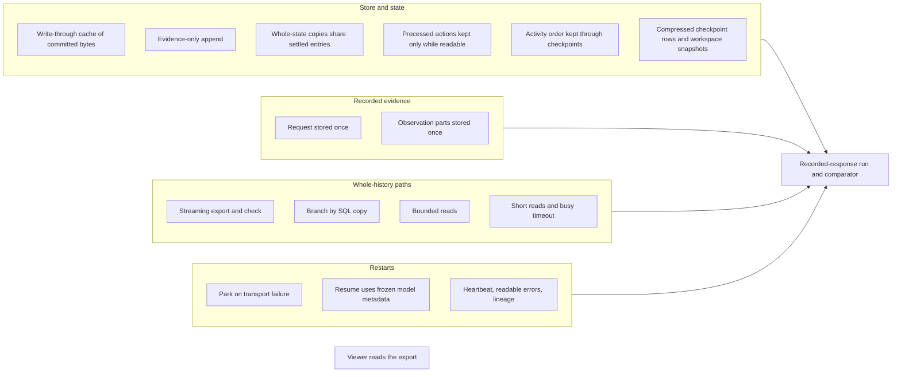

# Long runs without losing realism: engine cost, storage and restarts

Status: proposal, 2026-10-15. Decisions taken under the owner's rules are listed in "Decisions" below. The parts that need
the owner's confirmation are listed in "Awaiting the owner" and are not specified. The specified part is in
[SPEC-long-run-cost.md](SPEC-long-run-cost.md).

Source baselines:
- WorldMock `main` at `0bd2de65883b022802a5e0aab501e93caeca87c7`, after the history-read fixes `5dc50272` and `49db53cd`.
- Evidence: the first 30-day real-model run, filed as issue #15. It ran engine `d27f2c5a` with the white-collar package v5,
  run directory `WorldMock-Dataset/execution/20261015T030532Z-white-collar-30day-resume3`.

How this was produced:
- Nine research passes measured main's code offline against that run's data. Their areas were the commit path, checkpoints
  and state, recorded evidence, whole-history reads, the viewer, resilience, model cost, the per-decision critical path, and
  proof and measurement.
- A separate reviewer re-checked every option against the owner's rule, the code on main and the run's numbers.
- No model was called. Scripts and outputs are local under `.work/run30/scratch/opt-*` (not tracked).

Claim tags:
- [O] observed in the run;
- [R] measured offline with main's code;
- [M] read from code;
- [W] from the web.

## Owner's rules

| Rule (2026-10-15) | Consequence here |
| --- | --- |
| The engine exists to make the persona act like a real human. An optimization must not hurt simulation quality in any way. A time-consuming feature that improves quality stays | Every change in the specification leaves each model prompt, decision input and settled world fact byte-identical, or changes only the recorded form with no information lost. The realism features stay: the 16,000-token thinking budget, wakes, 30-minute progress reports, pushes, memory consolidation, reflection, plan_day and full model evidence |
| Prompt changes are acceptable | Prompt order and wording are not off limits. Changes that alter what the model sees still have to show they do not lower quality, so a prompt change that can only be judged with model calls is proposed here but not specified |
| Changes to tool parameters, or new fields in the environment dataset schema, wait for the owner's confirmation | Nothing in the specification changes a model tool schema, a CLI option of the run commands, or a package field. Items that would need one are listed under "Awaiting the owner" |

## What the 30-day run shows

| Measure | `d27f2c5a` (the run) | `main` today (estimate) |
| --- | --- | --- |
| Engine time per decision, day 1 → day 30 | 1.0 → 39.5 s [O] | about 1 → 13 s [R] |
| Engine time per simulated day at day 30 | 3,280 s [O] | 1,030–1,330 s [R], growing about 31–42 s per simulated day |
| Model time per day | about 33 min, flat [O] | unchanged |
| World state at day 30 | 10.49 MB, nothing ever pruned [O] | unchanged |
| Checkpoints | 5,538, about 184 a day, each a full state copy; 29.8 GB [O] | unchanged |
| events.jsonl | 1.92 GB; half of it is a duplicated request copy plus per-observation activity_bindings [O] | unchanged |
| Export peak memory | about 6× event bytes, about 12 GB [R] | unchanged; about 31 GB (this machine's RAM) at 60 days |
| Restarts | 4 in 30 days: 3 from a ~35 s transport budget, 1 external kill. 13 further resume attempts failed, 8 of them on a live `/models` fetch [O] | unchanged |
| Viewer | cannot open a 14.26 GB run (sql.js and Chrome's ~2 GB buffer cap) [M][W] | unchanged |

Where main's remaining engine time goes at day 30 [R]:
- About 11 of the about 13 s per decision is whole-state work: evidence commits (0.7–0.9 s each), version-advancing commits
  (0.45–0.6 s), checkpoints (about 1.0 s) and 4–10 whole-state deep copies per advance or round (about 0.31 s each).
- About 1,400 deep copies a day.
- 67% of the 23,547 commits leave the state unchanged, yet still re-read, validate, canonicalize and rewrite it.

Model time is 96% output decoding (6.3 ms per completion token, R² 0.98), and 7.8 M of the 9.0 M output tokens are
reasoning [R]. So no material model-time saving exists without touching the thinking budget, which stays.

## Established approaches

| Source | What it does | Used for |
| --- | --- | --- |
| Akka Persistence, EventStoreDB, Kurrent projections [W] | Persist events per command, keep state in memory, append guarded by expected revision; projections are left folds over the stream | Evidence-only appends; streaming export |
| Immer, Redux immutable updates [W] | Copy on write with structural sharing of unchanged values | Whole-state copies share settled entries |
| SQLite ATTACH, INSERT…SELECT, expression indexes, WAL [W] | Copy tables inside SQLite; serve WHERE terms from expression indexes; readers do not block writers in WAL | Branch copy; bounded reads; live-run reader safety |
| Stripe idempotency keys [W] | Prune idempotency keys after a window; a reused key after pruning is a new request | Scope request identity to the open round, then prune |
| Git objects, restic packs, Claim Check [W] | Store content once under its hash, reference it from the envelope | Observation parts stored once |
| Temporal retry policies, AWS capped backoff [W] | Unlimited attempts with capped exponential backoff, bounded by a total time, not an attempt count | Parking transport failures |
| Temporal replayer, VCR.py, WireMock [W] | Replay a recorded history against new code and fail on any divergence | The recorded-response run |
| Perfetto UI, igv.js, File API [W] | Stream multi-GB traces into an in-browser index; read bodies by byte range | The viewer |
| asv, sqlite.org/cpu.html [W] | Compare commits side by side with exact counters plus a relative timing factor | The benchmark kit |

## Changes

### Store commit path

**Write-through cache.** The store keeps the version, current time, accounts and canonical bytes of the state it last
committed. It loads them lazily at the first write and updates them only after a successful transaction (single writer,
`store.py:42`). Version-advancing commits then take `before` from the cache instead of `json.loads` of the stored row
(`store.py:97`). The last event time is read by primary key, never cached.

**Evidence-only append.** Same-version commits stop passing, validating and rewriting the world state. These are:
- observation;
- model request and response;
- memory_updated;
- action_requested and decision_started;
- run_failed;
- plan_day failure evidence.

A new `append_evidence(drafts)` writes their events against the cached version. It is used at:
- `model_evidence.py:71`, `:119`;
- `engine.py:88`, `:168`;
- `decision_coordinator.py:133`;
- `runtime.py:660`, `:683`.

`world_setup.py:134` advances the version and stays on `commit`.

The check "the engine's world equals the committed world" moves to two places:
- immediately before every version-advancing commit, where it compares the staged world's starting point;
- the observation commit, which keeps a byte compare because its content becomes the decision prompt.

Together these are at least as strong as today for every prompt.

**Structural sharing.** `WorldState.__deepcopy__` gives fresh containers for `processed_actions` and `activities` but shares
their entries; every other field is still deep-copied. The entries are never edited in place. The two in-place edits that
exist are rewritten as replacements anyway:
- `decision_coordinator.py:364-366`;
- `travel.py:107-110`.

A runtime guard makes any future in-place edit loud. It is the same pre-commit compare that also catches an edit leaking
into the committed world. A permanent test fixture wraps every public engine method and asserts that the committed world is
byte-unchanged by reads.

A deep copy at 10.5 MB drops from 0.31 s to 0.015 s [R].

**Checkpoint single encode.** The checkpoint compares the caller's encoded state with the cached committed bytes, encodes the
payload once and hashes those bytes. The stored body and `record_sha256` are byte-identical to today's [R].

Saving at day 30 [R]: about 1,148 s a day of commit, copy and checkpoint work falls to about 270–340 s, before pruning.

### State and checkpoint storage

**Processed actions only while a rule can read them.** At each clock advance (`time_advance.py:105`), keep a processed action
only while its id is the `origin_action_id` of a non-terminal activity. The readers are:
- the same-round identity lookup;
- this second's rejections;
- the origin of a live activity.

A host-side check makes ids embed the decision id (`f"{decision_id}:action:{n:04d}"`, as LifeAgent already forms them). Then
an id from a settled second can never be submitted again, and the cross-round replay path, which was never exercised
(`reused_request_events` 0 in 30 days [O]), is deleted.

The full record of every action stays in the `action_requested` and `action_result` events. In this run, 3,273 of 3,273
stored results are contained in their event [R].

Hot state at day 30: 10.5 → about 3.8 MB [R].

**Activity order kept through checkpoints.** `WorldState.activities` is stored as an ordered array, so canonical JSON no longer
re-sorts it. Today, 96 of 3,008 observations had two activities whose order a restore would change [R], and the Oct 20 resume
showed the persona a swapped tool layer [O].

Uninterrupted runs are unchanged. Resumed and replayed runs now see what an uninterrupted run would have shown.

**Compressed checkpoint rows and workspace snapshots.**
- **Checkpoint rows.** The stored body is the zlib-compressed canonical payload. `record_sha256` stays the sha256 of the
  uncompressed canonical payload, so the Checkpoint record, restore, the export embed and certification are unchanged.
- **Workspace snapshots.** The per-checkpoint tar is stored gzip-compressed with a fixed header timestamp.
- **Measured** [R]:
  - state 5.8×;
  - workspace tar 5.2× in 0.10 s.
- **Projected checkpoint table** with pruning: 30/118/263 GB at 30/60/90 days → about 2.2/8/17 GB. Workspace snapshots:
  2.8/10.5/23 GB → about 0.5/2/4.4 GB.
- **Every step keeps its own restorable checkpoint**, so a resume still continues from the failure second.

**Status reads checkpoint ids only.** `status.py:39-40` stops parsing five full checkpoint bodies to list their ids.

### Recorded evidence

**Each model request stored once.** A `model_response` or failure event writes `"request": null`, as plan_day evidence already
does (`day_planning.py:180-194`). The response links to its request through `caused_by`. Each response also checks in-process
that the request it was given has the digest recorded at request time; a mismatch is a `ProtocolError`. No reader uses the
copy (reader inventory [M]).

Saving: 463 MB of 1.92 GB (24%) over 30 days [R].

**Observation parts stored once.** These observation tables move into a content-addressed `parts(sha256, body)` table:
- `activity_bindings`, chunked by the local date of each activity's `started_at`;
- the constant or slow tables: `errand_item_bindings`, `locations`, `known_activity_actions`, `catalog_bindings`,
  `persona_views`, `memory_layer`.

The parts are inserted in the same transaction as the observation. The stored observation carries bare sha256 strings, so
any reader that was not rehydrated fails loudly.

The store's single row decoder rehydrates every read. A branch copies the parts table. The export rehydrates, so
events.jsonl lines stay self-contained and downstream readers (LabelKit) see no change.

The host still renders the prompt from the in-memory dict that `observe()` returns.

On all 3,008 observations of the run, rehydration reproduced the stored observation byte for byte [R]. Saving: the
quadratic term of event growth goes away; observation bytes fall from 43.7 to about 6 MB a day at day 30.

Combined, the run database's events table falls from 1.95 GB to about 0.8 GB at 30 days and from about 9.6 to 2.8 GB at 90.

### Whole-history paths

| Path | Today at day 30 | Change | After |
| --- | --- | --- | --- |
| Export timelines | 166 s of the 340 s export [O] | Read orders and progress once, not once per day | 5 s; byte-identical for a full export [R] |
| Export | 340 s, ~12 GB peak [O][R] | One cursor pass in short read transactions; every event validated and written as `canonical_json(model_dump())` exactly as today, and hashed as written; in memory, big events drop only a denylist of bulky payloads nothing post-run reads (bindings, prompt layers, request copies, response messages), so every other key, including any new one, stays visible (guard test); timelines from the same pass | 47–70 s, 0.8 GB [R]; all 30 days' artifacts and quality.json byte-identical to the certified export [R] |
| Export check | 97 s, ~10 GB | Two passes: hash and row count before parsing, then each line parsed and checked in full (activity-prefix and initial-funds checks included) before it is reduced; every check kept; returns the manifest and activities instead of the full event list | under 1 GB; identical accept and reject on every negative test |
| Restore (resume, replay) | 67 s, 6 GB [R] | ATTACH the parent read-only and `INSERT … SELECT` the events and their artifact rows; keep streamed per-event re-validation | 45 s, 0.1 GB [R]; identical event and artifact digests [R] |
| fail_run and counterfactual check | 29 s, 5.9 GB per call [R] | Indexed lookups | 0.02 s |
| Experience window per observation | 0.13–0.25 s [R] | Two index-ordered subqueries with UNION ALL instead of an OR plus a sort | 0.01 s; 3,008 of 3,008 windows identical [R] |
| plan_day inputs, storefront acceptance | 2.5–3.3 s per midnight, 0.14 s per purchase [R] | Read each of the four event types once per plan and share the lists (no window bounds, so plan prompts cannot depend on when plans are written); bound the storefront lookup by the activity start | identical plan prompts and acceptance [R] |
| Session opening read (cold start) | 15.5 s first observation after a resume [R] | One indexed query that stops at the first match | 2.1 s; identical observation [R] |
| inspect_run summary and money | 23–48 s, 4.5 GB [R] | SQL-side counts and filters, streamed cursors | 0.1 s and 4 s; identical output [R] |
| `worldmock evaluate` | Builds every event of events.jsonl into a list (`evaluation/adapters.py:360`, `evaluation/io.py:40-50`) [M] | Streams the same way as the export check, with the same denylist reduction | Same results; memory bounded like the export |

**Live-run reader safety.** Today a reader that holds a long scan on a live run makes the engine's next commit fail with
"database is locked" after 5 s [R]. The product's own `worldmock status` is the worst case: 84 s inside one read transaction
at day 30 [R]. Two changes fix this:
- **Short reads.** `worldmock status`, `inspect_run.py` and `render_day.py` use per-type counts through the existing
  expression index, first and last events by primary key, and no long transaction. Their output is unchanged.
- **Longer busy timeout.** The engine's store connection waits up to 120 s for a reader instead of 5 s.

The rollback journal stays. WAL would protect every reader, but a killed run would keep its last commits in a separate
`-wal` file that a copy of only `footprints.sqlite` loses [W].

**Mid-run cutoffs.** An export with `--cutoff` earlier than the last event today renders timeline rows past the cutoff
(24 extra rows on Oct 7 in a 10-day test [R]). The streaming export stops at the cutoff, as the recording design says. This
is an evidence fix and changes those exports' timeline bytes.

### Viewer

The viewer opens an export directory instead of the run database:
- It streams events.jsonl into an in-page sql.js index of the fields its views read (222 MB of 1.92 GB at day 30), and reads
  full bodies by byte range when a row is opened.
- Run identity and timezone come from the export manifest, so incomplete exports keep their catalog names.
- The SQL console says which bodies are pruned in it.

Measured with the real page scripts on the 30-day export: about 19 s to open, 0.15 s per context click, all 17 outputs
byte-identical to the full-body reference [R]. Today the run cannot be opened at all.

Only `tools/` changes. Opening a run without exporting it first is not supported; `worldmock export` works at any cutoff.

### Network and restarts

**Park on transport failure.**
- The transport retry count stays as frozen today.
- When it is spent, the dispatcher parks instead of failing: it keeps re-sending the identical request with capped
  exponential backoff (up to 120 s between attempts) for up to 12 hours. The wall budget is an engine constant.
- The same applies to 429, honouring Retry-After.
- Every attempt sends the same bytes [R], and no wall clock reaches a decision [M]. So a parked run settles exactly like a
  never-interrupted run that got the same answers. Today's fail-and-resume brings a new run id, redrawn action-keyed random
  numbers and the activity-order swap instead.
- Attempts are recorded in the model-exchange envelope (`transport_attempts`), never inside the provider response, which
  later prompts read back.
- In this run it would have removed 3 of 4 stops, all 13 failed resume attempts, 3.1 GB of re-copied pages and about
  18–54 min of downtime [O].

**Whole-call deadline.** Each attempt runs under a total deadline of 120 s plus 7.5 ms per `max_tokens`: 240 s at 16,000
tokens, about 2× the slowest legitimate call (115 s [R]). When it expires, the identical request is re-sent as a transport
retry.
- This replaces a provider stall (605.6 s, one token, which became a correction turn the persona then read for the rest of the
  evening [O]) with a fresh answer to the same request.
- One valid 357.6 s answer would have been resampled.
- The per-read 300 s timeout never bounded these calls [R].

**Resume uses the frozen model metadata.** A resume validates the parent manifest and checkpoint id first. It then loads the
environment with the manifest's frozen `model_metadata` and makes no network call, in the driver or the actor. A fresh run
fetches `/models` with a few retries. Every prompt-side reader already uses the frozen copy, and a resume succeeds today
only when the live value equals it [M]. Removes 8 of 13 failed resume attempts [O].

**Readable failures.**
- **Picklable errors.** `EnvironmentInputError`, `PreconditionError` and `RegistrationError` gain `__reduce__`, so actor
  failures reach `status.json` with their type instead of `UnserializableException`.
- **Root cause in status.** `status.json` gains `error_message`, and the dispatcher error carries the root exception
  (ConnectError, not "InternalServerError").
- **Heartbeat.** The driver writes `heartbeat.json` every 60 s. `worldmock status` reports a run whose heartbeat is older
  than three intervals as stale, and says "waiting for the model" during a park.
- **Issue #7.** `atomic_write` retries a Windows `PermissionError` a bounded number of times.

**Lineage.**
- A branch carries `lineage`: the parent's lineage plus one entry with the parent's run id, checkpoint, simulated range, end
  reason and discarded tail.
- The export manifest carries it, and quality.json reports the parents' end reasons in a lineage section.
- `source_run_ids` stays the sorted set it is today.

**Quieter logs.**
- **Unclosed sessions.** LiteLLM's cached async clients are closed and evicted inside the task's own event loop, which
  removes the 5,065 "Unclosed client session" errors [R].
- **Previews evaluated once.** Availability is evaluated once per observation row (see below), which halves the
  purchase-preview refusal lines.
- **Ops log.** It gains transport waits, protocol rejections, commit time and plan_day call time.

### Per-decision host costs

All of these leave every observation byte-identical [R]:
- **Open activities computed once.** The agent's open activities are computed once per observation and passed to the slot
  and pending-conclusion checks, instead of scanning all 1,253 activities per tool-layer row: about 0.18 s per observation
  at day 30, growing.
- **Availability evaluated once.** Each action row's availability is evaluated once per observation build instead of twice
  (`observe.py:36` and `tool_layer.py:161`): 155 → 79 evaluations, about 0.1 s per observation.
- **No memory-episode deep copies.** The memory runtime reads episode ids and the unconsolidated tail from its loaded cache
  instead of two whole-list deep copies per decision: about 0.11 s per decision at day 30.
- **Token count reused.** `fit_request` returns the prompt token count it already measured, and the usage log reuses it.

### Model cost

**Off-peak scheduling (operator step, no code).** DeepSeek charges half price outside Mon–Fri 01:00–04:00 and 06:00–10:00 UTC
[W]. Against a random launch time that saves about $3.1 per 30-day run (16%); against this run's timing, $4.86 [R]. The
same backend and fingerprint served both bands [R]. The runtime manual says when to launch. quality.json's peak band ignores
Chinese public holidays, which the manual notes.

**Cost by call class.** quality.json reports calls, tokens, cache hits, peak share and cost per class, derived from the
recorded request shape with existing predicates. No event or request changes. The classes are:
- fresh decision turn;
- turn with history;
- truncation retry;
- consolidation;
- reflection;
- plan_day.

### Proof that nothing the persona experiences changed

**Recorded-response run** (`scripts/recorded_response_run.py`, outside code identity). It re-runs a real recording on new
code with the recording's own model answers served from 127.0.0.1:
- A chat request must equal the recorded request in the six model-visible fields, and in raw key order for tools.
- Restarts are reproduced at the recorded checkpoints.
- Any divergence fails the call, and a report names the call, simulated time and the prompt layer that differs.

**Comparator** (`scripts/compare_runs.py`). It compares two runs as they are recorded:
- Masks: identities (mapped by first occurrence, as a bijection) and wall-clock fields, by exact path only.
- Reconstruction rules: only for recording-only data, each citing its reader search.
- Compared byte for byte: everything the persona sees, every settled fact, the world state, the checkpoints and every export
  artifact.

**Backport verification.** The run's recording is on the `d27f2c5a` prompt lineage, and `0bd2de65` changed prompts. Store,
checkpoint, evidence and state files are byte-identical between `49db53cd` and main. The optimizations are therefore
cherry-picked onto a `49db53cd` verification branch and gated against the 30-day recording: zero divergence over 3,762
calls. The first two segments (675 calls) on `d27f2c5a` itself are the determinism control.

The activity-order fix deliberately changes resumed prompts after the Oct 20 restart, so it is left out of the backport and
proved separately by restore-equals-live tests.

The comparator compares observations as the engine's own decoder returns them and states as the engine reloads them.
Recorded-form changes (request copy, parts, pruned processed actions, compressed rows) are therefore compared through the
production readers, never through a hand-written reconstruction.

**Masked complete-day comparison.** The two complete-day scripted runs on base and head must give equal behaviour signatures
with only code identity masked. This runs in every change, beside the code-bound fixtures, which stay.

**Benchmark kit** (`.work`, not tracked). It has two parts:
- a scripted calendar run for 3, 30 and 60 days with a checkpoint per step and model evidence at the run's rates, reporting
  exact counters and engine seconds per decision;
- hot-path timings at 10 MB and 30 MB of state.

## Projected effect

Estimates for main with every specified change, at this run's daily decision counts. Model time (about 33 min a day) is
unchanged.

| | 30 days | 60 days | 90 days |
| --- | --- | --- | --- |
| Engine time per day at the end, main today | 17–22 min | 33–43 min | 48–64 min |
| Engine time per day at the end, after | about 2.4–4.4 min | about 3.8–6.7 min | about 5.1–8.9 min |
| Whole-run engine time, main today → after | 3.8 h → 0.8–1.5 h | 13.2 h → 2.2–4.3 h | 28.4 h → 4.1–8.3 h |
| World-state bytes written per day (SSD wear) | 7.3 → about 2 GB | 14.6 → about 4 GB | 21.8 → about 6 GB |
| Run database (events + checkpoints), main today | 32 GB | 122 GB | 273 GB |
| Run database, after | about 3 GB | about 10 GB | about 20 GB |
| Workspace snapshot assets | 2.8 → about 0.5 GB | 10.5 → about 2 GB | 23 → about 4.4 GB |
| Export peak memory | 12 → about 0.8 GB | 31 → about 1.6 GB | 58 → about 2.4 GB |
| Resume to first request | 65–214 s (growing) | — | — |
| Restarts from a network outage under 12 h | about 2 / 5 / 9 | 0 | 0 |

The engine figures come from the completeness review's combination of the measured unit costs. They have ±25% for machine
load, and assume this run's late-week daily counts (511 evidence appends, 255 version steps, 184 checkpoints, about 1,400
whole-state copies and 88 decisions a day). Main's phone-first free time changes those counts, which the benchmark kit
measures.

About 90% of the saving comes from the store cache, structural sharing and pruning processed actions. Without pruning, day 90
stays at about 12–20 min a day. The disk figures assume this run's growth rates.

## Not proposed

| Alternative | Reason |
| --- | --- |
| Fewer checkpoints (hourly) or deleting old ones | A resume would redo up to an hour of decisions with fresh model samples, and counterfactual branch points would be lost. Compressed per-step checkpoints cost little |
| Lower thinking budget, thinking off, fewer wakes, no 30-minute progress reports, no push wakes | Realism features; 96% of model time is decoding the thinking that decides |
| Write-behind evidence, asynchronous checkpoints, concurrent memory consolidation, precomputed observations | Break the fail-closed evidence order or change what the next decision sees, for seconds a day |
| Archiving concluded activities out of the hot state, or binding only live activities | Recall of past tasks, name binding and the 第二次 numbering read every activity; that is memory, a realism feature |
| Faster JSON encoders (orjson) | A new dependency and a different canonical byte form, for about 35 s a day after the cache |
| Storing model request messages and tool schemas by reference | Same-second continuation and the progress layer's protection rebuild prompts from stored requests; the full request stays readable inline |
| Dropping the duplicated reasoning in `provider_specific_fields` | 1.7% of bytes; the stored provider response should stay as received |
| Moving the final checkpoint out of the export manifest | Saves no bytes |
| Run-independent random keys | Changes how every run settles, with no realism gain; parking removes most resumes |
| A local query server for the viewer | Reading a live run's database can stop the run; slow on full bodies |
| WAL journal mode | A killed run's last commits stay in `-wal`, which a copy of only `footprints.sqlite` loses; short reads and a busy timeout are enough |
| Certifying the timeline files inside the export check | Changes what the check rejects; a separate decision |
| One persistent event loop and HTTP connection pool per worker | Its time saving (about 0.4 s per decision) is a soft regression estimate; closing the clients is specified, and the pool waits for a measurement in the next model-backed run |
| Fixed-cadence snapshot chunking and differential checkpoints | Smaller than compression (0.6 GB and 28 MB) but more code; compression is enough for 90 days |

## Awaiting the owner

These would change a tool parameter, a CLI option or the dataset schema, or they change what the model sees in a way only
model calls can judge. They are not specified.

| Item | What it would change | Why it is not specified |
| --- | --- | --- |
| Host default `[]` for an omitted `views` or `errands` in `conclude_activity`, and repair of a stray closing bracket | Host validation of model tool arguments | A tool-parameter change. The run's retries added a view the default would have lost in 38 of 147 cases, so it also changes memories |
| User-layer order for prompt caching (persona and slow layers first) | The position of every user layer in each prompt | Saves money only ($3.6–7.0 per 30-day run). Position affects attention, so it needs a paired decision replay (about $5–6 of model calls) and is best decided with the context-compaction draft |
| A CLI option or config field for the park budget | A run-command option or package field | The 12 h constant needs neither |
| An engine gate that holds model calls during DeepSeek peak hours | A config field | Operator scheduling gives the saving without it |
| A per-month weather climate declared by the package (issue #15) | A new package field | Not an optimization; listed for completeness |
| Removing `transport_max_retries` from the package | A dataset schema change | Parking works with the field as it is |

## Decisions

Questions the research raised that do not need the owner's confirmation under the rules above, and how they were decided.

| Question | Decision | Why |
| --- | --- | --- |
| Where the engine-equals-committed check runs | Before every version-advancing commit, plus a byte compare on the observation commit | Keeps every prompt derived from the committed world, and catches structural-sharing leaks |
| Checkpoint storage form | zlib-compressed full rows, record hash over the uncompressed payload | Simplest; every row self-contained; no format change for readers |
| Workspace snapshot form | gzip-compressed tar | Simplest; same restore path |
| Request-identity replay across rounds | Narrowed to the open round; the never-used cross-round path is deleted | Not a realism feature; lets processed actions be pruned |
| Restore re-validation | Kept, streamed | Integrity first; 14 s per resume at day 30 |
| Live-run reader safety | Short reads in `status`, `inspect_run` and `render_day`, plus a 120 s busy timeout on the engine connection; the rollback journal stays | No format change, and no committed tail stranded in a `-wal` file of a killed run |
| Export check return value | The manifest and activities, not the full event list; callers updated, including one line in WorldMock-Dataset's `tools/execution.py` | A streaming check cannot hold the list; no compatibility shim |
| Viewer input | The export directory only | One loader; works on every existing export |
| Park budget | 12 hours, engine constant; 429 parks too | No new option or field; covers an overnight outage |
| Resume capacity check | Use the frozen metadata; fresh runs still check live | Every prompt-side reader already uses the frozen copy |
| Activity order | Persist insertion order | Uninterrupted runs unchanged; resumed runs corrected |
| Expected refusals at ERROR | Unchanged rule; evaluated once per observation instead of twice | Changing the logging rule in AGENTS.md is the owner's |
| Observation parts in the export | The export rehydrates | Downstream readers see no change |

## Implementation order and acceptance

- **Order.** Design chapters first, then code, in one integration branch:
  1. store and state;
  2. recorded evidence;
  3. whole-history paths;
  4. network and restarts;
  5. per-decision host costs;
  6. viewer;
  7. proof tools.
- **Versions.** The export manifest goes from 7 to 8 (lineage, `request: null`). The world-state structure version moves
  (ordered activities, pruned processed actions). `RULES_VERSION` and every dataset package are unchanged. Both complete-day
  baselines and the viewer sample are re-frozen once at the end.
- **Acceptance.** These are offline, before merge:
  - the full suite, mutation suite and coverage gate;
  - the masked complete-day comparison;
  - the recorded-response run of segments 1–2 on `d27f2c5a` (determinism control);
  - the backport verification on `49db53cd` over all 30 days, with zero divergence;
  - the benchmark kit before and after on main;
  - restore-equals-live at every step of a scripted day.

  The next real run on main (the dataset #11 acceptance run, which #15 asks to run past day 20) becomes the reference
  recording for main's prompt lineage.
