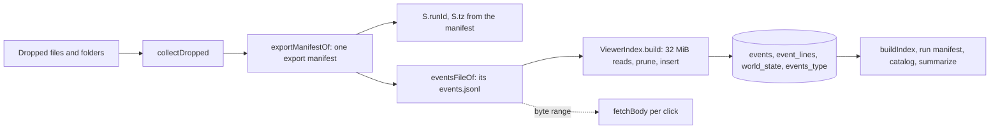

# Viewer for long runs

> Part of [SPEC-long-run-cost.md](../SPEC-long-run-cost.md); read its terms and order there.

## Goal and basis

This chapter implements the proposal's section "Viewer" and its "Decisions" row "Viewer input: the export directory
only". The viewer stops reading the run database. It opens an export directory, streams `events.jsonl` into an in-page
sql.js index whose `events` table has the run database's shape, prunes the three bulky event types to the fields the
views read in bulk, and reads every full body by byte range from the export file. Run identity and timezone come from the
export manifest, so incomplete exports keep their catalog names, warnings and local times.

Only `tools/`, `tests/system/viewer/` and two documentation files change. No file under `src/`, `custom/`, nor
`pyproject.toml` or `uv.lock` changes, so `runtime_code_sha256` (`src/worldmock/run_setup.py:107-117`) is unchanged:
every model prompt, decision input, settled world fact, event, checkpoint and export artifact stays byte-identical, a run
in progress keeps resuming (`src/worldmock/runtime.py:284`), and the chapter can land while a run is going. It changes no
model tool schema, no host validation of tool arguments, no CLI option of the run commands and no field of the
environment dataset.

One dependency: the drop-zone text and the runtime manual below tell the user to export a running or stopped run before
viewing it. Exporting a running run is safe only with chapter 04 (export in short read transactions, the engine's 120 s
busy timeout); today a long export read can make the engine's next commit fail with "database is locked" (review
`opt-review-viewer/lock_probe.txt`). This chapter therefore merges after chapter 04, which is also the proposal's order.

Research inputs: `.work/run30/opt/design_viewer.json` (option "Build a viewer index in the page from the export's
events.jsonl, and read full bodies by byte range") and `.work/run30/opt/review_viewer.json` (verdict "revise"; its
revisions (a), (b), (d), (e) and (f) are adopted below, (c) belongs to chapter 04). Scratch evidence:
`.work/run30/scratch/opt-viewer/` (research) and `.work/run30/scratch/spec-07-viewer/` (this chapter's prototype).

### Measured cost today (main `0bd2de65`)

- [M] `tools/run-viewer.html:1674` reads the dropped `footprints.sqlite` with `file.arrayBuffer()` and `:1677` opens it
  with `new SQL.Database(buf)`; sql.js 1.10.3 copies the bytes into its MEMFS (`sql-wasm-debug.js:917`), so JS holds two
  copies.
- [W] Chrome caps one ArrayBuffer at `0x7fe00000` bytes, about 2.0 GB
  (https://onnxruntime.ai/docs/tutorials/web/large-models.html).
- [O] The 30-day run database is 14.26 GB (12.29 GB checkpoints, 1.95 GB events). It cannot be opened.
- [R] An events-only copy with full bodies is 1.968 GB; sql.js opened it in 81.4 s with 3.8 GB of JS buffers, and it
  passes Chrome's cap around day 31.
- [R] The viewer's own SQL on full bodies, run natively (what a local server would do): 85.4 s to open, 6.4 s per
  context click.

What the views need in bulk [R] (`opt-viewer/build_dbs.txt`):

| Event type | Full | Needed in bulk | Kept in the index |
| --- | --- | --- | --- |
| observation | 847.1 MB | 6.0 MB | envelope and four data fields |
| model_response | 538.0 MB | 74.6 MB | everything except `data.request` |
| model_request | 469.3 MB | 75.8 MB | everything except `data.request.messages[1:]` |
| all other types | 66.3 MB | 66.3 MB | the original line |
| total | 1,920.6 MB | 222.7 MB (11.6%) | |

### Expected saving

- [R] Research run of the real page scripts in a Node vm with the sql.js 1.10.3 wasm on the 30-day export
  (`opt-viewer/results.json`, checked by the reviewer): index build 14.8 s (6.2 s parse, 4.1 s insert, 0.8 s type
  index) over 1,920,680,141 bytes; a 257,581,056-byte index; the viewer's load queries 4.3 s, so the run opens in about
  19 s; 0.15 s per context click; reasoning view 0.34 s; peak RSS 468 MB while building and 850 MB after all views. All 17
  outputs were byte-identical to the full-body reference. Node's `fs.createReadStream` stood in for the browser's file
  reads; timings are ±50% (shared machine).
- [R] This chapter's prototype `.work/run30/scratch/spec-07-viewer/spec_build.cjs` builds the index with exactly the
  keep-lists, prune function, table definitions and world-state row specified below (its line splitter is the same
  loop over `file.stream()` chunks; the 32 MiB slice reader specified below is checked separately against a direct
  split at read sizes from 1 byte to 1 MiB, with a 3-byte and a 4-byte character crossing reads, in
  `spec-07-viewer/slice_lines.cjs`), runs the unchanged page scripts on it, and compares with the research reference
  outputs (`opt-viewer/out_reference/*.json`): 17 of 17 identical
  (`spec-07-viewer/out_spec/result.json`), 46,142 rows, a 267,829,248-byte index including the 9.3 MB world-state row.
  Its build time (266 s) is not a measurement of the browser: the machine was at 100% CPU from other sessions, and Node's
  file-backed Blob read the file at about 36 MB/s there while `fs.createReadStream` read all of it in 3.0 s
  (`spec-07-viewer/stream_probe.cjs`, `read_probe.cjs`). Opening the 30-day export once in Chrome is an acceptance step
  of this chapter (see "Tests").
- Growth: the build follows `events.jsonl` bytes (about 130 MB/s measured in the research). Chapter 03 writes
  `"request": null` in responses, which removes 24% of `events.jsonl` (463 MB at day 30); chapter 03's observation parts
  do not shrink the export, which rehydrates them. With issue #15's projections (5.1 GB at 60 days, 9.6 GB at 90 days,
  before chapter 03) the open takes about 40 s and 74 s plus 9 s and 13 s of queries. Exporting a 60-day run at all relies
  on chapter 04's streaming export.
- Ceiling [R] (review): sql.js keeps even `new SQL.Database()` as a MEMFS file in one JS typed array that grows by 1.125×
  above 1 MB (`sql-wasm-debug.js:914-917`, `:3146-3153`). The binding limit is Chrome's per-ArrayBuffer cap plus growth
  headroom, not the 2 GiB wasm maximum. Index bytes per day are flat (5.5–12.8 MB, mean 7.4 MB), which reaches the cap at
  about 200 days.

### Where this chapter differs from the research, and why

| Research | This chapter | Why |
| --- | --- | --- |
| Observation keep-list of ten keys (four read plus six small scalars) | The four keys the views read: `balance_fen`, `body`, `active_activities`, `calendar_context` | The keep-list is "the fields the views read in bulk"; the prototype proved identity with exactly these four |
| `file.stream().getReader()` | `file.slice(a, b).arrayBuffer()` in 32 MiB reads | Perfetto's `TraceFileStream` reads multi-GB traces this way (`TRACE_SLICE_SIZE = 32 * 1024 * 1024`, [W] https://github.com/google/perfetto/blob/main/ui/src/core/trace_stream.ts); the read size is a page property that tests can lower to cross every boundary |
| `S.runId` from the first event; manifest bound by `world_state.run_id` | Both are the export manifest's `run_id` | One concept, one name; works without a checkpoint (review revision (a)) |
| Timezone from `world_state.timezone`, default `Asia/Shanghai` | The export manifest's `window.timezone`, no default | Review revision (a); no fallback |
| SQL console help lists tables | It also lists what is pruned, the `event_lines` table, the absent tables and where full rows are | Review revision (b) |
| Identity test samples every 40th request | Every request, including continuations with more than two messages, the timeline HTML, an incomplete export and the console | Review revision (f) |
| Build without yields | Yields every 100 ms through a `MessageChannel` message and logs progress | Review: keep the tab responsive during the parse. Chrome wakes timers of a hidden page at most once per second, and once per minute after five minutes hidden for chains of five or more ([W] https://developer.chrome.com/blog/timer-throttling-in-chrome-88), so `setTimeout(0)` yields would stretch a 20 s build to minutes when the user switches tabs; message delivery is not timer-throttled ([W] https://jefftkaufman.substack.com/p/overhead-of-messagechannel) |

The reviewer's preference for a distinct name of the pruned column is not adopted: the task fixes "the same events
table shape", every view query keeps running unchanged on `events.body`, and the console's help paragraph, which stays
above the input and therefore above every result, states the pruning (the reviewer's stated minimum: "show the pruning
notice above every console result").

## Behaviour



### Input

The viewer opens one export directory written by `worldmock export` (`src/worldmock/footprints/export.py:44-105`). The
user drops the directory (or a folder that contains it, such as the whole execution folder with `run/` and `export/`), or
selects files with the page's file input. Every file of one drop is collected once by `collectDropped`:

| File | Recognised by | Recorded as |
| --- | --- | --- |
| `manifest.json` (any depth) | exact name | `{path, read}` candidate |
| `events.jsonl` (any depth) | exact name | `{path, open}` candidate |
| `*.sqlite`, `*.sqlite3`, `*.db` (any depth) | `/\.(sqlite3?|db)$/i` on the name | path only, for the refusal message |
| top-level file whose name is 64 lowercase hex digits | `/^[0-9a-f]{64}$/` | asset handle (first one wins) |
| file directly inside a directory named `assets` | parent directory name | asset handle (first one wins) |
| `MEMORY.md` inside a directory | exact name; agent from `/agent_?0*(\d+)/i` on its path | text into `S.memFiles[agent].memoryMd` |

A path is the file's name for a top-level file and `<dir>/<…>/<name>` for a file found by walking a dropped directory (the
existing walk at `tools/run-viewer.html:1725-1753`). `episodes.jsonl` is no longer read (see "What is deleted").

### Identifying the export

1. Parse every `manifest.json` candidate once (`parseManifests`). A file that cannot be read or is not JSON is logged
   with `console.error('Unreadable manifest file:', path, error.message)` and skipped (today's message,
   `tools/run-viewer.html:968`).
2. The export manifest is the parsed candidate whose value is a plain object with a plain-object
   `frozen_run_manifest`. Exactly one must exist (`exportManifestOf`):
   - none, and a database file was dropped → refuse with the bare-database message;
   - none otherwise → refuse with "No export manifest was dropped";
   - more than one → refuse, naming their paths.
3. The export manifest must carry `run_id` (string), `window.timezone` (string), `artifacts.events.path` (string) and
   `artifacts.events.rows` (integer); otherwise refuse. The schema version is not read: exports of schema 6, 7 and 8
   open alike (the 30-day export is schema 6 [R]).
4. `S.runId = manifest.run_id` and `S.tz = manifest.window.timezone`. Both hold without a checkpoint; in the 30-day
   export `run_id` equals `frozen_run_manifest.run_id` and `checkpoint.state.run_id`, and `window.timezone` equals
   `checkpoint.state.timezone` [R] (`spec-07-viewer/manifest_keys.py`). They are equal by construction:
   `_export_identity` writes `run["run_id"]` and `ZoneInfo(run["window"]["timezone"]).key`
   (`src/worldmock/footprints/export.py:141-159`), and the world state's timezone is the same config value
   (`src/worldmock/life/world_setup.py:34`, `:99`).
5. `ownRunManifest(manifest)` must return `{frozen: true}`, that is `frozen_run_manifest.run_id === S.runId` and
   `frozen_run_manifest.agent_ids` is an array; otherwise refuse. This guarantees that a run manifest is always found
   below, which is why the "no run manifest" states are deleted.
6. The events file is the `events.jsonl` candidate whose path equals the export manifest's directory (its path up to and
   including the last `/`, empty for a top-level file) followed by `artifacts.events.path`. A missing one is refused.
   `S.eventsFile` is that `File`; `S.fileName` is its path (shown as 数据文件 in the overview).

### Building the index (`tools/run-viewer-index.js`)

`ViewerIndex.build(SQL, file, manifest, log)` returns a new sql.js `Database`:

1. `new SQL.Database()`, then the schema, byte for byte (the `events` and `world_state` definitions are those of
   `src/worldmock/footprints/store.py:23`, `:25-26`):

   ```sql
   CREATE TABLE events(event_seq INTEGER PRIMARY KEY, event_id TEXT NOT NULL UNIQUE, body TEXT NOT NULL);
   CREATE TABLE event_lines(event_seq INTEGER PRIMARY KEY, offset INTEGER NOT NULL, length INTEGER NOT NULL);
   CREATE TABLE world_state(singleton INTEGER PRIMARY KEY CHECK(singleton=1),
   version INTEGER NOT NULL, body TEXT NOT NULL);
   ```

   There is no `artifacts`, `checkpoints` or `events_agent_type`.
2. `BEGIN`, then read the file in slices of `ViewerIndex.readBytes` bytes (32 MiB) with
   `file.slice(position, position + readBytes).arrayBuffer()`. Split on byte `0x0A`. A line that spans slices is
   collected as sub-arrays and joined once at its newline. `offset` is the absolute byte index of the line's first byte;
   `length` is its byte count without the newline. Offsets are JS numbers: exact to 2^53 bytes; sql.js binds values above
   2^31 as doubles, which the `INTEGER` column stores as integers, and reads them back exactly
   (`sql-wasm-debug.js:657-668`, `:518-522`).
3. Each line: decode with `new TextDecoder('utf-8', {fatal: true})`, `JSON.parse`, prune (table below), insert
   `(event_seq, event_id, body)` into `events` and `(event_seq, offset, length)` into `event_lines`. `body` is the decoded
   line text itself for every type that is not pruned, and `JSON.stringify(pruned)` for the three pruned types. The
   cause in the refusal is the thrown error's `message`, or the thrown value itself when it is a string (sql.js throws
   bare strings for binding errors, for example a line without `event_seq`: `Wrong API use : tried to bind a value of an
   unknown type (undefined).`).
4. After the last slice: bytes after the last newline mean a truncated file → refuse. The number of lines must equal
   `artifacts.events.rows` → else refuse.
5. `CREATE INDEX events_type ON events(json_extract(body,'$.event_type'), event_seq)`. The expression is written exactly
   as every view's `WHERE json_extract(body,'$.event_type')='…'` (`tools/run-viewer.html:446`, `:474`, `:885`, `:1431`,
   `:1465`; `tools/run-viewer-context-view.js:21`, `:35`, `:50`), so SQLite serves those scans and their
   `ORDER BY event_seq` from it.
6. If `manifest.checkpoint` is present: `INSERT INTO world_state VALUES(1, checkpoint.state_version,
   JSON.stringify(checkpoint.state))`. An incomplete export (no `checkpoint`; `export.py:86-92` writes it only for a
   completed experiment) leaves the table empty.
7. `COMMIT` and return the database. If any step throws, the database is closed (`finally`) and the error propagates.

Pruning (constants `OBSERVATION_DATA_KEEP` and `REQUEST_MESSAGES_KEEP`, stored once in `tools/run-viewer-index.js`;
the SQL console help is generated from them):

| `event_type` | Body in the index | Bulk readers this keeps working |
| --- | --- | --- |
| `observation` | the whole envelope; `data` reduced to the keys of `OBSERVATION_DATA_KEEP` that are present: `balance_fen`, `body`, `active_activities`, `calendar_context` | `buildIndex` observation projection (`tools/run-viewer.html:481-491`); the economy ledger reads only envelope `resource_changes` (`:1374-1376`), which observations keep |
| `model_request` | the whole envelope and `data`; `data.request` keeps every key, with `messages` cut to the first `REQUEST_MESSAGES_KEEP` (1) | `buildIndex` request projection (`:540-543`); `ContextView.index` reads `messages[0].role`, `messages[0].content`, `json_type(tools)` (`run-viewer-context-view.js:14-21`) |
| `model_response` | the whole envelope and `data` without the key `request` (a copy of the request today, `null` after chapter 03) | overview token sums (`:881-885`); reasoning `RS_PATH` (`:1461`); response lookup by `caused_by` and continuation lookup by `tool_calls[].id` (`run-viewer-context-view.js:34-36`, `:47-52`) |
| every other type | the original line | every other projection |

The envelope fields are all kept, so `event_type`, `agent_id`, `occurred_at`, `run_id`, `event_id`, `decision_id`,
`caused_by`, `activity_id`, `resource_changes` and `wall_elapsed_ms` read the same on every row.

Responsiveness: inside the line loop, when at least `YIELD_MS` (100) milliseconds of `Date.now()` have passed since the
last yield, `await yieldToPage()`: it posts one message through a new `MessageChannel` and continues when the message
arrives, closing the channel. The message is a task of its own, so input and painting run in between; unlike
`setTimeout`, it is not throttled when the tab is hidden (see "Where this chapter differs from the research"). After
each slice, when the read fraction crosses a new tenth, `log` receives `· 已读 <MB> / <MB> MB（<n> 条事件）`
(MB = bytes / 1048576 with one decimal). Each slice read is itself an asynchronous browser read.

### World state, run identity and timezone in the views

- `buildIndex` keeps `SELECT body FROM world_state LIMIT 1` (`tools/run-viewer.html:584`) without the `try`/`catch`
  (the table always exists now). `S.world` feeds only: the accounts cards (overview `:895-898`, economy `:1389-1394`),
  location sessions (`:1177-1197`), person names (`:589-591`) and the world-state version line (`:911`).
- `S.runId` (overview run_id line `:906`, top bar `:1681`) and `ownRunManifest` (`:954-955`) use the export manifest's
  `run_id`. The query `SELECT json_extract(body,'$.run_id') AS r FROM events LIMIT 1` (`:580-581`) is deleted. For a
  resumed chain this shows the last segment's run (the run the export belongs to) instead of the first event's ancestor.
- `S.tz` is the export manifest's `window.timezone`; `:588` (`if (S.world.timezone) S.tz = …`) is deleted and the initial
  value at `:249` becomes `''`. `S.fmt` and `S.tzOff` are still computed from `S.tz` at `:594-595`, but `:595` loses its
  `try`/`catch` that silently set the Shanghai offset `28800`: `makeFmt(S.tz)` on the line before already throws a
  `RangeError` for a zone `Intl` does not know, so the catch was dead and only held a default zone. `:595` becomes
  `S.tzOff = tzOffsetSec(S.tz, S.t0||Math.floor(Date.now()/1000));` and the initial `tzOff: 28800` at `:261` becomes
  `tzOff: 0`. An unknown zone in the manifest therefore fails the load with the `RangeError`'s message.
- `renderSessions` looks activity names up by each entry's `activity_id`:
  `new Map(Object.values(S.world?.activities||{}).map(activity=>[activity.activity_id, activity]))`. This reads the
  object keyed by activity id that today's exports carry (every entry's `activity_id` equals its key in the 30-day state
  [R], `spec-07-viewer/state_acts.py`) and the ordered array chapter 02 writes, with one expression and no branch. Both
  forms are inputs, not a compatibility layer: the proposal's decision "Viewer input: the export directory only" requires
  the one loader to open every existing export (object form) and every new one (array form).
- An incomplete export shows: catalog names, the input-warnings card, local times, the run id and all event-derived views
  as a complete one; the accounts cards and the world-state version show 无 world_state / —; location sessions are
  absent; persons are named `agent <id>` (`:593`).

### Full bodies by byte range

`fetchBody(seq)` becomes `async`: it reads `offset, length` from `event_lines` and returns
`await S.eventsFile.slice(offset, offset + length).text()`, keeping today's FIFO cache of 40 (`BODY_CACHE_MAX`,
`:266`). The text is the exact export line, which is byte-identical to the stored event body (307 of 307 sampled lines
[R], `opt-viewer/identity_check.txt`; every view output identical [R]). The index `events.body` is never used as a full
body.

Functions that become `async` because they read a body: `fetchBody`, `prettyBody`, `toggleDetail`
(`tools/run-viewer.html:813-832`, `:1115-1133`), `ContextView.responseFor`, `ContextView.read`, `ContextView.render`
(`tools/run-viewer-context-view.js:33-40`, `:59-70`, `:228-242`). `ContextView.select` and `switchView` return the
render's promise; every context control handler returns `render()` so a caller (and a test) can await it.

- `fetchBody` takes the cache and the file it will use before its first `await`, and writes the text into that cache.
  A read still in flight when the user reloads (the reload replaces `S.bodyCache` and `S.eventsFile`) therefore lands in
  the dropped cache, never in the next export's cache under the same `event_seq`.
- `toggleDetail` inserts the detail element synchronously (button for a `model_request`, then a `<pre>` holding
  `读取中 …`), so a second click toggles it, and fills the `<pre>` after the read. The final DOM equals today's.

Normative code (`tools/run-viewer.html`, replacing `:813-832` and `:1115-1133`):

```js
/** @brief 事件全文：按 event_lines 的字节区间从导出的 events.jsonl 读出原行（FIFO 缓存）；索引的 events.body 可能已裁剪，
 *  不作全文。读之前取定缓存与文件，换一份导出时还在读的结果只进旧缓存。事件不在索引里时抛错。 */
async function fetchBody(seq){
  if (S.bodyCache.has(seq)) return S.bodyCache.get(seq);
  const cache = S.bodyCache, file = S.eventsFile;
  const line = q('SELECT offset, length FROM event_lines WHERE event_seq=?',[seq])[0];
  if (!line) throw new Error(`Event ${seq} is not in the loaded export`);
  const text = await file.slice(line.offset, line.offset+line.length).text();
  if (cache.size >= BODY_CACHE_MAX) cache.delete(cache.keys().next().value);
  cache.set(seq, text);
  return text;
}
/** @brief 事件全文的缩进 JSON（超过 400000 字符截断并注明全文长度）；全文不是 JSON 时写英文错误日志、照原文截断显示。 */
async function prettyBody(seq){
  const text = await fetchBody(seq);
  try{
    let pretty = JSON.stringify(JSON.parse(text),null,2);
    if (pretty.length > 400000) pretty = pretty.slice(0,400000)+`\n…（已截断，全文 ${pretty.length} 字符）`;
    return pretty;
  }catch(error){
    console.error('Event body is not JSON:', seq, error.message);
    return text.slice(0,400000);
  }
}
```

```js
/** @brief 展开或收起一行事件的全文：第一次展开时插入详情（模型请求带「查看上下文」按钮），再按字节区间读入全文；
 *  读不到时在详情里写读取失败并写英文错误日志。 */
async function toggleDetail(row, seq){
  let det = row.nextElementSibling;
  if (det && det.classList.contains('tl-detail')){
    det.classList.toggle('on');
    return;
  }
  det = document.createElement('div');
  det.className='tl-detail on';
  if (S.events.find(event => event.seq === seq)?.type === 'model_request') {
    const button = document.createElement('button');
    button.type = 'button'; button.textContent = '查看上下文';
    button.onclick = () => ContextView.select(seq);
    det.appendChild(button);
  }
  const pre = document.createElement('pre');
  pre.textContent = '读取中 …';
  det.appendChild(pre);
  row.after(det);
  try{ pre.textContent = await prettyBody(seq); }
  catch(error){
    console.error('Event body could not be read:', seq, error.message);
    pre.textContent = '读取失败：'+error.message;
  }
}
```

The `/* 懒加载事件全文（FIFO 缓存） */` comment above `fetchBody` (`:813`) is replaced by its `@brief`.
- `ContextView.render` takes a ticket (`state.ticket`, incremented per call and by `reset`). After `await read(…)`, a
  render whose ticket is no longer current returns without writing, so a slow read never overwrites a newer selection
  or the next run.
- The order in which `read` parses the current request, the previous request and the response is today's, so the
  segmentation error lines appear in the same order.

### SQL console

`renderSqlConsole` keeps its first sentence (`只读查询（仅允许 SELECT / WITH / PRAGMA / EXPLAIN），最多返回 200 行。`) and
replaces the table list (`tools/run-viewer.html:1537`) with `ViewerIndex.pruningNote()`, which renders, byte for byte
(the two lists come from the constants):

```text
查询的是页面从导出的 events.jsonl 建的索引，不是运行数据库。表：<code>events(event_seq, event_id, body)</code> · <code>event_lines(event_seq, offset, length)</code> · <code>world_state(singleton, version, body)</code>（只有带最终存档的完整导出才有一行）。body 为 JSON，可用 <code>json_extract</code> 取字段。<br>三类事件的 body 已裁剪：observation 的 data 只留 balance_fen、body、active_activities、calendar_context；model_request 的 data.request.messages 只留前 1 条；model_response 去掉 data.request。其余事件的 body 与 events.jsonl 的原行相同。索引里没有 checkpoints 与 artifacts 表。<br>完整的行在 events.jsonl 里：event_lines 是每行的字节起点与长度，时间线展开一行读的就是这一段。要对完整事件、存档或素材写 SQL，用 <code>sqlite3</code> 以只读方式打开运行目录的 footprints.sqlite，或用 <code>python scripts/inspect_run.py &lt;运行目录&gt; event &lt;序号&gt;</code>。
```

The default query and the read-only guard (`:1538-1568`) are unchanged.

### Loading order and reset

`openExport(files, dirEntries, log)` is the one load path for the page and the tests:

1. `resetRun()` — close `S.db`, clear everything a run owns (below);
2. `collectDropped`; `parseManifests`; `exportManifestOf`; set `S.runId`, `S.tz`; check the frozen manifest;
   `eventsFileOf`; set `S.eventsFile`, `S.fileName`;
3. log `· 导出 <manifest path> · <run id first 8> · <rows> 条事件 · <MB> MB` plus ` · 没有最终存档` when there is no
   checkpoint;
4. `S.db = await ViewerIndex.build(S.SQL, S.eventsFile, manifest, log)`; log `· 事件索引已建好`;
5. `indexRun(manifests, assets, log)`: `buildIndex(log)`; log `· 读取运行清单与冻结目录 …`; `loadRunManifest(manifests)`
   (the run's own `manifest.json` from a dropped run directory is preferred over the frozen copy, today's rule
   `:970`); `ViewerWording.loadCatalog(S.runManifest.manifest, assets, reportMissing)`; log
   `· 记忆文件：<n> 个 agent · 运行清单：<path>`; `summarize(log)`.

`resetRun()` holds today's reset body (`tools/run-viewer.html:1780-1789`) plus `S.eventsFile=null`, `S.fileName=''`,
`S.tz=''`, `S.agents={}`, `S.agentIds=[]`, minus `S.ignoredManifests`. It keeps `S.SQL` and `S.loading`. Clearing
`S.agents` fixes a leak: today a run without world state kept the previous run's person names (`:589-593` only rebuilds
them when a world exists). The "换一个文件" button calls `resetRun()` and then shows the drop zone (`:1790-1792`).

`handleFiles` (the page wrapper):
- refuses a drop while `S.loading` is true: `console.error('Run viewer load refused:', text)` and `#drop-err` shows
  `text` = `Another export is still loading; drop again after it finishes` (no load starts);
- otherwise sets `S.loading`, loads sql.js when needed (unchanged `:1663-1665`), awaits `openExport`, then shows the run
  (unchanged `:1681-1690`);
- on any error: `console.error('Run viewer load failed:', error.message)`, `resetRun()` (frees a half-built index),
  hides `#app` and shows the drop zone again (an error raised by the first overview render after `#app` was shown
  would otherwise leave an empty app over a hidden error), `#drop-err` shows `加载失败：<message>`, the log gets `× 失败`;
- clears `S.loading` in `finally`.

### Memory card

The subjective-summary card (`renderMemory`, `tools/run-viewer.html:1445-1448`) shows `MEMORY.md` exactly when the drop
included the run directory (directly, or inside the execution folder): the file lives only at
`run/as2/agents/agent_0001/MEMORY.md` [O]. A top-level `MEMORY.md` (selected through the file input) has no agent path
and is not read, as today. Memory episodes keep coming from `memory_updated` events.

### Drop-zone text

`tools/run-viewer.html:163-168` becomes:

```html
    <h1>拖入导出目录</h1>
    <p>把 <code>worldmock export</code> 写出的导出目录拖到此处，或点击选择其中的 <code>events.jsonl</code> 与
       <code>manifest.json</code>。<br>
       没有导出的运行（包括运行中和中途停下的）先导出：<code>worldmock export --run-dir &lt;运行目录&gt; --output
       &lt;新目录&gt;</code>，加 <code>--cutoff</code> 只导出到某个事件。<br>
       查看器在页面里从 events.jsonl 建索引（下方显示读取进度），展开一行时按字节区间读这一行的全文。<br>
       对象名称取自导出目录 assets 里冻结的环境目录，没有 assets 时显示为「名称缺失」；人物的 <code>MEMORY.md</code>
       总结要同时拖入运行目录（或整个执行目录）。<br>
       所有数据只在本地浏览器内解析，不会上传。</p>
```

The file input stays `<input type="file" id="file-input" multiple>` with no `accept` (asserted by an existing test).
The page states no open time: the browser figure is not measured yet (see "Acceptance for this chapter"), and the
progress lines show it.

`renderCatalogCard` (`:1019-1021`) ends with `请把整个导出目录拖入：其中的 manifest.json 与 assets 目录都要在。` instead of
`请把整个 run 目录或导出目录拖入：…`.

### What stays byte-identical, and why

- Everything the persona sees and everything recorded: no engine file changes (see "Goal and basis").
- Every view's output on an export, compared with the same page code on the same events with full bodies: identical,
  because the pruned bodies keep every field a bulk query reads, full bodies are the original line bytes, and the
  `world_state` row parses to the same object (the export manifest stores the checkpoint state as canonical JSON; parsing
  it and `JSON.stringify` round-trip to the same JS object order). Proven by `run_viewer_identity.test.cjs` on fixture
  runs and by the prototype on the 30-day export (17 of 17 [R]).
- Number formatting: a pruned body re-serialised by `JSON.stringify` writes `1230` where Python wrote `1230.0`;
  `json_extract` returns the same JS number either way. The raw JSON texts the summaries keep (the action request,
  memory episode ids, plan goals, `resource_changes`; `tools/run-viewer.html:493`, `:552-553`, `:562-563`) all belong to
  types that are not pruned, and every pruned-type value a view reads is either a scalar or parsed before use. The
  identity fixture contains a Python-style float line to keep this proven.

### Deliberate visible changes

| Where | Today | After |
| --- | --- | --- |
| Input | `footprints.sqlite` (+ optional run files) | the export directory; a bare database is refused with a message that names `worldmock export` |
| Overview run_id and top bar | first event's `run_id` | export manifest `run_id` |
| Overview 数据文件 | `footprints.sqlite` | the dropped path of `events.jsonl` |
| Timezone | `world_state.timezone`, default `Asia/Shanghai` | export manifest `window.timezone` |
| Incomplete exports | n/a (failed runs were opened through their database, which has a world state) | names, warnings and local times as complete exports; no world-state cards |
| Input-warnings card | could say no run manifest was read | always names its source manifest |
| SQL console | full bodies, `checkpoints` and `artifacts` | the index; help states the pruning and where full rows are |
| Timeline detail | synchronous | `读取中 …` until the line is read; a failed read shows `读取失败：<message>` |
| Second drop during a load | started a second load | refused with a message |
| A load that fails after the app was shown | the empty app stayed over the hidden error | back to the drop zone with the error |
| Switching tabs during a load | n/a (one synchronous open) | the build keeps its speed (message yields) |
| Person names after reload | could keep the previous run's names | cleared |

### Invariants

- `events` holds exactly `artifacts.events.rows` rows, one per line, keyed by the line's `event_seq`, `event_id`
  unique; `event_lines` has the same keys.
- For every `event_seq`, `fetchBody` returns the exact line of `events.jsonl` (bytes `[offset, offset + length)`).
- For every row not of the three pruned types, `events.body` equals the line text.
- A pruned body keeps its whole envelope; an observation's `data` keys are a subset of `OBSERVATION_DATA_KEEP`; a
  request keeps `REQUEST_MESSAGES_KEEP` messages at most; a response has no `data.request`.
- `world_state` has one row exactly when the export manifest has `checkpoint`.
- `S.runId`, `S.tz` and the run manifest come from the export manifest; nothing in the page holds a default timezone
  or a default offset.
- Every load starts from `resetRun()`; one load at a time; a body read still in flight at a reload never enters the
  next export's cache.
- The build yields at least every `YIELD_MS` of work, through messages, never through timers.
- `S.runManifest` is never null after a successful load.

### Failure handling

Every refusal is an `Error` with the exact English text below; `handleFiles` logs it once with
`console.error('Run viewer load failed:', message)` and shows `加载失败：<message>`. Tests call `openExport` and see the
rejection directly.

| Situation | Exact message (`<…>` filled in) | Raised in |
| --- | --- | --- |
| No export manifest; a database file was dropped | `<first database path> is not opened directly: export the run with "worldmock export --run-dir <run directory> --output <new directory>" (--cutoff <event_seq> exports part of it) and drop the export directory` (the second and third `<…>` are literal text) | `exportManifestOf` |
| No export manifest | `No export manifest was dropped: drop the directory written by "worldmock export", or select its manifest.json and events.jsonl` | `exportManifestOf` |
| Several export manifests | `More than one export manifest was dropped: <paths joined by ", ">; drop one export directory` | `exportManifestOf` |
| Missing or mistyped `run_id`, `window.timezone`, `artifacts.events.path`, `artifacts.events.rows` | `Export manifest lacks run_id, window.timezone or artifacts.events` | `exportManifestOf` |
| `frozen_run_manifest` not this run's | `Export manifest frozen_run_manifest is not the run manifest of run <run_id>` | `openExport` |
| Events file not dropped | `The export's events file was not dropped: <expected path>` | `eventsFileOf` |
| A line cannot be decoded, parsed, pruned or inserted | `events.jsonl line <n> could not be indexed: <cause>`, after `console.error('Unindexable events.jsonl line', n, cause)`; `<cause>` is the error's `message`, or the thrown string | `indexLine` |
| `window.timezone` is not a zone `Intl` knows | the `RangeError` message of `Intl.DateTimeFormat` (from `makeFmt`) | `buildIndex` |
| Bytes after the last newline | `events.jsonl does not end with a newline: the file is truncated` | `readLines` |
| Row count differs | `events.jsonl holds <lines> events but the export manifest lists <rows>` | `build` |

After the load:

| Situation | Behaviour |
| --- | --- |
| `fetchBody` for a sequence with no `event_lines` row | rejects with `Event <seq> is not in the loaded export`; its page callers (`toggleDetail`, `ContextView.render`) write the error log |
| A body read fails (file moved or changed: Chrome raises `NotReadableError`) in the timeline | `console.error('Event body could not be read:', seq, error.message)`; the detail shows `读取失败：<message>` |
| A full body is not JSON in `prettyBody` | `console.error('Event body is not JSON:', seq, error.message)`; shows the first 400,000 characters as today |
| A body read fails in the context view | today's `console.error('Context viewer failed:', error)`, written for every render; the alert box only when the render's ticket is still current |
| A drop during a load | `console.error('Run viewer load refused:', text)`; `#drop-err` shows `text` = `Another export is still loading; drop again after it finishes` |

### What is deleted

- Opening `footprints.sqlite`: the `.sqlite` pick, `file.arrayBuffer()` and `new S.SQL.Database(buf)`
  (`tools/run-viewer.html:1667-1678`).
- The first-event run id query (`:580-581`), the world-state `try`/`catch` (`:583-586`), the timezone read from the world
  (`:588`), the `Asia/Shanghai` default (`:249`), and the Shanghai offset `28800` as initial value (`:261`) and as the
  dead fallback of the `tzOff` `try`/`catch` (`:595`).
- `S.ignoredManifests` (`:257`, `:973`, `:1783`) and the counting in `loadRunManifest` (`:964-969`): a run manifest is
  always found.
- The "no run manifest" branch of `renderInputWarnings` (`:979-984`) and of `ViewerWording.loadCatalog`
  (`tools/run-viewer-wording.js:113-116`, with its last doc sentence `:109`), including the log
  `Frozen catalog is unavailable: no run manifest for this database`.
- `loadRunFiles` (`:1709-1721`) and the old `indexRun` (`:1698-1707`), replaced by `collectDropped`, `parseManifests`,
  `exportManifestOf`, `eventsFileOf`, `openExport` and the new `indexRun`.
- Reading `episodes.jsonl` into `S.memFiles[…].episodes` (`:1732`, `:1738-1739`): nothing reads it (the memory view reads
  `memory_updated` events).
- The reset statements inside the "换一个文件" handler (`:1780-1789`), moved into `resetRun`.
- The design rows and sentences about dropping a bare database (see "Design chapters").

## Interfaces and files

Style for every new or changed line: at most 120 characters; new or changed functions at most 50 lines and 5
parameters; Doxygen-style `/** @brief … */` comments in Chinese on every function; logs and error texts in English;
UI text stays Chinese. `tools/run-viewer.html` grows from 1,803 to about 1,870 lines (limit 2,000).

### `tools/run-viewer-index.js` (new, about 160 lines)

Loaded by a new `<script src="run-viewer-index.js"></script>` after `run-viewer-context-view.js`
(`tools/run-viewer.html:205`). It follows the namespace pattern of `run-viewer-context-view.js:4-5`. The listing is
normative; comments may be reflowed, code may not change meaning.

```js
'use strict';

/** @brief 查看器的事件索引：分段读入导出的 events.jsonl，在页面内的 sql.js 库里建与运行数据库同形的 events 表（三类大事件
 *  只留各视图批量读取的字段），记下每行的字节区间供按需读全文，并放入导出清单带的最终世界状态。 */
const ViewerIndex = {
  /** 每次从 events.jsonl 读入的字节数，与 Perfetto 读大文件的分段相同；用例可改小以覆盖跨段的行。 */
  readBytes: 32 * 1048576,
};
{
  /** observation 的 data 里进索引的键：时间线摘要、身体曲线与经济流水按类型批量读取的四个字段（buildIndex 的投影）。 */
  const OBSERVATION_DATA_KEEP = ['balance_fen', 'body', 'active_activities', 'calendar_context'];
  /** model_request 的 data.request.messages 进索引的条数：上下文索引只读第一条的 role 与 content（ContextView.index）。 */
  const REQUEST_MESSAGES_KEEP = 1;
  /** 建索引时连续占用页面的上限（毫秒），超过就让出一次事件循环。 */
  const YIELD_MS = 100;
  /** 索引库的表：events 与 world_state 与运行数据库同形，event_lines 记每行在 events.jsonl 里的字节起点与长度（不含换行）。 */
  const SCHEMA = `
CREATE TABLE events(event_seq INTEGER PRIMARY KEY, event_id TEXT NOT NULL UNIQUE, body TEXT NOT NULL);
CREATE TABLE event_lines(event_seq INTEGER PRIMARY KEY, offset INTEGER NOT NULL, length INTEGER NOT NULL);
CREATE TABLE world_state(singleton INTEGER PRIMARY KEY CHECK(singleton=1),
version INTEGER NOT NULL, body TEXT NOT NULL);`;
  /** 与各视图按类型读取的 WHERE json_extract(body,'$.event_type')=… ORDER BY event_seq 同一写法的索引。 */
  const TYPE_INDEX = "CREATE INDEX events_type ON events(json_extract(body,'$.event_type'), event_seq)";

  /** @brief 一条事件在索引里的形状：observation 的 data 只留 OBSERVATION_DATA_KEEP，model_request 的
   *  data.request.messages 只留前 REQUEST_MESSAGES_KEEP 条，model_response 去掉 data.request；信封与其余字段原样。
   *  其余类型返回 null，索引写原行。 */
  function prune(event) {
    const data = event.data;
    if (event.event_type === 'observation') {
      return {...event, data: Object.fromEntries(OBSERVATION_DATA_KEEP.filter(key => key in data)
        .map(key => [key, data[key]]))};
    }
    if (event.event_type === 'model_request') {
      return {...event, data: {...data, request: {...data.request,
        messages: data.request.messages.slice(0, REQUEST_MESSAGES_KEEP)}}};
    }
    if (event.event_type === 'model_response') {
      const {request, ...rest} = data;
      return {...event, data: rest};
    }
    return null;
  }

  /** @brief 让出一次事件循环：经一条新的 MessageChannel 投递一条消息，收到后关闭通道再继续。隐藏的标签页里计时器
   *  每秒至多唤醒一次，消息投递不受这一限制，切到别的标签页时建索引不变慢。 */
  function yieldToPage() {
    return new Promise(resolve => {
      const channel = new MessageChannel();
      channel.port1.onmessage = () => { channel.port1.close(); resolve(); };
      channel.port2.postMessage(null);
    });
  }

  /** @brief 把跨段的几块字节拼成一行。 */
  function joined(parts) {
    const out = new Uint8Array(parts.reduce((total, part) => total + part.length, 0));
    let at = 0;
    for (const part of parts) { out.set(part, at); at += part.length; }
    return out;
  }

  /** @brief 按 readBytes 分段读 events.jsonl，以 0x0A 分行，跨段的行拼好后交给 onLine(字节, 行首偏移, 行号)。每占用页面
   *  YIELD_MS 毫秒让出一次事件循环，读过每一成写一行进度；最后一个换行之后还有字节说明文件被截断，报错。返回行数。 */
  async function readLines(file, onLine, log) {
    let lineStart = 0, parts = [], count = 0, tenths = 0, yielded = Date.now();
    for (let position = 0; position < file.size; position += ViewerIndex.readBytes) {
      const value = new Uint8Array(await file.slice(position, position + ViewerIndex.readBytes).arrayBuffer());
      let start = 0;
      for (let end = value.indexOf(10); end !== -1; end = value.indexOf(10, start)) {
        parts.push(value.subarray(start, end));
        onLine(parts.length === 1 ? parts[0] : joined(parts), lineStart, ++count);
        parts = [];
        start = end + 1;
        lineStart = position + start;
        if (Date.now() - yielded >= YIELD_MS) {
          await yieldToPage();
          yielded = Date.now();
        }
      }
      if (start < value.length) parts.push(value.subarray(start));
      const read = Math.min(position + ViewerIndex.readBytes, file.size);
      if (Math.floor(read * 10 / file.size) > tenths) {
        tenths = Math.floor(read * 10 / file.size);
        log(`· 已读 ${(read / 1048576).toFixed(1)} / ${(file.size / 1048576).toFixed(1)} MB（${count} 条事件）`);
      }
    }
    if (parts.length) throw new Error('events.jsonl does not end with a newline: the file is truncated');
    return count;
  }

  /** @brief 一行写进索引：UTF-8 严格解码、解析，按类型裁剪后写 events（不裁剪的类型写原行），字节区间写 event_lines。
   *  任何一步失败都写英文错误日志，并以带行号的错误抛出；sql.js 绑定出错时抛的是字符串，原样作原因。 */
  function indexLine(statements, decoder, bytes, offset, number) {
    try {
      const text = decoder.decode(bytes);
      const event = JSON.parse(text);
      const pruned = prune(event);
      statements.events.run([event.event_seq, event.event_id, pruned === null ? text : JSON.stringify(pruned)]);
      statements.lines.run([event.event_seq, offset, bytes.length]);
    } catch (error) {
      const cause = typeof error === 'string' ? error : error.message;
      console.error('Unindexable events.jsonl line', number, cause);
      throw new Error(`events.jsonl line ${number} could not be indexed: ${cause}`);
    }
  }

  /** @brief 从导出的 events.jsonl 建索引库：逐行写入，行数须等于导出清单的 artifacts.events.rows；建事件类型索引；
   *  导出清单带最终存档时写入 world_state 一行。任何一步失败都先关库再抛出。 */
  async function build(SQL, file, manifest, log) {
    const db = new SQL.Database();
    let built = false;
    try {
      db.exec(SCHEMA);
      db.exec('BEGIN');
      const statements = {events: db.prepare('INSERT INTO events VALUES(?,?,?)'),
        lines: db.prepare('INSERT INTO event_lines VALUES(?,?,?)')};
      const decoder = new TextDecoder('utf-8', {fatal: true});
      const count = await readLines(file, (bytes, offset, number) =>
        indexLine(statements, decoder, bytes, offset, number), log);
      statements.events.free();
      statements.lines.free();
      const rows = manifest.artifacts.events.rows;
      if (count !== rows) throw new Error(`events.jsonl holds ${count} events but the export manifest lists ${rows}`);
      db.exec(TYPE_INDEX);
      if (manifest.checkpoint) {
        db.run('INSERT INTO world_state VALUES(1,?,?)',
          [manifest.checkpoint.state_version, JSON.stringify(manifest.checkpoint.state)]);
      }
      db.exec('COMMIT');
      built = true;
      return db;
    } finally {
      if (!built) db.close();
    }
  }

  /** @brief SQL 控制台的索引说明（HTML）：有哪些表、哪三类事件的 body 裁剪了、各留什么、没有哪些表、完整的行到哪里读。 */
  function pruningNote() {
    return '查询的是页面从导出的 events.jsonl 建的索引，不是运行数据库。表：<code>events(event_seq, event_id, body)</code>' +
      ' · <code>event_lines(event_seq, offset, length)</code> · <code>world_state(singleton, version, body)</code>' +
      '（只有带最终存档的完整导出才有一行）。body 为 JSON，可用 <code>json_extract</code> 取字段。<br>' +
      `三类事件的 body 已裁剪：observation 的 data 只留 ${OBSERVATION_DATA_KEEP.join('、')}；` +
      `model_request 的 data.request.messages 只留前 ${REQUEST_MESSAGES_KEEP} 条；model_response 去掉 data.request。` +
      '其余事件的 body 与 events.jsonl 的原行相同。索引里没有 checkpoints 与 artifacts 表。<br>' +
      '完整的行在 events.jsonl 里：event_lines 是每行的字节起点与长度，时间线展开一行读的就是这一段。' +
      '要对完整事件、存档或素材写 SQL，用 <code>sqlite3</code> 以只读方式打开运行目录的 footprints.sqlite，' +
      '或用 <code>python scripts/inspect_run.py &lt;运行目录&gt; event &lt;序号&gt;</code>。';
  }

  Object.assign(ViewerIndex, {build, pruningNote});
}
```

sql.js 1.10.3 APIs used, all present in the published build: `new Database()`, `Database.exec` (`sql-wasm-debug.js:1030`),
`Database.run` (`:945`), `Database.prepare`, `Statement.run` (`:614`), `Statement.free`, `Database.close` (`:1196`,
idempotent, frees open statements). `Blob.slice`, `Blob.arrayBuffer`, `Blob.text`, `TextDecoder` and `MessageChannel`
are standard browser APIs; `slice` takes 64-bit offsets ([W] https://w3c.github.io/FileAPI/). The column name `offset`
is an SQLite keyword that the grammar accepts as an identifier (`%fallback ID … OFFSET`); the prototype created and
queried `event_lines` with it in sql.js 1.10.3 (`spec-07-viewer/spec_build.cjs`).

### `tools/run-viewer.html`

| Today | Change |
| --- | --- |
| `:160-173` drop zone | the `<h1>`/`<p>` text of "Drop-zone text"; the input element unchanged |
| `:203-205` scripts | add `<script src="run-viewer-index.js"></script>` after `run-viewer-context-view.js` |
| `:208-212` header comment | `WorldMock 运行数据查看器 —— 纯前端页面：打开导出目录，从 events.jsonl 在页面里建 sql.js 索引（run-viewer-index.js），按类型投影摘要字段，事件全文按字节区间从同一文件懒加载缓存。` |
| `:243-265` `S` | `fileName` comment `拖入的 events.jsonl 的路径`; add `eventsFile: null` (`导出的 events.jsonl（File）：事件全文按 event_lines 的字节区间从这里读`) and `loading: false` (`正在加载一份导出时为 true，期间的拖入被拒绝`); `runId: '', tz: ''` with comment `取自导出清单的 run_id 与 window.timezone`; `tzOff: 0` (`:261`); `runManifest` comment `{path, frozen, manifest}：本导出所属运行的运行清单（frozen 表示取自导出清单）`; delete `ignoredManifests` |
| `:388` `reportMissing` doc | `更换数据库时` becomes `换一份导出时` |
| `:457` `buildIndex` doc | `@brief 建索引：事件索引、各类摘要字段、订单表、世界状态（导出带最终存档时）；运行身份与时区已由 openExport 取自导出清单；摘要文字等读完运行文件之后再生成（summarize）。` |
| `:580-591` | becomes: `const w = q('SELECT body FROM world_state LIMIT 1')[0];` / `if (w) S.world = JSON.parse(w.body);` / `if (S.world){ S.agents = {}; for (…) S.agents[id]=…; }` (the `for` line unchanged) |
| `:595` | `S.tzOff = tzOffsetSec(S.tz, S.t0\|\|Math.floor(Date.now()/1000));` without the `try`/`catch` (see "World state, run identity and timezone in the views") |
| `:813-824` `function fetchBody(seq)` | the normative `async function fetchBody(seq)` of "Full bodies by byte range" |
| `:825-832` `function prettyBody(seq)` | the normative `async function prettyBody(seq)` of "Full bodies by byte range" |
| `:859-866` `switchView(id)` | `return ({…}[id])();` |
| `:951-960` `ownRunManifest(value)` | `const runId = S.runId;`; doc: `@brief 本导出所属运行的冻结运行清单：清单本身，或导出清单 frozen_run_manifest 中的那一份。以导出清单的 run_id 认定（恢复链的导出以祖先运行的事件开头，首个事件的 run_id 不是本运行）；带 agent_ids 才是运行清单，同一 run 目录里 LabelKit 输入、手机来源等清单也写着同一个 run_id。` |
| `:961-974` `async loadRunManifest(candidates)` | `function loadRunManifest(manifests)` over parsed `{path, value}`: `let found = null; for (const {path, value} of manifests){ const own = ownRunManifest(value); if (own && (!found \|\| (found.frozen && !own.frozen))) found = {...own, path}; } S.runManifest = found;` — `@brief 在已解析的清单中认定本导出所属运行的运行清单：运行清单本身优先于导出清单中冻结的副本（导出逐字复制，内容相同）；导出清单的冻结副本已在加载时核对，总能认定。` |
| `:975-988` `renderInputWarnings(agent)` | only the found branch remains, its template text unchanged; doc drops `没有读到清单时说明怎样提供` |
| `:1016-1022` `renderCatalogCard()` | wording of "Drop-zone text" |
| `:1115-1133` `toggleDetail(row, seq)` | the normative `async function toggleDetail(row, seq)` of "Full bodies by byte range" |
| `:1177-1185` `renderSessions(agent)` | `const acts = new Map(Object.values(S.world?.activities\|\|{}).map(activity=>[activity.activity_id, activity]));` and `acts.get(id)?.name`; doc adds `活动名按条目的 activity_id 查` |
| `:1536-1537` console help | first sentence kept, then `${ViewerIndex.pruningNote()}` replaces the `表：…` sentence |
| `:1654-1696` `handleFiles(fileList, dirEntries)` | as in "Loading order and reset"; the UI lines `:1681-1690` unchanged |
| `:1698-1707` `indexRun(files, dirEntries)` | replaced by `openExport(files, dirEntries, log)` and `indexRun(manifests, assets, log)` |
| `:1709-1721` `loadRunFiles` | replaced by `collectDropped(files, dirEntries)`, `noteFile(dropped, path, open)`, `parseManifests(candidates)`, `exportManifestOf(manifests, databases)`, `eventsFileOf(candidates, exported)` |
| `:1723-1753` `loadDirFiles(entries, manifests, assets)` | `loadDirFiles(entries, dropped)`: per file `noteFile`, the `assets` rule, `MEMORY.md` only |
| `:1779-1793` reload handler | `resetRun(); $('#app').classList.remove('on'); $('#drop-zone').classList.remove('hidden'); input.value='';` |
| new | `resetRun()` |

New and replaced functions (normative code; place them where `indexRun`/`loadRunFiles` are today):

```js
/** @brief 页面与测试共用的加载入口（S.SQL 已就绪）：清空上一份运行，收集拖入的文件，认定唯一的导出清单与它的
 *  events.jsonl，运行身份与时区取自导出清单，建索引，再读运行清单与冻结目录、合并活动并生成摘要。 */
async function openExport(files, dirEntries, log){
  resetRun();
  const dropped = await collectDropped(files, dirEntries);
  const manifests = await parseManifests(dropped.manifests);
  const exported = exportManifestOf(manifests, dropped.databases);
  S.runId = exported.value.run_id;
  S.tz = exported.value.window.timezone;
  if (!ownRunManifest(exported.value)?.frozen)
    throw new Error(`Export manifest frozen_run_manifest is not the run manifest of run ${S.runId}`);
  const events = eventsFileOf(dropped.events, exported);
  S.eventsFile = await events.open();
  S.fileName = events.path;
  log(`· 导出 ${exported.path} · ${S.runId.slice(0,8)} · ${nf(exported.value.artifacts.events.rows)} 条事件` +
    ` · ${(S.eventsFile.size/1048576).toFixed(1)} MB${exported.value.checkpoint? '' : ' · 没有最终存档'}`);
  S.db = await ViewerIndex.build(S.SQL, S.eventsFile, exported.value, log);
  log('· 事件索引已建好');
  await indexRun(manifests, dropped.assets, log);
}

/** @brief 索引建好之后：读事件索引与摘要字段，认定运行清单并读冻结目录建名称表，合并活动、算出连续使用并生成摘要。 */
async function indexRun(manifests, assets, log){
  buildIndex(log);
  log('· 读取运行清单与冻结目录 …');
  loadRunManifest(manifests);
  S.catalogMissing = await ViewerWording.loadCatalog(S.runManifest.manifest, assets, reportMissing);
  log(`· 记忆文件：${Object.keys(S.memFiles).length} 个 agent · 运行清单：${S.runManifest.path}`);
  summarize(log);
}

/** @brief 收集同一次拖入或选中的文件：manifest.json、events.jsonl 与数据库文件经 noteFile 记下；顶层文件名恰为 64 位
 *  十六进制摘要的文件记作素材（只记句柄，同名取先遇到的）；拖入的目录交给 loadDirFiles。顶层文件的路径就是文件名。 */
async function collectDropped(files, dirEntries){
  const dropped = {manifests:[], events:[], databases:[], assets:new Map()};
  for (const file of Array.from(files)){
    noteFile(dropped, file.name, async ()=>file);
    if (/^[0-9a-f]{64}$/.test(file.name) && !dropped.assets.has(file.name))
      dropped.assets.set(file.name, async ()=>file);
  }
  if (dirEntries.length) await loadDirFiles(dirEntries, dropped);
  return dropped;
}

/** @brief 按文件名记下一个拖入的文件：manifest.json 记作清单候选，events.jsonl 记下路径与取得 File 的函数，数据库文件
 *  （.sqlite、.sqlite3、.db）只记路径，供拒绝时说明。 */
function noteFile(dropped, path, open){
  const name = path.split('/').at(-1);
  if (name==='manifest.json') dropped.manifests.push({path, read:async ()=>(await open()).text()});
  if (name==='events.jsonl') dropped.events.push({path, open});
  if (/\.(sqlite3?|db)$/i.test(name)) dropped.databases.push(path);
}

/** @brief 逐个读取并解析拖入的 manifest.json；读不出或不是 JSON 的写英文错误日志后跳过。 */
async function parseManifests(candidates){
  const parsed = [];
  for (const candidate of candidates){
    try{ parsed.push({path:candidate.path, value:JSON.parse(await candidate.read())}); }
    catch(error){ console.error('Unreadable manifest file:', candidate.path, error.message); }
  }
  return parsed;
}

/** @brief 已解析清单中带 frozen_run_manifest 对象的那一份是导出清单，须恰有一份，且带加载要读的 run_id、
 *  window.timezone 与 artifacts.events；一份都没有而拖入了数据库文件时，说明要先用 worldmock export 导出。 */
function exportManifestOf(manifests, databases){
  const isObject = value => value!==null && typeof value==='object' && !Array.isArray(value);
  const found = manifests.filter(item=>isObject(item.value) && isObject(item.value.frozen_run_manifest));
  if (!found.length && databases.length) throw new Error(`${databases[0]} is not opened directly: export the run ` +
    'with "worldmock export --run-dir <run directory> --output <new directory>" (--cutoff <event_seq> exports part ' +
    'of it) and drop the export directory');
  if (!found.length) throw new Error('No export manifest was dropped: drop the directory written by ' +
    '"worldmock export", or select its manifest.json and events.jsonl');
  if (found.length>1) throw new Error('More than one export manifest was dropped: ' +
    `${found.map(item=>item.path).join(', ')}; drop one export directory`);
  const value = found[0].value;
  if (typeof value.run_id!=='string' || typeof value.window?.timezone!=='string'
      || typeof value.artifacts?.events?.path!=='string' || !Number.isInteger(value.artifacts.events.rows))
    throw new Error('Export manifest lacks run_id, window.timezone or artifacts.events');
  return found[0];
}

/** @brief 导出清单所在目录下 artifacts.events.path 指的那个 events.jsonl：拖入目录时按路径找，顶层选中时路径就是文件名。 */
function eventsFileOf(candidates, exported){
  const expected = exported.path.slice(0, exported.path.lastIndexOf('/')+1) + exported.value.artifacts.events.path;
  const found = candidates.find(item=>item.path===expected);
  if (!found) throw new Error(`The export's events file was not dropped: ${expected}`);
  return found;
}

/* 目录拖入 → 各层文件经 noteFile 记下；直接位于 assets 目录下的文件按文件名记入素材（只记句柄，不读内容）；
 * 人物的 MEMORY.md 读进 S.memFiles */
async function loadDirFiles(entries, dropped){
  const walk = async (entry, path='')=>{
    if (entry.isFile){
      const file = ()=>new Promise((res,rej)=>entry.file(res,rej));
      const full = (path+'/'+entry.name).slice(1);
      if (path.split('/').at(-1)==='assets' && !dropped.assets.has(entry.name)) dropped.assets.set(entry.name, file);
      noteFile(dropped, full, file);
      if (entry.name==='MEMORY.md'){
        const m = full.match(/agent_?0*(\d+)/i);
        const aid = m? String(+m[1]) : String(Object.keys(S.memFiles).length+1);
        S.memFiles[aid] = {memoryMd: await (await file()).text()};
      }
      return;
    }
    if (entry.isDirectory){ /* 与今天 :1743-1750 相同 */ }
  };
  for (const e of entries) await walk(e);
}

/** @brief 清空上一份运行：关闭索引库，丢掉事件、摘要、名称表、订单表、缓存、缺失记录与各视图状态；sql.js 引擎与加载标志保留。 */
function resetRun(){
  if (S.db) S.db.close();
  S.db=null; S.eventsFile=null; S.fileName=''; S.events=[]; S.summaries=new Map(); S.typeCounts={}; S.obs=[]; S.acts=[];
  S.memFiles={}; S.bodyCache=new Map(); S.world=null; S.runId=''; S.tz=''; S.agents={}; S.agentIds=[];
  S.runManifest=null; S.orders=new Map(); S.uses=null; S.catalogMissing=[];
  ViewerWording.reset(); S.missingNames=new Set(); S.reminded=new Map(); S.day=null;
  AT.page=0; AT.sortKey='start'; AT.sortDir=1;
  TL.inited=false; TL.types=new Set(); TL.kw=''; TL.rendered=0;
  RS.loaded=false; RS.items=[]; RS.kw='';
  ContextView.reset();
  const sqlBody = $('#sql-body'); sqlBody.dataset.inited=''; sqlBody.innerHTML='';
}
```

(The directory branch of `walk` keeps today's lines `:1743-1750` verbatim; it is abbreviated above only.)

`handleFiles` (normative):

```js
/** @brief 拖放区与文件选择框的加载：同一时间只加载一份导出；加载 sql.js 后经 openExport 打开，成功后显示总览，
 *  失败时写英文错误日志、清空半成品、回到拖放区并显示原因。 */
async function handleFiles(fileList, dirEntries){
  const logEl = $('#drop-log'), errEl = $('#drop-err');
  if (S.loading){
    const text = 'Another export is still loading; drop again after it finishes';
    console.error('Run viewer load refused:', text);
    errEl.style.display='block';
    errEl.textContent = text;
    return;
  }
  S.loading = true;
  logEl.style.display='block'; logEl.textContent=''; errEl.style.display='none';
  const log = m => { logEl.textContent += m+'\n'; logEl.scrollTop = logEl.scrollHeight; };
  try{
    log('· 加载 sql.js 引擎（CDN）…');
    if (!S.SQL) S.SQL = await loadSqlJs();
    log('· 引擎就绪');
    await openExport(fileList||[], dirEntries||[], log);
    /* :1681-1690 原样：顶栏、Agent 筛选、导航、显示主界面、总览 */
  }catch(e){
    console.error('Run viewer load failed:', e.message);
    resetRun();
    $('#app').classList.remove('on');
    $('#drop-zone').classList.remove('hidden');
    errEl.style.display='block';
    errEl.textContent = '加载失败：'+e.message;
    log('× 失败');
  }finally{
    S.loading = false;
  }
}
```

### `tools/run-viewer-context-view.js`

| Today | Change |
| --- | --- |
| `:6` `state` | add `ticket:0` |
| `:32-40` `function responseFor(item)` | `async`; `event:JSON.parse(await fetchBody(rows[0].seq))`; `@brief 通过请求事件的因果身份查找响应，不猜测相邻调用；响应全文按字节区间读出。` |
| `:58-70` `function read(seq)` | `async`; `JSON.parse(await fetchBody(seq))`, `JSON.parse(await fetchBody(previous.seq))`, `response:await responseFor(item)`; evaluation order unchanged; doc adds `全文按字节区间读出` |
| `:204-225` `bindControls` | every handler that ends with `render();` ends with `return render();` (`#ctx-stage`, `#ctx-request`, `#ctx-view`, `#ctx-prev`, `#ctx-next`, each `[data-context-block]` button, `#ctx-rule`) |
| `:227-242` `function render()` | `async`, with the ticket (code below); doc `@brief 应用人物与阶段筛选，只读取当前与对照请求全文；读全文期间又发起的渲染作废本次结果。` |
| `:244-251` `select(seq)` | last line `return switchView('context');` |
| `:253-257` `reset()` | add `state.ticket += 1;` (in-flight renders of the previous run are dropped) |

```js
  async function render() {
    const root = $('#ctx-body');
    const ticket = ++state.ticket;
    try {
      const agent = agentFilterVal();
      const items = index().filter(item => (!agent || String(item.agent) === agent) &&
        (state.stage === 'all' || item.stage === state.stage));
      if (!items.some(item => item.seq === state.seq)) state.seq = items[0]?.seq ?? null;
      const model = state.seq === null ? null : await read(state.seq);
      if (ticket !== state.ticket) return;
      root.innerHTML = controls(items) + (model ? content(model) : '<div class="empty">没有匹配的模型请求。</div>');
      bindControls(items, model);
    } catch (error) {
      console.error('Context viewer failed:', error);
      if (ticket !== state.ticket) return;
      root.innerHTML = `<div role="alert">Context viewer failed: ${esc(error.message)}</div>`;
    }
  }
```

### `tools/run-viewer-wording.js`

`loadCatalog(manifest, assets, report)` (`:107-123`): delete `:113-116` (the `manifest == null` branch and its log) and
the doc sentence `没有属于本库的运行清单时写一次英文错误，四份必需目录都算没有读到，全部名称缺失。` (`:109`). The function
now always receives the run manifest.

Comments that still name the database as the input change to the export (one concept, one name), with no code change:
`:4` `名称只取本库运行清单登记的冻结目录文件` → `名称只取本导出所属运行的运行清单登记的冻结目录文件`; `:36` `随换库清空` →
`随换一份导出清空`; `:62` and `:65` `换一个数据库时` → `换一份导出时`; `:107` `读本库运行清单` → `读本导出所属运行的运行清单`.

### `tests/system/viewer/run_viewer_harness.cjs`

The harness keeps running the page's real scripts in a `vm` context (`:13-17`, `:146-156`) and now feeds a fake export
through `openExport`, the page's one load path. Changes:

| Today | Change |
| --- | --- |
| `:3-4` header | `@brief 查看器 Node 用例共用的助手：执行页面的真实脚本，用真实 SQLite 实现 sql.js 的 Database 接口，把用例事件写成一份导出（events.jsonl、导出清单、冻结目录），经页面的加载入口 openExport 打开。` |
| `:13-17` `scripts` | an array of `{file, source}` (`file` is `tools/<name>` or `tools/run-viewer.html`) so a case can mutate one source |
| `:43-67` `database(events, world)` | deleted; replaced by `class Database`, `referenceIndex`, `exportRun`, `eventsFile`, `canonicalJson` |
| `:76-78` `fileEntry(name, content)` | `content` may be a file-like object (has `slice` and a numeric `size`): passed as is; otherwise `droppedFile(name, content)` as today |
| `:128-188` `viewer(events, options)` | rewritten as below |
| `:208-209` exports | remove `database`; add `exportRun`, `eventsFile`, `referenceIndex`, `canonicalJson`, `Database` |

```js
/** @brief sql.js 的最小替身：页面建索引与查询用到的 Database 接口（exec、run、prepare、close），同一 SQL 交给真实的
 *  node:sqlite 内存库执行；close 可重复调用，与 sql.js 相同。Database.live 是还没关闭的库，用例借它核对失败时关了库。 */
class Database {
  static live = new Set();
  constructor() { this.db = new DatabaseSync(':memory:'); this.open = true; Database.live.add(this); }
  exec(sql) { this.db.exec(sql); return []; }
  run(sql, params) { if (params) this.db.prepare(sql).run(...params); else this.db.exec(sql); return this; }
  prepare(sql) {
    const statement = this.db.prepare(sql);
    let rows = [], index = -1;
    return {
      bind(parameters) { rows = statement.all(...(parameters || [])); index = -1; },
      step() { return ++index < rows.length; },
      getAsObject() { return rows[index]; },
      run(values) { statement.run(...(values || [])); },
      free() {},
    };
  }
  close() { if (this.open) { this.db.close(); this.open = false; Database.live.delete(this); } }
}

/** @brief 与 Python canonical_json 同序的 JSON 文本：对象键按字符串排序、无空白、非 ASCII 原样，值为 undefined 的键
 *  不写；数组逐项（undefined 写 null），其余值照 JSON.stringify。 */
function canonicalJson(value) {
  if (Array.isArray(value)) return `[${value.map(item => canonicalJson(item ?? null)).join(',')}]`;
  if (value === null || typeof value !== 'object') return JSON.stringify(value);
  const keys = Object.keys(value).filter(key => value[key] !== undefined).sort();
  return `{${keys.map(key => `${JSON.stringify(key)}:${canonicalJson(value[key])}`).join(',')}}`;
}

/** @brief 导出的 events.jsonl：size 与 slice(起, 止)；slice 给出的 arrayBuffer() 与 text() 只经微任务完成，
 *  形状同浏览器的 File。content 是字符串（按 UTF-8 编码）或 Buffer（原样字节，用于非法 UTF-8 的用例）。 */
function eventsFile(content) {
  const bytes = Buffer.isBuffer(content) ? content : Buffer.from(content, 'utf8');
  return {name: 'events.jsonl', size: bytes.length, slice(start, end) {
    const part = bytes.subarray(start, end);
    return {arrayBuffer: async () => part.buffer.slice(part.byteOffset, part.byteOffset + part.length),
      text: async () => part.toString('utf8')};
  }};
}
```

`exportRun(rows, options)` — `@brief 把用例事件写成一份导出并给出拖入的文件。`:
- Each event row becomes `canonicalJson({run_id: RUN_ID, occurred_at: epoch + index * 60, agent_id: 1, event_id:
  'event-<seq>', ...row, event_seq: <seq>})` with `seq = index + 1` (today's envelope defaults, `:49-51`, plus `event_id`
  and `event_seq`, which every real export line carries). `options.lineEdits` (`[[seq, original, replacement]]`)
  replaces a unique substring in a line (throws `Line edit anchor is not unique` otherwise). `text` is every line plus
  `\n`.
- World state: `{run_id: RUN_ID, timezone, agents: {1: {name: '陈曦'}, 2: {name: '李明'}}, ...options.world}` (today's
  `:52-54`), `timezone = options.timezone ?? 'Asia/Shanghai'`.
- Export manifest: `{schema_version: 8, committed: true, run_id: RUN_ID, source_group_id: RUN_ID, cutoff_event_seq:
  <rows>, experiment_completed: <checkpoint>, window: {start: <ISO of epoch>, end: <ISO of last occurred_at>, timezone},
  artifacts: {events: {path: 'events.jsonl', rows: <rows>, sha256: <hex of text>}}, frozen_run_manifest: options.frozen ??
  runManifest({}, RUN_ID, catalog)}`, plus `checkpoint: {state_version: world.version ?? 0, state: world}` unless
  `options.checkpoint === false`, then `...options.exportFields`.
- The export manifest file's text is `canonicalJson(manifest)`, as `export_run` writes `canonical_json(manifest)`
  (`src/worldmock/footprints/export.py:56`). This matters for the identity comparison: the reference stores
  `canonicalJson(state)` as the world-state row, so the candidate must parse the state from sorted-key text too, or
  `S.world` keeps the fixture's insertion order and its JSON differs from the reference only in key order.
- Drop: without `options.files` and `options.directories`, one directory `export` holding `events.jsonl` (the
  `eventsFile`), `manifest.json` and `assets/` (the frozen catalog files of `options.catalog ?? CASES.catalog`). With
  either option: top-level files `[eventsFile, droppedFile('manifest.json', canonicalJson(manifest)),
  ...(options.files ?? [])]` and directories `options.directories ?? []`, without the export's assets (today's "only the
  given files" meaning).
- Returns `{lines, text, manifest, files, directories}`.

`referenceIndex(lines, manifest)` — `@brief 参照库：运行数据库同形、每行原文的全文 events 表，用例自己按字节算的
event_lines，同一个 events_type 索引；导出带最终存档时 world_state 一行（规范 JSON）。不经页面的建索引代码。` It executes the
same three `CREATE TABLE` statements and `CREATE INDEX` as `run-viewer-index.js` (written out literally in the harness),
inserts every line as its own body with `offset` accumulated as `Buffer.byteLength(line) + 1`, and inserts
`(1, state_version, canonicalJson(state))` when `manifest.checkpoint` exists.

`viewer(events, options)`:
- context globals as today plus Node's `TextDecoder`, `MessageChannel` (the build's yields) and `performance` (the SQL
  console's timing, needed by the `console` snapshot);
- `options.mutation` (`{file, original, replacement}`): the named script's source must contain `original` exactly once
  (else throw `Mutation anchor is not unique: <file>`), and the replaced source is run instead;
- after the scripts run: `state.SQL = {Database}`; `options.prepare?.(run)` (lets a case lower
  `ViewerIndex.readBytes` or stub `Date.now`);
- `open(rows, opened)`: `exportRun(rows, opened)`; when `options.reference`,
  `run('ViewerIndex').build = async () => referenceIndex(exported.lines, exported.manifest)`; then
  `await run('openExport')(exported.files, exported.directories, opened.log ?? (() => {}))`; on rejection close and null
  `state.db` (when set) and rethrow; remember `exported`;
- returned object: as today, plus `exported` (the last export), and `context()` becomes
  `async context() { await run('ContextView.render()'); return get('#ctx-body').innerHTML; }`; `close()` closes and nulls
  `state.db` when set; `reload(nextEvents, options)` clicks `#btn-reload` and opens again (the `reference` override
  stays).

## Design chapters

Design text changes before code (AGENTS.md「文档维护」). Chapters 01 (「权威事实与投影」), 03 (「事件与来源」,
「冻结输入、检查点与分支」, 「完整导出认证」, 「检查工具」) and 06 (「完整导出认证」 `:418-430`) also edit
`docs/design/05-recording-engine.md`, and chapter 06 inserts a section into `docs/manual/runtime.md`. This chapter edits
only the places below; none of them is a line another chapter edits (`:465` is the last sentence of 「完整导出认证」, after
chapter 06's `:418-430`). Line numbers are those of `0bd2de65`; when another chapter's text lands first, each edit is
located by the quoted text it replaces.

### `docs/design/05-recording-engine.md`

- `:19` becomes:
  `查看器打开导出目录：在页面里从 events.jsonl 建索引，读导出清单、运行清单和冻结的目录素材，见「显示写法与检查工具」。`
- `:285` (table 「名称的唯一来源」, row 查看器) becomes:
  `| 查看器 | 导出清单的 frozen_run_manifest；同一次拖入了运行目录时取运行目录的 manifest.json（内容相同） | 同一次拖入的 assets/<sha256> 文件 |`
- `:301` (table 「取不到名称」, row 没有属于本库的运行清单) is deleted.
- `:307-340` 「查看器」 is replaced by the text below. Today's lines `:318-336` (种类标签, the 位置/写什么 table, the
  start-request wording and the 「上下文」 action words) are kept verbatim between the bullet list and the drop-zone
  paragraph; the following subsection 「查看器里的连续使用」 is unchanged.
- `:465` ends with `查看器不做认证，它怎样读导出目录和冻结的目录素材见「显示写法与检查工具」。`

New 「查看器」 text (substance; the implementer keeps the wording):

> ### 查看器
>
> 查看器不做认证，只打开导出目录。没有导出的运行（包括运行中和中途停下的）先用 `worldmock export` 导出，`--cutoff`
> 只导出到某个事件。拖入导出目录，或拖入包含它的执行目录（运行目录一起读），也可在文件选择框里选中导出目录里的
> `events.jsonl` 与 `manifest.json`（要名称再选中 assets 里的文件）。
>
> - **认定导出。** 同一次拖入的 `manifest.json` 里，带 `frozen_run_manifest` 对象的那一份是导出清单，必须恰有一份，
>   且带 `run_id`、`window.timezone` 与 `artifacts.events`；不读结构号，各版导出都能打开。`events.jsonl` 取导出清单所在
>   目录下 `artifacts.events.path` 指的文件。导出清单的 `frozen_run_manifest` 必须是 `run_id` 相同、带 `agent_ids` 的
>   运行清单。只拖了 `footprints.sqlite`（或 `.sqlite3`、`.db`）而没有导出清单时，页面说明先导出。
> - **运行身份与时区。** 都取导出清单：顶层的 `run_id` 与 `window.timezone`，不读世界状态，没有缺省时区。总览与顶栏的
>   run_id 是这个值；恢复链的导出写的是最后一段的运行。
> - **页内索引。** 每次读 32 MiB（Perfetto 读大文件的分段），按换行分行，逐行严格按 UTF-8 解码并解析，写进页面里的
>   sql.js 内存库：`events(event_seq, event_id, body)` 与运行数据库同形；`event_lines(event_seq, offset, length)` 记每行
>   在文件里的字节起点与长度（不含换行）；`world_state(singleton, version, body)` 在导出清单带最终存档时写入
>   `checkpoint.state` 一行，不完整导出没有这一行。行数必须等于 `artifacts.events.rows`。写完建 `events_type` 索引
>   （`json_extract(body,'$.event_type'), event_seq`），与各视图按类型读取的写法相同。建索引时每过约 0.1 秒经一次消息投递
>   让出页面（隐藏的标签页里计时器每秒至多唤醒一次，消息投递不受限），拖放区每读过一成写一行进度；同一时间只加载一份导出。
> - **裁剪。** 三类大事件的 body 只留各视图批量读取的部分，其余事件写原行：
>
>   | 事件 | 索引里的 body |
>   | --- | --- |
>   | observation | 信封全留；data 只留 `balance_fen`、`body`、`active_activities`、`calendar_context` |
>   | model_request | 信封与 data 全留；`data.request.messages` 只留第一条 |
>   | model_response | 信封与 data 全留，去掉 `data.request` |
>
>   这张表只在 `tools/run-viewer-index.js` 维护一处，SQL 控制台的说明由它生成。
> - **全文。** 时间线展开一行、「上下文」读请求与响应时，按 `event_lines` 的字节区间从 `events.jsonl` 读原行，与导出文件
>   逐字节相同；读不到（文件被移走或改动）时在该处写读取失败和英文错误日志。
> - **不完整导出。** 没有最终存档时，对象名称、运行输入警告和当地时刻照常；期末账户与世界状态版本显示「无 world_state」，
>   没有地点会话，人物写「agent <编号>」。
> - **人物总结。** `MEMORY.md` 只在同一次拖入了运行目录（`as2/agents/agent_<编号>/MEMORY.md`）时显示；记忆正文照常取自
>   `memory_updated` 事件。
> - **冻结目录。** 认定运行清单（拖入了运行目录的 `manifest.json` 时取它本身，否则取导出清单里的冻结副本）后，取
>   `environment_assets` 里上表五个素材名的 `sha256` 和 `size_bytes`，在同一次拖入的文件里找到 `assets/<sha256>`（直接位于
>   名为 `assets` 的目录下的文件按文件名记下句柄，顶层选中的、文件名恰为 64 位十六进制摘要的文件也记下，同名取先遇到的），
>   核对字节数后逐行解析成 JSON 对象；不在浏览器里重算摘要，不接受另外拖入的环境数据集目录。没有拖入 assets 时，app、
>   内容、商品、地点、出行方式的名称显示为缺失；活动名、事务名、地点会话名是事件和世界状态自己带的文字，不受影响。
> - **加载次序。** 固定为：清空上一份运行（索引库、名称表、订单表、缺失记录、各视图状态）；认定导出清单与 events.jsonl；
>   建索引；读事件索引与摘要字段；认定运行清单，读目录文件建名称表；合并活动并算出连续使用；最后生成各行摘要文字，只算一次。
> - **SQL 控制台。** 查询的是这个索引；说明写明三类 body 的裁剪、各留什么、`event_lines` 表、没有 checkpoints 与
>   artifacts 表，以及完整行在哪里读：`event_lines` 的字节区间、`sqlite3` 只读打开运行目录的 `footprints.sqlite`、
>   `scripts/inspect_run.py`。
> - **容量。** 30 天的导出（events.jsonl 1.92 GB）在 Chrome 里 <验收实测秒数> 秒打开，索引约 260 MB。sql.js 把索引放在
>   一个随写入按 1.125 倍增长的 ArrayBuffer 里，Chrome 单个 ArrayBuffer 的上限约 2 GB，按每天约 7.4 MB 约 200 天到顶。
>
>   （`<验收实测秒数>` 由实现者填入本章验收在 Chrome 里量到的打开用时；设计正文只写实测值。）
>
> 加载被拒绝的情形（英文原因显示在拖放区，并写同文错误日志）：
>
> | 情形 | 原因 |
> | --- | --- |
> | 没有导出清单，拖入了数据库文件 | `<路径> is not opened directly: export the run with "worldmock export …" … and drop the export directory` |
> | 没有导出清单 | `No export manifest was dropped: …` |
> | 导出清单多于一份 | `More than one export manifest was dropped: …` |
> | 导出清单缺字段 | `Export manifest lacks run_id, window.timezone or artifacts.events` |
> | 冻结副本不是本运行的运行清单 | `Export manifest frozen_run_manifest is not the run manifest of run <run_id>` |
> | 没有拖入 events.jsonl | `The export's events file was not dropped: <路径>` |
> | 某行解不了 | `events.jsonl line <行号> could not be indexed: <原因>` |
> | 文件被截断 | `events.jsonl does not end with a newline: the file is truncated` |
> | 行数不符 | `events.jsonl holds <n> events but the export manifest lists <m>` |
>
> 种类标签、写法表格与「互动、购买、查询三种」以下各段（今天 `:318-336`）不变。
>
> 拖放区说明写「把 worldmock export 写出的导出目录拖到此处……对象名称取自导出目录 assets 里冻结的环境目录，没有 assets 时
> 显示为「名称缺失」……」（全文见 `tools/run-viewer.html` 拖放区）。有任何一份必需的目录文件没有读到时，总览在「运行输入警告」
> 卡片旁显示标题为「对象名称」的卡片，正文是「未读到这次运行冻结的环境目录（缺 <素材名，以「、」相连>），对象名称显示为
> 「名称缺失（身份）」。请把整个导出目录拖入：其中的 manifest.json 与 assets 目录都要在。」目录文件都读到时不显示这张卡片。

### `docs/manual/runtime.md`

`:72-73` become:

> 实际模型请求和事件可在运行查看器（tools/run-viewer.html）中核对：先用 worldmock export 导出（运行中或中途停下的运行加
> --cutoff 导出到某个事件），再把导出目录拖进去；查看器在页面里从 events.jsonl 建索引，拖放区显示读取进度。对象名称取自
> 导出冻结的环境目录；人物的 MEMORY.md 总结要同时拖入运行目录。SQL 控制台查的是这个索引，三类大事件的正文已裁剪，完整的行用
> sqlite3 或 scripts/inspect_run.py 读。分发查看器时带上同目录的全部 run-viewer 脚本和样式文件。

`docs/design/01-architecture.md:214` (the viewer reads saved facts) and `:258` (the recorded viewer sample) stay true and
do not change.

## Tests

All viewer tests run under `tests/system/viewer/test_run_viewer.py` (Node with `node:sqlite`; Node ≥ 22.5 also has
the globals `TextDecoder`, `MessageChannel` and `performance` that the harness passes into the page's context, so the
bootstrap probe `scripts/bootstrap_environment.py:21-30` needs no change). No test reads the dataset repository; the
identity fixtures are built from `tests/fixtures/viewer-context.json` and `tests/fixtures/display-wording-cases.json`.

### Byte-identity proof for this chapter

- **Engine.** The chapter's commits touch no path under `src/`, `custom/`, nor `pyproject.toml`, `uv.lock`
  (`git diff --name-only <base>..<head>` of the chapter's commits lists only `tools/`, `tests/system/viewer/` and the two
  documentation files), so `runtime_code_sha256` and both complete-day baselines are untouched by this chapter.
- **Viewer.** `run_viewer_identity.test.cjs` below: every render output from the index equals the output from full
  bodies on the fixture runs, and every byte range returns the exact line.
- **30-day run** [R], recorded above: `spec-07-viewer/spec_build.cjs`, 17 of 17 outputs identical with this chapter's
  keep-list.

### New test file `tests/system/viewer/run_viewer_identity.test.cjs`

Comments in Chinese. It imports the harness and defines:

**Fixture `identityRun()`** (agents 1 陈曦 and 2 李明, timezone `Asia/Tokyo`, `epoch` from the harness), events in this
order:

| Seq | Event | Content |
| --- | --- | --- |
| 1 | `decision_started` a1, decision `decision-a` | `{round_order: 0, wake_reasons: ['session_open']}` |
| 2 | `observation` a1 | every data key of a recorded observation (`active_activities`, `activity_bindings` (300 rows, so the line exceeds 4 KiB), `agent_id`, `balance_fen` 120000, `body` `{levels, values: {energy_kcal 1356.25, sleep_deficit_hours 1.875, relaxation_need 0.3, social_need 0.4}}`, `catalog_bindings`, `current_time`, `environment_layer`, `errand_bindings`, `errand_item_bindings`, `goal_bindings`, `home_location_id`, `interaction_bindings`, `known_activity_actions`, `location_id`, `locations`, `memory_layer`, `persona_views`, `progress_event_ids`, `same_moment_stage`, `todo_layer`, `tool_layer`, `verified_experiences`, `wake_reasons`), all non-empty |
| 3 | `model_request` a1, `event_id` `request-action`, decision `decision-a` | `{phase: 'request', call_id: 'call-a', attempt: 1, request: viewer-context.json action}` |
| 4 | `model_response` a1, `caused_by: ['request-action']`, decision `decision-a` | `{phase: 'response', call_id: 'call-a', request: <the same request> (today's copy), response: {model, choices: [{index: 0, finish_reason: 'tool_calls', message: {content: '', reasoning_content: '先刷一会儿哔哩哔哩。', provider_specific_fields: {reasoning_content: <same>}, tool_calls: <continuation messages[2].tool_calls>}}], usage: {prompt_tokens 900, completion_tokens 80, total_tokens 980, prompt_cache_hit_tokens 640, completion_tokens_details: {reasoning_tokens 55}}}}` |
| 5 | `action_requested` a1 | `start_side_activity` `{action: 'interact', target: ['哔哩哔哩'], prefer: null}`, `self_note: '先看会儿。'` |
| 6–9 | `CASES.events[0].events` | one interact activity (`e-1`): acceptance and three progress events, each `event(entry.type, entry.data, {activity_id: entry.data.activity.activity_id})` as `run_viewer_wording.test.cjs:55-56` builds them |
| 10 | `environment_event` a1 | `app_push` with app, title, summary, `app_id`, `content_id` |
| 11 | `action_result` a1 | an order of a goods id from `CASES.catalog` with `total_price_fen` and `app_id` |
| 12 | `environment_event` | `purchase_payment`, `resource_changes: {'account:agent:1': -1200, 'account:external:scenario': 1200}` |
| 13 | `memory_updated` a1 | `append_episodes` with one episode `午饭点了外卖。` |
| 14 | `decision_started` a1, decision `decision-b` | `wake_reasons: ['planned_end']` |
| 15 | `observation` a1 | the full shape again; `lineEdits` turns `"energy_kcal":1230,` into `"energy_kcal":1230.0,` |
| 16 | `model_request` a1, `event_id` `request-continuation`, decision `decision-b` | viewer-context.json continuation (four messages; first request of its decision) |
| 17 | `model_response` a1, `caused_by: ['request-continuation']`, decision `decision-b` | `request: null` (chapter 03's form), a response with reasoning in both places |
| 18 | `model_request` a2, `event_id` `request-other` | the `otherRequest()` of `run_viewer.test.cjs:24-29` (no tools) |
| 19 | `model_response` a2, `caused_by: ['request-other']` | `{phase: 'failure', error: 'Transport failed', request: null, response: null}` |
| 20 | `model_request` a1, `event_id` `request-plan`, `purpose: 'plan_day'` | request `{model, messages: [system, user]}` |
| 21 | `model_response` a1, `caused_by: ['request-plan']`, `purpose: 'plan_day'` | `request: null`, a response |
| 22 | `environment_event` a1 | `day_plan_generated` with one goal and `remind_at` |
| 23 | `action_rejected` a1 | `error_code`, `same_moment_round: 1`, `max_same_moment_decisions: 3` |
| 24 | `checkpoint_created` | `checkpoint_id: 'cp-1'` |
| 25 | `run_ended` | `end_time`, `wall_elapsed_ms: 120000` |
| 26 | `checkpoint_created` | `checkpoint_id: 'cp-2'` |

World: names of both agents, `accounts` for agent 1 and the external account, one stay session listing the activity of
rows 6–9, `activities` as an array of `{activity_id, name}` (chapter 02's form), `version: 26`. Frozen run manifest:
`runManifest({input_warnings: [one for agent 1, one scenario-level]})`. Drop: the export files at top level (harness
`files` mode) plus a directory `run` with `manifest.json` (the same run manifest), `assets/` (the catalog files) and
`as2/agents/agent_0001/MEMORY.md` (`今天把纪要交了。`). The incomplete variant is rows 1–23 with `checkpoint: false`.

**Snapshot `snapshot(app)`**: an object of strings, captured in the order of the table below. Before each entry the
agent filter `#agent-filter` is set to `''` (or to the agent the key names), because `ContextView.select` sets it. Each
entry is captured independently: a thrown error is recorded as `error: <message>`, so a comparison reports it instead of
crashing.

| Key | Content |
| --- | --- |
| `state` | JSON of `S.events` as `[seq, type, agent, t, sum]`, `S.typeCounts`, `S.t0`, `S.t1`, `S.obs`, `S.acts`, `[...S.orders]`, `S.runId`, `S.tz`, `S.agents`, `S.agentIds`, `S.world`, `S.runManifest`, `S.catalogMissing`, `S.memFiles`, `S.fileName` |
| `overview`, `overview:1`, `overview:2` | `renderOverview()` HTML with the agent filter empty, `1`, `2` |
| `timeline` | after `renderTimeline()`: `#tl-body` HTML, `#tl-count` text and every appended row's HTML |
| `rows` | `tlRow(e).innerHTML` for every event |
| `details` | for every event, a fresh row and `await toggleDetail(row, seq)`: the detail's children texts |
| `activities` | `renderActivities()` HTML of every page |
| `body`, `economy`, `economy:1`, `memory` | the render functions' HTML |
| `reasoning`, `reasoningSearch` | `rsQuery('')` and `rsQuery('哔哩')` rows; `renderReasoning()` list HTML |
| `contextIndex` | `ContextView.index()` |
| `contextReads` | for every request: JSON of `{current, before, previous, response, changes}` from `await ContextView.read(seq)` |
| `contextViews` | for every request: `#ctx-body` after `await ContextView.select(seq)`, then after `await #ctx-view.onchange` to `growth` and to `comparison` |
| `pretty` | `await prettyBody(seq)` for every event |
| `console` | `renderSqlConsole()` HTML; then, for each of two queries, `#sql-input`'s `value` set to the query (the harness's fake textarea does not take its text from the markup), `#sql-run.onclick()`, and `#sql-out` HTML and `#sql-msg` text (the ` · <ms> ms` suffix removed). The queries are the default one, `SELECT event_seq, json_extract(body,'$.event_type') AS type, json_extract(body,'$.occurred_at') AS t` + newline + `FROM events ORDER BY event_seq DESC LIMIT 20`, and `SELECT event_seq, json_extract(body,'$.agent_id') AS agent, json_extract(body,'$.resource_changes') AS rc FROM events ORDER BY event_seq` |
| `errors` | `app.errors` |

Tests:

1. `every view shows the same output from the index as from full bodies on a complete export` — reference
   (`reference: true`) and candidate snapshots are equal key by key (assert per key, message names the key); for every
   sequence the candidate's `await fetchBody(seq)` equals `app.exported.lines[seq - 1]`. Coverage guards on the
   candidate: request 16 reads with `current.continuation === true` and a source decision label; request 3's
   response is row 4 and request 16's is row 17; `details` of row 3 starts with `查看上下文`; the memory view contains
   `今天把纪要交了。`; the input-warnings card's source is `run/manifest.json`.
2. `an incomplete export keeps catalog names, input warnings, run identity and local times` — candidate and reference
   of the incomplete variant are equal key by key. Then the candidate is compared with the reference of the same 23 rows
   opened with a checkpoint (the run database at that cutoff): equal `S.events`, `targets(activities)`, the
   input-warnings card's source line and its code and message columns (the person column names `agent 1` without a
   world state), `S.runManifest`, `S.catalogMissing`, `S.runId === RUN_ID`, `S.tz === 'Asia/Tokyo'` and the time column
   of every timeline row; the candidate's overview contains `无 world_state` and `agent 1`, and `S.world === null`.
3. `lines split across reads at any read size give the same index and byte ranges` — candidates prepared with
   `ViewerIndex.readBytes` 7 and 4096 (via `prepare`) give the default candidate's snapshot. One more case appends an
   `environment_event` whose `data.summary` is `<padding>中<padding>😀`: the test computes the byte offsets in the export
   text and pads with ASCII `x` until `中` (3 bytes) starts at an offset `≡ 6 (mod 7)` and `😀` (4 bytes) at `≡ 5 (mod 7)`,
   so both straddle a 7-byte read; reference and candidate snapshots at `readBytes` 7 are equal.
4. `the index prunes exactly the three listed types and the console says so` — on the candidate: every observation's
   `json_extract(body,'$.data')` keys are a subset of the four keep-list keys and include all four; every request has
   `json_array_length(body,'$.data.request.messages') === 1` and its other request keys equal the line's; every
   response has `json_type(body,'$.data.request') IS NULL` and the rest equal to the line's; every other row's body
   equals its line; `world_state` has one row; `EXPLAIN QUERY PLAN SELECT event_seq FROM events WHERE
   json_extract(body,'$.event_type')='observation' ORDER BY event_seq` mentions `INDEX events_type`; there is no table
   `checkpoints` or `artifacts` in `sqlite_master`; the console HTML contains each keep-list key, `只留前 1 条`,
   `去掉 data.request`, `event_lines(event_seq, offset, length)`, `没有 checkpoints 与 artifacts 表`, `sqlite3` and
   `scripts/inspect_run.py`.
5. `the identity comparison notices a keep-list or byte range that loses what a view reads` — each mutation below opens a
   candidate through `options.mutation`; its snapshot must differ from the reference in the named key(s):

   | Name | File | Original | Replacement | Must differ in |
   | --- | --- | --- | --- | --- |
   | `observation_keep_drops_balance` | `tools/run-viewer-index.js` | `'balance_fen', ` | `` (empty) | `state`, `rows` |
   | `request_keeps_no_message` | `tools/run-viewer-index.js` | `const REQUEST_MESSAGES_KEEP = 1;` | `const REQUEST_MESSAGES_KEEP = 0;` | `contextIndex` |
   | `response_drops_the_response` | `tools/run-viewer-index.js` | `const {request, ...rest} = data;` | `const {request, response, ...rest} = data;` | `overview`, `reasoning` |
   | `byte_range_off_by_one` | `tools/run-viewer-index.js` | `lineStart = position + start;` | `lineStart = position + start + 1;` | `pretty`, `details` |
   | `timezone_not_from_the_manifest` | `tools/run-viewer.html` | `S.tz = exported.value.window.timezone;` | `S.tz = 'Asia/Shanghai';` | `rows`, `state` |

6. `loading refuses inputs that are not one complete export, with the exact message` — after opening the fixture once
   (so `S.SQL` is set), for each row below: `const before = new Set(Database.live)`, then
   `await assert.rejects(app.run('openExport')(files, directories, () => {}), {message})`; afterwards
   `app.state.db === null` and every harness `Database` that is live was live before the call (the failed build closed
   its own index). `rows` are the identity rows 1–3, `n = 3`; `ex(options) = exportRun(rows, {files: [], ...options})`;
   `M = canonicalJson(ex().manifest)`.

   | Case | `files`, `directories` | `message` |
   | --- | --- | --- |
   | lone database | `[droppedFile('footprints.sqlite', '')]`, `[]` | `footprints.sqlite is not opened directly: export the run with "worldmock export --run-dir <run directory> --output <new directory>" (--cutoff <event_seq> exports part of it) and drop the export directory` |
   | nothing | `[]`, `[]` | `No export manifest was dropped: drop the directory written by "worldmock export", or select its manifest.json and events.jsonl` |
   | two exports | `[]`, `[directoryEntry('a', [fileEntry('manifest.json', M)]), directoryEntry('b', [fileEntry('manifest.json', M)])]` | `More than one export manifest was dropped: a/manifest.json, b/manifest.json; drop one export directory` |
   | no time zone | `ex({exportFields: {window: null}}).files`, `[]` | `Export manifest lacks run_id, window.timezone or artifacts.events` |
   | another run's frozen manifest | `ex({frozen: runManifest({}, 'another-run')}).files`, `[]` | `Export manifest frozen_run_manifest is not the run manifest of run viewer-test-run` |
   | no events file | `[ex().files[1]]`, `[]` | `The export's events file was not dropped: events.jsonl` |
   | one row too many | `ex({exportFields: {artifacts: {events: {path: 'events.jsonl', rows: 4}}}}).files`, `[]` | `events.jsonl holds 3 events but the export manifest lists 4` |
   | truncated | `[eventsFile(ex().text.slice(0, -1)), ex().files[1]]`, `[]` | `events.jsonl does not end with a newline: the file is truncated` |
   | line 2 not JSON | `[eventsFile(ex().lines[0] + '\nnot json\n'), F2]`, `[]`, where `F2` is `ex({exportFields: {artifacts: {events: {path: 'events.jsonl', rows: 2}}}}).files[1]` | matches `/^events\.jsonl line 2 could not be indexed: /`; `app.errors` gains an entry starting `Unindexable events.jsonl line 2 ` |
   | invalid UTF-8 | `[eventsFile(Buffer.from([0xff, 0x0a])), F1]`, `[]`, `F1` as `F2` with `rows: 1` | matches `/^events\.jsonl line 1 could not be indexed: /` |

   (An unknown zone fails later, in `buildIndex`, after the index is in `S.db`; that case goes through `handleFiles`,
   which frees it, in the drop-zone test of `run_viewer.test.cjs`.)
7. `the index build yields to the page through messages and reports progress` — `prepare` sets `readBytes` 7 and
   replaces the context's `MessageChannel` by a subclass that counts its constructions. When `prepare` also makes the
   context's `Date.now` advance 1000 ms per call, the count after opening equals the number of lines (a yield after
   every line); when `Date.now` always returns 0, the count is 0. Both loads complete with the default candidate's
   `state` snapshot. In both, the log has lines matching `/^· 已读 [\d.]+ \/ [\d.]+ MB（\d+ 条事件）$/`, the last of them
   ending with `（<number of lines> 条事件）` and followed by `· 事件索引已建好`.

### Existing tests that change

`tests/system/viewer/test_run_viewer.py:15-27`: add `identity_file = Path(__file__).with_name("run_viewer_identity.test.cjs")`
to the `node --test` argument list; the timeout stays 60 s.

`tests/system/viewer/run_viewer.test.cjs` (the harness keeps `viewer(events, options)`, `files`, `directories`,
`world`, `catalog`; only the listed tests change):

| Test (line today) | Change |
| --- | --- |
| `context reads current seven-layer actions and complete other requests` (`:31`) | `await` every `ContextView.read`/`select`; property access on the awaited value |
| `a decision first request with extra messages is a continuation matched to its source decision` (`:69`) | `(await app.run('ContextView.read(3)'))`, `await` select, `await app.get('button:message:2:message').onclick()` |
| `context response matching follows caused_by across interleaved agents and reused call identifiers` (`:108`) | `(await app.run('ContextView.read(1)')).response.seq` and likewise; `await` select |
| `context comparison uses same agent and stage, detects same-length edits and never crosses runs` (`:130`) | `await` read, select, `app.context()`, `(await app.run('ContextView.read(1)')).before` |
| `context preserves unparsed inputs and escapes recorded HTML including failed responses` (`:157`) | `await app.context()` |
| `context navigation, stage filter and all rule paths are available through the actual view` (`:174`) | `await` the `toggleDetail` run, the button `onclick()`, every `#ctx-view`, `#ctx-rule`, `#ctx-stage` `onchange` |
| `context drills into current tools and real-shaped progress self notes` (`:206`) | `await app.context()` and every block button `onclick()`; `#ctx-item` `onchange` stays synchronous |
| `context drills into an inline current tool layer and lists travel methods and location units by detail` (`:269`) | `await app.context()` and block button `onclick()` |
| `context index respects the actual first message role and tools field type` (`:297`) | `(await app.run('ContextView.read(2)')).current.stage` |
| `context comparison keeps the slicing note when only the previous input was sliced into layers` (`:309`) | `await` select and `onchange` |
| `errand events show their Chinese wording, the errand name and the recorded product, never the errand identity` (`:867`) | the `forEach` at `:883-887` becomes a `for … of kinds.entries()` loop with `JSON.parse(await view.run('fetchBody(…)'))` |
| `activities page lists location sessions from the final world state` (`:960`) | runs twice with unchanged expectations: with today's object form, each entry gaining `activity_id` equal to its key (as every recorded entry has), and with chapter 02's array of the same entries; a lookup by key alone fails the array run, a lookup by position fails both |
| `names are escaped in activities timeline and economy without changing stored events` (`:1041`) | `JSON.parse(await view.run('fetchBody(1)'))` |
| `warnings that were not computed or are empty are stated and a missing manifest says how to supply it` (`:1192`) | renamed `warnings that were not computed or are empty are stated, and without a dropped run manifest the export's frozen copy is the source`; the `bare` part asserts `未计算：运行清单没有 input_warnings 键（清单早于运行输入警告）` and `manifest.json · frozen_run_manifest`, and no `未读取` |
| `the manifest is bound to the world state run, preferred over the export copy and never another run` (`:1212`) | renamed `the run manifest is bound to the export's run, the run directory copy is preferred over the export copy and other runs are ignored`; the `worldmock-export` directories are removed and the export copy is set with `frozen: {...child, input_warnings: [<导出清单中的副本>]}`; `view.state.runId === RUN_ID` ("the export names the run; the first event belongs to the parent run"); the `ignoredManifests` assertion is deleted; `exportOnly` (no run manifest dropped) shows `manifest.json · frozen_run_manifest` and the copy's warning; `strangers` asserts the frozen copy is the source and `errors` contain `Unreadable manifest file` |
| `reloading another database drops the previous run manifest and its warnings` (`:1252`) | renamed `reloading another export drops the previous run manifest and its warnings`; after reload `state.runManifest.frozen === true` and the card shows the default statement, not `上一份库的警告` |
| `SQLite content snapshots without retired title display actual content` (`:1291`) | `await` `fetchBody` in the loop |
| `catalogCard` helper (`:1366`) | new wording `请把整个导出目录拖入：…` |
| `catalog names are read from the frozen assets named by the run manifest` (`:1372`) | the `stranger` case now resolves names through the export's frozen manifest: `targets` equal `NAMED`, `foreign.state.runManifest.frozen === true`, `errors` empty; comment `:1410` says the export files are recognised by name |
| `export directories supply the same names through frozen_run_manifest` (`:1416`) | uses the default export directory with `exportFields: {schema_version: 6}`; asserts `runManifest.frozen`, path `export/manifest.json`, `NAMED`, no card, no errors |
| `a catalog file that is absent or has the wrong size is treated as missing and logged in English` (`:1428`) | `bare` (`files: []`) errors are the five `Frozen catalog file is missing: catalog/<file>` lines (four required and the registered travel-method file) plus the five missing names; same for `reloaded` |
| `continuous uses are found without the frozen catalog` (`:1978`) | the non-name errors are the five `Frozen catalog file is missing: …` lines |
| `midnight, time zone, paging, sorting and timeline filters never cut a continuous use` (`:1910`) | `viewer(events, {timezone: 'Asia/Tokyo'})`; comment `导出清单的时区换成东京` |

New tests in `run_viewer.test.cjs`:
- `timeline detail reads the full line by byte range, and a failed read is shown and logged` — on three events:
  `await toggleDetail` on row 1 shows `JSON.stringify(JSON.parse(line 1), null, 2)` and its `<pre>` held `读取中 …`
  before the read finished; `await assert.rejects(app.run('fetchBody(999)'), {message: 'Event 999 is not in the loaded
  export'})`; with `S.eventsFile` replaced by an object whose `slice().text()` rejects with `file moved`, a new row for
  event 2 shows `读取失败：file moved` and `errors` contain `Event body could not be read: 2 file moved`; with
  `S.eventsFile` replaced by one whose `slice().text()` resolves `not json`, row 3 shows `not json` and `errors` gain an
  entry starting `Event body is not JSON: 3 `.
- `a body read that finishes after a reload stays out of the next export's cache` — the first export's
  `S.eventsFile.slice` is wrapped so the read of event 1 waits on a deferred promise; `const pending =
  app.run('fetchBody(1)')`; `await app.reload(otherRows)`; the deferred resolves; `await pending` is the first export's
  line 1, `app.state.bodyCache.has(1)` is false, and `await app.run('fetchBody(1)')` is the second export's line 1.
- `a context render overtaken by a newer one does not overwrite it` — two requests; the read of request 1 is held on a
  deferred promise (wrapping `S.eventsFile.slice` for its offset), `select(1)` starts, `await select(2)` finishes,
  then the deferred resolves; `#ctx-body` keeps `value="2" selected`.
- `reloading an export without a final checkpoint keeps no person names from the previous run` — reload with
  `checkpoint: false`: the overview Agent line shows `agent 1`, not `陈曦`.
- `the events file is the one beside the export manifest` — with `decoy = directoryEntry('other',
  [fileEntry('events.jsonl', eventsFile('{"x":1}\n'))])` and `exported = exportRun(rows, {})` (the default `export`
  directory), `await app.run('openExport')([], directories, () => {})` succeeds for `directories` `[decoy,
  ...exported.directories]` and `[...exported.directories, decoy]`: each time `S.fileName === 'export/events.jsonl'`
  and `S.events` has one entry per row (taking the first or the last `events.jsonl` fails one of the two orders).
- `the drop zone refuses a second drop while an export loads and shows a failed load` — with `S.loading = true`,
  `handleFiles` writes `Another export is still loading; drop again after it finishes` to `#drop-err` and `errors`
  gain `Run viewer load refused: Another export is still loading; drop again after it finishes`. With `S.loading =
  false`, `on` added to `#app` and `hidden` to `#drop-zone`, and a lone `footprints.sqlite`: `#drop-err` shows
  `加载失败：footprints.sqlite is not opened directly: …`, `errors` contain `Run viewer load failed: footprints.sqlite is
  not opened directly: …`, `#app` no longer has `on`, `#drop-zone` no longer has `hidden`, and `S.loading` is false
  afterwards. Last, the files of `exportRun(rows, {files: [], timezone: 'Mars/Olympus'})`: `#drop-err` shows
  `加载失败：` followed by the `RangeError` message that `new Intl.DateTimeFormat('zh-CN', {timeZone: 'Mars/Olympus'})`
  throws in the same Node, and `S.db` is null.

`tests/system/viewer/run_viewer_wording.test.cjs` and `run_viewer_context.test.cjs` need no change (the first opens
through the default export directory, the second runs the parser only).

### Source mutations

None is registered in `tests/dataset_acceptance.py`: the mutation runner resolves only Python modules under
`worldmock.`, `custom.` and `scripts.` (`tests/mutation_runner.py:51-63`), and this chapter changes no Python source.
The five source mutations of the viewer (the table in `the identity comparison notices a keep-list or byte range that
loses what a view reads`) are applied by the harness to the page's real script text with the same unique-anchor rule,
and are killed inside `tests/system/viewer/test_run_viewer.py::test_run_viewer_recorded_names` by that test of
`run_viewer_identity.test.cjs`. The loader's other rules (the cache across a reload, the events file beside the
manifest, yields through messages, the drop zone after a failed load, the closed index after a refused build, the
render ticket) each have a named test above that fails when the rule is broken.

### Acceptance for this chapter

- `python -m pytest tests/system/viewer` passes; the full suite passes at the end of the integration (chapter 09).
- By hand: open the 30-day export
  (`WorldMock-Dataset/execution/20261015T030532Z-white-collar-30day-resume3/export`) in Chrome by dropping the folder;
  record the open time from the drop log, one context click, the reasoning view, and that the page stayed responsive
  during the build; then drop it once more, switch to another tab during the build and record that open time too
  (the `MessageChannel` yields must keep it close to the first). The proposal's figure is about 19 s; a Chrome open
  beyond 60 s is reported to the owner before merging. The measured open time is written into the design text's
  「容量」 bullet (see "Design chapters").
- `.work/run30/scratch/spec-07-viewer/spec_build.cjs` cannot be rerun against the implemented page as it is: it calls
  today's `indexRun(files, dirEntries)` and a synchronous `fetchBody`, and its reference `out_reference/runId.json`
  holds the first event's run id, which this chapter deliberately replaces by the manifest's (the run is a resumed
  chain). Its 17-of-17 result stays the 30-day evidence for the keep-lists; the chapter's own proof on the implemented
  page is `run_viewer_identity.test.cjs`.

## Files touched

- `tools/run-viewer-index.js` (new)
- `tools/run-viewer.html`
- `tools/run-viewer-context-view.js`
- `tools/run-viewer-wording.js`
- `tests/system/viewer/run_viewer_harness.cjs`
- `tests/system/viewer/run_viewer.test.cjs`
- `tests/system/viewer/run_viewer_identity.test.cjs` (new)
- `tests/system/viewer/test_run_viewer.py`
- `docs/design/05-recording-engine.md` (`:19`, `:285`, `:301`, `:307-340`, `:465` only)
- `docs/manual/runtime.md` (`:72-73` only)

Not touched: `tools/run-viewer-context.js`, `tools/run-viewer-context.css`,
`tests/system/viewer/run_viewer_context.test.cjs`, `tests/system/viewer/run_viewer_wording.test.cjs`,
`tests/fixtures/viewer-context.json`, `tests/fixtures/display-wording-cases.json`, any file under `src/`, `custom/`,
`scripts/`.

## Not in this chapter

| Item | Where it lives |
| --- | --- |
| An export-written viewer index beside `events.jsonl` | Not specified: it changes `src/` and the export schema; the research keeps it for when a 60–90-day open proves too slow |
| A local query server over the run directory | The proposal's "Not proposed" table (reading a live run's database can stop the run) |
| A smaller index (one copy of system messages, tools and reasoning) | Dropped by the review; revisit with the events area's reasoning-copy decision or near the ~200-day ceiling |
| SQL over full bodies in the page (Web Worker with a `full_body` function reading `File.slice`) | Not specified; the console points to `sqlite3` and `scripts/inspect_run.py` |
| Safe export of a live run (short read transactions, busy timeout) and the streaming export that 60-day runs need | Chapter 04, which this chapter merges after (see "Goal and basis"); WAL is in the proposal's "Not proposed" table |
| `model_response.data.request = null` | Chapter 03; the index drops the key either way |
| `activities` as an ordered array in the world state | Chapter 02; this chapter only reads names by `activity_id`, which works with both forms. `renderSessions` in `tools/run-viewer.html` is changed here, so chapter 02 must not edit it |
| `lineage` in the export manifest | Chapter 05; the viewer does not read it |
| Re-recording `tests/fixtures/viewer-context.json` | Chapter 09, final re-freeze |
| The 33 `Context message 1 was not segmented` errors on `d27f2c5a`-era requests | A separate viewer issue for older prompt lineages; identical on both backends [R], not caused here |
| Firefox, Safari and mobile browser limits | Not checked |
