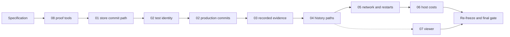

# 09 Versions, design chapters and implementation

> Part of [the long-run cost specification](../SPEC-long-run-cost.md). Code baseline `main` at `0bd2de65`.

## Goal and basis

Chapters 01–08 each specify one area. Their reviewers left questions that cross chapters: shared files, the order of
commits, version numbers, and a few choices that go beyond the proposal. This chapter answers them and says how the
whole specification lands: which numbers change, in what order the commits go, which gates each commit passes, how the
frozen fixtures are re-frozen, and what is left for the owner.

Where this chapter and another chapter disagree, this chapter wins. Where a later chapter's line references were taken
on `0bd2de65` and an earlier chapter has since changed the file, the later chapter's change is applied by its quoted
text on top of the earlier chapter's code.

## Versions

| Number | Where | Before | After | Changed by |
| --- | --- | --- | --- | --- |
| World-state structure `WORLD_SCHEMA_VERSION` | `src/worldmock/life/models.py:29` | 14 | 15 | Chapter 02, activity-order commit |
| Run manifest structure `RUN_MANIFEST_SCHEMA_VERSION` | `src/worldmock/life/models.py:32` | 6 | 7 | Chapter 05 (`lineage`) |
| Export manifest `EXPORT_SCHEMA_VERSION` | `src/worldmock/footprints/export.py:31` | 7 | 8 | Chapter 03 bumps it (`request: null`); chapter 05 adds `lineage` under 8 without a second bump |
| `quality.json` `schema_version` | `src/worldmock/footprints/quality.py:73` | 8 | 9 | Chapter 05 bumps it (`lineage` section); chapter 06 replaces `model_usage.by_purpose` with `model_usage.by_call_class` under 9 without a second bump |
| Checkpoint model `schema_version` | `src/worldmock/footprints/models.py` | 1 | 1 | Unchanged: compression changes the stored row, not the checkpoint record, and `record_sha256` is still taken over the uncompressed canonical text |
| `RULES_VERSION` | `src/worldmock/exchange/constants.py:7` | 6 | 6 | Unchanged; every dataset package loads as it is |
| AS2 patch series and `AS2_LOCKED_SOURCE_SHA256` | `patches/agentsociety2/` | — | regenerated | Chapter 05, by its patch procedure |

No version is bumped twice. A chapter that lands second under a number another chapter already bumped changes only its
own content and its own test expectations.

There is no migration and no reader for the old numbers (AGENTS.md). Run directories and exports written before this
specification are refused when resumed, branched, exported, checked or evaluated, and are read with the code they were
recorded with.

## Rulings across chapters

| Question | Raised by | Ruling |
| --- | --- | --- |
| Observation write signature | 01, 03 | `append_observation(draft, parts)`, called right after `require_committed(...)` in `observe`, as both chapters now state. There is no world argument on any evidence append |
| `_require_stored_version` inside every write transaction | 01 | Kept. It is not a new feature: today `commit` re-reads the stored version and so detects a second writer. The cache would lose that detection without it. One indexed read per write |
| `run_failed` recorded even when the engine world has diverged | 01 | Kept as chapter 01 states (subject to the event-time check). Recording why a run stopped is evidence, and a diverged world is exactly when it is needed |
| Committed-world guard fixture cost (about 20% on engine-heavy tests) | 01 | Kept. It is the proposal's leak protection for structural sharing and costs nothing at run time |
| Stale aside in chapter 02 that `stage_day_plan` commits through `commit_step` | 01 | Chapter 02's test stages "as `stage_day_plan` does". The aside is wrong and is ignored |
| Chapter 03's `copy_history` and `copy_parts` and its two mutations on them | 03, 04 | Implemented in chapter 03 so that branching works at chapter 03's commit, and deleted by chapter 04 as it states, with its `branch_skips_parts` mutation replacing them |
| Chapter 04's stale remark about a WAL row in chapter 01 | 01, 04 | Ignored. WAL is not used anywhere (proposal, "Not proposed") |
| `status.py` first and last event statements | 04, 05 | Chapter 04 adds `_FIRST_EVENT_SQL` and `_LAST_EVENT_SQL`; chapter 05 reuses them and adds only what it states beyond them |
| `_populate_branch` signature and `:125` | 04, 05 | Chapter 04 lands first and rewrites `:125` and the signature; chapter 05 adds `lineage=` on top |
| `worldmock status` on a run directory written before chapter 02 | 02 | A readable refusal instead of a `TypeError`. When the stored world's `activities` is not a list, `status` logs ERROR `Run directory was written by an older engine: world activities are not an array` and raises `ValueError` with the same text. No structure-number check, so raw test states need no new field. One test in `tests/unit/footprints/test_status.py` covers it |
| Deleting the 12 `reused` checks in 9 files | 02 | Approved. After the cross-round replay path is deleted no event carries `reused`, so every reader's result is unchanged on every stream the engine can produce; AGENTS.md asks for obsolete code to be deleted |
| Chapter 02's reader list naming `admission.py:108` | 06 | After chapter 06 that order is read in `activity_control.open_activities`, in the same order. Chapter 02's activity-order tests cover both readers |
| Chapter 03's reader inventory and `quality.json` | 06 | `quality.json` reads `model_request.data.request` (purpose, `extra_body`, tool names, message roles). Chapter 03 nulls the request only on `model_response`, so there is no conflict |
| Chapter 04's request outline | 06 | Keeps the four request fields the call-class classifier reads. Chapter 06 updates chapter 04's `test_finish_reason_usage_and_model_survive_the_response_reduction` for `_usage_entry`'s new signature and adds `_call_class` to `test_request_outline_keeps_every_call_class` |
| Token count carried as `LifeAgent._life_fitted` | 06 | Accepted. It is declared on the class with a default of `None`, set by `fit_request` and read by `compare_usage` in the same call. No request field and no AS2 patch is needed |
| Memory cursor not found | 06 | Accepted: logs ERROR and raises `ValueError`. The state cannot occur in a run, and the previous silent fallback is the kind AGENTS.md forbids |
| HTTP 502 (`BadGatewayError`) | 05 | Stays an ordinary failure, as today. Reclassifying it would change what the package field `transport_max_retries` counts, so it is listed for the owner (below) |
| Comparator and wall-clock values in `lineage` and `transport_attempts` | 05, 08 | Chapter 08's masks cover every wall-clock value in both, also when both sides carry them: `branched_at`, `last_recorded_at`, the lineage downtime fields and each attempt's `failed_after_ms` and `wait_ms`. The discarded-tail masks chapter 08 adds stay |
| Chapter 08's `processed-actions-pruned` rule | 02, 08 | Chapter 08 has adopted chapter 02's exception for terminal results; closed |
| Comparator reading the `d27f2c5a` recording | 03, 08 | Through its export, or through the code it was recorded with, never through the new store decoder (which refuses old-form observations) |
| Main checkout's AS2 vendor copy after the merge | 05 | Never rebuilt from this worktree. It is a merge step coordinated with the owner, because other sessions share that checkout |
| `LabelKit-DataSet/persona/tests/export_fixtures.py` builds schema-6 export manifests | 03 | Out of scope; already stale against 7. Listed as a follow-up |

## Order of commits

Every commit is on `feat/long-run-cost`. Design chapters change in the same commit as the code they describe, design
text first in the diff (AGENTS.md). Each commit carries its own tests and its own registered mutations in
`tests/dataset_acceptance.py`.

| Step | Content | Base of its masked complete-day comparison |
| --- | --- | --- |
| Specification | Proposal and chapters 01–09 | — |
| Proof tools | Chapter 08: the two scripts, the comparator, the masked complete-day comparison, the CI job, their tests and mutations | — (no production file) |
| Store commit path | Chapter 01 | Its parent, no rules; must be `equal` |
| Test identity | Chapter 02's tests-only commit: action ids in production form and the split of `record_complete_day` | — (tests only; full suite) |
| State and checkpoints | Chapter 02's identity-check, pruning, activity-order, checkpoint-row and snapshot commits, in that order | Each against its parent with chapter 02's rules |
| Recorded evidence | Chapter 03 | Parent, chapter 03's rules |
| History paths | Chapter 04 | Parent, no rules beyond the earlier ones |
| Network and restarts | Chapter 05, including the AS2 patches by its procedure | Parent, chapter 05's rules |
| Host costs | Chapter 06 | Parent, chapter 06's rules |
| Viewer | Chapter 07 (`tools/` and `tests/system/viewer/` only). It may be written in parallel on its own branch from the specification commit and is merged after chapter 04, which its text about exporting live runs depends on | — (no `src/` change) |
| Re-freeze | The two complete-day baselines and `tests/fixtures/viewer-context.json` | — |

The cumulative masked comparison runs the test-identity commit as base against the final head with chapter 08's
`R_V2` rule set and `export-manifest-version=7:8`. The test-identity commit's production code is main plus chapter 01,
and chapter 01's comparison against main gives `equal` without rules, so the chain covers every production change.

## Shared files

The chapters land in the order above, one at a time, in one worktree. These files are edited by more than one chapter;
the later chapter applies its change on top of the earlier one's final code.

| File | Chapters, in landing order |
| --- | --- |
| `src/worldmock/footprints/store.py` | 01 (cache, `commit`, `append_evidence`, `require_committed`, `checkpoint`), 02 (stored checkpoint form), 03 (`parts`, `_decode`, `append_observation`), 04 (connection timeout, streamed reads, SQL copy), 05 |
| `src/worldmock/footprints/checkpoint.py` | 01, 02, 03, 04, 05 |
| `src/worldmock/footprints/export.py` | 03, 04, 05 |
| `src/worldmock/footprints/quality.py` | 02, 05, 06 |
| `src/worldmock/footprints/validation.py` | 04, 05 |
| `src/worldmock/status.py` | 02, 04, 05 |
| `src/worldmock/life/models.py` | 01, 02, 05 |
| `src/worldmock/life/engine.py` | 01, 03, 04 |
| `src/worldmock/life/model_evidence.py` | 01, 03, 05 |
| `src/worldmock/life/decision_coordinator.py` | 01, 02, 06 |
| `src/worldmock/life/time_advance.py` | 01, 02 |
| `src/worldmock/life/activity_control.py` | 02, 06 |
| `src/worldmock/life/day_plan_inputs.py` | 02, 04 |
| `src/worldmock/life/day_planning.py` | 05, 06 |
| `src/worldmock/life/counterfactual_runtime.py` | 01, 04 |
| `src/worldmock/life/world_setup.py` | 01, 05 |
| `src/worldmock/runtime.py` | 01, 05 |
| `custom/agents/life_agent.py` | 05, 06 |
| `scripts/inspect_run.py` | 03, 04 |
| `tests/dataset_acceptance.py` | every chapter |
| `tests/life/conftest.py`, `tests/life/environment_runtime.py`, `tests/life/day_baseline_runtime.py`, `tests/dayrun_baseline.py` | 01, 02, 04, 05, 08 |
| `tests/unit/footprints/test_store.py`, `test_branch_coverage.py`, `test_status.py`, `test_quality.py` | 01, 02, 03, 04, 05, 06 |
| `tests/unit/engineering/test_import_graph.py` | 01, 05, 06 |

`tests/unit/engineering/test_import_graph.py`'s `DELAYED_IMPORTS` takes chapter 01's two deletions and chapter 05's
three additions. `record_model_exchange` is about 48 lines after chapters 01, 03 and 05; it is re-checked against the
50-line limit when chapter 05 lands.

## Design and manual changes

Each chapter's "Design chapters" section gives its text. The same design file is edited by several chapters, so later
edits are applied by their quoted text, never by line number.

| File | Chapters |
| --- | --- |
| `docs/design/01-architecture.md` | 08 |
| `docs/design/04-simulation-engine.md` | 01, 02 |
| `docs/design/05-recording-engine.md` | 01, 02, 03, 04, 05, 06, 07, 08 |
| `docs/design/06-agent.md` | 02, 03, 05 |
| `docs/design/07-evaluation.md` | 02, 04 |
| `docs/design/08-configuration.md` | 05 |
| `docs/design/09-io-formats.md` | 01, 02, 03, 05 |
| `docs/design/10-runtime.md` | 04, 05, 08 |
| `docs/manual/runtime.md` | 05, 06, 07 |

The quality-structure sentence in `05-recording-engine.md`「完整导出认证」is edited by chapters 05 and 06; it ends
with structure 9, the `lineage` section and `by_call_class`. `python scripts/build_design_doc.py` runs after every commit
that edits a design file and must succeed.

## Gates

**Every commit.**
- The chapter's new and changed tests, plus every test directory its files touch.
- For production commits, the masked complete-day comparison against the base in "Order of commits", with that
  chapter's rules: `equal` or `equal_under_rules`. A recording takes about twenty minutes a side on this machine, so
  the comparison runs once per chapter, from the chapter's base to its last commit with the union of its rules; a
  `different` verdict is bisected over the chapter's commits. Chapter 01 must give `equal` without rules. The report
  goes to `.work/long-run-cost/gates/<chapter>/`.
- The two complete-day baseline tests (`tests/system/lifecycle/test_complete_day_baseline.py`), the viewer recording
  test (`tests/system/lifecycle/test_run_viewer_recording.py`) and the viewer tests that read
  `tests/fixtures/viewer-context.json` are not gates until the re-freeze. They are left out on the command line
  (`--deselect`), never with a skip marker.

**End of every chapter.** The full suite in its six shards and the mutation suite, from a separate gate worktree
checked out at the chapter's last commit, while the next chapter is written. A failure is fixed in a new commit on the
branch before the next chapter's gate.

**Mutation time limits.** The unmutated killer pass has a 480 s limit (`tests/system/mutations/test_dataset_acceptance.py:16`)
and each mutation 180 s. On this Windows machine the killer pass already takes longer on `0bd2de65`, so local gates
run the mutation suite with a local, uncommitted pytest plugin that scales both limits. The committed limits change only
from a CI measurement: if the CI mutation job's unmutated pass takes more than 75% of its limit after the guard
fixture and the new killers, the limit becomes 1.5 times the CI measurement, rounded up to a minute, in its own commit
that cites the CI log.

**Final gate.** On the re-frozen head: the full suite, the mutation suite, and the coverage gate
(`scripts/coverage_gate.py`: branch coverage at least 85%, no uncovered public interface), all layers green, nothing
skipped.

## Re-freezing

Once, on the commit after the viewer is merged and every production commit has landed:
- the two complete-day baselines, by the two-candidate procedure in `docs/design/01-architecture.md`「工程验证」: two
  independent processes record a candidate each, and `scripts/freeze_rrs_baseline.py` writes them only when they are
  equal. A difference is investigated, not retried;
- `tests/fixtures/viewer-context.json`, re-recorded through `_recorded_viewer_requests` in
  `tests/system/lifecycle/test_run_viewer_recording.py` on the real host. The re-recording must keep a continuation
  request with more than two messages (chapter 07's identity test needs it). If the recording is byte-identical, the
  file is left as it is.

The re-freeze is its own commit. It changes no production file.

## Acceptance before merge

All offline:
- the final gate above;
- the cumulative masked complete-day comparison (test-identity commit against the head, `R_V2`);
- chapter 08's backport verification on `49db53cd` over all 30 days of the run: the determinism control on `d27f2c5a`
  segments 1–2, both negative controls, the base replay, V1 with zero divergence, and V2 with exactly the one expected
  divergence at call 2,880;
- the benchmark kit on main before and after the branch;
- restore-equals-live at every step of a scripted day (chapter 02);
- the viewer opening the 30-day run's export in Chrome (chapter 07), with the time measured.

Receipts and reports stay in `.work/long-run-cost/` and are summarised in the pull request.

The next real model-backed run on main (the dataset #11 acceptance run, which issue #15 asks to run past day 20) is the
reference recording for main's prompt lineage.

## Merge and follow-ups

- One pull request from `feat/long-run-cost` into `main`, linked from issue #15, with the acceptance receipts summarised.
- The CI job `complete-day-behaviour` passes on that pull request with "Base has no behaviour recorder", because the
  proof tools arrive with it. Whether it becomes a required check is the owner's call.
- WorldMock-Dataset, coordinated with its session:
  - `tools/native_day.py` (the `f"action-{round_id}"` line, `:390` at `7918adf`) uses
    `f"{context.decision_id}:action:0001"`. The current engine accepts this form too, so it can land at any time before
    the merge, and must land no later than it;
  - `tools/execution.py:219-223` and `tests/test_execution.py:50` take `validate_export`'s new return value (manifest
    and activities). This lands right after the merge.
- The main checkout's AS2 vendor copy is rebuilt after the merge, coordinated with the owner.

## Not in this chapter

- The proposal's "Awaiting the owner" and "Not proposed" tables.
- For the owner, raised by this specification:
  - HTTP 502 as a transport failure (it would park instead of ending the run);
  - whether `complete-day-behaviour` is a required check;
  - the time of the main checkout's vendor rebuild.
- `LabelKit-DataSet`'s stale export fixtures.
