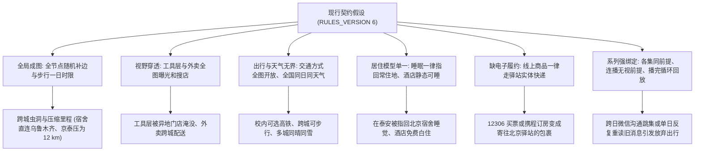
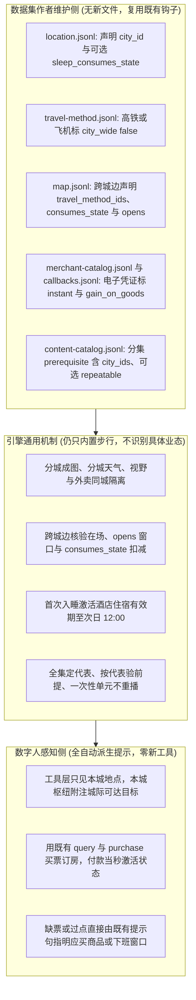
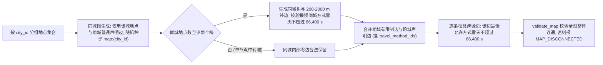
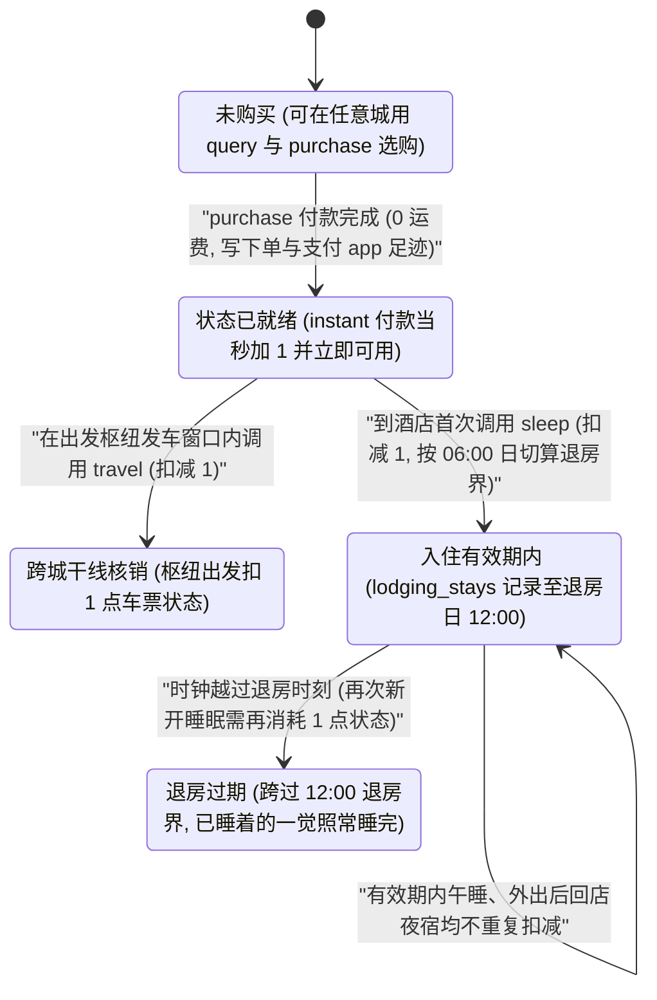
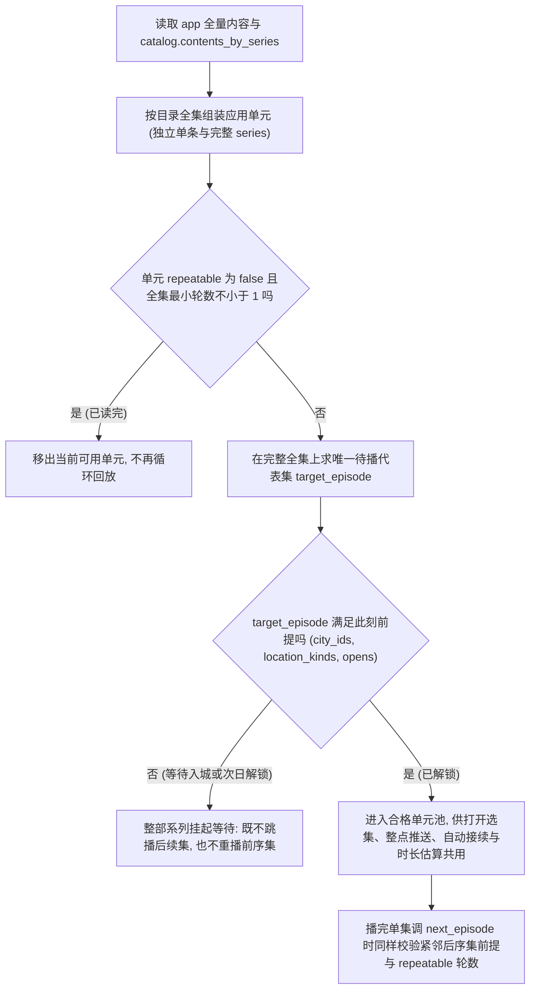
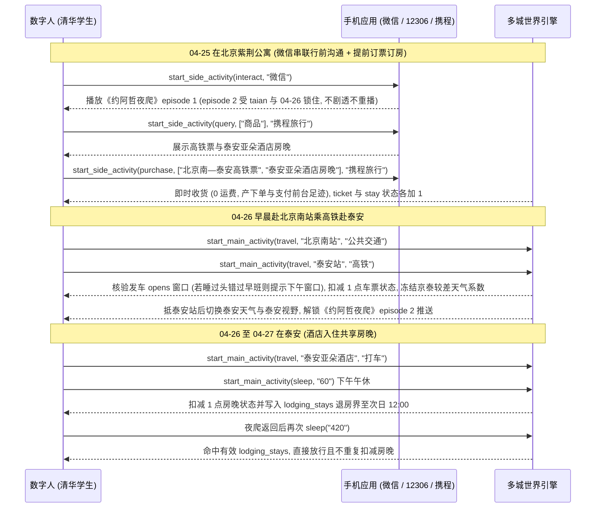

# 多城环境、电子凭证履约与内容系列分集前提提案

> 状态：提案，待评审；本文不改变当前运行规则与代码实现。
> 代码基线：`6440605a`（`RULES_VERSION = 6`）；目标契约版本：`RULES_VERSION = 7`、`format_version = 7`。
> 关联议题：[Issue #17 多城环境包支持](https://github.com/HoldThatThgt/WorldMock/issues/17)、[Issue #18 内容系列支持分集独立前提](https://github.com/HoldThatThgt/WorldMock/issues/18)。
> 实证背景：多日多城环境包 `environment/0007-tsinghua-student-anon`（涵盖北京、苏州、泰安、包头、南京、南通、乌鲁木齐，`96` 小时真实模型运行）。

本提案合并解决多城环境隔离、跨城交通与时刻表、电子票务与酒店住宿预订，以及跨日内容系列分集独立前提四类联动问题，遵循以下核心约束：

- **八个既有工具与参数签名零改动**：人物继续调用 `start_main_activity`、`start_side_activity`、`report_status`、`pause_activity`、`conclude_activity`、`revise_day_plan`、`recall_task_summary` 与 `search_memory`，不新增专用订票订房工具或日期参数。
- **引擎仍只内置步行，不认识具体交通或酒店业态**：高铁、飞机、长途大巴与酒店房型仍由数据集通过目录文件声明；购票乘车、发车窗口与订房入住全部通过复用并正交扩展 `consumes_state`、`opens`、`callbacks.jsonl` 与线上即时收货钩子完成。
- **显式城市身份统一隔离**：每个地点必填 `city_id`（不保留缺省值或迁移分支），统一收口街区随机补边、同城一日时限、工具层视野、同城外卖查询、睡眠就近引导与分城每日天气。
- **内容系列按全集定代表、按代表验前提，并支持一次性已读**：解除应用系列各集前提全等限制，引入 `city_ids` 入城前提与 `repeatable: false` 单轮消费语义，消除旧聊天循环回放与跳集剧透。

## 现行单城与系列契约的瓶颈



| 瓶颈维度 | 现行代码与契约位置 | 现行约束 | 多城与多日实证后果 |
| --- | --- | --- | --- |
| 街区成图与直径门禁 | [资源引擎](../../design/03-resource-engine.md) `mapgen.py` 与 `admission.py` | 对全部地点生成随机树与 `200–2000 m` 额外边；按全图最慢方式与最差天气校验 `86,400 s` | 紫荆公寓随机直连乌鲁木齐的家；京苏、京泰真实里程被迫压缩至 `12,000 m` |
| 工具层视野与商业范围 | [模拟引擎](../../design/04-simulation-engine.md) `observe.py`、`purchase_offers.py`、`query_answer.py`、`discovery.py` | 工具层每轮渲染全图地点与全部出行方式；外卖选店与店铺查询搜索全图门店 | 人在北京却被数十个异地门店与出行组合挤占上下文；夜间本地打烊时外卖穿透到异地门店 |
| 出行方式与天气隔离 | [交换引擎](../../design/02-exchange-engine.md) `travel.py` 与 `weather.py` | 任意起终点开放全部出行方式；全世界每日共用单一 `weather:{local_date}` 随机键 | 校内教学楼可坐高铁赴站；跨城可步行或打车；北京与乌鲁木齐同日天气必然相同 |
| 异地居住与睡眠引导 | [模拟引擎](../../design/04-simulation-engine.md) 动作准入 `admission.py` | 非可睡地点拒绝睡眠时固定提示回 `persona.home_location`；`sleepable` 仅支持静态布尔 | 在泰安犯困被引导回北京睡觉；酒店标 `sleepable: true` 会免费白住，不标则永远不可睡 |
| 线上票务与房晚履约 | [模拟引擎](../../design/04-simulation-engine.md) `purchase_offers.py` | 仅存在到店、骑手外卖、两至五天到常住地驿站快递三条履约路径 | 无法在 `12306` 或 `携程` 付款即时出票订房，也不支持按次扣减票证或按入住房晚解锁酒店睡眠 |
| 应用系列分集前提与回放 | [资源引擎](../../design/03-resource-engine.md) 与 [模拟引擎](../../design/04-simulation-engine.md) `admission.py`、`content_select.py`、`interact.py`、`app_push.py`、`content_prerequisite.py` | 同系列各集强制 `prerequisite` 完全相同；`next_episode` 无视前提连播；选集先过滤单条再拼单元；读完按最低轮数从头重播 | 微信跨日接龙被迫拆成静态单条，首轮读完后人物在后续日期十余次重读旧对话并误判未沟通成功；且存在全应用只剩锁住后序集时触发空候选崩溃的隐患 |

## 目录契约的最小正交扩展（`RULES_VERSION = 7`）



所有目录文件中，省略即代表不启用对应扩展；除原本明确允许 `null` 的字段外，以下新增字段写成 `null` 均按 `ENVIRONMENT_KIND_INVALID` 拒绝：

| 目录文件 | 字段或规则变化 | 约束与语义 | 准入错误边界 |
| --- | --- | --- | --- |
| `manifest.json` | 升级规则与目录格式版本 | `format_version` 与 `rules_version` 均要求严格整数 `7`，直接拒绝版本 `6` 环境包 | 版本不匹配报 `RULES_VERSION_MISMATCH` 或 `ENVIRONMENT_KIND_INVALID` |
| `location.jsonl` | 必填 `city_id` | 非空白严格字符串，单城环境同样必填；同城地点共享街区图、商业范围与每日天气 | 缺失或空白报 `ENVIRONMENT_KIND_INVALID` |
| `location.jsonl` | 可选 `sleep_consumes_state` | 非空白字符串，引用 `callbacks.jsonl` 已登记状态；仅允许声明在 `sleepable: true` 且 `is_home: false` 的地点（酒店或旅舍）；目录仍允许多个地点标 `is_home: true, sleepable: true` 作为各城免费自有住处 | 非可睡或自有住处携带报 `ENVIRONMENT_KIND_INVALID`；未知状态报 `ENVIRONMENT_REF_UNKNOWN` |
| `travel-method.jsonl` | 可选 `city_wide` | 严格布尔，缺省 `true`；为真时参与同城街区全地点出行，也可被声明边引用；为假时仅可用于 `map.jsonl` 显式列出它的声明边；所有出行方式统一沿用 `WEATHER_FACTORS`，不设天气豁免字段 | 类型错误或写成 `null` 报 `ENVIRONMENT_KIND_INVALID` |
| `map.jsonl` | 可选 `travel_method_ids` | `travel_method_id` 或 `walking` 的升序去重数组；跨城边（`a` 与 `b` 属于不同 `city_id`）**必填非空且不得包含 `walking`**；同城边省略代表普通同城街区距离声明，显式写出则作为限定方式的同城直达边 | 跨城边缺失、空数组或写 `walking` 报 `ENVIRONMENT_KIND_INVALID`；未排序或重复报对应规范码；未知方式报 `ENVIRONMENT_REF_UNKNOWN` |
| `map.jsonl` | 可选 `consumes_state` 与 `opens` | 仅允许声明了 `travel_method_ids` 的边携带；`consumes_state` 引用已登记状态，出发受理时要求状态不小于 `1` 并扣减 `1`；`opens` 为 `OpeningHours` 对象，限制允许受理出发的日期与发车检票时段 | 普通自由边携带报 `ENVIRONMENT_KIND_INVALID`；未知状态报 `ENVIRONMENT_REF_UNKNOWN`；坏时段复用 `_check_opening_hours` |
| `merchant-catalog.jsonl` | 可选 `instant` | 严格布尔，缺省 `false`，仅允许 `app_ids` 非空的线上商品声明；为真时走电子即时履约（`0` 运费、付款完成当秒直接收货、不经驿站）；当目录不存在任何 `instant: false` 的实体快递商品时，不强制要求登记驿站 | 店铺商品（`store_kinds` 非空）声明或写成 `null` 报 `ENVIRONMENT_KIND_INVALID` |
| `callbacks.jsonl` | 状态行可选 `gain_on_goods` | 商品身份升序去重数组，缺省空数组；每收到一件匹配商品，状态按 `min(cap, before + 1)` 递增；同状态的 `gain_on_goods` 与 `reset_on_goods` 不得存在同一商品重叠；原有 `reset_on_goods` 保持置满 `cap` 不变 | 未知商品报 `ENVIRONMENT_REF_UNKNOWN`；重叠商品报 `ENVIRONMENT_KIND_INVALID` |
| `content-catalog.jsonl` | `prerequisite.city_ids` 与 `repeatable` | `prerequisite.city_ids` 为升序去重的已登记 `city_id` 数组，与 `location_kinds`、`opens` 三者至少写一项，仅限 `app_ids` 非空的内容声明；`repeatable` 为严格布尔，缺省 `true`，同系列各集取值须一致，为 `false` 时完整读完一轮后即耗尽 | 未知城市报 `CONTENT_BINDING_DANGLING`；地点内容写 `prerequisite` 报 `CONTENT_PREREQUISITE_INVALID`；同系列 `repeatable` 不一致报 `CONTENT_SERIES_INVALID` |
| `content-catalog.jsonl` | 解除应用系列各集前提全等校验 | `_check_series` 对 `app_ids` 非空的系列不再比较各集 `prerequisite` 是否相等，继续要求容器绑定、`memory_category`、`repeatable` 一致及集号唯一 | 仅地点内容系列保持无前提约束 |

以下极简目录片段演示北京乘高铁赴泰安入住亚朵酒店，并配合跨日微信系列解锁的写法（省略与现行合同相同的常规字段）：

```json
{"app_ids":[],"city_id":"beijing","is_home":true,"kind":"dorm","location_id":"dorm-zijing","name":"紫荆公寓","sleepable":true}
{"app_ids":[],"city_id":"beijing","kind":"train_station","location_id":"station-beijing-south","name":"北京南站"}
{"app_ids":[],"city_id":"taian","kind":"train_station","location_id":"station-taian","name":"泰安站"}
{"app_ids":[],"city_id":"taian","is_home":false,"kind":"hotel","location_id":"hotel-atour-taian","name":"泰安亚朵酒店","sleep_consumes_state":"stay_atour_taian","sleepable":true}

{"city_wide":false,"exertion":"idle","name":"高铁","price_per_km_fen":0,"speed_meters_per_second":75,"start_price_fen":0,"travel_method_id":"high_speed_rail"}

{"a":"station-beijing-south","b":"station-taian","consumes_state":"ticket_bjs_taian","length_m":450000,"opens":{"weekly":{"mon":[["07:30","08:15"],["13:00","13:45"]],"sat":[["07:30","08:15"],["13:00","13:45"]],"sun":[["07:30","08:15"],["13:00","13:45"]]}},"travel_method_ids":["high_speed_rail"]}

{"app_ids":["ctrip","rail12306"],"category":"goods","goods_id":"ticket-bjs-taian","instant":true,"name":"北京南—泰安高铁票","price_fen":21500}
{"app_ids":["ctrip","meituan"],"category":"goods","goods_id":"room-atour-taian","instant":true,"name":"泰安亚朵酒店房晚","price_fen":38000}

{"cap":4,"gain_on_goods":["room-atour-taian"],"initial":0,"reset_on_goods":[],"state":"stay_atour_taian"}
{"cap":4,"gain_on_goods":["ticket-bjs-taian"],"initial":0,"reset_on_goods":[],"state":"ticket_bjs_taian"}

{"app_ids":["wechat"],"content_id":"wx-taishan-1","duration_seconds":180,"exertion":"idle","pushable":false,"relaxation_relief":"none","repeatable":false,"series":{"episode":1,"title":"约阿哲夜爬"},"social_relief":"medium","summary":"行前与阿哲确认次日高铁车次与山脚集合点。","summary_source":{"kind":"synthetic","notice":"作者编写","url":null},"title":"行前约定"}
{"app_ids":["wechat"],"content_id":"wx-taishan-2","duration_seconds":180,"exertion":"idle","prerequisite":{"city_ids":["taian"],"opens":{"exceptions":{"2025-04-26":[["08:00","24:00"]]},"weekly":{}}},"pushable":true,"relaxation_relief":"none","repeatable":false,"series":{"episode":2,"title":"约阿哲夜爬"},"social_relief":"medium","summary":"抵达泰安后阿哲发来实时天气与出站汇合位置。","summary_source":{"kind":"synthetic","notice":"作者编写","url":null},"title":"抵达泰安汇合"}
```

## 多城地图、出行、天气与视野隔离规则

### 分城成图与准入门禁



- **同城随机补边彻底隔离**：每座城市用确定性种子键 `map:{city_id}`（若无通用同城连接或单地点城则不抽树和额外边）生成城内街区连接；`generate_edges` 永远不会在不同 `city_id` 之间生成随机连通边或额外边，彻底根除跨城虫洞。
- **三角不等式与方式感知路由**：自由街区子图内部沿用既有的矛盾声明检查与“不绕过声明边”筛选（含带 `travel_method_ids` 的声明边不得被无限制随机边抄近道绕过）；同时 `Graph` 路由查询支持按出行方式筛选可达边——使用某个 `travel_method_id` 时，只能经过**未声明 `travel_method_ids` 的同城自由边（仅限 `city_wide: true` 或 `walking`）**，以及**`travel_method_ids` 显式包含该方式的声明边**。
- **单城与跨城双轨时限门禁**：[admission.py](file:///d:/code/WorldMock/src/worldmock/resource_engine/registration/admission.py#L434-L451) 的 `validate_route_limit` 改为两条独立检查：
  - 同城街区时限：对每个不少于两个地点的城市内部图，以 `walking`（`1.2 m/s`）与所有 `city_wide: true` 出行方式中的最慢速度乘最差天气 `0.6`，校验城内最长最短路不超过 `TRAVEL_MAX_SECONDS`（`86,400 s`）。
  - 跨城干线时限：对每条跨城声明边，按其 `travel_method_ids` 中最慢速度乘最差天气 `0.6`，校验单边直达耗时不超过 `86,400 s`。

### 同城、跨城出行结算与分城天气

| 环节 | 同城出行（起终同城，非通道直达边） | 城际干线或通道直达边出行（`map.jsonl` 显式带 `travel_method_ids` 的单边） |
| --- | --- | --- |
| **可用地点与路径** | 仅沿本城有效边寻路，可用 `walking` 与 `city_wide: true` 的方式 | 人物必须停留在声明边的某一个端点，目的地为另一端点；仅开放该边声明的 `travel_method_ids` |
| **天气与用时公式** | 读取当前城市当日天气 `weather:{city_id}:{local_date}` | 统一取起终两城当日天气系数的较小值 `min(origin_weather_factor, destination_weather_factor)`，全部出行方式均沿用 `WEATHER_FACTORS`（暴雨 `0.7` 与暴雪 `0.6` 照常导致航班延误或高铁限速），出发受理时冻结 `weather_factor` |
| **时段与状态核验** | 无边级发车窗口与客票状态检查 | 依次检查在场约束、边上 `opens` 发车窗口（不在时段内报 `LOCATION_CLOSED` 并用 `time_phrase` 写明今日后续或未来七日窗口）、边上 `consumes_state` 客票状态（不足报 `ACTIVITY_PRECONDITION_UNMET` 并沿用 `receiving <商品名> makes it available` 提示）；受理成立同事务扣减 `1` 点状态 |
| **途中取消限制** | 保持既有规则 | 若起终点 `city_id` 不同（跨城旅途中），禁止 `conclude_activity` 提前结束跳回出发枢纽，活动工具层将 `conclude_activity` 标为不可用并写明原因；到达目的枢纽后切换当前停留城市与天气 |

关于世界每日天气：世界状态将 `weather_by_date` 扩展为按 `local_date -> {city_id: condition}` 嵌套索引的字典，本地午夜边界在所有已登记城市上各自用随机键 `weather:{city_id}:{local_date}` 抽取当日天气。环境层展示人物当前 `location_id` 所属城市的当日天气（在跨城路上时 `location_id` 仍锚定出发城，到达目的枢纽提交后自然切换为目的城天气）。

### 工具层视野、门户提示与同城商业边界

| 观察与商业维度 | 隔离与呈现规则 | 预期效果 |
| --- | --- | --- |
| **工具层地点清单** | 人物在某城时，只列出**当前城市全部地点**，以及**与当前停留地点存在直接跨城声明边相连的异地枢纽**；跨城目的枢纽下仅列出该声明边允许的 `travel_method_ids` | 消除几十个异地门店对模型上下文的噪音，同时保留“必须先抵本城枢纽才可登车登机”的真实空间逻辑 |
| **本城枢纽门户提示** | 本城连有跨城声明边的枢纽目标行，其 `state` 在营业时段后自动附带直达说明（如 `全天营业；城际可达：泰安站（高铁）、苏州站（高铁）`）；若人物在宿舍直接向异地地点请求 `travel`，名称解析照常认出目标，准入拒绝并由 `next_step` 指引前往本城对应枢纽 | 人物在宿舍即可看懂“坐高铁赴泰安需先去北京南站”，不会在城市内部迷失 |
| **外卖、查询与商品曝光** | 外卖候选店（`quote_goods`）、缺远程渠道最近有售门店提示（`_require_store`）、`query_answer` 门店行与工具层轮转的店铺商品（`discovery.py`）均只筛选 `store.city_id == current_city`；若当前城市无营业店有售，门店缺货提示仅点出本城门店（或说明本城暂无该商品线下门店） | 彻底阻断外卖与店内商品查询的跨城穿透，且让地方特产只在当地进入视野 |
| **线上商品与快递驿站** | `app_ids` 线上商品全图可查可买：其中 `instant: true` 付款即收货，无城市依赖；`instant: false` 的实体快递依然寄往 `persona.home_location` 所属城市内最近的 `accepts_parcels: true` 驿站；当目录存在非即时线上商品时，准入检查要求主常住地所在城市内必须至少有一个合法驿站 | 符合出差旅游时网上买实物仍默认寄回学校或老家的直觉，同时防止快递包裹投递到异地驿站 |

## 电子凭证履约与异地住宿生命周期



- **即时电子履约（`FulfillmentKind.INSTANT`）**：
  - 针对 `merchant-catalog.jsonl` 中声明 `instant: true` 的线上商品，`quote_goods` 派生 `instant` 履约路线：复用 `purchase` 的下单段（`ordering`）与支付段（`payment`）前台区间、`订单已下单` 与 `支付成功` 通知、双边资金转账与个人事务累计；不收取运费、不登记发货或送达预排事件、不抽取商铺品质，在付款完成的那一秒于同次提交内直接调用 `settle_receipt` 结算收货并触发 `gain_on_goods` 或 `reset_on_goods` 状态更新。
  - 若 `gain_on_goods` 绑定的回调状态与某条跨城边或酒店关联，购买完成后立即生效，不依赖任何实体物流时间。
- **凭状态商业酒店入住有效期（`AgentState.lodging_stays`）**：
  - `AgentState` 新增持久化映射 `lodging_stays: dict[str, int]`（地点身份到退房纪元秒）。
  - 在声明了 `sleep_consumes_state` 的地点请求 `sleep` 时：若 `state.current_time < agent.lodging_stays.get(location_id, 0)`，说明人物尚在已支付房晚的入住有效期内，直接准入且**不再扣减状态**（同一晚内的下午午休、夜间回店睡觉互不重复扣费）；否则校验本人 `callback_states[location.sleep_consumes_state] >= 1`，不足时按 `ACTIVITY_PRECONDITION_UNMET` 拒绝并沿用通用句式提示购买对应住宿商品（`receiving <商品名> makes it available`）。
  - 扣减成功开始睡眠时，同事务将状态减 `1`（写出 `consume_on_start` 回调效果），并按本地钟面 `06:00` 日切规则写入退房时刻：若入住当地时刻在 `00:00` 至 `05:59` 之间，退房界设为**当日 `12:00:00`**；若在 `06:00` 及以后，退房界设为**次日 `12:00:00`**。与营业时段规则一致，入住激活后即使睡眠期间时钟跨过 `12:00` 也不打断当次睡眠，只影响醒后下一次新开睡眠。
- **睡眠拒绝的同城就近引导**：
  - 在不可睡地点（如餐厅、车站、景区）请求 `sleep` 被拒时，`next_step` 仅在当前停留地点所属城市内按以下优先级给出唯一合理指引：本城当前仍在 `lodging_stays` 有效期内的酒店 → 本城标有 `is_home: true, sleepable: true` 的自有住处 → 本城已持有有效 `sleep_consumes_state`（`>= 1`）的酒店 → 提示购买本城可睡酒店对应的房晚商品并前往入住；若当前城市既无自有住处也无任何酒店地点，再提示返回已有住处的最近城市，彻底根除在泰安提示回北京睡觉的荒诞行为。

## 内容系列分集独立前提与单轮消费状态机（Issue #18）



- **全入口统一“全集定代表、按代表验前提”**：
  - 在 `content_select` 中新建唯一纯助手函数，先基于目录完整系列 `catalog.contents_by_series`（而非过滤后的零散单条）组建单元，过滤掉已完成一轮且 `repeatable: false` 的单元，再求每个单元唯一待播代表集 `target_episode`（最小轮数中集号最小的一集）。
  - 对每个未耗尽单元仅判定 `target_episode` 的 `prerequisite_unmet`（涵盖 `city_ids`、`location_kinds` 与 `opens`）：若 `target_episode` 不满足前提，则整部系列在当前时刻视为不合格（安全挂起等待解锁）；只要前序集已读完、后序集被明日日期或泰安入城前提锁住，整部系列既不会回放前序已读集，也不会跳过前序集偷跑后序集。一旦抵达解锁条件，`target_episode` 自动放行且因系列已开始（`_started` 为真）优先续接。
  - `select_content`、`autoplay_content`、`opening_duration` 以及 `app_push._push_candidates` 全部共用同一套单元代表集筛选（整点推送与自动接续另要求 `target_episode.pushable` 为真）。因此同一条微信对话系列中，用户主动发送的首条可设 `pushable: false`，而次日或入城后对方主动回信的后续集可设 `pushable: true` 在整点准时推送唤醒注意。
- **紧邻接续校验与暂停提示一致性**：
  - `next_episode` 与 `activity_control._continues_with_next_episode` 引入当前 `(stay_location, local_moment)` 参数：找到同一系列集号更大的紧邻下一集后，必须校验该集此刻满足 `prerequisite_unmet == ()`（以及未因 `repeatable: false` 超过单轮），不满足则返回 `None` 正常结束当次条目，不再击穿未来日期或异地剧情；暂停临近结束提示与实际接续完全同源。
- **修复无合格内容时的拒绝与空集隐患（`content_prerequisite.py`）**：
  - 现行 `_unmet_contents` 对应用内全部内容直接检查 `all(unmet)`，一旦出现“前序集无前提且已读完、待播代表集带前提被锁住”的状态，合格单元集合为空而 `all(unmet)` 为假，会导致工具层误标可用并在空列表上崩溃。
  - 修订后，`app_prerequisite_refusal` 与 `app_time_state` 只读取**未耗尽单元各自的当前 `target_episode`** 的未满足状态：存在未耗尽但全都不满足前提的单元时，汇总其分句与开放时间（差地点时优先只列出满足 `city_ids` 与当前停留城市的匹配地点显示名）；若应用内全部内容均已读完且无任何未耗尽单元，则统一返回 `CONTENT_PREREQUISITE_UNMET`（`reason` 为 `"All content in <app 名称> has already been finished."`），工具层 `state` 写 `"无未读内容"`、`available` 为 `false`。

## 端到端时序验证与模块落地边界

### 典型多城多日行程推演（`0007` 场景）



### 所属模块改动清单与后续验收标准

待本提案评审通过并正式授权实施后，按“先改模块设计正文，再改源码与行为测试”的顺序同步推进，直接启用新版契约并拒绝 `RULES_VERSION = 6` 环境包，不保留旧版本读取或迁移代码：

| 受影响文档与模块 | 承担的变更内容 |
| --- | --- |
| [交换引擎](../../design/02-exchange-engine.md) | 升级 `RULES_VERSION` 至 `7`；明确跨城天气系数的两城取小规则与 `INSTANT` 零运费即时履约语义 |
| [资源引擎](../../design/03-resource-engine.md) | 新增地点 `city_id` 与 `sleep_consumes_state`、方式 `city_wide`、声明边 `travel_method_ids` / `consumes_state` / `opens`、商品 `instant`、回调 `gain_on_goods`、内容 `prerequisite.city_ids` / `repeatable` 合同；改写分城成图、同城/跨城双轨时限门禁及解除应用系列前提全等校验 |
| [模拟引擎](../../design/04-simulation-engine.md) | 落实跨城枢纽发车窗口与状态核销、禁止跨城中途取消、外卖查询同城隔离、商业酒店退房钟点与同城睡眠引导、`INSTANT` 即时收货，以及内容全集定代表选集与接续状态机 |
| [记录引擎](../../design/05-recording-engine.md) | 确认城市天气键、即时电子收货、`consume_on_start` 跨城/入睡起因绑定与导出核验一致 |
| [人物](../../design/06-agent.md) | 规定工具层视野（本城地点 + 可达异地枢纽）、枢纽 `state` 门户说明、跨城/住宿条件不可用文字、全集无新内容时的应用状态及环境层本城天气投影 |
| [配置](../../design/08-configuration.md) | 将地图种子键更新为 `map:{city_id}`、每日天气随机键更新为 `weather:{city_id}:{local_date}` |
| [状态与序列化](../../design/09-io-formats.md) | 在 `WorldState` 天气字段支持分城键、在 `AgentState` 新增 `lodging_stays`、在 `FulfillmentKind` 新增 `instant` |
| [资源设计手册](../../manual/resources.md) | 补充多城城市划分、跨城枢纽边与发车时段、即时凭证商品与分集解锁微信系列的作者示例与排错指南 |

实施完成后的核心行为验收覆盖以下维度：

- **地图与门禁隔离**：多城包不生成任何跨城随机边；单节点中转城正常成图；同城超 `62.2 km` 报错，而京乌 `2,500 km` 航线与京泰 `450 km` 高铁声明边在对应方式下通过准入；全国各城同日独立天气并按起终较差天气计算跨城耗时。
- **视野与商业隔离**：工具层不暴露非直达异地地点；外卖与店铺查询严格限制在当前城市；`instant: true` 电子凭证付款当秒激活状态并触发 `gain_on_goods` 累加，不走驿站也不影响实体快递。
- **跨城交通与住宿闭环**：未购票或错过 `opens` 发车窗口时准确拒绝并给出既有引导提示；购票后在发车窗口内检票扣减状态、跨城不可中途跳转回起点；酒店首睡扣状态并写入 `12:00` 退房界，同房晚午休与夜宿不重复扣状态，退房后再次新睡重新检票扣减，睡着跨过 `12:00` 不被打断。
- **系列分集前提与防循环回放**：同一应用系列内支持每集独立 `city_ids` 与 `opens` 时段；前序集播完且后序集未解锁时系列安全挂起、不跳集、不回放前序集；`repeatable: false` 系列完整读完后彻底下线不再触发循环打开，所有现行单测、集成测试与文档门禁全量通过。
