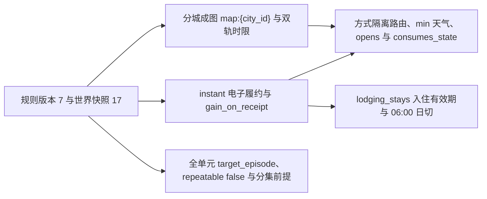

# 多城环境、电子凭证履约与内容系列分集前提 · 交付记录

[开发规格](SPEC.md)约定规则升级、目录契约、地图与路由、同城商业、即时履约、住宿生命周期及系列分集前提的落地边界。[原提案](PROPOSAL.md)保留人物心智模型与设计依据（关联 [Issue #17](https://github.com/HoldThatThgt/WorldMock/issues/17) 与 [Issue #18](https://github.com/HoldThatThgt/WorldMock/issues/18)）。

## 核心交付内容

- **规则与快照版本升级**：将 `RULES_VERSION`、`CatalogManifest.format_version` 与 `CatalogManifest.rules_version` 升级为 `7`，将 `WORLD_SCHEMA_VERSION` 升级为 `17`；直接拒绝旧版本目录与检查点快照，不保留兼容层或迁移代码；八个既有工具名称与签名及 `LIFE_SYSTEM_LAYER` 正文均保持不变。
- **分城成图、限定边与跨城天气**：`Location` 强制声明 `city_id`，`mapgen` 按 `map:{city_id}` 独立生成同城街区树与额外边（支持单节点中转城、绝不生成跨城随机边）；`MapEdge` 支持 `travel_method_ids`、`consumes_state` 与 `opens`，`Graph` 实现限定边单跳路由与自由街区隔离；`validate_route_limit` 分同城自由街区轨与声明限制边轨独立校验 `86,400 s` 时限；跨城旅途禁用 `conclude_activity`，出发准入对非直达异地目标给出 `"Travel to <hub display_name> first."` 指引；`WorldState.weather_by_date` 扩展为按日期与 `city_id` 索引，出行取起终两城天气系数的较小值。
- **视野隔离与同城商业边界**：工具层仅暴露当前城市全部地点与直接相连的异地枢纽（并在本城枢纽状态后附加 `；城际可达：...`），同时保留完整 `catalog_bindings` 使异地直呼名称仍可解析并获得枢纽提示；外卖筛选、缺货最近门店提示、查询商家行与店铺商品曝光均过滤 `store.city_id == current_city`；存在非即时线上商品时要求主常住地所在城市登记合法驿站。
- **即时电子履约与酒店入住生命周期**：新增 `FulfillmentKind.INSTANT`（`"instant"`）与 `CallbackState.gain_on_goods`（递增写 `StateGainResult` / `gain_on_receipt`），同 app 混合篮子内按每张订单逐笔结算付款即收货，查询渠道扩展 `"即时到账"` 与工具层 `"运费0元，付款即收货"` 预览；`ConsumeOnStartResult.content_id` 放宽为可选并由 `DecisionCoordinator._consumed_on_start` 绑定实际动作种类；`AgentState.lodging_stays` 记录凭 `sleep_consumes_state` 入住酒店的退房纪元（按当地 `06:00` 日切算当天或次日 `12:00:00` 退房，睡梦中跨点不打断），不可睡地点按本城优先顺序给出引导。
- **内容系列分集前提与单轮消费**：`ContentPrerequisite` 新增 `city_ids`（优先于 `location_kinds` 与 `opens` 检验，缺失地点时按城市与地点类型筛选候选项），`Content` 新增同系列一致的 `repeatable` 约束并放宽 app 系列各集 `prerequisite` 相等校验；`content_select`、`autoplay_content`、`opening_duration`、`pinned_push_content`、`app_push`、`next_episode` 与 `activity_control` 统一基于完整系列求未耗尽代表集 `target_episode` 校验前提与接续；全耗尽 app 统一返回 `CONTENT_PREREQUISITE_UNMET` 与 `"无未读内容"`，一次性地点单元完成后由 `unit_locked` 与 `locked_refusal` 安全隐藏拒载。

## 验证与交付说明

- **文档与工程门禁**：[开发规格](SPEC.md)、全部受影响 `docs/design/*.md` 与 [资源编写手册](../../manual/resources.md) 在规格工作流完成一轮评审修复并通过 `test_documentation_gate.py` 与 `test_design_doc_build.py` 共 `19` 项检查；本报告写出后再次运行 `scripts/documentation_gate.py`、`tests/unit/engineering/test_documentation_gate.py` 与 `tests/unit/engineering/test_design_doc_build.py` 验证通过。
- **确定性基线与静态门禁**：同步刷新内置单城示例环境（`test-city`、版本 `7`）、[viewer-context.json](../../../tests/fixtures/viewer-context.json)（`test_run_viewer_recording.py` 与 `tests/system/viewer/` `2` 项通过）、以及各经两次独立运行一致后冻结发布的 [dayrun-activity-baseline.json](../../../tests/fixtures/dayrun-activity-baseline.json) 与 [dayrun-callback-baseline.json](../../../tests/fixtures/dayrun-callback-baseline.json)（`test_complete_day_baseline.py` `4` 项通过）；提示词摘要与八个工具声明校验（`test_system_layer_text.py` `10` 项）及风格、导入图与单源工程门禁全部通过。
- **全量测试、覆盖率与变异测试状态**：
  - 完整门禁首轮运行时，全库共 `6,817` 项测试中 `6,811` 项通过、`0` 错误、`0` 跳过，分支覆盖率达 `96.28%`（高于 `85%` 门槛）；当时仅余 `6` 项新增 `SourceMutation` 用例因捕获异常类型过早绕过断言以及 `Graph.next_hub_toward` 一行未覆盖分支待补齐。
  - 随后在未改动生产代码的前提下补齐上述 `6` 项断言与 `Graph.next_hub_toward` 分支覆盖，并逐项实测复验通过：相关专项与工程门禁聚焦回归 `147` 项全过，该 `6` 项 `SourceMutation` 独立变异运行均以预期断言失败稳定击杀（`killed_by_gate=True`），[graph.py](../../../src/worldmock/resource_engine/map/graph.py) 目标行已覆盖，`test_multi_city_and_edge_admission.py` 与 `test_graph.py` 共 `18` 项通过，全部改动文件均为 UTF-8 无 BOM 且仅含 LF 换行。
  - 按合入推送指令，先行将当前代码、文档与测试合并推送至 `main`；包含全量 `6,817+` 测试、带分支覆盖统计与全部 `343` 条逐进程变异检查的完整后台门禁仍在独立工作树内继续运行（截至推送前保持零失败推进），完成后如发现任何尾项问题将另行提交小型修复提交。

## 无人值守时采用的决定

| 问题 | 采用的处理 |
| --- | --- |
| 新旧环境与世界快照如何兼容？ | 不保留向后兼容与迁移脚本，将 `RULES_VERSION`、`format_version` 与 `rules_version` 直接升至 `7`，`WORLD_SCHEMA_VERSION` 升至 `17`，直接拒绝旧包与旧快照。 |
| 列表未按升序排列报哪一错误码？ | 沿用 `errors.py` 与 `_check_order` 既有合同，数组未升序与 JSONL 行序未升序统一报 `ENVIRONMENT_KIND_INVALID`，重复元素报 `ENVIRONMENT_ID_DUPLICATE`，不新增多余枚举码。 |
| 多城天气怎样存储与计算跨城速度系数？ | 将 `WorldState.weather_by_date` 存为 `local_date -> {city_id: condition}`，午夜按 `city_id` 升序以 `weather:{city_id}:{local_date}` 抽取并注册 `weather-{city_id}-{local_date}`；出行统一取起终两城当日系数的较小值。 |
| `gain_on_goods` 与边或酒店扣除如何记入回调结果？ | 新增 `StateGainResult`（`type="gain_on_receipt"`、`rule_id=None`）记录收货递增；将 `ConsumeOnStartResult.content_id` 改为可选并在 `DecisionCoordinator._consumed_on_start` 动态填写 `"interact"`、`"travel"` 或 `"sleep"`。 |
| `instant` 商品报价、混合篮子与导出如何校验？ | `quote_goods` 返回零运费与当前地点，`prepare_purchase` 冻结预计时刻；`_pay_order` 对同一 app 篮子逐笔判定 `PICKUP` 与 `INSTANT` 在付款当秒结算收货；导出不变量允许 `instant` 无商铺和品质、由 `purchase_payment` 触发且仅要求下单与付款通知。 |
| 跨城非直达路径、工具层暴露与中途结束如何处理？ | 保留全部地点于内部名称解析中，工具层仅列本城地点与直接相邻异地枢纽并附加 `；城际可达：...`；非直达跨城请求经城市 BFS + 最短步行指引 `"Travel to <hub display_name> first."`；跨城旅途中禁止 `conclude_activity`。 |
| 酒店房晚有效期与不可睡地点引导顺位怎么定？ | `AgentState.lodging_stays` 按当地 `06:00` 日切写入当日或次日 `12:00:00` 退房纪元，睡眠中跨 `12:00` 不中断；非可睡地点依次在本城检索有效期内酒店、本城自有住处、本城已持券酒店、本城可购券酒店，当前城均无时再指引最近城市住处或酒店。 |
| 分集系列挂起、全耗尽与地点一次性锁定如何处理？ | 围绕完整 `catalog.contents_by_series` 筛选未耗尽代表 `target_episode` 供选集、推送、接续与提示共用；全耗尽 app 返回 `CONTENT_PREREQUISITE_UNMET` 与 `"无未读内容"`；`locked_refusal` 先处理 `not repeatable` 完成拒载再索引 `consumes_state` 避免空键错误。 |
| 仓内基线环境与单测夹具如何同步？ | 为 `dataset-environment` 全量地点补充 `"city_id": "test-city"` 并重算 `v7` 清单校验；在两份独立运行一致后通过 `scripts/freeze_rrs_baseline.py` 重新冻结 `activity` 与 `callback` 完整日基线并更新 `FROZEN_IDENTITY`。 |
