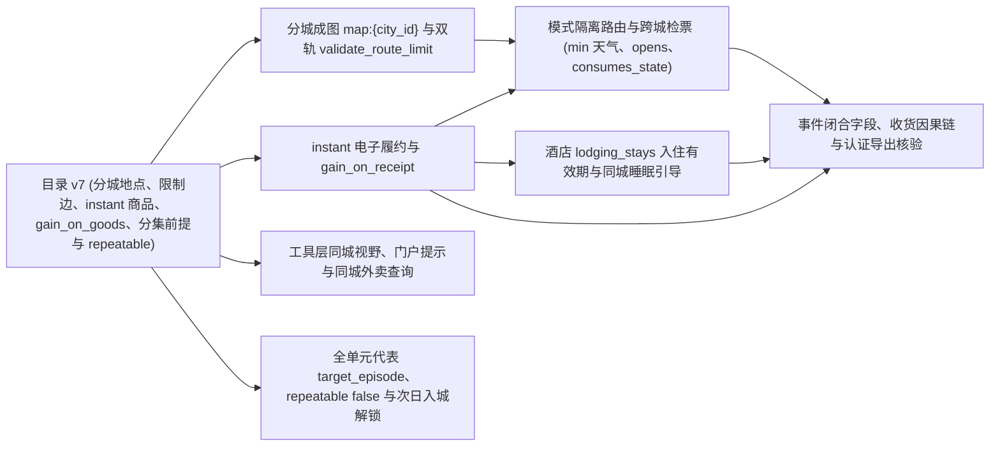
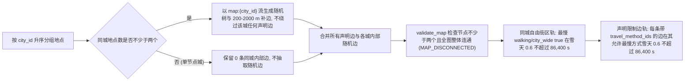
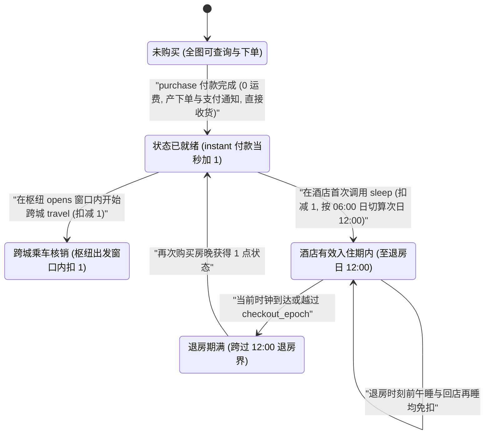
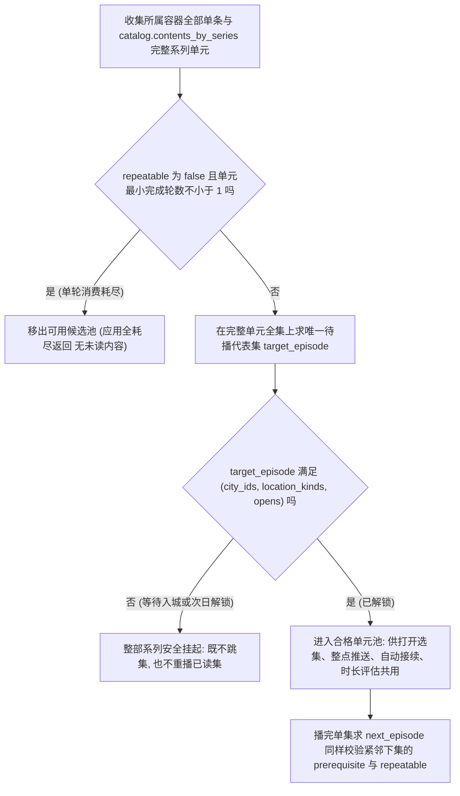

# 多城环境、电子凭证履约与内容系列分集前提 · 开发规格

> 代码基线：`6440605a`（`RULES_VERSION = 6`、`format_version = 6`、`WORLD_SCHEMA_VERSION = 16`）
> 目标契约版本：`RULES_VERSION = 7`、`CatalogManifest.format_version = 7`、`CatalogManifest.rules_version = 7`、`WORLD_SCHEMA_VERSION = 17`
> 边界依据：[多城环境、电子凭证履约与内容系列分集前提提案](PROPOSAL.md)（关联 [Issue #17](https://github.com/HoldThatThgt/WorldMock/issues/17)、[Issue #18](https://github.com/HoldThatThgt/WorldMock/issues/18)）

本次实现严格以[提案](PROPOSAL.md)为功能边界，直接拒绝旧版规则与世界快照，不保留任何兼容分支或迁移脚本。以下核心契约保持不变：

- 八个既有工具名称与参数签名零改动（不新增购票、订房或日期参数）；`LIFE_SYSTEM_LAYER` 正文与工具描述保持完全不变，`prompt_schemas.py` 仅扩展查询结果行的 `route` 枚举值 `"即时到账"`。
- 引擎继续只内置步行（`walking`），不硬编码高铁、航班或酒店等具体业态；跨城交通、发车检票与酒店入住全部通过正交扩展 `city_id`、`city_wide`、`MapEdge`、`instant`、`gain_on_goods`、`sleep_consumes_state`、`lodging_stays` 与 `prerequisite` 实现。
- 规则唯一归宿原则保持不变，新增共享判定（例如状态不可用提示 `state_unavailable_reason` 与全单元内容筛选）均维持唯一定义并纳入 `OWNERS` 校验。



## 版本升级与旧格式拒绝

- **规则版本常量**：`src/worldmock/exchange_engine/definitions/constants.py` 将 `RULES_VERSION` 由 `6` 升级为 `7`。
- **目录清单版本**：`CatalogManifest` 将 `format_version` 限定为 `Literal[7]`，并要求 `rules_version` 为严格整数且等于 `RULES_VERSION`（`7`）；清单加载与登记校验直接拒绝版本 `6` 环境包（`rules_version != 7` 报 `RULES_VERSION_MISMATCH`，`format_version != 7` 报 `ENVIRONMENT_KIND_INVALID`）。
- **世界状态模式版本**：`src/worldmock/state/world/world.py` 将 `WORLD_SCHEMA_VERSION` 由 `16` 升级为 `17`，以反映 `WorldState.weather_by_date`、`AgentState.lodging_stays` 与 `FulfillmentKind.INSTANT` 的结构演进；恢复检查点仍严格校验 `schema_version == WORLD_SCHEMA_VERSION`，不读取旧版本快照。
- **确定性日基线同步**：`scripts/freeze_rrs_baseline.py` 校验 `identity["rules_version"] == RULES_VERSION`，随规格落地一并更新仓库内置环境夹具、`dayrun-activity-baseline.json`、`dayrun-callback-baseline.json` 与查看器录制样例。

## 目录结构、行模型与登记准入

所有目录文件中，省略可选字段表示不启用对应扩展；除原本明确允许 `null` 的字段外，以下新增字段显式写成 `null` 一律按 `ENVIRONMENT_KIND_INVALID` 拒绝。

### 目录行模型与字段契约

| 目录文件与模型 | 新增或变更字段 | 类型、默认值与约束 | 准入校验与边界 |
| --- | --- | --- | --- |
| `manifest.json` (`CatalogManifest`) | `format_version`、`rules_version` | 严格整数 `7` | `rules_version != 7` 报 `RULES_VERSION_MISMATCH`；`format_version != 7` 报 `ENVIRONMENT_KIND_INVALID` |
| `location.jsonl` (`Location`) | `city_id`（必填） | 非空白严格字符串；单城与多城环境包均必填 | 缺失、空白、非字符串或 `null` 报 `ENVIRONMENT_KIND_INVALID`；全目录城市集合为所有地点 `city_id` 的去重集合 |
| `location.jsonl` (`Location`) | `sleep_consumes_state`（可选） | 非空白严格字符串，省略时为 `None`（显式 `null` 拒绝）；仅允许声明在 `sleepable: true` 且 `is_home: false` 的地点 | 显式 `null`、非字符串或空白、声明在 `sleepable: false` 或 `is_home: true` 地点均报 `ENVIRONMENT_KIND_INVALID`；引用未登记回调状态报 `ENVIRONMENT_REF_UNKNOWN`；跨城多处声明 `is_home: true` 与 `sleepable: true` 仍合法 |
| `location.jsonl` (`Location`) | 驿站准入规则（`accepts_parcels`） | 条件性强制要求：仅当目录存在至少一件非即时线上商品（`app_ids` 非空且 `instant: false`）时才要求至少登记一个驿站 | 仅存在商店商品或 `instant: true` 商品时允许无驿站；任何已声明 `accepts_parcels: true` 的地点仍须在其 `kind` 上绑定地点内容；缺少所需驿站或驿站未绑定内容均报 `PARCEL_STATION_REQUIRED` |
| `travel-method.jsonl` (`TravelMethod`) | `city_wide`（可选） | `StrictBool = True`；引擎内置 `WALKING` 保持 `city_wide=True` | 显式 `null` 或非布尔报 `ENVIRONMENT_KIND_INVALID`；为真可用于同城自由街区与声明边；为假仅可用于 `map.jsonl` 显式列出它的声明边 |
| `map.jsonl` (`MapEdge`) | `travel_method_ids`（可选） | 非空、升序去重字符串元组，或省略为 `None`（显式 `null` 拒绝）；元素为已登记 `travel_method_id` 或 `"walking"` | 跨城边（`loc[a].city_id != loc[b].city_id`）缺失、为空或包含 `"walking"` 报 `ENVIRONMENT_KIND_INVALID`；未排序、含空串、写成 `[]` 或 `null` 报 `ENVIRONMENT_KIND_INVALID`；元素重复报 `ENVIRONMENT_ID_DUPLICATE`；引用未知出行方式报 `ENVIRONMENT_REF_UNKNOWN` |
| `map.jsonl` (`MapEdge`) | `consumes_state` 与 `opens`（可选） | `consumes_state` 为非空白字符串（已登记回调状态）；`opens` 为 `OpeningHours`；仅允许在声明了 `travel_method_ids` 的边上携带 | 普通自由边（省略 `travel_method_ids`）携带任一字段、或显式 `null` 均报 `ENVIRONMENT_KIND_INVALID`；未知状态报 `ENVIRONMENT_REF_UNKNOWN`；`opens` 复用 `_check_opening_hours` |
| `merchant-catalog.jsonl` (`Goods`) | `instant`（可选） | `StrictBool = False`；仅允许 `app_ids` 非空且 `store_kinds` 为空的线上商品声明 | 店铺商品（`store_kinds` 非空）声明 `instant`、或任意商品显式写成 `null`、非布尔均报 `ENVIRONMENT_KIND_INVALID` |
| `callbacks.jsonl` (`CallbackState`) | `gain_on_goods`（可选） | 升序去重非空白 `goods_id` 元组，缺省为空元组 `()`；不得与同状态的 `reset_on_goods` 存在同一商品重叠 | 显式 `null`、未升序或与 `reset_on_goods` 重叠报 `ENVIRONMENT_KIND_INVALID`；元素重复报 `ENVIRONMENT_ID_DUPLICATE`；引用未登记商品报 `ENVIRONMENT_REF_UNKNOWN` |
| `content-catalog.jsonl` (`ContentPrerequisite`) | `city_ids`（可选） | 升序去重非空白 `city_id` 元组，缺省为空元组 `()`；`city_ids`、`location_kinds` 与 `opens` 三者至少声明其一 | 显式 `null`、空白元素、未升序报 `ENVIRONMENT_KIND_INVALID`；元素重复报 `ENVIRONMENT_ID_DUPLICATE`；三者均省略或为空报 `CONTENT_PREREQUISITE_INVALID`；未知 `city_id` 报 `CONTENT_BINDING_DANGLING`；地点内容携带前提仍报 `CONTENT_PREREQUISITE_INVALID` |
| `content-catalog.jsonl` (`Content`) | `repeatable`（可选） | `StrictBool = True`；同一系列内所有集的 `repeatable` 须一致 | 显式 `null` 或非布尔报 `ENVIRONMENT_KIND_INVALID`；同系列各集 `repeatable` 不一致报 `CONTENT_SERIES_INVALID` |
| `content-catalog.jsonl` (`_check_series`) | 系列一致性校验调整 | 绑定 `app_ids` 的系列不再校验各集 `prerequisite` 相等；保留容器、`memory_category`、`consumes_state`、`repeatable` 与集号唯一检查 | 地点内容系列继续禁止声明 `prerequisite`；上述保留字段不一致均报 `CONTENT_SERIES_INVALID` |
| 环境加载器 (`environment.py`) | 主常住地同城驿站校验 | 解析 `persona.home_location` 后，当存在非即时线上商品时，校验至少存在一个满足 `place.accepts_parcels and place.city_id == home_location.city_id` 的地点 | 主常住地所在城市缺少驿站时报 `PARCEL_STATION_REQUIRED`；`Catalog.nearest_parcel_station(home_location_id)` 仅在 `home_location.city_id` 内选取最近驿站 |

### 登记准入错误码与对齐约定

| 规范码 | 触发场景与详情约定 |
| --- | --- |
| `RULES_VERSION_MISMATCH` | `manifest.json` 的 `rules_version` 为严格整数且不等于 `7` |
| `ENVIRONMENT_KIND_INVALID` | 新增字段显式写 `null` 或类型不符；`Location.city_id` 缺失或空白；`Location.sleep_consumes_state` 声明在 `sleepable: false` 或 `is_home: true` 地点；`MapEdge` 跨城缺 `travel_method_ids`、含 `"walking"` 或自由边带 `consumes_state`/`opens`；`Goods.instant` 用于店铺商品；`gain_on_goods` 与 `reset_on_goods` 重叠；以及数组（`travel_method_ids`、`gain_on_goods`、`city_ids`、`location_kinds`、`reset_on_goods`）或行序未按升序排列 |
| `ENVIRONMENT_REF_UNKNOWN` | `Location.sleep_consumes_state` 或 `MapEdge.consumes_state` 引用未登记状态；`MapEdge.travel_method_ids` 引用未登记出行方式（且非 `"walking"`）；`CallbackState.gain_on_goods` 引用未登记商品 |
| `ENVIRONMENT_ID_DUPLICATE` | `travel_method_ids`、`gain_on_goods`、`city_ids` 等绑定数组内元素重复，或 `map.jsonl` 重复声明同一地点对 |
| `PARCEL_STATION_REQUIRED` | 目录含至少一件 `app_ids` 非空且 `instant: false` 的商品但目录无合法驿站，或环境加载时 `home_location.city_id` 内无驿站；以及任何 `accepts_parcels: true` 地点未绑定地点内容 |
| `CONTENT_BINDING_DANGLING` | `ContentPrerequisite.city_ids` 出现未在 `location.jsonl` 声明的 `city_id`，或 `location_kinds` 悬空（详情如 `<content_id> prerequisite names <city_id>.`） |
| `CONTENT_PREREQUISITE_INVALID` | 地点内容声明 `prerequisite`，或 app 内容的 `prerequisite` 中 `city_ids`、`location_kinds` 均为空且未写 `opens` |
| `CONTENT_SERIES_INVALID` | 同系列各集容器绑定、`consumes_state`、`memory_category`、`repeatable` 不一致或集号重复（对 app 系列放宽 `prerequisite` 一致性） |
| `MAP_DISTANCE_CONTRADICTED` | 同城自由声明边两端通过其他自由声明边存在严格更短路径 |
| `MAP_ROUTE_TOO_LONG` | 任一多节点城市的自由街区图在 `{walking, city_wide: true}` 最慢方式与雪天 `0.6` 下最长最短路超过 `86,400 s`；或任一带 `travel_method_ids` 的声明边在其最慢允许方式与雪天 `0.6` 下单边耗时超过 `86,400 s` |
| `MAP_DISCONNECTED` | 全图（自由边与声明限制边并集）不连通，或某多节点城市的自由街区子图内部不连通 |

关于未排序数组错误码的统一收敛：与 `src/worldmock/resource_engine/registration/errors.py`、`admission.py`（`_check_order`）及 [资源引擎设计](../../design/03-resource-engine.md) 保持完全一致，所有列表未排序（包括 `travel_method_ids`、`gain_on_goods`、`city_ids`、`location_kinds`）以及 JSONL 行未排序均继续使用 `ENVIRONMENT_KIND_INVALID`，数组或行键重复使用 `ENVIRONMENT_ID_DUPLICATE`，不再额外新增 `ENVIRONMENT_ARRAY_UNSORTED` 枚举码，既避免发明[提案](PROPOSAL.md)之外的新错误码，也保持现有负面合约测试与设计文档完全一致。

### 极简多城环境示例片段

以下片段展示 `manifest.json` 升级与北京至泰安高铁、商业酒店房晚、电子凭证及跨日分集前提配合（仅摘录核心字段）：

```json
{"environment_id":"demo-multi-city","environment_version":"7.0.0","format_version":7,"rules_version":7}
```

```json
{"app_ids":[],"city_id":"beijing","is_home":true,"kind":"dorm","location_id":"dorm-zijing","name":"紫荆公寓","sleepable":true}
{"app_ids":[],"city_id":"beijing","kind":"train_station","location_id":"station-beijing-south","name":"北京南站"}
{"app_ids":[],"city_id":"taian","is_home":false,"kind":"hotel","location_id":"hotel-atour-taian","name":"泰安亚朵酒店","sleep_consumes_state":"stay_atour_taian","sleepable":true}
{"app_ids":[],"city_id":"taian","kind":"train_station","location_id":"station-taian","name":"泰安站"}
```

```json
{"city_wide":false,"exertion":"idle","name":"高铁","price_per_km_fen":0,"speed_meters_per_second":75,"start_price_fen":0,"travel_method_id":"high_speed_rail"}
```

```json
{"a":"station-beijing-south","b":"station-taian","consumes_state":"ticket_bjs_taian","length_m":450000,"opens":{"weekly":{"mon":[["07:30","08:15"],["13:00","13:45"]],"sat":[["07:30","08:15"],["13:00","13:45"]],"sun":[["07:30","08:15"],["13:00","13:45"]]}},"travel_method_ids":["high_speed_rail"]}
```

```json
{"app_ids":["ctrip","meituan"],"category":"goods","goods_id":"room-atour-taian","instant":true,"name":"泰安亚朵酒店房晚","price_fen":38000}
{"app_ids":["ctrip","rail12306"],"category":"goods","goods_id":"ticket-bjs-taian","instant":true,"name":"北京南—泰安高铁票","price_fen":21500}
```

```json
{"cap":4,"gain_on_goods":["room-atour-taian"],"initial":0,"reset_on_goods":[],"state":"stay_atour_taian"}
{"cap":4,"gain_on_goods":["ticket-bjs-taian"],"initial":0,"reset_on_goods":[],"state":"ticket_bjs_taian"}
```

```json
{"app_ids":["wechat"],"content_id":"wx-taishan-1","duration_seconds":180,"exertion":"idle","pushable":false,"relaxation_relief":"none","repeatable":false,"series":{"episode":1,"title":"约阿哲夜爬"},"social_relief":"medium","summary":"行前与阿哲确认次日高铁车次与山脚集合点。","summary_source":{"kind":"synthetic","notice":"作者编写","url":null},"title":"行前约定"}
{"app_ids":["wechat"],"content_id":"wx-taishan-2","duration_seconds":180,"exertion":"idle","prerequisite":{"city_ids":["taian"],"opens":{"exceptions":{"2025-04-26":[["08:00","24:00"]]},"weekly":{}}},"pushable":true,"relaxation_relief":"none","repeatable":false,"series":{"episode":2,"title":"约阿哲夜爬"},"social_relief":"medium","summary":"抵达泰安后阿哲发来天气与出站汇合位置。","summary_source":{"kind":"synthetic","notice":"作者编写","url":null},"title":"抵达泰安汇合"}
```

## 分城地图生成、双轨门禁与方式感知路由



### 分城成图、摘要序列与三角不等式

- **按城独立生成**：`generate_edges` 按 `city_id` 升序分组节点。地点数不少于两个的城市先纳入城内自由声明边（未声明 `travel_method_ids`）作为初始连通分量，取 `random_stream(seed, f"map:{city_id}")` 派生 64 位城市种子，生成随机生成树边及 `floor((n - 1) / 2)` 上限内的 `200–2000 m` 额外边（候选边排除该城全部已声明地点对）；生成过程中逐条检查不绕过该城内任意一条声明边（包括自由声明边与同城带 `travel_method_ids` 的限制声明边）。单节点城市保持零条内部边，绝不生成跨城随机边。
- **地图摘要确定性**：`map_bytes` 序列化每条 `MapEdge` 时省略取值为 `None` 的扩展字段（`travel_method_ids`、`consumes_state`、`opens`）；未带扩展字段的自由边保持 `{"a", "b", "length_m"}` 极简 JSON 形态，`map_sha256` 在零扩边环境下保持纯净结构。
- **双轨时限门禁 (`validate_route_limit`)**：
  - 同城自由街区轨：对每个不少于两个地点的城市，提取其地点及未声明 `travel_method_ids` 的自由边组成自由街区子图，验证该子图内部连通，且其全点对最长最短路在 `{"walking"}` 与所有 `city_wide: true` 方式中最慢速度乘雪天系数 `0.6` 下耗时不超过 `TRAVEL_MAX_SECONDS`（`86,400 s`），否则报 `MAP_ROUTE_TOO_LONG`（自由子图自身不连通则报 `MAP_DISCONNECTED`）。
  - 声明限制边轨：逐条检查声明了 `travel_method_ids` 的边，以其列出方式中最慢速度乘 `0.6` 计算单边耗时，须不超过 `TRAVEL_MAX_SECONDS`（`86,400 s`），否则报 `MAP_ROUTE_TOO_LONG`。
- **全图连通与不矛盾校验**：`validate_map` 在合并自由边与限制声明边的完整图上校验全图整体连通（否则报 `MAP_DISCONNECTED`）；`_check_declared_distances` 检查自由声明边之间互不绕过矛盾（`MAP_DISTANCE_CONTRADICTED`），避免把跨城航班与高铁接驳误判为距离矛盾。

### 方式感知路由 (`Graph`)

- **限定边作为单边直达跳**：所有声明了 `travel_method_ids` 的边仅作为两端点之间的单边直达跳（single-edge direct hop），只对边上声明的 `travel_method_ids` 开放，绝不参与多跳自动拼接路线。
- **自由街区方式寻路**：`walking` 与所有 `city_wide: true` 的出行方式使用同城自由街区边（无 `travel_method_ids` 的边）执行确定性最短路（等长取节点序列字典序最小）；若同城两相邻端点间另存带 `travel_method_ids` 的同城直达边且包含该方式（且比绕行更短），仅直接按该声明边执行并受其 `opens`/`consumes_state` 约束。
- **`city_wide: false` 方式隔离**：`city_wide: false` 方式禁止在自由街区边上寻路，仅在起终点存在直达声明边且边上 `travel_method_ids` 显式列出该方式时可用。
- **全局拓扑辅助查询**：全图全边最短路仅保留给 `validate_map` 连通性检查与下节跨城枢纽 `next_step` 指引。

### 城际与限制边出发准入顺序

出发请求经由 `_travel_refusal` 与 `planned_trip` 按严格顺序依次校验以下条件：

| 校验次序阶段 | 判定依据与失败条件 | 拒绝码与提示行为 |
| --- | --- | --- |
| 原地活动阻塞检查 (`_keeps_here`) | 存在本人进行中的 `QUERY` 活动或含 `PICKUP` 订单的 `PURCHASE` 活动 | `ACTIVITY_PRECONDITION_UNMET`，提示先结束该活动（`Conclude <name>.`） |
| 跨城非直达目标检查 | `origin.city_id != destination.city_id` 且 `(origin, destination)` 不存在直达跨城边 | 通过全图最短路确定当前应先前往的枢纽节点 `<hub display_name>`，返回 `ACTIVITY_PRECONDITION_UNMET`，`next_step` 固定为 `"Travel to <hub display_name> first."` |
| 方式许可与离边校验 | 所选方式不在直接声明边的 `travel_method_ids` 内，或 `city_wide: false` 方式无对应直达边 | `ACTIVITY_PRECONDITION_UNMET`（`unmet` 含方式或路线约束说明，指出不可用及该路径或城市许可的方式） |
| 行程耗时与天气计算 (`planned_trip`) | 取 `min(weather_factor(origin_city), weather_factor(destination_city))` 算耗时与车费；若超 `86,400 s` 拒绝 | `ROUTE_DURATION_INVALID` |
| 发车检票时段 (`edge.opens`) | 目标为限定声明边且声明了 `opens`，但出发当地时刻不在开放时段内 | `LOCATION_CLOSED`，使用共享 `time_phrase(edge.opens, local_date)` 写明当日或未来七日窗口 |
| 票证状态核验 (`edge.consumes_state`) | 目标为限定声明边且声明了 `consumes_state`，而 `agent.callback_states[state] < 1` | `ACTIVITY_PRECONDITION_UNMET`，调用共享助手 `state_unavailable_reason` 按 `goods_id` 升序列出 `reset_on_goods` 与 `gain_on_goods` 并集（以 `" or "` 相连） |
| 事务启动与扣减 | 上述全部通过后开始出行；若遍历的声明边含 `consumes_state` | 同事务扣除 `1` 点状态并写出 `ConsumeOnStartResult(state=edge.consumes_state, content_id=None, before=before, after=before - 1)`；`DecisionCoordinator._consumed_on_start` 读取实际动作种类 `"travel"` 绑定 `CallbackCause("action", "travel", ...)` |

### 跨城在途禁退约束

- 当处于进行中的出行活动满足 `catalog.locations[origin_id].city_id != catalog.locations[destination_id].city_id` 时，`activity_control._conclude_refusal` 与活动工具层共同禁止 `conclude_activity` 提前结束并退回起点枢纽，返回 `ACTIVITY_PAUSE_UNAVAILABLE` 并标明原因。

## 分城每日天气与事件契约

- **分城天气存储**：`WorldState.weather_by_date` 结构改为 `dict[str, dict[str, str]]`，映射关系为 `local_date -> {city_id: condition}`。
- **初始化与午夜生成**：`simulation_engine/world/world_setup.py` 与时钟调度（`weather.py`、`compile.py`、`effects.py`）对目录所有已登记城市按 `city_id` 升序逐城通过 `random_stream(state.random_state, f"weather:{city_id}:{local_date}")` 抽取当日天气（`tuple(WEATHER_FACTORS)`）；午夜排程为每个城市登记 `scheduled_id` 为 `weather-{city_id}-{local_date}` 的 `ScheduledEvent`。
- **闭合天气事件**：每条午夜天气 `environment_event`（`kind="weather"`）的 `data` 为闭合字段集 `{kind, city_id, local_date, condition, speed_factor, scheduled_id}`。
- **天气消费口径**：
  - 每日环境层展示人物当前锚定地点 `agent.location_id` 所属 `city_id` 的当日天气（跨城在途时 `agent.location_id` 仍锚定出发城，抵达目的枢纽并提交后自然切换为目的城天气）。
  - 外卖延时计算取所属城市（门店与目的地同城）的当日天气系数；所有出行（含同城与跨城）统一取 `min(weather_factor(origin_city), weather_factor(destination_city))` 并在出发受理时冻结。

## 工具层视野隔离、门户提示与同城商业边界

- **名称解析全保留与工具层精准裁剪**：
  - `observe._catalog_bindings` 继续保留目录全部地点进入私有 `catalog_bindings` / `interaction_bindings`，确保人物直接对非直达异地地点发起 `travel` 时，`name_resolution` 仍能精确识别地点与方式并由 `_travel_refusal` 给出 `Travel to <hub display_name> first.` 指引。
  - 公开渲染与可用下标（`tool_layer` 与 `callable_index`）仅暴露**当前停留/锚定城市的全部地点**，以及**与 `agent.location_id` 存在直接跨城声明边相连的异地枢纽**；异地非相邻地点不进工具层。
  - 在当前城市目标行下按 `walking`（若允许）在前、其余可用同城方式按 `travel_method_id` 升序列出（`city_wide: false` 方式仅当两点间存在许可该方式的声明边时出现；若两点仅通过限制边相连则仅列边允许方式）。在直接相连的异地枢纽目标行下，**只列出该条跨城边声明的 `travel_method_ids`**（按 `travel_method_id` 升序）。
- **本城枢纽门户状态后缀**：对于当前城市内任意连有至少一条跨城声明边的地点，其工具层目标行 `state` 在当天营业时段（`"全天营业"`、时段列表或 `"今日休息"`）之后紧接附加：`；城际可达：<dest1>（<method1>、<method2>）、...`。其中目的枢纽按目的地 `location_id` 升序排列，每个枢纽括号内的出行方式显示名按边上 `travel_method_ids` 升序以 `、` 相连。
- **严格同城商业隔离**：
  - `purchase_offers.quote_goods` 挑选外卖/到店候选门店及 `_require_store` 缺货最近在售门店提示、
  - `query_answer._stores` 门店行情行构建、
  - `discovery.product_bindings` 店铺商品曝光筛选与轮转候选池（及对应的 `callable_index.goods` 统计）、
  均强制过滤 `store.city_id == current_city`（其中 `current_city = catalog.locations[state.agents[agent_id].location_id].city_id`）。若当前城市没有任何门店或无营业店卖该店铺商品，查询与缺货提示仅就当前城市回复，绝不跨域推荐外城门店。
  - 绑定 `app_ids` 的线上商品维持全图可查可买：其中 `instant: false` 实体快递统一投递至 `persona.home_location` 所属城市内最近的 `accepts_parcels: true` 驿站；`instant: true` 商品按电子履约当秒收货。

## 即时电子履约与收货状态增益



- **报价与冻结预计 (`Offer` 与 `DeliveryState`)**：
  - 当 `goods.instant` 为真时，`quote_goods` 返回：`fulfillment=FulfillmentKind.INSTANT`（`"instant"`）、`store_id=None`、`delivery_fee_fen=0`、`destination_id=present_location(state, agent_id) or agent.location_id`、`path=()`、`distance_meters=0`、`prep_seconds=0`、`weather_delay_seconds=None`。
  - `prepare_purchase` 为 `FulfillmentKind.PICKUP` 与 `FulfillmentKind.INSTANT` 统一冻结 `expected_at = state.current_time + duration`。`DeliveryState.store_id` 对 `station_pickup` 与 `instant` 均允许 `None`，`weather_delay_seconds` 仅 `delivery` 非空。
- **付款同事务收货 (`_pay_order` 与混合订单安全)**：
  - `StorefrontRuntime._pay_order` 逐笔检查同一张合并订单内的每笔 `order`（同一 app 购物篮内可能混买 `instant` 与 `station_pickup` 商品）：只要 `order.fulfillment in {FulfillmentKind.PICKUP, FulfillmentKind.INSTANT}`，立即在付款完成同一秒调用 `settle_receipt` 结算收货，并将生成 `goods_received` 事件的 `caused_by` 指向该笔 `purchase_payment` 事件。
  - `basket.delivery_events` 跳过 `PICKUP` 与 `INSTANT`，不登记任何发货（`ORDER_SHIPPED`）或到达（`delivery_arrival`）排程。
- **状态累加增益 (`gain_on_goods` 与 `StateGainResult`)**：
  - `recording_engine/events/callback_contract.py` 新增 `StateGainResult`（`kind="callback_effect"`、`type="gain_on_receipt"`、`rule_id=None`、`state`、`goods_id`、`before`、`after`），并在 `recording_engine/events/environment_events.py` 的 `_callback_effect` 合同表登记 `"gain_on_receipt": StateGainResult`。
  - `callbacks.py` 的 `reset_on_receipt` 按状态名升序遍历：匹配 `gain_on_goods` 时按 `after = min(declaration.cap, before + 1)` 更新 `agent.callback_states[state]` 并写出 `StateGainResult`（归因指向 `goods_received`）；`reset_on_goods` 仍按 `reset_to_cap` 置满 `cap`；同状态二者因登记准入严格互斥，每次收货互不干涉。
- **查询、提示与导出核验一致**：
  - `query_answer.ROUTE_NAMES` 新增 `"instant": "即时到账"`，查询结果行对该类商品写 `store=None`、`delivery_fee_fen=0`、`route="即时到账"`；`prompt_schemas.py` `_QUERY_ROW` 对应将 `route` 枚举扩充为 `["到店", "外卖", "快递", "即时到账", None]`。
  - `tool_layer._purchase_facts` 对 `offer.fulfillment == "instant"` 显示 `"运费0元，付款即收货"`（`delivery` 与 `station_pickup` 继续显示到达时间，`pickup` 省略运费与到达提示）。
  - `result_projection._purchase` 与 `settled_text.purchase_sentence` 对 `store_id is None` 且 `fulfillment == "instant"` 的订单跳过商铺、评分与「预计送达」字段（仅保留商品、份数、渠道、当前地点与付款金额）；`settled_text.experience_sentence` 对无 `quality` 的 `goods_received` 只写收货时刻、商品名与份数，`progress_layer._world_records` 与 `entries._world_drafts` 因无 `"quality"` 不重复生成带商铺评价的 `receipt` 记录。
  - `recording_engine/validation/invariants.py` 更新收货品质与因果校验：`_receipt_quality` 仅对 `pickup` 与 `delivery` 检查 `store_id` 与 `quality`（跳过 `station_pickup` 与 `instant`）；`_receipt_cause` 对 `pickup` 与 `instant` 均校验 `goods_received` 起因为 `purchase_payment`；`_expected_order_notices` 对 `instant` 仅核对 `ORDER_PLACED`（当 `app_id` 非空）与 `payment_notification`，不期望 `ORDER_SHIPPED` 与 `ORDER_DELIVERED`。

## 商业酒店住宿生命周期与同城睡眠引导

- **入住状态与退房纪元**：`AgentState` 新增持久化字段 `lodging_stays: dict[str, int] = Field(default_factory=dict)`，记录每个曾经凭状态入住的地点 `location_id` 所对应的当前有效退房纪元秒（`checkout_epoch`）。
- **入睡核验、免扣复睡与 06:00 日切算法**：
  - 当人物停留在声明了 `sleep_consumes_state` 的商业酒店地点开始 `sleep` 时：
    - 若 `state.current_time < agent.lodging_stays.get(location_id, 0)`：判定仍在本房晚退房有效期内，**直接准入睡眠且不扣减回调状态**，既有退房时刻保持不变（保障同一房晚内的下午小睡与外出夜归睡眠共用同一次核销）。
    - 否则要求 `agent.callback_states[location.sleep_consumes_state] >= 1`；不足时以 `ACTIVITY_PRECONDITION_UNMET` 拒绝，调用共享助手 `state_unavailable_reason` 提示需购买的房晚商品。
    - 准入成立并开始睡眠时，同事务将状态减 `1`、发出 `ConsumeOnStartResult(state=location.sleep_consumes_state, content_id=None, before=before, after=before - 1)`（由 `DecisionCoordinator._consumed_on_start` 绑定 `CallbackCause("action", "sleep", ...)`），并按人物当前运行时区本地时刻计算 `checkout_epoch`：`00:00:00` 至 `05:59:59` 入睡设为**同一本地日期 `12:00:00`**；`06:00:00` 至 `23:59:59` 入睡设为**次日本地日期 `12:00:00`**，写入 `agent.lodging_stays[location_id]`。
  - 与营业窗口一致，睡眠开始后即使在睡梦中跨过 `12:00:00` 退房时刻也绝不中断当次睡眠；仅在醒来后于退房时刻或之后新发起 `sleep` 时才需要重新核销状态。
- **非可睡地点的同城睡眠引导 (`_sleep_place_refusal`)**：
  - 当人物在非可睡地点请求 `sleep` 被拒绝时，按以下严格优先顺位检索可选睡眠地点（先看当前所在城市 `current_city`，同优先级别取全图最短距离最小者、同距按 `location_id` 升序）：
    - 本城内仍在 `agent.lodging_stays` 有效期内的商业酒店（`state.current_time < checkout_epoch`）；
    - 本城内 `is_home == True and sleepable == True` 的自有住处；
    - 本城内已持有有效房晚状态（`sleep_consumes_state` 非空且当前状态值不小于 `1`）的商业酒店；
    - 本城内声明了 `sleep_consumes_state` 的商业酒店（通过 `state_unavailable_reason` 指明待购的房晚商品名并引导购买入住）；
    - 若当前城市既没有任何 `is_home and sleepable` 住处，也没有任何声明 `sleep_consumes_state` 或 `sleepable` 的酒店地点，则在全图其余城市中按最近全图最短距离选择存在自有住处或酒店的最近城市地点作为跨城备选引导（优先自有住处，其次酒店）。

## 内容系列分集独立前提、`repeatable: false` 与全单元定代表



- **统一单元筛选核心 (`content_select` 唯一真源)**：
  - 提取共享纯助手函数构建并筛选单元：基于完整系列集合（`catalog.contents_by_series` 里的全部各集）与独立单条组建完整单元，禁止先过滤单个分集再重组单元。
  - 若单元 `repeatable` 为 `False` 且该单元最小 `completed_rounds >= 1`，立即从可选单元池剔除。
  - 在未耗尽单元内用既有 `representative` 规则算出唯一当前代表集 `target_episode`（已完成轮数最少者里集号最小的一集）。
  - 仅评估 `prerequisite_unmet(target_episode, stay_location, local_moment)`：只有当该代表集此刻满足全部前提（返回空元组）时，该单元才加入合格单元池。
  - `select_content`（`eligible_contents`）、`select_from_contents`、`autoplay_content`、`opening_duration`、`pinned_push_content` 与 `app_push._push_candidates` 全部共用这套“全单元定代表、按代表验前提”筛选（`autoplay_content`、`app_push._push_candidates` 与 `pinned_push_content` 在代表集上叠加 `target_episode.pushable == True` 判断）。
- **紧邻续播与暂停提示一致性 (`next_episode` 与 `_continues_with_next_episode`)**：
  - `next_episode` 接收 `(stay_location, local_moment)` 参数：寻得紧邻后续集 `candidate` 后，若 `(not candidate.repeatable and candidate_rounds >= 1)` 或 `prerequisite_unmet(candidate, stay_location, local_moment)` 非空，一律返回 `None` 正常结束当次播放，不再违背前提跳入后续集或跨轮循环；`activity_control._continues_with_next_episode` 传入同一 `(stay_location, local_moment)` 调用 `next_episode`，保障暂停三分钟窗口提示与实际结束接续行为严格一致。
- **前置条件判定与地理名称筛选 (`content_prerequisite.py`)**：
  - `prerequisite_unmet` 依次检验三项前提：`city_ids`（若非空且 `stay_location is None or stay_location.city_id not in city_ids`，记入 `LOCATION_UNMET`）→ `location_kinds`（若非空且 `stay_location is None or stay_location.kind not in location_kinds`，记入 `LOCATION_UNMET`）→ `opens`（记入 `TIME_UNMET`）；`LOCATION_UNMET` 在返还元组内保持去重。
  - `_clause` 在存在 `LOCATION_UNMET` 时按 `(not p.city_ids or loc.city_id in p.city_ids)` 与 `(not p.location_kinds or loc.kind in p.location_kinds)` 过滤候选地点；当当前停留地点 `stay` 已知且当前城市内存在匹配地点时优先仅列本城地点名称，否则按地点身份升序列出符合 `city_ids` 城市的匹配地点。
- **无合格单元与全耗尽应用的状态呈现 (`app_prerequisite_refusal` 与 `app_time_state`)**：
  - 两者改为读取传入 `agent` 状态后的**剩余未耗尽单元各自的 `target_episode`**：
    - 只要存在任意一个已耗尽以外但目前因前序未满足被阻塞的代表集列表（所有剩余单元的 `target_episode` 都不满足前提）：`app_prerequisite_refusal` 汇总这些 `target_episode` 的前提拒绝分句（`CONTENT_PREREQUISITE_UNMET`），`app_time_state` 汇总其 `opens` 的 `time_phrase`。
    - 若该 app 原本登记了内容，但**所有单元均为 `repeatable: false` 且均已完成至少一轮（未耗尽单元池为空）**：`app_prerequisite_refusal` 返回 `CONTENT_PREREQUISITE_UNMET`，`reason` 为 `"All content in <app 名称> has already been finished."`（其中 `<app 名称>` 为 `app.name`）；`app_time_state` 返回 `"无未读内容"`；工具层将 `interact` 动作 `available` 设为 `false`。
- **地点单元一次性消费锁 (`location_activities.py`)**：
  - `unit_locked(contents, agent)` 在原有 `consumes_state` 判定基础上，新增一次性完结条件：当 `not contents[0].repeatable` 且单元最小完成轮数不小于 `1` 时返回 `True`，令工具层隐藏已读完的一次性地点单元；同时 `locked_refusal` 在访问 `catalog.callback_states[contents[0].consumes_state]` 之前先处理 `not contents[0].repeatable` 分支（直接拒绝 `ACTIVITY_PRECONDITION_UNMET`，避免 `consumes_state is None` 引起空键异常）。
- **`ConsumeOnStartResult` 扩展 (`callback_contract.py` 与 `decision_coordinator.py`)**：
  - `ConsumeOnStartResult.content_id` 放宽为 `str | None = Field(default=None, min_length=1)`：地点 `interact` 扣减写实际非空 `content_id`，地图声明边 `travel` 与商业酒店 `sleep` 均写 `None`。
  - `DecisionCoordinator._consumed_on_start` 根据实际受理动作种类绑写 `CallbackCause("action", actual_action_kind, ...)`（`"interact"`、`"travel"` 或 `"sleep"`）。

## 受影响设计文档、生产文件与测试清单

### 设计文档与用户手册

| 文档路径 | 调整范围 |
| --- | --- |
| [02-exchange-engine.md](../../design/02-exchange-engine.md) | 升级 `RULES_VERSION = 7`；明确所有出行方式共用 `WEATHER_FACTORS`、跨城出行天气取两城较小值，补充 `instant` 零运费、零耗时与无品质收货语义 |
| [03-resource-engine.md](../../design/03-resource-engine.md) | 新增地点 `city_id` 与 `sleep_consumes_state`、方式 `city_wide`、`MapEdge` 可选限制字段、商品 `instant`、回调 `gain_on_goods`、内容前提 `city_ids` 与 `repeatable` 合同；重写分城成图、双轨 `validate_route_limit`、方式路由与放宽 app 系列前提校验 |
| [04-simulation-engine.md](../../design/04-simulation-engine.md) | 定义跨城出发准入顺序、禁止跨城中途 `conclude_activity`、同城商业与查询过滤、即时履约付款直结收货、酒店 `lodging_stays` 与 `06:00` 日切退房、同城睡眠引导、全单元代表 `target_episode` 选集与接续逻辑 |
| [05-recording-engine.md](../../design/05-recording-engine.md) | 新增 `StateGainResult`（`gain_on_receipt`）、放宽 `ConsumeOnStartResult.content_id` 为可选及动作起因区分；规范 `weather` 事件闭集与 `instant` 订单不产发货/送达及无品质核验导出不变量 |
| [06-agent.md](../../design/06-agent.md) | 更新工具层可见地点集、枢纽 `；城际可达：...` 门户状态后缀、`运费0元，付款即收货` 购买预览、`即时到账` 查询路线与 `prompt_schemas.py` 枚举、同城商品轮转过滤、全耗尽 app 状态「无未读内容」及环境层按城天气投影 |
| [08-configuration.md](../../design/08-configuration.md) | 将地图种子改为 `map:{city_id}`、每日天气随机键改为 `weather:{city_id}:{local_date}`、午夜天气排程改按城市升序 `weather-{city_id}-{local_date}`，并写入环境加载时的 `home_location.city_id` 驿站准入说明 |
| [09-io-formats.md](../../design/09-io-formats.md) | 更新 `WORLD_SCHEMA_VERSION = 17`、`WorldState.weather_by_date` 嵌套结构、`AgentState.lodging_stays` 持久映射及 `FulfillmentKind.INSTANT` |
| [resources.md](../../manual/resources.md) | 升级指南示例至规则版本 `7`，补充多城规划、枢纽直达边与 `opens`/`consumes_state`、`instant` 电子票务/酒店房晚与 `gain_on_goods`、跨城分集微信系列的作者编写示例与常见报错排错 |

### 生产源码与运行脚本

| 模块位置 | 核心改动与单源归属 |
| --- | --- |
| `exchange_engine/definitions/constants.py` | 将 `RULES_VERSION` 设为 `7` |
| `resource_engine/catalog/models.py`、`callback_models.py` | 扩展 `CatalogManifest`（v7）、`Location`（`city_id`、`sleep_consumes_state`）、`TravelMethod`（`city_wide`）、`Goods`（`instant`）、`ContentPrerequisite`（`city_ids`）、`Content`（`repeatable`）、`MapEdge`（`travel_method_ids`、`consumes_state`、`opens`）、`CallbackState`（`gain_on_goods`）；`Catalog.nearest_parcel_station` 限同城查找 |
| `resource_engine/catalog/travel_methods.py`、`loader.py`、`resource_engine/map/mapgen.py`、`resource_engine/map/graph.py` | 保持内置 `WALKING` 为 `city_wide=True`；`mapgen` 按 `map:{city_id}` 分城成图与 `map_bytes` 省略空扩展；`Graph` 实现限定边单跳路由与自由街区/全图分离；`loader` 检查 `rules_version == 7` |
| `resource_engine/registration/admission.py`、`configuration/inputs/environment.py` | 落实新增字段、互斥与排序约束、条件性 `PARCEL_STATION_REQUIRED`、分城双轨 `validate_route_limit`、放宽 app 系列前提相等校验与 `home_location.city_id` 驿站核验 |
| `state/world/world.py`、`agent.py`、`kinds.py`、`orders.py` | `WORLD_SCHEMA_VERSION = 17`、`weather_by_date` 嵌套类型、`AgentState.lodging_stays`、`FulfillmentKind.INSTANT`、支持 `instant` 的 `DeliveryState` 检验 |
| `recording_engine/events/callback_contract.py`、`environment_events.py`、`recording_engine/validation/invariants.py` | 新增 `StateGainResult` 与 `gain_on_receipt` 注册；`ConsumeOnStartResult.content_id` 改为可选；更新 `weather` 闭集与 `instant` 订单导出不变量（无 `store_id`/品质、仅 `ORDER_PLACED` 与 `payment_notification`） |
| `simulation_engine/world/world_setup.py`、`simulation_engine/scheduling/clock/weather.py`、`effects.py`、`compile.py` | 分城每日天气初始化与随机抽取、`weather-{city_id}-{local_date}` 午夜事件及按所在城市读取天气 |
| `simulation_engine/activities/travel/travel.py`、`simulation_engine/actions/admission.py`、`simulation_engine/activities/lifecycle/activity_control.py`、`simulation_engine/decisions/decision_coordinator.py` | 跨城枢纽直达校验与 `"Travel to <hub display_name> first."` 指引、限定边 `opens` 与 `consumes_state` 扣减、`min(origin, dest)` 天气、共享 `state_unavailable_reason`（注册至 `OWNERS`）、禁止跨城提前结束、`_consumed_on_start` 动态绑定动作种类 |
| `simulation_engine/actions/admission.py`、`simulation_engine/actions/start_group.py` | `lodging_stays` 有效期判断与 `06:00` 日切 `12:00` 退房计算、同城优先的 `_sleep_place_refusal` 引导链 |
| `simulation_engine/commerce/purchase/purchase_offers.py`、`storefront_runtime.py`、`basket.py`、`simulation_engine/scheduling/callbacks/callbacks.py`、`simulation_engine/commerce/fulfillment/receipt.py` | 外卖同城门店隔离；`instant` 零运费报价与 `prepare_purchase` 冻结；`_pay_order` 逐笔直结收货、跳过 `delivery_events`、`reset_on_receipt` 支持 `gain_on_goods` 增量 `gain_on_receipt` |
| `simulation_engine/observation/layers/observe.py`、`environment_layer.py`、`simulation_engine/observation/targets/tool_layer.py`、`simulation_engine/observation/targets/discovery.py`、`simulation_engine/observation/targets/callable_index.py`、`simulation_engine/activities/query/query_answer.py`、`agents/prompt/prompt_schemas.py`、`simulation_engine/observation/wording/settled_text.py` | 工具层本城+直接异地枢纽过滤与 `；城际可达：...` 门户后缀；`discovery.py` 与 `query_answer` 同城隔离；`ROUTE_NAMES["instant"] = "即时到账"`、`_QUERY_ROW` 枚举更新；工具层 `instant` 预览写`"运费0元，付款即收货"`；环境层按当前城读天气；`result_projection`、`settled_text` 与 `progress_layer` 对 `instant` 跳过商铺、品质及「预计送达」描写 |
| `simulation_engine/activities/content/content_select.py`、`interact.py`、`location_activities.py`、`simulation_engine/scheduling/callbacks/app_push.py`、`simulation_engine/observation/wording/content_prerequisite.py`、`tests/unit/engineering/test_single_source.py` | 全单元代表筛选并复用至所有点名/推送/接续入口；`next_episode` 与 `_continues_with_next_episode` 传递 `(stay, local_moment)`；`prerequisite_unmet`（`city_ids` 先验）、`_clause` 优先本城筛选、`app_prerequisite_refusal` 与 `app_time_state` 全耗尽支持；`unit_locked`/`locked_refusal` 支持地点 `repeatable: false`；`OWNERS` 同步维护新增共享助手归属 |
| `scripts/freeze_rrs_baseline.py` | 验证基线环境版本号与 `RULES_VERSION = 7` 对齐 |

### 既有夹具、更新测试与拟新增测试

| 测试或夹具范围 | 具体文件路径与调整内容 |
| --- | --- |
| 环境夹具与运行基线 | `tests/fixtures/dataset-environment/catalog/manifest.json`、`location.jsonl`、`travel-method.jsonl`、`merchant-catalog.jsonl`、`content-catalog.jsonl`、`tests/fixtures/dayrun-activity-baseline.json`、`tests/fixtures/dayrun-callback-baseline.json`、`tests/fixtures/viewer-context.json`、`tests/fixtures/dayrun_fidelity_inputs.json`（补充 `city_id` 并重录 v7/schema 17 确定性基线） |
| 已有单测同步更新 | `tests/unit/exchange/test_constants.py`、`tests/unit/exchange/test_operators.py`、`tests/unit/catalog/test_dataset_catalog.py`、`tests/unit/catalog/test_dataset_negative_contract.py`、`tests/unit/catalog/test_admission.py`、`tests/unit/catalog/test_manifest_version.py`、`tests/unit/catalog/test_mapgen.py`、`tests/unit/catalog/test_graph.py`、`tests/unit/catalog/test_identity.py`、`tests/unit/footprints/test_environment_events.py`、`tests/unit/footprints/test_purchases.py`、`tests/unit/life/test_environment_contract.py`、`tests/unit/life/test_environment_commerce.py`、`tests/unit/life/test_environment_content.py`、`tests/unit/life/test_environment_body.py`、`tests/unit/life/test_environment_layer_schema.py`、`tests/unit/life/test_persisted_lifecycle_shape.py`、`tests/unit/life/test_query_rules.py`、`tests/unit/start_interfaces/test_system_layer_text.py` |
| 已有集成与系统测试更新 | `tests/integration/life/test_purchase_travel_admission.py`、`tests/integration/life/test_purchase_orders.py`、`tests/integration/life/test_query_answer.py`、`tests/integration/life/test_sleep_runtime.py`、`tests/integration/life/test_callback_runtime.py`、`tests/integration/footprints/test_event_fields.py`、`tests/integration/footprints/test_export.py`、`tests/system/environment/test_validation.py`、`tests/system/lifecycle/test_complete_day_baseline.py`、`tests/system/lifecycle/test_sleep_runs.py`、`tests/system/lifecycle/test_parcel_arrival_export.py` |
| 拟新增专项单元与集成测试 | 拟新增 `tests/unit/catalog/test_multi_city_and_edge_admission.py`（分城 `map:{city_id}`、单节点城、双轨时限、无驿站 `instant` 包与 `gain_on_goods` 校验）；拟新增 `tests/integration/life/test_intercity_travel_and_hotel.py`（跨城门户、非直达枢纽指引、`opens` 窗口与 `consumes_state` 扣减、跨城禁 `conclude_activity`、分城天气取小、`lodging_stays` `06:00` 日切复睡与 `12:00` 退房、同城优先睡眠引导梯队）；拟新增 `tests/integration/life/test_instant_fulfillment_and_gain.py`（`instant` 与 `station_pickup` 混单结算、`gain_on_receipt` 钳位递增、导出不变量与查询预览）；拟新增 `tests/integration/life/test_series_prerequisites_and_repeatable.py`（全单元代表 `target_episode` 挂起与解锁、`next_episode` 与暂停提示一致、全耗尽 app `无未读内容`、`unit_locked` 一次性地点锁定） |

## 无人值守时采用的决定

- **版本与零向后兼容策略**：确定将 `RULES_VERSION`、`format_version`、`rules_version` 一律设为 `7`，`WORLD_SCHEMA_VERSION` 设为 `17`，直接拒绝版本 `6` 与旧世界快照，不保留任何兼容分支、迁移函数或自动补城逻辑。
- **未排序数组错误码收敛至 `ENVIRONMENT_KIND_INVALID`**：遵循已落地更新的[资源引擎设计](../../design/03-resource-engine.md)与现行 `errors.py` / `admission.py`（`_check_order`）单源合同，所有列表和行序未升序均统一报 `ENVIRONMENT_KIND_INVALID`、重复报 `ENVIRONMENT_ID_DUPLICATE`，不再引入未在[提案](PROPOSAL.md)声明的 `ENVIRONMENT_ARRAY_UNSORTED` 枚举码。
- **跨城工具层隐藏与名称解析保留**：`observe._catalog_bindings` 与 `interaction_bindings` 继续保有全部地点行与出行方式，`tool_layer` 与 `callable_index` 按当前城市及直接跨城相邻枢纽精准过滤。这样既消除了数十家异地门店上下文噪音，又能让模型误写直飞非相邻异地地点时继续由 `name_resolution` 准确解析并触发 `"Travel to <hub display_name> first."` 的构造性指引。
- **同 app 混合履约篮逐笔结算**：`payment_orders` 按下单 app 分组后同一篮子可能混含 `instant: true` 与 `instant: false`（`station_pickup`）商品；`StorefrontRuntime._pay_order` 对组内订单逐条判断 `order.fulfillment in {FulfillmentKind.PICKUP, FulfillmentKind.INSTANT}` 执行当秒 `settle_receipt`，避免首条商品履约方式覆盖整组。
- **单源错误语与地点 `repeatable: false` 保护**：`state_unavailable_reason` 统一聚合 `reset_on_goods | gain_on_goods`（升序、`" or "` 连接）为地点内容、`MapEdge.consumes_state` 与酒店 `sleep_consumes_state` 共用唯一定义并录入 `OWNERS`；`location_activities.locked_refusal` 先处理 `not contents[0].repeatable` 的已读完拒绝，再读取 `consumes_state`，防止对未配状态的常规地点产生空键查找异常。
- **测试夹具、基线与文档门禁验收**：本仓库 `dataset-environment` 与完整日回归基线须随 v7 补齐 `city_id` 与结构版本号后通过 `scripts/freeze_rrs_baseline.py` 重新冻结；正式合入前须全量运行 `python -m pytest tests`、`python scripts/documentation_gate.py` 与 `python scripts/build_design_doc.py` 验证通过（不在本阶段保留任何历史流水账或机器执行产物上库）。
