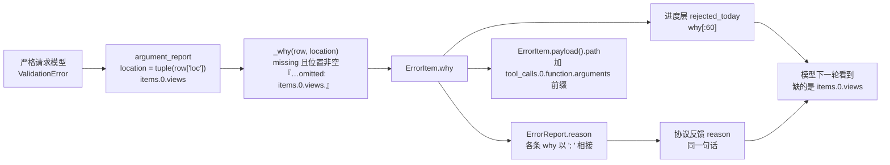

# 被拒原因带上漏了的字段名：开发规格

> 状态：冻结，2026-11-19。按这份规格一次实现代码、测试与当前模块设计，实现不再改写本文。
> 依据：`D:/code/WorldMock-Dataset/.work/fanout-review/ENGINE-FIXES.md` 第一节「报错带上字段名（建议做）」。第一节定下的改法不改；与那张表的偏离见「依据与偏离」。
> 代码基线：`mori/rejection-field-location-564539` 分支的 `74f1b949`（与 ENGINE-FIXES 引用的 HEAD 相同）。文中的「现在」与行号都指这个提交。
> 证据：`ENGINE-FIXES.md` 第一节与第五节；本规格写作时对 `74f1b949` 的实测（每条都记在对应章里），以及三份受影响测试的现状基线 145 passed。

## 改动的文件

| 文件 | 改什么 | 章 |
| --- | --- | --- |
| `src/worldmock/state/interaction/request_errors.py` | 缺字段的句子去掉句号、原因函数接位置、新增参数内位置函数 | 原因文本、位置写法 |
| `tests/unit/agent_protocol/test_start_request_models.py` | 两处期望值带上字段名 | 测试 |
| `tests/integration/runtime/test_conclude_memories.py` | `views_missing` 的期望值带上 `items.0.views` | 测试 |
| `tests/integration/start_interfaces/test_purchase_prefer.py` | 缺 `prefer` 的期望值带上字段名 | 测试 |
| `tests/unit/agent_protocol/test_request_error_locations.py` | 新增三条用例 | 测试 |
| `docs/design/04-simulation-engine.md` | 「动作、名称与并行」写明原因带位置 | 设计文档 |
| `docs/design/06-agent.md` | 「进度、待办与记忆」加一句 `rejected_today` 的行形状 | 设计文档 |
| `docs/dev/rejection-field-location/SPEC-rejection-field-location.md` | 本文 | — |

不碰的文件：`errors.py`、`progress_layer.py`、`prompt_schemas.py`、任何工具 description、`docs/dev/` 下的旧记录。

## 依据与偏离

本章逐字依据 ENGINE-FIXES 第一节：被拒原因从通用的「缺了一个必填字段」变成「缺的是哪一个」，字段名取校验器已经给出的位置，
不改报错的其它任何部分。第一节的改法与三条细节照抄执行：改 `_VALIDATION_REASONS["missing"]`、让原因函数接收位置、位置用点号写法、
不写正确取值。

与 ENGINE-FIXES 那张「要同步改的测试与文档」表比，偏离有三行，归成两类：旧开发记录不回写（AGENTS.md 冻结）；
前缀压缩与 `_expected` 传位置在本实现里是死代码。

| 第一节的写法 | 本规格的做法 | 理由 |
| --- | --- | --- |
| 调用点两处：`_why(row)` → `_why(row, location)`，并且 `_expected(field, row)`（:92）的兜底分支把 `location` 一起传下去 | 只改 `_why` 的调用点，`_expected` 不接位置、不改签名 | `_expected` 的 missing 行恒含 `This field is required`（`request_errors.py:95-96`），`parts` 不为空，走的是 `"; ".join(parts) + "."`；只有 `parts` 为空才落到 `_why(row)`，而 `parts` 为空要求这一行既不是 missing 也不是 extra_forbidden 且 Schema 无类型键，与 missing 互斥。传下去的位置永远用不到，是死代码 |
| `_argument_path` 里先判断 `tool_calls` / `function` / `arguments` 前缀再压掉 | `_argument_path` 只做点号连接，不写压缩分支 | 原因函数拿到的是 `tuple(row["loc"])`（`request_errors.py:52`），pydantic 的 loc 本来就只在参数内，实测是 `('items', 0, 'views')`、`('errands',)`、`('errands', 0, 'item')`、`('items', 0, 'memories', 0, 'keywords')`。`tool_calls.0.function.arguments` 前缀是 `ErrorItem.payload()`（`errors.py:85`）与 `start_group.bind_report` 事后加的，原因函数比它们早一步，永远看不到前缀 |
| 在 `docs/dev/environment-contract-revision`、`docs/dev/first-real-day-run` 的旧记录里注明「句子已带位置」 | 那三处旧记录不动 | AGENTS.md：`docs/dev/` 的规格与开发记录完成后冻结，后续变更不回写旧过程；那几句话描述的是当时的实现 |

## 术语

| 术语 | 含义 |
| --- | --- |
| 位置 | pydantic 校验错误里的 `loc`，从本次工具调用的参数顶端算起的路径，成员是字段名（字符串）或数组下标（整数） |
| 参数内位置 | 位置的点号写法：成员依次用 `.` 连接，不带方括号、不带 `tool_calls` 前缀，例如 `items.0.views`、`errands.0.item` |
| 字段名 | 参数内位置在模型里的实际键名，例如 `prefer`、`views`、`keywords` |
| 原因、`why` | `ErrorItem.why`，一条错误的一句话英文原因；同一句话逐字进入报告 `reason`、协议反馈与进度层 `rejected_today` |
| 报告 | `ErrorReport`，一次拒绝的五字段合同，`reason` 是各条 `why` 以 `"; "` 相接 |
| 两条通道 | 宿主侧（模型请求先经本地严格模型校验，`agents/protocol/life_feedback.py:55`）与环境侧（绕过宿主的请求在 `actions/dispatcher.py:473`、`actions/start_group.py:153` 校验）。两条通道共用 `argument_report` 与 `ErrorItem.why` |
| 投影上限 | 进度层把 `why` 截到 60 字（`observation/layers/progress_layer.py:372`），提示 Schema 冻结 `maxLength: 60`（`agents/prompt/prompt_schemas.py:303`） |

## 人物会注意到什么

| 情形 | 现在 | 之后 |
| --- | --- | --- |
| 漏写顶层必填字段（例如副工具没写 `prefer`） | `This required field was omitted.` | `This required field was omitted: prefer.` |
| 漏写数组项里的字段（例如结束活动的某一项没写 `views`） | `This required field was omitted.` | `This required field was omitted: items.0.views.` |
| 漏写个人事务变更里的字段 | `This required field was omitted.` | `This required field was omitted: errands.0.item.` |
| 一次漏两处 | 两句一模一样的句子，看不出缺的是哪两个 | 两句各带自己的位置，`reason` 以 `"; "` 相接；投影截到 60 字后第一处位置仍完整 |
| 绕过宿主的请求被环境拒绝 | 同样是通用句子 | 与宿主同一句，因为两条通道共用同一个 `ErrorItem.why` |
| `rejected_today` 的一行 | `{"why": "This required field was omitted.", …}` | `{"why": "This required field was omitted: items.0.views.", …}`；取法、形状、条数与 60 字上限都不变 |

## 原因从校验器到模型那一轮



位置上唯一的差别是：明细的 `path`（模型在 `items` 里的机械字段）带 `tool_calls` 前缀，而原因文本里的位置不带。
原因文本说「哪个参数」，`path` 说「哪个调用里的哪个参数」，两者本来就分工不同，不需要对齐。

## 原因文本

`src/worldmock/state/interaction/request_errors.py`。

缺字段的句子改成不带句号，因为句号由拼装处补，后面还要接位置：

```python
#: 严格请求模型可产生的类型与形状错误，统一解释具体 JSON 条件；
#: 缺字段时原因后面接参数内位置。
_VALIDATION_REASONS = {
    "missing": "This required field was omitted",
    ...
```

字典共十四项，其余十三项一个字都不改。`missing` 这一项只被原因函数读到，`src/` 里没有第二份副本（这句话只在 `request_errors.py:15` 出现）。

原因函数的签名与分支：

```python
def _why(row: Mapping[str, Any], location: Sequence[Any] = ()) -> str:
    """@brief 英文校验原因不包含库转储、内部身份或验收答案。"""
    if row["type"] == "value_error":
        return str(row["ctx"]["error"])
    if row["type"] in _VALIDATION_BOUNDS:
        comparison, key = _VALIDATION_BOUNDS[row["type"]]
        units = " entries or characters" if "length" in key else ""
        return f"The value must be {comparison} {row['ctx'][key]}{units}."
    if row["type"] == "missing" and location:
        return f"{_VALIDATION_REASONS['missing']}: {_argument_path(location)}."
    if row["type"] not in _VALIDATION_REASONS:
        logging.error("Undeclared request validation condition: %s", row["type"])
        raise ValueError(f"Undeclared request validation condition: {row['type']}")
    return _VALIDATION_REASONS[row["type"]]
```

缺字段分支放在未声明条件检查之前，位置为空时仍落到原来的字典取值。其余三个分支逐字不变：`value_error`、范围条件、
未声明条件的错误日志与异常。`_why` 的入参从 1 个变成 2 个，仍在 5 个以内。

`argument_report` 的循环里只改一个调用点（`request_errors.py:57`）：

| 位置 | 现在 | 改为 |
| --- | --- | --- |
| `request_errors.py:13` | `#: 严格请求模型可产生的类型与形状错误，统一解释具体 JSON 条件。` | 追加半句「缺字段时原因后面接参数内位置。」（同一行或拆成两行都行，两行时第二行以 `#:` 开头） |
| `request_errors.py:15` | `"missing": "This required field was omitted.",` | `"missing": "This required field was omitted",` |
| `request_errors.py:57` | `_expected(field, row), _why(row)))` | `_expected(field, row), _why(row, location)))` |
| `request_errors.py:107` | `return "; ".join(parts) + "." if parts else _why(row)` | 不变（原因见「依据与偏离」） |
| `request_errors.py:110` | `def _why(row: Mapping[str, Any]) -> str:` | `def _why(row: Mapping[str, Any], location: Sequence[Any] = ()) -> str:`，并在范围分支与未声明条件检查之间插入缺字段分支 |

## 位置写法

新增私有函数，插在 `_expected` 与 `_why` 之间（`request_errors.py:108-109` 是这两个函数之间的空行，`:110` 是 `_why` 的定义）：

```python
def _argument_path(location: Sequence[Any]) -> str:
    """@brief 参数内位置的点号写法：成员依次用点号连接，不带方括号，例如 items.0.views。"""
    return ".".join(str(part) for part in location)
```

三条约束：

- 只有点号一种写法。引擎里已有的具名报错用的是点号（例如 `goals.1.intent_kind`），不引入
  `items[0].views` 这种第二种写法。
- 只写位置，不写正确取值。`_VALIDATION_REASONS` 原有的要求（不含库转储、内部身份、验收答案）仍然满足：
  字段名本身就是模型刚写过的那个参数路径，不是答案。
- 不做前缀压缩（见「依据与偏离」第二行）。

拼出来的句子长度（实测，含末尾句号）：

| 位置 | 原因 | 字数 |
| --- | --- | --- |
| `prefer` | `This required field was omitted: prefer.` | 40 |
| `items.0.views` | `This required field was omitted: items.0.views.` | 47 |
| `errands.0.item` | `This required field was omitted: errands.0.item.` | 48 |
| `items.0.memories.0.keywords` | `This required field was omitted: items.0.memories.0.keywords.` | 61 |

## 投影与 60 字上限

一个都不改。理由与实测：

- 进度层 `_memo_reject` 取的是 `str(item.get("why") or report.get("reason") or report["error_code"])[:60]`，
  一行仍是 `written`、`why`、`times`、`last`、`accepted_as` 五个键，最多 8 行。取法与形状不动。
- 最长的一句是 `This required field was omitted: items.0.memories.0.keywords.`，61 字（含句号）。
  截到 60 字丢掉的只是最后的句号，字段名 `keywords` 完整。所以本条不需要动上限。
- 一次漏两处时，`reason` 是 `This required field was omitted: items.0.views.; This required field was omitted: errands.`
  （90 字），截到 60 字留下 `This required field was omitted: items.0.views.; This requir`：第一处位置完整，
  第二处只剩句子开头。这仍比现在（两句都看不出是哪一处）能定位，按 ENGINE-FIXES 的裁定接受，不动 60 这个上限。
- 提示 Schema 的 `maxLength: 60`（`prompt_schemas.py:303`）与投影的 `[:60]` 是同一件事的两处表达，都保持原样。

## 测试

### 改现有断言

四处，都是把通用句子换成带位置的句子；断言结构、参数化与用例名都不动。

| 位置 | 现在 | 改为 |
| --- | --- | --- |
| `tests/unit/agent_protocol/test_start_request_models.py:150` | `"This required field was omitted."` | `f"This required field was omitted: {field}."` |
| `tests/unit/agent_protocol/test_start_request_models.py:228` | `(("prefer",), None, (), "This required field was omitted.")` | `(("prefer",), None, (), "This required field was omitted: prefer.")` |
| `tests/integration/runtime/test_conclude_memories.py:310` | `"views_missing": "This required field was omitted.",` | `"views_missing": "This required field was omitted: items.0.views.",` |
| `tests/integration/start_interfaces/test_purchase_prefer.py:143` | `(…, "This required field was omitted."),` | `(…, "This required field was omitted: prefer."),` |

`:150` 的用例逐字段删键（`action`、`target`、`detail`、`prefer` 里按工具轮），删除的是顶层键，位置就是 `(field,)`，
所以期望值用 `field` 插值。`:228` 与 `test_purchase_prefer.py:143` 是同一件事的宿主侧与环境侧，都定位 `prefer`。
`test_conclude_memories.py:310` 那条用例的输入是 `{"items": [{"activity_name": …, "summary": "收尾。", "memories": []}], "errands": []}`，
缺的是 `items[0].views`，而该断言是整句相等（`feedback["reason"] == _LIMIT_REASONS.get(case, …)`），所以期望值要写全整句。

### 新增 `tests/unit/agent_protocol/test_request_error_locations.py`

文件头一句话：`"""缺少必填字段时，纠错原因写明它在参数里的位置，包括嵌套数组与 60 字投影。"""`。只依赖
`worldmock.state.interaction.requests.ConcludeActivityRequest`、`worldmock.state.interaction.request_errors.argument_report`
与 `worldmock.state.interaction.errors.ErrorReport`（辅助函数的返回标注），不启动引擎、不调用模型。

共用的辅助函数与 `test_start_request_models.py::_report` 同法：直接对请求模型做一次严格校验，拿到 `ValidationError`
后调 `argument_report`，并顺手断言报告的自洽条件。

```python
def _report(arguments: dict) -> ErrorReport:
    """结束活动的严格校验失败时，宿主与环境共用的报告；校验没失败即断言失败。"""
    with pytest.raises(ValidationError) as caught:
        ConcludeActivityRequest.model_validate(arguments)
    report = argument_report("conclude_activity", caught.value, ConcludeActivityRequest, arguments)
    assert report.error_code == "ARGUMENTS_INVALID" and report.fix == "Correct every reported parameter."
    assert report.reason == "; ".join(item.why for item in report.items)
    return report
```

三条用例。每条都断言明细的 `path`、`written`、`allowed_values`、`expected`、`why`，以及报告 `reason`。

**用例一：一次漏两处，各带自己的位置。** `test_a_missing_field_is_named_by_its_position`

输入：

```python
{"items": [{"activity_name": "等快递", "summary": "等到中午才到。", "memories": []}]}
```

期望（两条明细，次序就是校验错误的次序，`items` 在 `errands` 前）：

| `path` | `written` | `allowed_values` | `expected` | `why` |
| --- | --- | --- | --- | --- |
| `("items", 0, "views")` | `None` | `()` | `This field is required; JSON type: array.` | `This required field was omitted: items.0.views.` |
| `("errands",)` | `None` | `()` | `This field is required; JSON type: array.` | `This required field was omitted: errands.` |

`reason` 逐字是 `This required field was omitted: items.0.views.; This required field was omitted: errands.`
（第一句自带句号，再接 `"; "`，所以中间出现 `views.;`。这是现有拼接规则的自然结果，不改，见「决定」里关于 `reason` 拼接的那一条。）

**用例二：数组项里的字段。** `test_a_missing_field_inside_an_array_item_is_named`

输入：

```python
{"items": [{"activity_name": "等快递", "summary": "等到中午才到。", "memories": [], "views": []}],
 "errands": [{"change": "新增", "name": "取快递", "quantity": None, "memo": None,
              "remind_time": None, "reason": None}]}
```

期望（一条明细）：

| `path` | `written` | `allowed_values` | `expected` | `why` |
| --- | --- | --- | --- | --- |
| `("errands", 0, "item")` | `None` | `()` | `This field is required; A value satisfying one of the declared JSON types is required.` | `This required field was omitted: errands.0.item.` |

`reason` 与 `why` 相同。`expected` 里的 `anyOf` 句来自 `item` 声明为 `str | None`，与位置无关，逐字照现在的输出。

**用例三：最长的一条与 60 字投影。** `test_the_longest_position_still_fits_the_projection`

输入：

```python
{"items": [{"activity_name": "等快递", "summary": "等到中午才到。", "views": [],
            "memories": [{"type": "routine", "text": "快递一般中午到。", "importance": 0.4}]}],
 "errands": []}
```

期望（一条明细）：

| `path` | `written` | `allowed_values` | `expected` | `why` |
| --- | --- | --- | --- | --- |
| `("items", 0, "memories", 0, "keywords")` | `None` | `()` | `This field is required; JSON type: array.` | `This required field was omitted: items.0.memories.0.keywords.` |

另外两条断言把投影上限写成可执行的：`len(item.why) == 61`，以及 `item.why[:60].endswith("keywords")`。
这一条守的是「投影不改也能定位」：超过 60 字只丢句号。

不新增 `pytest.mark.skip`、`xfail`，不改任何既有用例的参数或名字。

## 设计文档

当前行为只改这两处，与代码同一次提交。

| 位置 | 现在 | 改为 |
| --- | --- | --- |
| `docs/design/04-simulation-engine.md:26`（「动作、名称与并行」的第一段末） | `每个参数都必须出现，多余字段拒绝。` | ``每个请求工具的每个参数都必须出现，多余字段拒绝；缺少必填字段时，纠错原因写明它在参数里的位置（`items.0.views`、`errands.0.item`），只写位置，不写该写什么。`` |
| `docs/design/06-agent.md:253` 之后（「进度、待办与记忆」开头那段，末句是「内容短语统一使用实际已消费与总时长，跨容器恢复读取共享进度。」） | 该段没有 `rejected_today` 的行形状 | ``段落末句之后加一句：被拒的请求汇总在 `rejected_today`，每行是 `written`、`why`、`times`、`last`、`accepted_as`；`why` 逐字取那次拒绝的原因，至多 60 字。`` |

`docs/design/` 里没有第三处描述这句原因：`04-simulation-engine.md:54`、`:364` 的 `why` 讲的是名称解析与查询的拒绝，
与必填字段无关；`06-agent.md:342` 已写明 `rejected_today` 的取法、形状与上限不变，本次不动它，也不需要新句；
`09-io-formats.md` 没有进度层的机器形状，不用改。
`docs/dev/environment-contract-revision/SPEC-environment-contract-revision.md:757`、
`docs/dev/first-real-day-run/spec/01-purchase-prefer.md:45`、`docs/dev/first-real-day-run/spec/13-implementation-order.md:797`
引用的是旧句子，属当时记录，按 AGENTS.md 不回写。

## 决定

无人值守，以下都是推荐做法，落地时照此执行。

| 问题 | 选项 | 推荐与理由 |
| --- | --- | --- |
| `_expected` 是否也接位置（ENGINE-FIXES 的表里要求接） | A 接；B 不接 | **B。** `_expected:95-96` 对 missing 行恒加 `This field is required`，`parts` 非空，永远走 `"; ".join(parts) + "."`；落到 `_why` 兜底要求 `parts` 为空，而 `parts` 为空就说明这一行不是 missing，自相矛盾。接上去的位置用不到，是死代码，AGENTS.md 禁止这类防御性分支 |
| `_argument_path` 是否压掉 `tool_calls…arguments` 前缀（ENGINE-FIXES 的表里要求压） | A 压；B 只连接 | **B。** `argument_report:52` 传的是 `tuple(row["loc"])`，实测 pydantic 只给参数内的位置；`tool_calls.0.function.arguments` 是 `errors.py:85` 与 `bind_report` 事后加的，原因函数在前一步 |
| 位置为空时缺字段要不要也补句号 | A 补一个不可达分支；B 按 ENGINE-FIXES 逐字实现 | **B。** 非对象的参数得到的是 `model_type` 且 loc 为空（实测 `None`、`[]`、`"x"`、`3` 都是这一种），不是 missing；缺字段必然有位置。为不可达情形加分支是防御性代码 |
| `reason` 里出现 `views.; errands.` 这样的双标点要不要修 | A 改拼接规则；B 保持 | **B。** 拼接规则是 `ErrorReport` 的统一行为，改它会同时改掉所有错误码的 `reason`；ENGINE-FIXES 没有这条改动，规格不外扩。整句相等的那条断言（`test_conclude_memories.py`）按逐字结果写期望 |
| 位置用点号还是方括号 | A 点号；B 方括号 | **A。** ENGINE-FIXES「路径写法」已定，且引擎既有具名报错是点号（`goals.1.intent_kind`）；两种写法并存会让模型多认一种格式 |
| 要不要把 60 字上限放宽，让一次漏两处时两句都完整 | A 放宽；B 不放宽 | **B。** 最长的一句 61 字，截断只丢句号；`docs/design/06-agent.md:342` 写明 `rejected_today` 的取法、形状与上限不变，提示 Schema 与投影两处都写着 60。放宽要同时改 Schema、投影与设计文档三处，收益是第二处位置，代价是动已冻结的形状 |
| 旧开发记录里引用这句原因的三处要不要注明「已带位置」 | A 回写；B 不动 | **B。** AGENTS.md：`docs/dev/` 的规格与记录完成后冻结，后续变更不回写；新行为写在 `docs/design/` 与本文 |
| 新增用例放新文件还是并进现有两个文件 | A 新文件；B 并进现有两个文件 | **A。** 本任务指定新文件 `tests/unit/agent_protocol/test_request_error_locations.py`；自带一个 `_report` 辅助函数（与 `test_start_request_models.py` 同法写法），不跨测试文件导入私有函数 |
| 新用例要不要断言 `reason` 拼句 | A 断言；B 只断言明细 | **A。** `reason` 是模型在协议反馈里看到的那一句，也是 `rejected_today` 兜底取的那一句；不断言它就漏掉拼句行为 |
| 用例三要不要把 60 字上限写成断言 | A 写 `len == 61` 与 `why[:60]` 结尾；B 只断言完整句子 | **A。** 上限写死在一个测试里，将来有人改动原因文字时，这条会立刻指出字段名是否还能看见 |
| 是否按 ENGINE-FIXES 第五节跑一次真实模型短程验收 | A 跑；B 不跑 | **B。** 本任务只做确定性测试（AGENTS.md 的 CI 分层口径）；真实模型验收要另起任务，指标与口径沿用 ENGINE-FIXES 第五节第 2、3 条 |

## 不做的事

- **ENGINE-FIXES 第二节「工具 description 不同步改」**：三条反证照抄——必填在工具定义里已经写明（模型收到的 `conclude_activity`
  定义里顶层 `required: ["items","errands"]`、item 级 `required: ["activity_name","summary","memories","views"]`，字段说明写着
  「没有就写空列表」，仍然漏了 391 次）；规则里已经写明语义（系统层 `life_prompt.py:115` 原文「个人事务只记要买到或取到的商品，
  item 写商品名；打电话、做家务这类没有商品的打算不记成个人事务。」，errand 参数形态错误仍有 55 次；`intent_kind` 唯一性报错
  自带修法，仍有 76 次）；现有分层裁决明确禁止（`state/interaction/schema.py::purpose_only_schema` 与 `docs/design/06-agent.md`
  「提示与工具」：参数 description 只写用途，世界交互规则只在系统层 rules 写一次，抄第二份就有两处漂移）。不改任何工具 description。
- **ENGINE-FIXES 第三节「观察 note 加参照」**：动观察文案要动快照与金样测试，收益在思考预算而不是被拒次数，ENGINE-FIXES 自己排在
  第一节之后单独一票。本次不做。
- **ENGINE-FIXES 第四节**：`intent_kind` 每类一条（76 次）与 errand 更新要置空（55 次）是跨轮不记忆，属 agent 侧改动、会改提示形状；
  世界侧缺口（`errands` 只收商品、商品目录缺常购品类、通信渠道没有发消息动作）是数据与环境设计问题，不是报错文本问题。都不做。
- **`rejected_today` 的取法、形状与 60 字上限**：不动（见「投影与 60 字上限」）。
- **其它错误码的原因文本**：类型、范围、格式、多余字段、`value_error`、未声明条件六个分支逐字不变；只改缺字段这一条。
- **`_expected` 与 `written` 的取值**：不动（`written` 对 missing 仍是 `None`，`expected` 仍是 Schema 推出的那句）。
- **位置的前缀与方括号写法**：`ErrorItem.payload()` 的 `path` 前缀、`bind_report` 的调用下标都不动；原因文本不出现方括号。
- **依赖**：不新增任何第三方包；只用 `collections.abc.Sequence`（文件已导入 `Mapping`、`Sequence`）。
- **旧开发记录回写**：`docs/dev/` 下三处引用按「决定」里「旧开发记录回写」那一条不动。
- **真实模型短程验收**：按「决定」里「真实模型短程验收」那一条不在本任务里执行。

## 验收

一次跑完，不在中间零散跑：

| 检查 | 命令 | 通过标准 |
| --- | --- | --- |
| 单元与集成 | `PYTHONPATH=./src /d/code/WorldMock/.venv/Scripts/python.exe -m pytest tests/unit tests/integration -q --tb=short` | 全部通过，没有 skip 或 xfail 增加；三份受影响的测试（`test_start_request_models.py`、`test_conclude_memories.py`、`test_purchase_prefer.py`）加上新文件全部通过；改动前的基线是 145 passed |
| 文档门禁 | `PYTHONPATH=./src /d/code/WorldMock/.venv/Scripts/python.exe scripts/documentation_gate.py` | 退出码 0，无断链 |

另外两条自查，不靠新增测试：

- `grep -rn "This required field was omitted" src/ tests/` 逐条看都对：`src` 里只有 `request_errors.py` 的字典项（不带句号），
  `tests/` 里四处现有断言与新增用例都带 `: 位置.`；没有别处还写着旧句子。
- 逐行看 `request_errors.py`：每个函数不超过 50 行、不超过 5 个入参，每行不超过 120 字符；新增函数与新增分支的注释是中文，
  日志与报错文本是英文。

测试只在 `tests/` 落地，耗时、日志与回执写到 `.work/`，不上库。
