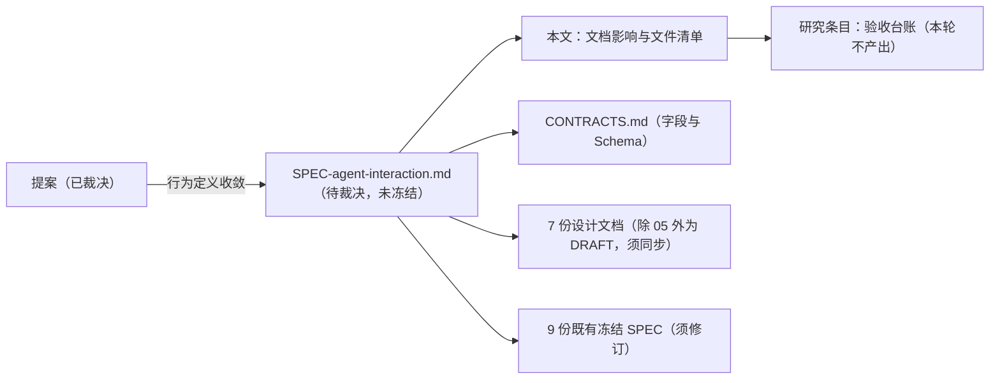

> 历史记录：本文件保存提交 `72f004b0087efa1b6f6d662ac6a143e087e4e21c` 时的过程与判断，不再定义当前系统。
> 当前设计见 [文档入口](../../INDEX.md)；正文中的路径、规则和结果按当时上下文理解。

> 归档基线：2cf230115f4084aef2376e9d77bc976efbed43ea
> 原始路径：`docs/dev/research/agent-interaction-document-impact.md`
> 归档说明：此提交仅定位归档原文快照，不是审查执行证明；原始执行记录与未执行事实按原文保留。

# 数字人交互：文档影响与文件修改清单

> 状态：**调研证据**（本轮为文档审计，不含实现）。
> 日期：2026-09-22。基线源码：`WorldMock` main 工作树，未提交状态。
> 被审计对象：[数字人交互规格](../SPEC-agent-interaction.md)（本轮由[提案](../PROPOSAL-agent-interaction.md)裁决而来）。
> 方法：11 路只读源码审计（工具面、上下文装配、节律契约、进度存储与检查点、前置条件与任务生命周期、状态结构与版本、评估与交付消费者、唤醒词表枚举、设计文档归属、冻结冲突、测试门禁）。
> **四组路数各指不同审计，互不矛盾**，不可互相换算：
> - 本文的 **11 路**：按**采集方法**切分（工具面、上下文装配、节律契约、进度存储与检查点、前置条件与任务生命周期、状态结构与版本、评估与交付消费者、唤醒词表枚举、设计文档归属、冻结冲突、测试门禁）。
> - 提案的 **八路**：按**分面**切分（工作与任务、活动与进度、交互菜单、决策协议、社交与在场、身体与环境、调度与截止、投影层）。
> - `dayrun-toolbox-design-audit.md` 的 **10 个只读单元**：动作菜单、决策循环、叙事投影渲染、叙事生命周期与读回、设计意图冻结条款、工时与 wait 与任务、任务过期路径、社交接受度与在场、菜单剪裁、内容目录。
> - `dayrun-two-agent-realism-and-friction.md` 的 **13 路**：9 路 thinking 分片挖掘 + 2 路真实性评估 + 1 路交互/世界面 + 4 路对抗验证（该轮验证推翻/修正了 3 处汇编阶段断言）。
> 本文结论**只适用于决策与表达链**；评估、交付、画像、语料、品类、账本六个模块**本轮未读**，本文对它们无结论。

## 审查结论

本规格要落地，**不是加几个字段，而是换一层骨架**。实测波及面：

口径：以 `REQUEST_MODELS` 登记的 **17 个权威工具名**为唯一匹配模式（`src/worldmock/life/models.py:994-1012`），
一次性重算全部五项。**先前版本的表是两套不同 grep 模式的混用结果，已作废。**

**三种计数口径必须写明，不可混用**：① **文件数**（含任一工具名的文件数）；② **含工具名的行数**；
③ **命中次数**（同一行出现两次算两次）。另有第四种：`allowed_tools` 数组的**条目数**（仅场景适用）。
本表每行都标明用的是哪一种。

| 面 | 数量 | 说明 |
| --- | --- | --- |
| 源文件 | **45** | `src/` 39 个 + `custom/` 6 个 Python；另加 `catalog/` 5 个文件 |
| 代码引用点 | **441 行** | `src/` 271 行 + `custom/` 170 行 |
| 测试文件 | **113** | 合计 **1497 行**；其中仅提两个待删工具的 **14 个** |
| 文档 | **68 文件** | 含工具名的行 **502**（行数口径）；反引号工具名命中 **299** 处（次数口径）；松散命中 **749** 处（次数口径，含领域词误伤）。其中 `CONTRACTS.md` 独占 **65** 处反引号命中，是最大单点 |
| 场景 JSON | **4** | 三个多人物场景各 **9 个** `allowed_tools` 键、**153** 个工具名条目；`evaluation.json` 无 `allowed_tools` |
| catalog | **1 个文件 / 15 行**（真工具名口径） | 工具名只在 `affordances.toml`。`resources.jsonl` 的唯一命中是 `drain_rules` 的 `consume`——**活动类型键，不是工具名**，属领域词假阳性 |
| 冻结规格 | **9 份 SPEC + `CONTRACTS.md`** | 真工具名引用按反引号判别，见「冻结规格修订清单」 |
| 设计文档 | **7 份需改**（`docs/design/` 共 10 份编号文档；另 3 份：`02`/`07` 领域词误伤不改、`06-delivery.md` 本轮未评） | **除 `05-recording-engine.md` 外均为 DRAFT**；`05` 自称「已整合」，其接口表具规范效力——这是修订顺序的第一件事 |
| 世界状态版本 | **5 → 6** | 破坏性：旧检查点拒绝加载 |
| 唤醒词表同步点 | **五处** | 枚举（含 `SLEEP_ALLOWED_REASONS`）/ `WAKE_REASON_NAMES` + 写入期校验 / 质量报告分桶 / 两层测试；唯一权威定义见「唤醒词表的五处同步点」节 |

**新工具面 5 个名字是全新的**：`start_activity`、`recall_task_summary`、`report_status`、`pause_activity`、
`conclude_activity` 作为**工具名**在当前 `src/` 与 `custom/` 中出现 0 次；另 2 个（`plan_day`、`revise_day_plan`）
是既有工具名，按裁决保留为独立工具。所以这是一次**工具面收敛**（17 → 7）而非改名。
两个待删工具散在 **6 和 7 个源文件**里（`change_playback_speed` 6、`game_action` 7）。

**去向账**（两个方向分别数清，口径以 [规格](../SPEC-agent-interaction.md)「稳定工具面」为准）：

| 方向 | 计数 | 明细 |
| --- | --- | --- |
| 新工具面 | **7** | **5 个全新** + **2 个沿用**（`plan_day`、`revise_day_plan`，按裁决保留为独立工具） |
| 旧工具面 | **17** | **2 个整条删除** + **2 个沿用** + **13 个能力收进 `action` 参数** |



## 权威归属与不可混淆的概念

| 内容 | 权威文档 |
| --- | --- |
| 会话、决策轮循环、进度层字段 | `docs/dev/SPEC-agent-interaction.md` |
| 工具 Schema、字段闭集、枚举字面量 | `docs/CONTRACTS.md` |
| 状态归属、共享时钟、活动组合、观察投影 | `docs/dev/SPEC-life-runtime.md` |
| 决策所见、两阶段决策、预算 | `docs/dev/SPEC-decision-context.md` |
| 工具与活动类型准入、地点菜单 | `docs/dev/SPEC-interaction-menu.md` |
| 记忆合同、巩固与反思 | `docs/dev/SPEC-life-realism.md` |
| 当日目标 | `docs/dev/SPEC-day-plan-goals.md` |
| 事件、检查点、分支、导出 | `docs/design/05-recording-engine.md` |

必须区分、不得混用的概念：

| 概念 | 不是什么 |
| --- | --- |
| **会话 session** | 不是活动（不占资源、不参与身体结算、不产生工作量） |
| **会话 session** | 不是活动的组合容器（承载 1–2 个活动，但**不聚合**它们的资源、结算与工作量；那些量仍只在 `ActivityState` 上） |
| **会话 session** | 不是当日目标（目标无暂停态、由活动证据推进、不是人物显式结束） |
| **会话 session** | 不是工作任务（合同由场景声明、由提交或过期结束） |
| **模型自述 progress_note** | 不是已核验经历（永不进入环境事件投影区段） |
| **派生视图裁剪** | 不是销毁式遗忘（episodes 只追加，不删除不重写） |

## 冻结前冲突与采纳裁决

| # | 冲突 | 冻结原文 | 采纳裁决 |
| --- | --- | --- | --- |
| 1 | 播报节律 vs 唤醒词表 | 「唤醒原因是冻结词表，成员不可增删」 | **显式修订**：新增成员 `progress_report_due`；成员集改为「不可改名、不可删除，新增须走版本表」 |
| 2 | 并发上限 vs 活动组合 | 「活动准入**仅**按占用交集判定」 | **显式修订**：保留占用交集，追加硬上限 `max_concurrent_sessions=2`；新错误码 `SESSION_LIMIT_EXCEEDED` |
| 3 | 午夜浓缩 vs 巩固触发 | 「主观巩固触发为**三选一**」 | **显式修订**：改为四选一，增加「跨过当日 `day_end_seconds` 边界」 |
| 4 | 遗忘 vs 检查点 | 「事件…只追加…不能更新或删除」；`episode_counter == len(records)`；`episodes_sha256` | **不改冻结条款**：遗忘实现为**派生视图裁剪**，不删任何记录 |
| 5 | 前置条件进提示 | 「user 消息由 persona_card、scene、facts 三部分组成」 | **扩展不改结构**：前置条件字段进 `facts.tasks`，进度层进 `facts.sessions` + `scene` 一句；**不新增顶层段** |
| 6 | 多目标 start vs 单动作 | 「一次决策只提交一个需要生活时间的主要行动」 | **澄清不改语义**：`targets[]` 是一个动作的多目标，不是多个动作；不相容整组拒绝 |

**未被修订的既有语义**（本规格明确遵守）：只有环境能改世界状态；一次决策一个生活动作；
沉默边界不调用模型；体感数值不进提示；已核验经历只由已提交事件确定性投影；SQLite 记录是唯一提交权威。

## 本轮裁决的落地后果

四条裁决逐条改变爆炸半径，**其中两条是删除**，删除的连带面必须一并列出。

| # | 裁决 | 落地后果 | 爆炸半径 |
| --- | --- | --- | --- |
| 1 | `change_playback_speed` 删除 | 播放中改速能力消失；**开播时仍可设定**（`start_targeted_activity` 的 `playback_speed` 字段保留） | 源 **6** 文件 / 场景 27 处 / 测试 **10** 文件 |
| 2 | `game_action` 删除，游戏降为「选一个游戏名 + 定时自述」 | TextWorld 命令回路整条消失；`play_game` 退回与 `watch` 同形 | 源 7 文件 / 场景 27 处 / 测试 20+ 处 / `catalog/affordances.toml` 注释 |
| 3 | 17 个工具一次性收敛为 **7** 个，能力收进 `action` 参数 | 每个交互对象的可用动作在**交互对象层**罗列；`action` 取值**按对象绑定**为闭集；`plan_day` / `revise_day_plan` 保留为独立工具 | 见「其他规范、数据与消费者修改清单」 |
| 4 | 三级结构：任务 → 会话 → 活动 | 会话是**新增结构**，但**不新增事件类型**（见「事件类型是封闭的 14 项」） | `WorldState` 版本 5→6 |

### 裁决 2 的完整处置清单

删除分**两类**，不可混为一谈：
- **命令回路**（`game_action` 及其状态）——整条删除，共三处状态写入，删一处不解干净。
- **同源但独立**的链路（`game_boundary` 合同）——须一并收敛，但它表达的是「该活动允许继续交互」，
  不是命令回路，**删不掉也不能删**，只能随工具面一起改写。

| 位置 | 形态 | 处置 |
| --- | --- | --- |
| `life/engine.py:1344-1365` | `_game_action` handler | **删除** |
| `life/engine.py:1367-1377` | `_store_game_outcome` 辅助函数（**仅**被 `_game_action` 调用） | **删除** |
| `life/engine.py:1169-1171` | 开播时建 `game_sessions` 条目的分支 | **删除**（`play_game` 不再需要会话） |
| `life/game.py` | `run_game_command` | **删除**（唯一调用者是 `_game_action`；`verify_game_progress` 见下行，**它不是** `_game_action` 调用的） |
| `life/models.py` | `GameActionRequest`、`GameProgress`、`AgentState.game_sessions` | **删除** |
| `life/models.py` | `REQUEST_MODELS["game_action"]`、`ActionRequest` union 成员 | **删除** |
| `custom/agents/life_activity_controls.py:168-171, 183-186` | 游戏命令的 Schema 绑定与校验分支 | **删除** |
| `custom/agents/life_agent.py:321-323, 510, 1494-1495` | 工具描述、`_ACTIVITY_CONTROL_TOOLS` 成员、`life_action_tool_names()`（`:273`）的动态加入分支 | **删除**（**注意**：影响文档早期版本写的 `_eligible_tools` **在全仓库不存在**，真实符号是 `life_action_tool_names()`） |
| `evaluation/public_evidence.py:252-253, 397-398` | 游戏证据分支 | **删除** |
| `verify_game_progress` 全链路 | **定义** `life/game.py:83`、**分组导入** `life/engine.py:86`、**调用** `life/engine.py:734`、**测试** `tests/life/test_domain_branch_coverage.py:63/1480/1483` 与 `tests/corpora/test_corpora.py:15/104` | **整条删除**（校验对象随 `game_sessions` 消失）。只删调用点会留下孤儿函数与断掉的导入 |
| 游戏内容（`games` 声明：`multi-person.json` 与 `white-collar-12-weeks.json` **各 30**、`multi-person-half-day.json` **8**；`game_session` 内容 **80 条**） | 场景与语料数据 | **保留**，成为 `play` 动作的合法目标 |
| `game_boundary` 合同（**引擎侧** `life/engine.py:184`、`:198`、`:202`、`:213`；**注册表侧** `catalog/affordances.py:101`、`:275-278`、`:444-458`；**人物侧镜像** `custom/agents/life_agent.py:417`、`:421`、`:445`、`:479-482` 的 `_game_boundary_kinds` 与七键闭集） | 「该活动允许继续交互」 | **须一并收敛，但它不是命令回路**：与 `game_action` 是两条链路，实现时勿混同 |

**`play_game` 活动本身保留**：它仍走既有的持续时间、结算与 `activity_progress` 路径，
只失去「发送命令推进」这一能力。

## 数据进入：状态结构的破坏性变更

| 项 | 现状 | 变更 | 后果 |
| --- | --- | --- | --- |
| `WorldState.sessions` | 不存在 | **新增** `dict[str, SessionState]`，带 `default_factory` | 字段本身向后兼容（旧记录由默认值填充） |
| `WORLD_SCHEMA_VERSION` | **5**（`src/worldmock/life/models.py:21`） | **5 → 6** | **破坏性**：`WorldState.schema_version`（`life/models.py:442`）是 `Literal[WORLD_SCHEMA_VERSION]` 且**无默认值**，旧检查点 `model_validate` 直接拒绝——这是项目既有设计意图（「直接拒绝旧检查点」）。**注意**：`footprints/models.py:160/173` 的 `Literal[1] = 1` 是 `Event` 与 `Checkpoint` 的版本，与本字段无关，**不要改错文件** |
| 场景声明 | — | **不需要** | 会话是运行期生成物（同 `activities` / `deliveries` / `processed_actions`），不来自场景种子 |

**连带影响**：所有手工构造 `WorldState` 的测试夹具必须补 `schema_version=6`。

**另需落点的三档容量**（规格给出但影响文档先前未覆盖）：

| 容量 | 规格要求 | 当前实况 | 落点 |
| --- | --- | --- | --- |
| 单会话进度层 **4000** 字符 | 午夜浓缩后逐会话压到 4000 以内 | **无对应常量** | `narration.py:41-52` 的常量表须新增；装配时裁剪 |
| **进展自述 / 目标单句进展 500 字符**（**两行合一**：规格分列会话级与目标级，此处合并因落点相同） | 两条各自独立的上限：会话级 `progress_note`、目标级 `PlanGoal` 单句 | **无对应常量**；且 `model_copy` 路径不跑校验器，`Field(max_length=500)` **不生效** | 两处各自**自写校验器**（规格「单句进展字段对冻结 `PlanGoal` 的破坏面」已注明） |
| 长期记忆 **8000** 字符 | 派生视图裁剪，不删记录 | 既有视图裁剪约 3999 字符（`life_memory.py`） | 「遗忘是派生视图」节要求；须改 `life_memory.py` 的窗口与 `MEMORY.md` 装配 |

## 要求、文档与测试矩阵

| 要求 | 可观察行为 | 规格/设计落点 | 测试落点（须新建或修订） |
| --- | --- | --- | --- |
| 会话生命周期不可由自述推进 | 删除全部 `progress_note` 后状态与数字逐字节不变 | 本规格「会话层」 | 新增 |
| 一次决策一个生活动作 | 多动作响应被拒 | `SPEC-life-runtime.md`「决策机会规则」 | 既有 + 修订 |
| 并发硬上限与占用交集同时生效 | 二者各自独立拒绝 | 本规格「冻结条款修订」#2 | 新增 |
| 睡眠不播报 | 跨多个播报边界，`decision_started` 计数为零 | `SPEC-life-runtime.md`「决策节律」 | 既有 `test_wake_reasons.py` 扩展 |
| 沉默边界不调用模型 | 无唤醒条件的边界无 `model_request` | `SPEC-life-runtime.md` | 既有 |
| 前置条件进提示 | `facts.tasks` 含未满足项且 `scene` 有中文说明 | 本规格「前置条件前置」 | 新增 |
| 遗忘是派生视图 | 裁剪后 `episode_counter == len(records)`、`episodes_sha256` 链完整、检查点可恢复 | `SPEC-life-realism.md`「记忆合同」 | 既有 + 修订 |
| 午夜浓缩 | 跨日边界产生一次浓缩且不改已核验经历 | 本规格「午夜浓缩」 | 新增 |
| 词表修订一致 | **代码同步点五处**（`schedule.py` 枚举；`WAKE_REASON_NAMES` 与写入期校验合为一处；**`quality.py:384-399` 分桶**；`test_event_fields.py`；`test_wake_reasons.py`）；**文档同步面另列**（`CONTRACTS` 枚举表、life-runtime 冻结词表、本规格修订表）。构成以「唤醒词表的五处同步点」节为唯一权威 | 本规格「冻结条款修订」#1 | `test_wake_reasons.py:38`、`test_event_fields.py:48/54` 须改 |

## 冻结规格修订清单

判别口径：**只统计反引号包裹的工具名引用**。`purchase` / `consume` 同时是领域词
（`purchase_allowed`、`evaluate_purchase`、`consume:eat`），松散匹配会造假阳性。
下表「真引用」列为反引号包裹处的数量。

| 文档 | 真引用 | 修订章节 | 修订性质 |
| --- | --- | --- | --- |
| `docs/CONTRACTS.md` | **65** | 工具 Schema 表、保护集合表、请求字段字面边界表、枚举表（词表 + 错误码）、观察投影字段、品类动作闭集 | **字段级修订，最大单点** |
| `docs/dev/SPEC-interaction-menu.md` | **29** | 「声明与准入」（保护集按新工具面重建：7 工具 + 按对象绑定的 `action` 枚举）、「观察与人物工具」、验收台账 | 条款修订 |
| `docs/dev/SPEC-life-runtime.md` | 2 | 「决策节律：结算边界与唤醒条件分离」（词表）、「活动组合政策」（硬上限）、「观察投影与提示合同」（进度层与前置条件字段）、「字符预算」 | 条款修订 + 扩展 |
| `docs/dev/SPEC-decision-context.md` | 2 | 「上下文与阶段相互独立」（进度层）、「预算与失败」、日首只开放 `plan_day` 的条款 | 扩展 + 条款修订 |
| `docs/dev/SPEC-map-and-storefront.md` | 2 | `discover_places` / `purchase` 的生活动作登记与配对章节 | 条款修订（工具名与动作参数改名） |
| `docs/dev/SPEC-day-plan-goals.md` | 3 | 「当日目标与生命周期」（目标单句进展字段，≤500 字符）；`plan_day` 降为 `action` 取值 | 扩展 + 条款修订 |
| `docs/dev/SPEC-category-contract.md` | 1 | 「产品行为与边界」中「本次不改变人物决策协议」一句 | 范围声明失效，须改 |
| `docs/dev/SPEC-dayrun-behavior.md` | 1 | 「持续活动与必要唤醒」（播报节律） | 扩展 |
| `docs/dev/SPEC-life-realism.md` | 1 | 「两阶段决策」（播报调用）、「记忆合同」（四选一触发 + 派生视图裁剪） | 条款修订 |

**不需修订（领域词误伤，先前清单误列）**：`SPEC-labelkit-delivery.md`、`SPEC-as2-integration.md`、
`SPEC-run-viewer-names.md`。`as2-integration` 先前被列入「分层职责（工具面收敛）」，
但反引号引用为 **0**——它谈的是分层，不点名任何工具，**本轮不改**。

### `CONTRACTS.md` 逐节修订锚点

该文件独占 **65 处**反引号工具名引用，是全部文档里的最大单点。按节分布如下，
实现者可按节推进，不必通读。

口径：反引号工具名命中，按 `CONTRACTS.md` 的**节**归集。**逐节求和 = 全文合计 = 65 处**，两者一致。下表只列**有命中**的 9 个节；`CONTRACTS.md` 其余章节反引号工具名引用为 0。

| 节（起始行） | 引用数 | 修订内容 |
| --- | --- | --- |
| `### 人物工具与管理接口`（:47） | **27** | **整表替换**：17 行工具 Schema 换成 **7** 行（5 个会话动作 + 2 个当日目标登记）；`allowed_tools` 闭集说明（:87）改为 `action` 取值闭集；保护集合表（:93）收敛；:114 的「删除旧的 `start_activity`」历史说明须重写 |
| `### 当日目标请求`（:116） | **5** | `plan_day` / `revise_day_plan` 从工具降为 `action` 取值；生命周期条款（:164-165）随改 |
| `### 请求字段与结算检查`（:192） | 1 | 「变速走独立的 `change_playback_speed`」删除，改为开播时经 `action` 参数设定 |
| `### 请求模型的闭集与字面边界`（:206） | **24** | **第二大单点**：逐行字面边界表按新 `action` 参数重建；`change_playback_speed` 行（:215）与 `game_action.command` 行（:227）删除 |
| `### 地点发现与购买身份`（:345） | **1** | `discover_places` / `purchase` 改名后同步；`purchase_allowed` 等**领域字段名不改** |
| `### 下推返回体`（:666） | 1 | `browse_activities` 作为下推类工具的表述随改名调整 |
| `### 禁止进入提示的字段`（:726） | 2 | `consume` / `purchase` 的宿主约束说明随改名调整 |
| `## 品类契约与目录字段`（:859） | **1** | 动作闭集（:883）含 `purchase`、`consume:eat`、`consume:use`——**这些是品类动作，不是人物工具**，须区分后决定是否随改 |
| `## 版本表`（:1251） | **3** | 追加本次修订条目；既有条目**不改**（版本表是历史） |

**两处易错**：`:883` 的品类动作闭集与人物工具名同形但**不是同一概念**，
`purchase` 在那里指品类配对动作；`:264` 的活动类型枚举里 `play_game` **必须保留**。

## 设计文档修改清单

**`05-recording-engine.md` 不是 DRAFT**：其 `:3` 写「已整合；原已冻结的接口与行为约束继续有效」，
因此它的接口表（表头在 `:340`、`:401`、`:537`、`:618`、`:717`、`:792` 共 **6 处**）是**规范性**的，
不是「草稿吸收新主张」而是「已整合文档的冻结条款被修订」。其余六份为 DRAFT，须随本规格同步。

判别口径同上。**反引号判别只筛「工具名引用」，会漏掉非工具名的真修改**——
`09-io-formats.md` 正是这个盲区：它被误伤的只有 `purchase` / `consume` 那 3 处资源域概念，
但它的 `:75` `Literal[5]` 是**真修改**（世界版本 5→6），因此它**须改**，见下表。

**仅领域词误伤、本轮不改**：`02-exchange-engine.md`（7 处松散匹配）、`07-evaluation.md`（3 处），二者的反引号工具名引用为 **0**。

| 设计文档 | 真引用 | 修订点 | 现有承载章节 |
| --- | --- | --- | --- |
| `docs/design/04-simulation-engine.md` | 2 | **主战场**：观察与决策机会、动作受理与校验、共享时钟推进、唤醒条件、会话状态机、恢复 | `## 3. 组织观察与决策机会`、`## 4. 收齐并有序受理动作`、`## 5. 推进共享时钟`、`## 8. 判断唤醒条件` |
| `docs/design/08-configuration.md` | 2 | 交互菜单声明（新工具名）、`max_concurrent_sessions`、播报间隔场景参数 | `### 3.2 交互菜单声明` |
| `docs/design/05-recording-engine.md` | 2 | 会话与进展叙述的记录位置、午夜浓缩的证据身份 | `## 一致性保存与校验`、`## 保存共同检查点` |
| **`docs/design/03-resource-engine.md`** | **1** | **先前清单遗漏**：活动占用与会话并发上限的资源语义 | `## 5. 校验资源可用性` 与 `### 准入边界`（该文件**没有**「资源占用与冲突」节，切勿照抄锚点） |
| `docs/design/00-overview.md` | 0 | 术语（会话、进度层、稳定工具面）——**无工具名，但术语表须补三个词** | 术语节 |
| `docs/design/01-architecture.md` | 0 | 数据流新增「模型撰写、不承载状态」一类 | `## 2. 总体架构与职责分工` |
| `docs/design/09-io-formats.md` | **0** | **世界与人物状态格式**：`:75` 的 `Literal[5]`→`Literal[6]`、`WorldState` 字段表插入 `sessions`、`:60-65`「不新增 `WorldState` 字段」半句作废。**反引号工具名引用为 0，但版本号是真修改**——故列入本表 | `## 世界与人物状态格式`（该节标题**无编号**，不能按 `3.x` 引用） |

## 设计文档逐行锚点

七份设计文档的**可执行锚点**。逐行核实过，含行号与「必须改成什么」。
`05` 的状态是**已整合**（非 DRAFT），其接口表（表头 6 处：`:340`、`:401`、`:537`、`:618`、`:717`、`:792`）
因此具备规范效力——**这是全部修订里的第一件事**，它决定其余改动是「草稿吸收新主张」
还是「已整合文档的冻结条款被修订」。

### `04-simulation-engine.md`（主战场）

**约束**：`:76` 声明「正文标题与灰色功能框保持同名」，而 `:36-52` 的 mermaid 有八个节点
（`PREP|OBSERVE|ACTION|CLOCK|ACTIVITY|SETTLE|WAKE|RESTORE`）。新增会话状态机或播报节律主题
**必须同时加一个 mermaid 节点**，否则不变量破裂。

| 行 | 现值（须改） | 必须改成 |
| --- | --- | --- |
| `:97-101` | 设计依据列出五份 SPEC，**无新规格** | 追加 `[数字人交互规格](../SPEC-agent-interaction.md)`；被列的五份全在修订表内 |
| `:91-93` | 未提会话归属 | 增补 `WorldState.sessions` 为引擎所有状态 |
| `:163-164` | 「菜单不裁剪场景…只约束入口与参数」 | 菜单的工具闭集收敛为 7 个；地点菜单改剪裁对象的 `actions` 枚举而非工具 |
| `:175`（`:176` 为空行；原文是「继续收窄」） | 收窄输入未含进度层 | 增补 `facts.sessions` 与 `facts.tasks` 的 5 个前置条件字段 |
| **`:292`** | `该动作可以原子启动两项及以上兼容持续活动` | **最尖锐的过时句**。`两项及以上` 是**无上界**枚举，必须改为「至多两个」，且并发上限与占用交集**各自独立**生效 |
| `:293-295` | 引用 `#同一人物的活动集合` | 该锚点所在条款**被显式修订** |
| `:505-506`（散文枚举约 12 项、非穷举） | 散文枚举约 12 项；实际闭集 17 项，散文省略了 `discovery_result`、`person_left`、`task_due_soon` | 增补 `progress_report_due`（闭集 **18** 项） |
| `:508-509` | 「完整闭集…见 life-runtime」 | 「完整闭集」四字已错；且 `:509` 的锚点 `#决策节律增量字段` **在 `05` 中不存在**（见「悬空锚点」） |
| `:516` | 「营业变化…不增加周期轮询」 | 播报节律**正是**周期边界，此句须限定范围否则读作禁止播报 |
| `:533-538`（节标题「恢复与反事实运行编排」在 `:521`） | 恢复身份不含结构版本 | 工具模板身份随工具面变换；世界版本 5→6 使旧检查点不可加载 |
| `:594`（节标题「验收重点」在 `:588`，`:594` 是表内数据行） | 验收表无会话行 | 增补会话/播报验收行 |

### `05-recording-engine.md`（**状态为已整合，非 DRAFT**）

**好消息**：规格结论是**不新增事件类型**，故 `:169-184` 的 14 项 `EventType` **不需改成员**。

| 行 | 现值（须改） | 必须改成 |
| --- | --- | --- |
| `:113-118` | 人物决策/动作执行表 | 增补进展自述（`request.summary`）与播报触发的调用 |
| `:121` | 「不把额外生成的解释冒充当时的决定或事实」 | **既有硬边界的现成表述**——扩展为点名 `progress_note` 且标注**未经核验** |
| **`:127`** | `存储在事务内分配持久序号` | **数据库事务语境**——与规格的 `会话` 术语冲突，须消歧 |
| `:195` | `decision_started` 行 | 增补：播报节律的 `decision_started` 是新增调用之一 |
| **`:197`** | `action_requested` 行 | **这是全部会话转移的唯一审计路径**（`tool_name` + `request` + `request_sha256`），须写明 |
| `:198` | 业务拒绝码枚举 | 增补 `SESSION_LIMIT_EXCEEDED` |
| `:260-265` | 「请求、受理、购买、人物文字和反思均不能产生这些事实」 | **既有硬边界的逐字同义表述**——引为新增规则的前例 |
| `:271-277` | 「主观巩固标志」 | 须改为**四选一**触发 |
| `:369-370` | 静态工具描述进工具模板身份 | 工具面整体变换，该哈希每次运行都变 |
| `:522-528` | 检查点 `snapshots` 键集 | **键集不变**（会话住在 `life` 内），但 `state` 现携带 `sessions` |
| **`:549`** | `世界结构版本为 5` | **`5` → `6`**；每个既有运行目录的检查点都变为不可加载 |
| `:709-711` | 质量报告分组 | `decision_rhythm` 增成员；`quality.py:384-399` 的未识别分箱**不得静默吞掉** `progress_report_due` |
| `:815-823` | 版本表 | 追加 `2026-09-22-agent-interaction` 行 |

### `08-configuration.md`（DRAFT）

| 行 | 现值（须改） | 必须改成 |
| --- | --- | --- |
| `:25` | 配置职责清单 | 增补播报间隔参数；**会话必须显式排除**（场景不声明会话） |
| `:120-122` | 两个重估间隔 | **播报间隔的插入点**（默认 1800 秒），与两个既有间隔并列 |
| **`:146-150`** | `工具名只取 REQUEST_MODELS`；「必须显式保留休息、睡眠、当日目标与既有活动控制所需的保护项」 | **类别描述已不匹配**；须逐项列出收敛后的保护集 |
| `:156-157` | 权威仅为 `SPEC-interaction-menu.md` | 须指名新规格为保护集的共同权威 |
| `:169` | `discover_places 加入工具闭集` | **点名了 7 工具面不含的工具**（`discover_places` 的能力收进 `action` 取值，不再是工具名）。裁决项 2 已落地（`plan_day` / `revise_day_plan` 保留为独立工具），本条按「改名 + 收进 `action`」处理 |
| **`:173`** | `菜单显式包含 start_parallel_activities` | **两重过时**：点名收敛中的工具；且把并发绑死在旧工具上 |
| `:291` | 校验清单「包含保护项」 | 须绑定新保护集 |
| `:312` | 错误分类「缺保护项」 | 同上；**注意** `SESSION_LIMIT_EXCEEDED` 是**运行期**业务错误，**不得**加进配置错误表 |

### `03-resource-engine.md`（DRAFT）

**修订点**：活动占用与会话并发上限的资源语义。该文件**没有**「资源占用与冲突」节；
真实承载位置是 `## 5. 校验资源可用性` 与 `### 准入边界`（`:337`、`:344`）。
修订内容：并发上限 `max_concurrent_sessions=2` 与既有「按占用交集判定」的关系说明。

### `09-io-formats.md`（DRAFT）

**这是全套里唯一存放状态格式表的设计文档**，故世界版本升级在此是实质修改而非引用。

| 行 | 现值（须改） | 必须改成 |
| --- | --- | --- |
| `:60-65` | 「不新增 `WorldState` 或 `AgentState` 字段」 | **这半句已错**：会话**确实**新增 `WorldState` 字段；`interaction_menu` 部分仍成立 |
| **`:75`** | `schema_version` 为 `Literal[5]` | **`Literal[5]` → `Literal[6]`**，说明补「会话集合」 |
| `:85-95` | `WorldState` 字段表 | **插入点**：在 `activities` 后加一行 `sessions`，类型为「字符串到 `SessionState` 的映射」，必填，带默认工厂；说明写「会话状态映射」 |
| `:114-142` | `day_plan` 行 | **目标层增补的锚点**（目标单句进展，≤500 字符） |
| `:144-151` | 「活动身份只存在于 `WorldState.activities`，人物不另存当前活动槽」 | **可扩展的前例**：按同一归属规则，会话身份只住在 `WorldState.sessions`，**绝不进 `AgentState`** |
| `:147` | `verified_experiences` 事实窗口 | `progress_note` 必须**排除**在此窗口外 |
| `:177-204` | `ActivityState` 表 | **不改**：活动保持既有形状，反向 `activity → session` 链接**不在此定义**，不得臆造 |

**既有编号缺陷**（与本特性无关，但引用时会传染）：`:67`、`:206`、`:212` 三个顶级标题**无编号**，
其子节却是 `3.1`–`3.4` 与 `9.1`–`9.3`，`2.`–`8.` 系列父节不存在。

### `01-architecture.md`（DRAFT）

| 行 | 现值（须改） | 必须改成 |
| --- | --- | --- |
| `:87` | 数字人职责行 | **新增类别的插入点**：人物同时撰写进展自述，交付给模拟引擎但**明确不承载状态** |
| `:90` | 模拟引擎职责行 | 增补会话状态机与播报节律 |
| **`:106`** | 状态归属行 | **主要修改**：会话（及其进展层）归引擎所有 |
| `:107` | 数字人记忆与工作区行 | **关键消歧**：进展层**不是**人物所有的状态，尽管文字由模型写。客观字段归 `:106`，自述字段归 `:107` 并加「不承载状态转移」限定 |
| `:110-112` | 「世界状态只有生活环境这一写入入口」 | **逐字保留**——这是硬边界的执行条款；新类别须表现为与之一致，**而非例外** |
| `:114-117` | 「模型仅更新主观章节」 | **最接近的既有前例**：同一规则，扩展到进展层并加并发上限 |
| `:136` | 「场景决定…交互菜单」 | **显式排除会话**：场景不声明会话 |
| `:193-195` | 收窄列表 | 增补进度层与 5 个前置条件字段 |
| `:198` | 「没有唤醒条件时…静默续行」 | **保留并加强**：新节律增加唤醒原因，但**不废除静默** |
| `:203-205` | 边界种类枚举 | 增补播报节律为边界种类，或明确归类为既有边界上的唤醒条件 |
| `:275` | 代码对应表 | 会话模块落地后再加 `session.py`；**代码落地前不得点名** |

### `00-overview.md`（DRAFT）

| 行 | 现值（须改） | 必须改成 |
| --- | --- | --- |
| **`:11-12`** | `本目录仍为草稿，修订不改变冻结规格或实现状态` | **对本变更为假**。须改写为承认规格可以修订冻结条款 |
| **`:82`** | 模拟引擎术语行 | **术语修改**：增补会话、进度层、稳定工具面 |
| `:79` | 数字人术语行 | 增补：人物撰写进展自述，不承载状态转移 |
| **`:127-143`** | 需求映射表 | **插入点**：增补会话生命周期、播报节律、前置条件进提示、并发上限四行，**状态列须沿用既有词表**（`DRAFT` / `FROZEN` / `冻结约束已承接` / `实现与分列`） |
| `:169` | 时间推进决策行 | 增补会话模型与播报节律决策行，或声明尚未裁决 |
| `:102-104` | 人物自主性 / 唯一写入者两条原则 | **逐字保留**——这是硬边界的正当性依据，应在会话术语条目中引用 |

### `05:127` 的术语消歧（须在改名前裁定）

`05-recording-engine.md:127` 用「事务」指**数据库事务**（`存储在事务内分配持久序号`），
`:417` 的章节标题也是 `### 事务与失败处理`。新规格用「会话」指人物视角的交互单元。
**两个概念此前共用一词**，而两份文档在同一次变更里都要改，必须先消歧。

| 概念 | 建议词 | 依据 | 需切换的文件 |
| --- | --- | --- | --- |
| 数据库事务 | **保留「事务」** | `05` 已用 18 处，`CONTRACTS.md` 2 处，`ARCHITECTURE.md` 5 处 | **不改** |
| 人物交互单元 | **「会话」（`session`）** | 新规格统一采用；`session_id` 已是字段名 | 新规格、本影响文档、`docs/INDEX.md` |

**已执行**：新规格 55 处、本影响文档 22 处、`INDEX.md` 3 处已改为「会话」；
`05:127`、`:417`、`INDEX.md:118` 的数据库事务用法**保持不动**。

### 悬空锚点（既有缺陷，不得带病前行）

`04-simulation-engine.md:509` 与 `SPEC-life-runtime.md:106` **都**链接到：

```
[记录引擎的决策节律增量字段](../../design/05-recording-engine.md#决策节律增量字段)
```

**该章节在 `05` 中不存在**（**69** 个标题无一匹配，grep 计数 0）。
`CONTRACTS.md:1260` 记录了该节**曾被新增**（`2026-09-18-revision-2` 行：「新增决策节律增量字段节并登记唤醒原因冻结闭集」），
说明该节随后被移除或改写；`05` 的版本表 5 行（`:819-823`）**均无删除或丢失记录**。
规格的修订条款 1 牵连 `rhythm.py` 快照与 `CONTRACTS` 枚举表，而这些值的**字段级归属设计文档**
正是缺失的那一节。**要么在 `05` 中恢复它，要么改指两处链接**——不能把断链带下去。

### 既有矛盾（独立于本特性）

| # | 冲突 | 证据 |
| --- | --- | --- |
| C1 | `00:177` 与 `00:206` 声明 `v1.0 单人物`，而 `01:24` 声明人数属运行配置，且仓内已有 `multi-person.json` 与 `multi-person-half-day.json` 两个多人物场景 | `00` 是过时一侧 |
| C2 | `05:3` 自称「已整合」，而 `00:12` 称「本目录仍为草稿」——**同一目录三份文档三个互斥声明** | 须先裁定 `05` 的身份 |
| C3 | `00:12` 保证「不改变冻结规格」，而本规格**确实**修订冻结条款 | 修订权威**在设计目录之外**，须写明 |
| C4 | `04:508` 称唤醒闭集由**模拟引擎**维护，而写入期权威是**存储层**的镜像（`footprints/models.py:34-39`），漏改则事件**写不进库** | 归属声称差了一层 |

**归一化项**：`08:10` 把 `## 版本历史` 放在**文首**，其余设计文档都在文末（`00:224`、`01:349`、`04:610`、`09:271`）或名为 `## 版本表`（`05:815`）。

## 其他规范、数据与消费者修改清单

| 文件 | 改动 | 爆炸半径 |
| --- | --- | --- |
| `src/worldmock/life/models.py` | `REQUEST_MODELS` 收敛为 **7** 项（`start_activity` / `recall_task_summary` / `report_status` / `pause_activity` / `conclude_activity` / `plan_day` / `revise_day_plan`，后两项保留为独立登记工具）；`WorldState.sessions`；`SessionState`；`WORLD_SCHEMA_VERSION` 5→6；`activity_start_tool` 反向映射 | 全仓工具名消费者 |
| `src/worldmock/life/session.py` | **新增**：会话创建/暂停/结束/中止、容量校验、前置条件汇总 | 新模块 |
| `src/worldmock/life/schedule.py` | `WakeReason` 增成员；播报候选；`SLEEP_ALLOWED_REASONS` 不变 | 两层互锁测试 |
| `src/worldmock/life/rhythm.py` | 快照填新标志；`next_decision_candidates` 增播报候选 | 决策节律测试 |
| `src/worldmock/life/engine.py` | `_dispatch`（`:943`）**内部局部** `handlers` 字典（`:954-966`，非模块级）、`_validate_call`（`:749`）、`_OPS_COMPONENTS`（`:179`）、午夜浓缩挂点 | 53+26+14 处测试 |
| `src/worldmock/life/projection.py` | `facts.sessions`；`facts.tasks` 增 5 个前置条件字段 | 投影测试 |
| `src/worldmock/life/narration.py` | 进度层一句；前置条件未满足句；预算常量 | 渲染测试 |
| `src/worldmock/life/interaction_menu.py` | `PROTECTED_INTERACTION_TOOLS`、`menu_allows_action` 分支、`_derive_activity_start_tools` | 32+26+14 处测试 |
| `src/worldmock/life/rules.py` | 并发上限准入；`SESSION_LIMIT_EXCEEDED` | 准入测试 |
| `src/worldmock/life/menu_execution.py` | 菜单执行桥接（工具名分支） | 间接 |
| `src/worldmock/catalog/affordances.py` | `HABIT_TOOLS`、`SURFACE_TOOLS` | 16 处测试 |
| `catalog/affordances.toml` | **24 处 `tool =` 赋值**（14 处引号串形式 `tool = "..."` + 10 处表内联形式 `tool = { ... }`；另有 1 处 `tool.surface`） | 目录准入测试 |
| `custom/agents/life_agent.py` | **最大消费者**：`_TOOL_MODELS`、`_TOOL_DESCRIPTIONS`、`_ACTION_PROTOCOL`、`_available_action_models`、`_visible_action_contracts`、全部 `_bind_*`、`life_tool_schema_sha256` | 53+42+36 处测试 |
| `custom/agents/life_activity_controls.py` | `_START_TOOLS`（`:18`，**在此文件而非 `life_agent.py`**）、`_bind_activity_control_schemas`（`:156`）、`request_claims`（`:198`） | 9+4 处测试 |
| `custom/agents/life_menu.py` | `filter_action_contracts`、`menu_action_error`、`bind_storefront_schemas` | 41+26 处测试 |
| `custom/agents/life_memory.py` | 午夜浓缩、长期记忆裁剪窗口、`build_context`（`:42`）增进度层来源。**注意**：巩固触发的判断不在本文件，而是 vendor 的 `AgentMemoryStore.should_consolidate`（`vendor/agentsociety2/.../agent/memory.py:858`）；`life_memory.py:69` 只是调用点，`:128` 的 `_consolidate_subjective` 是执行者 | 记忆测试 |
| `custom/envs/life_env.py` | `_REVISION_CONTRACT_TOOLS`、`_validate_registered_tool_surface` | 7 处测试 |
| `src/worldmock/evaluation/public_evidence.py` | `_world_request_shape` 十分支工具名 switch | 14+5+9 处测试 |
| `src/worldmock/evaluation/behavior_metrics.py` | `_is_passive_action`、社交指标工具名检查 | 同上 |
| `scenarios/*.json` | 三个多人物场景各 **9 个** `allowed_tools` 键、各 **153** 个工具名条目；`evaluation.json` **无** `allowed_tools` | `allowed_tools` 条目 **459** 处（=153×3）；若按「含工具名的行」数则为 **491** 行，按松散命中则为 **493** 处——**三种口径不可混用** |
| `src/worldmock/footprints/models.py` | 事件类型/字段面若需登记会话事件 | 记录测试 |

### 必须在同一变更集内改完的闭集

漏一个就会在加载或启动期直接失败：

1. `PROTECTED_INTERACTION_TOOLS`（`interaction_menu.py:15-23`）——校验**拒绝**缺保护项的菜单；
2. `_KNOWN_TOOLS = frozenset(REQUEST_MODELS)`（`interaction_menu.py:28`）——场景 JSON 出现未注册工具名即加载失败；
3. `_REVISION_CONTRACT_TOOLS`（`life_env.py:19-21`）——init 期断言，当前引用 **6 个**具体工具名：`plan_day`、`revise_day_plan`、`send_message`、`start_social_activity`、`discover_places`、`start_parallel_activities`。

**这 6 个在新工具面下全部不再是工具名**：前五个的能力收进 `start_activity` 的 `action` 取值，`start_parallel_activities` 的能力由 `targets[]`（≤2）与并发上限取代。因此该闭集与 `_validate_registered_tool_surface` 的校验对象都要换成 `action` 取值闭集，否则 init 期断言会变成永真的空检查——**这是本变更里最容易留下假绿的一处**。

### 唤醒词表的五处同步点

`WakeReason` 不是两处同步。本轮补查发现写入期还有一道校验，**共五处**：

**这一节是唯一权威的同步点定义**；规格与其验收台账只引用本表，不另行枚举。
口径以代码实测为准，共 **五处**（三处生产代码 + 两处测试），此前文档中出现的
「两处」「三处」「四处」均为过时口径。

| # | 位置 | 形态 | 漏改后果 |
| --- | --- | --- | --- |
| 1 | `src/worldmock/life/schedule.py:32-51` | `WakeReason` 枚举（17 项）；`SLEEP_ALLOWED_REASONS`（`:54`，**枚举成员**非字符串，3 项） | 生产端产不出新原因；若误入睡眠允许集，人物会在睡眠中被播报唤醒 |
| 2 | `src/worldmock/footprints/models.py:34-39` 与 `:83-89` | `WAKE_REASON_NAMES` frozenset（17 项）+ `validate_decision_rhythm`（函数定义在 `:75`）的写入期校验 | **写入期拒绝**：新原因的事件**落不了库**，且是**运行期**失败而非启动期 |
| 3 | `src/worldmock/footprints/quality.py:384-399` | `_wake_reason_distribution` 按 `WAKE_REASON_NAMES` 分「已知 / 未识别」 | 新原因被静默计入 `unrecognized_wake_reason_counts`——**不报错，只是数字错**，最难发现 |
| 4 | `tests/footprints/test_event_fields.py:47-54` | 两条断言：等于 `_SPEC_WAKE_REASONS`、等于枚举成员集 | 测试失败 |
| 5 | `tests/life/test_wake_reasons.py:38` | `tuple(item.value for item in WakeReason) == FROZEN` | 测试失败 |

**三处生产代码里，第 3 处最危险**：它不抛错、不拒绝，只是把新原因归到「未识别」桶里。
只改枚举与规格、漏掉 `quality.py`，测试会全绿而质量报告已经错了。

**另需同步的文档面**（非代码，但同属口径一致）：`docs/CONTRACTS.md` 的枚举表、
`docs/dev/SPEC-life-runtime.md` 的冻结词表、以及本规格的冻结条款修订表。

### 事件类型是封闭的 14 项

若会话层需要**新事件类型**，会同时打破四处：

| 位置 | 形态 | 漏改后果 |
| --- | --- | --- |
| `footprints/models.py:106-110` | `EventType` 14 项 `Literal` | Pydantic 校验拒绝 |
| `evaluation/adapters.py:58-73` | `_WORLD_SOURCE_CHANNELS` 14 键字典 | **裸查表 `KeyError`**（`:436` 处无 `.get()`） |
| `evaluation/adapters.py:57` | `_PRIVATE_WORLD_EVENTS` 4 项闭集 | 可见性分类错误 |
| `tests/footprints/test_event_fields.py:34-37` | `len(EVENT_TYPES) == 14` | 测试失败 |

**本规格的结论是不新增事件类型**：**七个**工具都是生活动作，请求随既有 `action_requested` 事件落库，
进展自述在 `request.summary` 内，天然可审计。理由与替代方案见规格「事件与重建约束」节。

### 导出重建约束

| 位置 | 断言 | 对本规格的含义 |
| --- | --- | --- |
| `footprints/validation.py:33-34` | `reconstruct_activities(records) != activities` → `IntegrityError` | 活动必须能仅从事件重建；会话**不参与**活动重建，故不受影响 |
| `footprints/validation.py:36` | 已核验经历必须能仅从事件重建 | 模型自述**不得**进入已核验经历（本规格已约束） |
| `footprints/validation.py:42-54` | 质量报告必须能从事件复现 | 若把会话指标加进质量报告，必须同时提供事件证据；本规格**不**把会话加进质量报告 |
| `footprints/validation.py:110-111` | `set(checkpoint.snapshots) == {"life"} ∪ {agent:N}` | 会话住在 `WorldState` 内，随 `life` 快照保存，**不需要新的快照键** |
| `footprints/quality.py:565` | 记忆条目字段集合恰好 `{id,type,text,epistemic_status}`（`:564` 是循环行，断言在 `:565`） | 进展自述**不得**写成记忆条目；若将来要写，须同步改此处 |
| `footprints/quality.py:30-31` | `_SUBJECTIVE_TYPES` 9 项闭集 | 同上 |

### 两组互锁测试

| 测试 | 断言 | 为何互锁 |
| --- | --- | --- |
| `tests/life/test_wake_reasons.py:38` | `tuple(item.value for item in WakeReason) == FROZEN` | 词表必须与规格逐项相等 |
| `tests/footprints/test_event_fields.py:48/54` | 词表等于 `_SPEC_WAKE_REASONS` 且等于枚举 | 同一事实两处断言 |

## 精确门禁与证据要求

| 门禁 | 命令 | 通过判据 |
| --- | --- | --- |
| 全量测试 | `uv run pytest -q` | 全绿 |
| 覆盖门禁 | `uv run python scripts/coverage_gate.py` | 分支覆盖率 ≥85.00% 且未覆盖公共接口为 0；报告写 `docs/dev/coverage-report.json` |
| 风格门禁 | `uv run pytest tests/test_style_gate.py -q` | 零新增违规；若清偿既有债须同步缩减 `_OUTSTANDING` |
| 规格覆盖矩阵 | 人工维护 `docs/dev/ANALYSIS-spec-coverage.md` | 每条新条款映射到至少一个测试；`gap` 为 0 |
| 独立突变审查 | 独立 worktree + Uncle Bob 口径 | 存活突变须修复并复验 |

**禁止占位实现**：`pyproject.toml` 的 `exclude_lines` 已去掉对纯 `...` stub 的豁免——
**规格可以冻结，但不能先落一个 `...` 函数占位**，那会直接触发接口覆盖率门禁。

## 本轮未做与未覆盖

| 项 | 状态 |
| --- | --- |
| 实现 | **未做**。本轮只产出规格与文档影响。 |
| 六个模块 | **未读**：`evaluation/`、`delivery/`、`profile/`、`corpora/`、`categories/`、`resources/`。本文对它们无结论。 |
| 验收台账 | 规格内已带**验收台账**（契约点到口径的映射，共 24 行）。**独立验收记录仍待产出**：实现阶段另立 `agent-interaction-verification.md`，记录固定源码身份下的命令、结果与审查证据。 |
| 索引登记 | 本轮已登记（见 `docs/INDEX.md`）。 |
