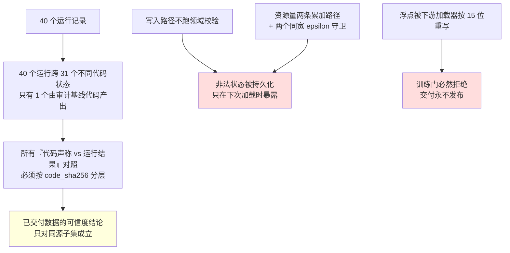
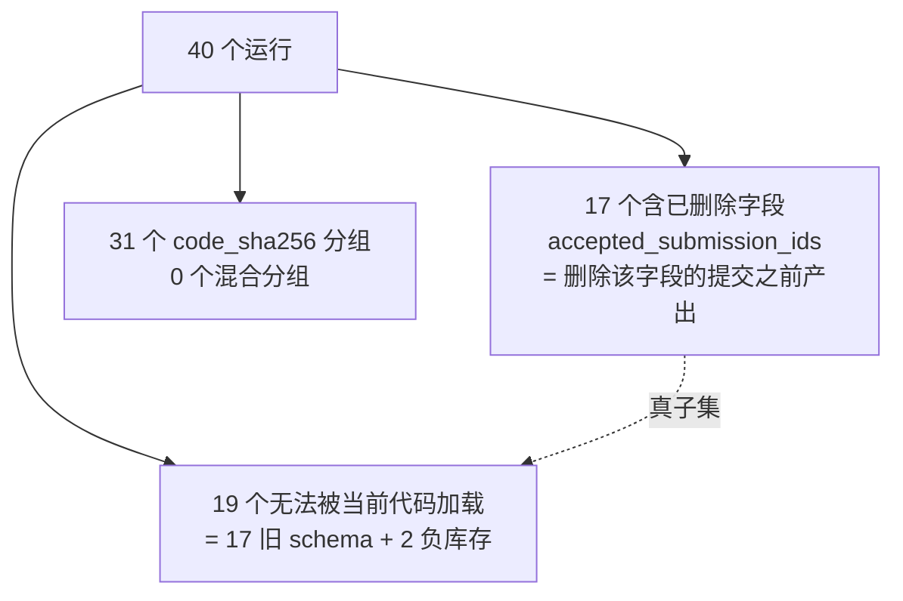
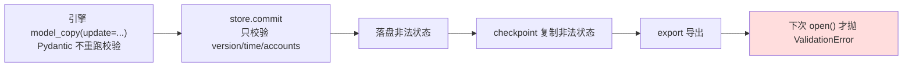

> 归档基线：2cf230115f4084aef2376e9d77bc976efbed43ea
> 原始路径：`docs/dev/research/code-refute-2026-09-17.md`
> 归档说明：此提交仅定位归档原文快照，不是审查执行证明；原始执行记录与未执行事实按原文保留。

# WorldMock 编码模块全面 refute（对抗审计报告）

> 状态：调研证据（历史依据，不构成当前规范）｜ 日期：2026-09-17 ｜ 结论：对抗复核驳倒 11 条原始发现并下调 8 条定级，维持 P1 及以上 9 条；发现的缺陷已由后续修复闭环。

日期：2026-09-17。审计基线：提交 `36540f8`（审计进行中该基线被并发会话推进为 `b430dae`，见「方法论与可信度」）。
测试基线：全量 `1050 passed in 98.39s`。
本报告的每条结论都经过**独立对抗复核**（另一个 agent 尝试驳倒它）；被驳倒的发现单列一节保留。

---

## 一、结论摘要

**最重的两条**：

| 缺陷 | 机制 | 后果 |
| --- | --- | --- |
| 训练数据加载门必然拒绝真实记录 | 训练记录的 `input`/`target`/`provenance` 以**嵌套 JSON 对象**落盘，HF `datasets` 读回时经 pandas 的 ujson 编码器按 **15 位有效数字**重写浮点（`1139.1499999999999` → `1139.15`），守恒检查随即 fail-closed | 交付管道不可用：唯一发布路径 18 次真实尝试全部失败，规格要求的交付清单零产出 |
| 状态不变量只在加载时执行 | 16 处 `store.commit` 与检查点恢复分支都不重跑领域校验；实测五条不变量**全部被接受并落盘** | 非法世界状态可穿过检查点与导出全程不被发现；已有 2 个运行因负库存永久不可加载 |

**可信度声明**：本报告**驳倒了 11 条原始发现**（其中 5 条是"环境必然拒绝"这类高定级指控），
并对 8 条下调定级。原始审计单元报告了 54 条发现，加上后补的四个单元共 76 条；
经对抗复核后**维持 P1 及以上者 9 条**。

---

## 二、方法论与可信度

### 执行方式

四阶段 pipeline：`审计 → 对抗验证 → 跨单元矛盾裁决 → 业界调研`。共派出 27 个隔离 agent：

**每个 finding 都有可执行复现**：审计与复核共产生 157 个探针脚本（118 个复现件 + 39 个复核探针），
全部落在 `/tmp/wm-audit/`，仓库文件零改动。

### 对抗复核的产出（这是本报告可信度的来源）

复核代理的立场是"驳倒这条发现"，结果：

- **驳倒 11 条**：办公室/游戏继续提示的矛盾（被人物工具面吸收）、未启用生活条目候选、
  周末路况系数（规格明文允许静态路况）、窗口起点材料丢失（初始状态已用左闭播种可见集）、
  零人物场景（装配层必然拒绝）、恢复分支重放父事件、编译边界起点丢失、
  字幕颗粒度（语料层声明的整片卡片）、关闭失败致 `run_failed` 写不进（触发条件不可达）、
  语料许可无执行者（已有人工登记）、预排事件永久滞留（生产不可达）。
- **下调定级 8 条**：注册表闸门缺口两条（真实触发需作者拼错配置）、真人参照通道之外的评估披露问题、
  质量报告的重复计数、审计工具恒真、恢复分支失败归因、只读视图口径、两个字段零消费者、映射配置断言。
- **修正数字 5 处**：`fail_run` 触发数 17→15、悬空检查点分支 8→9、`run_ended` 23→22、
  含 `accepted_submission_ids` 的库 19→17、`action_result` 超计 34/40→33/40。

### 审计基线的重大限定（必须先读）

40 个运行记录的 `code_sha256` 对应 **31 个不同代码状态**，反查提交后横跨至少 19 个提交加 12 个脏工作树状态。
**匹配审计基线 `36540f8` 的运行只有 1 个**（`deepseek-day-affordance`，1/40）。

含义：**任何"代码声称 vs 运行数据"的对照结论，只对同源子集成立。**
这也是本报告不把"运行数据反证代码"当作强证据的原因——运行数据本身是被混池的样本。
三个单元曾对同一问题给出 7 / 17 / 19 三个数字，裁决结果是三个不同的量：
旧 schema 库 17 个、加载失败库 19 个、活动缺字段库 1 个；
其中"7"是一个空集合推理假阳性（对空活动字典判断"缺字段"恒为真，6/7 命中是零活动的库）。

---

## 三、确认的缺陷（按定级）

### P0 — 两条

#### 训练数据加载门必然拒绝真实记录，交付永不发布

`src/worldmock/delivery/training.py` 把 `input`/`target`/`provenance` 作为嵌套 JSON 对象写入
`{split}.jsonl`，而 `datasets.load_dataset(..., Json(decode=False))` 对**对象形态**的列走
`datasets/utils/json.py: json_encode_field` → `pandas.io.json.ujson_dumps`，该编码器把双精度量化到
**15 位有效数字且没有无损档位**（`double_precision` 上限实测就是 15，传 16 直接报错）。

复核实测：138 条真实记录中 **136 行被改写**（`input` 135 行、`target` 50 行），
逐叶对比共 1883 个浮点叶子被改写；真实交付件里去重后的 260 个浮点有 **193 个（74.2%）**被改写。
于是守恒检查 `[_decode_json_record(row) for row in loaded[split]] != rows` 必然为真，
抛 `IntegrityError("Dataset loader changed canonical training records")`，
`pipeline` 在写出任何交付产物之前整体失败。

规格硬条款要求"以标准 `json.loads` 逐记录核对原值，保留缺失与 null 的区别和浮点数"，在此实现下不可满足。

**为什么测试看不见**：测试夹具用的浮点恰好都是 15 位以内可往返的值（`0.3`、`0.1`、`3600.0`、`65.0`、
`0.0048`、`1139.15` 逐个实测不被改写），而 `deliver()` 的成功发布路径**没有任何测试**。

**修改方向**：落盘前把三个 JSON 列序列化成**文本**再交给 `write_jsonl`
（`encode_example` 有一条"已是可解析字符串即原样返回"的短路，正是规格要求的口径）。
改约 3–5 行，守恒检查与 `_decode_json_record` 一行不动即可由"必然失败"变成真检查。
**禁止**通过放宽守恒检查来让交付通过——那会把错误浮点静默写进已发布的数据集，而读取侧 `json.loads` 不会报错。

#### 状态不变量只在加载时执行，写入路径不校验

`WorldState` 的领域不变量只由 `LifeEngine` 构造时的那一次 `model_validate` 执行；
16 处 `store.commit`、`FootprintStore.create`、检查点恢复分支（`checkpoint.py` 原样复制未校验状态）
**都不重跑校验**。复核实测逐条构造五条不变量，`commit` **5/5 全部接受并落盘**，只在下次加载时抛错。

**规格归属决定了修复位**：权威规格把世界状态校验责任判给生活模型、并**明令存储不反向决定活动或资源规则**
（"存储接收已验证的 JSON 状态与事件"）。所以正确修法是**让写入路径复校**，而不是把校验塞进存储层。

**与负库存缺陷的关系**：负库存那条不是"完全没有写时守卫"，而是 commerce 的守卫阈值（`< -1e-9`）
与不变量的边界（`0`）错配——`round(x, 9)` 恰好落在 `-1e-09` 时守卫放行。
同一仓库里 `resources/ledger.py` 已经是正确形态（容差内**归一化到界**，与规格"归零"条款一致），
即健康形态与危险形态并存。

---

### P1 — 七条（另有两条未完成复核，见第五节）

| 缺陷 | 机制要点 | 证据 |
| --- | --- | --- |
| 负库存穿过 epsilon 守卫被持久化 | 库存走 `round(累积+delta, 9)`，活动量走未舍入浮点求和，两个守卫阈值同宽（`1e-9`）互不吸收；`-1e-09` 被放行 | 2 个运行因此不可加载；与各自的两条合法兄弟运行**共享同一 code_sha256**，证明是当前代码写坏而非版本差异 |
| 失败路径读整个事件史 | `fail_run` 与反事实来源校验用 `read_events(last_event_seq)` 取全表并逐条 pydantic 解析，只为回答一个布尔谓词 | 1 天规模实测 0.82 秒 / 峰值 348 MB；替换为 `json_extract(...) LIMIT 1` 只需 0.2 毫秒（约 4000 倍），且该模式在仓库内已被 `status.py` 使用 |
| 世界状态与幂等账无界增长 | `processed_actions`/`activities` 只增不减（无任何裁剪路径），且每条事件提交都整体重写 `world_state` | 1 天运行足迹库已 156–223 MB；**调研代理另测出更早的墙**：检查点表把全量状态内联进 body，单日 156 份、state 从 16 KB 涨到 1.17 MB，是对天数的**二次增长**，84 天外推约 0.6 TB |
| 真人参照通道用点位距离发布方向性结论 | `left_distance < right_distance` 直接判定方向（浮点精确相等才算 mixed），整条路径无置信区间；实现合同要求的 `human_reference_candidate` 标签在代码里零命中 | 构造用例：候选与参照完全一致时仍发布 `outcome=left_more_supported`，且同一次运行里所有量化区间都是 `insufficient_blocks`；距离差 `1e-12` 也判 `left` |
| 目录有两个互斥写入者 | 按 `catalog/README.md` 重跑生成器会**静默删除** builder 追加的条目并把 manifest 版本重置回硬编码 `1.2`，**退出码 0**；实测还会清空墓碑文件 | 复核自跑复现全链（追加 → 重跑 → 条目消失、版本回退）；三条缓解证据：`--check` 会报漂移、钉扎检查拒绝中间态、既有测试钉住 manifest 与条目数 |
| 最大数值表声明为事实却溯源到未冻结提案 | 193 个 MET 值声明 `type: fact`，artifact 指向一份**未冻结提案文档**，note 写 `evidence snapshot pending`；真正来源 `corpora/lifestyle/items.json`（sha 可核验）未被指向 | 复核另发现两层自相矛盾：语料登记文件承诺假设值会标 `(assumption)`，而 **171/183** 条确实自带该标记、目录层却整体标 `fact`；124 条 fact 里 **121 条** artifact 指向 sha 钉住的语料文件，只有这 3 条不是 |
| 恢复在验证场景身份之前就发布分支目录 | `_prepare_resume` 只比父运行的模型身份与代码摘要，不校验请求场景是否与父检查点一致，却先把完整分支目录（manifest + 数据库 + 日志）写到目标路径 | 用错误场景恢复会留下一个内部自相矛盾的运行目录，且 `read_status` 与 `export_run` **都接受它**；直到环境初始化才抛 `IntegrityError`。对照：新建路径保留了场景摘要，恢复路径把它丢弃——接线遗漏 |

---

### P2 — 十六条（均已复核）

工程纪律类（fail-closed 声明未覆盖到最后一层）：

| 缺陷 | 机制要点 |
| --- | --- |
| 注册表嵌套子表不做未知键校验 | `tool`/`relief` 两个子表按 `.get()` 直读：把 `surface` 拼错，该活动类型**静默从工具面与习惯覆盖检查里消失**，加载与全部 155 项 catalog 测试仍全绿 |
| 习惯归并路由不做引用校验 | `activity_type` 从不校验为已声明类型，拼错的路由被通配兜底静默掩蔽 |
| 家族层布尔用 `bool()` 强转 | `unclassified = "false"` 静默变真并豁免覆盖完备性检查；同文件对同类错误在活动类型层是严格拒绝的 |
| 准入拒绝一切字面端点转换边 | `energy_kcal → money_fen` 这类资源折算 100% 被拒，与自身文档"convert 的字面端点是资源折算"矛盾；唯一能过的形状（两端同 id）被模型层禁止 |
| 准入两条规则作用域窄于声明 | 墓碑校验漏预排表与账户引用；初值上界校验漏账户初值——同一份引用放在资源字段被拒、放在账户字段被接受 |
| 引擎加载路径跳过语料存在性核对 | `load_runtime_scenario` 不传 `corpora_root`，于是"缺声明即拒绝"的语料半边在**运行路径**上是死的 |
| 动机层读仓库默认注册表而非场景钉定版 | L4 用场景钉定的注册表、L3 用模块全局默认；今天两者是同一文件故无可观测差异，但触发路径是公开参数可达。复核另查出**八处**同类旁路，只修动机层不足以闭环 |
| 四个已声明字段零消费者（合并情绪分量字段） | `sleep_channel`/`type_pattern`/`target_corpus`/家族 `comfort` 改任何值都不改变行为；情绪分量的真实取值在三个生成器里硬编码，且 `continue` 家族的注册表值与运行期取值**相反** |

评估与报告的"结论强于证据"类：

| 缺陷 | 机制要点 |
| --- | --- |
| 因果与资源连续性门禁四类规则有三类从不执行 | 共同支持掩码取字段交集，而对照侧恒定输出空的直接原因、状态版本、资源变化，于是三类规则永不执行；含资金不守恒的候选不会产生硬错误，报告却呈现为"通过"。注：真正拦住不守恒的是导出层的账本校验，故危害低于原判 |
| 共同活动支持为空时活动类指标仍报"ok" | 全空日向量上算出 0 差异并给出正常区间，等价于把被掩码排除的活动计为零活动——正是规格禁止的"把缺失计为零质量"。同一次运行里另三个指标已正确输出 `not_applicable`，属模块内不一致 |
| 评审维度无闭集校验 | 未知维度抛裸 `KeyError`，缺必需维度被静默接受（盲评包与报告静默少一维） |

交付与证据链类：

| 缺陷 | 机制要点 |
| --- | --- |
| 字幕在片段边界被重复交付 | 用区间相交判定"新跨过的字幕"，横跨边界的同一条字幕在每个后续边界重发；真实运行中 67 个观看会话共 241 次重复交付，全文进入模型提示词。注：语料本身就是整片单条字幕，"首边界交付全文"非缺陷 |
| 只读状态视图把祖先墙钟与调用计入恢复分支 | 恢复分支报出的现实耗时与模型用量含父运行的量（实测虚增 73%–252%，极端一例 19526%），与同份输出里本分支自身口径的 token 统计并列矛盾 |
| 未声明的内容选择规范进入每轮提示 | 工具描述与系统指令写有"办公室优先短视频、长片留给家里""在办公室公开看长娱乐不合时宜"——该规范在世界模型里没有对应事实，也不属物理/经济/任务可行性约束，且被既有测试钉住（有意而非笔误） |
| 画像注意力键的值被钳制下限静默夹断 | 配置声明的九档排序里最低档 0.02 低于钳制下限 0.03，该键在下限以下**零灵敏度**；末两档的实际差值由余数分配的按键序决定，而非偏好模型 |
| 人物通道的思考与工具选择参数与规格钉定值不符 | 规格钉 `thinking=disabled` + `tool_choice=required`，实现为 `enabled` + `auto`，运行身份也据实记录该偏离。偏离有真实探针驱动（思考模式拒收 `tool_choice=required`），但规格未回写——属文档缺口，且规格同条的另一半（独立工作验收）是合规的 |

状态模型类：

| 缺陷 | 机制要点 |
| --- | --- |
| 状态引用完整性只覆盖人物键 | 活动归属、账户引用、活动/交付/幂等账的键身份全部无校验；实测 8 类不自洽状态全部被接受。但因引擎是唯一写入者、键与归属由构造恒等，40 个运行零命中，无真实触发路径 |
| 内容品类事实多处手写 | 注册表、场景校验的 `Literal`、语料构建的品类元组三处各自手写；未声明品类被加载器接受、消费侧静默采零 |
| 耐久性字段双名与 `or` 回退 | 八条目录行的 `effect` 是死字段，运行时取值一律来自字面叫 `legacy_effect` 的字段 |
| 交付物状态枚举手写副本 | 质量统计手写复制动作状态与活动状态枚举，漂移时静默计入 `unrecognized` 而非失败 |
| 两条恒真断言 | 断言两侧是同一纯函数的相同调用形态，任何实现下都通过（AST 全仓扫描恰好命中两条） |

---

### P3 — 十二条（可优化，均已复核）

死字段与死参数：候选池三处配额声明恒不生效（全局上限实测不可达、家族配额不可达、睡眠时长上限被另一常量恒支配）；
注册表家族情绪分量无消费者已并入 P2；轮状态的观察版本字段只写不读；
一个预排事件类型声明后无生产者且效果分发对未处理类型走空操作（fail-open 缺口）；
`artifacts` 索引表、恢复检查点文件、脱敏函数三者写而不读；持久化审计工具的守恒分支不可达且生产路径零调用；
合同付款公式在目录里声明但运行期从不求值（真实付款在同一事实的第二份手写里）；
进食候选的能量收支夹逼与理由文本方向相反（`restores energy X->Y` 而 Y<X，触发带约 0.9%，样本内零命中）；
人物决策全部失败后引擎仍把失败人物的活动边界当推进边界（宿主会拦住，实际危害为零）；
映射配置校验全部写成 `assert`（`PYTHONOPTIMIZE` 下整段消失）；
日历特殊日不校验年份是否落在运行窗口内；场景允许零人物世界（装配层会拒绝）；
一次性迁移脚本仍可原地重写冻结的场景文件。

复核补充的**跨模块事实**：预排表编译在 `compile.py` 里有 **8 处**互不相同的端点政策
（七处 `start < due < end`，一处 `start < deadline <= end`），校验器又是第三种口径。
起点侧不丢材料（初始状态用左闭播种可见集），但终点侧不对称是真实的；
建议按规格已声明的左闭右开统一为单一谓词。

---

## 四、被驳倒的发现（保留，避免误修）

这一节是本次审计最重要的产出之一：**每一条都是原始单元以"真实触发路径"口吻报告、经独立复核证伪的**。

| 原始指控 | 驳倒依据 |
| --- | --- |
| 玩游戏时提示"继续游戏"而受理侧必拒 | 人物工具面在玩游戏中**撤下**了继续动作工具，模型拿不到该工具；提示与合同的不一致不可达 |
| 42% 内容条目因权重恒零永不进候选 | 该品类不参与动机采样是**显式声明**且被两条测试钉死；观察摘要与下钻工具是设计好的可达路径（模型自选观看过该条目即是证据） |
| 未启用生活条目被枚举为候选 | 机制成立但被 top-k 支配关系遮蔽（候选时长 60–120 分钟恒被 10 分钟档压过，真实运行零出现） |
| 周末仍套用工作日高峰系数 | 规格交付绑定条款明文允许"静态道路条件"，且日型已在冻结快照与代码文档双重声明 |
| 窗口起点的任务与邮件被静默丢弃 | 初始状态用**左闭**播种可见集，与编译器的严格内部区间互补覆盖，无丢失无重复 |
| 编译边界起点材料丢失 | 同上（这两条由两个不同单元独立提出、被两个不同复核代理用同一机制独立驳倒） |
| 零人物场景会静默产生空运行 | 装配层无条件引用含出行角色的对象，**任何**零人物文档都在加载期抛准入错误 |
| 恢复分支重放父运行的事件 | 分支只保留到检查点的父前缀，其后事件是新生；父子关系由 manifest 与逐事件运行标识表达，导出认证强制"祖先在前" |
| 单条全时长字幕导致颗粒度不符规格 | 语料获取层显式声明这是"跨整片时长的卡片字幕"，无更细粒度可交付 |
| 关闭失败致失败事件写不进数据库 | 触发条件不可达：日志关闭按契约永不抛，存储关闭抛错时失败事件反而写得进去 |
| 语料许可核对无执行者 | 许可由人工逐源登记并留痕（两个登记文件），出库的九条许可串无占位符 |
| 同秒预排事件永久滞留 | 唯一新增路径产生的时刻恒晚于当前时刻，四条可达路径逐条证伪 |

另外，审计单元自报的一条"审计工具恒真=假安全"也被驳倒：不守恒在账本应用期就被另一个错误码拒绝，
且该账本经存储与导出双重接线——真实护栏存在，审计工具只是冗余守卫。

---

## 五、未完成复核的发现（诚实缺口）

以下发现未进入复核波，**不应据本报告直接修改**：

- **动机层**：未到开放期的任务被枚举为候选、生活条目候选不看人物启用闭集（这两条的机制被调研代理独立解释为
  "缺少候选可执行性抽象"，见第七节）。
- **状态模型**：世界状态缺 `schema_version`（旧 schema 与随机损坏不可区分）、活动时间不变量缺三条、
  `boundary_type`/`interruption_reason` 用裸字符串承载未登记闭集、八条不变量守卫零测试断言。
- **构建管线**：溯源的断言位置与快照段落不存在、覆盖门禁单方向、一个规则文件无人解析、
  183 条 MET 值每条手写两遍且不比对、冻结语料无法由仓库脚本再生产、目录说明文档四处与实况相反、
  抓取脚本对步行请求硬编码驾驶档位、插值函数端点覆盖无断言。

这些在 `/tmp/wm-audit/units/` 里有完整证据与复现件，可按同一协议补一轮复核。

---

## 六、复核后的权威计数

以下数字以复算真值为准：含 `run_ended` 的运行数 22、含 `accepted_submission_ids` 的库 17、
无法被当前代码加载的库 19、触发全量事件读取的失败路径 15、悬空检查点引用的分支 9、
`action_result` 超过请求数的运行 33。冻结时记录的值与复算真值的逐项对照，以及被撤回的表述，
见文末版本表。

---

## 七、业界实践与修改建议

调研覆盖六个方向、共 74 条建议、引用来源 140+（含官方文档、规范、源码与同行评议论文），
完整交付件在 `/tmp/wm-audit/research/`。以下是推荐采纳的核心建议。

### 数值表示：连续量该用什么

业界在这点上有明确的**分域共识**：可数量用整数最小单位，连续生理量保留浮点但**声明量化网格**。

- 全引擎换定点（如 0 A.D. 的 `Position`、Photon Quantum 的 Q48.16）买的是**跨机逐位复现**，
  而本项目单机运行、状态与事件都以最短往返文本落盘（40/40 个库字节级往返一致），收益不成立。
- **epsilon 守卫不变量只有一种可辩护用法：容差内归一化到界**（本项目账本已是此形态、规格也明文要求归零）；
  "容差内放行"不可辩护。量有自然最小单位时正解是**量化后精确比较**。
- 交付管道要同时满足"下游可直接训练"与"原值无损"，业界做法是**两层结构**：
  给训练器低精度派生副本，给溯源与守恒的走精确源（RFC 8785 要求按 ECMAScript 最短往返）——
  本项目已有雏形，缺的只是"派生必须从精确文本派生"。

### 长周期状态：84 天能不能跑

业界在"不能每次推进都写全量快照"上**零分歧**（Axon 按事件数阈值、Postgres 按时间间隔 + 摊平、
SQLite 按页阈值）。要点：

- 先撞墙的是**检查点表**（全量状态内联进 body，对天数二次增长），不是事件表。
- 替代方案是"阈值/间隔检查点 + 派生数据移出权威状态"；`processed_actions` 是**派生数据**（三个判据），
  成熟做法是独立有界存储（Stripe 幂等键的原文：可按 24 小时自动移除）。
- 含完整提示词的证据留存与规模冲突，业界折中是**引用替代内联**（Langfuse 上传对象存储后原位替换为引用、
  已上传者按 id 去重）；OpenTelemetry 的 GenAI 语义约定把这类字段标为"默认不应采集"，
  理由之一正是数据体量。**而本项目规格已经写明"模型调用证据先形成持久化素材、再通过宿主提交证据引用"**——
  即这不是新架构，是补齐实现。实测消息级去重地板上界 50.3%。

### 需求驱动的行为选择

调研结论对本项目的候选生成问题很直接：**候选生成期必须保证可执行性，业界没有"枚举宽、受理窄、靠拒绝教模型"的正面先例**
（BDI 的选项生成器是两段式过滤、GOAP 的动作带前置条件检查、行为树把前置条件装饰到节点上离线验证、
主流 LLM 智能体框架把非法输出投影到可执行集合——有一项实测把可执行率从 18% 提到 79%）。

本项目缺的正是**"候选可执行性"这一层抽象**：注册表只声明"家族含哪些活动类型"，
不声明"要满足什么前置条件才能被提出"，且受理侧的校验器完全没被复用到枚举期；
拒绝理由也**没有回灌**给动机层（上下文里只有连续拒绝计数，没有原因），
于是下一轮用同一生成器产出同一条不可行候选。

关于"把 softmax 概率与排名暴露给模型"：调研给出三条独立理由判定**不可辩护**——
排名加高概率在功能上就是默认选项（元分析显示默认效应的实质机制之一是"代言"，
58 项研究、效应量 `d=0.68`），LLM 对选项顺序与标签的敏感度实测可达 13%–75% 的性能差，
而本项目**还有一个纯实现缺陷**：softmax 是对全部候选计算的再截断，
所以展示的五条概率之和不等于一、跨决策点不可比——连"信息"都没提供好，只剩诱导。
建议改为给可执行动作集合 + 四分量权衡 + 理由文本，呈现顺序用**注册表枚举序**（语义序）而非效用序。

### 真实性评估

- **"怎样证明 LLM 人物行为与真人相似"业界没有公认解**（生成式 ABM 领域的同行评议结论是
  "验证仍未被好好解决，许多研究仅依赖对'可信度'的主观评价"）。但它的四个子问题都有可引用规范，
  而本项目的四条发现**全部落在规范线以下**。
- 条件性门禁必须把"未执行"报成**独立第三态**并逐规则披露——三个独立领域（形式验证的空洞性、
  合规评估的三态判定值、测试报告的 skipped 列）口径一致。
- 点位距离**不可**发布方向结论：仿真验证规定比较只有三种（图形/主观、**区间/客观**、
  **假设检验/客观**），并明确"优先用后两种"。
- Krippendorff α 有**判定带与样本量公式**，关键是必须同时报有效单元数；
  "2 个单元 α=1.0"之所以危险，是因为它被当成可靠性充足。
- 模型评审**不能替代真人评审，可作补充但必须带真人锚点**——针对某一智能体优化过的评审会系统性高估它，
  高一致不等于有效。
- **额外发现（超出原派发范围）**：正式运行只有 12 个自然周块，而计量经济学实证显示块数少时
  名义 5% 检验的实际拒绝率可达 8%–11.5%；即补上区间后，区间本身在 12 块下也偏窄。
  可照搬的正面范例是把基准设成"真人自己的两周重测一致性"而非绝对真值。

### 声明式注册表的校验

- fail-closed 校验的**最小充分集**是"逐层封闭 schema + 严格类型 + 跨字段不变量代码"，
  而生态默认值全是放行未知键（JSON Schema 的 `additionalProperties` 默认放行、
  Pydantic 的 `extra` 默认 `ignore`）——**严格是必须显式付出、且必须逐层付出的动作**。
  仓库**已经**在别处用了 `extra="forbid"` 与 `jsonschema`，手写的那套注册表校验是唯一的例外，依赖成本为零。
- `assert` 做配置校验不可接受（三条权威来源口径一致，两个 linter 可自动检出）。
- 值域越界（如配置值低于钳制下限）JSON Schema **表达不了**，必须有代码校验器。
- **死旋钮**有成熟机制：Rust 生态把"每个已声明字段都有消费者"形式化为对
  "schema 叶子路径 ↔ 消费清单"的**双向**核对（两种失败各有名字）。
- 场景钉定的正确做法是**按内容摘要钉定**而非版本号别名。调研发现本项目在这一层有缺口：
  目录 manifest 只有版本号、没有内容摘要，且该版本号是构建脚本里的硬编码字面量，
  而注册表文件在构建脚本里**只被检查存在性**——改注册表值不会改变场景钉定的版本。

### 离散事件仿真

- 时间窗端点应以规格已声明的左闭右开统一（Flink 的 `TimeWindow` 逐字如此，且规格自己写了"左闭右开"）。
- 同刻事件定序业界统一为"到达时间 → 优先级 → 插入序"（SimPy/ns-3/OMNeT++ 三家一致）。
- 分支仿真的血缘，业界做法是让**每个产物自包含其祖先路径**（ERF 的表述），
  但本项目规格要求"引用可验证才算完整检查点"，故只借表达方式不借政策。
- 未知事件类型的正确行为是**拒绝而非静默忽略**；穷尽分发的成熟写法是
  `match` + `case _ as unreachable` 抛错，但本项目**没有任何静态类型检查器**，
  编译期保证在此仓库等于零，需与最小静态检查配置或纯动态穷尽性测试配套。

---

## 八、需要你裁决的三点

1. **正式 84 天运行的规模阻断要不要先解决？** 检查点表的内联全量状态是对天数的二次增长，
   1 天已 156 份 / 54.5 MB。若交付条款要求"任意边界可恢复"，就与"按阈值检查点"冲突——这一取舍需要规格拍板。
2. **真人参照结论的可接受强度。** 若按规范补上区间，正式 84 天只有 12 个周块，
   结论会系统性地降到"混合/不确定"。这会显著改变交付叙事，需要你确认接受。
3. **提示词里要不要继续给模型看候选概率与排名。** 移除会改变提示词 schema，
   使已产出的一千余条含动机提示的模型请求记录不再跨版本可比（符合"禁止向后兼容"，但需要规格先改）。

---

## 九、产物清单

| 位置 | 内容 |
| --- | --- |
| `/tmp/wm-audit/ground-truth.md` | 冻结事实块（含本报告版本表的勘误口径） |
| `/tmp/wm-audit/audit-protocol.md`、`verify-protocol.md`、`research-protocol.md` | 三份共享协议（可复用为后续轮次的派发模板） |
| `/tmp/wm-audit/units/` | 14 份审计单元报告（含完整证据、已排除假设、UNVERIFIABLE、method_gap） |
| `/tmp/wm-audit/verify/` | 16 份对抗复核报告（每条 finding 的独立证据与 verdict） |
| `/tmp/wm-audit/research/` | 6 份业界调研报告（74 条建议、140+ 引用来源） |
| `/tmp/wm-audit/repro/`、`/tmp/wm-audit/verify/*.py` | 157 个可执行探针（复现件与复核探针） |

仓库内文件零改动；`runs/**` 全程以只读模式访问。

## 版本表

| 版本 | 日期 | 修订内容 |
| --- | --- | --- |
| 本版 | 2026-09-17 | 冻结复核复算逐项修正冻结时记录的计数，并撤回两条被派发语料带偏的表述；正文数字以复算真值为准，逐项对照见下 |

冻结时记录的值与复算真值的逐项对照：

| 事实 | 冻结时记的值 | 复算真值 | 说明 |
| --- | --- | --- | --- |
| 含 `run_ended` 的运行数 | 23 | **22** | 换判据同值，非查询假象 |
| 含 `accepted_submission_ids` 的库 | — | **17** | 与 `code_sha256` 提交反查零反例 |
| 无法被当前代码加载的库 | — | **19** | 17 旧 schema + 2 负库存，是并集而非单一原因 |
| 触发全量事件读取的失败路径 | 17 | **15** | 17 是含失败事件的运行数，另两条由另一函数发出 |
| 悬空检查点引用的分支 | 8 | **9** | 漏了崩溃的那个分支（其检查点表为空，全部悬空） |
| `action_result` 超过请求数的运行 | 34 | **33** | 差 1 来自一条无动作标识的结果事件 |

两条被派发语料带偏的表述（由复核代理纠正，记此以免复述）：
"34/40 个运行的事件语义与规格不符"（实为规格意图：进行中与完成各记一条结果，孤儿结果为零）；
"交付件里有 1022 个高精度浮点"（复核换口径复算得 1883 个被改写叶子 / 943 个高精度记号，1022 不可复现）。
两者都不改变结论方向，但具体数字不可引用。

