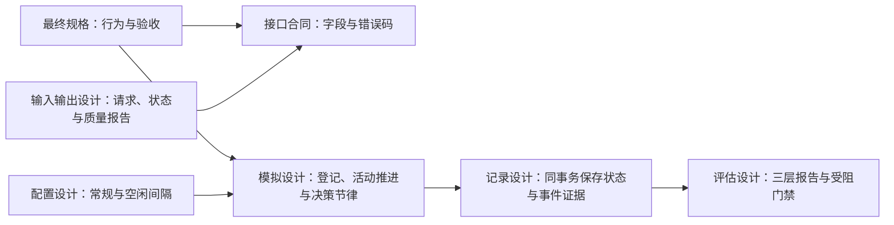

> 历史记录：本文件保存提交 `72f004b0087efa1b6f6d662ac6a143e087e4e21c` 时的过程与判断，不再定义当前系统。
> 当前设计见 [文档入口](../../INDEX.md)；正文中的路径、规则和结果按当时上下文理解。

> 归档基线：2cf230115f4084aef2376e9d77bc976efbed43ea
> 原始路径：`docs/dev/research/day-plan-goals-verification.md`
> 归档说明：此提交仅定位归档原文快照，不是审查执行证明；原始执行记录与未执行事实按原文保留。

# 当日目标实现与验收记录

> 状态：本特性全部实现并通过确定性验收，无待实现或待复验条目。
> 范围：[最终规格](../SPEC-day-plan-goals.md)全部行为，无特性延期项。日期：2026-09-21。

本文保留独立特性分支在 `4ae28c7` 的验收快照；后续与 main 的组合证据见
[主线组合验收](day-plan-goals-main-verification.md)。

## 隔离与源码身份

| 身份 | 实际内容 |
| --- | --- |
| 开发工作树 | `/Users/atishoo/.codex/worktrees/day-plan-goals/WorldMock` |
| 分支 | `codex/day-plan-goals` |
| 开发基线 | `170e1f0fcd83a745f9989da5dac95eac72ea8647`，冻结主目录当时已有修改及未跟踪的提案、调研和相关测试 |
| 实现与首次独立突变 | `2d97d3dbe8cd6120e5e3cb707f8387fd22deb601` |
| 加固测试与最终工程门禁 | `b53079d67e87e5ff075c083f1bd96238b6bf4d99`；生产源码与实现提交完全相同，只增加行为断言、补齐既有校验覆盖并校正文件清单 |
| 运行边界 | 开发和突变只写隔离工作树；未合并、未推送；Python运行库只读复用既有虚拟环境，源码与依赖来自隔离快照 |

初始定向基线 `147 passed in 15.46s` 仅证明改造前可运行，不构成本特性完成证据。
首轮全量诊断发现四个旧测试夹具问题和既有时间锚点校验覆盖缺口，均已修正；其失败结果未被登记为通过。

## 已裁决的接口与设计责任

人物提交有序目标，环境保存登记和活动证据。保留 `plan_day`，允许空清单，家族证据只标记已推进。
一次活动当日最多支持一个目标，修订不能抹掉已推进事实，也不能从报告分母删除丢弃目标。
三层报告进入真实 quality 导出；正确的外部约束拒绝记运行受阻，不称引擎缺陷。



| 设计文档 | 本次落实的职责 |
| --- | --- |
| [模拟引擎](../../design/04-simulation-engine.md) | 有序目标、首次正时长推进、午夜结算先于失效、已推进修订保护、一次情绪奖励与精确威胁唤醒 |
| [记录引擎](../../design/05-recording-engine.md) | 登记结果和活动结算保存完整目标对象，复用原有事务和冻结导出边界 |
| [评估](../../design/07-evaluation.md) | 习惯、外部结构、刻意目标分别统计；历史分母、实际活动证据、空样本和外部受阻门禁 |
| [配置](../../design/08-configuration.md) | 场景常规/空闲重估间隔及其关系校验；人物不填时间参数 |
| [输入输出](../../design/09-io-formats.md) | 新请求及持久状态、活动品类快照、目标质量报告；旧时段形状直接拒绝 |

提案已改为裁决依据；现行行为只在最终规格维护。其他规格、接口合同、设计、覆盖映射与索引已同步，
不为本特性新增另一份设计权威，不保留旧计划字段、段起点唤醒、段级照做函数和偏离分钟指标。

## 行为与测试对应

下表的路径以仓库根目录为准，列出的都是实际测试入口和行为断言。

| 要求 | 生产责任 | 验证入口与外部可见断言 |
| --- | --- | --- |
| 目标闭集、容量、文字和严格形状 | `life/schedule.py`、`life/models.py` | `tests/life/test_day_plan.py` 的 empty_and_eight、text_bounds、text_limit、input_rejects、old_checkpoint 测试：空与八条接受，第九条/空白/超长/非法意图/旧字段/环境证据拒绝 |
| 空清单已提交、每日一次、迟交与重试 | `life/engine.py`、`life/schedule.py` | 同文件 empty_plan、late_first_submission；`tests/life/test_revision_contract.py` 同日重提、跨日重开和拒绝后重试测试，核对实际错误码与状态 |
| 修订保护与登记身份 | `life/schedule.py` | `test_revision_keeps_progressed_prefix_and_original_registration_for_unchanged_goals`、`test_revision_merged_limit_returns_domain_error_and_preserves_plan`；核对前缀顺序、原登记时刻、合并容量拒绝和原状态不变 |
| 正时长、人物/日期/家族/登记时刻 | `life/schedule.py`、`life/rhythm.py` | day_plan 的 progress_requires、lifestyle_family 与 goal_pulse_requires_actual_own_positive_evidence 测试；零时长、他人、历史、跨日和错误品类均不能推进；day_boundary_expiry_and_agent_isolation 另验证人物间到期清理隔离 |
| 一次活动只推进首个目标且只奖励一次 | `life/schedule.py`、`life/rhythm.py`、`life/felt.py` | `test_progress_consumes_one_activity_once_in_priority_order_and_survives_serialization`、`test_goal_pulse_requires_actual_own_positive_evidence_and_is_one_time`；序列化恢复及修订后不重复消费活动；重复结算的身体状态不重复奖励；test_minimal_engine_registration_progress_checkpoint_path 另经真实检查点恢复核对推进证据保持不变 |
| 午夜先结算再失效 | `life/engine.py`、`life/rhythm.py` | `test_midnight_final_interval_progresses_old_plan_before_expiry` 与 `tests/footprints/test_goal_export.py::test_real_engine_midnight_settlement_exports_old_day_goal_progress`；状态过期，旧日结算与导出仍保存推进证据 |
| 精确威胁和双间隔 | `life/schedule.py`、`life/rhythm.py`、`life/scenario.py` | `tests/life/test_wake_reasons.py` 的候选/唤醒一致、自定义间隔、精确预警、真实引擎任务与闭店测试；检查具体原因与 commitment_threatened 同时存在 |
| 承诺判定、睡眠与既有节律 | 同上 | wake_reasons 的 commitments_exclude、sleep_accepts、scenario_rejects；`tests/life/test_revision_contract.py` 的睡眠/静默边界；`tests/life/test_engine_feedback.py` 保留游戏回合与消息唤醒断言 |
| 实际 Schema、本地校验和空清单工具门控 | `custom/agents/life_agent.py`、`custom/envs/life_env.py` | `tests/integration/test_grounded_targets.py` 的 plan_day 与 revise_day_plan 系列；`test_life_agent_protocol.py::test_plan_tool_schemas_describe_ordered_goals_and_empty_revision`，核对模型实际收到的闭集 Schema |
| 完整事实与有限场景叙述 | `life/projection.py`、`life/narration.py` | `tests/life/test_grounded_observation.py` 的去锚点、全文目标/场景预算和就寝后可见性；`tests/life/test_narration.py` 核对已推进措辞，不称文字目标完成 |
| 人物到环境、SQLite、下一观察与恢复 | LifeAgent、LifeEnv、LifeEngine | `tests/integration/test_observation_agent_seam.py::test_native_goal_tools_persist_empty_revision_progress_and_restore`，实际 dispatch_react_tool 提交空清单、修订、执行活动、持久化与恢复后继续核对已推进保护 |
| 目标历史分母、优先级和真实证据 | `evaluation/goal_metrics.py` | `tests/evaluation/test_goal_metrics.py` 修订历史、登记时刻、孤立状态、实际家族、活动标识、同活动跨结算、午夜与 run/人物/日期/code 分组反例；核对事件标识与手算分母 |
| 习惯首次正时长样本与跨日条件 | 同上 | 同文件 first_settlement、zero_duration、same_day_repetition、missing_lifestyle、run/人物/地点/小时隔离测试；核对具体样本事件、配对分子分母、加权一致率与 null |
| 外部拒绝闭集、去重与缺证据门禁 | 同上 | 同文件十三种外部错误码参数、run隔离、同动作多事件、幂等重放、缺 action_id/error_code 测试；核对 block_count、来源事件、接受率与门禁 |
| 真实质量导出与既有评估入口 | `footprints/quality.py`、`evaluation/behavior_metrics.py` | `tests/footprints/test_goal_export.py` 实际 export 命令按登记/推进/拒绝三个冻结截点导出；验证 manifest 摘要及完整质量内容；行为入口测试核对同一报告并删除旧指标 |
| 工程与文档一致性 | 现行合同、规格、设计与测试 | 全量 coverage gate、style gate、documentation gate、旧生产符号扫描与独立文档审查 |

## 独立 Uncle Bob 审查

实现者不审查自己编写的模块：指标实现代理审查领域，领域实现代理审查指标，文档审查代理审查人物接口。
每路先在干净提交创建独立 detached worktree，再运行未突变基线；每个突变只改生产行为，
使用预声明测试命令，立刻恢复并检查完整 diff/status。语法、导入与环境错误不计为 killed。

| 范围 | 首轮结果 | 原始证据 |
| --- | --- | --- |
| 领域与节律 | 71 项基线通过，11 killed，0 survived/invalid/inconclusive | [领域审查](day-plan-goals-bob-domain.md) |
| 人物接口与观察 | 8 项基线通过，8 killed，0 survived/invalid/inconclusive | [接口审查](day-plan-goals-bob-interface.md) |
| 三层指标与导出 | 89 项基线通过，13 killed、3 survived，0 invalid/inconclusive | [指标初审](day-plan-goals-bob-metrics.md) |

三个初次存活突变分别暴露：零时长被计为习惯样本、同一活动后续区间推进第二个目标、
同一天两个样本冒充跨日习惯证据。现实现本身正确，父代理增加三项针对行为的测试后已通过 54 项指标测试。
在 `b53079d` 的新干净隔离工作树上，三个原补丁 SHA-256 不变并逐字节复验，全部 killed，
各自只在对应新增断言失败。未突变及恢复后均为 92 passed；完整证据见
[指标复验](day-plan-goals-bob-metrics-recheck.md)。初次存活结论保留，不追溯改写。

合计审查三十五个不同语义突变，首次三十二个被杀死，余下三个经补测复验全部被杀死；
没有剩余存活突变、无效突变或待判定突变。三路审查及复验的临时工作树均已正常移除。

## 固定源码工程门禁

最终门禁使用 `b53079d`，执行期间生产与测试文件冻结。命令：

```sh
UV_PROJECT_ENVIRONMENT=/Users/atishoo/Project/WorldMock/.venv \
UV_NO_SYNC=1 LITELLM_LOCAL_MODEL_COST_MAP=True \
PYTHONPATH=src:.:vendor/agentsociety2/packages/agentsociety2:vendor/labelkit/src \
/Users/atishoo/Project/WorldMock/.venv/bin/python scripts/coverage_gate.py
```

实际结果：**3638 passed, 4 skipped, 24 warnings in 526.52s (0:08:46)；分支覆盖率 96.51%（6715/6958），未覆盖公共接口为零**。退出码为零，门禁 PASSED。
完整原始输出见 [工程门禁输出](day-plan-goals-gates.txt)，机器收据见 [coverage-report.json](../coverage-report.json)。
运行身份 `b26b9de8-30e0-40ae-8832-91c5e350396e`；覆盖 manifest 摘要 `7f9d24c0a0461cb049e4755212a012aca1094d60d4ba944e53363766cc95cc26`。
最终文档更新后另执行 `scripts/documentation_gate.py`，78 份文档、零断链；
`tests/test_style_gate.py` 与 `tests/test_documentation_gate.py` 合计 7 passed in 1.80s。
新增规格、提案与审查记录中的相对 Markdown 文件链接另逐项检查可解析；不把文档更新算作另一轮全量测试。
既有时间锚点模型补测仅补正常错误传播与字段错误断言，不修改生产行为或门禁；独立定向 28 项通过。
本特性新增测试没有 skip、xfail 或占位。四个既有跳过都位于 `tests/resources/test_equivalence_anchor.py`，仅因隔离工作树缺少历史运行 `runs/deepseek-multi-47931e06` 的 SQLite 产物；该文件未改动，不冒充本特性证据。

本记录只接受本规格的确定性功能与工程验收；项目原有十二周正式运行、盲评与完整自然日 LabelKit
交付仍按 [项目验收标准](../../VERIFICATION.md) 判定，不能由本特性离线结果替代。

## 实际修改清单

以下清单由开发基线 `170e1f0fcd83a745f9989da5dac95eac72ea8647` 到特性验收提交 `4ae28c7` 的 Git diff 生成。

共 61 个文件；不包含开发基线冻结的其他会话修改。

| 文件 | 变更 |
| --- | --- |
| `custom/agents/life_agent.py` | 修改 |
| `custom/envs/life_env.py` | 修改 |
| `docs/CONTRACTS.md` | 修改 |
| `docs/INDEX.md` | 修改 |
| `docs/VERIFICATION.md` | 修改 |
| `docs/design/04-simulation-engine.md` | 修改 |
| `docs/design/05-recording-engine.md` | 修改 |
| `docs/design/07-evaluation.md` | 修改 |
| `docs/design/08-configuration.md` | 修改 |
| `docs/design/09-io-formats.md` | 修改 |
| `docs/dev/ANALYSIS-spec-coverage.md` | 修改 |
| `docs/dev/PROPOSAL-day-plan-goals.md` | 修改 |
| `docs/dev/SPEC-day-plan-goals.md` | 新增 |
| `docs/dev/SPEC-decision-context.md` | 修改 |
| `docs/dev/SPEC-interaction-menu.md` | 修改 |
| `docs/dev/SPEC-life-realism.md` | 修改 |
| `docs/dev/SPEC-life-runtime.md` | 修改 |
| `docs/dev/coverage-report.json` | 修改 |
| `docs/dev/implementation-status.md` | 修改 |
| `docs/dev/research/day-plan-goals-bob-domain.md` | 新增 |
| `docs/dev/research/day-plan-goals-bob-interface.md` | 新增 |
| `docs/dev/research/day-plan-goals-bob-metrics-recheck.md` | 新增 |
| `docs/dev/research/day-plan-goals-bob-metrics.md` | 新增 |
| `docs/dev/research/day-plan-goals-gates.txt` | 新增 |
| `docs/dev/research/day-plan-goals-verification.md` | 新增 |
| `docs/dev/research/day-plan-semantics.md` | 修改 |
| `src/worldmock/evaluation/behavior_metrics.py` | 修改 |
| `src/worldmock/evaluation/goal_metrics.py` | 新增 |
| `src/worldmock/footprints/models.py` | 修改 |
| `src/worldmock/footprints/quality.py` | 修改 |
| `src/worldmock/life/engine.py` | 修改 |
| `src/worldmock/life/felt.py` | 修改 |
| `src/worldmock/life/models.py` | 修改 |
| `src/worldmock/life/narration.py` | 修改 |
| `src/worldmock/life/projection.py` | 修改 |
| `src/worldmock/life/rhythm.py` | 修改 |
| `src/worldmock/life/scenario.py` | 修改 |
| `src/worldmock/life/schedule.py` | 修改 |
| `tests/evaluation/test_behavior_metrics.py` | 修改 |
| `tests/evaluation/test_goal_metrics.py` | 新增 |
| `tests/footprints/test_event_fields.py` | 修改 |
| `tests/footprints/test_goal_export.py` | 新增 |
| `tests/integration/test_activity_schema.py` | 修改 |
| `tests/integration/test_agent_branch_coverage.py` | 修改 |
| `tests/integration/test_grounded_targets.py` | 修改 |
| `tests/integration/test_life_agent_protocol.py` | 修改 |
| `tests/integration/test_observation_agent_seam.py` | 修改 |
| `tests/life/conftest.py` | 修改 |
| `tests/life/test_activity_title_embedding.py` | 修改 |
| `tests/life/test_affordance_contract.py` | 修改 |
| `tests/life/test_day_plan.py` | 修改 |
| `tests/life/test_domain_branch_coverage.py` | 修改 |
| `tests/life/test_engine_branch_coverage.py` | 修改 |
| `tests/life/test_engine_feedback.py` | 修改 |
| `tests/life/test_felt_states.py` | 修改 |
| `tests/life/test_grounded_observation.py` | 修改 |
| `tests/life/test_model_input_killpoints.py` | 修改 |
| `tests/life/test_narration.py` | 修改 |
| `tests/life/test_revision_contract.py` | 修改 |
| `tests/life/test_wake_reasons.py` | 修改 |
| `tests/profile/test_models.py` | 修改 |
