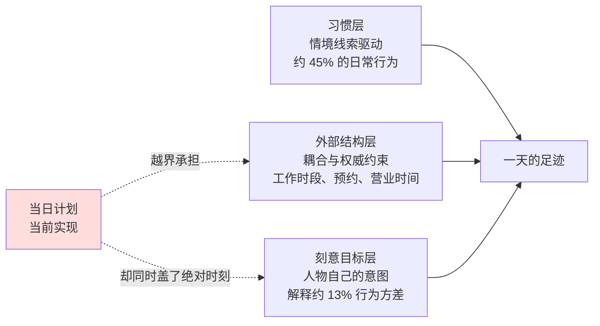
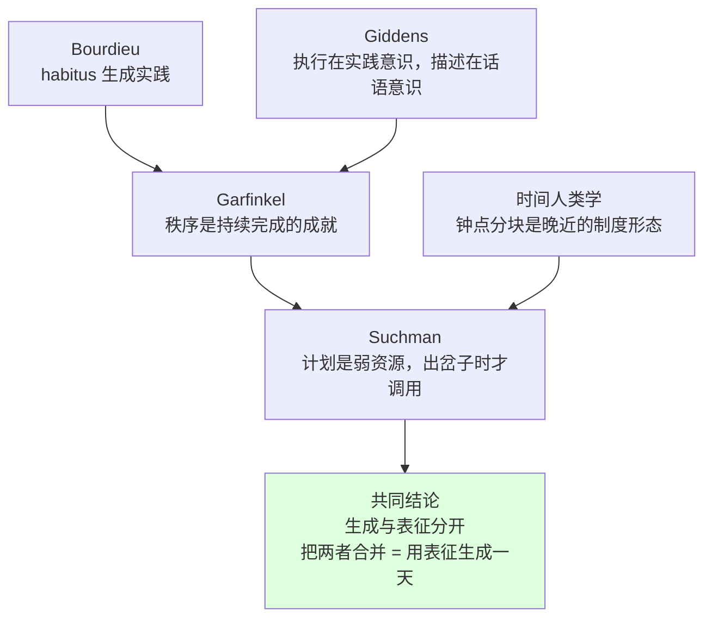
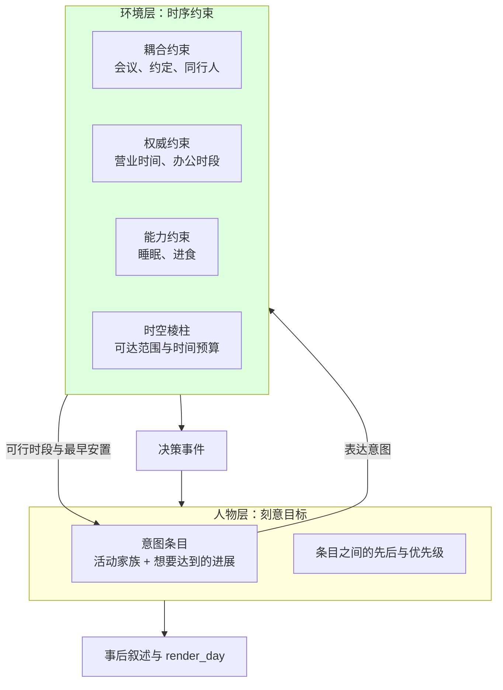

# 当日计划的语义调研：计划、目标与时间锚点的学科依据

> 状态：调研证据（历史依据，不构成当前规范）｜ 日期：2026-09-21
> 结论：`plan_day` 的价值在目标卸载与承诺，不在行为预测。当前实现把它同时当作目标层与时刻表，是最不可靠的一层承担了最可靠两层的职责。
> 依据本文提出的改造方案见 [当日计划语义改造提案](../PROPOSAL-day-plan-goals.md)（已裁决）。
> 最终行为与验收见 [当日目标特性规格](../SPEC-day-plan-goals.md)，研究结论不替代规范。
> 范围：只审查当日计划的语义与时钟归属，不涉及工具开放逻辑、提示预算与记忆引用路径。文中所有外部结论均标注核实状态。

## 结论摘要

一天的行为由三种控制模式共同决定，而当日计划只描述其中最不可靠的一层。把它当作"一天怎么过"的表示，等于用约 13% 的方差去代表全部。

三个独立学科传统（社会理论、认知科学、行为心理学）分别到达同一个架构判断：**目标层与时序层必须分开**。目标层是"做什么、为什么"，与情境无关、修订廉价、由事件触发；时序层是"什么时候做"，数值化、与世界耦合（出行时长、营业时间、资源可用性）、不可行性只在这一层暴露。把两层压在一起会得到两种失败之一：为了一班晚点的公交重算整个目标体系，或者冻结一份已经无法达成目标的日程表。

由此得出对当前实现的具体判断：

- `PlanSegment` 同时携带绝对起止秒（时序层）与活动家族和备注（目标层），两层压成一层，而模型创建绝对秒所需的信息并不在提示里。
- 环境已经是唯一合法的世界状态写入者，时序约束天然属于环境层，不需要新概念。
- 刻意目标层是三层里最小且最不可靠的，把它写死成时段表会让产出的日子比任何日记研究观察到的都整齐。

## 学科依据

### 社会理论：没有哪个传统认为计划是行为的生成器

这一组文献本来是用来支持"目标驱动"的，实际找到的是更强的否定。共同的形状是**生成与表征分开**：行为由倾向、情境、约束生成；被表征的时候才呈现成计划形。

| 传统 | 核心主张 | 确切术语 | 对当日计划的含义 |
| --- | --- | --- | --- |
| Bourdieu | 实践由 habitus 生成，不经由显式意图或规则查询 | `habitus`、实践逻辑、`synoptic illusion` | 他对 Kabyle 历法的分析指出：日历只能是写在纸上的东西，访谈者口中前后矛盾、随情境变动的历法说法是被分析者整理成干净网格的。问人物"今天打算怎么过"拿回的整齐日程，本身就是描述情境的产物 |
| Giddens | 日常执行属实践意识，不在话语意识中；但**描述可以按需生产** | `practical consciousness` / `discursive consciousness`、`time-space zoning` | 人物被问起时会给出一份连贯的计划形答复，无论是否有计划在支配行为。叙述的连贯不能当作机制的证据 |
| Garfinkel / Sacks | 秩序是成员持续完成的成就，不是规则应用的结果 | `accountability`、`etcetera clause`、`doing being ordinary` | 规则无法规定自身的应用，总有什么在填补空缺。日程写得再细也不会消除即兴，只会把即兴挪到对日程条目的解释上 |
| Suchman | 计划不是控制行为的东西，而是行动的**弱资源** | `plans as resources`、`situated action` | 她的经验研究是 Xerox 复印机（PARC Operability Project, 1980–81）。计划在出岔子、环境陌生、或需要为自己辩解的时候才被调用。她针对的正是 Newell & Simon 那条"目的性行动 = 执行计划"的路线 |
| 时间人类学 | 时间计算是社会性的；日程锚定是晚近的、纪律性的、协调性的 | Evans-Pritchard 的 `oecological time` / `structural time`、Thompson 的 `task-orientation` vs `clock time` | 显式时间分块不是表征一天的中性基底，而是伴随工业纪律而来的特定制度形态。它首先是协调技术，其次才是认知技术 |

关于这一组的证据强度需要说实话：**概念支持很强，经验支持很薄**。没有哪项研究估算了日常行为中有多少比例由计划生成；而最接近量化主张的时间利用日记，正是 Bourdieu 会称为 synoptic illusion 的那类数据。Bourdieu 的历法论证针对的是年度仪式时间，不是逐小时作息，把它外推到日计划是我的类比而非他的原话。

Bourdieu 之外四位都承认一件事：**外在的时间表是真实的约束**。课表、营业时间、班次、上下班时刻，habitus 是在这些约束之内运作的。主张针对的是生成机制，不是环境。这一点对下一步的设计直接有用——时间锚点该留着，只是不该由人物生成。

### 认知科学：目标层与时序层的分野是教科书级的

| 传统 | 目标层术语 | 时序层术语 | 时间表示 | 是否有时长 |
| --- | --- | --- | --- | --- |
| Schank & Abelson 1977 | script、plan / planbox、goals、themes | scene 序列、header 入条件 | 序数 + 因果，只有概念时态 | **无时长槽位** |
| HTN 与古典规划 | 任务网络、methods、任务分解 | 约束张贴、STP、time map、PDDL 2.1 durative action | 区间与时刻加上下界 | 有，但只在时序规划扩展里 |
| BDI | desires → intentions、plan library | 解释器循环、事件队列 | 非时间性，事件驱动 | 不适用 |
| Generative Agents 2023 | 隐在自然语言计划与人物文本里，**无目标树** | daily plan：start time + duration + description，递归分解 | 度量化的 time-of-day，多粒度 | 有，一等字段 |
| 交通行为学 | **activity program / agenda**（做什么、优先级） | **activity schedule**（何时、何序、何地） | 连续、度量；时段选择与时长选择是分开的模型部件 | 有，且是统计估计量 |

有几处值得单独点出。

**Schank & Abelson 的分层是序数的。** 他们的 script 有时序但没有时长槽位；时钟出现的地方只是入条件（餐馆是否开门）。时长是下游才引入的。我们现在的 `PlanSegment` 强行塞入起止秒，等于把下游的东西提到了上游。

顺带纠正一处我此前引错的说法：这本书里的四个实体是 scripts、plans、goals、themes，作者在前言里自己给了置信度排序（scripts > plans > goals > themes，越往后定义越松）。"PAG/TAG" 不是这本书的术语，不要用。要表达分层就直接写"themes 生成 goals，goals 生成 plans，plans 生成 actions"。

**交通行为学给了这一层它自己的名字。** `activity program`（我打算做哪些事、各自什么优先级，在排程之前）与 `activity schedule`（实际排在几点）是**分开建模的两个量**。这正好对应"给待办和暂停事务设一个目标"这个说法，而且这个领域早就有名字，不需要新造概念词。

**BDI 回答了"多久叫醒一次"，而且答案不是周期。** Bratman 的要点是 intention 是 conduct-controlling 且 reason-terminating 的——它**终结**一个问题的讨论，这个"终结"才带来计算价值。desire 不约束进一步思虑，intention 约束。Rao & Georgeff 给出三档承诺策略：

| 策略 | 放弃意图的条件 | 后果 |
| --- | --- | --- |
| `blind commitment` | 认为已达成或不可能 | 稳定高效，对世界变化充耳不闻 |
| `single-minded commitment` | 已达成、不可能，或不再想要 | 多数报告设置下的内部最优解 |
| `open-minded commitment` | 上述之外再加上判断其不可达成 | 响应性好，但会震荡 |

现在的实现实质上是 open-minded commitment：每次唤醒都可能重新考虑一切。报告作者标了警告——**Kinny & Georgeff 那个"single-minded 通常最优"的结论他没能在原文核实**，而这是本报告中唯一可能改变唤醒参数的经验结论，不要拿它当设计依据。

**Generative Agents 可借鉴的是决策循环，不是它的计划表示。** 它不让所有 agent 同步 tick 过决策步，而是每个 agent 在被迫时推进自己的认知：当前计划步时长走完、感知到需要反应的事件、或共处触发对话。共享的环境时钟只负责排序。这与本项目"共享时钟推进到下一个相关事件而非固定 tick"是同一件事，理由也相同：越过一个活动的结束时刻就丢掉了活动边界。

但它的计划表示是**时间锚定的调度，不是目标层次**。它把日计划做成三元组列表并递归分解到 5–15 分钟。值得注意的是，调研时的旧规格曾明确写了"刻意不做递归分解到 5–15 分钟"——也就是说我们借了它的 5–8 段结构，却砍掉了让它能落地的那一半。粗块之所以够用，是因为下面有细化机制接着。改造前的 `PlanSegment` 既要粗块语义（5–8 段、意图），又要细化后的精度（绝对秒），两边都不占。

### 行为心理学：计划不是预测，时间锚点是弱线索

这一组是本报告里数字最硬的，而且它推翻了把自写计划当基准的用法。

#### 计划与行为之间有一个被量化的落差

Webb & Sheeran（2006, *Psychological Bulletin* 132(2):249–268）的元分析：意图改变 **d = 0.66**，行为改变只有 **d = 0.36**。换算过来，意图大致解释行为方差的 13%。相关研究的意图-行为相关系数在 r ≈ .36–.53 之间（McEachan 等 2011；Godin & Kok 1996）。Orbell & Sheeran 为"有强烈意图却没有行动"的那约一半人创造了 *inclined abstainers* 这个说法。

与此同时，Wood, Quinn & Kashy（2002, *JPSP* 83(6):1281–1297）发现**约 45% 的日常行为是在同一情境下重复的**，由线索驱动，与人的目标无关地持续存在。

这两条合起来说明：拿"实际偏离计划多少"当指标，测的是模型能不能遵守自己刚说过的话（指令遵循能力），不是像人的程度。模型完全可以写一份平淡的计划然后忠实执行、偏离为零，而行为一点也不像人。

#### 计划的乐观是系统性的，不是随机的

Buehler, Griffin & Ross（1994, *JPSP* 67(3):366–381，五个研究、465 名本科生）的出声思考数据最有价值：参与者**没有估计结果的分布，而是构造了一个单一的、有序的、无障碍的剧本，然后把它当作日期报出来**。预测实质上就是他们的计划。

三条独立证据说明为什么自写计划会过满：

- 从内部视角构造，只取单一场景，不取基率（Buehler 等）
- 生成于实施心态（Gollwitzer 1990 的 deliberative vs implemental mindset）：障碍不只是被忽略，而是被主动过滤，感知可行性被抬高
- 针对一个比当下更空闲的幻想未来书写（Zauberman & Lynch 2005 的资源冗余）

效果的真实幅度需要诚实交代：Halkjelsvik & Jørgensen 的综述（2012, *Psychological Bulletin* 138(2):238–271）覆盖约 122 项研究，结论是低估存在但平均幅度适中，且随任务长度与新异性变化极大，**很短的task 更常被高估而不是低估**，并且没有单一统一机制。Roy, Christenfeld & McKenzie（2005）认为它主要是关于过去同类任务耗时的记忆偏差。

需要标注：报告作者**未能核实**"schedule 框架 vs goal 框架"这个对照以此命名存在于规划谬误文献中。实质内容有，但记在 Gollwitzer 的 deliberative/implemental mindset 名下。不要作为一个已验证的区分写进文档。

#### 时间锚点确实有效，但条件比效果重要

Gollwitzer & Sheeran 的元分析（2006, *Advances in Experimental Social Psychology* 38:69–119）：94 个独立检验、N = 8,461、**d = 0.65**。机制**不是动机增强**，而是计划建立了一个预先联结的情境线索 → 反应关联，遇到线索就启动行动，降低对意识思虑的依赖。支持证据包括线索的可及性提高、感知准备性、认知负荷下仍能高效启动、动机耗尽后效果持续，以及最强的一条——在额叶受损患者、海洛因成瘾者、精神分裂症患者这些执行控制受损人群中同样有效。Gollwitzer & Sheeran 把这个叫 *strategic automaticity*。

但边界条件比标题数字重要：

- **效果依赖一个已经存在的目标意图。** 实施意图不创造目标，它自动化已经持有的目标的启动。所以"给待办设目标"是前提，不是可选。
- **现场效果远弱于实验室。** 健康行为领域的元分析落在 d ≈ 0.3 而不是 0.65。这个文献的规模和历史使发表偏倚成为真实的顾虑。
- **线索必须机会相容。** 把一个意图锚到一个当时并不空闲的时刻，产生的是体验到的失败而不是行动。
- **时刻线索本身就弱。** 基于时间的计划依赖自我发起的看表，而事件线索由环境送达；时间型前瞻记忆可靠地差于事件型。报告作者**未能在元分析的调节分析里核实**时间线索是否可靠劣于事件线索，标为未决。

有一组旁证指向同一个设计结论。Ariely & Wertenbroch（2002, *Psychological Science*）发现自我设定的等距截止日改善了表现，但**外部强加的等距截止日更好**。Milkman 等人的健身房 megastudy（约 61,000 名参与者、53 种干预，*Nature* 2021）里最好的干预（计划加微奖励）在四周内把每周健身次数提高约 27%，之后效果衰减，多数干预效果很小。COVID 疫苗短信 megastudy（约 47,000 人）里最好的短信只移动约 1 个百分点。

结论：**给时间锚点一条经由环境生效的路径，而不是只在人物意图上盖个时间戳。** 这与本项目"只有环境可以改变世界状态"是同一个形状——环境才是让一个 14:00 承诺生效的东西，人物自写的时间应当被理解为弱且可推翻的线索。

#### 计划有一件真实的功能，而且不需要执行

这一条我没预料到，但它比"人物需要连续性"这个理由硬。

Masicampo & Baumeister（2011, *JPSP* 101(4):667–683）：未完成的目标会产生侵入性念头并损害无关任务的表现，但**为它做一个具体的计划就消除了这种损害，尽管目标仍未完成**。让人分心的是**未计划**的目标，不是未完成的目标。计划承担的是卸载功能，不需要真的去做就能完成卸载。

这也解释了为什么待办的形态本来就不该挂时刻：Bellotti 等人的 to-do 研究（CHI 2004, "What a to-do"）发现待办清单通常**根本不带时间锚**，它起的是"记着"和"现在不做"的信号作用，清单上 20–30 条里有相当一部分会滞留数周至数月。Palen 的日历研究（CHI 1999）发现群件日历系统性地错误表征实际发生的事——参与者维护影子日历、记录的是计划而非实际事件、条目会变陈旧。**日历是关于意图的记录和协调装置，不是行为日志。**

#### 顺便撤回一条我此前引用的经典

Zeigarnik（1927）报告的"被打断任务比已完成任务更容易被回忆"（常引比例约 1.9:1）**复制性差**：样本小、无预注册、强依赖调节变量（自我投入程度、抱负水平、打断是外部强加还是自我施加、任务的可替代性），历史上有零结果和反向结果。报告作者未能在本次核实到具体的预注册失败复制，但也**没有找到确立该比例稳健性的元分析**。暂停事务的恢复行为不要建在这个效应上。

立得住的替代是目标激活研究：Goschke & Kuhl（1993）显示未完成的意图在记忆中保留残余激活；Förster, Liberman & Higgins（2005）显示目标可及性在目标活跃期间上升、完成后下降。Leroy 的注意力残留研究（2009, *OBHDP*）发现从一件未完成任务切换开会让下一件任务的表现变差，而**任务完成和做计划都能减少这种残留**。

#### 一天的真实碎片化程度

Mark, Gonzàlez & Harris（CHI 2005）观察 24 名信息工作者：一个工作球在被切换前的平均停留时间约 **12 分钟**，大约每 **3 分钟**就介入一次新任务或通信，**只有约 57% 的被中断工作在同一天内被恢复**——即约 43% 在那段时间里根本没被恢复。Iqbal & Horvitz（CHI 2007）测得被挂起任务的中位恢复时间约 20–25 分钟。

对照来看，让模型写 5–8 段绝对时段的一日骨架，产出的日子比任何日记研究观察到的都整齐。

## 对本项目的具体判断

### `plan_day` 该不该留

该留，但它的价值在卸载与承诺，不在预测。三条理由按强度排序：

- **卸载功能有硬证据且不依赖执行。** 把模糊的期望转成具体条目本身就有效（Masicampo & Baumeister）。这条直接支持"给待办和暂停事务设个目标做到什么程度"这个用法。
- **时间锚点是真实的因果机制，不是记账。** d = 0.65 是行为科学里较稳的效应之一，且机制是线索启动而非动机，因此可与"环境不替人物选择"共存——环境提供线索，人物仍是决定者。
- **删除会撕掉评估层的一块证据。** 旧 `behavior_metrics` 的计划-实际偏离需要人物自己的意图做对照。但这一条是可替换的，不是不可替代的，见下。

### 三处需要改的地方

**时序归属。** 段不再要求绝对起止秒，时间要求只在确实存在耦合约束时由环境下发。这同时消掉模型在它没有信息的地方生成数字这一类故障。

**保留意图的有序结构。** 去掉的是时长和绝对时刻，不是意图本身。Schank & Abelson 那边给了支持：script 有时序但没有时长槽位。

**唤醒条件。** 从"计划段起点"改成"承诺受威胁"——截止临近、地点将要关门、同行人到达。`plan_block_boundary` 这个唤醒原因可以退役。实现核查纠正：`reconsideration_interval_seconds` 已经是场景参数，并非仅模块硬编码；最终规格沿用这一入口增加空闲间隔。

### 场景三用的轮询分档

对话中提出的分档（有待办或暂停事务走常规间隔，什么都没有走长间隔）在文献里站得住，但依据要换一个——BDI 的答案是**事件驱动而非周期**：

| 情形 | 决策时机 | 依据 |
| --- | --- | --- |
| 未完成承诺受事件威胁 | 立即 | 事件驱动重考虑；单靠时钟时间是弱线索，有外部后果的时刻才咬得住 |
| 有可推进的承诺但无威胁 | 常规间隔 | BDI 的常规循环；`single-minded` 避免震荡 |
| 没有任何在手承诺 | 长间隔 | 无目标活跃时无需重考虑 |

### 度量该拆成三层

现在段级对照算出单一偏离数（`src/worldmock/evaluation/behavior_metrics.py`），这个数混了三种控制模式，读不出来。按模式拆开：

| 层 | 度量对象 | 归属 |
| --- | --- | --- |
| 习惯层 | 同一情境线索下的行为一致率 | 报告项，不需要计划参与 |
| 外部约束层 | 耦合与权威约束的遵守率 | 被拒绝、地点不可达造成的偏离全归这里，算缺陷、进质量门禁 |
| 刻意目标层 | 意图条目的兑现率 | 只在这一层算，且以外部时间利用分布为对照 |

两条校准预期值得写进报告项的口径说明：失败条目倾向于**被丢弃而不是重排**；**越靠后的条目兑现率越低**（目标梯度效应）。

## 需要标注的疑点与未核实项

以下条目在文档中引用前需要单独核实，不要当作已验证结论。

| 条目 | 状态 |
| --- | --- |
| Kinny & Georgeff 的"single-minded 通常最优" | 未能在原文核实。这是本报告中唯一可能改变唤醒参数的经验结论 |
| "schedule 框架 vs goal 框架" | 未能核实以此命名的文献。实质内容记在 Gollwitzer 的 deliberative/implemental mindset 名下 |
| 时间型线索是否元分析意义上劣于事件型线索 | 未决 |
| Zeigarnik 效应 | 复制性差，不要作为设计依据 |
| 一个人同时持有多少个活跃目标 | 常见引用的"约 15 个"是指令产物（Emmons 要求参与者生成 15 个）。可持续投入的合理范围约 5–9 个，但无可靠基率 |
| 规划谬误的幅度 | 各机制解释竞争，Halkjelsvik & Jørgensen 明确拒绝单一机制；短任务常被高估 |
| 实施意图的现场效果量 | 发表偏倚是实际顾虑，健康行为领域 d ≈ 0.3 |
| 时间地理三约束的经验量级 | 三族约束的分类是**理论性**的（Hägerstrand 1970），不是从数据导出。"一天有多大比例被外部同步"没有公认的已发表数值 |
| BDI 的 "REVISE" 系统 | 查不到出处，不要引用 |
| Schank & Abelson 的 "PAG/TAG" | 不是该书术语，不要引用 |

关于时间地理有一处归属需要小心：`capability` / `coupling` / `authority` 三约束来自 Hägerstrand，Giddens 是吸收引用方。如果设计文档要用这组词，准确归属是 Hägerstrand。

另有一处对既定叙事的反驳值得知道：Thompson 的"任务导向 vs 钟点时间"二分受到批评。Glennie & Thrift（1996）认为他只在工业英格兰承认复杂的时间意识，隐含地否认了"传统"社会；Parry（1999）认为他的论证建立在一个浪漫化的农民过去上，且大量工厂工作是"长期相对空闲被密集活动的间歇打断"。如果设计论证要倚重这个二分，需要正面处理这些批评。

## 与数据接入的关系

对话中讨论的"接入参考数据集"这个方向，按本次调研的结论应当调整优先级。

把参考日程作为示例放进提示会教模型抄，并抹平人物之间的差异。而计划本身就不预测行为（解释约 13% 方差），所以拿它去对齐参考日程，对齐的是最不可靠的一层。

有价值的用法是让参考数据进入环境侧的先验：

- 活动时长的分布、时段分布、同行人结构，来自时间利用调查，按人物分层
- 用来给意图条目提供可行时段（耦合约束的实例）与校验区间
- 评估层的外部对照基准也用它，而不是用人物自己的叙述

是否接入、接入哪个来源，属于数据扩容决策，不在本文范围内。已知的可用来源与许可边界需要另做调研。

## 依据来源

- Bourdieu, *Outline of a Theory of Practice*, 第三章 "Generative Schemes and Practical Logic"，开篇 "The calendar and the synoptic illusion"
- Giddens, structuration theory 的实践意识/话语意识之分与 `time-space zoning`；三约束组经由 Giddens 引自 Hägerstrand
- Garfinkel, *Studies in Ethnomethodology*；Sacks, "doing being ordinary"
- Suchman, *Plans and Situated Actions: The Problem of Human-Machine Communication*，Xerox PARC Operability Project 1980–81
- Evans-Pritchard, *The Nuer*（1940）"Time and Space"；Thompson, "Time, Work-Discipline, and Industrial Capitalism", *Past and Present* 38 (1967)；Zerubavel, *Hidden Rhythms* (1981)、*The Seven Day Circle* (1985)
- Hägerstrand, "What about people in regional science?", *Papers of the Regional Science Association* 24 (1970), DOI 10.1007/BF01936872
- Lenntorp, *Paths in Space-time Environments* (1976)，PESASP 模型；Ellegård, Hägerstrand & Lenntorp, *Economic Geography* 53(2) (1977)
- Schank & Abelson, *Scripts, Plans, Goals, and Understanding* (1977)
- Sacerdoti, *A Structure for Plans and Behavior* (1975)；Erol, Hendler & Nau (1994)；Ghallab, Nau & Traverso, *Automated Planning*
- Allen & Koomen (1983)；Vere 的 DEVISER (1983)；Dean (1985) 与 Dean & McDermott (1987) 的 time map；Dechter, Meiri & Pearl (1991) 的 STP
- Bratman, *Intention, Plans, and Practical Reason* (1987)；Rao & Georgeff (1991, 1995)；Kinny & Georgeff (1991)
- Park 等, "Generative Agents: Interactive Simulacra of Human Behavior" (2023)
- Kitamura (1988)；Axhausen & Gärling (1992)；Bowman & Ben-Akiva (2001)；Arentze & Timmermans 的 ALBATROSS；Schwanen & Dijst (2003)
- Kahneman & Tversky (1979)；Buehler, Griffin & Ross (1994)；Halkjelsvik & Jørgensen (2012)；Flyvbjerg 的参照类预测系列
- Gollwitzer (1999)；Gollwitzer & Sheeran (2006)；Webb & Sheeran (2006)；Ariely & Wertenbroch (2002)；Milkman 等的 megastudy (2021)
- Locke & Latham (1990, 2002)；Klein 等 (1999)；Emmons (1986)
- Bellotti 等 (CHI 2004)；Palen (CHI 1999)；Gonzàlez & Mark (CHI 2004)；Mark, Gonzàlez & Harris (CHI 2005)；Iqbal & Horvitz (CHI 2007)
- Masicampo & Baumeister (2011)；Leroy (2009)；Goschke & Kuhl (1993)；Förster, Liberman & Higgins (2005)
- Wood, Quinn & Kashy (2002)；Lally 等 (2010)
