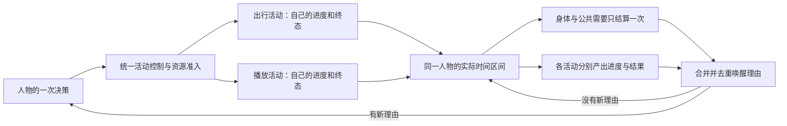

> 归档基线：2cf230115f4084aef2376e9d77bc976efbed43ea
> 原始路径：`docs/dev/research/dayrun-behavior/concurrency-design-review.md`
> 归档说明：此提交仅定位归档原文快照，不是审查执行证明；原始执行记录与未执行事实按原文保留。

# 同一人物并行活动与持续性：只读设计核查

范围：`/Users/atishoo/.codex/worktrees/dayrun-behavior/WorldMock`，读取时基线为 `74edeaddccf1e051a0f7c98024ec95eeb6c48514`。本报告只提出供父代理冻结的实现与验收边界，没有修改仓库，也没有执行测试或真实模型。此前的 reconciliation 工作树不属于本任务。

## 建议冻结的核心行为

人物可以同时进行资源不冲突的多个活动。每条活动使用现有独立生命周期，分别持有活动身份、已执行区间、资源声明、进度、完成条件和控制资格。启动一个活动不隐式暂停另一个；暂停或取消只作用于点名活动。一个人物在同一段世界时间内只有一笔基础身体结算和一次唤醒判定。

不把播放藏进出行状态，不引入另一套播放进度，不选一个“主活动”代表其他活动。`WorldState.activities` 已经容纳多条活动，建议保持它为唯一事实源，删除 `AgentState.current_activity_id`，通过一个按身份稳定排序的查询取得人物的活动集合，避免维护第二份活动 ID 索引。若父层选择持久活动 ID 集合，则必须额外验证它与活动表中 ACTIVE 项严格双向一致，不能容忍两份事实不一致。

现有依赖已经有严格模型、冻结目录、事件队列和记录事务；本设计不需要新依赖。官方 SimPy 文档说明有限容量资源在释放前归申请过程占用；Stately 的并行状态文档强调各分支独立、通过事件协调。本项目采用这些已验证的机制思想，仍使用自己的确定性模拟循环。[SimPy 共享资源](https://simpy.readthedocs.io/en/latest/simpy_intro/shared_resources.html)、[Stately 并行状态](https://stately.ai/docs/parallel-states)。

## 当前实现的明确障碍

| 当前代码 | 直接后果 | 必须替换的行为 |
| --- | --- | --- |
| `life/models.py:250` 单个 `current_activity_id`；`activities.py:115` 启动时拒绝已有活动 | 多活动表仍被单槽约束 | 使用人物活动集合，校验所有占用 |
| `catalog/affordances.py:255` 给每个活动隐式添加 position | 即使删除单槽，任何组合仍然冲突 | 所有资源在冻结声明中显式给出，删除隐式万能锁 |
| `engine.py:1021` `_auto_pause_for_switch`；`engine.py:1068` 启动先自动暂停 | 模型选择第二件事会停止第一件事 | 删除自动暂停；明确控制旧活动后才能释放冲突资源 |
| `engine.py:1442` 每活动调用 `advance_activity`/`advance_social`，两者都推进身体 | 并行活动重复扣基础代谢、增长清醒需要，第二条还读取被第一条改变的身体 | 先按人结算公共区间，再按活动分发结果 |
| `engine.py:1589`、`engine.py:1612`、`rhythm.py:113` 按单活动预测身体和决策 | 重复预测、后遍历结果覆盖前结果 | 每人聚合预测；所有活动各自结束/交互边界进入最小时间选择 |
| `rhythm.py:440` 用 `setdefault` 每人只保留第一条 activity_progress | 其他活动的目标推进和节律证据丢失 | 进度输入为完整集合，身体/节律记录另有每人唯一归属 |
| `schedule.py:255` 截止/闭店预警是持续为真的窗口条件 | 每个后续边界仍然产生相同唤醒 | 首次或相关事实变化才输出预警，保存已交付预警状态 |
| `rhythm.py:272` 只取最近一个未来任务截止 | 多任务预警不能逐项去重，已提醒任务遮住其他新预警 | 逐个未完成可见任务形成预警事实，再汇总人物理由 |
| `custom/agents/life_agent.py:275` 一次决策恰好一个生活动作；成功 start 后通常不再立即决策 | 仅支持第二个 ACTIVE 仍不代表人物能选择“现在一起开始步行和播放” | 冻结能从正常工具入口原子开始兼容活动组合的请求 |

单槽还涉及 `observe.py`、`presentation.py`、`projection.py`、`social_actions.py`、`status.py`、动机候选及 agent 的 `active_activity` 控制闭集。不能只改模型字段和活动循环。

## 资源声明与组合边界

资源准入的唯一通则是：新活动全部声明合法、自己的条件成立，并且新组合内部以及与本人其余 ACTIVE 活动之间不存在独占资源交集；PAUSED 和终态不占资源。其他人物不会占用本人的 attention、hands 等个人资源；门店库存、物品数量和支付等仍由交换层分别检查。

建议冻结下面这张保守但完整的当前活动声明表。它移除播放对固定位置的占用，同时保持其他活动现有的限制；不是在代码里硬写“只允许步行加播放”的白名单。`position` 的新明确含义是身体位置/姿态的控制权；播放读取位置而不控制位置。

| 活动 | 明确占用 |
| --- | --- |
| wait | position |
| sleep | position、attention |
| work | position、attention、device、hands |
| watch/播放 | attention、device |
| play_game | position、attention、device、hands |
| travel/walking | position |
| travel/driving | position、attention、hands、vehicle |
| read_mail | position、attention、device |
| browse | position、attention、device |
| consume | position、hands |
| lifestyle | position |
| chat/call | position、attention |

由此，当前表允许播放分别与步行、进食/使用物品、等待、生活活动并行；驾驶、游戏、工作、读信、浏览、交谈、通话和睡眠均与播放冲突。两个控制身体位置的活动冲突，两个播放争用 attention/device 也冲突。所有被表允许的组合必须同批交付，不把进食加播放留到以后。单个 lifestyle 的已有地点资格仍然有效；若产品要求运动与播放之间更细的注意力限制，必须在冻结目录中明确条目声明后再实现，不能临时增加代码例外。

这是待父代理冻结的领域选择，不是当前合同已经规定的结论。通话与步行是否开放不能从日常直觉暗中推断；当前社交合同明确占 position。本轮若选择开放，必须同时修改社交声明、测试及合同，以同一集合通则准入，不能另写 special case。

当前 `ContentItemConfig` 的 `CONTENT_KINDS`（`life/scenario.py:358`）没有 podcast 或音频品类，只有已有字幕时间轴内容，不能把视频改名当作播客验收。首条技术贯通可用真实冻结播放内容；最终若冻结验收仍表述为播客，资源侧必须交付有来源与时间轴的真实音频条目和相应品类，并沿同一播放生命周期通过端到端验收。这不是可 defer 的尾项。

## 人物怎样开始和控制并行活动

按父层裁决，保留现有单项启动工具，新增一个原子组合启动工具，仍然一次人物决策只提交一个生活工具调用。新工具直接表达“同时开始这些活动”，子项复用既有单项启动请求模型和领域函数，不复制生命周期。这比替换全部 start/consume/social 工具更小，且旧单项工具继续承担当前独立能力，因此不是历史格式兼容层。组合工具只接受本轮冻结的活动启动类型，不能夹带购买、消息、工作交付等瞬时动作成为通用批处理器。

每个子项必须以它自己的原工具名和原请求，分别通过 `life/menu_execution.py:10` 的 `require_interaction_menu`，再通过该工具现有当前可见目标、地点、数量、权限校验；不能因为外层组合工具可见就绕过其中任何一项。菜单和 agent schema 只在当前确有可执行组合时提供组合入口，并明确每项的合法目标。受理时在同一世界状态重新检查；菜单呈现不是永久权限。子项数量只受已声明资源与请求有界长度约束，不能在引擎写一个仅支持 walking/watch 的分支来缩小生命周期范围。

集合提交先在暂存世界中校验全部目标、时长、当前资源、组合内部资源、共同能量以及支付/库存；全部成立才接受。非法目标、资源冲突、付款不足或任一子项错误时全组业务拒绝，旧活动、余额和进度不变，不吞异常、不自动挑选剩余合法项。资源允许的瞬时购买/发送消息等也不能因为有 active 活动就由 agent schema 一概隐藏，应按原业务条件判断。

一次启动集合中的活动需要各自可追踪的 activity_id。动作记录必须明确对应多条活动：活动独立完成各自发终态，不能在第一条完成时把同一请求的其他活动视为完成，也不能让 `processed_actions` 中的单个终态被后完成的活动覆盖。建议请求结果直接保存活动身份列表，活动终态各自留证，整组请求完成由全部子活动终态聚合；这里需要同步更改当前 `ActionResult.activity_id` 与动作去重路径。

可见控制提供 `active_activities[]` 和 `paused_activities[]`，每项有身份、标题、状态、实际进度、预计结束和该项允许操作。精确身体账和其他人物私密数据继续隐藏。控制请求必须按目标活动校验身份与操作，不从“第一条 active”推断目标。

| 操作 | 目标活动 | 其他活动 |
| --- | --- | --- |
| 开始 | 新建独立活动；当前时刻受理 | 不变，冲突则整个开始请求拒绝 |
| 继续 | 保留进度与计划，只推进该活动反馈调度 | 继续原计划，无隐式暂停或重启 |
| 暂停 | 先结算至当前时刻，转 PAUSED，释放占用；不增加暂停期间进度 | 不变 |
| 恢复 | 保留此前进度，重新校验当前条件和占用；按剩余量重排结束 | 不变；冲突时拒绝恢复 |
| 取消 | 先结算实际区间，转 CANCELLED，保留实际消耗和进度 | 不变 |
| 完成 | 只在本活动自己的终点形成 COMPLETED | 不变 |
| 实验截止 | 每条未结束活动分别 TRUNCATED，包含暂停项 | 不把截断写成完成 |

一次人物决策控制一个目标时，未点名的活动默认继续，并不需要逐项调用 continue。暂停/继续等普通控制在人物实际获得决策机会时可作用于符合条件的目标，不要求每个活动恰好有相同的旧 feedback 时间。游戏仍保留真实命令回合，不能用普通 continue 穿过游戏反馈；上述资源表使游戏不会与其他持续活动并发，避免把本轮扩展成游戏交互调度重构。CHAT/CALL 的不可暂停、可取消语义保留。

## 身体、活动进度和到达的共同时间规则

建议人物持久保存 `body_settled_at`，初始化为运行开始时刻；每次推进必须满足人物身体没有未来进度，所有活动的 last_settled_at 不超过人物身体时刻。活动开始、控制和世界事件都发生在已结算的当前世界边界。

世界下一边界取所有人物决策时刻、每条活动计划结束、游戏交互、内容终点、身体阈值、排定环境事件和实验结束中的最早未来时间。对一个人物，从其 body_settled_at 到目标边界按 ACTIVE 集合变化切分区间；正常情况下最早边界选择已保证本次只有一个稳定集合。公共时间费用绝不能按活动数量累加。

| 结算部分 | 统一口径 |
| --- | --- |
| 基础代谢 | 对实际世界秒数只扣一次 |
| 运动额外消耗 | 并行集合的 MET 取最大值，用一次 `max(MET-1, 0)` 计算额外消耗；不叠加多份基础代谢 |
| 睡眠/清醒 | 显式睡眠独占时进入睡眠通道，否则清醒通道；压力、睡债、社交需要等公共增长一次 |
| 娱乐与生活效果 | 各活动按本活动真实执行秒数计算其已声明效果；同一身体通道先汇总再按现有界限处理一次，不能顺序依赖 activity_id |
| 工作效率 | 各工作活动使用同一个公共身体 before/after，叠加该工作的现有技能/工具因子；不额外推进身体 |
| 食物 | 每个实际消耗区间按既有数量与食物效率入账一次；保持 `BodySettlement.after` 与食物后续输入的既有边界，不把食品热量重复放进公共结算 |
| 内容 | 只累加播放活动 ACTIVE 的世界秒数乘其速度；暂停、等待和行走本身不生成接触内容 |
| 没有活动 | 时钟若经过真实空白区间，身体仍按清醒静息推进一次；不伪造 wait、playback 或浏览活动，不给空白区间内容收益 |

最大 MET 是本次应明确标注的 WorldMock 实验假设，不是所引用状态机资料推导出的医学结论。它选择同人同时动作的最强体力负荷，避免行走加低负荷播放把行走代谢再算一遍。所有准入能量投影、不可行判定与下一个身体阈值必须调用同一组合公式；不能实际结算取最大、预测仍按各活动单独算或总和算。

多个活动计划剩余时长不同，组合能量可行性需按各自结束点切分预测：先算重叠区间，再算余下单活动区间。释放一条活动后重新预测，不能把某一活动的最晚结束当成整个组合一直保持的负荷。

`social_actions.advance_social` 当前也结算基础身体并增长社交需要，`rhythm._apply_awake_social_ledger` 再通过特殊排除避免重复。并行改造应把清醒社交需要增长并入每人公共区间，聊天收益、共同进食收益等保留独立来源；共享进食是否在本区间发生必须依据区间开始时的活动集合和同地事实，不能用已经完成后变空的 active 集合判断。

出行只按自己的 elapsed_seconds 更新 route_progress_meters，到达时只改本人位置、记录到达与目的地访问结果；播放继续原内容，不能因到达重置或结束。内容先结束则只完成播放，出行继续。暂停出行时冻结路线进度，播放继续；恢复沿已冻结路线完成剩余路程，沿用现有“不在途虚构新地点、取消不退已付车费”语义。暂停播放不影响路线进度。更改播放速度只影响目标播放的剩余时间和内容进度。

`travel.py:113` 的定位轨迹采样目前只有测试调用，生产代码未调用；因此既有轨迹采样单测不构成真实出行链已记录轨迹的证据。本轮至少必须验收实际出行活动进度、真实到达与记录；不要借这段孤立 helper 宣称端到端已经通过，也不要在本轮擅自增加完整定位服务。

## 静默续行与预警去重

保留普通 900 秒结算粒度与 5400/10800 秒重估的区别。静默边界照常推进所有活动和身体，不能调用模型、观察、记忆写入或伪造 decision_started。到达、内容完成和其他多个事件同刻出现，只合并成该人物一次决策，理由包含所有本次新事实。不同人物仍各自判断。

预警应使用明确的事实身份，而不是“距截止还剩多少秒”或浮点身体值作指纹。建议 AgentState 保存已交付预警的事实集合及活动不可行条件的最近状态；该状态与人物实际接收的观察/决策共同提交，预测下一边界或睡眠过滤掉理由时不能提前标记已提醒。

最小持久字段可直接放在 `life/models.py:261` 附近，与现有 last_decision_time、felt_bands_at_last_decision、known_task_ids 同级：`delivered_warning_signatures: set[str]`。签名由有类型的当前威胁事实确定性编码，任务绑定 task_id/deadline，营业绑定 location_id/具体 closing_at/必要承诺身份，不编码倒计时、累计进度或连续身体数值。在每次边界计算 current_signatures，先移除已消失条件的旧签名；候选提醒为 current_signatures 减去 delivered_warning_signatures；只有真正向人物提供该理由时才加入已交付集合。因此一个字段即可表达首次、保持、消失清除和再次出现，不需要单独的“最近状态”字段。睡眠抑制期间保留未交付状态。字段和世界快照共同持久，集合序列化稳定排序。

| 预警 | 稳定事实身份和重新提醒条件 |
| --- | --- |
| 任务临近截止 | 未完成可见 task_id + 该任务 due_at；首次进入 30 分钟窗口提醒。相同身份持续为真不再提醒；due_at 改变构成新事实；新进入窗口的另一任务独立提醒 |
| 门店临近关闭并威胁承诺 | location_id + 本次具体 close_at + 被威胁承诺身份；首次进入 15 分钟窗口提醒。新增承诺或新的关闭时刻独立提醒；已有承诺完成后不能因为集合变小就当新威胁 |
| 活动不可行 | activity_id + 离散不可行原因；首次从可行变不可行提醒，持续同因不重复。明确恢复为可行后再次变不可行可重新提醒；暂停/终结解除该活动条件；恢复或真实计划更改重新计算，不用每秒变化的剩余能量作新事实 |
| 承诺受威胁 | 附着于上述具体新预警的额外理由，不独立使用一个永久为真的全局开关 |

读取所有未完成可见任务形成事实，不能只看 `_next_task_due` 的最小 due_at。下一决策时间只加入尚未交付预警的精确未来阈值；判定与调度使用同一事实产生器。预警被睡眠理由白名单过滤时保持未交付；醒来若威胁仍真实存在，可与 wake_from_sleep 一并呈现。保存/恢复后同一持续条件仍不得重复提醒。

deadline 真正到期的失约情绪脉冲、工作验收结果等是独立事实，不能被“已提醒过临近截止”吞掉。体感滞回继续比较上次实际决策，而非紧邻静默区间；普通重估、真消息或新完成即使发生在已提醒窗口中，仍按各自理由提供一次机会，但不能附带重复 task_due_soon。

## 记录、恢复和可见事实

每条 activity_progress 保留活动身份和本活动真实区间，允许同一人物的不同活动区间重叠。身体与唤醒统计必须有按“人物 + 区间”唯一的记录归属，不能复制同一笔身体账到每条活动记录后让报表求和。

建议在现有 environment_event 机制中记录每人每区间的 `body_settlement` 事实，携带参与 activity_ids、实际区间、身体变化、资源流以及本边界 decision_offered/wake_reasons。每条 activity_progress 引用该公共结算，另存本活动效率/消耗/接触；所有生产消费者一次性更新新合同，不做旧字段 fallback。若父层选择别的记录形状，必须保持同样的唯一身体账与一次人物决策统计。

具体最小记录形状建议如下。公共事件不携单个 activity_id，而以 `data.activity_ids` 和 `caused_by` 指向所有参与活动的来源；联合体力消耗不冒记到排序第一的活动。`data.body_settlement.before/after` 是共同连续身体变化，`data.resource_flows` 只在这一条记录保存本区间的基础/运动消耗、清醒增长及组合后的连续缓解等身体分录；需要解释组合时记录参与活动的冻结因素，不把同一实际缓解分录复制给每个来源。食物后续输入仍由实际消费活动单独记录，并不混进公共 `after`。

每条 activity_progress 保留自己的 `activity`、`interval_start/end`、实际内容接触/路线距离/库存投入产出，增加 `body_settlement_event_id` 引用；工作在自身记录保存实际工作效率。消费食物产生的独立能量输入分录留在对应消费记录，公共分录不能再记录一次；现有全局 `body.last_flows()` 应在共同结算完成后立即一次性取走，然后分别取各活动自身交换效果的分录，不能等遍历到第一条活动时一起取走。人物身体 before/after 仅作为公共变化证据，既不是额外资源分录，也不在每条 activity_progress 重复提供。

金融字段 `resource_changes` 与身体字段 `resource_flows` 必须保持区别：前者当前由 `footprints/ledger.py:12` 的事务校验、`:37` 的历史校验及 `:66` 的 `_money_changes` 从事件顶层累计 account 变化；后者由 `footprints/models.py:51` 校验身体资源分录形状。共同身体事件不复制资金变动；组合动作的各项实际付款只在唯一权威资金事件上记录一次，外层汇总和终态不能再次带同一笔顶层 `resource_changes`。`engine.py:1782` 的结果草稿提升字段路径及 `:438` 操作日志路径要同时核查，否则组合结果汇总会重复记账。

记录层需在同一事务校验共同身体事件按人物/区间唯一、活动引用存在且区间一致、无重复身体分录归属；严格验证引用，不靠报表的 set 去重掩盖重复写入。`footprints/export.py:138` 继续按活动重建，但需要解析并校验共享身体引用；`footprints/quality.py:249` 改读工作自身效率与公共区间；`evaluation/behavior_metrics.py:209`/`:314` 改按公共边界统计；`evaluation/adapters.py:438` 与 `:501` 不把共同身体记录误读成另一笔资金资源变化。现有 account ledger 继续守恒，不需要把它改造成一个新通用账本框架。

当前 `footprints/quality.py:249` 从 activity_progress.body_settlement 读工作效率；`evaluation/behavior_metrics.py:209` 按 activity_progress 数量计算静默比和唤醒分布；`rhythm.py:440` 只给第一条活动注解。这三条必须一起修改。否则即使生理值正确，报告仍会把同一个人两条活动算作两次决策，或把第二活动的目标进度丢掉。

`footprints/export.py:138` 已按 activity_id 分别重建实际区间，允许不同活动自然重叠，适合作为保留的活动重建机制。评估“做某类事多久”可以保留各活动自己的时长；评估“人一天醒着多久/空白多久”必须对真实区间取并集，不能合计活动时长。

恢复直接读取完整新 WorldState：所有活动的状态、进度、资源、路线/内容身份和下一边界，人物 body_settled_at、预警交付状态、已知事实与最后决策基线均持久保存。提升 WORLD_SCHEMA_VERSION，旧单槽快照严格拒绝，不迁移，不接受 scalar/list 双形状。恢复验证 ACTIVE 的所属人物、资源互斥、时间一致、合法目标及活动终态，随后从保存的同一秒继续，不补扣先前区间，也不重新提醒已交付的预警。

## 必须同步替换的旧合同

| 文档 | 当前条款 | 新特性冲突 |
| --- | --- | --- |
| `docs/dev/SPEC-life-runtime.md:578` | 正式/多人场景同人前台互斥；进食观看不能同时执行 | 替换成显式资源声明与统一活动集合，不保留旧禁令 |
| `docs/CONTRACTS.md:541` | current_activity_id 与单个 ACTIVE 对应，结束清槽 | 替换成活动集合和时间/资源不变量 |
| `docs/CONTRACTS.md:515` 附近观察合同 | 单个 active_activity | 改为完整可见活动集合和逐项控制资格 |
| `docs/design/04-simulation-engine.md:292`、agent 动作协议 | 一个主要生活动作 | 明确一次原子动作可以启动一个兼容活动集合；不能只靠测试预置并行状态 |
| `docs/design/04-simulation-engine.md:487` 和记录节律段 | activity_progress 上的决策标记 | 规定每人每边界唯一统计归属，避免活动数量改变唤醒次数 |
| `docs/dev/SPEC-day-plan-goals.md:53` | 一段活动推进一个匹配目标；预警窗口规则 | 每条活动分别提供证据，但每目标只首次推进；预警增加交付事实去重 |
| `docs/CONTRACTS.md:441` | CHAT/CALL 占位置与注意力，不可暂停 | 若采纳本报告资源表则保留；若开放走路通话必须显式替换 |

归属保持不变：资源引擎提供真实内容/物品/活动声明；交换引擎负责资源条件、消耗与产出；模拟引擎管理活动生命周期、共同身体时间和唤醒；记录引擎提交真实事件与恢复材料。`docs/design/02-exchange-engine.md:59`、`:264` 和 `docs/design/04-simulation-engine.md:372` 已明确这一分工，不能把持续身体模型搬进交换层。

## 实现文件与完整回归条款

| 责任 | 生产改动入口 | 必须通过的验收 |
| --- | --- | --- |
| 活动模型与控制 | `life/models.py`、`activities.py`、`engine.py`、`social_actions.py` | 同人独立开始/继续/暂停/恢复/取消/完成/截断；跨人 ID 拒绝；冲突拒绝零副作用；资源释放立即可用；恢复冲突保留暂停状态；旧单槽快照拒绝 |
| 冻结资源声明 | `catalog/affordances.toml`、`catalog/affordances.py`、既有 catalog 校验测试 | 所有 kinds 与社交声明显式覆盖；所有允许组合逐项跑真实入口；驾驶播放/游戏、睡眠播放、两个播放等拒绝；无自动暂停 |
| 共同身体时间 | `life/body.py`、`activities.py`、`engine.py`、`social_actions.py`、`rhythm.py` | 步行播放的基础能量/睡压与等时步行一致；播放量仍正确；活动 ID 排序不改变结果；不同结束点正确分段；无活动空白仍只有身体时间；真实食品热量一次；预测与实际阈值同秒 |
| 内容和路线 | `life/content.py`、`travel.py`、`engine.py` | 路线先到、内容先完、同时完；独立暂停/取消/恢复/变速；字幕/音频只揭示播放过的区间；路线距离和位置只随实际出行变化；到达不等于已吃 |
| 唤醒与持续 | `life/schedule.py`、`rhythm.py`、`models.py` | 阈值精确到秒；第一次提醒、后续多个900秒静默；新任务/修改截止/新闭店事实重新提醒；状态恢复后仍静默；不可行恢复后再次变化提醒；新消息和自然重估不被去重吞掉；睡眠和游戏原语义不变 |
| 人物可见入口 | `life/observe.py`、`presentation.py`、`projection.py`、`motivation.py`、`status.py`、`custom/agents/life_agent.py` | 真实一次人物决策选出兼容活动组合；观察含两条可控制活动；可只控制其中一条；动机/工具 schema 不拒绝集合；睡着/可交谈等他人投影由完整集合派生 |
| 留证和恢复 | `footprints/models.py`、`export.py`、`quality.py`、`evaluation/behavior_metrics.py`、`goal_metrics.py`、life checkpoint | 每活动真实区间可独立重建；身体流和唤醒统计一次；不同活动均有目标证据；恢复/无恢复输出一致；活动合计不冒充人的经过时长 |

现有回归基座包括 `tests/life/test_activities.py`、`test_activity_effects.py`、`test_body_flows.py`、`test_wake_reasons.py`、`test_content_game.py`、`test_travel_time.py`、`test_travel_trajectory.py`、`tests/integration/test_life_agent_protocol.py`。这些单活动测试应更新到新接口后继续保护原行为；需要另加完整并行人物入口、记录导出与恢复测试，不能只断言 active 数量。

首条端到端验收应从人物实际工具请求开始，选择一段真实冻结步行路线和一段真实冻结内容，同一世界时间受理，经过至少一个静默结算边界，到达或内容先结束时只完成相应活动，人物观察可控制剩余活动，最终从已提交事件重建两个真实区间并核对身体账。然后对冻结资源表允许的其余组合、失败路径及恢复路径完整执行同一验收要求；“先贯通”只是依赖顺序，不是减少交付范围。

## 核查证据边界

本报告来自当前 worktree 的源码、规格、既有测试阅读及上述官方机制资料；没有声称任何新行为已经实现或测试通过。执行的是 `git rev-parse HEAD`、`git status --short`、`rg`/`sed` 定位与读取，读取时基线 clean。特别是定位轨迹 helper 只有测试调用、内容闭集没有音频，以及人物一次动作限制，都是当前代码可直接核验的缺口，不能由设计意图或旧绿测试代替。
