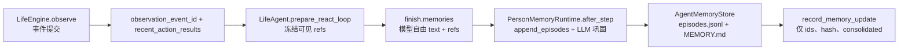

# 记忆事实约束与等待真实性：只读实现勘察

**基线与范围。** 唯一开发树 `/Users/atishoo/.codex/worktrees/dayrun-behavior/WorldMock`，检查时 `HEAD=74edeaddccf1e051a0f7c98024ec95eeb6c48514`，porcelain 状态为空；本文未修改仓库或调用真实模型。规范尚未冻结：`docs/dev/PROPOSAL-dayrun-behavior.md:32–36,75–89,130–141` 是目标提案，现行合同是 `docs/CONTRACTS.md`、`docs/dev/SPEC-life-realism.md`、`docs/design/05-recording-engine.md`。依赖 `vendor/agentsociety2` 在此工作树是 gitlink `ae3224ce982d52f1eb773a4f70521a7b60e19cba`，文件未检出；下列 vendor 源码在旧只读工作树的同一 gitlink 提交读取，**不是**从旧 WorldMock 生产源码推断新树行为。已载入 fable-workflow 的 explore/design 路线。

## 当前调用链：观察、人物记忆、足迹



- `src/worldmock/life/engine.py:261–270` 在 `observe` 先生成投影、提交 `observation` 后回填事件身份；`src/worldmock/life/observe.py:260–271` 只列上次观察以来的本人 `action_result`，包含状态和 `result`。这是已提交事实的可见输入，不包含本轮尚未结算的动作结果。
- `custom/agents/life_agent.py:159–190,200–214` 的 `LifeMemoryEpisode` 允许 `event`/`observation` 等十种类型、任意 `text`、`source=decision_observation`、1–8 个 `refs`；`_environment_source_ids:1098–1112` 收集观察事件和最近动作结果身份；`_validate_finish:953–959` 只检查一件动作和引用身份存在；`_bind_finish_reference_ids:1675–1685` 只把这些身份写进工具 Schema。`_memory_prompt_section:680–697` 把 `MEMORY.md` 和 episode `text` 不加客观/主观标签送回模型。
- gitlink `ae3224` 的 `agentsociety2/agent/person.py:515–549,551–573`：人物 ReAct 后调用 `PersonMemoryRuntime.after_step`，然后登记记忆更新。`agentsociety2/agent/memory_runtime.py:308–366` 验证并追加模型记忆、按阈值启动 LLM 巩固；`:367–410,544–600` 以新旧 episode 和既有 `MEMORY.md` 请求模型直接重写整份 Markdown；`:411–449,451–525` 的就寝反思又生成自由文本洞见，只有引用身份检查。`agentsociety2/agent/memory.py:462–537,537–590` 保存自由文本、类型、来源、引用，近似合并只按同类型/相似文本；`:403–459` 的 `MEMORY.md` 规范化只保证基本 Markdown/长度，不做命题核实或六节内容语义校验。
- `src/worldmock/life/engine.py:547–562` 的 `record_memory_update` 只记 episode 身份、三个工作区文件哈希、是否巩固；`src/worldmock/footprints/quality.py:374–455,500–521` 核验观察/结果/episode 引用存在及先后，不核验记忆正文与所引事件的命题相符。`docs/design/05-recording-engine.md:110–119,190–198,320–341` 明确记录引擎保存事实和记忆写盘证据、人物负责记忆；现状的证据链确实只证明“写过和引用过”。

**可重复的反例探针。** 使用本树 `src`/`custom`、gitlink 同提交 vendor、调用者 `.venv`、测试专用假 key（未联网），复用 `tests/integration/test_life_agent_protocol.py:123–138,287–310` 的观察夹具：设置已提交一件生活动作后调用 `build_react_tool_schemas`，再把合法 `finish` 的 `text` 改为 `我已吃过晚饭。`，`refs=[observation-current]`，`LifeAgent.validate_react_decisions(...)` 返回 `''`。该夹具没有晚餐结算。首次探针未设置测试 key 因 AS2 启动配置拒绝，补测试专用 key 后得上述结果；未把首次方法失败当产品证据。此反例证明引用身份门槛不等于事实核验。

## 当前调用链：等待与内容接触

- `StartBasicActivityRequest` 只有 `activity_type`、`planned_duration_seconds`（`src/worldmock/life/models.py:580–593`），`_start_basic` 仅转换为通用活动（`engine.py:971–980`）；因此现行权威动作没有“等待某物”的结构化原因。`engine.py:1450–1488` 每段写 `activity_progress`：真实起止、活动快照、身体结算、资源分录；最终完成再写终态 `action_result`。这足以报告等待区间/状态，不能推出刷过特定内容或等待原因。
- 现行目录 `catalog/resources.jsonl:4` 的 `entertainment_need` 分录配置含 `wait=0.05/h`（目标解析核对，同时有 awake 累积 `0.08/h`）；`catalog/affordances.toml:36–44` 把 wait 声明为 `relief.channel=intrinsic`。`src/worldmock/life/body.py:409–470` 由 wait **无条件**产生 `settle:wait:passive_entertainment` drain；`src/worldmock/life/motivation.py:771–777,815–822` 再把继续等待描述为 `casually browsing`。没有内容身份、播放进度或内容接触事件可支撑这个描述。
- 真正的 watch 在 `engine.py:1495–1512` 调 `reveal_watch`，`src/worldmock/life/content.py:144–162` 返回 `position_before_seconds`、`position_after_seconds` 和实际跨过的 cues。`src/worldmock/footprints/quality.py:179–213` 的内容接触按 watch 等内容活动统计，不把 wait 计作内容会话。现行测试 `tests/life/test_wait_passive_entertainment.py:36–137`、`tests/life/test_motivation.py:585–605`、`tests/life/test_news_feed.py:137–143,198–204` 反而钉住 wait 被动刷内容/缓解行为。

## 可冻结的最小完整合同建议

**已核验经历作为事件投影，人物文本只作为主观叙述。** 新增一个记录引擎纯投影，例如 `src/worldmock/footprints/experiences.py`，输入已提交且按 `event_seq` 排序的 `Event`，输出闭集 `VerifiedExperience`：`kind`（`waited`/`consumed`/`arrived`/`played`）、`agent_id`、`occurred_at`、`source_event_id`、`activity_id`、与 kind 对应的精确载荷。模型没有这个类型的写入口，也不能写 `source_event_id`。投影不新增世界账本、不把 `action_requested`/`action_accepted`/`in_progress` 当完成。按 `source_event_id` 或 `(activity_id, interval_end, kind)` 去重，重放同一事件列得相同结果；按人物查询且只用当前已提交截止序号。具体源：

| 经历 | 唯一可靠来源与判定 | 不能推出 |
| --- | --- | --- |
| 等待了多少 | `activity_progress` 的 wait `interval_start/end`，仅正时长 | 刷手机、接触具体内容、等待某个未验证目标 |
| 实际吃了什么 | consume `activity_progress.data.consumption` 的本区间**正增量**、`use_mode=eat`；保留商品/地点/数量及来源事件 | 仅购买、送达、启动 consume 即已吃；未吃完也不能称“整餐完成” |
| 到达地点 | travel 完成的 `activity_progress.data.activity`：`status=completed` 且 `location_id=destination_id`；终态 `action_result` 可交叉核验 | 仅出发、途中或计划目的地等于已到达 |
| 实际播放 | watch `activity_progress.data.activity.data.revealed.position_before/after_seconds` 严格增加，保留内容身份与范围 | 打开目录或普通 wait 即已播放 |

**必要的生产端校正。** `src/worldmock/life/activity_evidence.py:9–26` 把 `activity.data['consumed']` 的**累计值**写到名为 `interval_quantity` 的字段。多边界逐事件相加会重复记账。先在活动推进时传入区间前累计量，写真正的 `interval_quantity=after-before`，可另写 `cumulative_quantity` 供校验；投影只吃前者。若不改事件正文，投影必须按 `(activity_id, product_id)` 计算连续累计差，拒绝倒退/缺段，但会保留误导性的公开字段名；前者更符合现行 `05-recording-engine.md:190–198` 对实际区间的合同。测试须覆盖分段、暂停/恢复、截断、重复读、同商品多人物与零增量；数值沿用九位份额精度。

**人物侧不做事实判别。** 把模型可写 `finish.memories` 收窄为主观记录（感受、打算、反思、偏好/关系等），移除模型可写的 `event`/`observation`“已完成经历”类型；每条保留 `text`、`importance`、`refs`，但标记固定为 `subjective`，`refs` 仅表示人物看见的依据，绝不提升其正文可信级别。源事件投影单独经 `LifeEngine.observe`/`LifeEnv` 送入人物的“已核验经历”面，人物仍可对这些经历表达感受。现行 `memory_recent/search/read` 读取的自由 episode 和就寝反思也始终标记为主观。

**巩固必须有结构边界。** 当前单次 LLM 直接写完整 `MEMORY.md` 的路径不能保证主观文字不进入“最近发生的重要事情”。WorldMock 的巩固应确定性组装：该事实章节只由已核验事件模板填充并保留结构化 `source_event_id` 映射；人物感受/打算写进明确标为“人物自述”的通道，引用仍可检索。其余稳定档案事实只从冻结 persona 输入；反思仍可生成，但仅作为主观 episode。现行六节标题可以保留，需修改章节内容合同；若需要新增“人物自述”标题，先改冻结合同。`MEMORY.md` 只是可重建缓存，不是事实来源；恢复后按事件截止重算事实并核对缓存/源引用，不读旧自由文本反推事件。为了避免复制泛用记忆运行时，建议在 `LifeAgent` 使用一个具体 WorldMock 记忆运行时（覆写巩固写入/渲染），对 gitlink AS2 的 `PersonAgent._build_memory_runtime:187–225` 增加**单一**可覆写构造钩子，沿用现有 store、检索、触发与检查点；不写兼容层或双格式迁移。父代理可在冻结 spec 时选定更小的同等接线。

**等待保持事实空白。** 将 wait 从 `catalog/affordances.toml` 的 `intrinsic` 缓解和 `catalog/resources.jsonl` 的 relief 键移除；`body._entertainment_entries` 对 wait 只做清醒累积（仍结算能量/睡眠压力），`motivation._wait_texts`/`_entertainment_delta` 只说等待并使用同一纯累积公式。内容缓解只随已实际执行的 watch/game 等现有活动。已知等待原因只有绑定真实排队/日程/配送事件等可验证身份时才写入；现行 `StartBasicActivityRequest` 无 reason 字段，默认 `null/unknown`，不能用模型解释或唤醒原因冒充等待原因。若要求人物显式表达“我在等谁”，它应作为主观意图保存，除非新的请求字段绑定且验证了真实待发生事件。

## 文件与合同修改清单

| 边界 | 生产位置及替换 | 测试位置 |
| --- | --- | --- |
| 事件投影 | 新增 `src/worldmock/footprints/experiences.py`；`src/worldmock/life/engine.py`/`observe.py` 提供本人、已提交截止的结构化经历；`activity_evidence.py` 修正消费增量 | 新 `tests/footprints/test_experiences.py`；`tests/life/test_dayrun_inventory_regressions.py`；观察/恢复集成测试 |
| 人物输入 | `custom/agents/life_agent.py` 收窄 `FinishRequest`、分离 verified/subjective 提示与检索；`custom/envs/life_env.py` 只读桥接 | `tests/integration/test_life_agent_protocol.py`、`test_grounded_evidence.py`、`test_activity_schema.py`：伪晚餐/错来源/当前未结算/主观感受 |
| 持久巩固 | gitlink `vendor/agentsociety2/.../person.py` 的具体运行时构造接点、WorldMock 专用巩固组件；`memory_runtime.py` 当前自由整篇重写路径不用于 WorldMock。`engine.record_memory_update` 与 `footprints/quality.py` 校验结构化源引用 | vendor 记忆生命周期测试、WorldMock `tests/integration/test_life_agent_protocol.py` 写盘/恢复/就寝反思、`tests/footprints/test_quality.py` |
| 等待 | `catalog/affordances.toml`、`catalog/resources.jsonl` 及目录身份重算；`body.py`、`activities.py` 注释与通道、`motivation.py` 文案/预测 | 替换 `tests/life/test_wait_passive_entertainment.py` 的假缓解断言，更新 `test_motivation.py`、`test_news_feed.py`，增加 wait+实际 watch 对照及足迹断言 |
| 文档 | 冻结 `docs/dev/SPEC-life-realism.md`「记忆合同」、`docs/CONTRACTS.md`「记忆字段」与 wait/事件正文；同步 `docs/design/05-recording-engine.md` 的投影责任、`docs/dev/SPEC-life-runtime.md` 的 wait 结算/决策节律；提案状态改为实施基线后再更新实现状态 | 文档链接与规范到测试矩阵；不保留旧“wait=边等边刷”“模型自由 event/observation 文本即经历”条款 |

## 失败、恢复、并发边界与验收

- 先提交环境结算事件，后从已提交序列投影；本轮 `finish` 时动作仍可能待环境结算，不能以本轮动作受理写“已完成”。事件投影本身无副作用；同一截止、跨重启/检查点、反事实分支重复查询逐字等价；不同人物仅见本人可见事实。畸形应有的结算字段应失败并记录错误，不能静默生成零量事实。
- 主观 episode 写盘失败不发 `memory_updated`；长期记忆缓存写盘失败也不报告巩固完成。`PersonAgent._run_person_step` 当前先 after_step 再 `_record_memory_update`，检查点仍须囊括三个记忆文件；恢复前校验源引用仍存在于同一分支/截止。现行 AS2 `after_step` 返回的 `written` 不含 `_run_reflection` 追加的洞见（`memory_runtime.py:325–355,411–449`），而 `record_memory_update` 仅记返回 IDs；就寝反思若启用，应把这些 ID 纳入同一更新证据，避免哈希覆盖了未列出的 episode。此为集成风险，需用真实就寝步骤验证。
- 对无 consume 结算、只有购货/到店/观察引用的输入，已核验经历中不存在“已吃”；`finish` 仍可保存“我想吃/我觉得饿”，其类型永远为主观。分段实际吃 `0.3+0.2` 仅投影已吃 `0.5`，中途取消亦然；完成量和库存/热量对账。到达、播放、等待各从自身结算事件投影，wait 不增加内容接触或娱乐缓解。巩固前后任何主观 episode 或反思都不能增加/改写已核验经历；篡改源 event ID、跨人物引用、未提交动作、恢复后重复投影均被拒绝或去重。
- **重要语义边界，须父代理冻结**：没有语义判别器时，不可能保证任意自由 `text` 从字面上绝不出现“我吃过晚饭”；可强保证的是它永远不能进入结构化已核验事实、完成经历章节、指标或世界状态。若产品要求连主观自由文本中都禁止这种句子，就必须取消该自由文本面，改为封闭的感受/意图枚举或模板；仅靠 `refs`、提示、正则或 LLM 审查无法作此保证。建议冻结前者，保留人物表达自由，并在 UI/提示中明确显示“人物自述”。

**验证缺口。** 这份勘察只读；没有新 spec、实现或新测试。独立探针确认了虚假晚餐文本可通过当前协议，但未跑多人物长跑。最可能推翻建议的事实是：用户实际上要求主观文字字面也绝不能包含虚构完成事实。父代理应先决定结构性“已核验经历”保证是否满足要求，再冻结字段和验收；现有 proposal 没有把这一边界写死。

## 新树 AS2 实际扩展点：实施前的窄口确认

**核对更正。** 2026-09-21 再查新开发树 `74edead`，`git status --porcelain=v1` 为空，且该树的 `vendor/agentsociety2` 已检出 `ae3224ce`。本文开头“文件未检出、借旧树读取”是首次勘察时的临时状态；以下行号直接来自新树对应 gitlink。父层已冻结结构性界限：任何模型自由文本一律是人物自述，永不进入已核验经历、完成事实章节、客观指标或世界状态。这一界限消除了上节最后所列语义待决；仍须冻结具体字段和触发规则。

### 真实调用链与最小接线

- `vendor/agentsociety2/.../agent/person.py:165–185` 的 `restore` 固定调用 `_build_memory_runtime()` 再绑定/验证工作区。`:187–225` 的 `_build_memory_runtime` 同时解析全部已有 `MemoryRuntimeConfig` 并硬编码实例化 `PersonMemoryRuntime`。直接在 `LifeAgent` 覆写整个方法会复制这些阈值与回调装配。建议在基类配置构造后加唯一虚钩子 `def _new_memory_runtime(self, config: MemoryRuntimeConfig) -> PersonMemoryRuntime`，默认返回现有 `PersonMemoryRuntime(...)`；`LifeAgent` 只覆写为 `return WorldMockMemoryRuntime(self, config)`。新 WorldMock 子类构造签名 `__init__(self, owner: LifeAgent, config: MemoryRuntimeConfig) -> None`，内部调用现成基类构造，绑定其 owner 的环境只读查询回调。泛用 AS2 检索、`ensure_store`、`restore_store`、相似合并仍复用；不要改为通过提示让泛用整篇巩固模型遵守事实分区。
- `person.py:517–549` 在观察、ReAct 和后置钩子后调用 `after_step(tick,t,step_count,finish_memories,sleep_boundary)`，再调用 `_record_memory_update`。`memory_runtime.py:301–352` 目前返回 finish 写入/合并的 `list[dict]`；`:367–402` 的整篇 LLM 巩固返回 `None`，即使 `:404–437` 的反思另写 episode 也丢弃反思 ID。`person.py:551–573` 将返回列表全部称为 `append_episodes`，无条件向环境登记。`engine.py:547–562` 拒绝空 `episode_ids`，与 `finish.memories=[]` 合同矛盾。
- 推荐在 vendor 定义明确结果 `MemoryStepOutcome(episodes: tuple[dict, ...], summary_changed: bool, observation_event_id: str | None, verified_event_ids: tuple[str, ...])`，让 `PersonMemoryRuntime.after_step(...) -> MemoryStepOutcome`（泛用返回空来源和空观察身份），`WorldMockMemoryRuntime.after_step(...) -> MemoryStepOutcome`（相同入参签名），再由 `PersonAgent._run_person_step` 按结果登记。应把就寝反思返回的 episode 合入 `episodes`；不要用隐式 `last_summary_changed` 属性跨步骤传值。`MemoryUpdateEvidence` (`agent/base/react.py:95–114`) 的 `operation` 当前仅 `append_episodes`，新增明确的 `refresh_summary` 用于只有确定性事实摘要变化、无 episode 的步骤；无 episode 且摘要未变则不发事件。`memory_updated.data` 增加实际写入摘要所用的 `verified_event_ids` 与 `observation_event_id`；后者由 WorldMock 结果显式给出，`append_episodes` 记录本步 finish + 反思的全部 ID。只放已渲染的事实来源 ID，不能把一个源 ID 列表冒充整个数据库历史。
- 现行 `AgentMemoryStore.write_memory_md` (`agent/memory.py:403–432`) 每调用一次都会重置 `pending_episode_count`、`last_consolidated_episode_id` 和 `last_consolidated_step`。若 WorldMock 每次观察后确定性刷新完成事实，不能直接每步调用它却同时声称三种主观巩固阈值保持原语义。建议父层在 SPEC/CONTRACTS 明确替换 WorldMock 的旧“三触发整篇 LLM 重写”：每步有新已结算事实时确定性刷新事实章节，主观 episode/就寝反思照常保存但只进入主观区；移除旧整篇自由文本写入路径。若仍需要主观区的阈值摘要，则为它单独保留计数与写入操作，事实章节刷新不得重置该计数。这是**现行合同冲突** (`docs/CONTRACTS.md:971–973`; `docs/dev/SPEC-life-realism.md:116–135`)，不能靠换提示或复用 `write_memory_md` 绕过。

### 从观察截止到 MEMORY.md 的可核验路径

接口建议（命名可由父层统一，但参数和来源边界应冻结）：

```python
# 环境唯一能读足迹的 actor；返回类型为不可变、带 source_event_id 的经历。
LifeEnv.verified_experiences(
    context: DecisionContext, observation_event_id: str
) -> tuple[VerifiedExperience, ...]
LifeEngine.verified_experiences(
    context: DecisionContext, observation_event_id: str
) -> tuple[VerifiedExperience, ...]
WorldMockMemoryRuntime.after_step(
    *, tick: int, t: datetime, step_count: int,
    finish_memories: list[dict] | None = None, sleep_boundary: bool = False
) -> MemoryStepOutcome
```

`LifeEngine.observe` 在 `src/worldmock/life/engine.py:262–270` 已提交 `observation` 才把 `observation_event_id` 回填观察投影；`LifeAgent._prepare_life_action_state:879–902` 必须另外冻结该**结构化** ID（现有 `_environment_source_ids:1098–1112` 已验证其存在，但只保留在 set 中）。WorldMock runtime 在 `after_step` 用 owner 当前 `DecisionContext` 与冻结 ID 调 LifeEnv 的只读接口；绝不从 `finish.memories.refs`、模型文本或当轮待结算的动作计算截止。引擎查唯一 `event_id` 对应的原始 `observation`，验证 `agent_id`、`decision_id` 和当前轮版本/序号，再取其 `event_seq` 作为截止。当前 `FootprintStore` 有唯一事件 ID 与 `(agent,event_type,event_seq)` 索引 (`store.py:19–30`)，`read_events(cutoff)` (`:195–200`) 可先实现完整事件前缀，长期运行时应提供同索引的本人已提交事件截止查询，避免每个人每步重扫所有人物的所有事件；这仍是只读接口，不应从最近观察结果窗口推导历史。

投影对完整已提交前缀按 `event_seq` 顺序过滤本人实际结算事件，不使用观察中的 `recent_action_results` 窗口；以源 `event_id` 作为每条事实身份，重复读同一截止不能重复累加或追加。`MEMORY.md` 的完成事实章节只能由这些有类型记录的固定中文模板渲染，身份到事实载荷的映射可写在 `memory_updated` 证据并由质量门禁复核。人物卡片冻结字段构成身份章节；自由 `finish`、反思和检索结果只在清楚标为人物自述的章节/episode 路径出现。`MEMORY.md` 现有约 4000 字符上下文上限 (`person.py:158–161`)，**不能声称全文保存十二周每件事**：完整历史在不可变事件库，摘要按已冻结的稳定排序/截取规则选事实；重复相同事件前缀和工作区得到逐字相同正文、相同来源 ID 与哈希。

失败和恢复：`agent/memory.py:181–210` 在新工作区初始化、在恢复工作区验证原有记忆；`src/worldmock/footprints/checkpoint.py:20–38,60–110` 把工作区文件纳入共同检查点并在分支复制截止之前的原事件身份。恢复后必须用**该分支**已提交前缀重算事实选择并对比摘要/`memory_updated` 来源身份；不能从旧模型自由文本反推事实。事实投影纯函数可重复，尚未写完的 episode/摘要失败则不提交 `memory_updated`、也不出共同检查点；不能宣称 `append_episodes` 对同一半途失败工作区重试天然幂等（现有 `append_episodes` 会增加 merge_count，`agent/memory.py:475–535`）。如要同工作区重试，须用决策身份做写入幂等校验，或规定从最后共同检查点恢复到新目录；不添加静默 fallback。

### 责任分界与必须新增的断言

- 父层独占冻结 `docs/CONTRACTS.md`「记忆字段」、`docs/dev/SPEC-life-realism.md`「记忆合同」、`docs/design/05-recording-engine.md` 的分区、来源事件与刷新触发；同时独占可能与其他活动 worker 冲突的 `src/worldmock/life/engine.py`、`custom/envs/life_env.py`、`src/worldmock/footprints/store.py` 只读接口和 `memory_updated` 验证，给记忆 worker 上述接口签名。等待/进食结算生产者由其领域 owner 校正。
- 记忆 worker 独占 `custom/agents/life_agent.py`、新 `custom/agents/life_memory_runtime.py`、新 `src/worldmock/footprints/experiences.py`、vendor `agent/person.py`、`agent/memory_runtime.py`、`agent/base/react.py`（必要时 `agent/memory.py` 的确定性摘要写入方法），以及其对应 vendor/WorldMock 记忆协议测试。若事件投影由记录引擎 owner 实现，必须把 `experiences.py` 从此 worker 的独占清单移走；同文件只可一个 owner。
- 精确验收：只有购买/到店/受理而无消费结算时，投影和完成章节都没有“已吃”；`finish` 即使写“我已吃过”也只能以 `subjective` episode 出现；反思引用这种 episode 仍为主观。分段 `0.3+0.2` 消费恰好投影 `0.5`，同截止重复投影不增长；新一轮观察能见此前结算而本轮未结算动作不能提前进入；跨人物和未来 ID 拒绝。空 `finish.memories` 但有新结算事实应发 `refresh_summary`，两者皆空不发更新；就寝反思的全部新/合并 ID 必须出现在对应 `memory_updated`，哈希匹配 checkpoint 工作区；恢复分支按截止重算同样摘要及来源 ID。既有测试 `vendor/.../tests/test_worldmock_life_hooks.py:383–395,712–745` 只分别验空 after_step 和反思直调，未覆盖两者通过 PersonAgent 到足迹的合同；`tests/integration/test_life_agent_protocol.py:1344`、`tests/footprints/test_quality.py:63–68,214` 等需随返回体与事件字段更新。

本附录仅确认实现接点和合同冲突，没有修改仓库、运行模型或执行新测试。
