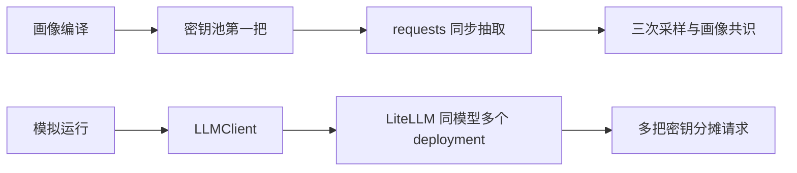
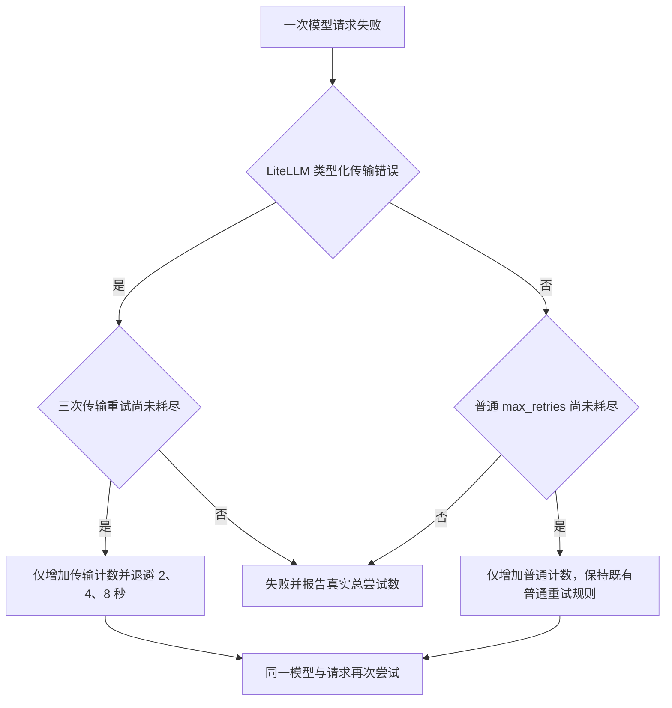

# 模型与供应商适配核查

## 核查范围

本次对照 `WorldMock-dayrun` 的 `761241c` 加未提交修改与主仓库 `20dedcd`。
隔离整合目录为 `~/.codex/worktrees/dayrun-reconciliation/WorldMock`，vendor 起点为 `da802c1`。
未访问真实模型，未读取或输出真实密钥。静态接线、确定性测试和真实供应商表现分别记录。

七项适配中的 token 预算、空载荷处理、reasoning 参数、温度、多 deployment 已存在于主仓库。
主仓库缺少 dayrun 的传输错误重试与 ReAct 轮次调整。
画像抽取固定使用密钥池第一把，因此“全链路分摊”尚未成立。

## 逐项结果

| 适配内容 | 当前生产接线与主仓库状态 | 验证及边界 |
| --- | --- | --- |
| 补全预算提高到 8000 | `profile/extractor.py` 的抽取请求、`custom/agents/life_agent.py` 的决策自述请求、`runtime.py` 的联系人回复请求均已接入 8000。`life/decision_start.py` 的请求识别副本也已同步。主仓库已具备。 | `tests/profile/test_extractor.py::test_request_payload_shape`、`tests/integration/test_life_agent_protocol.py::test_native_react_submits_one_host_bound_life_action`、`tests/integration/test_host_branch_coverage.py::test_prepare_contact_reply_builds_disabled_thinking_request` 覆盖请求形状；预算数值正确不等于供应商保证输出非空。 |
| 抽取 null 载荷归入重试 | `profile/models.py::TimeWindow.from_clock_range` 对非字符串抛出 `ValueError`，`extractor._parse_payload` 拒绝空内容并预先校验大五字段，均进入 `_single_run` 的既有无效载荷重试路径。主仓库已具备。 | 现有测试覆盖 `content=None`、空白、习惯时间窗口为 null 或数组、大五维度为 null，以及持续失败耗尽预算。本次直接执行其中八个无需 fixture 的既有测试函数，全部通过。 |
| reasoning 补全预算分离 | 抽取请求发送顶层 `reasoning.max_tokens=3000`；决策自述和联系人回复经 `extra_body` 发送 `reasoning.max_tokens=1500`。主仓库已具备。 | 本地测试能证明参数送出及决策开始事件识别形状一致，不能证明供应商始终执行软上限。此次未重跑真实模型。 |
| 决策自述降温到 1.0 | `LifeAgent.prelude_decision_statement_request` 使用 1.0；`life/decision_start.py` 的识别常数一致。主仓库已具备。 | 请求形状回归覆盖温度。原记录中不同温度下的病态比例属于既往小样本观测，本次没有重新验证，也不据此承诺完全消除病态输出。 |
| 传输错误额外重试 | dayrun 有字符串匹配与额外三次循环，主仓库缺少。隔离整合已改为 LiteLLM 类型判断与独立计数，固定公开常数 `TRANSPORT_MAX_RETRIES=3`。 | 新增 `vendor/agentsociety2/packages/agentsociety2/tests/test_llm_dispatcher_transport.py`，覆盖类型化暂时错误、持续故障、混合故障、真实总尝试数、普通预算耗尽、传输预算耗尽、取消、许可释放与成功用量。见下文。 |
| ReAct 预算增加到 16 | dayrun 的 `runtime._agent_specs` 为 16，主仓库起点为 10。参数经过 AS2 `Agent.restore` 写入 `_max_react_turns`，实际循环消费该值。 | dayrun 原有测试未断言生产 `_agent_specs` 的 16，也未验证需要超过十次调用才完成的决策。根任务负责整合与补充行为验证；增加轮次只扩大有限预算，不保证随机错误永不耗尽。 |
| 密钥池生成多个 deployment | `runtime._read_deepseek_key` 严格读取、去重密钥池；`_configure_process` 配置运行角色；LiteLLM `_build_router` 将每把密钥放入同一模型组的一个 deployment。主仓库已具备。画像抽取继续固定取第一把。 | `tests/integration/test_llm_dispatcher_multikey.py` 覆盖数量、同模型分组、OpenAI 兼容前缀、端点透传和 deployment 标识互异。它没有验证真实八把密钥的调用分布，画像编译不在该 Router 路径中。 |

主仓库已把端点与模型改为 `https://openrouter.ai/api/v1` 和 `deepseek-v4.1-flash`，
dayrun 保留 `https://api.deepseek.com/beta` 与 `deepseek-flash`。
整合必须保留主仓库端点与模型，不能整文件复制 dayrun 的 `runtime.py` 或 `profile/extractor.py`。

## 传输重试的冻结行为

只有 LiteLLM 的 `APIConnectionError`、`Timeout`、`InternalServerError`、`ServiceUnavailableError`
可以使用三次传输重试。认证、请求参数、无效载荷、协议、业务错误和限流不能借用传输预算。
普通预算继续由调用者的 `max_retries` 控制，正式运行使用零普通重试。
两个预算分别耗尽、分别停止；混合故障的总尝试上界为 `1 + max_retries + 3`。
重试不切换模型，不发送业务工具，不引入 fallback，不计入额外 ReAct 轮次。
普通限流退避固定从一秒开始指数增长、六十秒封顶；已删除 dispatcher 和环境包装器的
`base_delay`、`max_delay` 可调参数，生产调用方没有使用自定义值。
`stream=False` 仍作为模型参数显式处理；请求流式输出会在发出请求前失败。

沿用现有 LiteLLM Router 与既有调度器重试入口，Router 内部重试保持关闭，避免叠加重试。
异常分类直接使用当前依赖 LiteLLM 1.89.2 的公开异常类型，未增加第三方依赖。
外部参考为 [LiteLLM Reliable Completions](https://docs.litellm.ai/docs/completion/reliable_completions)。
退避前释放并发许可。仅已收到的成功响应计入已知 token 用量；传输失败是否已被远端计费仍无法由本地推断。
供应商错误正文可能包含密钥或请求片段，因此调度器日志和最终错误摘要只记录错误类型与尝试次数，
不拼接原始错误正文或请求内容；保留原异常链供诊断。

## 原 dayrun 补丁遗漏

| 遗漏 | 确定性证据 | 本次处理 |
| --- | --- | --- |
| 暂时不可用异常仍会立即终止 | 已安装 LiteLLM 的 `ServiceUnavailableError(message="busy")` 字符串为 `litellm.ServiceUnavailableError: busy`；dayrun 仅搜带空格的 `service unavailable`，实际只请求一次。 | 使用异常类型识别，测试覆盖该异常的恢复与耗尽。 |
| 实际尝试次数与错误不一致 | dayrun 的 `APIConnectionError`、`InternalServerError` 探针均执行四次，错误仍报告 `after 1 attempts`。 | 独立累计实际尝试数，错误与测试核对四次。 |
| 两种预算共用总 attempt | dayrun 使用总 attempt 判断普通预算和附加预算，混合故障会改变另一类错误的可用次数及退避序列。 | 使用两个计数器；混合序列与双方耗尽测试证明互不借用。 |
| 无新增传输恢复回归 | 原 `test_llm_dispatcher_no_retry.py` 只模拟 `ValueError("unsupported parameter")`，不能证明传输故障恢复。 | 新增类型化异常与错误文本含传输词但不应重试的反例。 |

## 已执行验证

| 范围 | 执行方式 | 结果 |
| --- | --- | --- |
| dayrun 抽取请求与 null 载荷 | 使用 dayrun 自身 Python 与源码，直接调用八个不依赖 fixture 的既有测试函数；全部模型响应由 `FakeSession` 返回。 | 八个通过。不是完整 pytest 套件。 |
| dayrun 原传输补丁 | 从实际源码提取 `call` 与错误判断函数，在内存中配合已安装 LiteLLM 异常对象、脚本化 Router 与假 sleep 执行。 | 复现服务不可用漏判和尝试次数误报。 |
| 隔离整合后的 dispatcher 首轮验证 | 隔离 `.venv/bin/python -m pytest`，`PYTHONPATH` 显式指向隔离 vendor；运行 `test_llm_dispatcher_no_retry.py`、`test_llm_dispatcher_transport.py`、`test_llm_callback_lifecycle.py`。 | 37 个通过；后续补充固定退避、流式拒绝、敏感错误正文和环境包装器测试，并纳入整套回归。 |
| AS2 全套回归 | 使用隔离 Python、显式 vendor `PYTHONPATH`、`WORKSPACE_PATH` 和占位模型凭据；设置 `MEM0_TELEMETRY=False`、`ANONYMIZED_TELEMETRY=False`、`LITELLM_LOCAL_MODEL_COST_MAP=True`，运行 `vendor/agentsociety2/packages/agentsociety2/tests`。 | 478 个通过，两个第三方弃用警告。首轮因未设置 `WORKSPACE_PATH` 有两个 registry 测试失败；补全所需环境后整套通过。 |
| 格式与修改边界 | `git diff --check`；生产修改为 dispatcher 与环境包装器的旧退避参数删除；测试为 transport 新文件与 no_retry 文案修正。 | 通过；未提交。 |

没有执行真实模型长跑、真实八密钥分布实验或供应商 reasoning 上限实验。
完整主仓库集成回归与独立变异审查由根任务汇总，不用本页局部测试替代。

## 统一请求入口需要确定的范围

当前运行角色使用 LiteLLM Router，画像编译使用独立同步 requests 客户端。
若“全链路分摊”明确包含画像编译，后续设计应确定统一供应商客户端是否覆盖画像抽取、
运行阶段、联系人回复与工作验收，并统一密钥选择、请求身份、重试与用量证据。
本次没有增加局部轮转兼容逻辑，也没有把画像编译分摊列为已完成。
