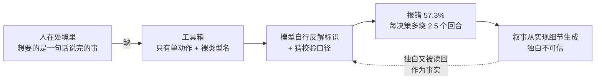
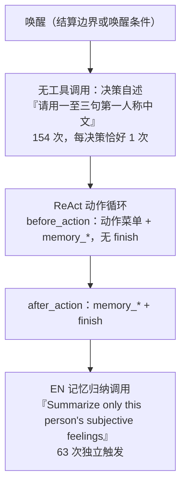
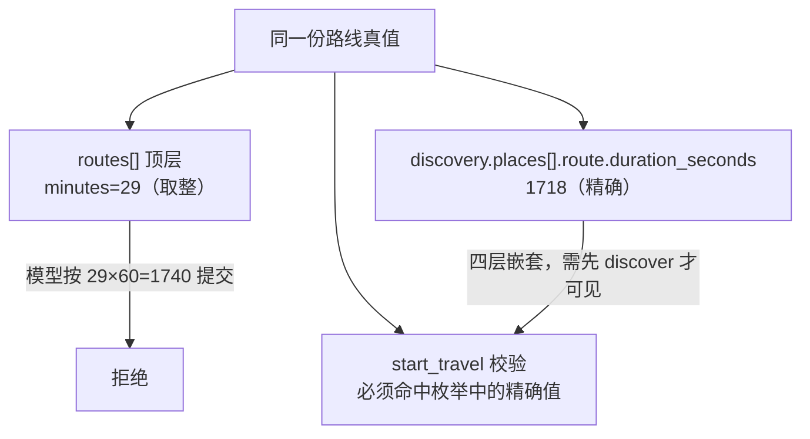
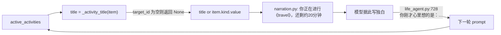
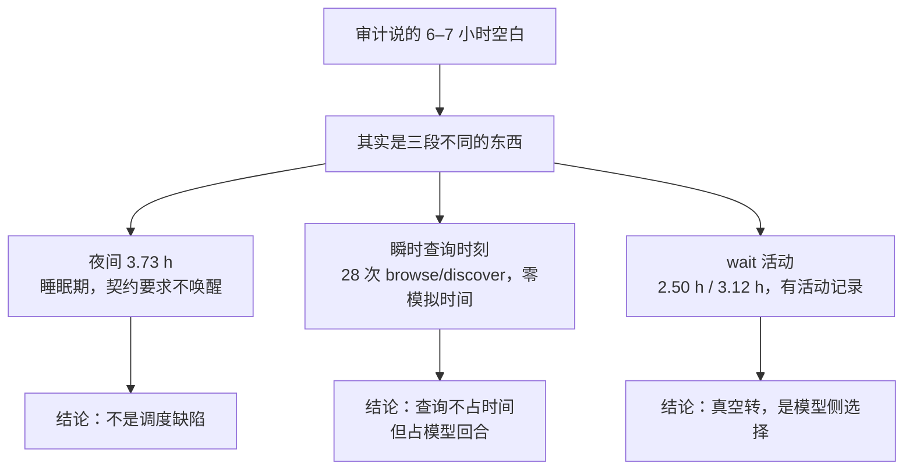
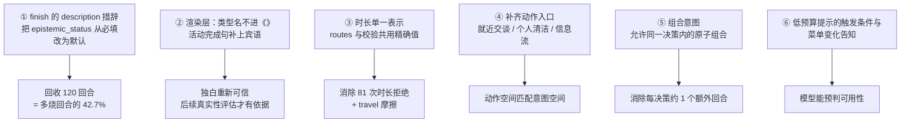

> 归档基线：2cf230115f4084aef2376e9d77bc976efbed43ea
> 原始路径：`docs/dev/research/dayrun-toolbox-design-audit.md`
> 归档说明：此提交仅定位归档原文快照，不是审查执行证明；原始执行记录与未执行事实按原文保留。

# dayrun 工具箱与模拟系统：设计层审计

> 证据来源：`runs/deepseek-day-main/footprints.sqlite`（该运行产物位于兄弟 worktree `WorldMock-dayrun-main/runs/`，本仓 `runs/` 无此目录）（743 次模型调用 / 154 个决策 / 370 次工具调用），
> 以及同目录 `dayrun-two-agent-realism-and-friction.md` 的评估结论。
> 方法：10 个只读单元分面读码（动作菜单、决策循环、叙事投影渲染、叙事生命周期与读回、设计意图冻结条款、工时与 wait 与任务、任务过期路径、社交接受度与在场、菜单剪裁、内容目录）+ 本文作者对库与代码的独立复核。
> 状态：**评估结论，未做任何代码改动。** 本文修正上一份评估的 5 处判断，见第五章。

---

## 一、一句话诊断

**工具箱在"结算"这一侧是自洽的；在"表达"这一侧，它把内部记账口径直接端给了模型。**

模型收到的不是处境描述，而是实现细节：动作类型名、无标签的整数枚举、32 位十六进制身份、
按阶段切换的菜单。模型被迫自己做两件事——**把内部标识反解成处境**，以及**猜到校验器要什么**。
摩擦成本几乎全部产生在这一层，而不是"世界答不答应"那一层。



---

## 二、硬证据（本文作者独立复算）

### 2.1 摩擦在哪一层：protocol 而非 business

| 指标 | 数值 |
|---|---|
| 去重后的真实工具调用 | 370 |
| 其中 `protocol_validation_error` | **212（57.3%）** |
| 业务拒绝 `action_rejected` | 7（占 154 次动作请求的 4.5%） |
| 业务拒绝错误码 | `WORK_LOCATION_REQUIRED` 4、`CONTENT_END_EXCEEDED` 3 |

**关键区分**：57.3% 的失败**不是世界说"不行"**，是 schema 校验说"你没说对"。世界侧的拒绝率只有 4.5%。
摩擦的来源是**接口表达**，不是**世界规则**。

### 2.2 全部 212 次失败的归因

| 类别 | 次数 |
|---|---|
| 枚举取值（`epistemic_status`，唯一字段） | **120** |
| 时长不匹配（`duration_seconds` 必须等于目录值） | 81 |
| 其他 | 11 |

被拒的 `epistemic_status` 取值：`inferred`(141) `intended`(40) `felt`(40) `planned`(36)
`committed`(11) `remembered`(9) `intention`(9) `experienced`(7) …

**这组取值本身就是诊断结论**：它们全是"把握程度"的合法语义，
没有一个是乱码或笔误。模型理解了这个字段要什么，只是不接受它**只有一个合法值**。

### 2.3 回合账（以 154 个决策为口径）

| 指标 | 数值 |
|---|---|
| 决策数 | 154 |
| 决策阶段模型请求 | 743 |
| 每决策调用（最小/中位/均值/最大） | 3 / 4 / 4.82 / 10 |
| 理论最少（独白 + 动作 + 收尾） | 462 |
| **多烧的回合** | **281** |
| 其中 `epistemic_status` 重试 | 120（占多烧回合的 42.7%） |
| 无工具调用总数 | 219 = 决策独白 154 + 英文记忆归纳 63 + 异常 2 |

### 2.4 两种模型调用，此前未被区分



**决策独白从未失败**：154 条全部非空，长度 51–117 汉字，从未触及 200 字上限。
这条路径设计得干净，没有摩擦——**可作为其余部分的参照标准**。

### 2.5 菜单剪裁：授权层没有区分，运行时层每轮都在变

| 事实 | 证据 |
|---|---|
| 场景声明的 9 个地点类菜单 | **逐字完全相同**（17 工具 / 10 活动类型），`scenarios/multi-person.json` |
| 实际下发菜单大小 | 11–17，随状态浮动 |
| 受保护、永不被剪 | 7 个：`start_basic_activity`、`plan_day`、`revise_day_plan`、`set_activity_state`、`continue_activity`、`change_playback_speed`、`game_action` |
| `start_social_activity` | **不在保护集内**，可被剪掉 |
| 实测出现率 | `consume` 11.9%、`set_activity_state` 25.0%、`continue_activity` 22.9%、`purchase` 51.3% |
| 模型是否被告知 | **否**。唯一信号是"菜单里没有了"，或调用后的 `INTERACTION_MENU_DENIED` |

### 2.6 回合预算打印正确，但低预算警告从未触发

prompt 尾部逐字携带：

```
Authoritative ReAct model-turn budget:
{"max_model_turns": 16, "memory_tools_available": true, "phase": "before_action",
 "remaining_model_turns_including_current": 15, "required_model_turns_including_current": 2,
 "used_model_turns": 1}
```

算术自洽（`remaining = 16 − used`，实测 `14+2=16`、`13+3=16` 全部成立）。
但 `_LOW_BUDGET_SENTENCE`（剩余 ≤2 时触发）**全天 0 次**——而实际有 **37 个请求**已降到剩余 ≤10（最低 7）。
模型在逼近上限时**从未收到任何一句提醒**。

### 2.7 工具箱缺口的最硬物证

全库有 **1 次模型自造工具名**：

```
tool_call: talk  {"person_id":"agent:2","contact_id":"contact-chenxi-colleague",
                  "duration_minutes":15,"social_action":"chat"}
回执:      {"ok": false, "error_type":"protocol_validation_error",
            "error":"unknown native tool calls: ['talk']"}
```

参数编得像模像样，`social_action` 这个键更是不存在。
**模型在"想跟同屋的人说两句话"这件事上没有工具，于是自己造了一个。**

---

## 三、四处结构性断裂

### 断裂一：可供性（给模型的）与校验（判模型的）是两份事实

`start_travel` 的 `planned_duration_seconds` 是**一个无标签的整数枚举**（实测 17–19 个值），
与 `destination_id` / `travel_mode` 不配对；而同一个事实在 prompt 顶层 `routes[]` 里只有**取整分钟**。
精确秒数只出现在 `discover_places` 的四层嵌套返回里。



同类：`consume` 的 `duration_seconds` 是 `enum: [900]`——**一个值**，而它的语义在 description 里
写作"必须等于商品目录时长"，目录本身不可见。

**这不是"模型猜得不准"，是同一事实有两种表示，且可提交的那一种不可见。**

### 断裂二：动作空间小于人物想做的事

| 人物想要 | 工具箱现状 | 证据 |
|---|---|---|
| 就近跟同屋的人说两句话 | 只有 `send_message`（异步单向）/ `start_social_activity`（连续活动） | 自造 `talk`；thinking 原话 "sending a WeChat while he sits next to me is weird" |
| 刷两条微博 / 看信息流 | 内容目录里有 `news_feed`、`joke_feed`，但无对应动作入口 | 独白 7 次提"微博"、1 次"知乎"，全天 0 次打开 |
| 洗漱 / 洗澡 | lifestyle 目录 183 条里有 `housework-*`、`pet-bath`，**无个人清洁** | 独白 9 次"洗漱"、3 次"洗澡"，全天 0 次 |
| 洗好的牛奶喝一口 | `consume` 只在持有 + 同地点 + 时长 ≥60 时出现（11.9%） | thinking 反复写"牛奶的时长对不上" |
| 边吃边聊 | 一次决策恰好一个动作 | 39.5% 的 thinking 命中该主题 |

**内容侧多半是够的**（193 条内容条目、30 种正餐、121 种食品、183 条生活活动），
缺口在**动作入口**：世界里有，模型够不着。

### 断裂三：单一动作的节律与人的并行性冲突

`_ACTION_PROTOCOL` 是**一个常量**（`custom/agents/life_agent.py:280`），被拼进每一个动作工具的
description 开头，逐字为 *"During one decision submit exactly one life action, and it must be the
only tool call in its model response."*

这条规则**不导致失败**（校验通过率不受它影响），但它让每一次组合意图都多花一个回合：
取消再开始、查一下再做、边吃边聊。实测 thinking 中 39.5% 命中该主题，
是全库最普遍的一条抱怨，而它在事件层**不可见**——只有回合数能反映出来。

`start_parallel_activities` 只出现在 39.8% 的菜单里，且只接受启动类子项，
不能用来做"取消 + 启动"这种最常见的组合。

### 断裂四：叙事从内部标识生成，且会被读回当作事实



`_activity_title()` 只对 `lifestyle` / `watch` / `play_game`（有 `target_id`）返回值，
其余一律 `None` → 裸枚举名进《》。全 run 59 条活动快照 58 条 `title` 为 null。

**闭环风险**：独白写错 → 作为"你刚才心里想的是"读回 → 成为下一轮的处境输入。
系统的自述反过来覆盖了地面真相。

---

## 四、两条"设计好了但没通电"

**热量的结算通道恒为 0。** `BodySettlement.food_energy_kcal` 字段存在、被写进事件、
在 `body.py:273` 的 `apply_food` 路径里确实带 `gained` 值——但全库 294 次出现**全部为 0**。
真实路径是 `apply_meal_progress → _apply_item_delta → apply_food`（`basket.py:294-333`），
它直接改 `agent.body`，**不经过被记录的 `body_settlement`**。所以热量在结算之间凭空跳入，
"吃没吃饱"在事件层不可审计。

**任务过期不构成唤醒理由，且过期是纯透传。** `ScheduledKind.TASK_EXPIRED` 存在，
编译时 `agent_id=None`（`compile.py:42`），效果是 `return ScheduledOutcome(state, dict(event.data))`
（`effects.py:33-34`）——**不改任何状态**；`_SCHEDULED_WAKE_FLAGS`（`engine.py:187-192`）里也没有它。
过期后任务只从投影里被 `continue` 掉（`observe.py:169`），面板变空。
截止前 30 分钟的 `task_due_soon` + `commitment_threatened` **确实各触发 2 次**（权威口径：`decision_started.wake_reasons`）；另有 6 条事件正文含该字面量（`environment_event` / `observation` / `decision_started` 各 2），两种口径都真、但含义不同（见第五章修正）。

---

## 四之二、空白时间的真实构成



**决策节律的实测**：agent1 有 87 个决策轮、agent2 有 67 个，间隔超过 3 小时空档的**只有两个，
且都在夜间**。这说明"决策稀缺"不是这一天的实际形态——**决策很密（约每 10 分钟一次），
缺的是"值得决策的事情"**。两者是不同的诊断，修法也不同。

---

## 五、对上一份评估的修正（必读）

五处判断本文推翻或修正，每一处都会改变修复方向：

**其一，工时不是"墙钟 × 0.8 的机械常数"。** 上一份写"任何用 effWork 论证心流的说法都是循环论证"。
实测比率在 0.800 → 0.771 之间**逐档下滑**（陈曦平、李凡递减）。
代码是 `_work_efficiency`（`body.py:538`）：多条身体曲线在结算区间上**梯形平均后连乘**，
输入含 `sleep_deficit_hours` 等。上一份看到的 0.80 只是该次运行的睡眠不足账恰落在曲线平段。
**结论要反过来**：这个量有生理含义，可以作为状态指标使用。

**其二，任务过期不是"没提醒"，是"提醒之后没有第二次机会"。** 上一份写"`wake_reasons` 全表里根本没有
`task_expired`，全天无人提起"，读起来像没提醒。实测 `task_due_soon` 与 `commitment_threatened`
**各 6 次**，6 条任务都按规格在截止前 30 分钟被唤醒过。真正的缺口是**过期不唤醒、过期不改状态**。

**其三，工具返回错误率不是 36%。** 那个数把累积在 prompt 里的历史回执重复计入了。
按 `tool_call_id` 全局去重后是 **212 / 370 = 57.3%**——比上一份严重得多。

另有一处本文未能复现（不计入上述五条）：上一份的 thinking 主题表（33.2% / 19.7% / 17.1% …）本文用不同匹配式得到
明显不同的比例（39.5% / 19.7% / 27.5% / 37.1%）。同一批文件、不同正则，数字差异很大，
**该表的比例不宜作为硬结论引用**，但主题的存在性（每条都能找到逐字原话）是可靠的。

**其四，白天并没有 6–7 小时空白，那是口径混淆。** 上一份写"无活动无决策的空白约 6.4 h / 约 7 h"。
把**活动覆盖并集**与**决策时点**分开算之后，两人全天最长的一块真正空白是 **3.73 小时，起于 00:01**，
即夜间睡眠段——而睡眠期只放行 `planned_end` 与 `wake_from_sleep` 唤醒（`schedule.py:54-57`），
所以夜间 3.75 小时不唤醒是**契约要求的行为**。活动覆盖分别是 17.38 h 与 16.78 h（24 小时制）。
上一份把"没有新启动的活动"读成了"没有决策"：白天那些决策其实发生了，只是其中 **28 次（占 154 次动作的 18.2%）
是 `browse_activities` / `discover_places` 这类瞬时查询**——它们 `occurred_at = state.current_time`，
**不消耗任何模拟时间**，因此不出现在活动时间线上。分布：agent1 19 次、agent2 9 次。

**其五，正餐热量数字要按摄入口径读。** 目录里 `meal-0018 鸡汤面` 是 **265 kcal/份**、
`meal-0001 牛肉炒面` 是 **516 kcal/份**（`catalog/objects.jsonl`，provenance 为 USDA FNDDS 实测值）。
上一份引用的 238.5 / 464.4 恰好是这两个数的 **0.9 倍**——可食部系数。
结论方向不变（鸡汤面确实是当天最寡淡的一餐），但引用时应说明是按摄入热量计的。

---

## 六、按杠杆排序的修复方向



**必须先做的是 ②**：只要独白不能被信任，任何"用独白评估真实性"的做法都是自欺，
后续所有真实性度量都建立在不信任的文本上。

**性价比最高的是 ①**：改一句 description，回收 120 个回合（占多烧回合的 42.7%），
且不触碰任何世界规则。**注意不要在 schema 里补 enum**——取值本来就写在 schema 里，
冲突出在 description 把同一个词当形容词用了（"Every episode is subjective self-report"）。

---

## 七、需要裁决

1. **动作粒度**：单一动作是刻意的现实约束（人一次确实只能做一件主要的事），
   还是接口简化？它决定了 39.5% 的 thinking 抱怨是"设计代价"还是"待修缺陷"。
2. **模型可见性**：菜单每轮变化而无一字说明，是有意让模型自己观察，还是漏了告知？
3. **`start_social_activity` 不在保护集内**——社交工具被地点菜单剪掉是有意设计吗？
4. **热量通道恒 0**：是否有意让热量只走 `body` 状态而不走结算证据？
   这决定"吃没吃饱"能否进入可审计范围。
5. **交互面是否本轮做**：`accepted` 恒为 false、行进中的人仍在出发地在场名单、
   6 次对话全单方面。`accepted` 的判定发生在结算时扫全场，
   环境**从不**替对方创建对称活动——这是设计还是待办？
