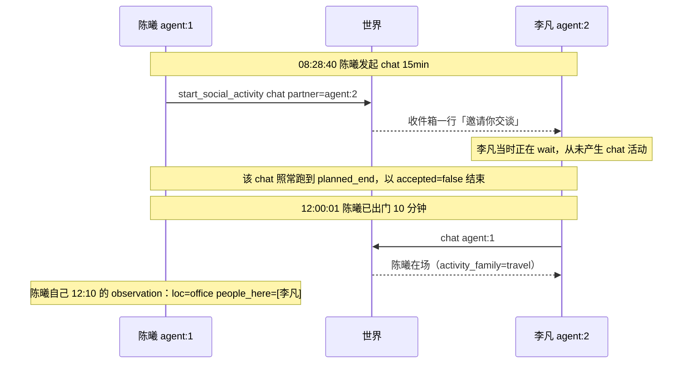

> 历史记录：本文件保存提交 `72f004b0087efa1b6f6d662ac6a143e087e4e21c` 时的过程与判断，不再定义当前系统。
> 当前设计见 [文档入口](../../INDEX.md)；正文中的路径、规则和结果按当时上下文理解。

> 归档基线：2cf230115f4084aef2376e9d77bc976efbed43ea
> 原始路径：`docs/dev/research/dayrun-two-agent-realism-and-friction.md`
> 归档说明：此提交仅定位归档原文快照，不是审查执行证明；原始执行记录与未执行事实按原文保留。

# dayrun 双人一天：真实性与交互摩擦评估

> 证据来源：`runs/deepseek-day-main/footprints.sqlite`（该运行产物位于兄弟 worktree `WorldMock-dayrun-main/runs/`，本仓 `runs/` 无此目录）（3179 条事件，run_id `72b38f09a78d41c0aebe9e8ec9eda859`）
> 评估对象：2026-01-05（周一）00:00 → 2026-01-06 00:00，deepseek-flash，743 次模型调用
> 方法：13 个只读单元并行（9 路 thinking 分片挖掘 + 2 路真实性评估 + 1 路交互/世界面 + 4 路对抗验证，本轮验证推翻/修正了 3 处汇编阶段断言，见第五章）
> 状态：**评估结论，未做任何代码改动**

---

## 一、结论摘要

这一天**已经不是"两个人在过日子"了**，但离真人还差三层：日程骨架立住了，身体与世界给得出反应，**但"人"的那一层——意图如何变成动作、人与人如何真的相遇、一天里的空白如何处理——还基本是缺的**。

一句话概括三个最硬的结论：

- **叙事与事件是两套东西。** agent:1 的独白说"温水喝完、收拾停当"，事件里那 45 分钟只有一个无对象的 `wait 2700`；独白说"跟李凡当面唠了二十分钟"，那次 chat 在 8.4 分钟后被他自己取消。读独白已经不能知道这个人做了什么。
- **交互面还没建立。** 6 次面对面对话，数据库里 `accepted` 全部是 `false`——**全是单方面的**，对方一侧零对称记录；行进中的人还留在他离开地的在场名单里（最长晚 32 分钟），所以出现了"对着已经出门 10 分钟的室友说话"。
- **系统自己有 36% 的工具返回是报错**，最高频的单一错误是记忆字段取值猜错（120 次，占全部模型错误 56.3%，每次恰好多烧 1 个模型回合）。

> **口径修正**：上句的 36% 把累积在 prompt 里的历史回执重复计入了。按 `tool_call_id` 全局去重后的口径是 **212 / 370 = 57.3%**，见 [设计层审计](dayrun-toolbox-design-audit.md)。本句保留原始记录身份，不就地改写。

同时也要说清楚**做到了什么**：起床 7:15 / 出门 8:00 / 步行 2.1 km 28.6 分钟 / 8:28:40 到岗，四个时点全部落在人物卡声明的窗口内；agent:1 傍晚"走 32 分钟到紫薇公园、坐 15 分钟、饿到放弃、自己记账说第二天补"是全天真味最足的一段。

---

## 二、这一天实际长什么样

```mermaid
gantt
    dateFormat HH:mm
    axisFormat %H:%M
    title 两个 agent 的一天（按活动类型）
    section 陈曦 agent:1
    sleep 00:00-03:45      :a1, 00:00, 225m
    空白(无决策轮)          :crit, 03:45, 105m
    wait 晨间              :a2, 03:45, 255m
    travel 通勤            :a3, 08:00, 29m
    chat+read_mail         :a4, 08:28, 32m
    work 工作              :a5, 09:15, 90m
    consume 加餐           :a6, 10:45, 15m
    wait 卡死              :crit, a7, 11:00, 60m
    travel 午餐往返        :a8, 12:00, 24m
    consume 午餐           :a9, 13:00, 30m
    watch+work             :a10, 13:45, 160m
    travel 去公园          :a11, 18:33, 32m
    consume 晚餐           :a12, 19:36, 25m
    wait 晚间              :crit, a13, 20:59, 50m
    sleep                  :a14, 21:49, 131m
    section 李凡 agent:2
    sleep                  :b1, 00:00, 225m
    空白(无决策轮)          :crit, 03:45, 105m
    wait 晨间              :b2, 03:45, 255m
    travel 通勤            :b3, 08:00, 29m
    wait 顶着工作          :crit, b4, 08:43, 160m
    空白(无决策轮)          :crit, 11:00, 50m
    work 工作              :b5, 11:00, 60m
    chat                   :b6, 12:00, 10m
    travel 午餐            :b7, 12:10, 19m
    consume 午餐           :b8, 13:00, 25m
    travel 回办公室        :b9, 13:25, 19m
    work                   :b10, 13:44, 180m
    travel                 :b11, 16:44, 21m
    consume                :b12, 17:05, 20m
    chat/travel            :b13, 18:33, 19m
    consume 晚餐           :b14, 20:00, 25m
    watch 段子             :b15, 20:29, 40m
    call 老友              :b16, 21:09, 30m
    wait 等外卖            :crit, b17, 21:39, 50m
    consume 外卖           :b18, 22:07, 25m
    watch 段子             :b19, 22:32, 30m
    wait                   :crit, b20, 23:02, 28m
```

（`crit` 标出的是空白与 wait 段）

| | 陈曦（agent:1） | 李凡（agent:2） |
|---|---|---|
| 活动总时长 | 17.33 h | 16.75 h |
| 睡眠 | 5.67 h（21:49 入睡） | 3.99 h（23:30 入睡） |
| 工作 | 3.50 h | 4.00 h |
| **wait** | **2.50 h** | **3.12 h** |
| 通勤 | 2.09 h | 1.92 h |
| 用餐 | 1.58 h | 1.67 h |
| 看片/段子 | 0.93 h | 1.17 h |
| 聊天 / 通话 | 0.89 h / — | 0.39 h / 0.50 h |
| 无活动无决策的空白 | 另有约 6.4 h | 另有约 7 h |

两人的 `boundary_type` 里 `interruption_reason` **全部为 None**——一天下来没有任何一次活动被打断。

---

## 三、贴合性评估

### 3.1 陈曦（agent:1，产品经理）：15 条判断，贴合 2 / 偏离 6 / 明显失真 7

**最严重的三条失真：**

**第一，他的第一人称自述是从工具名生成的，不是从世界状态生成的。** 三处独白把活动类型名当成节目名——`travel` 被说成"还剩十几分钟""还差四分钟就收尾"（`《travel》` 这个渲染式见 5.4 节）。另有四处"声称的动作"在动作日志里根本不存在：07:30 说"温水喝完、收拾停当"，实际 07:15–08:00 只有一个 2700 秒的无对象 `wait`；09:30 说"牛奶先喝着"，首次 `consume` 在 10:45:01；16:54:35 说"跟李凡当面唠了二十分钟"，那段 chat 8.4 分钟后被他取消；18:33 说"牛奶折腾两下没成"，而当天 7 次 rejection 里没有一次与 consume 相关。**这一条最致命，因为它摧毁了"读独白即可知道这个人做了什么"的前提。**

**第二，真人一定会有的生活内容整体缺失。** 起床后 45 分钟与到家后 50 分钟都是空白或 `wait`；全天 `wait` 2.5 h + 完全无活动空档 6.4 h ＝ 8.9 h，占清醒时间约 48%。全天没有洗漱、洗澡、早饭动作；没有手机行为（3 条消息、0 条回复处理、没打开过任何信息流，独白却四次说"刷两条微博"）；晚间独白承诺洗澡 + 牛奶 + 两集剧，实际是 50 分钟空等；自己的娱乐目标（打 Switch / 看 Netflix，世界里有 110 条 `game_session`、90 条 `feature_film`）一件没做。

**第三，职业侧不成立。** 产品经理的周一：0 会议、0 评审，全天 work 只有一个黑盒目标 `task-2026-01-05`；净在座 7 小时 25 分里 work 只有 3.5 h（47%）；两个工作块都恰好 `planned_end` 到点判完成。

**另外一条度量修正很重要**：`effective_work_seconds` 对 agent:1 的 29 行 work 记录，比率恒为约 0.80（21 行精确 0.80000，其余 0.795–0.800），即它是"墙钟 × 0.8"的机械常数。**任何用 effWork 论证"专注 / 摸鱼 / 心流"的说法都是循环论证。**

### 3.2 李凡（agent:2，后端）：13 条判断，贴合 3 / 偏离 7 / 明显失真 3

**最严重的三条：**

**第一，到办公室后 2 小时 31 分零产出（08:28:40–11:00）。** 其中 86 分钟是他**自己发起**的 `wait 9600` 秒，09:00、09:45 两轮都主动续等，10:09:37 才取消；之后 50.4 分钟连决策轮都没有。同期独白一直在说"上午就钉在工位上，先把那个并发 bug 往下推"。机制上分两半：工作合同 09:00 才放出（08:43 他看到 `tasks: []`）＋挂着活动时开工工具不暴露；但"用 wait 代表工作"是模型侧的选择。

**第二，工作日形状不对。** 真实干活 3.09 小时（4 小时墙钟 × 恒定 77% 折算系数），8 小时的工作合同只走了约 1/3，20:00 任务过期；全天零封工作邮件（3 条 `mail_arrival` 全在 agent:1）；除室友外零同事；两段工作共 4 小时零中断。对一个标签是"忙起来会进入心流忘记时间"的后端，产出应当偏多，这里正相反。

**第三，约 7 小时无活动无决策的空白**（00:00–03:45、10:09–11:00、12:29–13:00、17:30–18:33、19:05–19:30、19:36–20:00），加上 3.12 小时 `wait`。真人空转是有内容的，"wait"这个动作类型现实里不存在。

### 3.3 交互层：7 条，贴合 2 / 偏离 2 / 明显失真 3



**问题一：行进中的人仍占着出发地的在场名单。** 陈曦 18:33:01 出办公室去公园，李凡到 19:05:31 才收到 `person_left`，晚了 32 分钟。最硬的反证是陈曦自己 12:10:00 的 observation：`loc=office`、`people_here=[李凡]`，而他已经走了 10 分钟。

**问题二：6 次面对面对话全是单人活动。** 全表扫描：`{"accepted": false, "partner_id": ...}` 出现 28 条、**全部 false**，覆盖 6 次 chat（08:28:40 / 09:00:00 / 12:00:00 / 14:39:34 / 16:54:35 / 18:52:00），却都跑完或自行取消。对方一侧零对称记录——08:28:40 那 15 分钟李凡正在 `wait`。动作日志 514 行里没有"接受/拒绝邀请"这个动作。而且 chat 全程无内容，事后无法回答"他们聊了什么"。

**问题三：任务面同秒静默到期。** 6 条任务同一秒 20:00:00 到期，`wake_reasons` 全表里根本没有 `task_expired`，两人的任务面板随后直接变空，全天无人提起。活也没干完：李凡 28800 s 合同只做 14400 s（50%），陈曦只做 12600 s（43.75%）。同时两人的 6 条任务与 `work_progress`（含对方 assignee、deliverable schema、已工作秒数）**互相可见**。

### 3.4 世界层：7 条，贴合 2 / 偏离 1 / 明显失真 4

**一处"看起来像 bug、实际不是"的澄清。** agent:2 吃完面之后环境仍持续报"饿"（20:29 / 21:09 / 22:07 三次读数逐字为真）——这**不是结算滞后**。appetite 的下降发生在用餐过程中（20:00 0.838 → 20:15 0.664 → 20:25 餐毕 0.548），餐毕即最低点。真实原因是**那顿饭热量太小被当成正餐**：他吃的是 `meal-0018 鸡汤面`，只有 238.5 kcal，而同日的 `meal-0001 牛肉炒面` 是 464.4 kcal。190–238 kcal 的"晚饭"之后一小时又饿，在系统自己的数据里是自洽的。**失真点在产品能量数值与叙事（agent 说"我面快吃完了"）的错位。**

顺带查实一处账目缺陷：294 条 `body_settlement` 的 `food_energy_kcal` **全为 0**，热量在结算之间凭空跳入（陈曦 20:00:00 结算 after=817.5 → 同秒 observation 903.4 → 下档结算 before=903.4，+85.9 无来源记录），所以"吃没吃饱"在事件层面不可审计。

---

## 四、agent 在 thinking 里吐槽了什么

461 份非空 thinking（1,948,732 字符）逐份扫描。计数口径：**命中该主题的 thinking 文件数**（同一文件内重复不计），跨文件分别计次。

| 抱怨主题 | 命中文件 | 占比 | 陈曦 | 李凡 |
|---|---|---|---|---|
| 一次决策只能交一个动作，且收尾动作要独占一条消息 | 153 | 33.2% | 85 | 68 |
| 记忆的"把握程度"字段取值猜不中 | 91 | 19.7% | 50 | 41 |
| 算不清自己还剩几个模型回合 | 79 | 17.1% | 52 | 27 |
| 路线表只给取整分钟、提交却要精确秒 | 79 | 17.1% | 66 | 13 |
| 记忆引用的十六进制 id 认不出是哪个 | 75 | 16.3% | 42 | 33 |
| 餐食/商品的时长必须是精确目录值而目录不可见 | 55 | 11.9% | 47 | 8 |
| 身体/目标读数与自己的记忆冲突 | 48 | 10.4% | 30 | 18 |
| 想做的事没有对应动作 | 38 | 8.2% | 24 | 14 |
| 活动类型名落进中文书名号，被读成作品名 | 37 | 8.0% | 21 | 16 |
| 本回合工具清单里没有我正要用的工具 | 33 | 7.2% | 16 | 17 |
| 地点编号映射不到地名 | 26 | 5.6% | 16 | 10 |

### 逐条展开（含逐字原话）

**"一次决策只能交一个动作，且 finish 要独占一条消息"——最普遍的摩擦（153 份）。**
> "I'd probably take a few sips of milk while chatting. But engine only allows one."
> "So my action must be expressed... via finish? 'Finish after exactly one submitted life action.' ... Hmm, but finish schema only has memories."
> "I think the best single action is to cancel the wait and start a relaxation activity — but those are two actions."

规则原文在全 run 的 thinking 里被复述 52 次以上。它不导致动作失败，但每一次组合意图（边吃边聊、取消再开始、查一下再做）都要多花一个回合。

**记忆字段取值猜不中（91 份，120 次被拒）。**
> "epistemic_status: something like 'believed'/'felt'/'intended'… The schema just wants a string."
> 被拒后全文只有一行：`Fix epistemic_status to "subjective".`

被拒取值实测出现 `experienced / felt / inferred / planned / intention / feeling / decided / intended / acknowledged / committed / self_report` 等。**注意这条的机制在第五章被修正**——取值是写在 schema 里的。

**算不清还剩几个回合（79 份）。**
> "\"used_model_turns\": 1 and \"remaining_model_turns_including_current\": 15 … That's inconsistent."
> "my responses in this decision: 4 so far (each response = 1 turn?)"

**路线时长（79 份）。**
> "Round numbers hidden. Risky."
> "Even market walking 1080 fails. So the mechanism differs. Maybe durations in routes are not minutes*60."
> "Travel seems unusable with the displayed values." / "Guessing is hopeless."
> "I'm 100% stuck."

**记忆引用的十六进制 id（75 份）。**
> "Hmm, but I don't have any observation_event_id visible. … So what refs can I use?"
> "the recent_action_results shown don't have event_id fields (they have action_id)."
> "The list of IDs is given without mapping to texts; earlier subjective list order likely matches…"

**想做的事没有对应动作（38 份）——同性相吸的合并项。**
> "sending a WeChat while he sits next to me is weird; a realistic sim would have me just talk. But if talking isn't available…"
> "No eat/sleep tool. So eating might be modeled via... hmm."
> "There's no shower tool either."
> "Lifestyle ids must come from observation's life activity catalog — not visible here."

**地点编号（26 份）。**
> "I don't know which POI is 紫薇公园. That's a problem — need to discover."
> "The routes list only poi-* ids and home/market. So to travel to 菜饭骨头汤 I need its poi id. I don't know which. This is ambiguous."

### 打转的代价

thinking 长度的中位数是 1554 字符，均值 4227，**最长一份 76,058 字符**。前 12 份最长的 thinking 合计 531,703 字符，**占全部 thinking 的 27.3%**——而它们全部落在摩擦点上：

| 位置 | 字符 | 在跟什么搏斗 |
|---|---|---|
| 陈曦 11:00 | 76,058 | 同屋的人就在眼前却无"当面说话"工具，约 40 次改口后抛硬币 |
| 李凡 10:09 | 72,781 | 24 次写下 "FINAL" 又推翻，"reconsider" 出现 135 次 |
| 陈曦 19:05 | 52,240 | travel 时长穷举 |
| 陈曦 20:26 | 51,943 | travel 时长穷举 |
| 陈曦 13:40 | 48,419 | travel 时长穷举 |
| 陈曦 17:03 | 39,046 | 为一个是非题烧掉 |
| 李凡 10:09 | 36,689 | 同上 |
| 李凡 12:00 | 34,194 | 同一决策点内反复推翻 |

### 量化代价

| 指标 | 数值 |
|---|---|
| 新鲜工具结果错误率 | **212 / 589 = 36.0%** |
| 最高频单一错误 | `epistemic_status` 取值，120 次 = 全部模型级错误的 56.3% |
| 折算掉的模型回合 | 120 / 743 = **16.2%** |
| 被拒重提时的相似度 | 88.3% 只改那一个字段、其余逐字相同 |
| 每轮 ReAct 回合数 | 均值 4.82，最大 10（预算 16，从未打满） |
| 全天 token | input 6,731,038 / output 670,198 |

---

## 五、被对抗验证推翻或修正的判断（必读）

四个验证单元各自独立取数并主动纠错。以下是我在汇编阶段写错、由验证单元推翻的：

### 5.1 「信任显示分钟去算就必然被拒」——推翻

我在侦察阶段写的是"必然被拒"。验证单元找到 **4 条反例**：李凡四次提交 `1140`，当时路线表显示 **19 分钟**，`19×60 = 1140`，**被接受**。原因是 `1140 / 60 = 19.0` 整除，取整无损。

正确表述应该是：**当且仅当真实秒数恰为 60 的整数倍时，`分钟×60` 才会通过**。全天 204 个合法时长里只有 6 个是 60 的倍数（约 2.9%），所以实际被拒率约 **94%**（63 次中 59 拒 / 4 接受），不是 100%。渲染代码用的是 `round()`（`src/worldmock/life/observe.py:181`）。

### 5.2 「工具集在 ReAct 循环里递减」——机制解释推翻

分片单元提出"第 3 回合起只剩 memory_*+finish"，并给了 25/26 的命中率。验证单元复现了它的窗口口径（26/26、26/26、25/26，连它标注的例外轮次都一致），但**全 run 口径下另有 32 个决策的第 3 回合仍是完整动作菜单**——而这 32/32 机制统一：**动作被拒、阶段仍是 `before_action`**。

真相不是衰减，是**阶段状态机换菜单**：`before_action` → 完整动作菜单（含 6 个 `memory_*`，**不含 `finish`**）；`after_action` → `memory_*` + `finish`。全 743 条请求上 `phase ↔ 菜单` 一一对应、零非对角单元。system prompt 里逐字打印着 `{"phase": "before_action", ...}`。

顺带纠正一个假设：我派发时说"工具清单可能没记进 DB"是错的——它明文存在 `model_request.data.request.tools`。

### 5.3 「记忆引用的 event_id 缺失导致 agent 找不到可用引用」——因果层推翻

事实层成立：`finish` 的描述逐字承诺 `current recent_action_results[].event_id` 并明文禁止用 `action_id`，而 agent 可见的 `facts.recent_action_results` **0/202 含 `event_id`**（只有 `action_id` / `status` / `message` / `occurred_at`）。

但因果层被推翻：`refs` 是**带 enum 白名单的字段**，白名单恰好补齐了承诺里缺的值（前置 observation 的 event_id 在白名单内 284/284 = 100%）。**提交的 refs 1116/1116 全部合法，refs 校验失败 0 次。** 所以这是**纯认知开销，不是失败**。分片单元自己也写了这句，是我在汇编时把结论写强了。

### 5.4 「系统没给 epistemic_status 的值域」——推翻，且真实机制与直觉相反

取值**确实写在 schema 里**，从 DB 里可以逐字取到（`model_request.data.request.tools[]` 中 `finish` 那一项）：

```json
"epistemic_status": { "const": "subjective", "title": "Epistemic Status", "type": "string" },
"type": { "enum": ["commitment","relationship","preference","goal","conflict",
                   "resolution","identity","routine","reflection"],
          "title": "Type", "type": "string" }
```

但"每次第一次提交必然被拒"也被推翻：**34 个反例**（陈曦 22 / 李凡 12）首次即写对 `"subjective"`，全部带非空 memories。最硬的一个是陈曦全 run 第一次提交——上下文仅 7 条消息、无任何 validation error 历史，冷启动零拒绝历史却一次写对。

真实机制**不是**"模型误读 `type: string`"——模型从未推理过 `type`（461 个思维块中引用 JSON Schema `const` 关键字仅 1 次且无关）。真实机制是 **`finish` 工具描述里的形容词用法**："Every episode is subjective self-report"——同一个词在这里是形容词，模型因此把 `subjective` 当成一个语义类别，于是自造 `inferred / felt / intended / planned…`。被拒率约 78%，序列呈随机抖动、无学习曲线。

**同时被证实的对照**：同层 `memories[].type` 是 9 值 `enum`，全天 120 次 finish 报错中引用 `memories.N.type` 的 **0 次**、733 条记忆 **0 个越界值**。但对照论据需要修正——同层 `source` 用 `pattern: "^decision_observation$"`（同样可见）也零失误，所以判别维度更可能是"description 用词是否与字面量冲突"，而不是 enum vs const。

**下游若按"补一个 enum"去修会修错地方。**

### 5.5 其他被修正的细节

- **《travel》渲染**：证实。渲染式是 `title if title else kind`；全 run 59 条活动快照中 **58 条 `title` 为 null**，于是裸 snake_case 类型名落进中文书名号。221 行渲染里 217 行是裸类型名（`work` 58 / `travel` 44 / `consume` 42 / `wait` 40 / `watch` 12 / `chat` 9 / `call` 8 / `read_mail` 4）。**但一条子命题需修正**：李凡对 `《travel》` 的读法是**正确**的；他的同类误读发生在 `《call》`→「（游戏）」（21:29:13 逐字 "正在进行《call》（游戏）还剩10分钟"）。
- **活动结束不说是哪个**：证实。21:39:34 的 `active_activities: []` + `wake_reasons: ["planned_end"]`，正文只有 `Activity completed.`，紧随的"已核验经历"里只有 jokes-feed 的行，电话本身零记录。模型逐字猜错："which was whatever I was doing (**probably the game or the jokes feed**)"。**信息在事件里，是渲染层丢掉的**——95 条空 `active_activities` 观察中 46 条的 payload 全部带 `activity.kind`。一般化：`Activity completed` 作为尾句出现 229 次；`《X》` 与 `completed` 同现 0 次。
- **"想做的事没有对应工具"**：部分成立。分布是 `start_basic_activity` 14 次 = `wait` 10 / `sleep` 4。顶替成立（晨间例程、晚间洗澡、等外卖等），但"没有对应工具"被三类反例推翻：① 19:05:36 陈曦去菜饭骨头汤的路线在 `routes` 里明确 `walking 715s status=reachable`、`start_travel` 可用，全 run 7 条 `action_rejected` 无一条是 travel，模型仍写 "travel fails… maybe start_basic_activity('wait') to embody walking?" 并用 wait 900s 顶替，15 分钟后同一条路线用 `start_travel` 成功了；② `start_social_activity` 在全部 10 个 wait 决策点可用且被调用 6 次；③ `lifestyle:*`（meditation/cinema/gardening/housework）确实存在过。
- **一个关键旁证**：6/6 次成功的 `start_travel` 之前都紧邻一次 `discover_places`——因为**精确秒数只出现在 `discover_places` 的结算结果里**（`recent_action_results[].discovery.places[].route.duration_seconds`，四层嵌套），而同一份 prompt 顶层的 `routes[]` 只有取整的 `minutes`。`start_travel` 的 schema 里 `planned_duration_seconds` 是精确秒的 enum（一个无标签的整数列表，不与 destination/mode 配对），**agent 对 destination/mode 的 enum 讨论了几十处，从未讨论过 duration 也有 enum**（特征值在 461 份 thinking 中命中 0）。

---

## 六、发现清单（按影响排序）

```mermaid
graph TD
    A["叙事与事件脱钩<br/>独白说的动作在日志里不存在"] --> A1["渲染式 title if title else kind<br/>类型名进书名号"]
    A --> A2["Activity completed 无宾语<br/>信息在 payload 里被渲染层丢弃"]
    A --> A3["身体读数结算与叙事不同步<br/>food_energy_kcal 全为 0"]
    B["交互面未建立"] --> B1["chat accepted 全为 false<br/>6 次对话全是单方面的"]
    B --> B2["行进中的人仍在出发地在场名单<br/>最长晚 32 分钟"]
    B --> B3["任务同秒静默到期<br/>wake_reasons 里没有 task_expired"]
    C["可供性表达与校验不一致"] --> C1["routes[] 给取整分钟<br/>校验要精确秒"]
    C --> C2["consume 时长要精确目录值<br/>目录不可见"]
    C --> C3["地点只有 poi id<br/>名字→编号映射缺失"]
    D["契约措辞诱导错误"] --> D1["description 用形容词 subjective<br/>schema 是 const"]
    D --> D2["承诺 recent_action_results.event_id<br/>实际只有 action_id"]
    D --> D3["finish 独占一条消息的时序规则<br/>每轮被复述 52 次"]
    E["一天里的空白"] --> E1["wait 顶替无对应动作的需求"]
    E --> E2["无活动无决策的成片空白约 6-7 h"]
```



**必须先修的（会让评估本身失效）：** 叙事与事件脱钩。只要独白不能被信任，任何"用独白评估真实性"的做法都是自欺。

**最省力的高杠杆修复：** `epistemic_status` 的 description 措辞——改一句话即可回收 16.2% 的模型回合。以及 `title if title else kind` 的渲染式。

**结构性修复：** 交互面（接受/拒绝邀请、对话内容、在场名单实时性）与路线时长的单一表示。

---

## 七、待裁决

1. **`effective_work_seconds` 是墙钟 ×0.8 的常数**——这是有意的设计（作为"有效工时"的简化）还是待替换的占位？它直接决定"专注/心流"这类叙事有没有数据支撑。
2. **`wait` 的定位**。它现在同时承担"晨间例程""等外卖""顶替走路""顶着工作"四种语义。是要给它拆出真实活动类型，还是引入"空转"的概念？
3. **交互面是否本轮就要做**。6 次 chat 全是单方面的，这件事在双人场景里是根本性缺陷还是已知待办？
4. **`food_energy_kcal` 全为 0**：热量为什么不走结算通道，是记账缺陷还是有意简化？
5. **两人任务面板互相可见**（含对方 assignee 与 deliverable schema）——是设计还是泄露？

---

## 附：证据位置

| 内容 | 位置 |
|---|---|
| 3179 条原始事件 | `/tmp/wm-think/extract/all_events.jsonl` |
| 461 份 thinking 原文 | `/tmp/wm-think/extract/reasoning/` |
| 227 行活动时间线 | `/tmp/wm-think/extract/act_timeline.txt` |
| 514 行动作日志 | `/tmp/wm-think/extract/action_log.txt` |
| 两人第一人称独白与记忆 | `/tmp/wm-think/extract/voice_agent{1,2}.txt` |
| 9 份分片摩擦报告 | `/tmp/wm-think/out/friction-agent{1,2}-shard*.md` |
| 3 份真实性报告 | `/tmp/wm-think/out/realism-*.md` |
| 4 份对抗验证报告 | `/tmp/wm-think/out/verify-*.md` |
| 侦察 ground truth 与修正 | `/tmp/wm-think/GROUNDTRUTH.md`、`/tmp/wm-think/CORRECTIONS.md` |
