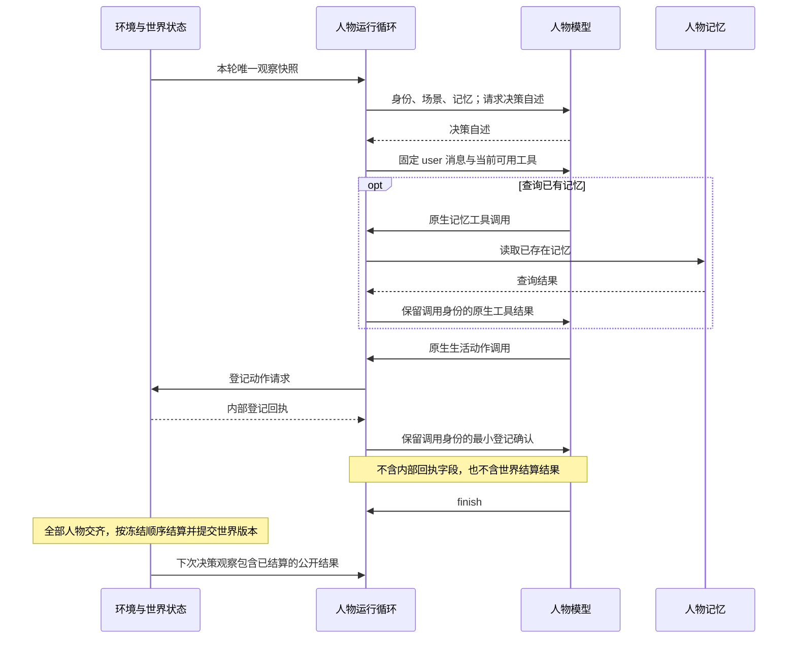

> 归档基线：2cf230115f4084aef2376e9d77bc976efbed43ea
> 原始路径：`docs/dev/research/decision-context-feasibility.md`
> 归档说明：此提交仅定位归档原文快照，不是审查执行证明；原始执行记录与未执行事实按原文保留。

# 决策上下文方案的业界依据与可行性验证

> 日期：2026-09-20。范围：核对 `PROPOSAL-decision-context.md` 的运行机制、模型协议和修改边界。
> 证据工作区：`/Users/atishoo/.codex/worktrees/decision-context/WorldMock`。
> 研究基线：WorldMock `426af3bfe3d7e507b749f286e08857e697c2ac2f`；
> AgentSociety2 `849bac7801be877f7e6f7f1759d3674a9e3d60b2`。
> 本文是设计裁决依据；最终行为与完整文件清单以
> [冻结的功能规格](../SPEC-decision-context.md)为准，以下采纳方案已对齐该裁决。

## 结论

方案的主干可行：人物基于同一轮的冻结观察查询记忆、提交一个生活动作，再由环境收齐请求并统一结算。
动态工具集合、原生工具消息、延迟可见的世界结果都有成熟机制支持，现有依赖和实现已经具备所需基础。
需要纠正的是“所有工具异步”“句柄完全不进上下文”“工作验收当轮回灌”三个陈述。
正常生活决策在没有记忆查询和协议纠错时，仍需自述、生活动作、`finish` 三次模型请求。
“两阶段”表示自述和行动循环，不是总请求次数；查询与重试会继续消耗同一回合预算。

“已登记”只说明环境收到了请求；它不表示购买成功、工作验收通过或活动完成。
这与 HTTP 对接受请求和完成处理的区分一致，但模拟采用环境驱动的后续观察，不需要让人物轮询任务。
[HTTP Semantics，202 Accepted](https://www.rfc-editor.org/rfc/rfc9110.html#name-202-accepted)

## 业界来源与采纳边界

持续更新的官方文档以下列检索日期为证据时间，不把检索年份误记为首次发表年份。

| 主题 | 一手来源、作者或机构、时间 | 采用的机制 | 不可照搬的边界 |
| --- | --- | --- | --- |
| 动态工具集合 | LangChain，官方知识库，2026 年检索：[Progressive Tool Disclosure with Deep Agents](https://kb.langchain.com/articles/8488719552-progressive-tool-disclosure-with-deep-agents) | 每次模型请求根据当前状态过滤工具；执行器保留完整实现 | WorldMock 已有 `build_react_tool_schemas` 和参数验证，不引入 LangChain、工具检索模型或新的中间件层；工具过滤不能替代执行校验 |
| 当前模型的原生工具协议 | DeepSeek，官方 API 文档，2026 年检索：[Tool Calls](https://api-docs.deepseek.com/guides/tool_calls/)、[Chat Completions](https://api-docs.deepseek.com/api/create-chat-completion/) | 保留 assistant 的原生调用，响应通过必填 `tool_call_id` 对应调用 | 内部 `ActionReceipt` 与提供商 `tool_call_id` 不是同一对象；移除内部回执不能通过删除原生工具结果完成 |
| 工具消息必须配对 | Anthropic，官方文档，2026 年检索：[Handle tool calls](https://platform.claude.com/docs/en/agents-and-tools/tool-use/handle-tool-calls) | 工具结果紧接对应调用；结果引用调用身份，结果内容可为空 | 这是对协议配对必要性的独立交叉证据，不要求 WorldMock 转用 Anthropic 消息格式 |
| 工具循环的思考内容 | DeepSeek，官方文档，2026 年检索：[Thinking Mode](https://api-docs.deepseek.com/guides/thinking_mode/) | 带 `tools` 的后续请求回传 assistant 的 `reasoning_content` | 将人物自述改名不能连带删除模型协议的 `reasoning_content`；二者语义和来源不同 |
| 异步请求登记 | Roy Fielding、Mark Nottingham、Julian Reschke，IETF，2022：[RFC 9110，202 Accepted](https://www.rfc-editor.org/rfc/rfc9110.html#name-202-accepted) | 接受处理与最终完成是两个独立事实 | 标准不规定模拟时间或人物唤醒规则；“接受”也不保证最终成功 |
| 异步请求与最终结果 | Microsoft，Azure Architecture Center，2026 年检索：[Asynchronous Request-Reply Pattern](https://learn.microsoft.com/en-us/azure/architecture/patterns/asynchronous-request-reply) | 同步确认请求登记，异步产生最终状态与错误；请求首先校验 | 不采用其 HTTP 轮询、重试等待、状态服务或兼容门面；现有观察事件就是结果交付入口 |
| 固定快照与批量更新 | Grzegorz Malewicz 等，Google，SIGMOD 2010：[Pregel](https://research.google/pubs/pregel-a-system-for-large-scale-graph-processing/)，DOI `10.1145/1807167.1807184`；LangChain，2026 年检索：[LangGraph runtime](https://docs.langchain.com/oss/python/langgraph/pregel) | 执行阶段读取既有输入，更新在后续阶段才可见；并行执行与统一更新分离 | 不引入图执行框架；该机制本身不定义商品争用、资金、工作验收等业务冲突规则 |
| 多人物同时行动 | Farama Foundation，2026 年检索：[PettingZoo Parallel API](https://pettingzoo.farama.org/api/parallel/)、[AEC API](https://pettingzoo.farama.org/main/api/aec/) | 收齐人物动作后由环境返回下一批观察 | 同时提交不代表业务操作可交换；文档明确提示需要处理冲突和决胜顺序，现有冻结顺序必须继续显式存在 |
| 读取信息与采取行动 | Shunyu Yao 等，Princeton University、Google Research，2022 预印本 / ICLR 2023：[ReAct](https://arxiv.org/html/2210.03629v3)，arXiv `2210.03629` | 信息查询和环境行动都可经工具完成，但查询返回的信息可继续服务当前推理循环 | 论文不要求查询占据一次模拟世界动作，也不证明所有工具必须延迟到下一轮；不照搬开放式多动作循环 |
| 记忆支撑当前决策 | Joon Sung Park 等，Stanford University、Google Research、Google DeepMind，UIST 2023：[Generative Agents](https://arxiv.org/html/2304.03442v2)，arXiv `2304.03442`，DOI `10.1145/3586183.3606763` | 从既有经历检索与当前处境相关的记忆，再用于当前决策 | 本次不引入论文中的向量检索、重要性评分和新反思流程；该论文不能证明 WorldMock 的具体提示预算或自然度已经达标 |

## 提案与当前代码的核对

以下是读取研究基线源码得到的事实，不是对最终实现的通过声明。

| 提案陈述 | 当前证据 | 修订建议 |
| --- | --- | --- |
| 所有工具都是异步的 | `LifeAgent._dispatch_strict_memory` 当次调用 `_memory_runtime.dispatch_tool` 并返回 `observation` 和 `data`；`finish` 终止当前循环 | 只将生活动作描述为登记后统一结算；记忆查询读取既有记忆并即时返回；`finish` 是循环控制 |
| 句柄不进入任何模型上下文 | `LifeAgent._submit_life_action` 目前把完整 `ActionReceipt` 同时放进文本和 `data`；AgentSociety2 `_append_react_tool_result` 又把两者放进原生 tool 消息 | 删除内部回执的模型可见副本；保留配对的 tool 消息和最小登记确认。验收按实际请求内容核对，不能只检查 user 消息 |
| `submit_work` 验收结论当轮回灌 | `LifeEnv.submit_action` 等待 `prepare_pending_work_review` 后仍只返回回执；评审结论留在 `PendingAction.work_review`；`LifeEngine._submit_work` 在统一结算时才生成含公开评审反馈的 `ActionResult` | 明确评审可以在登记阶段准备，但人物只能在结算后的观察中看到公开反馈 |
| 世界只在一轮结束后变化 | `commit_decision_round` 要求人物齐全，按 `PendingAction.order` 结算到暂存状态，再整体提交一个新版本 | 保留。措辞限定到“同一决策轮”；世界版本与模拟时刻分别描述，不以一个时间戳代替轮次身份 |
| 工具面随世界状态实时收窄 | 工具目标由 `prepare_react_loop` 取得的观察数据派生；轮内阶段、预算和记忆读取所得引用会改变工具 Schema | 写成“世界事实来自冻结观察，工具集合按当前决策阶段和预算更新”；记忆读取可能增加 `finish` 可引用的记忆身份，并非所有变化都叫收窄 |
| 第二次调用的动作前后 user 消息一致 | `_react_message_history` 只构造一次初始消息；后续追加原生 assistant/tool 历史 | 保留“初始 user 消息逐字节一致”，同时明确完整请求历史会增长，system 中的预算会变化 |
| 一次决策固定调用两次模型 | 决策自述可能重试；后续工具循环可能先查记忆、再登记动作、再 `finish` | 使用“先请求决策自述，再进入工具循环”描述顺序；正常无查询、无纠错时至少三次模型请求 |
| 三条通道完整覆盖上下文 | system、user、tools 是初始化与每次请求的配置入口；原生 assistant/tool 历史也会进入后续请求 | 三条通道描述初始材料与工具配置，并明确轮内原生历史；不把记忆返回或登记确认偷偷混回冻结的 user 消息 |
| 第一次调用带工具、第二次不带工具 | 提案开头 Mermaid 如此标注，但正文、后续图和 `prelude_monologue_request` 均相反 | 图统一为决策自述不带工具、后续工具循环带工具 |
| 一个构造器的两个旋钮正交 | 文本是否含 facts 和工具集合确实由不同路径负责；无工具的决策自述、只读分支、动作前后仍有合法组合限制 | 保留关注点分离；规格写清合法请求组合，不能以“正交”为由允许自述阶段提交世界动作或只读阶段携带场景 |
| 最近结果足以表达失败原因 | `ObservationMixin._recent_action_results` 已有 `error_code` 和完整结果；`projection.build_observation` 的 facts 只保留至多五条 `action_id/status/message`，场景只取最近一句 | 按事件顺序无损投影上次观察后的全部公开结果，保留错误原因与公开工作反馈；不能把整个事件 `data` 复制进人物提示 |

## 可行的最小实现

已有 `agentsociety2==2.8.7`、`pydantic==2.12.5`、`litellm==1.89.2`、记忆运行时与世界事件存储。
这里需要调整已有调用和投影，不需要新包、独立异步任务系统、兼容层或旧字段双写。

人物模型会收到登记确认、即时记忆查询结果、延迟世界结算结果三种返回语义。
内部 `ActionReceipt` 是宿主审计证据，决策自述是模型输出，都不属于这三种返回。

| 返回语义 | 进入人物模型的位置 | 应表达的事实 |
| --- | --- | --- |
| 原生生活动作响应 | 对应 `tool_call_id` 的 tool 消息 | 请求已登记，结算结果将在后续观察出现 |
| 记忆查询结果 | 当轮对应 `tool_call_id` 的 tool 消息 | 人物已经拥有的记忆内容与合法引用 |
| 世界结算结果 | 下一次决策观察派生的场景与事实清单 | 已完成、进行中、已拒绝等真实状态，以及允许公开的原因和反馈 |

`tool_call_id` 是提供商协议身份，不是内部动作回执。规格必须允许它留在原生协议字段中。
当前工具循环已经为每个执行的调用追加结果。冻结方案在 `LifeAgent` 覆盖现有 `_append_react_tool_result`，
仅在写入生活动作的模型消息时产生固定登记确认，并移除消息正文中的回执文本与 `data`。
原始 `ReactToolResult` 和 `ActionReceipt` 继续由宿主完整保存、验证和追踪。
记忆查询沿用原有结果写入路径，不改变其内容。
仅清空 `observation` 不足以阻止泄漏，因为运行时还会序列化 `data`。
登记确认的成功只指提交成功，不能采用已经完成世界动作的措辞。

全部公开结算结果按事件顺序进入下一次事实清单，不再保留五条上限。
共同字段为 `action_id`、`occurred_at`、`status`、`error_code`、`message`；
存在工作验收时额外投影 `public_work_review` 已定义的公开字段。
场景仍只概括最近一条；公开事实清单超出 user 硬预算时明确失败，不删结果或截短原因。

记忆查询不需要世界结算；对其立即返回结果不会破坏冻结世界观察。
这与 ReAct 的信息获取、Generative Agents 的决策前记忆检索相容，但“具体何时查询”仍由当前模型和预算决定。
[ReAct](https://arxiv.org/html/2210.03629v3)、
[Generative Agents，Memory and Retrieval](https://arxiv.org/html/2304.03442v2#S4.SS1)

采用固定快照时，必须区分“读取相同旧世界”和“最终状态与动作顺序无关”。
前者由观察与提交边界保证；后者对购买同一库存等冲突通常不成立，需继续使用冻结的结算顺序。
不得把现实中谁先完成模型请求作为业务优先级。
[LangGraph runtime](https://docs.langchain.com/oss/python/langgraph/pregel)、
[PettingZoo AEC API 的并行冲突说明](https://pettingzoo.farama.org/main/api/aec/)

## 必须进入最终规格的验证项

| 要验证的性质 | 能发现真实违约的用例 |
| --- | --- |
| 原生消息配对完整 | 实际交给模型客户端的后续请求包含每个调用对应的 tool 消息；`tool_call_id` 匹配；assistant 的 `reasoning_content` 保留 |
| 内部回执不会泄漏 | 用带可识别身份与哈希的回执运行完整工具循环，检查全部实际请求的消息正文和工具 Schema，确认没有内部回执副本；宿主登记证据仍可追溯 |
| 登记不冒充结算 | 提交动作后、批次提交前，原有世界资源未变化，模型只收到登记确认，不收到动作成功、付款或工作验收结论 |
| 记忆查询当轮有效 | 模型先读取记忆，下一次工具请求即可看到结果；不提交生活动作，不推进世界时钟，不占唯一生活动作名额 |
| 工作评审仍受结算边界约束 | 评审返回“通过”或“返工”后，批次提交前均不可见；结算后下一观察才出现相应公开反馈 |
| 观察冻结且完整历史增长 | 一次决策仅调用一次环境观察；动作前后初始 user 字节不变；记忆结果和登记确认经原生历史追加，阶段与预算更新 |
| 工具集合受阶段约束 | 动作登记后生活动作全部撤下；记忆工具与 `finish` 按预算开放；注入已经撤下的动作仍被运行时拒绝 |
| 并发完成顺序不改变结算顺序 | 对同一冻结世界和同一组冲突意图，交换模型响应返回顺序，比较最终资源、结果和世界版本；缺少任一人物请求时不得提交 |
| 结果完整且有公开边界 | 超过五条时仍按事件顺序完整回灌一次；已拒绝结果含具体错误原因，工作结果含公开评审反馈；内部评审推理、资源账户全量、请求哈希和原始事件不会一并进入提示 |
| 提示上限继续严格执行 | 场景、人物卡片、system、user 与自述在边界值通过，越界明确失败，不靠截断或删字段改变信息范围 |
| 命名完全替换 | 自述字段、证据记录、验证、导出、测试和文档使用同一命名；拒绝通过保留旧字段或旧接口解释混用 |

这些用例应进入当前变更的验收与变异测试，不能因为业界机制成立而记为“已经通过”。

## 修改位置与边界

此表列出研究确认的直接位置与必须追踪的连带面；最终规格需把命名搜索得到的所有消费者展开成完整清单。

| 责任 | 当前文件或模块 | 修改必要性 |
| --- | --- | --- |
| 人物请求、自述命名、登记确认、工具阶段 | `custom/agents/life_agent.py` | 直接修改；这里产生模型可见回执，构造自述和工具请求 |
| 原生消息配对和自述宿主钩子 | `vendor/agentsociety2/packages/agentsociety2/agentsociety2/agent/base/agent_runtime.py`、`agent/base/react.py` | 配对语义必须保留；若重命名自述钩子，修改生产调用链，不加旧名称适配 |
| 场景去重与预算 | `src/worldmock/life/narration.py`、`src/worldmock/life/projection.py` | 直接修改；场景和 facts 的字段边界必须同步 |
| 已结算结果的公开投影 | `src/worldmock/life/observe.py`、`src/worldmock/life/projection.py` | 直接核对；上游已有完整结果，新增人物可见字段应使用明确公开清单 |
| 自述事件及结算边界 | `src/worldmock/life/decision_start.py`、`src/worldmock/life/engine.py`、`custom/envs/life_env.py` | 自述字段需要贯通；保持评审准备、世界提交与下一观察的顺序 |
| 证据、模型身份、验证与训练导出 | `src/worldmock` 中读取旧自述字段、参数身份和提示指纹的消费者 | 必须由全仓语义搜索展开；只改事件生产端会使验证或 dreaming 导出断开 |
| 相关测试 | `tests/integration/test_life_agent_protocol.py`、`tests/life/test_narration.py`、`tests/life/test_grounded_observation.py`、`tests/life/test_engine_round.py`、`tests/life/test_work_review.py`；AgentSociety2 原生工具与生活钩子测试 | 验证实际消息、公开结果、结算边界与命名消费者；避免只对辅助函数做镜像断言 |
| 权威文档 | 新功能规格、`docs/CONTRACTS.md`、`docs/dev/SPEC-life-realism.md`、`docs/dev/SPEC-life-runtime.md`、原提案及其索引和引用文档 | 冻结规格给出唯一行为；提案状态和冲突措辞同步收束，不能保留两个互相矛盾的现行合同 |

## 已获得和未获得的证据

| 证据层 | 本次状态 | 可以得出的结论 |
| --- | --- | --- |
| 官方模型协议与成熟机制 | 已检索并阅读以上一手来源 | 动态工具、配对消息、登记与结算分离、冻结输入与统一更新可共同成立 |
| 当前代码与声明依赖 | 已读取研究基线的真实入口、工具响应序列化、观察投影和统一结算实现 | 主要基础已存在；原提案中的异步范围、回执可见性和工作评审回流描述需要修正 |
| 修改后的测试与变异测试 | 由本次功能开发的集成验收给出，本文不代替执行结果 | 在取得测试产物之前，不能宣称功能已经通过 |
| 实际提供商请求 | 本研究没有发送付费模型请求 | 官方协议与源码核对不是新版本的真实 API 连通性证明 |
| 人物自然度与长期生活行为 | 本研究没有运行长期场景或盲评 | 理论可行不等于特定提示、预算和人物行为已达到产品要求 |
