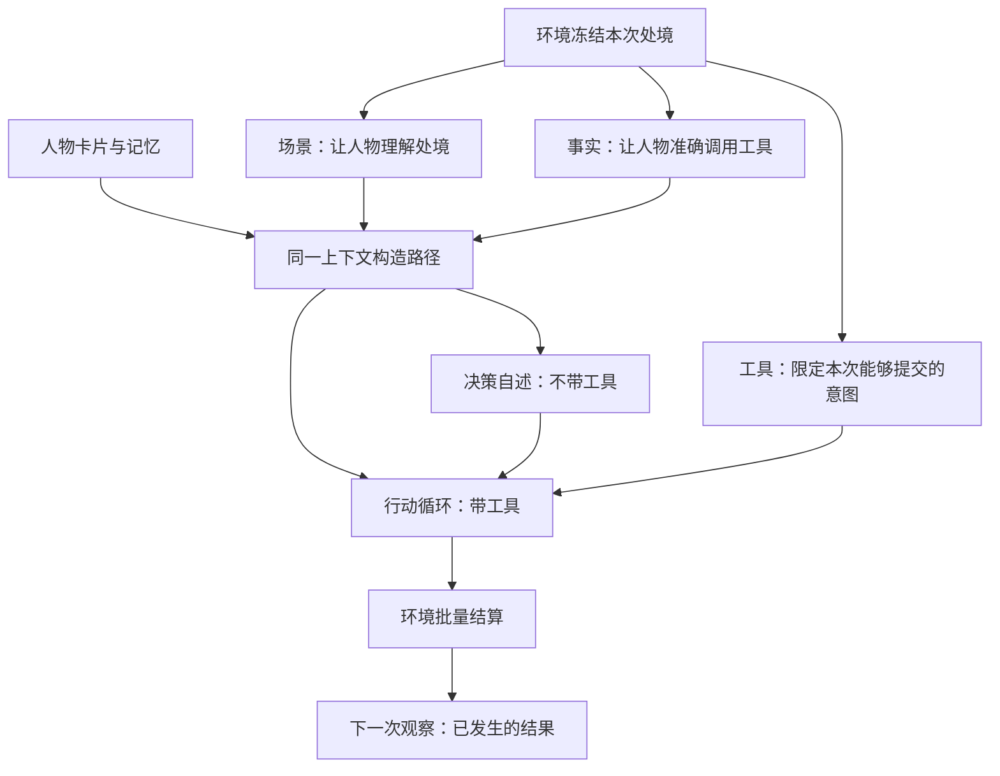
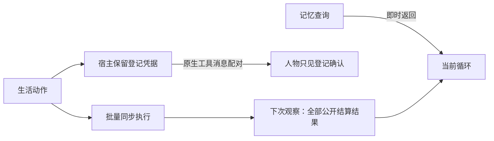
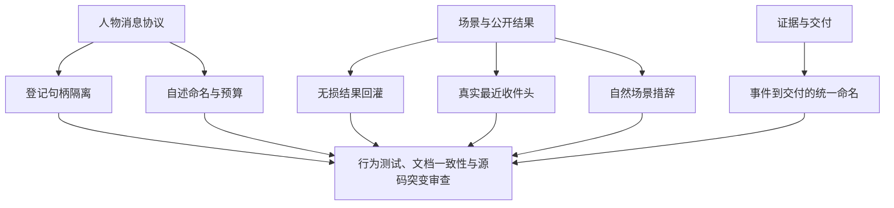
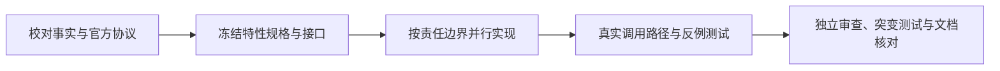

# 决策上下文方案裁决

> 归档：2026-09-20 裁决的决策上下文提案原文，内容未改，仅按新位置调整相对链接。
> 原路径 `docs/dev/PROPOSAL-decision-context.md` 现为[人物 Prompt 与交互修复方案](../PROPOSAL-decision-context.md)。

> 状态：已裁决的设计记录，2026-09-20。
> 开发与验收依据为 [最终特性规格](../SPEC-decision-context.md)，字段依据为 [接口合同](../../CONTRACTS.md)。
> 本文件解释心智模型与取舍，不再保留待裁决行为，也不另定义接口。

## 心智模型与项目框架的映射

### 用户原话

> “并发Fan out subagent，确认PROPOSAL-decision-context.md方案细节并且搜索业界方案验证理论可行性和文件修改清单，修订最终特性开发spec文档，确认文档一致性”
>
> “并发fan out subagent 实现spec描述功能，不允许defer任何待实现内容（通过测试用例保证），且必须遵循spec要求；”

### 项目框架映射

### 诉求的落实

人物需要知道自己是谁、眼下是什么处境、此前那件事究竟如何，然后自主拿主意。
这次开发把这些信息放到正确通道，保留环境对世界的唯一结算权；通过独立审查、实现与反例测试完成闭环。

## 提升后的心智模型

### 业界机制

| 机制 | 采用的部分 | 不适用的部分 |
| --- | --- | --- |
| 原生工具消息配对 | 每个工具调用有匹配的结果消息，保留提供商调用身份 | 删除结果消息会破坏协议；不能把“去掉句柄”理解成“去掉消息” |
| 动态工具选择 | 动作前后与预算变化时，只开放当前合法工具 | 不把普通助手可连续执行多个动作的循环照搬到共享世界 |
| 批量同步执行 | 本轮读取固定版本，收齐后统一更新 | 不把现实网络请求完成误当成模拟世界结算完成 |
| 观察与记忆分离 | 记忆即时可查，环境观察只读，之后通过环境结果更新认识 | 模型叙述不能成为已经成功的世界事实 |

### 裁决后的设计

决策自述和行动是两个阶段，行动本身可以有多个模型回合。
不含查询与纠错的正常路径仍需要自述、动作和 finish 三次请求。
决策自述不是提供商的 thinking；它是会留下证据的一段人物自述。

### 已作出的选择

| 选择 | 收益 | 代价与边界 |
| --- | --- | --- |
| 统一使用“决策自述” | 不再把人物自述与模型思考参数混用 | 调用钩子、事件、清单、指标和交付需要同步更名，旧接口直接删除 |
| 内部句柄留宿主，模型仅见配对登记确认 | 保留审计与原生协议，人物不会把登记当成结果 | 要同时隔离 observation 和 data，不能只清一个字段 |
| 全部新增公开结果回灌 | 不再因五条限制永久丢失结果，能看到返工原因 | 超过提示预算明确失败，不静默丢信息 |
| 场景保留意义、删重复分钟数 | 人物仍能理解地点营业与未完成活动 | 地点名称必须保留以说明营业状态属于谁 |
| 最近收件头与未展示未读提示 | 简短场景与完整事实清单一致 | 邮件正文仍须实际阅读后才能知道 |

这些选择由本次明确授权的方案验证与开发工作作出；理由和被纠正的原提案断言见研究记录。

## 当前实现的差距与闭合方式

### 差距归属

### 差距明细

| 差距名称 | 原实现问题 | 闭合判据 |
| --- | --- | --- |
| 登记句柄隔离 | 完整回执在两处进入模型消息 | 实际后续请求无登记字段，宿主仍保留回执 |
| 自述命名与预算 | 自述名称混杂，只读与预算追加入口不完整 | 全链新名称、各入口边界与超限测试通过 |
| 无损结果回灌 | 截取最早五条且漏掉公开返工原因 | 所有新增结果有序可见，私有细节不可见 |
| 真实最近收件头 | 最早三条被称为最新 | 展示最近三条，只在确有未展示未读项时提示 |
| 自然场景措辞 | 暂停活动书面化，路线分钟重复 | 保留活动进度与营业信息，去除重复分钟 |
| 事件到交付的统一命名 | 字段更名会影响多处消费者 | 事件、指标、清单、dreaming 共同验证 |

### 完成路径

本文件的差距表描述立项基线；最终是否通过以 [实现状态](../implementation-status.md) 的实测记录为准。
证据、可行性与修改边界见 [研究记录](decision-context-feasibility.md)，逐项验收见最终特性规格。
